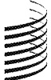
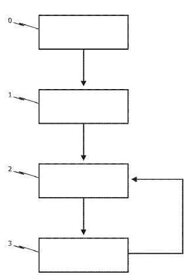
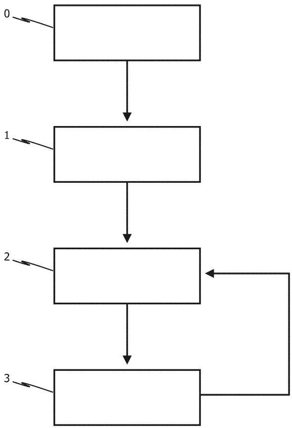
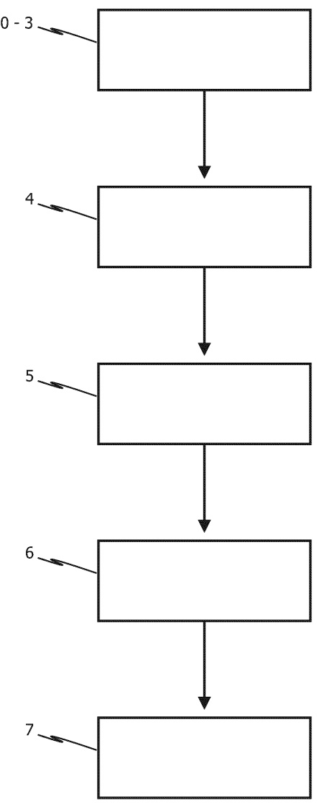

(12) NACH DEM VERTRAG ÜBER DIE INTERNATIONALE ZUSAMMENARBEIT AUF DEM GEBIET DES PATENTWESENS (PCT) VERÖFFENTLICHTE INTERNATIONALE ANMELDUNG

(19) Weltorganisation für geistiges Eigentum

Internationales Büro

(43) Internationales Veröffentlichungsdatum 09. April 2026 (09.04.2026)

(10) Internationale Veröffentlichungsnummer

WIPO | PCT WO 2026/074041 A2

(51) Internationale Patentklassifikation:

Nicht klassifiziert

(21) Internationales Aktenzeichen: PCT/EP2025/078253

(22) Internationales Anmeldedatum:

01. Oktober 2025 (01.10.2025)

(25) Einreichungssprache: Deutsch

(26) Veröffentlichungssprache: Deutsch

(30) Angaben zur Priorität:

10 2024 128 362.9

01. Oktober 2024 (01.10.2024) DE

(71) Anmelder: CERDIA INTERNATIONAL GMBH [CH/CH]; Allschwilerstrasse 10, 4055 Basel (CH).

(72) Erfinder: HUDINA, Josef; Güterstr. 126, 4053 Basel (CH). SCHÜTZ, Eckart; Heuweilerweg 4, 79194 Gundelfingen (DE). HÖLTER, Dirk; Brunnenstr. 3, 79312 Emmendingen (DE).

(74) Anwalt: TRINKS, Ole; Postfach 102605 (Bahnhofstraße 18 1/2, 86150 Augsburg), 86016 Augsburg (DE).

(81) Bestimmungsstaaten (soweit nicht anders angegeben, für jede verfügbare nationale Schutzrechtsart): AE, AG, AL, AM, AO, AT, AU, AZ, BA, BB, BG, BH, BN, BR, BW, BY, BZ, CA, CH, CL, CN, CO, CR, CU, CV, CZ, DE, DJ, DK, DM, DO, DZ, EC, EE, EG, ES, FI, GB, GD, GE, GH, GM, GT, HN, HR, HU, ID, IL, IN, IQ, IR, IS, IT, JM, JO, JP, KE, KG, KH, KN, KP, KR, KW, KZ, LA, LC, LK, LR, LS, LU, LY, MA, MD, MG, MK, MN, MU, MW, MX, MY, MZ, NA, NG, NI, NO, NZ, OM, PA, PE, PG, PH, PL, PT, QA, RO, RS, RU, RW, SA, SC, SD, SE, SG, SK, SL, ST, SV, SY, TH, TJ, TM, TN, TR, TT, TZ, UA, UG, US, UY, UZ, VC, VN, WS, ZA, ZM, ZW.

(84) Bestimmungsstaaten (soweit nicht anders angegeben, für jede verfügbare�regionale Schutzrechtsart): ARIPO (BW, CV, GH, GM, KE, LR, LS, MU, MW, MZ, NA, RW, SC, SD, SL, ST, SZ, TZ, UG, ZM, ZW), eurasisches (AM, AZ, BY, KG, KZ, RU, TJ, TM), europäisches (AL, AT, BE, BG, CH, CY, CZ, DE, DK, EE, ES, FI, FR, GB, GR, HR, HU, IE, IS, IT, LT, LU, LV, MC, ME, MK, MT, NL, NO, PL, PT, RO, RS, SE, SI, SK, SM, TR), OAPI (BF, BJ, CF, CG, CI, CM, GA, GN, GQ, GW, KM, ML, MR, NE, SN, TD, TG).

(54) Title: METHOD AND SYSTEM FOR RECOVERING CELLULOSE ACETATE FROM CELLULOSE ACETATE-CONTAINING POST-CONSUMER MOUTHPIECES AND/OR POST-CONSUMER FILTERS, IN PARTICULAR HT PRODUCTS

(54) Bezeichnung: VERFAHREN UND ANLAGE ZUM RÜCKGEWINNEN VON CELLULOSEACETATAUS CELLULOSEACETATHALTIGEN POST-CONSUMER-MUNDSTÜCKEN UND/ODER POST-CONSUMER-FILTERNINSBESONDEREVON HT-PRODUKTEN

 $ \underline{\text{FIG. 1}} $
 

(57) Abstract: The invention relates to a method for recovering cellulose acetate from cellulose acetate-containing post-consumer mouthpieces and/or post-consumer filters, in particular from HT products. In the method, the post-consumer mouthpieces and/or post-consumer filters, which are used as starting material, are first mechanically pretreated in order to at least partially remove and/or separate foreign substances and/or foreign bodies from the starting material. Subsequently, the pretreated starting material is cleaned by means of a treatment using a cleaning agent in such a way that at least partially remaining impurities are washed off and/or washed out and/or extracted from the pretreated starting material. Optionally, the cleaning agent can be recovered, in particular by means of a distillation process.

(57) Zusammenfassung: Die Erfindung betrifft ein Verfahren zum Rickgewinnen von Celluloseacetat aus celluloseacetathaltigen Post-Consumer-Mundstücken und/oder Post-Consumer-Filtern insbesondere von HT-Produkten. Bei dem Verfahren werden die als Ausgangsmaterial dienden Post-Consumer-Mundstücke und/oder Post-Consumer-Filter zunächst mechanisch vorbehandelt, um zumindest teilweise Fremdstoffe und/oder Fremdkörper von dem Ausgangsmaterial zu entfernen und/oder zu separieren. Anschließend erfolgt eine Reinigung vorbehandelten Ausgangsmaterials durch Behandlung mit einem Reinigungsmittel derart, dass zumindest teilweise verbliebene Verunreinigungen aus dem vorbehandelten Ausgangsmaterial ab- und/oder ausgewaschen und/oder extrahiert werden. Optional kann das Reinigungsmittel wiedergewonnen werden, insbesondere durch Destillation.

##### Veröffentlicht:

— ohne internationalen Recherchenbericht und erneut zu veröffentlichen nach Erhalt des Berichts (Regel 48 Absatz 2 Buchstabe g)

# VERFAHREN UND ANLAGE ZUM RÜCKGEWINNEN VON CELLULOSEACETAT AUS CELLULOSEACETATHALTIGEN POST-CONSUMER-MUNDSTÜCKEN UND/ODER POST-CONSUMER-FILTERN INS BESONDERE VON HT-PRODUKTEN

## Beschreibung

Die vorliegende Erfindung betrifft allgemein das stoffliche Wiederverwenden von celluloseacetathaltigen Materialien.

Insbesondere betrifft die Erfindung eine Anlage sowie ein Verfahren zum stofflichen Wiederverwenden von celluloseacetathaltigen Mundstücken und/oder Filtern insbesondere von HT-Produkten (HT = heated tobacco).

Bei der Herstellung und dem Vertrieb von Mundstücken für Tabakerzeugnisse, insbesondere Filter für Zigaretten oder Mundstücke für HT-Produkte, spielt die Produktverantwortung eine zunehmend höhere Bedeutung. Die Produktverantwortung umfasst sowohl die Entwicklung als auch die Herstellung und das in Verkehr bringen von Erzeugnissen. Das Ziel ist, dass sie ressourcenarm hergestellt, mehrfach verwendbar, technisch langlebig und nach Gebrauch zur ordnungsgemäßen, schadlosen und hochwertigen Verwertung sowie zur umweltverträglichen Beseitigung geeignet sind.

Die erste Priorität in der Hierarchie des Kreislaufwirtschaftsrechts ist und bleibt die Vermeidung. Das Weglassen von Verpackungsmaterialien, das Minimieren von eingesetzten Ressourcen und die Wiederverwendung sparen am meisten Geld, sind also für den Hersteller auch ökonomisch vorzugswürdig. Die zweite Priorität besteht in der möglichst hochwertigen Verwertung – dem Recycling.

Mit einer geeigneten Kreislaufwirtschaftsstrategie kann insbesondere der Klima-wandel minimiert und eine bessere ökologische Nachhaltigkeit erreicht werden, indem der kontinuierliche Verlust der biologischen Vielfalt durch die zunehmende Verschmutzung und andere Umweltbelastungen vermieden wird. Diese Strategie,

die von der Europäischen Commission im März 2020 angenommen wurde, ist ein wichtiger Meilenstein des so genannten „Europäischen Green Deal“.

Dabei geht es insbesondere darum, industrielle bzw. gewerbliche Modelle zu kreieren, in denen Abfälle als angelegte Ressourcen betrachtet werden. Dies liefert nicht nur Kosteneinsparungen und Ertragssteigerungen, sondern kann auch zur Schaffung neuer lokaler Arbeitsplätze beitragen.

Die vorliegende Erfindung betrifft insbesondere das stoffliche Wiederverwenden von celluloseacetathaltigen Mundstücken und/oder Filtern insbesondere von HT-Produkten. Jährlich fallen über 700.000 Tonnen an verwendeten Filtern und/oder Mundstücken von Tabakerzeugnissen an. Problematisch bei dem stofflichen Wiederverwenden dieser Abfälle ist, dass diese aus unterschiedlichen miteinander verbundenen Materialien bestehen, und gemäß dem Verwendungszweck Verunreinigungen enthalten, die zudem giftig sein können.

Es besteht somit insbesondere ein Bedarf nach einer Lösung für ein Verfahren und eine Anlage zum stofflichen Wiederverwenden von celluloseacetathaltigen Mundstücken und/oder Filtern insbesondere von HT-Produkten, um ein recyclinggerechtes Wiederverwenden insbesondere von Celluloseacetat zu ermöglichen. Ziel ist es, die zur Produktion verwendeten Materialien in einem Werkstoffkreislauf zu halten, so dass aus einem Produkt nach der Entsorgung wieder neue Materialien entstehen können. Dieses Ziel soll durch eine entsprechend konzipierte Anlage und Recyclingprozesse erzielt werden.

Somit betrifft die Erfindung insbesondere ein Verfahren zum Rückgewinnen von Celluloseacetat aus celluloseacetathaltigen Post-Consumer-Mundstücken und/oder Post-Consumer-Filtern insbesondere von HT-Produkten. Das Verfahren betrifft jedoch nicht ausschließlich Post-Consumer-Mundstücke und/oder Post-Consumer-Filter von HT-Produkten, sondern auch entsprechende Mundstücke oder Filter von „klassischen“ Rauchwaren, wie insbesondere Zigaretten.

Bei dem erfindungsgemäßen Verfahren werden die als Ausgangsmaterial dienen- den Post-Consumer-Mundstücke und/oder Post-Consumer-Filter zunächst mechanisch vorbehandelt. Die mechanische Vorbehandlung ist derart ausgebildet, dass zumindest teilweise Fremdstoffe und/oder Fremdkörper von dem Ausgangsmaterial entfernt und/oder separiert werden.

Anschließend erfolgt eine Reinigung des vorbehandelten Ausgangsmaterials. Hierzu wird das vorbehandelte Ausgangsmaterial mit einem Reinigungsmittel derart behandelt, dass zumindest teilweise verblieben Verunreinigungen aus dem vorbehandelten Ausgangsmaterial ab- und/oder ausgewaschen und/oder erhielt werden.

Die mechanische Vorbehandlung der als Ausgangsmaterial dienenden Post-Consumer-Mundstücke und/oder Post-Consumer-Filter erfolgt vorzugsweise derart, dass mindestens einer der folgenden Fremdstoffe und/oder Fremdkörper von dem Ausgangsmaterial zumindest teilweise entfernt und/oder separiert wird:

Optional kann das Reinigungsmittel insbesondere durch Destillation wiedergewonnen werden.

Papier oder papierähnliches Material;

• Metall, insbesondere in Gestalt von Heizelementen, wie Induktions-Metallplättchen oder Heizdorne, und/oder in Gestalt von Heizbechern;

Klebstoffe; und

• Tabak.

Insbesondere ist das erfindungsgemäße Verfahren zur Rückgewinnung von Celluloseacetat aus celluloseacetathaltigen Post-Consumer-Mundstücken und/oder Post-Consumer-Filtern geeignet, wobei diese Mundstücke oder Filter mindestens ein Celluloseacetat-Element aufweisen, welches mit einem Papier umhüllt ist.

Dabei erfolgt die mechanische Vorbehandlung insbesondere derart, dass das Papier, welches das mindestens eine Celluloseacetat-Element umhüllt, aufgetrennt wird, insbesondere durch Aufschlitzen an einer oder mehreren Stellen bevorzugt in Längsrichtung des mindestens einen Celluloseacetat-Elements.

Insbesondere erfolgt die mechanische Vorbehandlung derart, dass durch eine ein- oder mehrfach gerichtete Luftströmung Fremdstoffe und/oder Fremdkörper zu- mindest teilweise von dem Celluloseacetat-Element oder den Celluloseacetat-Elementen separiert werden.

In einer Weiterbildung der zuletzt genannten Ausführungsvariante ist vorgesehen, dass vor der mechanischen Vorbehandlung die celluloseacetathaltigen Post-Consumer-Mundstücke und/oder Post-Consumer-Filter zwischen zwei oder mehreren Siebgittern angeordnet werden, deren Maschenweite so ausgewählt ist, dass die Celluloseacetat-Elemente und Fremdstoffe und/oder Fremdkörper der Post-Consumer-Mundstücke und/oder Post-Consumer-Filter nach der mechanischen Vorbehandlung durch die Siebgitter räumlich getrennt und insbesondere nach Größe und Strömungswiderstand klassifiziert sind.

Besonders bevorzugt ist somit vorgesehen, dass zur mechanischen Vorbehandlung die Post-Consumer-Mundstücke und/oder Post-Consumer-Filter oder Komponenten hiervon derart einer ein- oder mehrfach gerichteten Luftströmung ausgesetzt werden, dass zumindest teilweise Fremdstoffe und/oder Fremdkörper von dem Celluloseacetat-Material der Post-Consumer-Mundstücke bzw. Post-Consumer-Filter separiert werden.

Besonders bevorzugt ist in diesem Zusammenhang vorgesehen, dass vor und/oder während der mechanischen Vorbehandlung durch die ein- oder mehr-fach gerichtete Luftströmung die Post-Consumer-Mundstücke und/oder Post-Consumer-Filter, insbesondere durch mechanische Aktoren, einer Walkbewegung ausgesetzt werden, wobei ein Ablauf der Walkbewegung vorzugsweise derart gewählt wird, dass dieser zumindest im Wesentlichen dem Bewegungsablauf bei einer manuellen Separierung entspricht.

Zum Reinigen des vorbehandelten Ausgangsmaterials kommt mindestens ein Reinigungsmittel zum Einsatz, welches geeignet ist, die verbliebenen Verunreinigungen in dem vorbehandelten Ausgangsmaterial zumindest teilweise ab- und auszuwaschen und/oder zu extrahieren.

Besonders bevorzugt weist das Reinigungsmittel ein auf Wasser basierendes Reinigungsmittel auf oder ist ein auf Wasser basierendes Reinigungsmittel.

Alternativ oder zusätzlich hierzu ist das Reinigungsmittel ein auf Kohlenwasserstoff basierendes Reinigungsmittel bzw. weist das Reinigungsmittel ein auf Kohlenwasserstoff basierendes Reinigungsmittel auf, welches vorzugsweise mindestens einen Alkohol, einen Carbonsäureester und/oder einen Ether aufweist.

Besonders bevorzugt ist oder weist das auf Kohlenwasserstoff basierende Reinigungsmittel eines oder mehrere der folgenden Lösungsmittel auf: Methanol, Ethanol, Isopropanol, Diethylether, Methylacetat, Ethylacetat, Isopropylacetat und Butylacetat, insbesondere Methanol, Ethanol und/oder Isopropanol, besonders bevorzugt Methanol und/oder Ethanol.

Gemäß Realisierungen des erfindungsgemäßen Verfahrens wird nach dem Reingen des vorbehandelten Ausgangsmaterials mit dem Reinigungsmittel das Reinigungsmittel zumindest teilweise und vorzugsweise vollständig von den abgewaschenen und/oder extrahierten Verunreinigungen getrennt rückgewonnen, insbesondere durch Destillation. Vorzugsweise wird dabei das rückgewonnene Reinigungsmittel wieder dem Verfahrenschritt der Reinigung zugeführt, insbesondere in einem geschlossenen Kreislauf.

Grundsätzlich ist es bevorzugt, dass der Anteil des noch im gereinigten Ausgangsmaterial verbleibenden Reinigungsmittels durch Trocknung reduziert wird, insbesondere auf einen Gehalt < 1 Gew.-% (bezogen auf die Gesamtmasse des Ausgangsmaterials), wobei das aus dem gereinigten Ausgangsmaterial entfernte Reinigungsmittel vorzugsweise wieder dem Verfahrensschritt der Reinigung zugeführt wird.

Gemäß Weiterbildungen des erfindungsgemäßen Verfahrens ist vorgesehen, dass das gereinigte Ausgangsmaterials in ein Zwischenprodukt, insbesondere in Gestalt von Pellets, umgeformt wird.

In diesem Zusammenhang bietet es sich an, dass zum Umformen des gereinigten Ausgangsmaterials in ein Zwischenprodukt das gereinigte und aufbereitete Ausgangsmaterial in einer Pelletierpresse pelletiert und in Pellets umgewandelt wird, wobei die umgewandelten Pellets eine höhere Dichte als das Ausgangsmaterial aufweisen, und wobei zumindest zeitweise während des Pelletierens eine Kühlung des gereinigten und aufbereiteten Ausgangsmaterials, der Pellets und/oder von Material-Zwischenstufen erfolgt.

Insbesondere werden bei der Kühlung des gereinigten und aufbereiteten Ausgangsmaterials, der Pellets und/oder von Material-Zwischenstufen das gereinigte und aufbereitete Ausgangsmaterial, die Pellets und/oder die Material-

Zwischenstufen unter einer kritischen Temperatur gehalten, wobei die kritische Temperatur einer Verglasungstemperatur von Celluloseacetat entspricht.

Gemäß besonders bevorzugten Realisierungen des erfindungsgemäßen Verfahrens ist vorgesehen, dass das Pelletieren mittels eines Kollers und einer Matrize erfolgt, wobei die Matrize vorzugsweise aus einen thermisch leitfähigen Material ausgebildet ist und die Kühlung vorzugsweise über die Matrize erfolgt.

Vorzugsweise wird das rückgewonnene Celluloseacetat als Rezyklat zur Herstellung eines thermoplastischen Materials, vorzugsweise in Granulatform, verwendet.

Alternativ hierzu wird das rückgewonnene Celluloseacetat insbesondere für Non-Woven-Anwendungen, beispielsweise für Luftfilter, oder thermisches Isoliermaterial, weiterverarbeitet.

In diesem Zusammenhang bietet es sich an, dass das rückgewonnene Celluloseacetat zur Herstellung eines Bi-Komponentengeleges mit Sandwichgeometrie benutzt wird, wobei die Schichten abwechselnd aus dem rückgewonnenen Celluloseacetat und einem anderen Fasermaterial bestehen.

Alternativ hierzu ist es denkbar, dass das rückgewonnene Celluloseacetat in einem anderen Material, insbesondere in frisches Celluloseacetat, kompartimentiert wird.

Hierbei bietet es sich an, dass zum Kompartimentieren rückgewonnenen Celluloseacetatdieses als ein Sandwich-Gelege ausgeführt wird und insbesondere als ein Meldblow-Gelege, wobei die äußeren Lagen des Sandwich-Geleges aus frischem Fasermaterial, insbesondere Celluloseacetat-Material, bestehen oder entsprechendes frisches Fasermaterial aufweisen, während die mittleren Lagen aus dem rückgewonnenen Celluloseacetatbestehen oder das rückgewonnene Celluloseacetatt aufweisen.

Die vorliegende Erfindung betrifft ferner ein Verfahren zur Herstellung eines thermoplastischen Rezykłats, wobei bei diesem Verfahren zunächst Celluloseacetat aus celluloseacetathaltigen Post-Consumer-Mundstücken und/oder

Post-Consumer-Filtern rückgewonnen wird, insbesondere nach einem Verfahren der zuvor beschriebenen Art.

Anschließend erfolgt ein optionales Trocknen des rückgewonnenen Celluloseacetats.

Danach wird das rückgewonnene und optional getrocknete Celluloseacetat in eine Kunststoffaufbereitungsanlage eingebracht, wobei das rückgewonnene und optional getrocknete Celluloseacetat als Hauptpolymermatrix in die Kunststoffaufbereitungsanlage eingebracht wird.

Schließlich erfolgt ein Vermischen des rückgewonnenen und optional getrockneten Celluloseacetat mit wenigstens einem Weichmacher und optional weiteren funktionellen Additiven sowie wahlweise mit Fremd-Polymeren, insbesondere post-consumer, pre-consumer oder post-industrial Polymeren, in der Kunststoffaufbereitungsanlage.

Bei Realisierungen des erfindungsgemäßen Verfahrens zur Herstellung eines thermoplastischen Rezyklats ist vorgesehen, dass nach dem Verfahrensschritt des Vermischens die in dem Verfahrensschritt des Vermischens erzielte Mischung insbesondere unter temperatur- und scheroptimierten Bedingungen derart homogenisiert wird, dass ein homogenisiertes Schmelzgemisch erhalten wird.

Anschließend wird das homogenisierte Schmelzgemisch granuliert oder pelletiert, und zwar derart, dass ein verarbeitungsfähiges thermoplastisches Rezyklat in Granulatform erhalten wird.

Schließlich wird das Rezyklat in mindestens einem Formgebungsverfahren verarbeitet. Bei dem Formgebungsverfahren handelt es sich beispielsweise um ein Extrusions-, Spritzgieß-, Blasform-, Spunbond- oder Meltblow-Verfahren.

Als Weichmacher wird bei der Mischung insbesondere ein Citrat-, Adipat- und/oder Sebacat-Ester in einer Konzentration von vorzugsweise 5 – 45 Gew.-% bezogen auf das Gesamtpolymergemisch eingesetzt.

Das Verhältnis von dem rückgewonnenen und optional getrockneten Celluloseacetat zu Fremd-Polymeren liegt insbesondere im Bereich von 30 : 70 bis 90 : 10 Gew.-% (bezogen auf das Gesamtpolymergemisch).

Gemäß Realisierungen des erfindungsgemäßen Verfahrens ist vorgesehen, dass zum Homogenisieren der in dem Verfahrensschritt des Vermischens erzielten Mischung die Mischung in einem Schmelzcompoundier-Aggregat vorzugsweise mit einem gleich- oder gegenläufigen Doppelschneckenextruder bearbeitet wird.

Hierbei bietet es sich an, dass dem Schmelzcompoundier-Aggregat eine oder mehrere Entgasungszonen zugeordnet ist/sind, in der verbliebene Alkohol- und Wasserdämpfe und flüchtige Nebenprodukte unter Unterdruck aus der Mischung entfernt werden.

Besonders bevorzugt wird dem Rezyklat während des Compoundierens ein Antioxidations- und/oder UV-Stabilisierungssystem zugesetzt, um insbesondere Alterungsbeständigkeit bei der Zweitverwendung zu gewährleisten.

Die Erfindung betrifft insbesondere auch ein thermoplastisches Rezyklat, welches nach einem Verfahren der zuvor genannten erfindungsgemäßen Art erhalten wird, wobei das Rezyklat einen Schmelzindex von 2 – 20 g/10 min (190 °C/2,16 kg) aufweist und mindestens zu 30 Gew.-% aus gereinigtem Celluloseacetat besteht.

Ferner betrifft die Erfindung die Verwendung des zuvor genannten Rezyklats zur Herstellung von Verpackungsfolien, Spritzgussartikeln, Blasform-Hohlkörpern oder Vliesstoffen, wobei die so erhaltenen Produkte nach Gebrauch erneut einem werkstofflichen Recycling zuführbar sind.

Schließlich betrifft die Erfindung eine Anlage zum Rückgewinnen von Celluloseacetat aus celluloseacetathaltigen Post-Consumer-Mundstücken und/oder Post-Consumer-Filtern sowie eine entsprechende Anlage zur Herstellung eines thermoplastischen Rezykłats.

Einzelheiten der Erfindung werden nachfolgend weiter erläutert:

Mechanische Vorbehandlung (Pre-Treatment):

Im Rahmen des erfindungsgemäßen Verfahrens werden die als Ausgangsmaterial dienenden Post-Consumer-Mundstücke und/oder Post-Consumer-Filter zunächst einer gezielten mechanischen Vorbehandlung unterzogen, um Fremdstoffe und/oder Fremdkörper wie Papier, Induktionsplättchen, Klebstoffe, Tabak und andere nicht erwünschte Bestandteile möglichst vollständig und sortenrein vom Celluloseacetat zu trennen. Hierbei ist es wesentlich, dass die Mundstücke und/oder Filter möglichst sauber und sortenrein eingesammelt werden. Eine Vorwäsche oder Zerkleinerung (z. B. Schreddern) des Materials findet dabei ausdrücklich nicht statt.

Die mechanische Vorbehandlung erfolgt vorzugsweise in mehreren, aufeinander abgestimmten Schritten: Zunächst werden die Filter mittels einer speziellen Vorrichtung oder in einer vollautomatisierten Handlingsanlage aufgeschlätzt, so dass das in der Regel aus Papier bestehende, die Celluloseacetat-Elemente umhüllende Material aufgetrennt wird. Dieses Auftrennen erfolgt vorzugsweise durch ein Aufschlitzen, dies kann an verschiedenen Stellen erfolgen, insbesondere in Längsrichtung des zylindrischen Gebildes und an einer oder mehreren Stellen, bevorzugt an zwei bis vier Stellen.

Beim Aufschlitzen wird die Umhüllung der Celluloseacetat-Elemente nach Möglichkeit in Ihrer gesamten Dicke durchtrennt, während die Celluloseacetat-Elemente nicht durchtrennt werden, um nach einem Wegfall der Umhüllung möglichst Ihre Größe beizubehalten.

In einem weiteren Schritt werden die zuvor vereinzelt vorliegenden Mundstücke und/oder Filter zwischen zwei oder mehreren Siebgittern durch eine gerichtete Luftströmung weitgehend von anhaftenden Papier- und Tabakresten sowie anderen Fremdkörpern und Fremdstoffen befreit. Hierzu kommt Druckluft oder eine Luftgebläsevorrichtung mit feststehenden und variabel angeordneten Luftdüsen zum Einsatz. Die Luftströmung kann einfach oder mehrfach gerichtet sein. Dabei wird die Maschenweite der Siebgitter so ausgewählt, dass die Celluloseacetat-Elemente und die Fremdstoffe und/oder Fremdkörper nach der Vorbehandlung durch die Siebgitter räumlich getrennt, d.h. nach Größe und Strömungswiderstand klassifiziert, sind.

Vor oder während der mechanischen Vorbehandlung durch eine ein- oder mehr-fach gerichtete Luftströmung, können die Post-Consumer-Mundstücke und/oder Post-Consumer-Filter Walkbewegungen durch mechanischen Aktoren ausgesetzt werden, die bereits zu einem teilweisen Ablösen der Fremdstoffe und/oder Fremdkörper führen und/oder diese in eine bessere Position zur Separierung mit Luftströmung bringen.

Die Separierung der Bestandteile erfolgt vollautomatisch und beruht sowohl auf den hohen Scherkräften der Luftströmung als auch auf Druckschwankungen infolge des Bernoulli-Effekts. Dadurch wird ein Unterdruck erzeugt, der Partikel zuverlässig ablöst, deren Abtransport fördert und eine Wiederanhaftung an den Filterflächen verhindert.

Wie zahlreiche manuelle Versuche gezeigt haben, ist diese Vorgehensweise äußerst effektiv, kostengünstig, leicht automatisierung und liefert Ergebnisse, die in Bezug auf Sauberkeit und Sortenreinheit den bisher bekannten und/oder angedachten Alternativen wie dem Schreddern und/oder dem Waschen und Ablösen in wässrigen Medien deutlich überlegen sind. Dies zeigt sich insbesondere daran das signifikant weniger Tabakreste und andere Nicht-Celluloseacetat-Partikel in die Struktur der Celluloseacetat-Elemente eindringen, aus denen diese später kaum noch zu entfernen sind.

Die so zunächst rein mechanisch vereinzelten und gereinigten Celluloseacetat-Elemente werden anschließend dem nachfolgend beschriebenen Reinigungs- bzw. Waschprozess zugeführt.

Das Endergebnis übertrifft in zahlreichen Versuchen alle bisherigen vergleichbaren Methoden und kann mit überschaubarem Aufwand vollautomatisiert durch Vorrichtungen und Sondermaschinen für die regionale und lokale Rückgewinnung des wertvollen Biopolymers für die Serienproduktion erschlossen werden.

#### Weiterer Prozessverlauf:

Nach der mechanischen Vorbehandlung wird das aufbereitete Ausgangsmaterial von den an und im celluloseacetathaltigen Material verblieben Verunreinigungen gereinigt. Dabei kommt vorzugsweise eine Behandlung mit einem

Reinigungsmittel zum Einsatz, das geeignet ist insbesondere die verbliebenen Verunreinigungen abzuwaschen oder zu extrahieren.

Dies kann ein Reinigungsmittel auf wässriger Basis sein, aber auch ein auf Kohlenwasserstoff basierendes Reinigungsmittel, welches vorzugsweise einen Alkohol, einen Carbonsäureester oder einen Ether aufweist.

Bevorzugt weist das auf Kohlenwasserstoff basierende Reinigungsmittel eines oder mehrere der Lösungsmittel Methanol, Ethanol, Isopropanol, Diethylether, Methylacetat, Ethylacetat, Isopropylacetat und Butylacetat auf, insbesondere Methanol, Ethanol und/oder Isopropanol, besonders bevorzugt Methanol und/oder Ethanol.

Die Reinigung kann dabei beispielsweise nach dem Verfahren einer kontinuierlichen Fest-Flüssig-Extraktion erfolgen.

Die Verwendung eines nichtwässrigen Reinigungsmittels hat den Vorteil, dass bei der Rückgewinnung von Celluloseacetat aus celluloseacetathaltigen Post-Consumer-Mundstücken und/oder Post-Consumer-Filtern keine große Mengen kontaminierten Wassers anfallen, dass sich nur aufwendig wieder reinigen lässt. Insbesondere ist es in diesem Zusammenhang denkbar, dass nach dem Behandeln des celluloseacetathaltigen Materials mit dem Reinigungsmittel dieses in einem geschlossenen Kreislauf, insbesondere durch Destillation, aufbereitet und wieder dem Rückgewinnungsprozess zugeführt wird.

Filter oder Mundstücke enthalten, wenn sie bereits verwendet wurden, je nach Tabakerzeugnis eine Vielzahl von chemischen Stoffen, die das Potential haben, krebserregend oder erbgutverändernd und damit hochgiftig zu sein. Einige dieser Stoffe sind beispielsweise Nikotin und seine Derivate, Phenole und polyzyklische aromatische Kohlenwasserstoffe (PAK).

Von daher ist es notwendig, dass bei dem erfindungsgemäßen Verfahren eine entsprechende Aufbereitung/Reinigung stattfindet, damit das recyclete Material unbedenklich wiederverwendet werden kann, so dass insbesondere nicht mehr die genannten chemischen Stoffe austreten können.

Das noch im gereinigten Ausgangsmaterial verbliebene Reinigungsmittel wird durch Trocknung reduziert, insbesondere auf einen Gehalt < 1 %, und das aus dem gereinigten Ausgangsmaterial entfernte Reinigungsmittel bevorzugt wieder dem Verfahrenschritt der Reinigung zugeführt wird.

Bei Bedarf wird das gereinigte Ausgangsmaterial für die weitere Verarbeitung in ein Zwischenprodukt umgeformt, wobei es sich bei dem Zwischenprodukt insbesondere um ein pelletförmiges Zwischenprodukt handelt.

Nach der Reinigung wird das nach dem patentgemäßen Verfahren gewonnene sortenreine Celluloseacetat-Rezyklat vornehmlich für zwei Hauptanwendungen vorbereitet:

Hauptanwendung 1: Compoundierung - Aufbereitung zu einem Thermoplastischen Material in Granulatform, bestehend aus:

a) einem sortenreinen Post-Consumer Celluloseacetat-Rezyklat; und/oder

b) einem sortenreinen Post-Consumer Celluloseacetat-Rezyklat unter Zugabe von Weichmachern, Additiven und Füllstoffen; und/oder

c) einem Post-Consumer Celluloseacetat-Rezyklat unter Zugabe von Weichmachern, Additiven und Füllstoffen sowie Pre-Consumer und/oder Post-Industrial Celluloseacetat-Rezvklaten: und/oder

d) einem Post-Consumer Celluloseacetat-Rezyklat unter Zugabe von Weichmachern, Additiven und Füllstoffen sowie frischem Cellulose Acetat; und/oder

e) einem Post-Consumer Celluloseacetat-Rezyklat unter Zugabe von Weichmachern, Additiven und Füllstoffen sowie weiteren kompatiblem Polymeren, wobei vornehmlich Biopolymere Einsatz finden.

Dabei wird das gereinigte Polymer komponiert, um ein reines, wiederverw์bares Rezyklat herzustellen. Dies erfolgt bevorzugt durch einen kontinuierlichen Prozess wie der Extrusion, kann jedoch alternativ auch diskontinuierlich mittels eines Batch-Verfahrens erfolgen, bei dem das Material plastifiziert, die Polymerschmelze homogenisiert und unter Zugabe von Zusatzstoffen komponiert wird.

Das resultierende Rezyklat hat ähnliche physikalische und chemische Eigenschaften wie unter Verwendung eines frischen Celluloseacetats hergestellten Compounds. Daher ist das Rezyklat nahezu gleichwertig zu einem Compound basierend auf frischem Celluloseacetat für eine Vielzahl von Anwendungen geeignet.

Alternativ kann das gereinigte Polymer mit einer Mischung aus Weichmachern, Additiven und anderen kompatiblen Polymeren vermeigt werden. Diese zusätzlichen Materialien können entweder neu (frisch) oder ebenfalls wiedergewonnen sein. Durch die gezielte Auswahl und Dosierung dieser Zusatzstoffe wird ein neuntiges Compound geschaffen, das spezifische Eigenschaften aufweist, die für Second Life-Anwendungen optimiert sind, z.B. verbesserte Flexibilität, UV-Beständigkeit oder Schlagzähigkeit.

Das hergestellte Compound kann an die Anforderungen verschiedener Anwendungen angepasst werden, beispielsweise für den Einsatz in der Automobilindustrie, im Bauwesen oder in Konsumgütern. Dabei bleibt die Qualität des Ausgangsmaterials durch das gesamte Verfahren hindurch erhalten, sodass das Rezyklat den technischen Anforderungen von Neuware entspricht.

Der Compound kann mit den für thermoplastische Materialien üblichen Verfahren weiterverarbeitet werden. Dazu gehören Extrusion, Spritzgießen, Blasformen, Thermoformen, Rotationsformen, Kalanderverfahren, Pultrusion und 3D-Druck.

Hauptanwendung 2: Wiederverwendung von gereinigten Post- Consumer-Cellulo-Seacetatfasern als Baustein und Füllstoff in nicht gewebten Sandwichstoffen:

Alternativ zu oder zusätzlich zur Hauptanwendung 1 ist es aber auch möglich, das Ausgangsmaterial mit einem anderen Material, insbesondere in frisches Cellulose-acetat zu kompartimentieren. Das Bi-Komponentengelege weist eine Sandwich-Geometrie auf, wobei die Schichten abwechselnd aus dem frischen Material bestehen und sich mit einer oder mehreren Lagen aus dem aufbereiteten Ausgangsmaterial abwechseln.

Bei dieser Anwendung eignet sich das so erzielte Fasermaterial insbesondere für Non-Woven-Anwendungen, beispielsweise für Luftfilter, oder thermisches Isoliermaterial.

Anstelle eines Bi-Komponenten-Sandwichgeleges aus Post-Consumer-Fasern und Frischen Non-Woven-Lagen sind aber auch andere Kompartimentierungen des Ausgangsmaterials mit Pre-Consumer bzw. Post-Industrial Celluloseacetat-Gelegen denkbar.

Eine solche Kompartimentierung hat den Vorteil, dass das Ausgangsmaterial nicht oder nur geringfügig aufbereitet und insbesondere gereinigt werden muss.

Insbesondere ist es denkbar, ein insbesonderes Meltblown-Gelege beispielsweise für ein Non-Woven-Produkt, wie etwa für eine Filtermatte, als Sandwich-Gelege auszuführen, wobei die äußeren Lagen aus dem frischen Celluloseacetat-Material bestehen, während die mittlere Lage aus dem aufbereiteten Ausgangsmaterial besteht.

Gemäß Realisierungen des erfindungsgemäßen Verfahrens ist vorgesehen, dass das gereinigte Ausgangsmaterial in einer Pelletierpresse pelletiert und in Pellets umgewandelt wird. Diese Pellets dienen dann als Zwischenprodukt.

Die umgewandelten Pellets weisen insbesondere eine höhere Dichte als das Ausgangsmaterial auf.

In diesem Zusammenhang ist es von Vorteil, dass zumindest zeitweise während des Pelletierens eine Kühlung des gereinigten und aufbereiteten Ausgangsmaterials, der Pellets und/oder von entsprechenden Material-Zwischenstufen erfolgt.

Das so gewonnene insbesondere pelletförmige Zwischenprodukt kann anschließend in ein Endprodukt weiterentwickelt werden.

Das erfindungsgemäße Verfahren bildet demzufolge ein sehr vorteilhaftes Recycling von Bestandteilen von Zigaretten- oder HT-Abfällen bzw. Zigaretten- oder HT-Mundstück- und Filtermaterialien, bei dem praktisch das gesamte ursprünglich vorhandene Celluloseacetat in aufgereinigter Form wiedergewonnen wird.

Die Erfindung betrifft ferner eine entsprechende Anlage zum Rückgewinnen von Celluloseacetat aus celluloseacetathaltigen Post-Consumer-Mundstücken und/oder Post-Consumer-Filtern insbesondere von HT-Produkten.

Die erfindungsgemäße Anlage weist insbesondere eine Aufbereitungssstation mechanischen Vorbehandlung der als Ausgangsmaterial dienenden Celluloseacetat-haltigen Mundstücke und/oder Filter, um Fremdstoffe und/oder fremdkörper von dem Ausgangsmaterial zu separieren und/oder zu entfernen, eine Reinigungsstation zum Reinigen des aufbereiteten Ausgangsmaterials, und gegebenenfalls eine Umformungsstation auf zum Umformen des gereinigten und aufbereiteten Ausgangsmaterials in ein Granulat.

Denkbar in diesem Zusammenhang ist es, dass die Aufbereitungsstation folgende Unterstation aufweist:

eine Trennstation zum Separieren und/oder Entfernen von vorhandenem Papier und Klebstoffen, zum Separieren und/oder Entfernen von ggf. in dem Ausgangsmaterial vorhandenen Induktions-Metallplättchen und/oder zum Separieren und/oder Entfernen von ggf. in dem Ausgangsmaterial vorhandenen Tabakkontaminationen: und/oder

eine Reinigungsstation; und/oder

eine Umformungsstation.

Insbesondere ist die Reinigungsstation ausgebildet, das aufbereitete Ausgangsmaterial unter Verwendung eines Reinigungsmittels zu reinigen. In diesem Zusammenhang bietet es sich an, dass die Reinigungsstation ausgebildet ist, das aufbereitete Ausgangsmaterial unter Verwendung von einem Reinigungsmittel, insbesondere einem auf Kohlenwasserstoff basierendem Reinigungsmittel, welches einen Alkohol, einen Carbonsäureester oder einen Ether aufweist, zu reinigen. Bevorzugt weist das auf Kohlenwasserstoff basierende Reinigungsmittel eines oder mehrere der Lösungsmittel Methanol, Ethanol, Isopropanol, Diethylether, Methylacetat, Ethylacetat, Isopropylacetat und Butylacetat auf, insbesondere Methanol, Ethanol und/oder Isopropanol, besonders bevorzugt Methanol und/oder Ethanol.

In einer Weiterbildung dieser Ausführungsvariante ist vorgesehen, dass die Anlage ferner eine Rückgewinnungseinrichtung aufweist, welche ausgebildet ist, nach dem Behandeln des Ausgangsmaterials mit dem Reinigungsmittel dieses in einem geschlossenen Kreislauf insbesondere durch Destillation aufzubereiten und wieder dem Rückgewinnungsverfahren zuzuführen.

Gemäß Realisierungen der erfindungsgemäßen Anlage weist die Umformungsstation mindestens eine Pelletierpresse auf, welche ausgebildet ist, das gereinigte und aufbereitete Ausgangsmaterial zu pelletieren und in Pellets umzuwandeln, wobei die umgewandelten Pellets eine höhere Dichte als das Ausgangsmaterial aufweisen, und wobei zumindest zeitweise während des Pelletierens eine Kühlung des gereinigten und aufbereiteten Ausgangsmaterials, der Pellets und/oder von Material-Zwischenstufen erfolgt.

Nachfolgend wird unter Bezugnahme auf die beiliegenden Zeichnungen die Erfindung näher beschrieben.

Es zeigen:

FIG. 1 schematisch ein Ablaufdiagramm einer exemplarischen Ausführungsform des erfindungsgemäßen Verfahrens zum Rückgewinnen von Celluloseacetat aus celluloseacetathaltigen Post-Consumer-Mundstücken und/oder Post-Consumer-Filtern; und

FIG. 2 schematisch ein Ablaufdiagramm zur Erläuterung einer exemplarischen Ausführungsform des erfindungsgemäßen Verfahrens zur Herstellung eines thermoplastischen Rezykłats.

In FIG. 1 ist schematisch ein Ablaufdiagramm zur Erläuterung einer exemplarischen Ausführungsform des erfindungsgemäßen Verfahrens zum Rückgewinnen von Celluloseacetat aus celluloseacetathaltigen Post-Consumer-Mundstücken und/oder Post-Consumer-Filtern gezeigt.

In dem ersten Verfahrensschritt werden die zu recyclenden celluloseacetathaltigen Post-Consumer-Mundstücke bzw. Post-Consumer-Filter bereitgestellt (Verfahrensschritt 0).

Anschließend wird im Verfahrensschritt 1 das bereitgestellte Material mechanisch vorbehandelt, um zumindest teilweise Fremdstoffe und Fremdkörper von dem Ausgangsmaterial zu entfernen bzw. zu separieren.

In dem dann folgenden Verfahrensschritt 2 wird das vorbehandelte Ausgangsmaterial durch Behandlung mit einem Reinigungsmittel derart gereinigt, dass zumindest teilweise verbliebene Verunreinigungen aus dem vorbehandelten Ausgangsmaterial ab- und/oder ausgewaschen und/oder extrahiert werden.

Anschließend kann das Reinigungsmittel wiedergewonnen werden, insbesondere durch Destillation ( $ \underline{\text{Verfahrensschritt 3}} $).

In FIG. 2 ist schematisch ein Ablaufdiagramm gezeigt zur Erläuterung einer exemplarischen Ausführungsform des erfindungsgemäßen Verfahrens zur Herstellung eines thermoplastischen Rezykłats.

Zunächst wird Celluloseacetat aus celluloseacetathaltigen Post-Consumer-Mundstücken und/oder Post-Consumer-Filtern rückgewonnen. Dies erfolgt vorzugsweise mit einem Verfahren, wie es in dem Ablaufdiagramm gemäß FIG. 1 gezeigt ist ( $ \underline{\text{Verfahrensschritte 0 bis 3}} $).

Anschließend erfolgt ein optionales Trocknen des rückgewonnenen Cellulose-acetats ( $ \underline{\text{Verfahrensschritt 4}} $).

Danach wird das rückgewonnene und optional getrocknete Celluloseacetat in eine Kunststoffaufbereitungsanlage eingebracht und dort mit einem oder mehreren Weichmachern sowie gegebenfalls weiteren Zuschlagsstoffen wie Additiven, Verstärkungsmitteln oder Füllstoffen vermischt (Verfahrensschritt 5).

Nach dem Vermischen erfolgt eine Homogenisierung der Mischung derart, dass ein homogenisiertes Schmelzgemisch erhalten wird (Verfahrensschritt 6). Danach wird das homogenisierte Schmelzgemisch derart granuliert oder pelletiert, dass ein verarbeitungsfähiges thermoplastisches Rezyklat in Granulatform erhalten wird (Verfahrensschritt 7).

Anschließend kann ein Verarbeiten des Rezykłats in mindestens einem Formgebungsverfahren erfolgen.

Die Erfindung ist nicht auf die in den Zeichnungen gezeigten Ablaufdiagramme beschränkt, sondern ergibt sich aus einer Zusammenschau sämtlicher hierin offenbarter Merkmale.

# VERFAHREN UND ANLAGE ZUM RÜCKGEWINNEN VON CELLULOSEACETAT AUS CELLULOSEACETATHALTIGEN POST-CONSUMER-MUNDSTÜCKEN UND/ODER POST-CONSUMER-FILTERN INS BESONDERE VON HT-PRODUKTEN

### Patentansprüche

## 1. Verfahren zum Rückgewinnen von Celluloseacetat aus

celluloseacetathaltigen Post-Consumer-Mundstücken und/oder Post-Consumer-Filtern insbesondere von HT-Produkten, wobei das Verfahren die folgenden Verfahrensschritte aufweist:

Reinigen des vorbehandelten Ausgangsmaterials durch Behandlung mit einem Reinigungsmittel derart, dass zumindest teilweise verbliebene Verunreinigungen aus dem vorbehandelten Ausgangsmaterial abund/oder ausgewaschen und/oder extrahiert werden; und

- mechanische Vorbehandlung der als Ausgangsmaterial dienenden Post-Consumer-Mundstücke und/oder Post-Consumer-Filter, um zumindest teilweise Fremdstoffe und/oder Fremdkörper von dem Ausgangsmaterial zu entfernen und/oder zu separieren;

optional Wiedergewinnen des Reinigungsmittels, insbesondere durch Destillation.

2. Verfahren nach Anspruch 1,

wobei bei der mechanischen Vorbehandlung der als Ausgangsmaterial dienenden Post-Consumer-Mundstücke und/oder Post-Consumer-Filter mindestens einer der folgenden Fremdstoffe und/oder Fremdkörper von dem Ausgangsmaterial entfernt und/oder separiert wird:

- Papier oder papierähnliches Material;

- Metall, insbesondere in Gestalt von Heizelementen, wie Induktions-Metallplättchen oder Heizdorne, und/oder in Gestalt von Heizbechern;

Klebstoffe; und

Tabak.

3. Verfahren nach Anspruch 1 oder 2,

wobei die celluloseacetathaltigen Post-Consumer-Mundstücke und/oder Post-Consumer-Filter mindestens ein Celluloseacetat-Element aufweisen, welches mit einem Papier umhüllt ist, wobei die mechanische Vorbehandlung derart erfolgt, dass das Papier, welches das mindestens eine Celluloseacetat-Element umhüllt, aufgetrennt wird, insbesondere durch Aufschlitzen an einer oder mehreren Stellen bevorzugt in Längsrichtung des mindestens einen Celluloseacetat-Elements.

4. Verfahren nach einem der Ansprüche 1 bis 3 und insbesondere nach Anspruch 3, wobei die celluloseacetathaltigen Post-Consumer-Mundstücke und/oder Post-Consumer-Filter mindestens ein Celluloseacetat-Element aufweisen, welches mit einem Papier umhüllt ist, wobei die mechanische Vorbehandlung derart erfolgt, dass durch eine ein- oder mehrfach gerichtete Luftströmung Fremdstoffe und/oder Fremdkörper zumindest teilweise von dem Celluloseacetat-Element oder den Celluloseacetat-Elementen separiert werden.

5. Verfahren nach Anspruch 4,

wobei zur mechanischen Vorbehandlung mit Luftströmung die

celluloseacetathaltigen Post-Consumer-Mundstücke und/oder Post-

Consumer-Filter zwischen zwei oder mehreren Siebgittern angeordnet

werden, deren Maschenweite so ausgewählt ist, dass die Celluloseacetat-

Elemente und Fremdstoffe und/oder Fremdkörper nach der Vorbehandlung

durch die Siebgitter räumlich getrennt und insbesondere nach Größe und

Strömungswiderstand klassifiziert sind.

6. Verfahren nach einem der Ansprüche 1 bis 5,

wobei zur mechanischen Vorbehandlung die Post-Consumer-Mundstücke und/oder Post-Consumer-Filter oder Komponenten hiervon derart einer ein- oder mehrfach gerichteten Luftströmung ausgesetzt werden, dass zumindest teilweise Fremdstoffe und/oder Fremdkörper von dem Celluloseacetat-Material separiert werden.

## 7. Verfahren nach Anspruch 6,

wobei vor und/oder während der mechanischen Vorbehandlung durch die ein- oder mehrfach gerichtete Luftströmung die Post-Consumer- Mundstücke und/oder Post-Consumer-Filter, insbesondere durch mechanische Aktoren, einer Walkbewegung ausgesetzt werden, wobei ein Ablauf der Walkbewegung vorzugsweise derart gewählt wird, dass dieser zumindest im Wesentlichen dem Bewegungsablauf bei einer manuellen Separierung entspricht.

8. Verfahren nach einem der Ansprüche 1 bis 7,

wobei zum Reinigen des vorbehandelten Ausgangsmaterials mindestens ein

Reinigungsmittel zum Einsatz kommt, dass geeignet ist, die verbliebenen

Verunreinigungen zumindest teilweise ab- und auszuwaschen und/oder zu

extrahieren.

9. Verfahren nach Anspruch 8,

wobei das Reinigungsmittel ein auf Wasser basierendes Reinigungsmittel aufweist oder ist.

10. Verfahren nach Anspruch 8 oder 9,

wobei das Reinigungsmittel ein auf Kohlenwasserstoff basierendes

Reinigungsmittel aufweist oder ist, welches vorzugsweise mindestens einen

Alkohol, einen Carbonsäureester und/oder einen Ether aufweist.

wobei das auf Kohlenwasserstoff basierende Reinigungsmittel eines oder mehrere der folgenden Lösungsmittel ist oder eines oder mehrere der folgenden Lösungsmittel aufweist: Methanol, Ethanol, Isopropanol, Diethylether, Methylacetat, Ethylacetat, Isopropylacetat und Butylacetat aufweist, insbesondere Methanol, Ethanol und/oder Isopropanol, besonders bevorzugt Methanol und/oder Ethanol.

11. Verfahren nach Anspruch 10.

12. Verfahren nach einem der Ansprüche 1 bis 11,

wobei nach dem Reinigen des vorbehandelten Ausgangsmaterials mit dem

Reinigungsmittel das Reinigungsmittel zumindest teilweise und

vorzugsweise vollständig getrennt von den abgewaschenen und/oder

extrahierten Verunreinigungen rückgewonnen wird, insbesondere durch Destillation.

13. Verfahren nach Anspruch 12.

wobei das rückgewonnene Reinigungsmittel wieder dem Verfahrensschritt der Reinigung zugeführt wird, insbesondere in einem geschlossenen Kreislauf.

wobei der Anteil des noch im gereinigten Ausgangsmaterial verbleibenden Reinigungsmittels durch Trocknung reduziert wird, insbesondere auf einen Gehalt  $ < $ 1 Gew.-%, und wobei das aus dem gereinigten Ausgangsmaterial entfernte Reinigungsmittel vorzugsweise wieder dem Verfahrensschritt der Reinigung zugeführt wird.

14. Verfahren nach Anspruch 1 bis 13,

15. Verfahren nach einem der Ansprüche 1 bis 14,

wobei das gereinigte Ausgangsmaterials in ein Zwischenprodukt,

insbesondere in Gestalt eines Pellets, umgeformt wird.

16. Verfahren nach Anspruch 15,

wobei zum Umformen des gereinigten Ausgangsmaterials in ein Zwischenprodukt das gereinigte und aufbereitete Ausgangsmaterial in einer Pelletierpresse pelletiert und in Pellets umgewandelt wird, wobei die umgewandelten Pellets eine höhere Dichte als das Ausgangsmaterial aufweisen, und wobei zumindest zeitweise während des Pelletierens eine Kühlung des gereinigten und aufbereiteten Ausgangsmaterials, der Pellets und/oder von Material-Zwischenstufen erfolgt.

17. Verfahren nach Anspruch 16.

wobei bei der Kühlung des gereinigten und aufbereiteten Ausgangsmaterials, der Pellets und/oder von Material-Zwischenstufen das gereinigte und aufbereitete Ausgangsmaterial, die Pellets und/oder die Material-Zwischenstufen unter einer kritischen Temperatur gehalten werden, wobei die kritische Temperatur einer Verglasungstemperatur von Celluloseacetat entspricht.

18. Verfahren nach Anspruch 16 oder 17.

wobei das Pelletieren mittels eines Kollers und einer Matrize erfolgt, wobei die Matrize vorzugsweise aus einen thermisch leitfähigen Material ausgebildet ist und die Kühlung vorzugsweise über die Matrize erfolgt.

19. Verfahren nach einem der Ansprüche 1 bis 18,

wobei das rückgewonnene Celluloseacetat als Rezyklat zur Herstellung eines thermoplastischen Materials, vorzugsweise in Granulatform, verwendet wird.

20. Verfahren nach einem der Ansprüche 1 bis 18,

wobei das rückgewonnene Celluloseacetat insbesondere für Non-Woven-

Anwendungen, beispielsweise für Luftfilter oder für thermisches Isolierma-

terial, weiterverarbeitet wird.

21. Verfahren nach Anspruch 20,

21. Verfahren nach Anspruch 20,

wobei das rückgewonnene Celluloseacetat zur Herstellung eines Bi-Komponentengeleges mit Sandwichgeometrie benutzt wird, wobei die Schichten abwechselnd aus dem rückgewonnenen Celluloseacetat und einem anderen Fasermaterial bestehen.

22. Verfahren nach einem der Ansprüche 1 bis 18,

wobei das rückgewonnene Celluloseacetat in einem anderen Material,

insbesondere in frisches Celluloseacetat, kompartimentiert wird.

23. Verfahren nach Anspruch 22,

wobei zum Kompartimentieren des rückgewonnenen Celluloseacetats dieses als ein Sandwich-Gelege ausgeführt wird und insbesondere als ein Meltblown-Gelege, wobei die äußeren Lagen des Sandwich-Geleges aus frischem Fasermaterial, insbesondere Celluloseacetat-Material, bestehen oder frisches Fasermaterial, insbesondere Celluloseacetat-Material, aufweisen, während die mittlere Lage aus dem Rezyklat besteht oder das Rezyklat aufweist.

24. Verfahren zur Herstellung eines thermoplastischen Rezykłats, wobei das Verfahren folgende Verfahrensschritte aufweist:

Rückgewinnen von Celluloseacetat aus celluloseacetathaltigen Post-Consumer-Mundstücken und/oder Post-Consumer-Filtern insbesondere von HT-Produkten mit einem Verfahren nach einem der Ansprüche 1 bis 23;

optional Trocknen des rückgewonnenen Celluloseacetats;

Einbringen des rückgewonnenen und optional getrockneten Cellulose-seacetats in eine Kunststoffaufbereitungsanlage, wobei das rückgewonnene und optional getrocknete Celluloseacetat als Hauptpolymermatrix in die Kunststoffaufbereitungsanlage eingebracht wird; und

- Vermischen des rückgewonnenen und optional getrockneten Cellulo-seacetats mit wenigstens einem Weichmacher und optional weiteren funktionellen Additiven sowie wahlweise mit Fremd-Polymeren, insbesondere Post-Consumer-, Pre-Consumer- oder Post-Industrial-Polymeren, in der Kunststoffaufbereitungsanlage.

## 25. Verfahren nach Anspruch 24.

wobei das Verfahren ferner folgende Verfahrensschritte nach dem Verfahrensschritt des Vermischens aufweist:

Homogenisieren der in dem Verfahrensschritt des Vermischens erzielten Mischung insbesondere unter temperatur- und scheroptimierten Bedingungen derart, dass ein homogenisiertes Schmelzgemisch erhalten wird;

Granulieren oder Pelletieren des homogenisierten Schmelzgemisches derart, dass ein verarbeitungsfähiges thermoplastisches Rezyklat in Granulatform erhalten wird; und

Verarbeiten des Rezykłats in mindestens einem Formgebungsverfahren insbesondere ausgewählt aus Extrusion, Spritzgießen, Blasformen, Spunbond- oder Meltblown-Technik zu Second-Life-Produkten.

## 26. Verfahren nach Anspruch 24 oder 25,

wobei als Weichmacher ein Triglycerid, ein Citrat-, Adipat- und/oder Sebacat-Ester in einer Konzentration von 5 – 45 Gew.-% bezogen auf das Gesamtpolymergemisch eingesetzt wird.

27. Verfahren nach einem der Ansprüche 24 bis 26,

wobei das Verhältnis von dem rückgewonnenen und optional getrockneten

Celluloseacetat zu Fremd-Polymeren im Bereich von 30 : 70 bis 90 : 10

Gew.-% (bezogen auf das Gesamtpolymergemisch) liegt.

28. Verfahren nach einem der Ansprüche 25 bis 27,

wobei zum Homogenisieren der in dem Verfahrensschritt des Vermischens erzielten Mischung die Mischung in einem Schmelzcompoundier-Aggregat vorzugsweise mit einem gleich- oder gegenläufigen

Doppelschneckenextruder bearbeitet wird.

29. Verfahren nach Anspruch 28,

wobei dem Schmelzcompoundier-Aggregat eine oder mehrere Entgasungszonen zugeordnet ist/sind, in der verbliebene Alkohol- und Wasserdämpfe und flüchtige Nebenprodukte unter Unterdruck aus der Mischung entfernt werden.

30. Verfahren nach einem der Ansprüche 25 bis 29,

wobei dem Rezyklat während des Compoundierens ein Antioxidations- und/oder UV-Stabilisierungssystem zugesetzt wird, um insbesondere Alterungsbeständigkeit bei der Zweitverwendung zu gewährleisten.

31. Thermoplastisches Rezyklat erhalten nach einem Verfahren gemäß einem der Ansprüche 24 bis 30, wobei das Rezyklat einen Schmelzindex von 2 – 20 g/10 min (190 °C/2,16 kg) aufweist und mindestens zu 40 Gew.-% aus gereinigtem Celluloseacetat besteht.

32. Verwendung des Rezyklats nach Anspruch 31 zur Herstellung von Verpackungsfolien, Spritzgussartikeln, Blasform-Hohlkörpern oder Vliesstoffen, wobei die so erhaltenen Produkte nach Gebrauch erneut einem werkstofflichen Recycling zuführbar sind.

33. Anlage zum Rückgewinnen von Celluloseacetat aus celluloseacetathaltigen Post-Consumer-Mundstücken und/oder Post-Consumer-Filtern insbesondere von HT-Produkten, wobei die Anlage ausgebildet ist, das Verfahren nach einem der Ansprüche 1 bis 23 auszuführen.

34. Anlage zur Herstellung eines thermoplastischen Rezykłats, wobei die Anlage ausgebildet ist, das Verfahren nach einem der Ansprüche 24 bis 30 auszuführen.

FIG. 1
 

FIG. 2
 

