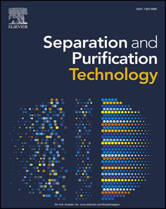

Separation and Purification Technology 363 (2025) 132244

Contents lists available at ScienceDirect

Separation and Purification Technology

journal homepage: www.elsevier.com/locate/seppur

# Adsorptive membranes of cellulose acetate CA/SiO2/UiO-66(Zr) for the

removal of protein bound uremic toxins☆

Diogo dos Reis Barradas a, Moisés Luzia Pinto b, Maria Norberta de Pinho c, Miguel Minhalma a,c,*

a *Chemical Engineering Department, Instituto Superior de Engenharia de Lisboa, Instituto Politécnico de Lisboa, Rua Conselheiro Emídio Navarro, 1, 1959-007 Lisboa,* *Portugal* b *CERENA, Chemical Engineering Department, Instituto Superior Técnico, University of Lisbon, Av. Rovisco Pais, n. 1, 1049-001 Lisbon, Portugal* c *Center of Physics and Engineering of Advanced Materials (CeFEMA), Instituto Superior Técnico, University of Lisbon, Av. Rovisco Pais, n. 1, 1049-001 Lisbon, Portugal*

A R T I C L E I N F O

A B S T R A C T

Editor: B. Van der Bruggen

One of the strong limitations of hemodialysis is the fact that protein bound uremic toxins (PBUTs), such as p- Cresyl Sulfate (pCS), are not filtered out, remaining in the patient’s bloodstream, leading to a worsening of the chronic kidney disease (CKD).

## Keywords:

Cellulose Acetate membranes Ultrafiltration UiO-66(Zr) Hemodialysis *P*-Cresil Sulphate

In the present work, the MOF (Metal Organic Framework) UiO-66(Zr) is incorporated into CA/SiO2 membranes in order to increase their capacity to remove uremic toxins, that preferentially bind to plasma proteins, such as pCS. The casting solutions for membrane synthesis by phase inversion combined with sol–gel method are prepared with 1%, 1.5%, 2% and 2.5% of MOF to yield CA22/SiO2 membranes with these contents.

The four membranes containing increasing MOF contents showed an increase of hydraulic permeability ranging from 14.38 to 33.82 kg/h/m2/bar and of molecular weight cut-off ranging from 3.5 to 14.7 kDa.

Adsorption isotherms were constructed at 37 °C for pCS on UiO-66(Zr) and on Bovine Serum Albumin (BSA) and for all the four membranes incorporating MOF. It was concluded that the membrane adsorption, per MOF mass, decreases with increasing MOF content. The Langmuir and Freundlich parameters were calculated for each case. Finally, a last adsorption isotherm was carried out on pCS in the presence of both UiO-66(Zr) and BSA, where with 5 mg/mL of UiO-66(Zr) it was possible to reduce the bounding of the toxin to the protein by around 50 %.

## 1. Introduction

Chronic kidney disease (CKD) is a syndrome responsible for structural and/or functional changes in the kidney with adverse implications for the patient, making it impossible for the organ to fulfill its functions [1,2]. On a structural level, the kidney begins to show cysts, tumors, malformations or atrophy, while on a functional level, it is no longer able to filter the bloodstream under the desired conditions, leading to an increase in the concentration of uremic toxins (UTs) in the patient’s blood. The accumulation of UTs in the bloodstream can lead to end-stage kidney disease (ESKD) [3]. This causes a serious deterioration in the health of these patients, their only chance of survival being renal replacement therapies such as hemodialysis (HD).

In the 1960 s, Loeb-Sourirajan’s development of asymmetric cellulose acetate membranes enabled great progress not only in the industrial scale of seawater desalination through reverse osmosis, but also as a central player in the development and improvement of various technologies [4]. Due to their advantages such as their low cost and simplicity of operation, membranes processes have emerged as the technology of choice in multiple fields and industrial sectors like the environmental, food and biomedical areas [5].

A very important application of membranes is in the extracorporeal blood purification technique of hemodialysis (HD) where they are responsible for filtering metabolic waste, excess salts and UTs from the patient’s blood [3]. There is, however, a group of toxins that can bound to proteins such as human serum albumin (HSA) through hydrogen

☆This article is part of a special issue entitled: ‘In Honor of Prof De Pinho’ published in Separation and Purification Technology.

* Corresponding author. *E-mail addresses:* diogobrs159@gmail.com (D. dos Reis Barradas), moises.pinto@tecnico.ulisboa.pt (M.L. Pinto), marianpinho@tecnico.ulisboa.pt (M.N. de Pinho), miguel.minhalma@isel.pt (M. Minhalma).

https://doi.org/10.1016/j.seppur.2025.132244 Received 29 November 2024; Received in revised form 22 January 2025; Accepted 21 February 2025

Available online 22 February 2025 1383-5866/© 2025 Elsevier B.V. All rights are reserved, including those for text and data mining, AI training, and similar technologies.

bonds and electrostatic interactions called protein bound uremic toxins (PBTUs) [6]. This creates a toxin-protein complex that is too large to be filtered by the pores of the membranes used in HD, resulting in the accumulation of these toxins in the patient’s bloodstream, leading to greater kidney deterioration and cardiovascular problems [7,8].

The need to filter PBTUs from patient’s bloodstreams has led to a search for the modification of the currently used membranes of hemodialysis giving them adsorptive capacity. Metal organic-frameworks (MOF) and namely Zirconium-based MOFs have been investigated by Kato et al. as having the ability to displace PBTUs from HSA [9]. In this frame of mind, the present work addresses the incorporation of UiO-66 (Zr) in the hybrid polymeric matrices of cellulose acetate/silica. The UiO-66(Zr) is currently considered to be one of the reference compounds among the most stable MOFs [10]. First reported in 2008 by Lilerud et al [11], UiO-66(Zr) has a simple laboratory synthesis and great potential due to its high levels of mechanical, aqueous, and thermal stability [12,13]. In addition, UiO-66(Zr) also shows some promising results in terms of its hemocompatibility [14].

The monophasic Cellulose Acetate/Silica membranes (CA/SiO2), the frame to incorporate the MOF, are synthetized by combining the phase-inversion technique with the sol–gel method. In this way, the acid conditions in the sol–gel method leads to the establishment of covalent bonds between silica and the CA matrix, that renders the monophasic membranes chemically and mechanically more stable [10,15]. This makes it possible to tailor the membranes selective permeabilities in such manner that water-soluble UTs are removed and essential blood components like the plasma proteins are retained [10,15]. Therefore, a broad range of CA/SiO2/MOF membranes can be produced by combining the various CA/SiO2 porous structures with the sorbent properties of MOFs. This can be a great advantage when it comes to customizing membrane selective permeation to PBTUs.

The present work addresses the synthesis and characterization of the MOF − UiO–66(Zr) − and a novel approach of its incorporation in CA/ SiO2 membranes to assess the removal efficiency of the PBUT −p-cresyl sulfate (pCS) − from blood surrogate solutions.

## 2. Experimental

### 2.1. Materials

UiO-66(Zr) was synthesized with terephthalic acid (C6H4(COOH)2, 166,13 g/mol, analytical grade 99 %, Thermo Scientific), zirconium dichloride octahydrate (ZrOCL2⋅8H2O, 322.25 g/mol analytical grade 98 %, Alfa Aesar), hydrochloric acid (HCl, 36,46 g/mol, 1 M, Fisher Scientific) and dimethyformamide (DMF, (CH2)2NCH, 73,09 g/mol, HPLC grade ≥99,5%, Fisher Scientific). These substances were used without further purification.

Casting solutions were prepared using cellulose acetate (CA, C6H7O2(OH)3 ~ 30000 Daltons, reagent grade ≥97 %, esterification degree ~ 40 %, Sigma-Aldrich), formamide (CH3NO, 45,02 g/mol, analysis grade, Honeywell), acetone (C3H6O, 58,08 g/mol, ≥99,7%, José M. dos Santos, LDA), tetraethyl orthosilicate (TEOS, SI(OC2H5)4, 208,33 g/mol, reagent grade 98 %, Alfa Aesar), nitric acid (HNO3, 63,01 g/mol, 65 % v/v, Chem-Lab) and the laboratory synthetized UiO-66(Zr) (Zr6O4(OH)4(C6H4C2O4)6), 1664,1 g/mol).

The molecular weight cut-off (MWCO) of the membranes is determined using polyethylene glycol (PEG) 2000 (2000 g/mol, Merck), PEG 6000 (6000 g/mol, Merck), PEG 10000 (10,000 g/mol, Merck), PEG 20000 (20,000 g/mol, Merck) and PEG 30000 (30,000 g/mol, Merck). The permeation experiments were carried out with solutions of sodium chloride (NaCl, reagent grade ≥99 %, Sigma-Aldrich), sodium sulfate (Na2SO4, 142,04 g/mol reagent grade ≥99 %, Sigma-Aldrich) and potassium p-cresyl sulfate (C7H7KO4S, 226.29 g/mol) in ultra-pure water with a concentration of 0,1 g/L. The synthesis of p-cresyl sulfate [11] was carried out at IST Laboratories by Professor João Paulo Telo. BSA is a reagent grade ≥98 % from Sigma).

### 2.2. Synthesis and characterization of UiO-66(Zr)

UiO-66(Zr) was synthesized in a Lab1st reactor by mixing 13.6095 g of terephthalic acid (BDC) with 26.3050 g of zirconium dichloride octahydrate. Then, 27 mL of hydrochloric acid were added, followed by 400 mL of DMF, under magnetic stirring at 170 rpm. The reactor was then heated for 72 h at 80 °C. After the synthesis, the mixture was placed in a filter and submitted to consecutive Soxhlet extractions for 72 h. The resulting mixture was transferred to a glass petri dish which was covered with perforated aluminium foil, set to dry in an oven at 150 °C for 72 h.

The characterization of UiO-66(Zr) was carried out by ATR-FTIR, TGA and X-ray diffraction (XRD).

### 2.3. Membrane casting

The compositions of the casting solutions used to synthesize CA22/ SiO2, CA22/SiO2/UiO-66(Zr) 1 %, CA22/SiO2/UiO-66(Zr) 1.5 %, CA22/ SiO2/UiO-66(Zr) 2 % and CA22/SiO2/UiO-66(Zr) 2.5 % membranes are shown in Table 1. The 5 % sol–gel silica precursor (TEOS) is added in acidic conditions [10,15]. The UiO-66(Zr) was first grinded using an agate mortar and pestle and then after being dispersed in formamide, is incorporated in the casting solution with a final content of 1, 1.5, 2 and 2.5 %. The casting solutions were homogenized for 24 h at 600 rpm and at room temperature in an orbital agitation plate. Before the casting, the casting solutions were placed in a sonicator for 30 min to better disperse the MOF.

Using a 250 μm slit casting knife to spread the casting solution over a glass plate, the phase inversion technique was used to carry out the membrane casting. The solvent was first evaporated for 30 s and then, the glass plates containing the polymer film were submerged in a water coagulation bath at 0–3 °C for 30 min.

### 2.4. Ultrafiltration experiments

The permeation experiments were carried out in the ultrafiltration set-up as reported in the literature [12]. The membrane surface area of each flat-sheet UF cell is 13.2 x 10-4 m2. After each experiment, the membranes were washed with deionized water at room temperature, maximum feed flowrate and lowest transmembrane pressure, until 95 % of the initial permeate flux was recovered.

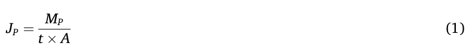

**Table 1** Casting solutions composition (m/m %).

|**Membrane**|**CA22/**|**CA22/**|**CA22/**|**CA22/**|**CA22/**|
|---|---|---|---|---|---|
||**SiO2**|**SiO2/UiO-** **66(Zr) 1**|**SiO2/UiO-** **66(Zr)**|**SiO2/UiO-** **66(Zr) 2**|**SiO2/UiO-** **66(Zr)**|
|||**%**|**1,5%**|**%**|**2,5%**|
|**CA**|16.41|16.24|16.15|16.07|15.98|
|**Formamide**|21.23|21.01|20.90|20.79|20.68|
|**Acetone**|58.87|58.26|57.95|57.65|57.34|
|**UiO-66(Zr)**|−|1.00|1.50|2.00|2.50|
|**TEOS**|3.00|3.00|3.00|3.00|3.00|
|**H2O**|0.50|0.50|0.50|0.50|0.50|
|**HNO3**|4 drops|4 drops|4 drops|4 drops|4 drops|
||(ph ~ 2)|(ph ~ 2)|(ph ~ 2)|(ph ~ 2)|(ph ~ 2)|

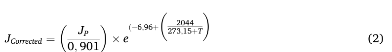

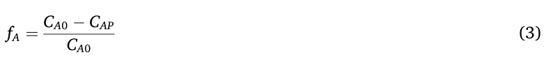

where fA is the apparent rejection coefficient, CA0 and CAP are the feed and permeate solute concentrations, respectively.

The salts concentration, in both permeate and feed samples, was determined by measuring the samples conductivity, using a condutivimeter (Com-B200E, Infitek), and then converting the conductivity value to g/L by using calibration curves (g/L vs μS/cm).

The membrane molecular weight cut-off (MWCO) is obtained through a series of permeation experiments of aqueous solutions of polyethylene glycol (PEG) of increasing molecular weight (MW) −2, 6, 10, 20 and 30 kDa. The permeation experiments were carried out with aqueous solutions with a PEG concentration of 0.6 g/L under total recirculation mode at the maximum volumetric feed flowrate, Q = 2 L/ min, and at a TMP of 1 bar. The concentration of PEGs in both permeate and feed samples was determined by an Alliance high performance liquid chromatography (HPLC Waters 2695) system, which allows the calculation of the rejection coefficient to PEGs, fPEG. The intersection of the curve, log(fPEG/(1-fPEG)) versus MW, with the horizontal line y = 1 yields the membrane MWCO.

A solution of 0.1 g/L of p-cresil sulfate in pure water was used to calculate the membrane’s rejection coefficients to pCS. Once again, the concentration of solute in both permeate and feed samples were determined by the Alliance HPLC system. The measurements were performed with a C18 column (5 µm, 150 x 4.6 mm2, Inertsil) at 40 °C, a flowrate of 1 mL/min from a mobile phase of acetonitrile and ammonium acetate 10 mM (E. Merck) (10:90 % v/v) and a detection wavelength of 230 nm [9].

### 2.5. Adsorption isotherms

#### 2.5.1. Adsorption isotherm of p-Cresyl Sulphate on UiO-66(Zr)

The adsorption isotherms were obtained by exposing 1.5 mg of UiO- 66(Zr) to 2.5 mL of aqueous solutions with pCS concentrations ranging from 0.01 to 0.15 g/L. These samples were stirred at a constant temperature of 37 °C for 24 h to reach equilibrium. After 24 h, the samples were filtered using 0.45 µm cellulose acetate syringe filters (Chemlab). The initial and equilibrium concentrations were obtained using the HPLC system above described.

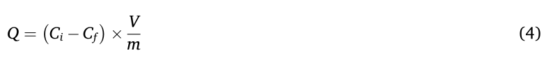

where V is the volume of solution exposed to UiO-66(Zr) and m is the mass of UiO-66(Zr) in grams.

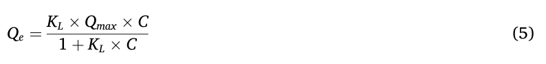

where *Qe*(mg/gUiO-66(Zr)) is the amount adsorbed per unit of adsorbent at equilibrium, *KL* (L/g) is the Langmuir constant, *Qmax* is the maximum uptake and C is the residual concentration of adsorbate (g/L).

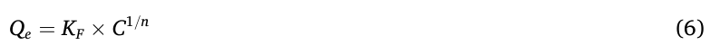

where *KF* ((mg/gUiO-66(Zr))/(m g/L)1/n) is the Freundlich constant and 1/ n is the non-linearity and adsorption intensity of the adsorbents.

#### 2.5.2. Adsorption isotherm of p-Cresyl Sulphate on BSA

In this experiment, 50 mg of BSA was exposed to 1 mL of aqueous solution of 0.2 M NaCl and pCS concentrations ranging from 0.01 to 0.15 g/L. After 24 h at 37 °C, the solutions were centrifuged and filtered with Amicon tubes (10 kDa, Milipore) at 4600 rpm for 15 min (centrifuge −Rotanta 460 R, Hettich). Subsequently, the same procedure as in the previous isotherms was followed.

#### 2.5.3. Adsorption isotherm of p-Cresyl Sulphate on the CA/SiO2/MOF membranes

The isotherms for the membranes incorporating UiO-66(Zr) were constructed by replacing the 1.5 mg of free UiO-66(Zr) by a mass of membrane that incorporates this same amount of 1.5 mg of UiO-66(Zr). The desired mass of membrane is cut in small pieces that are added to 2.5 ml of the aqueous solutions with pCS concentrations ranging from 0.01 to 0.15 g/L. After 24 h of stirring at 37 °C the membrane pieces were removed by centrifugation and the pCS content in the supernatant was determined by HPLC. This procedure was carried out for the four membranes with 1, 1.5, 2 and 2.5 % of UiO-66(Zr).

#### 2.5.4. UiO-66(Zr) as a p-Cresyl sulfate displacer from BSA (Competitive Adsorption)

In order to check the preferential adsorption of pCS between BSA and UiO-66(Zr), a final adsorption test was carried out, exposing pCS to both adsorbents. In this test, 50 mg of BSA were placed in 1 mL of aqueous solutions of 0.2 M NaCl and 1 g/L of pCS, in contact with different amounts of UiO-66(Zr), 5 to 30 mg. After 24 h of stirring at 37 °C, the solutions were divided into two halves. One half was subjected to filtration and centrifugation identical to the previous isotherms, and the supernatant was subsequently analyzed by HPLC. The other half was heated at 100 °C for 5 min, so that due to protein denaturation the pCS adsorbed to the protein would precipitate, and then centrifugation and filtration were followed by analysis.

## 3. Results and Discussion

### 3.1. UiO-66(Zr) characterization

The ATR-FTIR spectrum of UiO-66(Zr) is shown on Fig. 1. The bands at 1585 cm−1 and 1396 cm−1 belong to O – C – O asymmetric and symmetric stretching vibrations, respectively, in the BDC ligands. The band at 743 cm−1 belongs to the out-of plane C – H bending vibration. Finally, the band at 540 cm−1 belongs to the Zr – O bond stretching vibration in the metal–organic skeleton [13,14]. However, at 1665

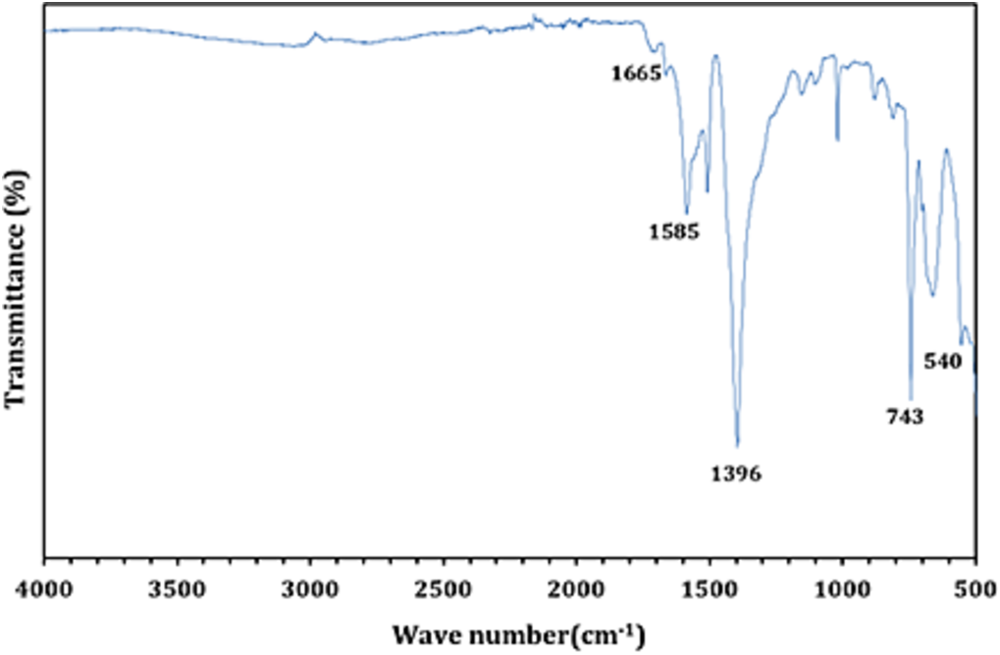

**Fig. 1.** ATR FTIR spectrum of UiO-66(Zr).

cm−1, a weak band belonging to the C = O stretch bond appears, ν(C = O), which indicates the presence of a small amount of the solvent DMF in the MOF pores.

The TG curve of UiO-66(Zr) is shown on Fig. 2. This curve corroborates the idea that a residual amount of DMF was present in the UiO-66 (Zr) sample, since ~ 10 % of it gets decomposed between 150 and 250 °C [16]. The second considerable loss of mass is found between 450 and 550 °C. In this temperature range, the BDC ligands burn, leading to the decomposition of UiO-66(Zr) [17].

The XRD scan of UiO-66(Zr) is shown on Fig. 3. All the peaks in the diffractogram were compared with the theoretical peaks, according to their crystallographic planes [18], in order to understand and comprehend the crystallinity of the synthesized MOF. Table 2 shows the 2θ ranges in which the theoretical peaks of UiO-66(Zr) are expected to be found, as well as the experimental values obtained.

Although all the peaks are within the expected range, they could be better defined. This indicates that the UiO-66(Zr) sample might consist of smaller particles than expected and/or is partially amorphous. The full width at half-maximum (FWHM at 2θ) was also calculated as being 1.57.

### 3.2. Membrane casting

Besides the previously mentioned membranes (Table 1) with MOF content of 0 %, 1 %, 1.5 %, 2 % and 2.5 % which were successfully synthesized, attempts were made to synthesize membranes with 4 and 6 % MOF, which did not prove possible. Increasing the MOF concentration to such levels caused large agglomerates of UiO-66(Zr) to appear throughout the membrane film, resulting in heterogeneous films with cuts.

### 3.3. Membrane characterization and pCS permeation

The ultrafiltration experiments were carried out in order to both characterize the membranes, with determination of Lp, MWCO and salts apparent rejection coefficients, and also to assess the permeation performance of the pCS, The results obtained for all the membranes are presented in Table 3 and Fig. 4. As an example, for the membrane CA22/ SiO2, Fig. 5 and Fig. 6 display the determination of hydraulic permeability and MWCO, respectively.

The results, presented in Table 3, generally show an increase in hydraulic permeability with increasing MOF content in the membranes. Similarly to the hydraulic permeability, the MWCO, also increases gradually with the increase in the UiO-66(Zr) content. These results are related to the fact that the addition of MOF particles to the membrane

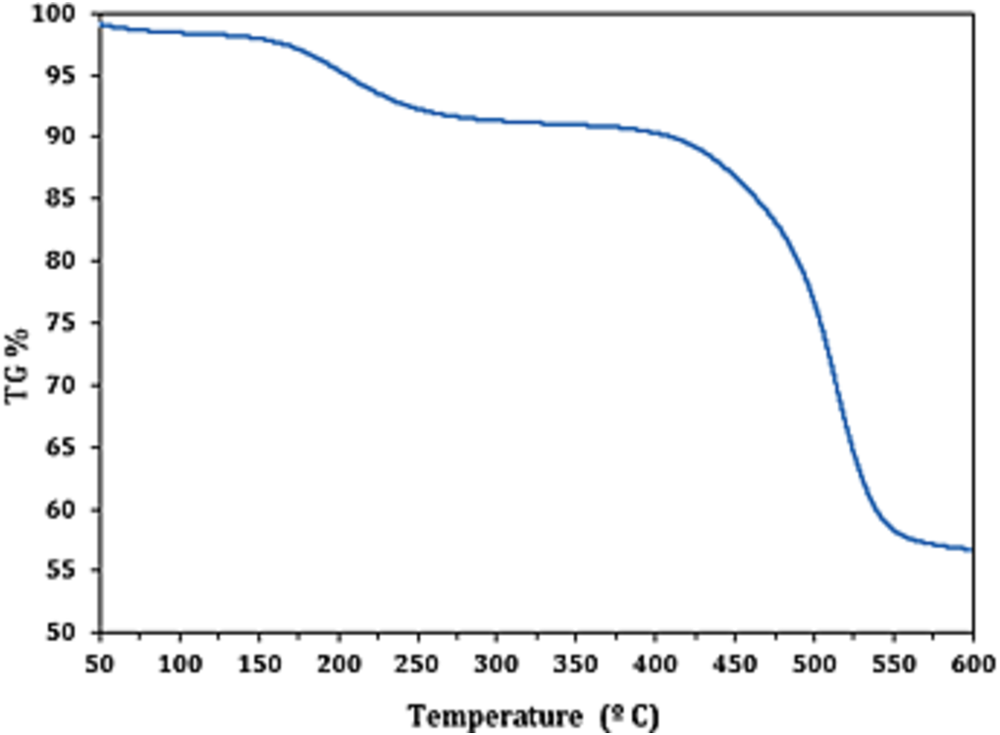

**Fig. 2.** TG curve of UiO-66(Zr).

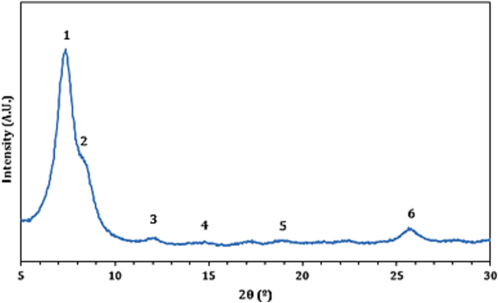

**Fig. 3.** Diffractogram of UiO-66(Zr).

**Table 2** Theoretical and experimental peaks of UiO-66(Zr) and the respective crystallographic planes.

|**Peak**|**2θ (**°**) Theoretical**|**2θ (**°**) Experimental**|**Crystallographic Plane**|
|---|---|---|---|
|**1**|7.2–7.7|7.3|(111)|
|**2**|8.4–8.8|8.5|(002)|
|**3**|11.9–12.3|11.9|(022)|
|**4**|14.7–15.1|14.8|(044)|
|**5**|16.9–17.2|17.1|(006)|
|**6**|25.6–25.9|25.7|(115)|

**Table 3** Parameters obtained during membrane characterization and pCS permeation.

|**Parameters**|**CA22/**|**CA22/**|**CA22/**|**CA22/**|**CA22/**|
|---|---|---|---|---|---|
||**SiO2**|**SiO2/UiO-** **66(Zr) 1**|**SiO2/UiO-** **66(Zr)**|**SiO2/UiO-** **66(Zr) 2**|**SiO2/UiO-** **66(Zr)**|
|||**%**|**1,5%**|**%**|**2,5%**|
|**LP (kg/h/** **m****2****/bar)**|14.38|11.41|33.82|19.72|28.65|
|**MWCO (Da)**|3527|7491|9431|12407|14688|
|**f (NaCl)**|3 %|7 %|3 %|4 %|3 %|
|**f (Na2SO4)**|8 %|13 %|5 %|8 %|5 %|
|**f (pCS)**|25 %|29 %|20 %|24 %|22 %|

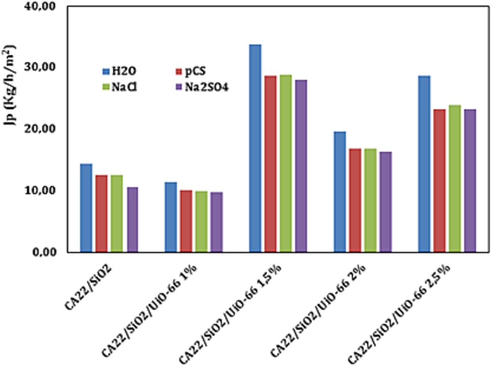

**Fig. 4.** Variation of permeate flux with water, NaCl, Na2SO4 and pCS aqueous solutions for all membranes at 1 bar.

matrix leads to a more porous structure, and this effect is more

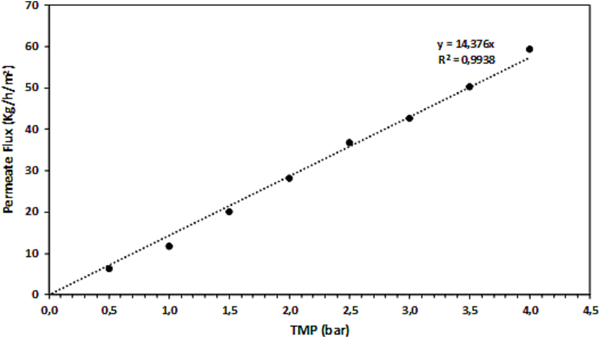

**Fig. 5.** Permeate fluxes of ultrapure water as a function of the TMP for CA22/ SiO2 membrane.

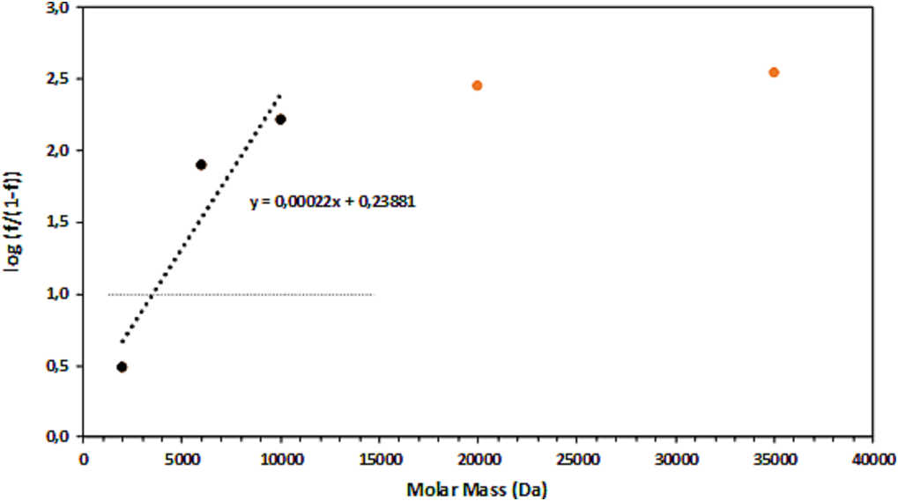

**Fig. 6.** Graphical demonstration of the MWCO determination for CA22/SiO2 membrane. Orange dots were excluded.

pronounced for the higher content of MOF. However, one should be aware that for higher contents the dispersion of the MOF particles in the casting solution is more difficult and MOF agglomerates may occur.

Regarding the salts rejection coefficients, it can be seen that in all cases the rejection to NaCl is lower than to Na2SO4, and the values are very low, *<*13 %, for all membranes, as expected for ultrafiltration membranes.

Finally, the addition of UiO-66(Zr) to the membranes results in a lower rejection coefficient to pCS by the membranes. The slightly higher value for the membrane with 1 % of MOF may be within the experimental error range. Considering this data and the fact that there is also a progressive increase in hydraulic permeability and MWCO as the MOF content of the membranes increases, one can conclude that the best membranes for removing pCS are those with a higher UiO-66(Zr) content, between 1.5 % and 2.5 %, as they reject the least pCS and have higher permeation fluxes.

It should also be mentioned that, regarding the permeation fluxes of both salts and pCS, there are no significant decreases compared to the water permeate flux. This is to be expected since the salts and pCS tests are carried out in the presence of dilute aqueous solutions and there is no significant concentration polarization.

### 3.4. Adsorption isotherm Studies

#### 3.4.1. Adsorption isotherms of p-Cresyl Sulphate on UiO-66(Zr) and on CA/SiO2/ UiO-66(Zr) membranes

In order to study the pCS adsorption behavior to free UiO-66(Zr) and to mixed matrix membranes containing varying UiO-66(Zr) content, different sets of adsorption experiments were carried out and the results are presented in Fig. 7.

For the treatment of the isotherms, the Langmuir and Freundlich

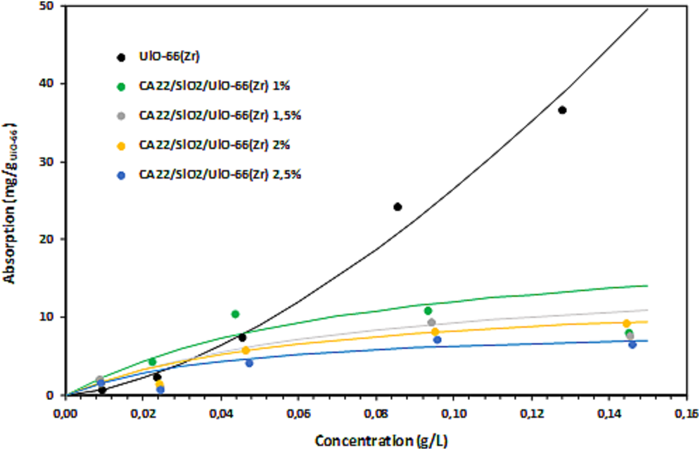

**Fig. 7.** Adsorption isotherms of pCS in the presence of free UiO-66(Zr) and mixed matrix membranes with 1%, 1.5%, 2% and 2.5% of UiO-66(Zr).

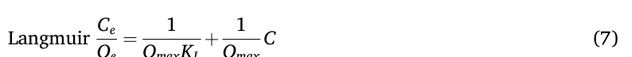

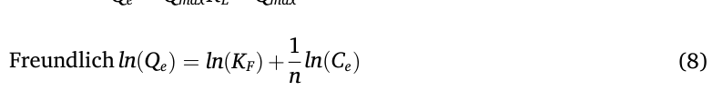

**Table 4** Freundlich and Langmuir parameters for the isotherms of pCS on UiO-66(Zr) and mixed matrix membranes with varying content of UiO-66(Zr).

||**Freundlich**||**Langmui**|**r**|
|---|---|---|---|---|
||**KF (m g/g)/((m** **g/L)****1/n****)**|**1/n**|**KL (L/** **g)**|**Qmax(m g/gUiO-** **66(Zr)****)**|
|**UiO-66(Zr)**|938.90|1.55|−|−|
|**CA22/SiO2/UiO-66** **(Zr) 1 %**|−|−|13.14|21.14|
|**CA22/SiO2/UiO-66** **(Zr) 1,5%**|−|−|12.12|16.91|
|**CA22/SiO2/UiO-66** **(Zr) 2 %**|−|−|16.07|13.41|
|**CA22/SiO2/UiO-66** **(Zr) 2,5%**|−|−|23.55|8.96|

necessarily have a higher adsorption capacity than membranes with a lower % of UiO-66(Zr) in their composition. This may be due to the fact that membranes with a lower UiO-66(Zr) % in their matrix have fewer and/or smaller agglomerates of MOF, which means that these particles are more dispersed throughout the film, resulting in a greater availability of MOF and places where pCS can adsorb to.

The parameters shown in Table 4 also indicate that the membranes with the lowest UiO-66(Zr) content in their composition have the highest adsorption capacity per unit mass of MOF. This can be seen by observing that the Qmax decreases as the UiO-66(Zr) content in the membranes increases. This observation may be related to the fact that membranes with a higher UiO-66(Zr) content are more agglomerated, leading to a lower total MOF area for adsorption. It can also be concluded that the affinity of the membranes towards pCS presents little differences, as shown by the KL, since all membranes have the same type of MOF. Fig. 8 shows the adsorption per mass of membrane used.

As expected, the membranes with the higher MOF content are the ones with the higher adsorption per mass of membrane.

#### 3.4.2. Comparison of p-Cresyl Sulphate adsorption on BSA with the one on UiO-66(Zr) and on mixed matrix membranes incorporating UiO-66(Zr)

Adsorption experiments were carried out with BSA. in order to study the pCS adsorption behavior to the free protein. These results are presented in Fig. 9 and it is also shown the comparison with the results obtained for the free UiO-66(Zr) and for the mixed matrix membranes.

The calculation of the Freundlich parameters for the BSA isotherm resulted in a KF of 35.10 (m g/g)/(m g/L)1/n) and a 1/n of 0.76. These values show that BSA has a lower adsorption capacity than MOF, since its KF is around 25 times lower than that of UiO-66(Zr).

#### 3.4.3. UiO-66(Zr) for the removal of p-Cresyl sulfate bound to BSA − competitive adsorption by MOF vs BSA

For the study of the competitive adsorption of pCS between BSA and UiO-66(Zr), adsorption experiments were carried out with ternary solutions of pCS, BSA and MOF, where the amount of UiO-66(Zr) was varied from 0 to 30 mg/ml. Fig. 10 shows the results obtained in the competitiveness test between UiO-66(Zr) and BSA.

From the analysis of Fig. 10 it can be seen that in the absence of MOF, around 80 % of the pCS is adsorbed to the protein. This value drops to around 40 % when UiO-66(Zr) is introduced into the medium. It can also be seen that in the presence of MOF, around 30 % to 35 % of the pCS is adsorbed to it, while there is always a quantity of 20 to 25 % of this toxin that is never adsorbed by any of the adsorbents. Thus, 5 mg/mL of UiO- 66(Zr) managed to reduce the amount of pCS adsorbed to BSA by half, from ~ 80 % to ~ 40 %.

It is also possible to conclude that the addition of larger quantities of MOF in the system has little influence on the amount of pCS that adsorbs

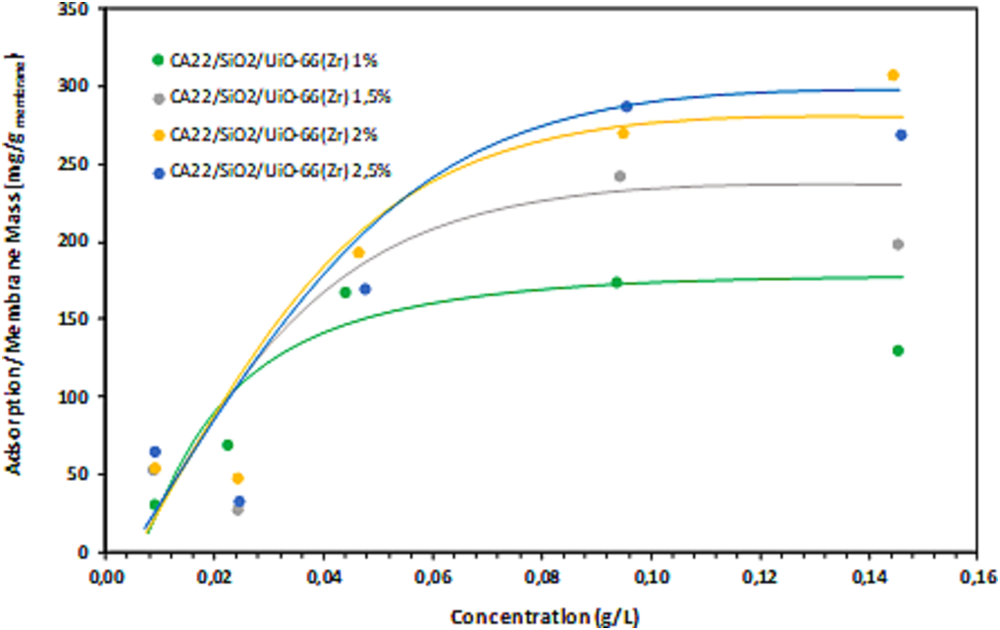

**Fig. 8.** Variation of pCS adsorption per unit mass of membrane for the CA/ SiO2/ UiO-66(Zr) membranes with varying content of UiO-66(Zr).

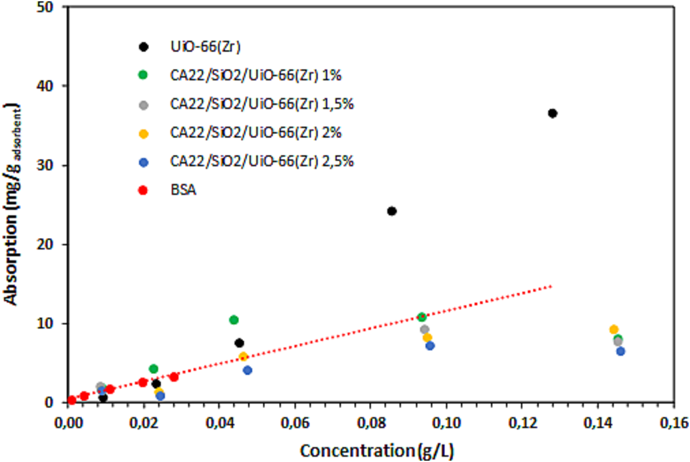

**Fig. 9.** Comparison between pCS adsorption isotherms in the presence of UiO- 66(Zr), hybrid membranes with UiO-66(Zr) (1%, 1.5%, 2% and 2.5%), and BSA.

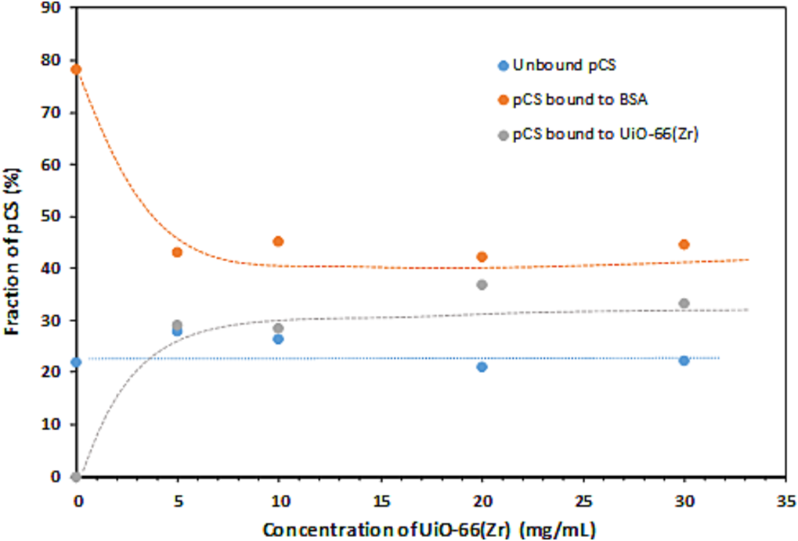

**Fig. 10.** Study of pCS adsorption in the presence of both UiO-66(Zr) and BSA. Concentrations: pCS = 1 g/L; BSA = 50 mg/mL and UiO-66(Zr) = 0 – 30 mg/ml.

to it, as the adsorption limit seems to be reached for 5 mg/mL of UiO-66 (Zr), since the fraction of pCS that adsorbs to the MOF does not increase by much more than 35 %. Adding more MOF also does not influence the amount of non-adsorbed pCS in the medium, this is an important result as one must take into account the toxicity of this material.

## 4. Conclusions

The synthesis of hybrid cellulose acetate/SiO2/MOF membranes was successfully carried out with MOF contents of 1, 1.5, 2 and 2.5 %.

The membranes characterization showed that the addition of UiO-66 (Zr) and the increase in its content resulted in higher hydraulic permeabilities from 14.38 to 33.82 kg/h/m2/bar and in higher MWCOs ranging from 3.5 to 14.7 kDa.

In the permeation tests with pCS, it was also possible to observe a decrease in the pCS rejection coefficient for membranes with a higher MOF content, concluding that the CA22/SiO2/UiO-66(Zr) 1.5 % membranes, CA22/SiO2/UiO-66(Zr) 2 % and CA22/SiO2/UiO-66(Zr) 2.5 % will be the best to use for filtering solutions with pCS, as they combine the lowest toxin rejection values with the highest hydraulic permeabilities.

The pCS adsorption isotherms were constructed at 37 °C for UiO-66 (Zr) and for all the membranes that incorporated MOF. From these results, it was concluded that UiO-66(Zr) tends to adsorb much more pCS

when it is free than when it is incorporated in the membranes. It was also concluded that an increase in MOF in the membrane matrix does not necessarily imply greater adsorption/( g MOF), possibly due to the MOF agglomerates in the membrane film, which means that fewer UiO-66(Zr) particles are available to adsorb pCS. This means that adsorption saturation is reached earlier on the membranes than on the free MOF.

The pCS adsorption isotherm by BSA showed that the % of pCS adsorption was much lower than the one obtained by MOF.

Regarding ternary solutions, pCS/BSA/MOF, the pCS adsorption tests at 37 °C showed that UiO-66(Zr) at around 5 mg/mL is able to compete with BSA and reduce the amount of pCS bound onto the protein from ~ 80 % to ~ 40 %. This predicts the increase of pCS removal efficiency in hemodyalisis, as it removes the pCS toxin from the BSA bound form (PBUT) to the MOF incorporated in the membranes.

## Declaration of competing interest

The authors declare that they have no known competing financial interests or personal relationships that could have appeared to influence the work reported in this paper.

## Acknowledgements

The authors are grateful to the Portuguese funding agency, Fundação para a Ciência e Tecnologia (FCT); for its financial support to CeFEMA [grant number UIDB/04540/2020], and to CERENA [grant number UIDB/04028/2020].

## References

[1] P. Romagnani, G. Remuzzi, R. Glassock, A. Levin, K.J. Jager, M. Tonelli, Z. Massy,

C. Wanner, H.-J. Anders, Chronic kidney disease, Nat. Rev. Dis. Primers. 3 (2017), https://doi.org/10.1038/nrdp.2017.88.

[2] A.C. Webster, E.V. Nagler, R.L. Morton, P. Masson, Chronic kidney disease, Lancet

6736 (16) (2016) 1–15, https://doi.org/10.1016/S0140-6736(16)32064-5.

[3] C. Gao, Q. Zhang, Y. Yang, Y. Li, W. Lin, Recent trends in therapeutic application of

engineered blood purification materials for kidney disease, Biomater Res. 26 (1) (2022) 1–25, https://doi.org/10.1186/s40824-022-00250-0.

[4] S. Loeb, S. Sourirajan, UCLA Dept. of engineering, Report 60-60 (July 1960).

[5] Z. Dai, V. Ottesen, J. Deng, R.M.L. Helberg, L. Deng, A brief review of nanocellulose

based hybrid, Fibers. 7 (40) (2019) 1–18, https://doi.org/10.3390/fib7050040.

[6] J. Eetjen, M. Odriguez, B. Tegmayr, Review on uremic toxins: classification,

concentration, and interindividual variability, Kidney Int. 63 (2003) 1934–1943, https://doi.org/10.1046/j.1523-1755.2003.00924.x.

[7] I-Wen Wu, Kuang-Hung Hsu, Chin-Chan Lee, Chiao-Yin Sun, Heng-Jung Hsu, Chi-

Jen Tsai, Chin-Yuan Tzen, Yen-Chih Wang, Ching-Yuang Lin, Mai-Szu Wu, p-Cresyl sulphate and indoxyl sulphate predict progression of chronic kidney disease, Nephrol. Dial. Transplant. 26 (3) (2010) 938–947, https://doi.org/10.1093/ndt/ gfq580.

[8] P.H. Wu, Y.T. Lin, Y.W. Chiu, G. Baldanzi, J.C. Huang, The relationship of indoxyl

sulfate and p – cresyl sulfate with target cardiovascular proteins in hemodialysis patients, Sci. Rep. 11 (1) (2021) 3786, https://doi.org/10.1038/s41598-021- 83383-x.

[9] S. Kato, K.I. Otake, H. Chen, I. Akpinar, C.T. Buru, T. Islamoglu, et al., Zirconium-

based metal-organic frameworks for the removal of protein-bound uremic toxin from human serum albumin, J. Am Chem Soc. 141 (6) (2019) 2568–2576, https:// doi.org/10.1021/jacs.8b12525.

[10] M. Faria, C. Moreira, T. Eusébio, P. Brogueira, M.N. de Pinho, Hybrid flat sheet

cellulose acetate/silicon dioxide ultrafiltration membranes for uremic blood purification, Cellul. 27 (2020) 3847–3869, https://doi.org/10.1007/s10570-020- 02985-2.

[11] J. Feigenbaum, C.A. Neuberg, Simplified method for the preparation of aromatic

sulfuric acid esters, J. Am. Chem. Soc. (1941), https://doi.org/10.1021/ ja01857a508.

[12] J.F. Guerreiro, M. Pereira da Silva, M. Bordonhos, M. Minhalma, M.L. Pinto, M.

N. de Pinho, Synthesis and characterization of MOF/silica cellulose acetate based membranes: removal of uremic toxins in haemodialysis spent dialysate, Desalination 565 (2023), https://doi.org/10.1016/j.desal.2023.116860.

[13] IR Spectrum Table [Internet]. [cited 2023 Jul 13]. Available from: https://www.

sigmaaldrich.com/PT/en/technical-documents/technical-article/analytical-chemistry/photometry-and-reflectometry/ir-spectrum-table.

[14] S. Zaboon, H.R. Abid, Z. Yao, R. Gubner, S. Wang, A. Barifcani, Removal of

monoethylene glycol from wastewater by using Zr-metal organic frameworks, J. Colloid Interface Sci. 523 (2018) 75–85, https://doi.org/10.1016/j. jcis.2018.03.084.

[15] G. Mendes, M. Faria, A. Carvalho, M.C. Gonçalves, M.N. de Pinho, Structure of

water in hybrid cellulose acetate-silica ultrafiltration membranes and permeation properties, Carbohydr. Polym. 189 (2018) 342–351, https://doi.org/10.1016/j. carbpol.2018.02.030.

[16] N,N-Dimethylformamide | HCON(CH3)2 | CID 6228 - PubChem [Internet]. [cited

2023 Jul 13]. Available from: https://pubchem.ncbi.nlm.nih.gov/compound/N_N- Dimethylformamide#section=Boiling-Point.

[17] Q. Yang, H.Y. Zhang, L. Wang, Y. Zhang, J. Zhao, Ru/UiO-66(Zr) catalyst for the

reduction of nitroarenes and tandem reaction of alcohol oxidation/knoevenagel condensation, ACS Omega 3 (4) (2018) 4199–4212, https://doi.org/10.1021/ acsomega.8b00157.

[18] S. Øien, D. Wragg, H. Reinsch, S. Svelle, S. Bordiga, C. Lamberti, et al., Detailed

structure analysis of atomic positions and defects in zirconium metal-organic frameworks, Cryst Growth Des. 14 (11) (2014) 5370–5372, https://doi.org/ 10.1021/cg501386j.