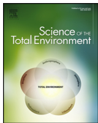
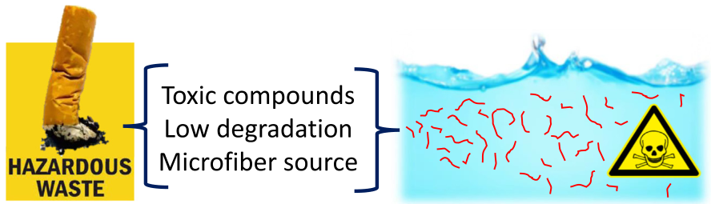
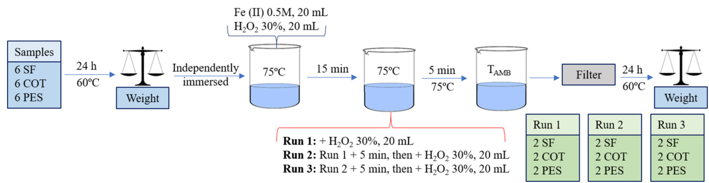
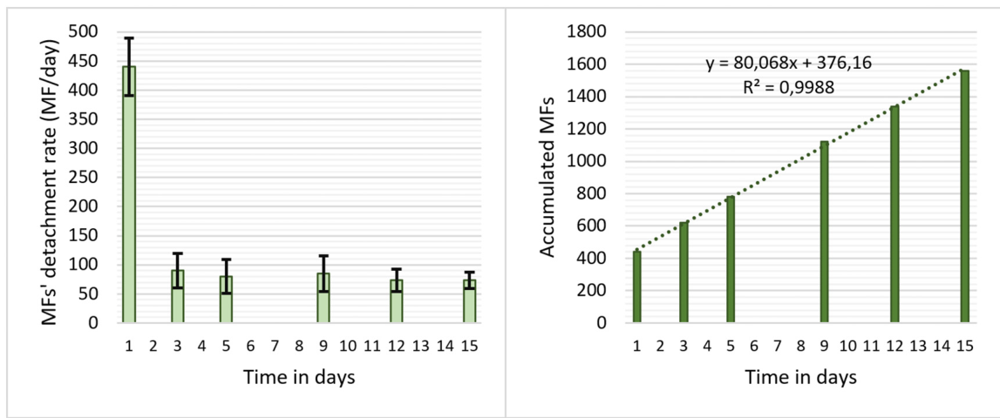
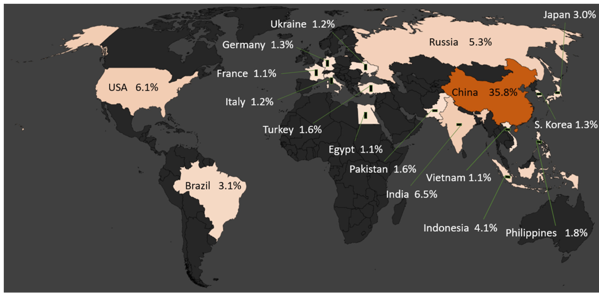
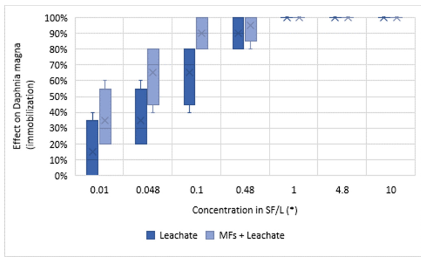
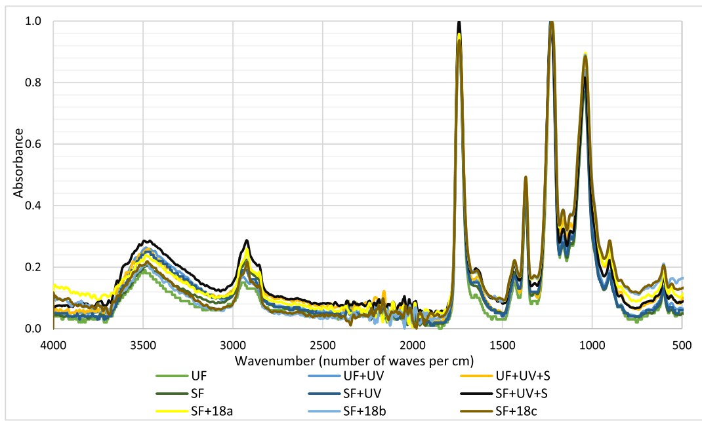
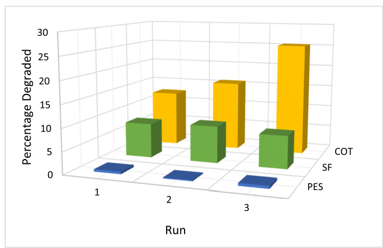

<!-- Page 0 | source: demo_b366b379_page_0.md | kind: md -->

Contents lists available at ScienceDirect

Science of the Total Environment

journal homepage: www.elsevier.com/locate/scitotenv

# Cigarette butts as a microfiber source with a microplastic level of concern

Francisco Belzagui *, Valentina Buscio, Carmen Gutiérrez-Bouzán, Mercedes Vilaseca

Institut d'Investigació Tèxtil i Cooperació Industrial de Terrassa (INTEXTER), Universitat Politècnica de Catalunya, BarcelonaTech. Spain

## HIGHLIGHTS

* Smoked filters are the most encountered littered item.
* Smoked filters might release about 0.3 million tons of microfibers per year.
* Microfibers from smoked filters have a low degradability rate.
* Detached microfibers increase the ecotoxicity of the smoked filters' leachate.

## GRAPHICAL ABSTRACT

## ARTICLE INFO

Article history:
Received 2 October 2020
Received in revised form 1 December 2020
Accepted 1 December 2020
Available online 17 December 2020

Editor: Yolanda Picó

Keywords:
Microplastic
Microfiber
Pollution
Cigarette filter, cigarette butts

## ABSTRACT

Microplastic pollution is a growing environmental concern among the scientific community. These small particles (<5 mm) might come from the fragmentation or direct emission of artificial and synthetic polymers. Among them, the microfibers (MF) are one of the most common types of microplastics identified in the environment. On the other hand, the most encountered type of garbage found in clean-up campaigns is the cigarette butts, which contains the smoked filters (SF) and unsmoked rests of tobacco. SFs are hazardous debris but are usually not properly disposed as such, and are composed of >15,000 strands that can be detached as MFs. This study aims to evaluate the detachment rate, the acute aquatic toxicity, and the aquatic-, thermooxidative-, and photo-degradability of the MFs generated from SFs. In this way, it was found that SFs detach approximately 100 small MFs (<0.2 mm) per day. In a rough estimation, about 0.3 million tons of potential MFs might be annually reaching aquatic environments from this source. Concerning the eco-toxicity, a statistically significant difference was found when MFs are present in the leachate generated by the SFs, where the *Daphnia magna* EC100 and EC50 were of 0.620 SF/L and 0.017 SF/L, respectively. Finally, the degradability of the SFs was evaluated by applying two methods (ATR-FTIR analysis and gravimetry). In both of them, a low degradability rate was observed. Thus, it may be concluded that MFs from SFs constitute an important source of microplastics, which might partially explain the high concentration of artificial polymers that have been found in the deep-sea sediments. Yet, the correct management of the SFs is an unsolved issue that should receive urgent attention.

Capsule: This work evaluates the detachment rate, toxicity, and degradability of the microfibers detached from the cigarette butts.

© 2020 Elsevier B.V. All rights reserved.

## 1. Introduction

The microplastics as pollutants are small fragments (length < 5 mm) of non-chemically modified and non-biodegradable polymers that have been found contaminating every ecosystem. Within the types of microplastics, microfibers (MF) are those with a length to diameter

ratio > 3; i.e., a maximum length of 15 mm (ECHA, 2019). A possible but usually not considered source are the cigarette butts, specifically, the smoked cigarette filters (SFs). In this sense, several clean-up campaigns have reported that SFs are the most common litter in number of items across the world (Veiga et al., 2016; WHO, 2017). In 2017, volunteers around the globe collected more than 2 million SFs, outnumbering other usual plastic wastes as straws, plastics bags, bottle caps, and food wrappers (Ocean Conservancy, 2018). In this sense, Roder et al., 2014 reported a mean and a maximum of 2.7 and 48

* Corresponding author.
E-mail address: francisco.belzagui@upc.edu (F. Belzagui).

https://doi.org/10.1016/j.scitotenv.2020.144165
0048-9697/© 2020 Elsevier B.V. All rights reserved.---

<!-- Page 1 | source: demo_b366b379_page_1.md | kind: md -->

cigarette butts per m², respectively. The current global consumption of tobacco is 6 trillion cigarettes per year (Ritchie and Roser, 2013; The Tobacco Atlas, 2019; Statista, 2019), and it has been estimated that three-quarters are not correctly littered. Hence, about 4.5 trillion SFs per year are carelessly discarded into the environment (Kathleen, 2000; Novotny and Slaughter, 2014; Christina et al., 2019; Torkashvand et al., 2020). Despite that some ideas have proposed to make use of this litter (Marinello et al., 2020), these residues continue to constitute a severe global issue of incorrect toxic litter disposal, yet, deficient attention has been placed onto them (Novotny et al., 2009).

The tobacco cigarette filters are generally composed of more than 15,000 fibers strands made of cellulose acetate with plasticized additives. This material can last up to 30 years to degrade in certain conditions (Hosono et al., 2007; Niaounakis, 2017b; Joly and Coulis, 2018). When incorrectly disposed, SFs might suffer a quick release of the strands, which can be detached as a MF, or get fragmented over time. Large concentrations of “rayon” fibers have been identified polluting the deep ocean sediments, which can be partially attributed to the strands detached from littered SFs (Woodall et al., 2014; Wright et al., 2015). On the other hand, tobacco cigarettes carry more than 4800 chemical compounds, from where more than 70 are carcinogens and over 200 are toxics (Hoffmann et al., 2001). When cigarettes are smoked, a proportion of these compounds are adsorbed by the filters. Afterward, some can be rapidly leached into the environment, while others remain adsorbed in the strands for an indefinite period (Moerman and Potts, 2011; Kurmus and Mohajerani, 2020; Torkashvand et al., 2020). Hence, MFs from SFs can act as vectors for many hazardous chemicals and could even behave as a source for prolonged radionuclide contamination (Desideri et al., 2019).

This study aims to evaluate the releasing rate, ecotoxicity, and the aquatic-, thermooxidative-, and photo-degradability of the MFs detached from SFs, and to approximate its relevance to the overall MFs' pollution. To do so, the releasing rate of MFs from these filters was measured in synthetic seawater. A rough estimation of the potential amount of these MFs that reach aquatic environments was done by considering the smoking trends of all the countries and the worldwide municipal water treatment rate. Unsmoked cigarette filters (UFs) and SFs were tested to measure the degradation of the cellulose acetate and to determine the possible influence of the smoking process in the degradability. Also, the toxicity of the MFs was assessed by means of an acute aquatic toxicity test on *Daphnia magna*.

## 2. Methodology

### 2.1. Smoking process of the cigarettes

Four different international and widely consumed commercial brands of tobacco cigarettes were purchased from a common store in Terrassa, Spain. The smoking process of the cigarettes was carried out by using a self-prepared gadget that consisted of an air bomb connected to a valve (see Supplementary Information, Fig. 1S). The system was regulated to obtain a smoking velocity of approximately 1 cigarette per 2 min. The smoking velocity selection was a consequence of previous attempts, in which an overheating of the cigarette filters was seen when higher smoking velocities were applied. This could have derived on the filter's physical degradation. Besides, it does not correspond to the normal smoking procedure.

### 2.2. Smoked cigarette filters as a source of microfibers

Ten SFs were carefully separated from their wrapping papers to facilitate the final visual identification of the MFs. The wrapping paper is rapidly detached when coming in contact with water, hence, its removal doesn't influence the release of MFs. Then, the SFs were placed in 10 L of distilled water to obtain a sample with a known concentration of 1 SF/L. Afterward, the sample was submitted to a slow but continuous

mechanical agitation for two weeks. The agitator consisted of a bowl with a blade that was assembled to generate a slow waving motion (frequency of 1 cycle per 2 s, maximum amplitude of the waves of approximately 2 cm, see Supplementary Information, Fig. 2S). The purpose was to emulate the slow movement of natural water bodies. Two times per week, three aliquots of 50 mL were taken, filtered through 20 µm polyamide filters (Merck Millipore Ltd. Nylon Net, 47 mm of diameter), and dried for 24 h at 60 °C. The filtering process was done by using a vacuum pump. The counting of the MFs was executed by visually inspecting the whole area of the polyamide filters in a stereomicroscope (Carton Stereo Zoom SC).

### 2.3. Ecotoxicity assessment of the microfibers released from smoked cigarette filters

The evaluation of the toxicity of the SFs and the released MFs was executed by following the standard toxicity test “OECD Test No. 202, *Daphnia sp.* Acute Immobilisation Test” (OECD, 2004). Because the leachate of the SFs can have a negative effect by themselves (i.e., it contains toxic substances desorbed from the cigarette filter), two settings were prepared to evaluate the toxicity that can be attributed to the MFs.

In the first one, 10 SFs were vigorously agitated in 1 L of distilled water for 24 h. The generated leachate was filtered through 20 µm polyamide filters to remove the SFs. In the second set, 10 SFs were cut into MFs of approximately 1 mm in length, put into 1 L of distilled water, and vigorously agitated for 24 h. Afterward, the *Daphnia magna* matrixes were prepared with concentrations of 10, 4.8, 1.0, 0.48, 0.10, 0.048, and 0.010 SF/L from both sets of samples.

Every matrix was prepared by following the standardized OECD test. In this way, for both sets and every concentration, 4 replicates were executed with 5 *Daphnia magna* each. Additionally, a control sample was prepared. The organisms were evaluated after a period of exposure of 48 h, where self-moving *Daphnia magna* were counted as living organisms and compared with the control sample.

### 2.4. Degradation of the UFs and SFs

The evaluation of the degradation rate of the cigarette filters was developed by following two methods: (1) chemical analysis through FTIR after salty water and UV-light treatment to the filters, and (2) gravimetrical analysis after applying the filters to a microplastic separation method proposed by the National Oceanic and Atmospheric Administration (NOAA).

In the first method, UFs without wrapping papers were put in 2 glass containers (3 UFs in each), one with distilled water and the other with synthetic seawater (3.5% NaCl w/v). Then, these were submitted to a slow mechanical agitation (frequency of 1 cycle per 2 s, maximum wave amplitude of 2 cm) and continuous UV-light (365 nm, intensity of 7 mW/cm², Vilber Lourmat lamps) for one month. The same procedure was simultaneously conducted with the same number of SFs. Afterward, to measure the possible degradation of the acetate cellulose strands, the outermost layer of every filter was sampled with a clamp to evaluate its chemical structure employing an ATR-FTIR (Nicolet 6700 FTIR, ThermoScientific). The outermost layer was selected as it was the portion of the filter with the highest UV-radiation exposure. Besides, UFs and SFs non-submitted to the test were also analyzed for comparative purposes. On the other hand, MFs from the SFs were left in containers with freshwater for 18 months in a place where the daylight could reach them. Afterward, three samples were analyzed with the same FTIR equipment.

On the other hand, the microplastic identification method proposed in NOAA, 2015 was also applied. This method relies on a modified Fenton Reaction (Fe(II)/H₂O₂) to oxidize “non-synthetic” polymers into carbon dioxide. The procedure was established as follows: SFs (made of cellulose acetate) were weighted without the wrapping papers. To have a reference frame for evaluation, woven fabrics of 100%---

<!-- Page 2 | source: demo_b366b379_page_2.md | kind: md -->

**Fig. 1.** Schematic overview of the experimental set to evaluate the degradability of the filters (SF) compared with cotton (COT) and polyester (PES). Each sample was independently treated.

cotton (COT) and 100% polyester (PES) were cut into regular pieces of similar weight. Thus, a total of 6 samples of each material were dried for 24 h at 60 °C before final weighting. Then, the initial solutions for the Fenton reaction were prepared, which consisted of a mix of (A) Fe (II) 0.5 M, and (B) $H_2O_2$ at 30%. Equal volumes (20 mL) of each solution were mixed in glass containers and heated up to 75 °C in a water bath. Then, the samples (filters, PES, and COT) were independently immersed in the glass containers for 15 min while kept in continuous stirring at 75 °C. After the first 15 min, three runs of experiments were executed, where two samples of each material were tested in each run.

In the first run, 20 mL of solution B was added after 15 min. In the second run, the same was done but adding 20 mL of solution B after 20 min. And, in the third run, one last volume of 20 mL of solution B was added after 25 min. For each time the solution B was added, the samples were maintained for 5 more minutes at 75 °C, which is the optimal condition for the chemical reaction to occur. The three times interval of 5 min each were selected to quickly increase the reaction velocity. Afterward, the glass containers were covered with a plastic film until room temperature was reached, and then the solutions were filtered through 20 µm polyamide filters (Merck Millipore Ltd. Nylon Net, 47 mm of diameter), and oven-dried for 24 h at 60 °C. The filtering process was done by using a vacuum pump. The polyamide filters were previously weighted after being dried for 24 h at 60 °C. The difference in mass between the initial sample and that retained on the polyamide filters was taken as a direct measurement of the degradability (Fig. 1).

## 3. Results and discussions

### 3.1. Smoked cigarette filters as a source of microfibers

As explained in the Methodology section, SFs were immersed in water and submitted to slow agitation. As expected, SFs released

many MFs from the very beginning of the experiment. As can be seen in Fig. 2, every SF detached approximately 100 MFs per day in the first two weeks. However, this detachment might accelerate over a long-time period as a consequence of the physical deterioration of the fibers that compose the filters (Andrady, 2011; Niaounakis, 2017a).

On the other hand, on the first day of soaking, the detachment was observed to be relevantly superior (450 MFs). In this line, Mepani et al., 2002 reported that some strands might present defective, smaller, and poorly attached fibers from the manufacturing process of the filters. These fibers might explain the rapid first release of MFs when the filters are immersed in water. On the other hand, it is not clear that if the usual process of extinguishing the cigarette ember onto a hard surface will accelerate the detachment of the MFs by the physical deterioration of the SF, or to lower it as a consequence of the tar that might bind the MFs together. Regarding the size, most encountered lengths were <0.2 mm, with many MFs being too small to be visually measured. It must also be emphasized that, once SFs reach an aquatic environment, the MFs are released straight into it, since the unique intermediary between these pollutants and the ambient is the wrapping paper. It would be interesting if future studies evaluate the role of the adsorbed chemicals to the MFs' detachment rate.

Concerning the worldwide situation, by applying the adjustment of the daily amount of MFs detached per SF for the last 10 years, it can be estimated a conservative value of $4 \times 10^{18}$ particles of MFs being annually released (Supplementary Information, section 3). On the other hand, by considering the global production of cellulose acetate destined for cigarette filters (640,000 tons) (Tullo, 2016; Hexa Research, 2017), and by assuming that 60% of the SFs reach aquatic environments, about 0.3 million tons of potential MFs are being directly and constantly introduced from this source (explanation for the 60% in Supplementary Information, section 4). Comparing this value with a known and relevant source of MFs, the domestic laundry of textile garments, which

**Fig. 2.** Microfibers (MFs) released per smoked cigarette filter per day in the left image, standard deviation is included. Accumulated MFs per smoked cigarette in the right image, the fitted model is included.---

<!-- Page 3 | source: demo_b366b379_page_3.md | kind: md -->

**Fig. 3.** Percentage of SFs littered in countries with a contribution of >1%.

release was estimated at 0.28 million tons MFs per year to aquatic environments (Belzagui et al., 2020), it can be concluded that MFs detached from SFs might be almost in the same order of magnitude than those released from domestic laundry. Surprisingly, very low attention has been put onto this source, whether from the tobacco producers or consumers. Yet, further investigation is needed to make an accurate evaluation regarding the MFs generated from discarded cigarette butts.

Also, a rough estimation was executed to spot the most probable contaminating countries regarding MFs from SFs. As seen in Torkashvand et al., 2020 review, it can be assumed that every country behaves similarly concerning the incorrect littering of SFs. Besides, the waste generation is mostly a function of the population size (Jambeck et al., 2015), which in this case must be correspondingly connected to the cigarettes consumed per country. Also, it can be assumed that the littered SFs will be proportional to the amount of generated MFs. On the other hand, the prevalence of electronic cigarette smokers was considered but it was neglected at this value didn't suppose a relevant proportion of the total amount of smokers; for instance, 0.5% in China (Wang et al., 2019). In this sense, for each country, the data compiled for this purpose were the cigarettes smoked per day per smoker, the percentage of smoker population, and the total population (data and calculations in Supplementary Information, section 4). Hence, as seen in Fig. 3, only 17 countries might generate almost 80% of these pollutants, with China producing about 35% of it.

The reduction of the littered SFs could be attained by decreasing the tobacco consumption, increasing the consumers' awareness regarding the environmental issues of the littered SFs, proper disposal management, banning single-use filters, or replacing them with more durable but easily disposable options, among others. Regarding a second life for this waste, Marinello et al., 2020 made an excellent contribution by reviewing the published possible solutions. In that work, it can be found that depending on the treatment applied, this waste can be recycled into insecticides, buildings' fills, etc. For instance, Mohajerani et al., 2016 estimated that, if 2.5% of the world's annual brick production would incorporate 1% of cigarette smoked filters (by weight), it will completely offset the yearly cigarette production. On the other hand, a declining trend in the global consumption of tobacco has been achieved in the last years (WHO, 2019). However, many low- and middle-income countries are expected to increase their tobacco prevalence (Drope et al., 2018), which could lead to a net increase of the MFs generated from SFs as a consequence of their deficient waste management systems. As can be seen, there is a broad set of solutions for this specific potential contamination, yet, it

does not generate the same concern throughout the scientific and/or social communities as other types of MPs.

## 3.2. Ecotoxicity assessment of the microfibers released from smoked cigarette filters

To evaluate the acute aquatic toxicity due to the MFs released from SFs, the acute immobilization test with freshwater crustaceans *Daphnia magna* was carried out. At lower concentration values (<0.1 SF/L), a statistically significant difference in the effect on *D. magna* was obtained when the MFs were aggregated (Shapiro-Wilk for normality, one-way ANOVA, *n* = 30, *p*-value = 0.038, no changes in the control sample). The obtained data are summarized in the boxplots of Fig. 4, where each trial and concentration are represented against the percentage of immobilized daphnids. From these results, the 100% lethal concentration was estimated at 0.620 SF/L for MFs with leachate and 0.888 SF/L for leachate only. This value is much higher than the reported by Kathleen (2013) which found a 100% effect at a concentration of 0.125 SF/L (only leachate), the difference might be attributed to the use of different tobacco brands and/or the application of different smoking methods.

**Fig. 4.** Effect (immobilization) on *Daphnia magna* after 48-h exposure to different concentrations of smoked filters (SF): only leachate in dark blue, MFs and leachate in light blue.---

<!-- Page 4 | source: demo_b366b379_page_4.md | kind: md -->

(*) In Fig. 4, it should be noted that the “x” axis does not present continuous or lineal space between the values and that each boxplot corresponds to the concentration shown below.

As can be seen in Fig. 4, as the concentration of SFs decreased, the effect of the presence of MFs became more notorious. In this way, the 50% effect (EC50) is 0.017 SF/L for leachate with MFs, whereas leachate only shows an EC50 value of 0.067 SF/L, which indicates that in this case, the microfibers have increased the toxicity by 4 times. At lower concentrations, this ratio was even increased from 5 to 10 times (effects of 40% and 10%, respectively, see Supplementary Information, Table 5S). The reason for this difference might be that at higher concentrations the toxic effect of the lixiviate has a strong and quick influence, while only at lower concentrations the presence of MFs is discernible. Possible explanations are the ingestion of the MFs with their adsorbed toxic substances, and the continuous desorption of lixiviate, among others.

In this way, despite being many variables in the production of tobacco and cigarettes (Micevska et al., 2006), all the studies that have conducted cigarette waste toxicity tests on living species have reported negative impacts (e.g., Novotny and Slaughter, 2014; Slaughter et al., 2011; Wright et al., 2015). Besides, it has been published that a single SF can leach enough substances to contaminate 1000 L of water (Roder et al., 2014). This can be explained because SFs and their MFs adsorb and carry many compounds that are included in the “Toxic Release Inventory Program” of the US-EPA, like pesticides, heavy metals, and organic chemicals, among others (Novotny and Slaughter, 2014). This program covers toxic chemicals that can cause “cancer or other chronic human health effects, and significant adverse acute human health and environmental effects” (EPA, 2018).

After the SFs are soaked both in natural or salty water, the elution of the toxic compounds can last from a few minutes to months (Slaughter et al., 2011; Moerman and Potts, 2011; Roder et al., 2014). For instance, it was reported that nicotine, one of the most studied compounds of the cigarette butts, rapidly elute in contact with water, with almost 50% eluted in the first of 15 rainfall consecutive experiments (Roder et al., 2014). On the other hand, Moerman and Potts, 2011 studied the leachate of metals from smoked cigarette filters. They found that differences in the pH within typical values of rainfall precipitation (4 to 6) didn't have any effects on the heavy metal leaching. They also reported that the metals have different leaching behaviors over time, suggesting that the longer a smoke cigarette filter remains in the environment,

the greater will be the contamination. In this sense, the MFs released from the SFs can still transport toxic substances for an indefinite time, which can be furtherly ingested by a wide range of organisms (Hoffmann et al., 2001). This ingestion has been reported, for instance, by Jemec et al., 2016, who found that even long MFs (1.4 mm) can be consumed by small daphnids.

Along our experiments to obtain the toxicity values, a particular behavior on *Daphnia magna* was observed. One specific physical harm derived from the morphology of these pollutants was identified. During the trials, it was seen that some *Daphnia magna* suffered an external entanglement with the MFs, drastically reducing their capability of movement, leading to a certain and quicker decrease. This was mainly seen in the lower range of the tested concentrations (<0.1 SF/L) because there were more living daphnids on which to verify this. It must be also noticed that lower concentrations are more likely to be found in the environment. This specific impact is expected to occur with other fiber-shaped pollutants on organisms similar in size and movement to *Daphnia magna* and would be of special interest to be furtherly studied.

Hence, MFs from SFs should be considered as a potential risk for the aquatic environment for several reasons: the possible hazardous linked to their size, morphology, and capacity to adsorb, transport, and release toxic substances; and the potential exposure to biota linked to the large quantity of SFs dumped into the environment. In any case, aquatic ecosystems are especially vulnerable to SFs, as they are a sink with favorable conditions for the detachment of MFs and the transport of the adsorbed toxic compounds. In this way, as pointed out in Novotny et al., 2009, SFs should be treated as hazardous waste even under correct disposal.

### 3.3. Degradation of the UFs and SFs

As explained before, UFs and SFs were submitted to distilled and salty water with UV-light for one month to emulate marine conditions. Subsequently, they were analyzed through FTIR technique to compare and evaluate possible changes in their chemical structures. Fig. 5 shows the FTIR spectra for the tested samples. In this way, the samples' FTIR resemblance to CA was approximately 95% in all the tested settings (Specta Polymers and Plasticizers by ATR - corrected library), indicating that they remained chemically unaltered.

**Fig. 5.** FTIR spectra of unsmoked (UF) and smoked filters (SF). “UF” and “SF” (filters) were not submitted to any trial. Filters “+UV” were submitted to a month of UV-light in distilled water. Filters “+UV + S” were submitted to a month of UV-light in salty water. “SF+18a, b, and c” are the samples analyzed after 18 months.---

<!-- Page 5 | source: demo_b366b379_page_5.md | kind: md -->

In Fig. 5, the cellulose acetate (CA) composition of the cigarette filters can be identified by the acetyl groups characteristic bands at 1240, 1370, and 1750 cm⁻¹ wavenumbers. Hence, it can be observed that the FTIR spectra of the UFs and SFs treated samples versus the untreated ones are practically identical. Besides, no difference was found between UFs and SFs, which indicates that the smoking process does not change the chemical structure of the filter or turns it more photodegradable. Also, the SFs that were left in freshwater and natural sunlight for 18 months didn't show any chemical changes. For these reasons, it can be concluded that the CA has a very low degradability under aquatic environments.

On the other hand, the low degradability behavior was also noted with the NOAA microplastic separation methodology. This process was carried out to compare the degradability of different fibers' materials under the same test (Fig. 6). As can be seen, the degradation of the CA cigarette filters (SF) appeared to reach a plateau when less than 10% of the mass was degraded. This can be explained as a consequence of the rapid degradation of the external cellulose layer (Bonanomi et al., 2020). In contrast, cotton (COT) samples showed a continuous degradation trend, while polyester (PES) samples did not respond to the Fenton reaction.

Also, to evaluate the longer-term degradation of the affected fibers, one more experimental test was conducted on cotton and filters. In this last trial, 20 mL of the H₂O₂ solution was added in the 3rd run and left overnight covered with a glass dish. Under this circumstance, the cotton sample was fully degraded, while the filters did not surpass the 10% plateau. As explained before, the test proposed by the NOAA is intended to separate microplastics from complex samples (NOAA, 2015). Therefore, under the premises of this analysis, the MFs detached from cigarette filters can be considered as microplastics and consequently could remain in the environment for a long time.

The low degradability of the filters can be explained for a series of reasons. First of all, the properties of CA depend on the degree of substitution (DS), which is the average number of acetyl groups per monomer (Haske-Cornelius et al., 2017; Fei et al., 2017). In this sense, biological degradation can occur in specific environmental conditions, but the higher the DS the lesser the extent of biodegradation (Bonanomi et al., 2020; Torkashvand et al., 2020). In the tested cases, by observing the relation between the length of the characteristic bands of the acetyl groups in Fig. 5, it can be inferred that the samples have a high DS of approximately 2.6 to 2.8 (Supplementary Information, Section 8). This high DS makes cigarette filters difficult to degrade by microorganisms or enzymes, i.e., to biodegrade (Zugenmaier, 2004; Puls et al., 2011; Fei et al., 2017; Haske-Cornelius et al., 2017).

On the other hand, although the ketonic carbonyl groups of CA could be photodegraded at UV-radiation <280 nm (Puls et al., 2011; Niaounakis, 2017a), little or no UV-radiation <290 nm reaches the Earth's surface as it's absorbed in the atmosphere (Kerr and Fioletov,

Fig. 6. Degradation of the smoked filters (SF), and woven fabrics of cotton (COT) and polyester (PES) with a modified Fenton reaction.

2008; Allen, 2001). Furthermore, in aquatic environments, the thermal loading is inhibited and the UV-radiation exposure is limited, reducing, even more, the photodegradation process (Niaounakis, 2017a). These results are consistent with other studies, for instance, Hosono et al., 2007 reported that CA did not suffer any chemical changes after 28 days of being in a xenon fadeometer. Moreover, whilst Bonanomi et al., 2020 reported that in optimal land conditions an 80% of degradation can be reached in 5 years, they also pointed out that, in the absence of soil (typical urban environment), the filters remained unaltered after 5 years. In this sense, it has been estimated that the degradation of SFs might last up to 30 years in certain conditions (Niaounakis, 2017a, 2017b). Nonetheless, these are only estimations that applied kinetic models and there is no reliable information about its full-degradation time scale (Joly and Coulis, 2018).

The SFs as a source of MFs might seem obvious, yet, in most publications, almost no attention is fixed on these or other artificial microplastics. For instance, in the SAPEA, 2019 report, only synthetic materials as tires and textiles garments are related to relevant sources of microplastics. On the other hand, cigarette butts are only mentioned as an example of bad littering behavior. It is important to underline that Woodall et al., 2014 reported enormous amounts of “rayon” MFs on the seabed around the globe, surpassing the concentrations of synthetic polymer microplastics. However, in our opinion, this work might have identified a group of generic artificial cellulosic fibers (such as cellulose acetate) as rayon. Technically, the material characterized as “rayon/viscose” is related to a textile fiber that has a global low relative production (The Fiber Year Consulting, 2018). Hence, the probability of its presence as a microfiber in the sediments of the oceans is very low. For this reason, the cellulosic fibers identified by Woodall et al. must have other origins, in which the MFs from SFs might constitute an important proportion of those pollutants. Therefore, given the low degradability of the SFs and their constant and incorrect disposal, it can be stated that these items are an increasing source of long-lasting MFs that are not receiving adequate consideration.

## 4. Conclusions

Smoked cigarette filters (SFs) are the most encountered type of litter around the world. Surprisingly, a still not resonated but significant issue is the possible impact generated from the releasing of the more than 15,000 strands that compose every SF, which can be detached in a microfiber (MF) size range or eventually get fragmented into lower sizes. This study evaluated the releasing rate, toxicity, and degradability of the MFs detached from SFs.

Regarding the releasing rate of MFs in water, every SF detaches around 100 MFs per day, with most MFs begin smaller than 0.2 mm. Concerning the ecotoxicity of these MFs, the EC50 on *Daphnia magna* organisms was observed at 0.017 SF/L. Furthermore, it was also detected that some daphnids got externally entangled with the MFs, significantly reducing their capability of movement and accelerating their decease. Concerning the degradability, the cellulose acetate that composes SFs showed no chemical alterations after a month under synthetic seawater conditions (UV-light and salty water) and after 18 months in freshwater and daily sunlight. Besides, the *National Oceanic and Atmospheric Administration* microplastic separation method showed that the cellulose acetate reached a plateau of degraded mass at 10%, from which no more changes were observed.

As can be seen, MFs from SFs are unnatural and hazardous particles that have a low degradation rate meaning a potentially high exposure and a risk for the aquatic environment. In particular, these small pollutants and their adsorbed toxic compounds can be introduced to the trophic chain, as can be easily ingested by a wide range of organisms. In a rough estimation, it was approximated that about 0.3 million tons of MFs per year might be introduced to aquatic environments from this source, with almost 80% generated by 17 countries. In this way, the MFs detached from SFs are an important source of MFs, which might---

<!-- Page 6 | source: demo_b366b379_page_6.md | kind: md -->

partially explain the ubiquitous concentrations of modified cellulose MFs that have been reported as “rayon” polluting the deep-sea sediments. Therefore, in terms of the efforts put on developing solutions to reduce this contamination, these potential pollutants should also be treated by the scientific and social communities as an important microplastic source.

Authorship statement

All persons who meet authorship criteria are listed as authors, and all authors certify that they have participated sufficiently in the work to take public responsibility for the content, including participation in the concept, design, analysis, writing, or revision of the manuscript. Furthermore, each author certifies that this material or similar material has not been and will not be submitted to or published in any other publication before its appearance in the Environmental Pollution Journal.

Declaration of competing interest

The authors declare that they have no known competing financial interests or personal relationships that could have appeared to influence the work reported in this paper.

Acknowledgments

The authors acknowledge the support of the “Secretaria d'Universitats i Recerca del Departament d'Empresa i Coneixement de la Generalitat de Catalunya” for funding this project.

Appendix A. Supplementary data

Supplementary data to this article can be found online at https://doi.org/10.1016/j.scitotenv.2020.144165.

References

Allen, Jeannie, 2001. “Ultraviolet radiation: how it affects life on Earth.” 2001. https://earthobservatory.nasa.gov/features/UVB.

Andrady, Anthony L., 2011. Microplastics in the marine environment. Mar. Pollut. Bull. 62 (8), 1596–1605. https://doi.org/10.1016/j.marpolbul.2011.05.030.

Belzagui, Francisco, Gutiérrez-Bouzán, Carmen, Álvarez-Sánchez, Antonio, Vilaseca, Mercedes, 2020. Textile microfibers reaching aquatic environments: a new estimation approach. Environ. Pollut. 265. https://doi.org/10.1016/j.envpol.2020.114889.

Bonanomi, Giuliano, Maisto, Giulia, De Marco, Anna, Cesarano, Gaspare, Zotti, Maurizio, Mazzei, Pierluigi, Libralato, Giovanni, et al., 2020. The fate of cigarette butts in different environments: decay rate, chemical changes and ecotoxicity revealed by a 5-years decomposition experiment. Environ. Pollut. 261, 114108. https://doi.org/10.1016/j.envpol.2020.114108.

Christina, Maria, Araújo, B., Costa, Monica F., Coastal Oceanography, Departamento De Oceanografia, Universidade Federal, Praia De, M., Via, S.N., 2019. Review article a critical review of the issue of cigarette butt pollution in coastal environments. Environ. Res. 172 (October 2018), 137–149. https://doi.org/10.1016/j.envres.2019.02.005.

Desideri, Donatella, Meli, Maria Assunta, Roselli, Carla, 2019. Leaching tests to assess the release of 210Po from discarded cigarette butts. Microchem. J. 145 (October 2018), 42–46. https://doi.org/10.1016/j.microc.2018.10.008.

Drope, Jacqui, Schulger, Neil, Cahn, Zachary, Hamill, Stephen, Islami, Farhad, Liber, Alex, Nargis, Nigar, Stoklosa, Michal, 2018. The tobacco atlas, sixth edition. The Tobacco Atlas. https://doi.org/10.5860/choice.50-2422.

ECHA, 2019. Restriction report - proposal. https://echa.europa.eu/registry-of-restriction-intentions/-/dislist/details/0b0236e18244cd73.

EPA, 2018. “Toxic release inventory program.” 2018. https://www.epa.gov/toxics-release-inventory-tri-program.

Fei, Pengfei, Liang, Liao, Cheng, Bowen, Song, Jun, 2017. Quantitative analysis of cellulose acetate with a high degree of substitution by FTIR and its application. Anal. Methods 9 (43), 6194–6201. https://doi.org/10.1039/c7ay02165h.

Haske-Cornelius, Oskar, Pellis, Alessandro, Tegl, Gregor, Wurz, Stefan, Saake, Bodo, Ludwig, Roland, Sebastian, Andries, Nyanhongo, Gibson S., Guebitz, Georg M., 2017. Enzymatic systems for cellulose acetate degradation. Catalysts 7 (10), 1–15. https://doi.org/10.3390/catal7100287.

Hexa Research, 2017. Cellulose Acetate Market Size and Forecast, By Product Type (Cellulose Acetate Tow, Cellulose Acetate Filament), By Application (Textile & Apparel, Cigarette Filters, Photographic Films, Extrusion & Molding, Tapes & Labels), And Trend Analysis, 2014–2020. https://www.hexaresearch.com/research-report/cellulose-acetate-market.

Hoffmann, D., Hoffmann, I., El-Bayoumy, K., 2001. The less harmful cigarette: a controversial issue. A tribute to Ernst L. Wynder. Chem. Res. Toxicol. 14 (7), 767–790. https://doi.org/10.1021/tx000260u.

Hosono, Kiyoshi, Kanazawa, Akihiko, Mori, Hideharu, Endo, Takeshi, 2007. Photodegradation of cellulose acetate film in the presence of benzophenone as a photosensitizer. J. Appl. Polym. Sci. 105, 3235–3239. https://doi.org/10.1002/app.26386.

Jambeck, Jenna R., Geyer, Roland, Wilcox, Chris, Siegler, Theodore R., Perryman, Miriam, Andrady, Anthony, Narayan, Ramani, Law, Kara Lavender, 2015. Plastic waste inputs from land into the ocean. Marine Pollution. 347. https://doi.org/10.1017/CBO9781107415386.01s0.

Jemec, Anita, Horvat, Petra, Kunej, Urban, Bele, Marjan, Kržan, Andrej, 2016. Uptake and effects of microplastic textile fibers on freshwater crustacean Daphnia magna. Environ. Pollut. 219, 201–209. https://doi.org/10.1016/j.envpol.2016.10.037.

Joly, François Xavier, Coulis, Mathieu, 2018. Comparison of cellulose vs. plastic cigarette filter decomposition under distinct disposal environments. Waste Manag. 72, 349–353. https://doi.org/10.1016/j.wasman.2017.11.023.

Kathleen, M. Register, 2000. Cigarette butts as litter - toxic as well as ugly? Underwater Naturalist, Bulletin of the American Littoral Society 25 (2), 23–29. https://www.littoralsociety.org/uploads/2/8/2/8/28281631/un_v25_no2.pdf.

Kathleen, M. Register, 2013. Watershed stewardship program. Underwater Naturalist, Bulletin of the American Littoral Society 10 (2).

Kerr, J.B., Fioletov, Vitali E., 2008. Surface ultraviolet radiation. Atmosphere - Ocean 46 (1), 159–184. https://doi.org/10.3137/ao.460108.

Kurmus, Halenur, Mohajerani, Abbas, 2020. The toxicity and valorization options of cigarette butts. Waste Manag. 104, 104–118. https://doi.org/10.1016/j.wasman.2020.01.011.

Marinello, Samuele, Lolli, Francesco, Gamberini, Rita, Rimini, Bianca, 2020. A second life for cigarette butts? A review of recycling solutions. J. Hazard. Mater. 384 (July 2019), 121245. https://doi.org/10.1016/j.jhazmat.2019.121245.

Mepani, A.B., Pauly, J.L., Lesses, J.D., Streck, R.J., Cummings, K.M., 2002. Cigarettes with defective filters marketed for 40 years: what Philip Morris never told smokers. Tobacco Control 11 (Supplement 1). https://doi.org/10.1136/tc.11.suppl_1.i51 (i51–61).

Micevska, T., St, M., Warne, J., Pablo, F., Patra, R., 2006. Variation in, and causes of, toxicity of cigarette butts to a Cladoceran and Microtox. Arch. Environ. Contam. Toxicol. 50 (2), 205–212. https://doi.org/10.1007/s00244-004-0132-y.

Moerman, J.W., Potts, G.E., 2011. Analysis of Metals Leached From Smoked Cigarette Litter. 20, pp. 30–35. https://doi.org/10.1136/tc.2010.040196 (Suppl 1).

Mohajerani, Abbas, Abdul, Aeslina, Larobina, Luke, 2016. A practical proposal for solving the World's cigarette butt problem: recycling in fired clay bricks. Waste Manag. 52, 228–244. https://doi.org/10.1016/j.wasman.2016.03.012.

Niaounakis, Michael, 2017a. Degradation of plastics in the marine environment. (In). Management of Marine Plastic Debris, 127–142 https://doi.org/10.1016/b978-0-323-44354-8.00003-3.

Niaounakis, Michael, 2017b. The problem of marine plastic debris. (In). Management of Marine Plastic Debris, 1–55 https://doi.org/10.1016/b978-0-323-44354-8.00001-x.

NOAA, 2015. Laboratory Methods for the Analysis of Microplastics in the Marine Environment: Recommendations for Quantifying Synthetic Particles in Waters and Sediments. NOAA.

Novotny, Thomas E., Slaughter, Elli, 2014. Tobacco product waste: an environmental approach to reduce tobacco consumption. Current Environmental Health Reports 1 (3), 208–216. https://doi.org/10.1007/s40572-014-0016-x.

Novotny, Thomas E., Lum, Kristen, Smith, Elizabeth, Wang, Vivian, Barnes, Richard, 2009. Cigarettes butts and the case for an environmental policy on hazardous cigarette waste. Int. J. Environ. Res. Public Health 6 (5), 1691–1705. https://doi.org/10.3390/ijeph6051691.

Ocean Conservancy, 2018. International coastal cleanup - building a clean swell. https://oceanconservancy.org/wp-content/uploads/2018/07/Building-A-Clean-Swell.pdf.

OECD, 2004. Test No. 202: Daphnia Sp. Acute Immobilisation Test, OECD Guidelines for the Testing of Chemicals, Section 2. OECD Publishing, Paris https://doi.org/10.1787/9789264069947-en.

Puls, Juergen, Wilson, Steven A., Ho, Dirk, 2011. Degradation of Cellulose Acetate-Based Materials: A Review. , pp. 152–165 https://doi.org/10.1007/s10924-010-0258-0.

Ritchie, Hannah, Roser, Max, 2013. “Smoking.” OurWorldInData.Org. 2013. https://ourworldindata.org/smoking.

Roder, Amy L., Putschew, Anke, Nehls, Thomas, 2014. Littered cigarette butts as a source of nicotine in urban waters. J. Hydrol. 519, 3466–3474. https://doi.org/10.1016/j.jhydrol.2014.05.046.

SAPEA, 2019. A scientific perspective on microplastics in nature and society. Science Advice for Policy by European Academies https://doi.org/10.26356/microplastics.

Slaughter, Elli, Gersberg, Richard M., Watanabe, Kayo, Rudolph, John, Stransky, Chris, Novotny, Thomas E., 2011. Toxicity of cigarette butts, and their chemical components, to marine and freshwater fish. Tob. Control. 20 (1 SUPPL), 25–29. https://doi.org/10.1136/tc.2010.040170.

Statista, 2019. “Global Cigarette Consumption from 1880 to 2017 (in Billion Cigarettes).” 2019. https://www.statista.com/statistics/279577/global-consumption-of-cigarettes-since-1880/.

The Fiber Year Consulting, 2018. The Fiber Year 2018. World Survey on Textiles & Nonwovens.

The Tobacco Atlas, 2019. “The tobacco atlas - consumption.” 2019. https://tobaccoatlas.org/topic/consumption/.

Torkashvand, Javad, Farzadkia, Mahdi, Reza, Hamid, Esrafili, Ali, 2020. Littered cigarette butt as a well-known hazardous waste: a comprehensive systematic review. J. Hazard. Mater. 383 (July 2019), 121242. https://doi.org/10.1016/j.jhazmat.2019.121242.---

<!-- Page 7 | source: demo_b366b379_page_7.md | kind: md -->

Tullo, Alexander H. 2016. "The decline of the cigarette filter." Chemical & Engineering News. 2016. https://cen.acs.org/articles/94/i26/decline-cigarette-filter.html#:~:text=The resulting cellulose acetate flake, goes into cigarette filter tow.
Veiga, J.M., Fleet, D., Kinsey, S., Nilsson, P., Vlachogianni, T., Werner, S., Galgani, F., et al., 2016. Identifying sources of marine litter. JRC Technical Report. https://doi.org/10.2788/018068.
Wang, Wenyuanyue, He, Zian, Feng, Nannan, Cai, Yuyang, 2019. Electronic cigarette use in China: awareness, prevalence and regulation. Tobacco Induced Diseases 17 (April), 1–11. https://doi.org/10.18332/tid/105393.
WHO, 2017. Tobacco and Its Environmental Impact: An Overview. https://doi.org/10.1002/mrm.26081.
WHO, 2019. Who Global Report on Trends in Prevalence of Tobacco Use 2000–2025. Third edition. https://www.who.int/publications/i/item/who-global-report-on-trends-in-prevalence-of-tobacco-use-2000-2025-third-edition.

Woodall, L.C., Sanchez-Vidal, A., Canals, M., Paterson, G.L.J., Coppock, R., Sleight, V., Calafat, A., Rogers, A.D., Narayanaswamy, B.E., Thompson, R.C., 2014. The Deep Sea is a major sink for microplastic debris. R. Soc. Open Sci. 1 (4), 140317. https://doi.org/10.1098/rsos.140317.
Wright, Stephanie L., Rowe, Darren, Reid, Malcolm J., Thomas, Kevin V., Galloway, Tamara S., 2015. Bioaccumulation and biological effects of cigarette litter in marine worms. Sci. Rep. 5, 1–10. https://doi.org/10.1038/srep14119.
Zugenmaier, Peter, 2004. Characterization and physical properties of cellulose acetates. (In). Macromolecular Symposia 208, 81–166. https://doi.org/10.1002/masy.200450407.
