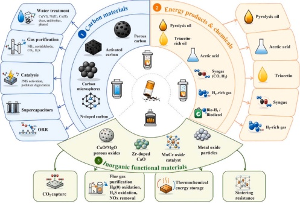
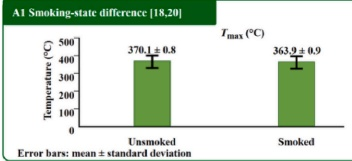
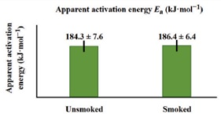
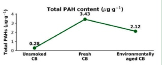
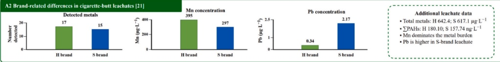
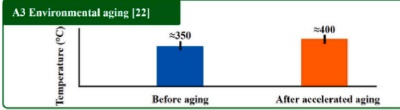
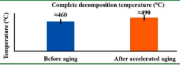
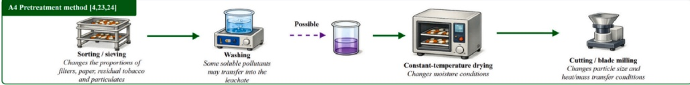
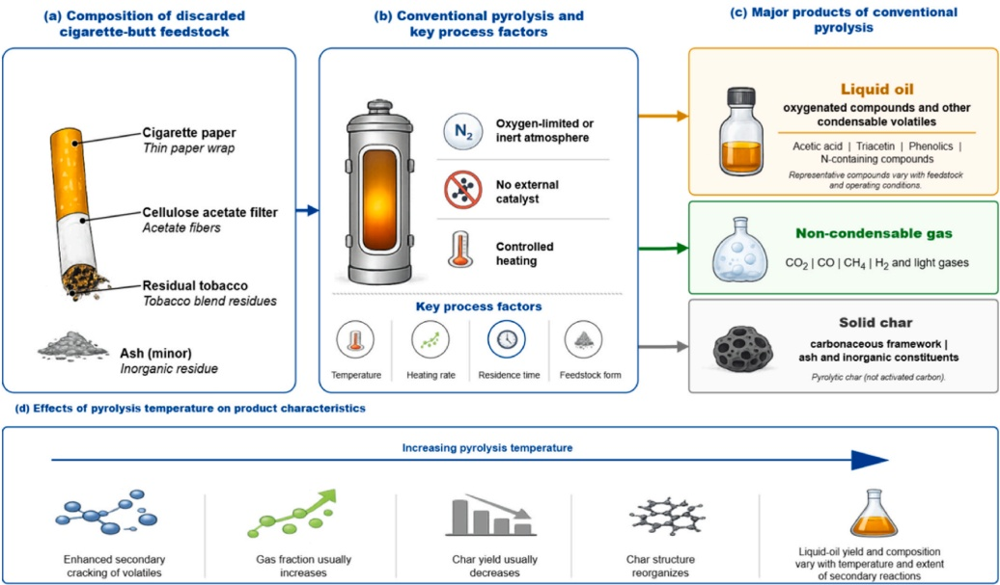
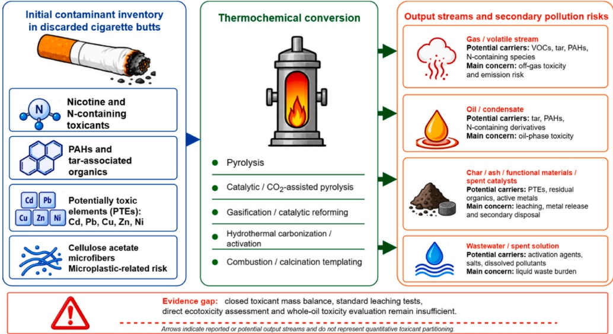

Review

# Thermal conversion of waste cigarette butts: Feedstock heterogeneity, process control, valorization pathways, and environmental safety: A critical review

Han Zhang $ ^{a,b} $, Jianyuan Fu $ ^{c} $, Bolin Wang $ ^{d} $, Hanjun Hu $ ^{e,*} $, Libo Zhang $ ^{a,**} $

 $ ^{a} $ School of Chemical Engineering, Guangdong University of Petrochemical Technology, Maoming, 525000, China

 $ ^{b} $ School of Energy and Environmental Engineering, University of Science and Technology Beijing, Beijing, 100083, China

 $ ^{c} $ School of Control and Computer Engineering, North China Electric Power University, Baoding, 071003, Hebei, China

 $ ^{d} $ Guangdong Country Garden School, Foshan, 528314, China

 $ ^{e} $ Beijing Chaobai Environmental Technology Co., Ltd, Beijing, 101399, China

##### HIGHLIGHTS

Feedstock heterogeneity affects the thermal behavior and process reproducibility of cigarette butt thermal conversion.

Thermal conversion can convert waste cigarette butts into oils, gases, chars, and functional materials.

The cross-phase fate of nicotine, PAHs, and heavy metals remains unclear.

- Conventional pyrolysis currently shows relatively higher near-term potential for engineering scale-up.

• Scale-up still requires feedstock standardization, continuous-operation validation, and LCA and TEA evaluation.

#### ARTICLE INFO

Keywords:

Pyrolysis

Recycling

Tobacco products

Nicotine

Polycyclic aromatic hydrocarbons

Heavy metals

#### GRAPHICAL ABSTRACT

## ABSTRACT

Waste cigarette butts are abundant and widely dispersed composite solid wastes worldwide. They consist of cellulose acetate filters, residual tobacco, cigarette paper, ash, and carry nicotine, polycyclic aromatic hydrocarbons (PAHs), and heavy metals. During weathering, cellulose acetate filters release microfibers and contribute to microplastic pollution, while toxic components migrate into aquatic and soil environments. Conventional landfilling, incineration, and recycling fail to achieve pollution control and resource recovery. This review focuses on the thermal conversion of waste cigarette butts. It compares feedstock heterogeneity, reaction mechanisms, and the effects of different processes on product formation and toxic-component migration, with the aim

of assessing resource-recovery feasibility and environmental safety. During thermal conversion, additives such as triacetin first undergo thermal desorption. Cellulose acetate then undergoes deacetylation and backbone cleavage, producing acetic acid and oxygenated volatiles. Cigarette paper releases phenols and aromatic compounds, while residual tobacco releases nicotine, pyridine, and other nitrogen-containing compounds. Volatiles may condense into pyrolysis oil or undergo cracking, reforming, or gasification into syngas at higher temperatures and under controlled atmospheres or catalytic conditions. The remaining carbon framework forms solid char through condensation, aromatization, and structural rearrangement. Different routes are oriented toward different products, but thermal conversion does not necessarily eliminate toxic components. Complete mass-balance data on their distribution among gas, oil, char, ash, and wastewater remain unavailable. Future studies should strengthen feedstock standardization, validation under realistic and continuous operating conditions, and life-cycle and techno-economic assessments, so that the environmental constraints and engineering requirements of waste cigarette but thermal conversion can be defined more clearly.

<table border=1 style='margin: auto; word-wrap: break-word;'><tr><td style='text-align: center; word-wrap: break-word;'>Abbreviation</td><td style='text-align: center; word-wrap: break-word;'>Definition</td></tr><tr><td style='text-align: center; word-wrap: break-word;'>AC</td><td style='text-align: center; word-wrap: break-word;'>Activated carbon</td></tr><tr><td style='text-align: center; word-wrap: break-word;'>BET</td><td style='text-align: center; word-wrap: break-word;'>Brunauer-Emmett-Teller</td></tr><tr><td style='text-align: center; word-wrap: break-word;'>BTEX</td><td style='text-align: center; word-wrap: break-word;'>Benzene, toluene, ethylbenzene, and xylenes</td></tr><tr><td style='text-align: center; word-wrap: break-word;'>CCB</td><td style='text-align: center; word-wrap: break-word;'>Cigarette-butt-derived carbon</td></tr><tr><td style='text-align: center; word-wrap: break-word;'>COD</td><td style='text-align: center; word-wrap: break-word;'>Chemical oxygen demand</td></tr><tr><td style='text-align: center; word-wrap: break-word;'>Ea</td><td style='text-align: center; word-wrap: break-word;'>Apparent activation energy</td></tr><tr><td style='text-align: center; word-wrap: break-word;'>ER</td><td style='text-align: center; word-wrap: break-word;'>Equivalence ratio</td></tr><tr><td style='text-align: center; word-wrap: break-word;'>FTIR</td><td style='text-align: center; word-wrap: break-word;'>Fourier-transform infrared spectroscopy</td></tr><tr><td style='text-align: center; word-wrap: break-word;'>GC-MS</td><td style='text-align: center; word-wrap: break-word;'>Gas chromatography-mass spectrometry</td></tr><tr><td style='text-align: center; word-wrap: break-word;'>LCA</td><td style='text-align: center; word-wrap: break-word;'>Life cycle assessment</td></tr><tr><td style='text-align: center; word-wrap: break-word;'>ORR</td><td style='text-align: center; word-wrap: break-word;'>Oxygen reduction reaction</td></tr><tr><td style='text-align: center; word-wrap: break-word;'>PAHs</td><td style='text-align: center; word-wrap: break-word;'>Polycyclic aromatic hydrocarbons</td></tr><tr><td style='text-align: center; word-wrap: break-word;'>PLI</td><td style='text-align: center; word-wrap: break-word;'>Pollution load index</td></tr><tr><td style='text-align: center; word-wrap: break-word;'>PMS</td><td style='text-align: center; word-wrap: break-word;'>Peroxymonosulfate</td></tr><tr><td style='text-align: center; word-wrap: break-word;'>Py-GC/MS</td><td style='text-align: center; word-wrap: break-word;'>Pyrolysis-gas chromatography/mass spectrometry</td></tr><tr><td style='text-align: center; word-wrap: break-word;'>RHE</td><td style='text-align: center; word-wrap: break-word;'>Reversible hydrogen electrode</td></tr><tr><td style='text-align: center; word-wrap: break-word;'>RQ</td><td style='text-align: center; word-wrap: break-word;'>Risk quotient</td></tr><tr><td style='text-align: center; word-wrap: break-word;'>TEA</td><td style='text-align: center; word-wrap: break-word;'>Techno-economic analysis</td></tr><tr><td style='text-align: center; word-wrap: break-word;'>TG-FTIR</td><td style='text-align: center; word-wrap: break-word;'>Thermogravimetric analysis coupled with Fourier-transform infrared spectroscopy</td></tr><tr><td style='text-align: center; word-wrap: break-word;'>TGA</td><td style='text-align: center; word-wrap: break-word;'>Thermogravimetric analysis</td></tr><tr><td style='text-align: center; word-wrap: break-word;'>TRL</td><td style='text-align: center; word-wrap: break-word;'>Technology readiness level</td></tr><tr><td style='text-align: center; word-wrap: break-word;'>VOCs</td><td style='text-align: center; word-wrap: break-word;'>Volatile organic compounds</td></tr></table>

## 1. Introduction

Waste cigarette butts are among the most abundant and widely dispersed anthropogenic solid wastes worldwide. Their management is hindered by the large quantities generated, dispersed littering, low recovery value per item, and inefficient collection (Vanapalli et al., 2023). Rather than being ordinary biomass residues, cigarette butts are complex pollutant-bearing wastes consisting of cellulose acetate filters, residual tobacco, cigarette paper, ash, and adsorbed smoke-derived contaminants (Premchand et al., 2025). Cellulose acetate filters are poorly biodegradable and can release microplastic fibers during environmental weathering. Meanwhile, nicotine, tar, polycyclic aromatic hydrocarbons (PAHs), volatile organic compounds, and heavy metals retained by the filters may leach into aquatic and terrestrial environments, posing persistent ecological risks (Vanapalli et al., 2023). Dobaradaran et al. (2019) reported a mean  $ \Sigma $16PAHs concentration of approximately 24.6  $ \mu $g g $ ^{-1} $ in freshly smoked cigarette butts, with lower concentrations observed after environmental aging, indicating that environmental exposure can further alter the PAH burden of cigarette butts. Taken together, cigarette-butt pollution constitutes a multifaceted environmental problem arising from the combined effects of plastic persistence, organic toxicity, metal-associated risks, and diffuse environmental dispersal.

Conventional disposal routes cannot fundamentally mitigate the long-term environmental risks posed by cigarette butts. Landfilling mainly relocates contaminants rather than eliminating them, as it neither decomposes cellulose acetate filters nor prevents the sustained release of nicotine, PAHs, and heavy metals (Dobaradaran et al., 2020, 2021, 2023, 2024a, 2024b; Akhbarizadeh et al., 2021; Vanapalli et al., 2023). Incineration or uncontrolled combustion reduces waste volume, but under suboptimal thermal conditions, oxygen deficiency, or inadequate gas-cleaning systems, it may cause secondary emissions of volatile organic compounds, pyrolysis-derived by-products, and inorganic contaminants in ash residues (Vanapalli et al., 2023). Basic recycling is likewise constrained by feedstock dispersion, compositional heterogeneity, residual pollutants, demanding pretreatment, and uncertain product safety, limiting its large-scale deployment (Battista, 2025). Accordingly, cigarette butt management must move beyond end-of-pipe cleanup toward integrated conversion pathways that combine volume reduction, detoxification, and resource recovery.

Thermochemical conversion offers one route for cigarette-butt valorization. Conventional pyrolysis is the baseline thermochemical route. It can convert cellulose acetate filters, residual tobacco, and cigarette paper into oil, gas, and char, and the product distribution is affected by temperature, heating rate, and residence time (Yousef et al., 2023; Lee et al., 2025). Beyond conventional pyrolysis, staged pyrolysis can selectively recover chemicals such as acetic acid (H. Kim et al., 2024a,b). CO₂-assisted pyrolysis and gasification-reforming can promote volatile conversion into syngas (Y. Kim et al., 2024a,b; Yousef et al., 2025). Hydrothermal carbonization, activation, and calcination templating have been used to prepare functional carbon and inorganic materials (Wu and Yang, 2023; Amghar et al., 2024). Representative studies illustrate several product-specific applications, including microspherical activated carbon for NH₃ adsorption (Wu and Yang, 2023) and KOH-activated pyrolytic char for acetaldehyde removal (Lee et al., 2025). Other studies have examined the selective recovery of acetic acid and triacetin-rich oils (Yousef et al., 2023; H. Kim et al., 2024a,b) and the production of H₂/CO-rich syngas (Y. Kim et al., 2024a,b). Cigarette-butt-derived carbon materials have also been investigated for Cr(VI) adsorption, heavy-metal removal, and CO₂ capture (Herrera-Puerta et al., 2025; C. Liu et al., 2025a,b; Premchand et al., 2025). Nevertheless, most existing assessments remain product-oriented, emphasizing yield, surface area, or adsorption performance, while the fate of hazardous constituents—including nicotine, PAHs, tar, heavy metals, residual activating agents, and off-gas pollutants—has not been adequately resolved.

This review focuses on resource recovery through the thermal conversion of waste cigarette butts. Existing reviews have mainly discussed cigarette butt pollution and control, biorefinery, resource recovery, or carbon-material applications (Vanapalli et al., 2023; Battista, 2025; Chen et al., 2025). Rather than cataloguing cigarette-butt-derived materials and their performance, this review follows the full thermal conversion process and examines feedstock heterogeneity, process control, value-added products, and environmental safety within a common analytical framework. Thermal conversion is examined separately because it usually does not require complete separation of cellulose acetate, residual tobacco, and cigarette paper. Temperature, reaction atmosphere, and catalysts can be adjusted to control multicomponent conversion and the resulting distributions of oil, gas, and char (Kim et al., 2023; Yousef et al., 2023; T. Liu et al., 2025a,b; Yousef et al., 2025). The review also evaluates the available evidence and

remaining gaps concerning the cross-phase migration of nicotine, PAHs, and heavy metals, together with risks associated with cellulose acetate microfibers. It also compares other valorization routes, scale-up evidence, and life-cycle assessment (LCA) and techno-economic analysis (TEA) evidence to clarify the environmental constraints and engineering requirements of waste cigarette butt thermal conversion.

## 2. Feedstock characteristics and thermal degradation mechanisms of cigarette butts

### 2.1. Feedstock boundaries and heterogeneity of cigarette butts

Existing studies define the feedstock boundary for cigarette butt thermal conversion inconsistently. The feedstocks investigated include whole smoked cigarette butts, separated smoked filters, unused filters, and separately examined cigarette paper, residual tobacco, and paper-filter-tobacco mixed samples. Whole cigarette butts contain filters, cigarette paper, residual tobacco, combustion ash, and smoke condensates (Vanapalli et al., 2023; Yousef et al., 2024). Separated smoked filters exclude most paper and tobacco but still retain adsorbed organics and inorganic particles (H. Kim et al., 2024a,b; Wilkinson et al., 2025). Unused filters are mainly composed of cellulose acetate and additives such as triacetin and  $ TiO_{2} $ (H. Kim et al., 2024a,b; Wilkinson et al., 2025). Thus, the term “cigarette butt” does not denote an equivalent feedstock across studies with respect to organic composition, inorganic matter, or pollutant load.

The initial pollutant load of cigarette butts also varies markedly. Existing studies have quantified PAHs, aromatic amines, and several heavy metals in smoked cigarette butts. For example, the mean  $ \Sigma $16PAHs concentration was approximately 24.6  $ \mu $g g $ ^{-1} $ in freshly smoked cigarette butts and approximately 20.4 and 18.7  $ \mu $g g $ ^{-1} $ in urban- and riverside-aged cigarette butts, respectively (Dobaradaran et al., 2019). Hg and Pb concentrations in cigarette butts collected along the Persian Gulf were 2.5–86.32 and 650–8630 ng g $ ^{-1} $, respectively (Dobaradaran et al., 2018). Dobaradaran et al. (2022) further measured total aromatic amines of 0.28, 3.43, and 2.12  $ \mu $g g $ ^{-1} $ in unsmoked cigarettes, freshly smoked cigarette butts, and environmentally aged cigarette butts, respectively. These results show that smoking and subsequent environmental exposure alter both the physical state and pollutant load of cigarette butts. Environmental assessments of thermal conversion must therefore account for this feedstock variability. Yousef et al. separately studied cigarette paper, filters, tobacco, and their mixed samples, and found clear differences in pyrolysis volatiles among the components. Cigarette paper mainly produced phenolic products, filters mainly produced carbonyl-containing oxygenates such as acetic acid, and tobacco was rich in nitrogen-containing products such as pyridine (Yousef et al., 2024). Wilkinson et al. distinguished unused and smoked filters and compared their thermal behavior using Fourier-transform infrared spectroscopy (FTIR), thermogravimetric analysis (TGA), and kinetic analysis. The main decomposition temperatures of the two filters differed significantly, while their apparent activation energies were similar, indicating that differences in feedstock definitions limit comparisons of thermal decomposition kinetics and pollutant loading across studies (Dobaradaran et al., 2022; Wilkinson et al., 2025).

Overall, the feedstocks used across studies are not equivalent in composition or thermal response. Whole smoked cigarette butts reflect the combined effects of multiple components and smoking residues, whereas separated filters and single-component samples are more suitable for identifying the contribution of specific components to pyrolysis behavior. Studies should therefore define the feedstock boundary before comparing product distributions, thermal decomposition kinetics, or pollutant loads.

After defining the feedstock boundary, differences in composition and state within the same feedstock type must also be considered. As shown in Fig. 1, within-type heterogeneity in cigarette butts arises mainly from smoking status, brand design, environmental weathering, collection source, and pretreatment method. These factors can alter

Fig. 1. Sources of internal heterogeneity within cigarette-butt feedstocks of the same type and representative evidence. Note: A1, differences in smoking status, mainly based on (Dobaradaran et al., 2022; Wilkinson et al., 2025); A2, brand differences, mainly based on (Yang et al., 2023); A3, environmental weathering, mainly based on (Music et al., 2023); A4, pretreatment methods, mainly based on (Hossaini Motlagh et al., 2024; H. Kim et al., 2024a,b; Yang and Yang, 2025).
 

component ratios, pollutant loads, elemental composition, physical state, and thermal-analysis profiles. These differences further affect thermal decomposition kinetics, pyrolysis product characteristics, environmental safety evaluation, and the reproducibility and comparability of research results.

Smoking status is an important source of internal heterogeneity within the same feedstock type. As shown in Fig. 1A1, Wilkinson et al. measured main decomposition temperatures of  $ 370.1 \pm 0.8 $ and  $ 363.9 \pm 0.9 $ °C for unused and smoked filters, respectively, and apparent activation energies (Ea) of  $ 184.3 \pm 7.6 $ and  $ 186.4 \pm 6.4 $ kJ mol $ ^{-1} $, respectively. The slight decrease in decomposition temperature, together with the similar Ea values, suggests that smoking has a limited effect on the apparent energy barrier of the main cellulose acetate decomposition stage (Wilkinson et al., 2025). By contrast, the PAH and aromatic-amine results discussed above show that smoking has a stronger effect on the pollutant load of cigarette butts, and subsequent environmental exposure may further change the residual levels of some pollutants (Dobaradaran et al., 2019, 2022). Thus, smoking status has a limited effect on the apparent kinetics of the main decomposition stage but can affect environmental-safety assessment by changing pollutant load.

Brand design and environmental weathering further expand feedstock differences. As shown in Fig. 1A2, cigarette-butt leachates from two brands differed in both the number and concentrations of detected metals. Seventeen metals were detected in the H-brand leachate and 15 in the S-brand leachate. The Mn concentrations were 395 and 297 µg L⁻¹, respectively, whereas the corresponding Pb concentrations were 0.34 and 2.17 µg L⁻¹. The total metal concentrations were 642.4 and 617.1 µg L⁻¹, respectively (Yang et al., 2023). These results indicate that brand-related differences may affect the initial pollutant load of cigarette-butt feedstocks. However, evidence from only two brands is insufficient to establish a general relationship between brand design and leaching behavior.

Environmental weathering increases variability by changing the physical state and thermal-analysis features of filters. As shown in Fig. 1A3, accelerated weathering changes the cellulose acetate particle size and fiber state in smoked filters. The main thermal decomposition temperature shifts from approximately 350 °C to approximately 400 °C, and the complete thermal decomposition peak shifts from approximately 460 °C to approximately 490 °C. These approximate values suggest that weathering may shift the reaction-temperature window by about 40–50 °C (Music et al., 2023). Together with the decrease in aromatic-amine content after environmental aging, these results indicate that weathering can simultaneously alter filter physical structure, pollutant load, and thermal-analysis profiles, reducing the reproducibility of process parameters among samples with different weathering states.

Geographical source, collection method, and pretreatment also change feedstock state. Hossaini Motlagh et al. analyzed leachates produced from recycled filters collected from different locations and exposure states. They found that the maximum difference in chemical oxygen demand (COD) reached 314.2%, and pollutants such as Cr, Pb, Ni, and Cd were detected, indicating that collection source and environmental exposure can generate substantial differences in pollutant loads among samples (Hossaini Motlagh et al., 2024). This COD difference reflects leachate properties and cannot be directly converted into changes in cigarette butt bulk composition or pyrolysis products. Uncontrolled variation in collection source may therefore cause batch-to-batch differences in pollutant load, product quality, and environmental-risk assessments.

As shown in Fig. 1A4, pretreatment is not only a routine experimental operation. It also redefines the feedstock entering the reactor. Sorting or screening changes the proportions of filters, cigarette paper, residual tobacco, and particulate impurities; washing may transfer soluble pollutants into the leachate; constant-temperature drying alters moisture content; and cutting or blade milling changes particle size and heat- and mass-transfer conditions (Hossaini Motlagh et al., 2024; H. Kim et al., 2024a,b; Yang and Yang, 2025). Thus, even when different studies all use “smoked filters” as feedstock, their actual composition and physical state may still differ if sorting, washing, drying, or grinding conditions differ. Existing studies still lack direct comparisons of thermal conversion for different geographical sources and collection systems under unified conditions. The extent to which these factors affect oil, gas, and char yields and product performance therefore remains unquantified.

### 2.2. Thermal decomposition mechanisms of cellulose acetate filters

The thermal decomposition of cellulose acetate filters is central to the thermochemical conversion of cigarette butts. These filters are primarily composed of acetylated cellulose and contain additional components such as triacetin and  $ TiO_{2} $. During heating, in addition to the typical reactions of cellulose, including glycosidic bond cleavage and dehydration, cellulose acetate filters undergo a series of consecutive transformations involving deacetylation, hydrogen-bond rearrangement, crystalline phase transition, volatile release, and char structure formation (Janković et al., 2023, 2024). Under an inert atmosphere, cellulose acetate filters sequentially undergo thermal desorption, deacetylation, backbone scission, and carbonization, producing acetic acid, oxygenated volatiles, tarry compounds, and carbonaceous residues. Acetic acid is mainly derived from acetyl group cleavage and degradation of the cellulose acetate backbone, whereas char formation depends on high-temperature condensation, aromatization, and structural rearrangement (Janković et al., 2023; H. Kim et al., 2024a,b).

The dominant reactions of cellulose acetate filters vary with temperature. The specific temperature ranges, feedstocks studied, and main products are listed in Table 1A. H. Kim et al., 2024a,b divided thermal conversion of waste filters into two stages: 100–300 °C, where thermal desorption of additives such as triacetin mainly occurs, and 301–400 °C, where the main pyrolysis of cellulose acetate dominates and acetic acid is the main product. Yousef et al. (2023) conducted whole-butt pyrolysis at 650–750 °C and obtained triacetin-enriched oil, gas, and Ca-rich porous char. The 650–750 °C range is the reactor temperature for whole cigarette but pyrolysis, not the initial release temperature of triacetin. The two studies describe additive desorption at low temperature and product distribution under high-temperature whole-butt pyrolysis, respectively, and are therefore not contradictory.

Structural evolution of cellulose acetate filters further affects volatile release and char-structure formation. Janković et al. (2024) noted that hydrogen-bond disruption, transformation from cellulose I to cellulose II, and chain rearrangement during slow pyrolysis can change the ordering and cleavage sequence of polymer chains, thereby affecting deacetylation, backbone cleavage, and volatile release. Their subsequent study showed that pre-carbonization devolatilization, nucleation-controlled chain scission, glycosidic bond cleavage, and solid-phase structural rearrangement jointly promote mesoporous char formation (Janković et al., 2023). These structural changes influence multiple product fractions by regulating volatile-release sequences and solid-phase condensation, thereby affecting the formation of oxygenated products such as acetic acid and the pore structure of the final char material. Herrera-Puerta et al. (2025) further found that smoked filters can form Cr(VI) adsorbents after inert pyrolysis and KOH activation, indicating that carbonized residues from cellulose acetate filters can serve as precursors for adsorbent production.

The reaction atmosphere markedly changes the thermal conversion pathway of filters. Under inert atmospheres, additive thermal desorption, deacetylation, backbone cleavage, devolatilization, and carbonization dominate. Under oxidative atmospheres, ignition, sustained combustion, and oxidative conversion dominate. The dominant processes, main products or intermediates, solid-phase changes, and key influencing factors under the 2 atm are listed in Table 1B.

Veljković et al. showed that heating rate affects the ignition behavior

Thermal conversion of cigarette-butt feedstocks: (A) temperature-dependent stages and products; (B) inert versus oxidative atmospheres.
 

<table border=1 style='margin: auto; word-wrap: break-word;'><tr><td colspan="5">Part A. Temperature-dependent decomposition and products</td></tr><tr><td style='text-align: center; word-wrap: break-word;'>Temperature or reaction condition</td><td style='text-align: center; word-wrap: break-word;'>Feedstock studied</td><td style='text-align: center; word-wrap: break-word;'>Main change</td><td style='text-align: center; word-wrap: break-word;'>Main product or result</td><td style='text-align: center; word-wrap: break-word;'>Reference</td></tr><tr><td style='text-align: center; word-wrap: break-word;'>100–300 °C</td><td style='text-align: center; word-wrap: break-word;'>Separated smoked filters</td><td style='text-align: center; word-wrap: break-word;'>Thermal desorption of additives such as triacetin</td><td style='text-align: center; word-wrap: break-word;'>Release of additives such as triacetin</td><td style='text-align: center; word-wrap: break-word;'>H. Kim et al., 2024a,b</td></tr><tr><td style='text-align: center; word-wrap: break-word;'>301–400 °C</td><td style='text-align: center; word-wrap: break-word;'>Separated smoked filters</td><td style='text-align: center; word-wrap: break-word;'>Main pyrolysis of cellulose acetate</td><td style='text-align: center; word-wrap: break-word;'>Acetic acid as the main product</td><td style='text-align: center; word-wrap: break-word;'>H. Kim et al., 2024a,b</td></tr><tr><td style='text-align: center; word-wrap: break-word;'>650–750 °C $ ^{1} $</td><td style='text-align: center; word-wrap: break-word;'>Waste cigarette butts</td><td style='text-align: center; word-wrap: break-word;'>Whole-butt pyrolysis and formation of oil, gas, and char products</td><td style='text-align: center; word-wrap: break-word;'>Triacetin-enriched oil, gas, and Ca-rich porous char</td><td style='text-align: center; word-wrap: break-word;'>Yousef et al. (2023)</td></tr><tr><td style='text-align: center; word-wrap: break-word;'>Oxidative heating conditions</td><td style='text-align: center; word-wrap: break-word;'>Smoked filter fiber bundles</td><td style='text-align: center; word-wrap: break-word;'>Ignition, sustained combustion, and oxidative conversion</td><td style='text-align: center; word-wrap: break-word;'>Reaction intermediates such as levoglucosenone and acrolein</td><td style='text-align: center; word-wrap: break-word;'>Veljković et al. (2024)</td></tr><tr><td colspan="5">Part B. Inert versus oxidative atmospheres</td></tr><tr><td style='text-align: center; word-wrap: break-word;'>Criterion</td><td style='text-align: center; word-wrap: break-word;'>Inert atmosphere</td><td style='text-align: center; word-wrap: break-word;'></td><td style='text-align: center; word-wrap: break-word;'>Oxidative atmosphere</td><td style='text-align: center; word-wrap: break-word;'></td></tr><tr><td style='text-align: center; word-wrap: break-word;'>Dominant process</td><td style='text-align: center; word-wrap: break-word;'>Additive thermal desorption, deacetylation, backbone cleavage, devolatilization, and carbonization</td><td style='text-align: center; word-wrap: break-word;'></td><td style='text-align: center; word-wrap: break-word;'>Ignition, sustained combustion, and oxidative conversion</td><td style='text-align: center; word-wrap: break-word;'></td></tr><tr><td style='text-align: center; word-wrap: break-word;'>Main products or intermediates</td><td style='text-align: center; word-wrap: break-word;'>Acetic acid, triacetin, gaseous products, and char</td><td style='text-align: center; word-wrap: break-word;'></td><td style='text-align: center; word-wrap: break-word;'>Reaction intermediates such as levoglucosenone and acrolein</td><td style='text-align: center; word-wrap: break-word;'></td></tr><tr><td style='text-align: center; word-wrap: break-word;'>Solid-phase change</td><td style='text-align: center; word-wrap: break-word;'>Pre-carbonization and carbonization, forming char with mesoporous and macroporous structures</td><td style='text-align: center; word-wrap: break-word;'></td><td style='text-align: center; word-wrap: break-word;'>Continued combustion and mass loss of the residual solid phase</td><td style='text-align: center; word-wrap: break-word;'></td></tr><tr><td style='text-align: center; word-wrap: break-word;'>Key influencing factors</td><td style='text-align: center; word-wrap: break-word;'>Temperature program, heating rate, and catalytic conditions</td><td style='text-align: center; word-wrap: break-word;'></td><td style='text-align: center; word-wrap: break-word;'>Heating rate, ignition behavior, and combustion stability</td><td style='text-align: center; word-wrap: break-word;'></td></tr><tr><td style='text-align: center; word-wrap: break-word;'>Main application or concern</td><td style='text-align: center; word-wrap: break-word;'>Recovery of chemicals such as acetic acid and preparation of char materials</td><td style='text-align: center; word-wrap: break-word;'></td><td style='text-align: center; word-wrap: break-word;'>Ignition behavior, combustion stability, and heat-release characteristics</td><td style='text-align: center; word-wrap: break-word;'></td></tr><tr><td style='text-align: center; word-wrap: break-word;'>References</td><td style='text-align: center; word-wrap: break-word;'>(Janković et al., 2023; H. Kim et al., 2024a,b)</td><td style='text-align: center; word-wrap: break-word;'></td><td style='text-align: center; word-wrap: break-word;'>Veljković et al. (2024)</td><td style='text-align: center; word-wrap: break-word;'></td></tr></table>

Note (Part A): 650–750 °C is the reactor set temperature for whole cigarette butt pyrolysis and does not mean that triacetin begins to release only at this temperature.

and combustion stability of used cellulose ester filter bundles. The dehydration of levoglucosan to levoglucosenone and the decomposition of glycerol to acrolein were identified as important steps in oxidative conversion (Veljković et al., 2024).

Overall, cellulose acetate conversion proceeds through additive desorption, deacetylation and acetic acid formation, backbone scission, secondary reactions of volatiles, and finally aromatization and char formation. Inert atmospheres favor chemical recovery and carbon-material preparation, whereas oxidative atmospheres require attention to ignition, combustion stability, and heat release.

### 2.3. Thermal behavior of cigarette paper, residual tobacco, and mixed cigarette butts

The thermal behavior of whole cigarette butts is not a simple superposition of cellulose acetate filter pyrolysis. Cigarette paper, residual tobacco, ash, and adsorbed smoke residues collectively influence volatile release, gas composition, char structure, and the properties of the resulting materials. During pyrolysis of intact cigarette butts, volatiles from different components are released over overlapping temperature ranges and undergo secondary reactions, leading to product distributions that are more complex than those from a single filter component (Yousef et al., 2024). Using thermogravimetric analysis coupled with Fourier-transform infrared spectroscopy (TG-FTIR) and gas chromatography–mass spectrometry (GC–MS), Yousef et al. compared cigarette paper, filters, tobacco, and mixed samples, and found that pyrolysis of cigarette paper mainly produced aromatics and phenolic compounds, filters generated acetic acid and carbonyl-containing oxygenates, and tobacco released CO₂, pyridine, and other nitrogen-containing species. In mixed samples, products such as acetic acid, propionaldehyde, acetone, limonene, and pyridine were detected simultaneously, clearly demonstrating the coupled behavior of multiple components (Yousef et al., 2024).

Residual tobacco is the primary source of nitrogen-containing products in whole cigarette butts and directly affects pyrolysis oil composition, gas evolution, and the formation of N-doped carbon materials. Compared with filters and cigarette paper, tobacco contains higher proportions of N, S, and inorganic ash, making it more prone to generating pyridine derivatives, nicotine-related compounds, and other nitrogenol volatiles (Yousef et al., 2024). Muzyka et al. (2022) investigated the pyrolysis of tobacco waste and found that nitrogen-containing compounds are mainly released in the low-temperature region; nicotine, pyridine, and N-methyl-2-pyrrolidone were detected in the oil phase, while increasing temperature promoted the decomposition and transformation of some nitrogenous species. Therefore, in the thermochemical conversion of whole cigarette butts, residual tobacco is a key component governing the formation of nitrogen-containing products and environmental risk assessment rather than an inert impurity.

Cigarette paper mainly contributes cellulose-derived volatiles and ash, while tar, PAHs, heavy metals, and smoke condensates retained in used cigarette butts further alter the carbonization pathway. Post-consumer cigarette butts have been converted into Cr(VI)-adsorbing carbon materials through inert pyrolysis followed by KOH activation, confirming that retained components in mixed butts participate in char precursor formation and pore structure regulation (Herrera-Puerta et al., 2025). Similarly, Zuccante et al. (2024) compared Fe-N-C electrocatalysts derived from tobacco, filters, cigarette paper, and whole cigarette butts, and found pronounced differences in morphology, N/Fe species, and Oxygen reduction reaction (ORR) performance among the resulting materials, indicating that feedstock composition directly governs the formation of active carbon sites and functional performance. Overall, feedstock selection, whether whole cigarette butts or separated filters, is not merely a preprocessing choice; it directly determines volatile composition, nitrogenous product distribution, char structure, and the performance of derived functional materials.

## 3. Thermochemical conversion technologies and process control of cigarette butts

### 3.1. Conventional pyrolysis and product distribution

As shown in Fig. 2, conventional pyrolysis is the basic route for converting cigarette butts into liquid oil, non-condensable gases, and solid char under oxygen-deficient or inert atmospheres. Product distribution is affected by temperature, heating rate, residence time, and feedstock form. Different target products require different control priorities. Liquid-product routes focus on oil yield and enrichment of target chemicals; char-material routes focus on char yield, pore structure, and subsequent activation; and gas routes focus on secondary cracking of

Fig. 2. Process flow diagram of conventional pyrolysis of waste cigarette butts. Note: This figure was prepared based on (Duanguppama et al., 2023; Janković et al., 2023; Yousef et al., 2023; Lee et al., 2025; Premchand et al., 2025).
 

volatiles and generation of useable gases (Janković et al., 2023; Yousef et al., 2023; Lee et al., 2025; Premchand et al., 2025). This section therefore discusses conventional pyrolysis in terms of liquid, char, and gas products.

When the target is liquid products or recoverable chemicals, temperature must balance oil-phase yield against excessive secondary cracking. Lee et al. (2025) pyrolyzed waste filters in a fixed bed at 500 °C and obtained 53.3% oil, 23.0% gas, and 23.7% char, indicating that medium-temperature pyrolysis can provide a high liquid yield while also producing a char fraction. Duanguppama et al. studied fixed-bed pyrolysis of smoked cigarette butts at 400–600 °C and found that the liquid fuel yield was highest at 400 °C (33.3 wt%). With dolomite added at this temperature, the liquid yield decreased to 28.6 wt% and the gas fraction increased by 8 wt%, but the higher heating value increased from 12.8 to 18.1 MJ kg⁻¹, and ignitability, viscosity, and density improved (Duanguppama et al., 2023). Yousef et al. (2023) obtained 38–39.5 wt% oil, 25.7–27.7 wt% char, and 33–36.4 wt% gas during waste cigarette butt pyrolysis at 650–750 °C. The triacetin content in the oil phase was highest at 750 °C, reaching 43%. These results show that total oil yield and target-component enrichment do not follow the same trend. Low to moderate temperatures help maintain liquid yield, whereas higher temperatures may favor enrichment of specific components in the condensed oil. Liquid routes should therefore not be evaluated only by total yield. Oil-phase composition, target-component concentration, and subsequent separation requirements should also be examined.

When the target shifts toward the production of carbon materials, the evaluation criteria correspondingly move from liquid yield to char yield, pore structure, and performance after subsequent activation. Premchand et al. investigated slow pyrolysis over 400–700 °C and found that the char yield decreased from 26.6 wt% to 20.1 wt% with increasing temperature. Nevertheless, the char produced at 500–600 °C exhibited relatively high specific surface areas of 272.9–270.8 m² g⁻¹ and showed favorable adsorption performance toward Ni(II) and Cu(II), respectively. These results suggest that an intermediate temperature range can provide a reasonable balance among char yield, pore development, and end-use performance (Premchand et al., 2025). Herrera-Puerta et al. prepared a Cr(VI) adsorbent via inert pyrolysis at 350 °C followed by KOH activation. The activated carbon exhibited a Brunauer–Emmett–Teller (BET) specific surface area of 433 m² g⁻¹ and a micropore volume of 0.25 cm³ g⁻¹, together with a maximum Cr(VI) adsorption capacity of 55.8 mg g⁻¹. This finding indicates that chars initially produced at relatively low temperatures can subsequently develop functional pore structures through post-activation (Herrera-Puerta et al., 2025).

Thermal-analysis and bench-scale carbonization experiments by Janković et al. (2023) showed that temperature and heating rate influence the devolatilization and carbonization of used filters, thereby affecting the specific surface area, pore structure, and surface functional groups of the resulting carbon. Higher temperatures are therefore not inherently preferable for carbon-material production; pyrolysis and subsequent activation should instead be designed together.

When gas production is the primary objective, higher temperatures or more extensive secondary cracking generally increase the gas fraction. Yousef et al. (2023) reported gas yields of 33.0–36.4 wt%; at 750 °C, the gas contained mainly CO₂ (11.6%), CO (8.0%), H₂ (4.6%), and CH₄ (2.0%). Duanguppama et al. (2023) also found that dolomite decreased the liquid yield while increasing the gas fraction by 8 wt%. These results indicate that conventional pyrolysis can produce a gas fraction, but it offers limited selectivity for target gases such as H₂ and CO and is therefore better regarded as a front-end step before catalytic reforming or gasification.

The feedstock boundary, reactor type, residence time, and yield-calculation basis differ among studies. These data should therefore be used only to summarize within-study effects of temperature on liquid yield, char structure, and gas generation, not for direct performance comparisons across routes.

Overall, the principal function of conventional pyrolysis is reducing cigarette butt volume through a relatively simple process while producing liquid chemicals, gas, and char precursors (Yousef et al., 2023; Lee et al., 2025; Premchand et al., 2025). Suitable conditions differ among target products. Within the feedstocks and reactor systems used in existing studies, low to moderate temperatures tend to maintain liquid yield, intermediate temperatures can balance char yield and pore development, and higher temperatures or intensified secondary cracking tend to increase the gas fraction or enrich selected oil-phase components (Duanguppama et al., 2023; Janković et al., 2023; Yousef et al., 2023; Premchand et al., 2025). Conventional pyrolysis therefore does not have a single optimal temperature applicable to all products. Process conditions should therefore be selected according to the target product. However, pyrolysis oil has a complex composition, gas selectivity is limited, and primary char usually requires further activation, which restricts direct use of these products without downstream upgrading (Janković et al., 2023; Yousef et al., 2023; Herrera-Puerta et al., 2025; Lee et al., 2025; Premchand et al., 2025). These limitations also motivate the development of intensified routes, including catalytic pyrolysis, CO₂-assisted conversion, and gasification-reforming (Kim et al., 2023; Y. Kim et al., 2024a,b; Guo et al., 2025; Yousef et al., 2025).

### 3.2. Catalytic pyrolysis, CO $ _{2} $-Assisted conversion, and reforming

Catalytic pyrolysis and CO₂-assisted conversion are used to shift product formation from simple partitioning among oil, gas, and char toward more selective cracking, reforming, and gasification of volatiles (Kim et al., 2023; Y. Kim et al., 2024a,b; Guo et al., 2025; Yousef et al., 2025). Under an N₂ atmosphere, cigarette butt-derived volatiles are readily condensed into a complex oil phase or converted into tar. In contrast, CO₂ can serve as a mild oxidant and reactive medium, participating in gas-phase reactions and regulating carbon distribution among oil, gas, and coke/char. Kim et al. (2023) demonstrated that CO₂-assisted thermal treatment promotes the thermal cracking of toxic organic compounds in cigarette butts, while Ni catalysts markedly enhance H₂/CO syngas production and suppress carbon deposition on the catalyst surface. Overall, the distinction between N₂ and CO₂ atmospheres determines whether the thermal conversion pathway favors condensable oil recovery or deep conversion of volatiles into syngas.

Catalyst selection and reactor configuration directly govern conversion efficiency and product quality. Ni-based catalysts are widely used for steam reforming and hydrogen-rich gas production, whereas Co-based or commercial reforming catalysts improve gas quality through cracking, deoxygenation, and tar reforming. Single-stage catalytic pyrolysis modifies the oil and gas composition in situ, whereas two-stage pyrolysis-reforming or gasification-catalytic reforming systems are more favorable for converting primary pyrolysis volatiles into  $ H_{2} $, CO, and light gases. Yousef et al. (2025) employed an oxygen-fed updraft gasification-catalytic reforming route to convert cigarette butts into syngas-rich products; after catalytic reforming, the  $ H_{2} $ content increased to 30.27 vol%, while tar concentration decreased from 18.15 to 13.38 g m $ ^{-3} $. Thus, compared with direct pyrolysis for oil production, reforming-oriented gas production can mitigate tar accumulation and low-value gas formation, but it requires high operating temperatures, stable catalysts, and downstream gas-cleaning systems.

Ni/char-catalyzed reforming enables coupled utilization of “product-catalyst” systems, in which cigarette butt-derived char acts not only as a by-product but also as a metal catalyst support involved in volatile reforming. Guo et al. (2025) investigated cigarette butt pyrolysis-reforming at 500–700 °C and reported that the conversion of light and heavy organics reached 75% at 700 °C, with coke formation lower than that observed at 500 and 600 °C. However, coke deposition, Ni particle stability, and catalyst regeneration remain critical bottlenecks for this route. Catalytic production of selective chemicals requires careful control of reaction severity. In acetic acid production, Kim et al. found that Al-MCM-41 promoted the conversion of triacetin; however, catalytic pyrolysis of whole waste filters caused acetic acid derived from cellulose acetate to undergo further cracking into light hydrocarbons. The optimal strategy was therefore identified as “catalytic thermal desorption of additives followed by non-catalytic pyrolysis of cellulose acetate” (H. Kim et al., 2024a,b). Duanguppama et al. (2023) further confirmed that kaolin and dolomite decreased liquid fuel yield but increased gas production, improving the heating value, viscosity, and ignition performance of the resulting fuel. Liu et al. 2025a,b investigated co-carbonization of recycled cellulose acetate and showed that the high volatility of cellulose acetate facilitates pore structure formation, clarifying the link between volatile release and char structure regulation. Overall, catalytic pyrolysis, CO₂-assisted conversion, and reforming promote the transformation of cigarette butt-derived volatiles from complex oil fractions into hydrogen-rich gases, syngas, or selective chemicals by regulating atmosphere, catalysts, and temperature windows, representing key pathways for upgrading conventional pyrolysis toward directed thermochemical conversion.

### 3.3. Hydrothermal carbonization and activation-assisted carbonization

Hydrothermal carbonization provides a conversion pathway for cigarette butt filters that differs from dry pyrolysis. In aqueous media, it promotes the hydrolysis, dehydration, condensation, and aromatization of cellulose acetate, first yielding hydrochar or carbon microspheres, followed by activation to regulate pore structure and surface functional groups. Yang and Yang (2025) reported that cigarette butt filters subjected to hydrothermal treatment at 200 °C formed oxygen-containing carbon microspheres through polymerization–nucleation and layer-by-layer growth, thereby enhancing NH₃ adsorption performance. Wu and Yang (2023) prepared microspherical activated carbon via hydrothermal reaction combined with H₃PO₄ activation and found that NH₃ adsorption capacity was positively correlated with the abundance of surface acidic functional groups rather than being governed solely by BET surface area. Bi et al. (2022) fabricated porous carbon for supercapacitors through hydrothermal carbonization followed by KOH activation, confirming that activation temperature regulates pore volume and electrochemical performance.

The type of activating agent determines the conversion direction from hydrochar or carbonized precursors to functional carbon materials. KOH is favorable for constructing high-surface-area carbons with well-developed microporous structures;  $ K_2CO_3 $ is a milder alkaline activator;  $ H_3PO_4 $ and phytic acid introduce acidic and phosphorus-containing functional groups, and  $ ZnCl_2 $ promotes dehydration–condensation reactions as well as pore formation. Xue et al. (2024) used  $ K_2CO_3 $ to activate cigarette butt-derived hydrochar and prepared porous carbon with high specific surface area for chloramphenicol adsorption. C. Liu et al. 2025a,b constructed ultramicroporous N-doped biochar through hydrothermal carbonization, nitrogen incorporation, and mild activation, demonstrating that both the ultramicropore fraction and N species jointly regulate  $ CO_2 $ capture capacity and selectivity. Ghosh and Halder (2026) functionalized cigarette butt hydrochar as a solid acid catalyst for biodiesel production via esterification of waste cooking oil, confirming that hydrochar can serve as a scaffold for catalytic materials.

Supporting studies indicate that the core of activation-assisted carbonization is not simply increasing BET surface area, but matching pore size, surface chemistry, and target application. Dalmaz and SiVri; Kaya Özak (2024) prepared cigarette butt activated carbon via ZnCl₂-assisted thermal carbonization for methylene blue adsorption. Wu et al. (2022) compared the effects of ZnCl₂, KOH, and H₃PO₄ activation and found that the KOH-activated sample exhibited the best supercapacitor performance. Mota-Resendiz et al. (2025) tuned the KOH dosage, temperature, and residence time to prepare high-performance activated carbon for water treatment. Sivaselvam et al. (2022) combined cigarette butt carbon with MgO for ciprofloxacin adsorption.

Overall, the hydrothermal carbonization–activation route offers the advantages of first building a stable carbon precursor and then enabling directed tuning for adsorption, catalysis, energy storage,  $ CO_{2} $ capture, and other applications through acid/base activation, heteroatom doping, and composite modification.

### 3.4. Gasification, combustion, calcination, and emerging routes

Beyond conventional pyrolysis and activation-assisted carbonization, cigarette butts can also be functionally converted through non-typical thermal transformation routes such as gasification, combustion-assisted synthesis, calcination templating, and oxidation kinetic analysis. The key feature of these routes is that cigarette butts are no longer used solely as carbon precursors; instead, they can act as volatile fuel sources, sacrificial templates, structure-directing agents, or model materials for thermal reaction studies. Unlike pyrolysis, which emphasizes the distribution of oil, gas, and char, gasification primarily converts cellulose acetate, cigarette paper, and residual tobacco into syngas composed of  $ H_{2} $, CO, and light hydrocarbons at high temperature. Yousef et al. (2025) applied an oxygen-fed updraft gasification-catalytic reforming route and showed that under 700–900 °C and different equivalence ratios (ER), cigarette butts were converted into syngas with a yield of 82.3–89.7%; after catalytic reforming at 900 °C, the  $ H_{2} $ content reached 30.27 vol%, while tar content was significantly reduced. Therefore, gasification-reforming is well suited for energy-gas production, with process control focusing on gasification temperature, equivalence ratio, tar reduction, and syngas quality.

Calcination and combustion-assisted synthesis reflect a differentiated utilization logic in which cigarette butts serve as templates or fuels. Amghar et al. (2024) used cigarette butts as a sacrificial template, followed by Ca/Mg impregnation and combustion calcination, to prepare porous CaO-based materials for CO₂ capture and thermochemical energy storage in calcium looping processes. Li et al. (2023) proposed a cigarette butt-assisted combustion synthesis method in which cigarette butts acted as both a porous reaction scaffold and a fuel source to rapidly prepare Zr-doped CaO sorbents; a combustion temperature of 750 °C and 25 wt% ZrO₂ support favored the formation of an anti-sintering framework, maintaining high conversion efficiency during cyclic CO₂ capture. Unlike gasification, whose goal is syngas maximization, this route exploits the exothermicity of cigarette butt combustion and the fibrous templating effect to construct pore structures in inorganic functional materials and improve cyclic stability.

Combustion synthesis can also be extended to the preparation of catalysts for flue-gas pollutant control. Peng et al. (2024) directly combusted cigarette butts impregnated with metal/sulfate precursors to prepare sulfated MnCe catalysts, increasing Hg $ ^{0} $ oxidation efficiency from 66.46% for pristine MnCe to 88.76%; the enhanced activity was attributed to surface chemisorbed oxygen and Mn–Ce redox synergy. Veljković et al. (2024) investigated the combustion kinetics of spent filter fiber bundles and confirmed that the heating rate affects ignition behavior and combustion stability, while levoglucosan formation and glycerol decomposition to acrolein represent rate-controlling steps in oxidative thermal conversion. Overall, these non-typical routes expand the boundaries of cigarette butt thermal conversion: gasification focuses on energy-gas production, calcination templating targets inorganic functional material fabrication, and combustion kinetics studies address thermal safety and reaction control. Emerging heating methods such as microwave-assisted processing may further enhance heat-transfer efficiency and improve conversion selectivity.

## 4. High-value products and applications of cigarette butt thermal conversion

### 4.1. Adsorbents and catalysts for environmental remediation

Environmental remediation includes pollutant adsorption and catalytic conversion. Adsorbents mainly use pores, surface functional groups, and surface charge to enrich pollutants from water or gas. Catalytic materials use carbon defects, heteroatoms, or loaded metals to promote oxidant activation and pollutant conversion. The former are mainly evaluated by adsorption capacity, selectivity, and regeneration performance, whereas the latter also require examination of reaction products, active-component stability, and secondary pollution. Table 2 summarizes representative materials, target pollutants, quantitative results, and applicability boundaries in five categories: aqueous organic-pollutant adsorption, heavy-metal and pharmaceutical adsorption, low-temperature gas adsorption, aqueous advanced oxidation, and gas-phase catalytic oxidation.

Aqueous adsorption studies involve both particulate microplastics and dissolved organics. These two types of pollutants respond differently to material structure and aquatic environmental conditions. The magnetic cigarette-butt char prepared by Adeleye et al. (2025) removed 87.6% of polystyrene microplastics in deionized water, but the removal efficiency decreased to 54% in seawater, indicating that inorganic salts and coexisting components in water weaken microplastic capture by the material. For dissolved organics, the  $ K_2CO_3 $-activated carbon reported by Xue et al. (2024) had a maximum chloramphenicol adsorption capacity of 450.13 mg g $ ^{-1} $, while the  $ ZnCl_2 $-activated carbon reported by Dalmaz and SiVri; Kaya Özak (2024) had a maximum methylene blue adsorption capacity of 285.7 mg g $ ^{-1} $. Mota-Resendiz et al. (2025) further found that the sample with the highest specific surface area did not provide the best adsorption performance across phenol, methylene blue, and rhodamine B. These results indicate that microplastic removal is more strongly affected by water composition and material separation mode, whereas dissolved-organic adsorption also depends on pore-pollutant size matching, as well as pH-induced changes in material surface charge and pollutant speciation. Increasing specific surface area alone does not guarantee better adsorption performance for different pollutants.

Heavy-metal and pharmaceutical adsorption highlights the distinct roles of pore structure and specific binding sites. Premchand et al. (2025) demonstrated that pyrolytic char derived from waste cigarette butts could adsorb Ni(II) and Cu(II), whereas Herrera-Puerta et al. (2025) reported a maximum Cr(VI) adsorption capacity of 55.8 mg g⁻¹ for KOH-activated material. Because Ni²⁺, Cu²⁺, and Cr(VI) differ substantially in aqueous speciation, optimum pH, and adsorption mechanisms, these results primarily demonstrate that both pristine pyrolytic char and activated carbon possess metal-adsorption capability, rather than providing a direct basis for performance ranking. By contrast, loading metals or metal oxides can introduce additional binding sites targeted toward specific pollutants. In a direct within-study comparison, Wang et al. (2022) found that Sn⁰ modification increased the maximum adsorption capacity for phenacetin to 156.4 mg g⁻¹, approximately 2.2 times that of the unmodified cigarette-butt-derived carbon. Sivaselvam et al. (2022) similarly enhanced the adsorption of anionic ciprofloxacin species by exploiting the positively charged surface of C@MgO. However, neither study sufficiently evaluated the long-term leaching of Sn- or Mg-containing components. Therefore, the adsorption enhancement achieved through material modification should be assessed together with the potential risk of metal release.

Low-temperature gas adsorption depends on gas-specific structural features. Wu and Yang (2023) prepared H₃PO₄-activated carbon microspheres with an NH₃ adsorption capacity of 35.89 mg g⁻¹ and showed that adsorption performance increased primarily with the abundance of surface acidic sites rather than with BET specific surface area alone. Lee et al. (2025) increased the KOH dosage to promote micropore development, thereby raising the acetaldehyde adsorption capacity from 3.1 to 17.54 mg g⁻¹, indicating a synergistic contribution from micropores and oxygen-containing surface functional groups. C. Liu et al. 2025a,b constructed N-doped carbon enriched with 0.6–0.8 nm ultramicropros, achieving a CO₂ adsorption capacity of 4.93 mmol g⁻¹ and a CO₂/N₂ selectivity of 23.4 at 25 °C and 1 bar. Collectively, these

Representative applications and performance of waste-cigarette-butt-derived adsorbents and catalysts in environmental remediation.
 

<table border=1 style='margin: auto; word-wrap: break-word;'><tr><td style='text-align: center; word-wrap: break-word;'>Application category</td><td style='text-align: center; word-wrap: break-word;'>Material and target pollutant</td><td style='text-align: center; word-wrap: break-word;'>Result</td><td style='text-align: center; word-wrap: break-word;'>Integrated interpretation</td><td style='text-align: center; word-wrap: break-word;'>Reference</td></tr><tr><td style='text-align: center; word-wrap: break-word;'>Aqueous organic-pollutant adsorption</td><td style='text-align: center; word-wrap: break-word;'>Magnetic cigarette-butt char for removal of polystyrene microplastics</td><td style='text-align: center; word-wrap: break-word;'>Removal efficiency was 87.6% in deionized water and decreased to 54% in seawater</td><td style='text-align: center; word-wrap: break-word;'>Inorganic salts and coexisting components in water weaken microplastic capture by the material</td><td style='text-align: center; word-wrap: break-word;'>Adeleye et al. (2025)</td></tr><tr><td style='text-align: center; word-wrap: break-word;'>Aqueous organic-pollutant adsorption</td><td style='text-align: center; word-wrap: break-word;'>$ K_{2}CO_{3} $-activated carbon for chloramphenicol adsorption</td><td style='text-align: center; word-wrap: break-word;'>Maximum adsorption capacity of 450.13 mg g $ ^{-1} $</td><td style='text-align: center; word-wrap: break-word;'>Adsorption of dissolved organics depends not only on pores but also on material surface charge and pollutant specification</td><td style='text-align: center; word-wrap: break-word;'>Xue et al. (2024)</td></tr><tr><td style='text-align: center; word-wrap: break-word;'>Aqueous organic-pollutant adsorption</td><td style='text-align: center; word-wrap: break-word;'>$ ZnCl_{2} $-activated carbon for methylene blue adsorption</td><td style='text-align: center; word-wrap: break-word;'>Maximum adsorption capacity of 285.7 mg g $ ^{-1} $</td><td style='text-align: center; word-wrap: break-word;'>This result corresponds to the methylene blue system; adsorption is related to pollutant charge state and material surface properties</td><td style='text-align: center; word-wrap: break-word;'>(Dalmaz and SiVriKaya Özak, 2024)</td></tr><tr><td style='text-align: center; word-wrap: break-word;'>Aqueous organic-pollutant adsorption</td><td style='text-align: center; word-wrap: break-word;'>Activated carbon for phenol, methylene blue, and rhodamine B adsorption</td><td style='text-align: center; word-wrap: break-word;'>The sample with the highest specific surface area did not show the best performance for all three pollutants</td><td style='text-align: center; word-wrap: break-word;'>Pore-size matching, surface charge, and solution pH jointly affect adsorption; increasing surface area alone does not guarantee improved adsorption across all target pollutants</td><td style='text-align: center; word-wrap: break-word;'>(Dalmaz and SiVriKaya Özak, 2024)</td></tr><tr><td style='text-align: center; word-wrap: break-word;'>Heavy-metal and pharmaceutical adsorption</td><td style='text-align: center; word-wrap: break-word;'>Chemically unactivated cigarette-butt pyrolysis char for Ni(II) and Cu(II) adsorption</td><td style='text-align: center; word-wrap: break-word;'>Pyrolysis char could adsorb Ni(II) and Cu(II)</td><td style='text-align: center; word-wrap: break-word;'>Chemically unactivated cigarette-butt char demonstrates metal-ion adsorption without chemical activation</td><td style='text-align: center; word-wrap: break-word;'>Premchand et al. (2025)</td></tr><tr><td style='text-align: center; word-wrap: break-word;'>Heavy-metal and pharmaceutical adsorption</td><td style='text-align: center; word-wrap: break-word;'>KOH-activated carbon for Cr(VI) adsorption</td><td style='text-align: center; word-wrap: break-word;'>Maximum adsorption capacity of 55.8 mg g $ ^{-1} $</td><td style='text-align: center; word-wrap: break-word;'>Activation-derived pores and surface sites promote Cr(VI) adsorption; performance is also affected by Cr(VI) speciation and solution pH</td><td style='text-align: center; word-wrap: break-word;'>Herrera-Puerta et al. (2025)</td></tr><tr><td style='text-align: center; word-wrap: break-word;'>Heavy-metal and pharmaceutical adsorption</td><td style='text-align: center; word-wrap: break-word;'>$ Sn^{0} $-modified cigarette-butt char for phenacetin adsorption</td><td style='text-align: center; word-wrap: break-word;'>Maximum adsorption capacity of 156.4 mg g $ ^{-1} $, about 2.2 times that of unmodified cigarette-butt char</td><td style='text-align: center; word-wrap: break-word;'>Internal comparison in the same study shows that  $ Sn^{0} $-modification enhanced phenacetin binding, but long-term Sn leaching was not fully evaluated</td><td style='text-align: center; word-wrap: break-word;'>Wang et al. (2022)</td></tr><tr><td style='text-align: center; word-wrap: break-word;'>Heavy-metal and pharmaceutical adsorption</td><td style='text-align: center; word-wrap: break-word;'>C@MgO composite for ciprofloxacin adsorption</td><td style='text-align: center; word-wrap: break-word;'>Positively charged C@MgO surface enhanced adsorption of anionic ciprofloxacin</td><td style='text-align: center; word-wrap: break-word;'>MgO loading can change material surface charge, but long-term Mg leaching remains insufficiently evaluated</td><td style='text-align: center; word-wrap: break-word;'>Sivaselvam et al. (2022)</td></tr><tr><td style='text-align: center; word-wrap: break-word;'>Low-temperature gas adsorption</td><td style='text-align: center; word-wrap: break-word;'>$ H_{3}PO_{4} $-activated microspherical carbon for  $ NH_{3} $ adsorption</td><td style='text-align: center; word-wrap: break-word;'>Adsorption capacity of 35.89 mg g $ ^{-1} $</td><td style='text-align: center; word-wrap: break-word;'>$ NH_{3} $ adsorption is governed mainly by surface acidic sites rather than being determined solely by BET surface area</td><td style='text-align: center; word-wrap: break-word;'>Wu and Yang (2023)</td></tr><tr><td style='text-align: center; word-wrap: break-word;'>Low-temperature gas adsorption</td><td style='text-align: center; word-wrap: break-word;'>KOH-activated carbon for acetaldehyde adsorption</td><td style='text-align: center; word-wrap: break-word;'>Adsorption capacity increased from 3.1 to 17.54 mg g $ ^{-1} $</td><td style='text-align: center; word-wrap: break-word;'>KOH-induced micropores and oxygen-containing functional groups jointly promote acetaldehyde adsorption</td><td style='text-align: center; word-wrap: break-word;'>Lee et al. (2025)</td></tr><tr><td style='text-align: center; word-wrap: break-word;'>Low-temperature gas adsorption</td><td style='text-align: center; word-wrap: break-word;'>N-doped ultramicrosporous carbon for  $ CO_{2} $ capture</td><td style='text-align: center; word-wrap: break-word;'>$ CO_{2} $ adsorption capacity of 4.93 mmol g $ ^{-1} $ at 25 °C and 1 bar, with  $ CO_{2}/N_{2} $ selectivity of 23.4</td><td style='text-align: center; word-wrap: break-word;'>$ CO_{2} $ capture depends on 0.6–0.8 nm ultramicrospores matched to  $ CO_{2} $ molecular size and on N-containing sites</td><td style='text-align: center; word-wrap: break-word;'>C. Liu et al. (2025a,b)</td></tr><tr><td style='text-align: center; word-wrap: break-word;'>Aqueous advanced oxidation</td><td style='text-align: center; word-wrap: break-word;'>Metal-free porous carbon for PMS activation</td><td style='text-align: center; word-wrap: break-word;'>Defects, micropores, and heteroatoms participate in radical and non-radical PMS activation</td><td style='text-align: center; word-wrap: break-word;'>The metal-free route avoids introducing additional metals, but the catalytic contributions of different carbon sites have not been quantitatively distinguished</td><td style='text-align: center; word-wrap: break-word;'>Huang et al. (2022)</td></tr><tr><td style='text-align: center; word-wrap: break-word;'>Aqueous advanced oxidation</td><td style='text-align: center; word-wrap: break-word;'>Co-Fe@CCB for PMS activation and rhodamine B degradation</td><td style='text-align: center; word-wrap: break-word;'>$ \cdot OH $,  $ SO_{4}^{2-} $, and  $ ^{1}O_{2} $ participate in rhodamine B oxidation, and the material can be separated magnetically</td><td style='text-align: center; word-wrap: break-word;'>Co-Fe redox centers and magnetic separability are relatively clear, but evidence on Co/Fe leaching and long-term cycling stability remains insufficient</td><td style='text-align: center; word-wrap: break-word;'>Wang et al. (2023)</td></tr><tr><td style='text-align: center; word-wrap: break-word;'>Gas-phase catalytic oxidation</td><td style='text-align: center; word-wrap: break-word;'>N-rich carbon for selective catalytic oxidation of  $ H_{2}S $</td><td style='text-align: center; word-wrap: break-word;'>$ H_{2}S $ is selectively oxidized to elemental sulfur, enabling pollutant conversion and sulfur recovery</td><td style='text-align: center; word-wrap: break-word;'>High humidity, high  $ CO_{2} $ concentration, and incomplete activity recovery after regeneration reduce operational stability</td><td style='text-align: center; word-wrap: break-word;'>Yang et al. (2024)</td></tr><tr><td style='text-align: center; word-wrap: break-word;'>Gas-phase catalytic oxidation</td><td style='text-align: center; word-wrap: break-word;'>Cigarette-butt-assisted combustion for preparation of sulfated MnCe catalyst for  $ Hg^{0} $ oxidation</td><td style='text-align: center; word-wrap: break-word;'>$ Hg^{0} $ oxidation efficiency increased from 66.46% for pure MnCe to 88.76%</td><td style='text-align: center; word-wrap: break-word;'>This process only converts  $ Hg^{0} $ into oxidized mercury; a downstream capture unit is still needed for final mercury removal</td><td style='text-align: center; word-wrap: break-word;'>Peng et al. (2024)</td></tr></table>

studies indicate that NH₃ adsorption is mainly governed by acidic surface sites, acetaldehyde adsorption depends on both microporosity and oxygen-containing functional groups, whereas CO₂ capture requires ultramicroprores matched to the molecular dimensions of CO₂ together with nitrogen-containing sites. Because the reported studies differ in adsorption-capacity units, gas concentrations, and operating pressures, their performance cannot be compared solely on the basis of absolute adsorption-capacity values.

In addition to pollutant adsorption, environmental-remediation applications also include cigarette-butt-derived catalytic materials in aqueous advanced oxidation. Huang et al. (2022) prepared metal-free porous carbon by one-step carbonization and used defects, micropores, and heteroatom sites to activate peroxymonosulfate (PMS). Wang et al. (2023) loaded Co-Fe components onto cigarette-butt-derived carbon, promoted rhodamine B oxidation through  $ \cdot OH $,  $ SO_4^{2-} $, and  $ ^1O_2 $, and used the magnetic properties of the material for separation and recovery. Metal-free carbon can avoid the risk of metal leaching, but its specific active sites remain unclear. Co-Fe systems are easier to recover magnetically, but metal leaching and long-term stability still require attention. These two studies evaluated the catalytic performance of cigarette-butt-derived materials toward external pollutants and cannot be used to determine whether the original pollutants in cigarette butts were sufficiently controlled.

Cigarette-butt-derived catalytic materials can also be used for the conversion of gaseous pollutants such as  $ H_2S $ and  $ Hg^0 $. Yang et al. prepared N-rich carbon through co-pyrolysis with urea and KOH. Carbon sites adjacent to pyridinic-N promoted  $ H_2S $ adsorption, dissociation, and  $ O_2 $ activation, selectively oxidizing  $ H_2S $ into elemental sulfur. However, high humidity, high  $ CO_2 $ concentration, and incomplete activity recovery after regeneration reduced operational stability (Yang et al., 2024). Peng et al. (2024) used cigarette-butt-assisted combustion to prepare sulfated MnCe catalysts and increased  $ Hg^0 $ oxidation efficiency from 66.46% for pure MnCe to 88.76%, mainly because of increased surface chemisorbed oxygen and Mn-Ce redox coupling. The former converts  $ H_2S $ into elemental sulfur, whereas the latter mainly oxidizes  $ Hg^0 $ into a more easily captured form and still requires a downstream capture unit for final removal. Evaluation of such catalytic materials should therefore consider not only conversion efficiency but also operating stability, regeneration performance, and whether downstream treatment is required.

Overall, the performance of cigarette-butt-derived adsorbents is affected by pore structure, surface charge, and functional groups, and the dominant factors differ among pollutants. Catalytic performance is closely related to carbon defects, heteroatom sites, or metal redox centers. Existing studies cover porous carbons, magnetic adsorbents, metal composites, oxidation catalysts, and related materials, but evaluations of long-term metal leaching, regeneration stability, and performance under complex water and gas conditions remain limited. In addition, existing studies mainly verify the removal or conversion of target pollutants and pay insufficient attention to the fate of original cigarette-butt pollutants such as nicotine, PAHs, and heavy metals during material preparation and use.

### 4.2. Carbon materials for energy storage and electrocatalysis

Cigarette-butt-derived carbon materials have also attracted attention as supercapacitor electrode materials. Their electrochemical performance is jointly affected by pore structure, ion transport, activation method, and co-precursor, rather than by a single material parameter. Bi et al. used smoked filters as feedstock and prepared an activated carbon sample (AC-700) through hydrothermal carbonization and KOH activation. The symmetric device had a specific capacitance of 52 F g⁻¹ at 0.25 A g⁻¹, an energy density of 7.2 Wh kg⁻¹ at 127 W kg⁻¹, and 97.2% retention after 5000 cycles (Bi et al., 2022). Wu et al. compared ZnCl₂, KOH, and H₃PO₄ activation and found that the KOH-activated sample performed best. Its symmetric device had a specific capacitance of 106.5 F g⁻¹ at 0.5 A g⁻¹, reached 5.15 Wh kg⁻¹ at 325 W kg⁻¹, and retained 73% after 11000 cycles (Wu et al., 2022). Liu et al. co-carbonized cellulose acetate recovered from cigarette butts with asphaltene. The resulting symmetric device had a specific capacitance of 261.7 F g⁻¹ at 0.5 A g⁻¹, reached 9.09 Wh kg⁻¹ at 259.7 W kg⁻¹, retained 5.11 Wh kg⁻¹ when the power density increased to 8361.8 W kg⁻¹, and retained 78.4% after 10000 cycles (T. Liu et al., 2025a,b). The three studies emphasize different performance attributes: the Bi system had higher cycling retention, Wu et al. directly demonstrated that KOH activation outperformed ZnCl₂ and H₃PO₄, and the Liu system achieved higher device specific capacitance and energy-power output after asphaltene co-carbonization. Because the three studies used different feedstock compositions and cycle numbers, the data are more suitable for illustrating the effects of activation method and co-precursor on electrochemical performance than to establish a single performance ranking.

For the ORR, Testa et al. activated cigarette-butt pyrolysis char with KOH and functionalized it with iron phthalocyanine (FePc). The onset/half-wave potentials of cig_450 in acidic, neutral, and alkaline media were 0.88/0.68, 0.77/0.43, and 0.91/0.85 V vs reversible hydrogen electrode (RHE), respectively, with electron-transfer numbers of approximately 3.6–4.0. The ORR potentials were most positive in alkaline medium, and the half-wave potential shifted negatively by only 6 mV after 2000 cycles, lower than the 50 mV shift in neutral medium. However, the limiting current still decreased by 59%, indicating that potential retention is not equivalent to full activity stability (Testa et al., 2023). Zuccante et al. compared catalysts derived from whole cigarette butts, filters, cigarette paper, and tobacco under the same preparation conditions. In 0.1 M KOH, the onset and half-wave potentials of the samples were 0.92–0.95 and 0.87–0.89 V vs RHE, respectively. The whole-butt and cigarette-paper samples both had half-wave potentials of 0.89 V and electron-transfer numbers of 3.8–3.9. After 2000 cycles, the onset and half-wave potentials of the whole-butt sample did not shift negatively, but peroxide yield increased from approximately 7.5% to 9% (Zuccante et al., 2024). Together, the two studies show that the electrolyte determines ORR reaction potential and cycling decay, while cigarette-butt components affect electron-transfer pathways and product selectivity. Onset potential or half-wave potential alone cannot fully reflect post-cycling current output and reaction selectivity.

Overall, the electrochemical performance of cigarette-butt-derived carbon depends on the pore structure and active sites formed during preparation. In supercapacitors, micropores provide charge-storage space, mesopores support electrolyte-ion transport, and activators and co-precursors further affect capacitance, energy-power trade-offs, and cycling retention (Bi et al., 2022; Wu et al., 2022; T. Liu et al., 2025a,b). In ORR systems, Fe-Nx sites participate in oxygen reduction, while pores and the carbon framework affect oxygen transport, electron transfer, and peroxide formation (Testa et al., 2023; Zuccante et al., 2024). Existing studies therefore indicate that cigarette-butt-derived carbon in energy storage and electrocatalysis cannot be assessed using a single metric; relevant measures include charge-storage capacity, energy-power trade-offs, cycling retention, and ORR activity and selectivity.

### 4.3. Fuels, syngas, hydrogen, and platform chemicals

Direct thermal conversion of cigarette butts can yield liquid fuels, platform chemicals, and syngas; however, these products are not formed independently but instead reflect the competitive partitioning of carbonaceous components under different reaction severities. Duan-guppama et al. reported that the highest liquid-fuel yield, 33.3 wt%, was obtained at 400 °C. After the addition of dolomite, the liquid yield decreased to 28.6 wt% and the gas fraction increased by approximately 8 wt%, whereas the higher heating value increased from 12.8 to 18.1 MJ kg⁻¹, accompanied by improved viscosity and ignition characteristics. These results indicate that catalytic secondary cracking can enhance fuel quality, but at the expense of oil yield (Duanguppama et al., 2023). When the target shifts toward platform chemicals, the evaluation should shift from total oil yield to target-component selectivity and downstream separation requirements. Yousef et al. (2023) obtained approximately 38–39.5 wt% oil during pyrolysis of whole cigarette butts at 650–750 °C, with triacetin accounting for 43% of the oil phase at 750 °C. However, this value represents its enrichment within the mixed oil rather than its isolated purity or individual product yield. Kim et al. further separated additive thermal desorption at 100–300 °C from cellulose acetate pyrolysis at 301–400 °C and introduced Al-MCM-41 only during the former stage, achieving an overall acetic acid yield of approximately 40%. When catalysis was extended into the cellulose acetate pyrolysis stage, the acetic acid already formed underwent further cracking into light hydrocarbons, while coke formation was promoted (H. Kim et al., 2024a,b). With further intensification of the reaction, CO₂-assisted catalytic pyrolysis, pyrolysis-reforming, and gasification-catalytic reforming can shift volatile products from complex liquid organics toward H₂ and CO. Kim et al. (2023) and Y. Kim et al., 2024a,b demonstrated a synergistic effect between CO₂ and Ni- or Co/SiO₂-based catalysts, with the Co/SiO₂ system increasing additional syngas production by up to approximately 50%. Guo et al. (2025) employed cigarette-butt-derived Ni/char for catalytic pyrolysis-reforming and achieved a 75% conversion of light and heavy organic species at 700 °C; however, coke deposition, Ni-particle stability, and catalyst regeneration remained major constraints. Yousef et al. (2025) further increased the H₂ content to 30.27 vol% through gasification-catalytic reforming while reducing the tar concentration from 18.15 to 13.38 g m⁻³, although the process still required high temperatures, steam supply, catalysts, and downstream gas purification. Overall, milder pyrolysis conditions are more favorable for retaining liquid products and selectively recovering valuable chemicals, whereas intensified cracking and reforming are better suited to syngas production. Nevertheless, improvements in gas quality are generally accompanied by higher energy demand, greater process and equipment complexity, and increased burdens associated with catalyst management.

Beyond the direct production of oils, gases, and chemicals, cigarette butt-derived carbons can also serve as functional materials in other energy-conversion processes. Wang et al. prepared a carbon material from cigarette butts through hydrothermal carbonization followed by KOH activation and added it to a glucose-fed dark-fermentation system. At a dosage of 1800 mg L $ ^{-1} $, the material increased the H $ _2 $ yield from 114.84 to 171.13 mL H $ _2 $ g $ ^{-1} $ glucose and altered the structure of the

hydrogen-producing microbial community (Wang et al., 2025). Ghosh and Halder (2026) further acid-functionalized cigarette butt-derived hydrochar to produce a solid acid catalyst, achieving a fatty acid methyl ester yield of approximately 97.14% from waste cooking oil at a methanol-to-oil molar ratio of 12:1, a catalyst loading of 6 wt%, 60 °C, and a reaction time of 100 min. Although both studies employed cigarette-butt-derived carbons as functional materials, their roles and performance metrics differed. In the former, the carbon material enhanced  $ H_2 $ production by regulating the microbial community and fermentation process, whereas in the latter, surface acidic sites catalyzed the conversion of waste cooking oil into fatty acid methyl esters (Wang et al., 2025; Ghosh and Halder, 2026). The long-term effects of sustained carbon addition on fermentation stability and the migration of residual contaminants remain to be evaluated in the former system, while the latter requires further assessment of acidic-site deactivation, leaching of active components, and catalytic performance over repeated cycles.

Direct thermal conversion routes should be evaluated according to liquid yield and fuel properties, target-chemical selectivity, syngas composition, and tar control (Duanguppama et al., 2023; Kim et al., 2023; Yousef et al., 2023; H. Kim et al., 2024a,b; Y. Kim et al., 2024a,b; Guo et al., 2025; Yousef et al., 2025). Cigarette-butt-derived char-assisted energy production should also consider process enhancement, material stability, and the inputs required for material preparation (Wang et al., 2025; Ghosh and Halder, 2026). Existing studies mainly verify product performance, but quantitative analyses of nicotine, PAHs, and heavy-metal migration among oil, gas, char, wastewater, and spent catalysts remain limited. The environmental safety of the overall conversion process therefore cannot be judged solely from increased yield or reduced tar.

### 4.4. Inorganic functional materials and template-derived products

Inorganic-material synthesis from cigarette butts does not preserve the original carbon framework. Instead, it exploits the porous morphology, liquid-absorbing capacity, and heat release during combustion of filter fibers, allowing cigarette butts to function as precursor carriers, sacrificial templates, and auxiliary fuels (Li et al., 2023; Amghar et al., 2024). Amghar et al. and Li et al. both adopted this strategy to prepare CaO-based CO₂ sorbents, although the underlying anti-sintering mechanisms and synthesis procedures differed. Amghar et al. impregnated cigarette butts with Ca/Mg precursors and subsequently combusted the organic matrix, thereby generating a porous CaO framework, while 10 mol% MgO acted as a spacer phase to suppress CaO grain agglomeration. The resulting material retained an effective conversion of 0.326 and a CO₂ uptake of 0.163 g g⁻¹ after 20 cycles (Amghar et al., 2024). In contrast, Li et al. directly combusted wet cigarette butts to prepare Zr-doped CaO. At 750 °C with 25 wt% ZrO₂, an inert CaZrO₃ framework was formed, and the carbonation conversion of CaO remained at 63.8% after 17 cycles (Li et al., 2023). Both studies demonstrate that cigarette butts can facilitate the formation of porous inorganic structures; however, the anti-sintering effects mainly originated from the MgO spacer phase in the former system and the CaZrO₃ framework in the latter, rather than from the cigarette-butt template alone. The former route employed a lower combustion temperature and shorter thermal treatment but required prolonged impregnation and freeze-drying, whereas the latter eliminated the freeze-drying step but required calcination at 750 °C for 2 h. The two studies should therefore be compared on the basis of the stabilization provided by the MgO spacer phase and CaZrO₃ inert framework, together with differences in their synthesis workflows. Because their carbonation–calcination conditions, cycle numbers, and performance metrics were not directly comparable, the reported cyclic data do not support a direct ranking of the two modification strategies.

Combustion-assisted synthesis can also be used to construct redox-active catalysts, but in this context the synthetic role of cigarette butts should be distinguished from the catalytic function of the inorganic active phase. Peng et al. carried out combustion synthesis using cigarette butts impregnated with metal-salt and sulfate precursors, increasing the Hg $ ^{0} $ oxidation efficiency of a sulfated MnCe catalyst at 150 °C from 66.46% for the unsulfated counterpart to 88.76%. This enhancement was mainly attributed to the increased abundance of surface chemisorbed oxygen induced by sulfation and to Mn-Ce redox synergy, whereas the cigarette butts primarily served as precursor supports and combustion templates (Peng et al., 2024). Importantly, this metric reflects the conversion of elemental Hg $ ^{0} $ into oxidized mercury species rather than the ultimate removal of mercury from the flue gas. Subsequent capture units are therefore still required, and the long-term resistance of the catalyst to water and sulfur-containing species requires further evaluation. The combustion-kinetic study by Veljković et al. further showed that increasing the heating rate favored ignition and initial heat release, whereas lower heating rates provided greater combustion stability. The formation pathways of levoglucosenone and acrolein also varied with heating rate, indicating an inherent trade-off between combustion intensification and process stability (Veljković et al., 2024). However, this study was conducted using milligram-scale bundles of isolated filter fibers and did not involve impregnation with inorganic precursors or evaluation of material performance. It is therefore useful for interpreting combustion control and thermal-safety considerations, but it should not be taken as direct evidence for the optimal synthesis temperature or heating program of inorganic materials.

## 5. Environmental safety, scale-up challenges, and future perspectives

### 5.1. Fate of toxic substances and risks of secondary pollution

To illustrate the migration pathways of potentially toxic components during cigarette butt thermal conversion, Fig. 3 summarizes the initial contaminants in waste cigarette butts, the main thermochemical conversion routes, and the possible output streams and secondary pollution risks. The figure emphasizes that nicotine and nitrogen-containing toxicants, PAHs and tar-related organics, potentially toxic elements such as Cd, Pb, Cu, Zn, and Ni, and cellulose acetate microfibers do not automatically disappear during thermal conversion. Instead, they may be transferred or retained in different output streams, including gas, oil, char/ash, functional materials, and wastewater. The arrows in the figure indicate only migration directions reported in the literature or plausible pathways inferred from process chemistry. They do not quantify the distribution of toxic components among phases. Identifying possible migration pathways alone is therefore not sufficient to prove environmental safety. It is also necessary to examine whether existing studies have performed mass-balance, leaching, and toxicity validation for these output streams.

To define the scope of the environmental-safety assessment, the 66 references cited in this review were screened by formal publication year (2021–2026), study type, feedstock, and conversion process. Eligible studies were original experimental investigations using discarded cigarette butts, discarded filters, or their separated components as feedstocks and involving pyrolysis (including experimental pyrolysis-kinetics studies), gasification and reforming, hydrothermal carbonization, carbonization and activation, or combustion-assisted conversion. Reviews, modelling-only studies, studies using nonqualifying feedstocks, and studies without the target thermal-conversion process were excluded. This screening identified 37 candidate studies and excluded 29 references. The screening was limited to references already cited in this review and did not constitute a systematic search of the entire field.

For the 37 candidate studies, four environmental-safety endpoints were assessed separately: standardized leaching tests, direct environmental ecotoxicity tests, direct toxicity tests of collected pyrolysis oil or tar, and complete mass-balance assessments of contaminants originally present in cigarette butts. Based on the experimental methods and

Fig. 3. Schematic diagram of toxic-component migration and secondary pollution risks during waste cigarette butt thermal conversion. Note: This figure was prepared by the authors based on information compiled from the following references: (Janković et al., 2023; Kim et al., 2023; Vanapalli et al., 2023; Wu and Yang, 2023; Dalmaz and SiVriKaya Özak, 2024; Y. Kim et al., 2024a,b; Xue et al., 2024; Yousef et al., 2024; Battista, 2025).
 

results reported in the main text, each endpoint was classified as complete evidence, partial evidence, not reported, not applicable, or pending verification. A complete contaminant mass balance required an initial contaminant inventory, quantitative measurements in relevant product phases, and a consistent mass basis; single-phase contaminant measurements, release of externally introduced metals, and functional bioassays were not counted as complete assessments of the corresponding endpoints. Only the main texts were examined, excluding Supporting Information; thus, “not reported” indicates that no corresponding evidence was found in the reviewed main text, not that the study definitively did not conduct the experiment.

Within the 37 screened candidate studies, the reviewed main texts did not report standardized heavy-metal leaching tests on pyrolytic char or activated carbon, direct environmental ecotoxicity assessments of thermal-conversion products, or direct toxicity assessments of collected pyrolysis oil or tar. It should be noted that one previous study evaluated the larvicidal and antibacterial activities of Ag-loaded cigarette-butter-derived carbon; however, its purpose was to verify the intended biological functionality of the material rather than to assess residual contaminants originating from cigarette butts, Ag release, or effects on non-target organisms. It therefore does not constitute toxicological validation of the environmental safety of the char material (Panneerselvam et al., 2022). Moreover, no complete mass balance of nicotine, PAHs, or native metals across gas, oil, char/ash, and process waters was identified in the reviewed main texts. Consequently, the available evidence remains insufficient to quantitatively determine the phases in which nicotine-related compounds ultimately accumulate, the distribution of PAHs among char, oil, and gas phases, or the partitioning of heavy metals among ash, char, oil, and gaseous products. Accordingly, this review does not extrapolate the environmental fate of contaminants where the existing literature provides no quantitative evidence. Table 3 distinguishes the reported measurements of nicotine, PAHs, and native metals by stream from the data still required for complete mass-balance assessment.

##### Table 3

Evidence gaps for nicotine, PAHs, and native metals across thermal-conversion streams.
 

<table border=1 style='margin: auto; word-wrap: break-word;'><tr><td style='text-align: center; word-wrap: break-word;'>Target contaminant</td><td style='text-align: center; word-wrap: break-word;'>Analyzed stream</td><td style='text-align: center; word-wrap: break-word;'>Reported evidence and studies</td><td style='text-align: center; word-wrap: break-word;'>Key evidence gap</td></tr><tr><td style='text-align: center; word-wrap: break-word;'>Nicotine</td><td style='text-align: center; word-wrap: break-word;'>Feedstock</td><td style='text-align: center; word-wrap: break-word;'>Identified by Kim et al. (2023); quantified by Y. Kim et al., 2024a,b</td><td style='text-align: center; word-wrap: break-word;'>Comparable initial nicotine inventories across studies</td></tr><tr><td style='text-align: center; word-wrap: break-word;'>Nicotine</td><td style='text-align: center; word-wrap: break-word;'>Collected oil/condensate</td><td style='text-align: center; word-wrap: break-word;'>Kim et al. (2023): GC-MS peaks; Yousef et al. (2023): relative peak areas; Y. Kim et al., 2024a,b: quantified; Lee et al. (2025): identified</td><td style='text-align: center; word-wrap: break-word;'>Feedstock-normalized recovery and quantitative data for gas, char, and process effluents</td></tr><tr><td style='text-align: center; word-wrap: break-word;'>Nicotine</td><td style='text-align: center; word-wrap: break-word;'>Analytical pyrolysis vapors</td><td style='text-align: center; word-wrap: break-word;'>Qualitatively identified by H. Kim et al., 2024a,b using Pyrolysis-gas chromatography/mass spectrometry(Py-GC/MS)</td><td style='text-align: center; word-wrap: break-word;'>Direct exhaust measurements and phase-resolved quantities</td></tr><tr><td style='text-align: center; word-wrap: break-word;'>PAHs</td><td style='text-align: center; word-wrap: break-word;'>Gas-line captured tar</td><td style='text-align: center; word-wrap: break-word;'>PAH values reported by Yousef et al. (2025) using Gas chromatography-flame ionization detection; inconsistent unit descriptions</td><td style='text-align: center; word-wrap: break-word;'>Initial PAH inventories, other product streams, and complete mass balance</td></tr><tr><td style='text-align: center; word-wrap: break-word;'>PAHs</td><td style='text-align: center; word-wrap: break-word;'>Analytical pyrolysis vapors</td><td style='text-align: center; word-wrap: break-word;'>1,3-Dimethylpyrene identified by Premchand et al. (2025) using Py-GC/MS</td><td style='text-align: center; word-wrap: break-word;'>Quantification in collected oil, actual exhaust, and solid residues</td></tr><tr><td style='text-align: center; word-wrap: break-word;'>Native metals</td><td style='text-align: center; word-wrap: break-word;'>Feedstock</td><td style='text-align: center; word-wrap: break-word;'>Zn quantified by Kim et al. (2023); Cr qualitatively reported from X-ray fluorescence analysis by Zuccante et al. (2024)</td><td style='text-align: center; word-wrap: break-word;'>Partitioning into char, ash, emissions, and effluents; leaching behavior</td></tr></table>

It is important to distinguish the limited evidence regarding the environmental safety of thermal-conversion products from the well-

established environmental risks associated with cigarette butts as a feedstock. By contrast, substantial evidence is already available for contaminant release from cigarette butts prior to thermal treatment. Previous studies have quantitatively determined the leaching of potentially toxic elements, PAHs, benzene, toluene, ethylbenzene and xylenes (BTEX), aromatic amines, nicotine, and phenolic compounds from cigarette butts into aquatic environments, with several studies further assessing their potential ecological risks to aquatic organisms using risk quotient (RQ) values (Dobaradaran et al., 2020, 2021, 2023, 2024a, 2024b; Akhbarizadeh et al., 2021). Therefore, the current environmental-safety evidence is markedly asymmetric: quantitative evidence is available for contaminant release from untreated cigarette butts, whereas existing thermal-conversion studies have mainly demonstrated the thermal degradation, volatilization, or reforming of selected organic contaminants and remain insufficient to establish the environmental safety of the resulting products and by-products.

Based on the evidence gaps identified above, the following discussion further examines the available evidence on contaminant migration and the associated risks of secondary pollution across different thermal-conversion routes, organized by gaseous, liquid-oil, solid, and aqueous output streams. As illustrated in Fig. 3, pyrolysis, catalytic/ $ CO_{2} $-assisted pyrolysis, gasification/catalytic reforming, hydrothermal carbonization/activation, and combustion/calcination-assisted templating can each generate distinct output streams. Accordingly, the production of value-added products cannot substitute for independent environmental-safety verification of each stream.

The control of volatile organic contaminants has received attention in studies of CO₂-assisted pyrolysis, catalytic pyrolysis, and gas-ification-reforming, but a comprehensive framework for assessing off-gas risks has yet to be established. Kim et al. (2023) and Y. Kim et al., 2024a,b demonstrated that CO₂ promotes the conversion of volatile toxic constituents released from cigarette filters into CO/H₂-rich syngas, while Co/SiO₂ and Ni/SiO₂ catalysts enhance the cracking of tar-like volatile compounds. In an updraft gasification-steam catalytic reforming system, Yousef et al. (2025) showed that high-temperature reforming increased the H₂ content and reduced the tar concentration; however, tar reduction alone does not provide a systematic assessment of PAHs, nitrogen-containing organics, volatile organic compounds (VOCs), or the toxicity of condensed oils. Likewise, studies targeting the recovery of acetic acid and triacetin have focused primarily on target-chemical yields, with comparatively limited attention to the fate of nicotine, tar, and PAHs (Yousef et al., 2023; H. Kim et al., 2024a,b). Therefore, the gaseous/volatile stream and oil/condensate stream are shown as separate potential risk streams in Fig. 3 to emphasize that tar abatement or target-oil recovery cannot replace independent assessment of off-gas and oil-phase toxicity. Overall, gasification and reforming routes show clear potential for tar reduction, but the environmental safety of both gaseous emissions and condensed oil fractions still requires dedicated verification.

Evidence gaps are particularly pronounced for the secondary-release risks associated with solid products and modified materials. CaO-, MgO–CaO-, and Zr–CaO-based routes use cigarette butts as sacrificial templates and auxiliary combustion fuels to improve the cyclic performance of CO₂-capture or thermochemical energy-storage materials. However, these studies have not systematically reported the distribution of cigarette-butt-derived heavy metals such as Cd, Pb, Cu, Zn, and Ni among flue gas, ash, and the final materials, nor have they generally included leaching-toxicity tests (Li et al., 2023; Amghar et al., 2024). Panneerselvam et al. loaded Ag nanoparticles onto cigarette-butt-derived pyrolytic carbon to produce an activated carbon-silver (AC-Ag) material with antibacterial and larvicidal activity, but evaluated only its toxicity toward selected target organisms. The study did not track the fate of original cigarette-butt contaminants such as nicotine, PAHs, or heavy metals, nor did it assess long-term Ag release or broader ecotoxicological effects (Panneerselvam et al., 2022). Similarly, Co–Fe-, Sn⁰-, MgO-, and FePc-modified materials have shown enhanced PMS activation, antibiotic adsorption, or oxygen reduction reaction performance. However, evidence remains insufficient regarding the combined risks from metal constituents, adsorbed contaminants, and residual toxicants originating from cigarette butts in spent materials (Sivaselvam et al., 2022; Wang et al., 2022, 2023; Testa et al., 2023). Accordingly, Fig. 3 highlights the “char/ash/functional materials/spent materials” stream to show that solid-product valorization should be accompanied by assessment of heavy-metal leaching, release of metal modifiers, and end-of-life management risks.

Aqueous by-products represent another potentially underestimated source of secondary pollution during scale-up of cigarette-butt thermal conversion. Pretreatment, activation, acid washing, and regeneration using  $ H_{3}PO_{4} $, KOH,  $ K_{2}CO_{3} $,  $ ZnCl_{2} $, HCl, ethanol, nitric acid, and related reagents can substantially improve specific surface area, pore structure, and adsorption or catalytic performance. However, most studies have not characterized the resulting waste streams in terms of nicotine, PAHs, heavy metals, dissolved salts, or desorbed pollutant loads (Wu and Yang, 2023; Dalmaz and SiVriKaya Ozak, 2024; Xue et al., 2024). For example, ethanol prewashing can remove tar and nicotine, but the subsequent fate and treatment of the washing solution have not been incorporated into a complete waste-management assessment (Wang et al., 2025). Overall, current studies demonstrate that cigarette butts can be converted into a range of value-added materials, but they have not yet systematically established comprehensive environmental-risk control covering off-gas emissions, oil-phase products, activation wastewaters, heavy-metal leaching, release of metal modifiers, and the disposal of spent adsorbents.

In addition to chemical contaminants, the release of microfibers from cellulose acetate filters themselves represents an important environmental risk associated with cigarette butts. Mohammadi et al. found that cigarette filters continuously released cellulose acetate microfibers during 1–60 d of exposure in aquatic environments, with release levels of approximately 5.78–92.43 items g $ ^{-1} $. Microfiber release became more pronounced after 60 d under seawater and outdoor exposure conditions, with particle sizes predominantly concentrated in the 20–50  $ \mu $m range. The pollution load index (PLI) and RQ values further indicated potential risks of these microfibers to aquatic environments (Mohammadi et al., 2025). However, existing studies on the thermal conversion of cigarette butts have mainly demonstrated that cellulose acetate undergoes deacetylation, main-chain scission, and carbonization, ultimately generating volatile products and carbonaceous residues (Janković et al., 2023; Janković et al., 2024; H. Kim et al., 2024a,b). By contrast, direct quantitative comparisons of cellulose acetate microfiber release before and after thermal conversion remain lacking. Therefore, the thermal decomposition of cellulose acetate should not be simply interpreted as complete elimination of microplastic-related risks. Fig. 3 therefore emphasizes that although thermal conversion can enable the valorization of cigarette butts, its environmental safety ultimately depends on whether systematic evidence is established for the mass balance, leaching toxicity, ecotoxicity, and end-of-life management of toxic constituents across gaseous, oil, solid, and aqueous output streams.

Apparent disagreements in the literature largely reflect differences in evaluation objectives and interpretation rather than directly contradictory experimental results. First, it remains unresolved whether thermal-conversion processes should be optimized primarily on the basis of total oil, gas, and char yields, or instead according to the selectivity toward target chemicals or gaseous products and their downstream separation value. Existing studies indicate that total oil yield, enrichment of target components, and gas quality do not necessarily vary in parallel (Duanguppama et al., 2023; Yousef et al., 2023; H. Kim et al., 2024a,b; Yousef et al., 2025). Second, it remains unclear whether the performance of cigarette-butt-derived carbon materials should be attributed predominantly to specific surface area and pore structure, or whether pore-size matching, surface functional groups, defects, heteroatoms, and metal active sites should be considered collectively. Available evidence shows that the sample with the highest specific surface area does not

necessarily exhibit the best adsorption performance. Factors such as surface acidic sites, ultramicropore matching, and specific active centers can be equally important (Huang et al., 2022; Wu and Yang, 2023; C. Liu et al., 2025a,b; Mota-Resendiz et al., 2025). Third, it remains uncertain whether the thermal cracking, volatilization, reforming, or interphase transfer of toxic constituents such as nicotine and PAHs is sufficient to constitute environmental detoxification. Previous studies have shown that some volatile organic constituents can be converted into syngas, tar can be reduced, and cellulose acetate can undergo thermal decomposition. However, complete mass balances and toxicological validation for nicotine, PAHs, and heavy metals across gas, oil, char, and wastewater streams remain notably insufficient (Janković et al., 2023; H. Kim et al., 2024a,b; Y. Kim et al., 2024a,b; Yousef et al., 2025). These uncertainties are compounded by inconsistencies in feedstock boundaries, process conditions, testing systems, and evaluation metrics. At the current stage, therefore, comparisons among studies are more appropriately made within clearly defined experimental boundaries rather than used to draw a universal conclusion.

### 5.2. Comparison with alternative valorization routes and evidence boundaries

Current evidence does not identify a single optimal route for valorizing waste cigarette butts across all scenarios. Different routes differ in feedstock adaptability, product type, environmental risk, and engineering maturity. El Fadili et al. (2025) summarized several routes for cigarette butt management and resource recovery, including building materials, cellulose recovery, carbon materials, and thermal conversion, and noted that no existing single route can simultaneously solve cost, scale-up, and hazardous-component removal. Different valorization routes should therefore be selected according to feedstock characteristics, product demand, environmental risk, and engineering constraints. A portfolio of routes may therefore be required for cigarette-butt management and resource recovery.

Within this framework, the routes differ principally in whether they preserve the original material structure and in the feedstock preparation they require. Compared with building-material routes, thermal conversion can break down the original structures of cellulose acetate, cigarette paper, and residual tobacco and further form oils, gases, chars, or target chemicals (Yousef et al., 2023; H. Kim et al., 2024a,b; Yousef et al., 2024). Building-material routes usually require separation, washing, and grinding of filters before low-percentage incorporation into mortar, geopolymer, or alkali-activated materials. These routes can reduce density and thermal conductivity, but higher addition levels often reduce mechanical performance. Although some studies have conducted leaching evaluation, product safety during long-term weathering, fragmentation, and end-of-life stages has not been adequately verified (El Fadili et al., 2023a, 2023b, 2024). Building-material use therefore retains more of the filter-fiber structure, while thermal conversion enables further chemical transformation of multiple cigarette but components but requires higher heat input and control of gas, liquid, and solid product streams.

Compared with solvent recovery and mechanical use, thermal conversion does not aim to preserve the cellulose acetate polymer chain or original fiber morphology. Solvent recovery can retain the intrinsic value of cellulose acetate, but it involves multi-step washing, organic solvent handling, and treatment of contaminated aqueous and organic waste streams (Benavente et al., 2018). Mechanical use mainly relies on drying, cutting, and compacting filter fibers and does not involve high-temperature treatment, but odor, fire resistance, pollutant leaching, and long-term use safety remain insufficiently evaluated (Maderuelo-Sanz et al., 2018). Biorefinery obtains fermentable sugars and ethanol through deacetylation, enzymatic hydrolysis, and fermentation under milder reaction conditions, but it depends on multi-step biochemical processing and enzyme inputs, and inhibitory components in cigarette-butt-derived sugar streams may affect fermentation performance (Battista et al., 2023). By contrast, existing studies can directly process whole cigarette butts or paper-filter-tobacco mixed samples and can steer product formation among oil, gas, char, and volatile fractions by adjusting temperature, reaction atmosphere, and catalysts (Yousef et al., 2023; Y. Kim et al., 2024a,b; Yousef et al., 2024). This conversion capability, however, does not mean that the environmental burden is lower. Existing studies have observed nicotine and pyridine compounds entering the oil phase during tobacco waste pyrolysis, CO₂-assisted pyrolysis promoting conversion of volatile organic fractions into gases, and some inorganic components being retained in solid products. A complete cross-phase mass balance for nicotine, PAHs, and heavy metals has not yet been established (Muzyka et al., 2022; Yousef et al., 2023; Y. Kim et al., 2024a,b).

No unified framework is currently available to assign technology readiness level (TRL) values of 1–9 to these routes, and it would be premature to identify one route as having the highest TRL. Based on available scale-up and validation evidence, chemical pulping has used a 50 L reactor and completed multiple cycles of liquid reuse, providing relatively clear process-scale evidence. Building-material routes have accumulated more data on product performance and leaching validation (d'Heni Teixeira et al., 2017; El Fadili et al., 2023a; El Fadili et al., 2023b; El Fadili et al., 2024). Cigarette butt thermal conversion has been extended to fixed beds, approximately 200 g reactors, and gasification-reforming devices, but most catalytic pyrolysis, hydrothermal carbonization-activation, and functional-material preparation routes remain at laboratory scale. Their specific engineering status is discussed in Section 5.3 and Table 4 (Yousef et al., 2023, 2025; Lee et al., 2025). The available evidence shows differences in process scale and product validation but is insufficient for a unified TRL ranking.

Life-cycle evidence also does not show that thermochemical conversion is generally superior to other cigarette butt management routes from an environmental perspective. Nongdren et al. (2026) compared littering, landfilling, incineration, anaerobic digestion, and some material-recovery scenarios, but did not include major thermochemical routes such as pyrolysis, gasification, and hydrothermal carbonization in a unified comparison. Mahmud et al. (2026) conducted an LCA of hydrogen production by co-gasification and reforming of multiple wastes containing cigarette butts, but cigarette butts were only one component of the mixed feedstock, so carbon footprint and energy consumption could not be attributed specifically to cigarette butt thermal conversion. An independent thermochemical LCA using waste cigarette butts as the sole feedstock and reporting both carbon footprint per unit treated and total process energy demand is still lacking. Duan et al. (2026) further showed, through LCA of hydrothermal carbonization of tobacco waste, that product substitution can reduce greenhouse-gas emissions and fossil-energy consumption, but the hydrothermal reaction and drying steps themselves remain important energy loads. The environmental performance of thermal conversion depends on reaction energy demand, reagent or catalyst input, pollution control, and product-substitution benefits. At present, it cannot be concluded that thermal conversion has the lowest carbon footprint or the lowest overall life-cycle impacts.

Overall, existing evidence does not support treating any one cigarette butt valorization route as a “universally optimal” option across technological maturity, environmental safety, and economics. This review focuses on thermal conversion not because it assumes a higher TRL, better economics, or better environmental performance than alternative routes, but because thermal conversion is particularly relevant to extensive chemical conversion of heterogeneous cigarette butts and to the study of cross-phase pollutant migration. The relative performance of different routes still needs to be compared under unified functional units and system boundaries using LCA, TEA, and long-term environmental-safety data.

Scale-up evidence and engineering barriers for major thermal conversion routes of waste cigarette butts.
 

<table border=1 style='margin: auto; word-wrap: break-word;'><tr><td style='text-align: center; word-wrap: break-word;'>Route</td><td style='text-align: center; word-wrap: break-word;'>Reported experimental scale or operating features</td><td style='text-align: center; word-wrap: break-word;'>Cost evidence</td><td style='text-align: center; word-wrap: break-word;'>Main scale-up bottlenecks</td><td style='text-align: center; word-wrap: break-word;'>Current engineering judgment</td><td style='text-align: center; word-wrap: break-word;'>References</td></tr><tr><td style='text-align: center; word-wrap: break-word;'>Conventional pyrolysis</td><td style='text-align: center; word-wrap: break-word;'>Fixed-bed studies;\napproximately 200 g reactor for whole cigarette butts producing oil, gas, and char</td><td style='text-align: center; word-wrap: break-word;'>No complete TEA covering collection, pretreatment, pyrolysis, separation, and waste-stream treatment</td><td style='text-align: center; word-wrap: break-word;'>Dispersed collection, pretreatment, continuous feeding, oil upgrading, tail-gas cleaning, and pollutant fate</td><td style='text-align: center; word-wrap: break-word;'>Mainly laboratory-reactor research; relatively greater near-term scale-up potential, but no pilot-scale evidence was identified</td><td style='text-align: center; word-wrap: break-word;'>(Yousef et al., 2023;\nLee et al., 2025;\nPremchand et al., 2025)</td></tr><tr><td style='text-align: center; word-wrap: break-word;'>Catalytic/ $ CO_2 $-assisted pyrolysis and pyrolysis-reforming</td><td style='text-align: center; word-wrap: break-word;'>Approximately 1 g filter samples and catalysts in representative studies;\nmicroreactors or laboratory devices</td><td style='text-align: center; word-wrap: break-word;'>No complete process-level TEA</td><td style='text-align: center; word-wrap: break-word;'>High-temperature energy demand, coke formation, catalyst stability and regeneration, metal cycling, and gas cleaning</td><td style='text-align: center; word-wrap: break-word;'>Laboratory proof-of-concept stage</td><td style='text-align: center; word-wrap: break-word;'>(Kim et al., 2023;\nY. Kim et al., 2024a,b;\nGuo et al., 2025)</td></tr><tr><td style='text-align: center; word-wrap: break-word;'>Hydrothermal carbonization-activation</td><td style='text-align: center; word-wrap: break-word;'>Mainly gram-scale batch studies followed by KOH,  $ H_3PO_4 $, or other activation treatments</td><td style='text-align: center; word-wrap: break-word;'>No complete TEA; partial cost analysis cannot represent the whole process</td><td style='text-align: center; word-wrap: break-word;'>Activator consumption, washing wastewater, drying, high-temperature activation, and reagent recovery</td><td style='text-align: center; word-wrap: break-word;'>Laboratory material-preparation stage</td><td style='text-align: center; word-wrap: break-word;'>(Bi et al., 2022;\nWu and Yang, 2023;\nC. Liu et al., 2025a,b; Ghosh and Halder, 2026)</td></tr><tr><td style='text-align: center; word-wrap: break-word;'>Gasification-catalytic reforming</td><td style='text-align: center; word-wrap: break-word;'>Oxygen updraft gasifier coupled with a 900 °C steam catalytic reformer using commercial KATALCO 57-4GQ catalyst</td><td style='text-align: center; word-wrap: break-word;'>No complete TEA or reliable unit cost for  $ H_2 $/syngas production</td><td style='text-align: center; word-wrap: break-word;'>700–900 °C energy demand, tar residues, steam/oxygen supply, catalytic-bed stability, and gas cleaning</td><td style='text-align: center; word-wrap: break-word;'>Stronger process-integration evidence, but no pilot-scale evidence was identified</td><td style='text-align: center; word-wrap: break-word;'>Yousef et al. (2025)</td></tr><tr><td style='text-align: center; word-wrap: break-word;'>Combustion/calcination templating</td><td style='text-align: center; word-wrap: break-word;'>Approximately 24 g cigarette butts for impregnation-freeze drying-combustion; Zr-CaO with repeated  $ CO_2 $ cycling tests</td><td style='text-align: center; word-wrap: break-word;'>No complete production-cost analysis or TEA</td><td style='text-align: center; word-wrap: break-word;'>Metal-salt precursors, impregnation/freeze-drying or high-temperature calcination energy, cycling stability, and pollutant fate</td><td style='text-align: center; word-wrap: break-word;'>Laboratory functional-material preparation stage</td><td style='text-align: center; word-wrap: break-word;'>(Li et al., 2023;\nAmghar et al., 2024)</td></tr></table>

### 5.3. Scale-up challenges and engineering constraints

The engineering scale-up of cigarette butt thermal conversion faces two main constraints. First, cigarette butts are small, widely dispersed, and low in unit value, making stable and low-cost recovery difficult (Vanapalli et al., 2023). Second, existing thermal conversion studies remain largely at the laboratory batch scale. As shown in Table 4, no clearly reported pilot-scale demonstration was identified among the cigarette butt thermal conversion studies included in this review. Conventional pyrolysis, catalytic/CO $ _{2} $-assisted pyrolysis, hydrothermal carbonization-activation, and combustion/calcination templating remain at the laboratory-reactor or material-preparation stage. Conventional pyrolysis has progressed from thermogravimetric and small-reactor studies to fixed-bed systems and an approximately 200 g reactor for whole cigarette butts. Gasification-catalytic reforming has coupled an updraft gasifier with a 900 °C steam reformer and used a commercial catalyst, but existing studies do not report treatment capacity or long-term continuous operation time sufficient to confirm pilot scale (Yousef et al., 2023, 2025).

In terms of economics, existing studies have not provided complete TEA studies covering cigarette butt collection, pretreatment, thermal conversion, product separation, and waste-stream disposal. They also lack unit production costs that can be compared across routes. Based on current evidence, the unit production costs of cigarette butt pyrolysis, gasification, or functional-material preparation cannot be reliably estimated. Individual studies have only conducted partial cost assessments for specific catalytic materials, which cannot be extrapolated to the economics of the whole cigarette butt thermal conversion system (Ghosh and Halder, 2026). Based on the evidence in Table 4, the main economic bottlenecks currently include collection and pretreatment of dispersed feedstock, high-temperature energy demand, catalyst or activator consumption, catalyst regeneration, oil-gas separation and cleaning, and treatment of activation washing wastewater. For high-surface-area functional carbon materials in particular, KOH, H₃PO₄, and other activation treatments and subsequent washing can improve material performance, but they also increase reagent, energy, and wastewater treatment burdens (Wu and Yang, 2023; Lee et al., 2025; C. Liu et al., 2025a,b). High adsorption capacity or strong electrochemical performance alone therefore does not demonstrate scalable economic feasibility.

Beyond reactor treatment scale, whether a process can maintain stable conversion efficiency and material performance under continuous operation is another key engineering constraint. Ni/char pyrolysis-reforming still faces coke formation, Ni particle stability, and catalyst-regeneration problems (Guo et al., 2025). Gasification-catalytic reforming has connected an updraft gasifier with a steam catalytic reformer and used a commercial catalyst, but operation at 700–900 °C, tar residues, and steam and oxygen supply increase process complexity, and downstream gas cleaning requires additional treatment and validation (Yousef et al., 2025). Hydrothermal carbonization-activation also involves activator consumption, washing wastewater, and subsequent high-temperature activation (Wu and Yang, 2023; C. Liu et al., 2025a,b). Combustion/calcination templating involves metal-salt precursors, impregnation, freeze-drying, or high-temperature calcination steps (Li et al., 2023; Amghar et al., 2024). The scale-up feasibility of different routes cannot therefore be judged only from yields or product performance under laboratory conditions. Continuous operating stability, catalyst lifetime, energy and reagent inputs, gas cleaning, and washing-wastewater treatment must also be considered.

Based on the available experimental scale, feedstock adaptability, and process complexity, conventional pyrolysis is currently better supported as a near-term baseline route for scaling up waste cigarette butt treatment. Its equipment configuration is relatively simple and can produce oil, gas, and char simultaneously. However, the complex composition of pyrolysis oil, post-treatment of the three product phases, and cross-phase distribution of nicotine, PAHs, and heavy metals still lack systematic validation. Industrial maturity therefore cannot yet be claimed (Yousef et al., 2023; Lee et al., 2025). By comparison, gasification-catalytic reforming has stronger process-integration evidence for continuous hydrogen-rich syngas production, but high-temperature operation, tar control, and long-term catalytic-bed stability impose higher engineering requirements (Yousef et al., 2025). The evidence summarized in Table 4 therefore supports conventional pyrolysis as a baseline route with relatively higher near-term scale-up potential, while gasification-catalytic reforming should be viewed as a gas-product-oriented route that requires further validation under continuous operation. At present, neither route has sufficient evidence to prove readiness for commercial application.

### 5.4. Future research directions

Future research should first establish low-reagent and low-energy pretreatment schemes based on clearly defined feedstock boundaries and basic feedstock properties. Existing studies switch among whole cigarette butts, separated filters, used filters, cigarette paper, and residual tobacco as feedstocks, but most report only the performance of final products while omitting essential feedstock information, such as feedstock boundaries, smoking status, washing method, moisture content, ash content, particle size, and residual nicotine/tar/heavy-metal levels. This lack of basic characterization makes cross-comparison among different processes difficult (Vanapalli et al., 2023; Yousef et al., 2024). Moreover, the preparation of high-performance adsorbents and carbon materials frequently relies on KOH, ZnCl₂, H₃PO₄, K₂CO₃, mixed salts, or nitrogen-source activation, introducing additional burdens associated with reagent consumption, acid-washing effluents, drying energy, and activator recovery (Dalmaz and SiVriKaya Özak, 2024; C. Liu et al., 2025a,b; Mota-Resendiz et al., 2025). Therefore, future studies should establish a unified reporting framework linking feedstock characterization, pretreatment intensity, activator consumption, and product performance, rather than relying on isolated comparisons of BET surface area, pore volume, or maximum adsorption capacity.

Mechanistic studies should also move beyond single thermal-decomposition behavior toward an integrated understanding of “thermal conversion mechanism-toxicant migration–real-condition performance.” Current work has preliminarily clarified cellulose acetate deacetylation, acetic acid formation, triacetin release, nitrogen-containing volatile generation, and char-structure evolution. However, closed mass balances for nicotine, PAHs, N-/Cl-/S-containing species, and heavy metals among oil, gas, char, and ash fractions remain largely unavailable (Dobaradaran et al., 2019; T. Liu et al., 2025a,b; Premchand et al., 2025). Application assessment should also shift from model pollutants toward real wastewater, real flue gas, humidity effects, coexisting ions, complex atmospheres, and long-term cyclic operation. Existing studies have already indicated that real wastewater matrices, humid  $ H_{2}S $ atmospheres, and high-temperature  $ CO_{2} $ cycling can significantly affect material stability and selectivity (Sivaselvam et al., 2022; Adeleye et al., 2025; Guo et al., 2025). Thus, future experimental systems should simultaneously evaluate product performance, toxicant fate, leaching risk, anti-interference capability, and cyclic stability.

Scale-up studies need to incorporate life-cycle assessment (LCA), techno-economic analysis (TEA), and policy-supported collection systems, and should avoid treating laboratory performance as direct evidence of engineering feasibility. Because cigarette butts are dispersed, low in unit value, and contain complex pollutant residues, the costs of collection, sorting, washing, drying, grinding, and transport may offset the value of the resulting materials. Vanapalli et al. (2023) proposed extended producer responsibility, deposit-return systems, and fixed collection points as prerequisites for stable feedstock supply. Battista (2025) noted that cigarette butt biorefinery and thermal conversion are limited by technological maturity, regulatory gaps, and scale-up pathways. In summary, future research should simultaneously address three fundamental questions: whether cigarette butts can be collected in a stable and reliable manner, whether the conversion process can be operated continuously with effective control of off-gas emissions and wastewater streams, and whether the value of the recovered products can offset the costs associated with collection and treatment.

This review also has limitations. First, it focuses on thermal conversion of waste cigarette butts. Although it compares competing routes such as building materials, solvent/material recovery, and biorefinery, it does not discuss all non-thermal resource-recovery routes in equal depth. Second, existing studies differ substantially in feedstock boundaries, pretreatment methods, reactor types, yield-calculation bases, and environmental-safety evaluation indicators, which limits quantitative cross-route comparison. Finally, evidence remains limited regarding cross-phase pollutant mass balances, long-term continuous operation, pilot validation, LCA, and TEA. The judgments in this review regarding environmental safety, technological maturity, and engineering potential are therefore based mainly on currently available evidence and should be updated as further quantitative studies and scale-up validation become available.

## 6. Conclusions

A practical feature of thermal conversion is its ability to treat filters, cigarette paper, and residual tobacco together and steer product formation through temperature, atmosphere, catalysts, and activation methods. Existing studies have produced pyrolysis oil, acetic acid, triacetin, syngas, porous carbon, and inorganic functional materials, and have used these products for adsorption, catalysis, energy storage, and energy production (Yousef et al., 2023; H. Kim et al., 2024a,b; T. Liu et al., 2025a,b; Yousef et al., 2025). Its technical relevance lies in the combined treatment of heterogeneous cigarette-butt components and the ability to steer production toward oil, gas, char, or functional materials. Product diversity, however, does not mean that environmental safety, economics, and engineering maturity have been fully demonstrated.

The main scientific limitation is the incomplete evidence on feedstock heterogeneity and pollutant fate. Studies differ substantially in feedstock boundary, smoking status, environmental weathering, collection source, and pretreatment method, which limits cross-study comparison. Among the relevant studies discussed in this review over the past six years, no complete mass balance has been reported for nicotine, PAHs, and heavy metals among gas, oil, char/ash, and wastewater. Evaluations of heavy-metal leaching from pyrolysis char, direct ecotoxicity of thermal conversion products, and overall toxicity of pyrolysis oil are also clearly insufficient. In addition, most routes remain at laboratory scale and lack clear pilot demonstrations, long-term continuous operation, and complete LCA and TEA evidence (Vanapalli et al., 2023; Battista, 2025).

Future research should address the following priorities. First, an environmental-safety evaluation system linking feedstock pollutant load, cross-phase migration, leaching/toxicity, and mass balance should be established. Second, standardized feedstock characterization and low-reagent, low-energy pretreatment systems should be developed. Third, continuous-operation and scale-up validation should be carried out for routes with stronger engineering evidence. Fourth, LCA, TEA, and collection-system evaluation should be conducted under unified functional units and system boundaries. For specific directions, conventional pyrolysis has a relatively simple process and already has fixed-bed and larger-batch experimental evidence, so it can serve as a near-term baseline route for scale-up (Yousef et al., 2023; Lee et al., 2025). Gasification-catalytic reforming offers a route to hydrogen-rich syngas production but still needs to address high-temperature energy demand, tar control, and catalyst stability (Yousef et al., 2025). Only by advancing environmental safety, feedstock standardization, continuous scale-up, and life-cycle assessment together can the engineering feasibility of cigarette-butt thermal conversion be judged more reliably.

#### CRediT authorship contribution statement

Han Zhang: Writing – review & editing, Writing – original draft, Investigation, Formal analysis. Jianyuan Fu: Writing – review & editing, Writing – original draft, Investigation, Formal analysis. Bolin Wang: Investigation, Formal analysis. Hanjun Hu: Investigation, Formal analysis, Conceptualization. Libo Zhang: Writing – review & editing, Writing – original draft, Investigation, Funding acquisition, Formal analysis, Conceptualization.

#### Declaration on the use of generative AI

The authors acknowledge the use of DeepSeek-R1 for language editing and proofreading of this manuscript. The authors are solely responsible for the final content. The authors declare no competing interests.

#### Declaration of competing interest

The authors declare that they have no known competing financial interests or personal relationships that could have appeared to influence the work reported in this paper.

This work was sponsored by the National Natural Science Foundation of China (22368051), Key Research Platforms and Projects in Universities of Guangdong Province (2025ZDZX4043), Projects of Talents Recruitment of GDUPT (2023rcyj2005).

##### Data availability

No data was used for the research described in the article.

## References

Adeleye, A.T., Bahar, M.M., Megharaj, M., Fang, C., Rahman, M.M., 2025. Cigarette butt-derived nanocomposites: a win-win approach for microplastic removal and ecological mitigation. J. Environ. Chem. Eng. 13, 118676. https://doi.org/10.1016/j.jece.2025.118676.

Akhbarizadeh, R., Dobaradaran, S., Parhizgar, G., Schmidt, T.C., Mallaki, R., 2021. Potentially toxic elements leachates from cigarette butts into different types of water: a threat for aquatic environments and ecosystems? Environ. Res. 202, 111706. https://doi.org/10.1016/j.envres.2021.111706.

Amghar, N., Moreno, V., Sánchez-Jiménez, P.E., Perejón, A., Pérez-Maqueda, L.A., 2024. Ca-based materials derived from calcined cigarette butts for CO2 capture and thermochemical energy storage. J. Environ. Sci. 140, 230–241. https://doi.org/10.1016/j.jes.2023.07.028.

Battista, F., Padovan, C., Salvetti, E., Gatto, V., Rizzioli, F., Bertasini, D., Bolzonella, D., 2023. A groundbreaking biorefinery loop for the valorization of cigarette butts into fermentable sugars and bioethanol. Sustain. Chem. Pharm. 31, 100948. https://doi.org/10.1016/j.scp.2022.100948.

Battista, F., 2025. Reclaiming cigarette butts: biorefinery technologies toward circular waste valorization. Resour. Conserv. Recycl. 222, 108470. https://doi.org/10.1016/j.resconrec.2025.108470.

Benavente, M.J., Caballero, M.J.A., Silvero, G., López-Coca, I., Escobar, V.G., 2018. Cellulose acetate recovery from cigarette butts. Proceedings 2, 1447. https://doi.org/10.3390/proceedings2201447.

Bi, R., Pang, S.K., Yung, K.C., Yin, L.K., 2022. Comprehensive study of used cigarette filters-derived porous activated carbon for supercapacitors: from biomass waste to sustainable energy source. J. Electroanal. Chem. 925, 116915. https://doi.org/10.1016/j.jelechem.2022.116915.

Chen, Y., Li, S., Xia, C., Tian, M., Guo, Y., Liu, X., Cui, M., Dou, S., Lee, H., Subramaniam, V., Ramachandran, K., Liu, X., 2025. Exploring the potential of low-dimensional materials from cigarette butts for energy applications: a comprehensive review. Adv. Powder Mater. 4, 100295. https://doi.org/10.1016/j.apmate.2025.100295.

Dalmaz, A., SiVriKaya Özak, S., 2024. Methylene blue dye efficient removal using activated carbon developed from waste cigarette butts: adsorption, thermodynamic and kinetics. Fuel 372, 132151. https://doi.org/10.1016/j.fuel.2024.132151.

Dobaradaran, S., Schmidt, T.C., Nabipour, L., Ostovar, A., Raeisi, A., Saeedi, R., Khorsand, M., Khajaehmadi, N., Keshtkar, M., 2018. Cigarette butts abundance and association of Mercury and lead along the Persian Gulf beach: an initial investigation. Environ. Sci. Pollut. Res. 25, 5465–5473. https://doi.org/10.1007/s11356-017-0676-9.

Dobaradaran, S., Schmidt, T.C., Lorenzo-Parodi, N., Jochmann, M.A., Nabipour, I., Raeisi, A., Stojanović, N., Mahmoodi, M., 2019. Cigarette butts: an overlooked source of PAHs in the environment? Environ. Pollut. 249, 932–939. https://doi.org/10.1016/j.envpol.2019.03.097.

Dobaradaran, S., Schmidt, T.C., Lorenzo-Parodi, N., Kaziur-Cegla, W., Jochmann, M.A., Nabipour, I., Lutze, H.V., Telgheder, U., 2020. Polycyclic aromatic hydrocarbons (PAHs) leachates from cigarette butts into water. Environ. Pollut. 259, 113916. https://doi.org/10.1016/j.envpol.2020.113916.

Dobaradaran, S., Schmidt, T.C., Kaziur-Cegla, W., Jochmann, M.A., 2021. BTEX compounds leachates from cigarette butts into water environment: a primary study. Environ Pollut 269 116185 https://doi.org/10.1016/j.envpol.2020.116185

Dobaradaran, S., Mutke, X.A.M., Schmidt, T.C., Swiderski, P., De-la-Torre, G.E., Jochmann, M.A., 2022. Aromatic amines contents of cigarette butts: fresh and aged

cigarette butts vs unsmoked cigarette. Chemosphere 301, 134735. https://doi.org/10.1016/j.chemosphere.2022.134735.

Dobaradaran, S., Schmidt, T.C., Mutke, X.A.M., De-la-Torre, G.E., Telgheder, U., Kerpen, K., Płonowski, M., 2023. Aromatic amines leachate from cigarette butts into aquatic environments: is there risk for water organisms? Environ. Res. 216, 114717. https://doi.org/10.1016/j.envres.2022.114717.

Dobaradaran, S., Telgheder, U., De-la-Torre, G.E., Rockel, S.P., Mutke, X.A.M., Schmidt, T.C., 2024a. Elucidating nicotine transfer into water environments via cigarette butt remaining parts. Environ. Pollut. 341, 122943. https://doi.org/10.1016/j.envpol.2023.122943.

Dobaradaran, S., Salemi, A., De-la-Torre, G.E., Telgheder, U., Schmidt, T.C., 2024b. The role of different remaining parts of cigarette butts in the transfer of phenolic compounds into the aquatic environment and their ecological risk. Sci. Total Environ. 957, 177584. https://doi.org/10.1016/j.scitotenv.2024.177584.

Duan, R., Chai, P., Yang, X., Zhao, X., Chang, G., Wang, H., Liu, Y., Xu, R., 2026. Converting tobacco waste into fuels and fertilizers via hydrothermal carbonization: properties improvement and life cycle assessment. Results Eng. 30, 111151. https://doi.org/10.1016/j.rineng.2026.111151.

Duanguppama, K., Pannucharoenwong, N., Echaroj, S., Turakarn, C., Chaiphet, K., Rattanadecho, P., 2023. Pyrolysis of cigarette waste to fuel production. Energy Rep. 9, 462–473. https://doi.org/10.1016/j.egyr.2023.06.037.

d'Heni Teixeira, M.B., Duarte, M.A.B., Raposo Garcez, L., Camargo Rubim, J., Hofmann Gatti, T., Suarez, P.A.Z., 2017. Process development for cigarette butts recycling into cellulose pulp. Waste Manag. 60, 140–150. https://doi.org/10.1016/j.wasman.2016.10.013.

El Fadili, H., Ben Ali, M., Safhi, A.E.M., El Mahi, M., Aziz, A., Lotfi, E.M., 2023a. Effects of encapsulating cellulose acetate microfibers on the mechanical, thermal and environmental properties of geopolymers: a new solution to mitigate the cigarettes pollution. J. Build. Eng. 72, 106627. https://doi.org/10.1016/j.jobe.2023.106627.

El Fadili, H., Ben Ali, M., Moussadik, A., El Mahi, M., Rahman, M.N., Lotfi, E.M., 2024. Synthesis of eco-friendly alkali-activated materials based on incineration by-products and cigarette filters: a novel approach to address cigarette pollution. Clean. Eng. Technol. 23, 100849. https://doi.org/10.1016/j.clet.2024.100849.

El Fadili, H., Ben Ali, M., El Mahi, M., Lotfi, E.M., 2025. Turning cigarette butts (CBs) into valuable resources: technical potential and drawbacks. In: Kesari, K.K., Prakash, C., Khalid, M., Negi, A. (Eds.), Functionalized Cellulose Materials: Sustainable Manufacturing and Applications. Springer, Cham, pp. 213–228. https://doi.org/10.1007/978-3-031-76953-5_9.

El Fadili, H., Ben Ali, M., El Mahi, M., Khatib, N., Lotfi, E.M., Labjar, N., Ibn-ElHaj, S., Khabbazi, A., 2023b. Determination of properties and environmental impact due to the inclusion of cigarette fibers in mortar: a new solution to mitigate the CB pollution. Environ. Sci. Pollut. Res. 30, 58346–58361. https://doi.org/10.1007/s11356-023-26491-7.

Ghosh, N., Halder, G., 2026. Transforming discarded cigarette butts into novel hydrochar catalyst towards biodiesel synthesis from waste cooking oil: a trash-to-treasure approach. Energy Convers. Manag. 352, 121138. https://doi.org/10.1016/j.enconman.2026.121138.

Guo, Y., Sun, K., Kong, L., Li, C., Fan, M., Zhang, L., Jiang, Y., Zhang, S., Hu, X., 2025. Pyro-reforming of cigarette butts for co-productions of hydrogen and organics over nickel catalyst supporting on biochar from cigarette. Int. J. Hydrogen Energy 109, 150–163. https://doi.org/10.1016/j.ijhydene.2025.02.091.

Herrera-Puerta, C.F., Suspes-García, S., Galindres-Jimenez, D.M., Cifuentes-Galindres, D., Tinoco, L.E., Moreno Piraján, J.C., Giraldo Gutierrez, L., Murillo-Acevedo, Y., 2025. Exploring the thermal decomposition of cigarette butts and its role in chromium adsorption processes. Heliyon 11, e42162. https://doi.org/10.1016/j.heliyon.2025.e42162.

Hossaini Motlagh, A., Alinejad, N., Kazembeigi, F., Torkashvand, J., Tashauoei, H.R., Fattahi, M., 2024. Quality variations of leachate resulting from cigarette filter recycling as a challenge for its management. Sci. Rep. 14, 972. https://doi.org/10.1038/s41598-024-51530-9.

Huang, S., Hu, T., Shi, P., Zhao, G., Min, Y., Xu, Q., 2022. Peroxymonosulfate activation by recycling of discarded cigarette filters: selective degradation of contaminants. J. Taiwan Inst. Chem. Eng. 132, 104139. https://doi.org/10.1016/j.jtice.2021.11.006.

Janković, B., Kojić, M., Milošević, M., Rosić, M., Waisi, H., Božilović, B., Manić, N., Dodevski, V., 2023. Upcycling of the used cigarette butt filters through pyrolysis process: detailed kinetic mechanism with bio-char characterization. Polymers 15, 3054. https://doi.org/10.3390/polym15143054.

Janković, B., Marinović-Cincović, M., Manić, N., Janković, M., Waisi, H., Dodevski, V., 2024. Enthalpy-entropy compensation and isoequilibrium relationship in thermochemical conversion of cigarette butt filters (CBFs) based on cellulose acetate (CA): causes and effects. Polym. Bull. 81, 13461–13508. https://doi.org/10.1007/s00289-024-05343-5.

Kim, Y., Cho, S.H., Lee, S., Jung, S., Chen, W.H., Kwon, E.E., 2023. Environmental benefits from the use of CO $ _{2} $ in the thermal disposal of cigarette butts. Environ. Res. 220, 115217. https://doi.org/10.1016/j.envres.2023.115217.

Kim, H., Lee, W.B., Lee, B., Kwon, J., Ryu, J.Y., Kwon, E.E., Kim, Y.M., 2024a. Acetic acid production via the catalytic conversion of triacetin over Al-MCM-41 and the pyrolysis of cellulose acetate in waste cigarette filters. J. Anal. Appl. Pyrolysis 183, 106758. https://doi.org/10.1016/j.jaap.2024.106758.

Kim, Y., Cho, S.H., Lee, S., Tsang, Y.F., Kim, Y.M., Chen, W.H., Jung, S., Kwon, E.E., 2024b. CO2-mediated catalytic pyrolysis of cigarette filters over Co/SiO2. J. Clean. Prod. 441, 141039. https://doi.org/10.1016/j.jclepro.2024.141039.

Lee, S.E., Park, J.E., Cha, J.S., Kim, H., Kim, Y.M., 2025. Efficient removal of acetaldehyde using KOH-activated adsorbents derived from pyrolysis char of waste

cigarette filters. Kor. J. Chem. Eng. 42, 2637–2647. https://doi.org/10.1007/s11814-025-00478-1.

Li, H., Sun, J., Jiang, Q., Xia, H., Cheng, S., Zhou, Z., Nie, X., Zhao, C., 2023. Facile, time-saving cigarette butt-assisted combustion synthesis of modified CaO-based sorbents for high-temperature CO $ _{2} $ capture. Fuel 337, 126868. https://doi.org/10.1016/j.fuel.2022.126868.

Liu, T., Yin, M., Nasir, S., Li, B., Tooba, A., Khan, M., Chen, Q., 2025a. Co-carbonization of bitumen asphaltenes and recycled cellulose acetate to fabricate hierarchical porous carbon with superior supercapacitor performance. Chem. Eng. J. 505, 159843. https://doi.org/10.1016/j.cej.2025.159843.

Liu, C., Wang, J., Zhang, S., Wei, C., Cao, L., Zhou, Y., Zhang, J., Zhang, S., 2025b. Ultramicropore-rich N-doped porous biochar from discarded cigarette butts for efficient CO2 capture with ultra-high adsorption capacity and selectivity. Sep. Purif. Technol. 358, 130205. https://doi.org/10.1016/j.seppur.2024.130205.

Maderuelo-Sanz, R., Gómez Escobar, V., Meneses-Rodríguez, J.M., 2018. Potential use of cigarette filters as sound porous absorber. Appl. Acoust. 129, 86–91. https://doi.org/10.1016/j.apacoust.2017.07.011.

Mahmud, K.S., Ahmed, M.R., Sarker, M.R.I., 2026. Sustainable hydrogen production from cigarette butts, textile, poultry and fish waste in Bangladesh: safe conversion of toxic by-products into valuable co-products. Energy Convers. Manag. X 29, 101421. https://doi.org/10.1016/j.ecmx.2025.101421.

Mohammadi, A., Bahrani, F., De-la-Torre, G.E., Saeedi, R., Renner, G., Schmidt, T.C., Dobaradaran, S., 2025. Cigarette filters as a major source of microfibers in aquatic environments. Sci. Rep. 15, 36980. https://doi.org/10.1038/s41598-025-20771-7.

Mota-Resendiz, K., Sánchez-Silva, J.M., Forgionny, A., Medellín-Castillo, N.A., Labrada-Delgado, G.J., Ocampo-Pérez, R., 2025. Valorization of waste cigarette butts into high-performance activated carbons for water remediation. J. Water Process Eng. 75, 107998. https://doi.org/10.1016/j.jwpe.2025.107998.

Muzyka, R., Chrubasik, M., Dudziak, M., Ouadi, M., Sajdak, M., 2022. Pyrolysis of tobacco waste: a comparative study between Py-GC/MS and fixed-bed reactors. J. Anal. Appl. Pyrolysis 167, 105702. https://doi.org/10.1016/j.jaap.2022.105702.

Mušić, B., Jemec Kokalj, A., Sever Škapin, A., 2023. Influence of weathering on the degradation of cellulose acetate microplastics obtained from used cigarette butts. Polymers 15, 2751. https://doi.org/10.3390/polym15122751.

Nongdren, L., Parveen, N., Vanapalli, K.R., 2026. Cradle to grave environmental analysis of cigarettes with emphasis on end-of-life management. Waste Manag. 219, 115553. https://doi.org/10.1016/j.wasman.2026.115553.

Panneerselvam, C., Suresh, U., Abdullah Alatawi, F., Angayarkanni, J., Murugan, K., 2022. Cigarette butt waste derived activated carbon incorporated silver nanoparticle (AC-Ag): effective nanocomposite for anti-bacterial and anti-larval activity in wastewater remediation. Mater. Lett. 313, 131809. https://doi.org/10.1016/j.matlet.2022.131809.

Peng, D., Zhou, Z., Zhou, Y., Guo, Q., Peng, S., Liu, X., Xu, M., 2024. Mercury removal performance of sulfated MnCe catalyst prepared by tobacco waste combustion synthesis. Fuel 363, 130894. https://doi.org/10.1016/j.fuel.2024.130894.

Premchand, P., Mead, S., Fino, D., Demichelis, F., Bensaid, S., Chiaramonti, D., Antunes, E., 2025. Sustainable valorisation of cigarette butts waste through pyrolysis: an insight into the pyrolytic products and subsequent aqueous heavy metals removal by pyrolytic char. Chem. Eng. Sci. 302, 120906. https://doi.org/10.1016/j.ces.2024.120906.

Sivaselvam, S., Viswanathan, C., Ponpandian, N., 2022. Waste cigarette butt derived carbon/magnesium oxide nanocomposite as potential adsorbent for the removal of ciprofloxacin from waste water. Mater. Lett. 312, 131668. https://doi.org/10.1016/j.matlet.2022.131668.

Testa, D., Zuccante, G., Muhyuddin, M., Landone, R., Scommegna, A., Lorenzi, R., Acciarri, M., Petri, E., Soavi, F., Poggini, L., Capozzoli, L., Lavacchi, A., Lamanna, N., Franzetti, A., Zoia, L., Santoro, C., 2023. Giving new life to waste cigarette butts: transformation into platinum group metal-free electrocatalysts for oxygen reduction reaction in acid, neutral and alkaline environment. Catalysts 13, 635. https://doi.org/10.3390/catal13030635.

Vanapalli, K.R., Sharma, H.B., Anand, S., Ranjan, V.P., Singh, H., Dubey, B.K., Mohanty, B., 2023. Cigarettes butt littering: the story of the world's most littered item from the perspective of pollution, remedial actions, and policy measures. J. Hazard. Mater. 453, 131387. https://doi.org/10.1016/j.jhazmat.2023.131387.

Veljković, F., Dodevski, V., Marinović-Cincović, M., Veličković, S., Janković, B., 2024. Combustion behavior of cellulose ester fibrous bundles from used cigarette filters: kinetic analysis study. Polymers 16, 1480. https://doi.org/10.3390/polym16111480.

Wang, Z., Liu, L., Lan, Y., Li, W., 2022. SnO-modified carbon derived from cigarette butts as a recycled material for enhanced removal of antibiotic phenacetin. J. Environ. Chem. Eng. 10, 107164. https://doi.org/10.1016/j.jece.2022.107164.

Wang, Z., Yang, L., Shan, Z., Tang, L., Chen, C., Lan, Y., Li, W., 2023. Fabrication of magnetic cobalt-iron composite moored on carbon derived from cigarette butts (CoFe@CCB) for peroxymonosulfate activation to efficiently degrade Rhodamine B. J. Water Process Eng. 53, 103845. https://doi.org/10.1016/j.jwpe.2023.103845.

Wang, R., Pei, Y., Gu, Y., Duan, Z., Zhang, J., Yu, F., 2025. Improved biohydrogen evolution by activated carbon derived from cigarette butts. Int. J. Hydrogen Energy 115, 49–59. https://doi.org/10.1016/j.ijhydene.2025.03.077.

Wilkinson, E., Hoh, E., Stack, M., Mladenov, N., Youssef, G., 2025. Thermal, physical, chemical, and mechanical properties of cellulose acetate from cigarette filters. J. Appl. Polym. Sci. 142, e56946. https://doi.org/10.1002/app.56946.

Wu, Y.F., Hsiao, Y.C., Ou, Y.J., Kubendhiran, S., Huang, C.Y., Yougbare, S., Lin, L.Y., 2022. Synthesis of cigarette filter-derived activated carbon using various activating agents for flexible capacitive supercapacitors. J. Energy Storage 54, 105379. https://doi.org/10.1016/j.est.2022.105379.

Wu, L., Yang, L., 2023. A novel micro-sphere activated carbon synthesized from waste cigarette butts for ammonia adsorption. Waste Manag. 168, 396–405. https://doi.org/10.1016/j.wasman.2023.06.017.

Xue, Z., Wen, J., Yang, C., Yuan, L., Yin, X., Li, Y., 2024. Efficient removal of chloramphenicol by  $ K_{2}CO_{3} $ activated porous carbon derived from cigarette butts. Biomass Convers. Biorefinery 14, 2211–2224. https://doi.org/10.1007/s13399-022-02515-z.

Yang, S., Gu, C., Jiao, Y., Yang, Q., 2023. Research on the presence of cigarette butts and their leaching of chemical pollutants and microparticles: the case of Dalian, China. Front. Mar. Sci. 10, 1277402. https://doi.org/10.3389/fmars.2023.1277402.

Yang, J., Cui, S., Zhao, F., Wang, F., Feng, J., Ning, P., Jia, L., 2024. Waste to wealth: discarded cigarette butt-derived metal-free N-rich carbon catalysts for the selective catalytic oxidation of hydrogen sulfide to sulfur. Environ. Sci. Technol. 58, 20267–20276. https://doi.org/10.1021/acs.est.4c06461.

Yang, P., Yang, L., 2025. Top-down hydrothermal carbonization of discarded cigarette butts for optimizing ammonia adsorption performance of carbon microsphere materials. Sep. Purif. Technol. 369, 132997. https://doi.org/10.1016/j.seppur.2025.132997.

Yousef, S., Eimontas, J., Zakarauskas, K., Striugas, N., 2023. Pyrolysis of cigarette butts as a sustainable strategy to recover triacetin for low-cost and efficient biodiesel production. J. Anal. Appl. Pyrolysis 175, 106167. https://doi.org/10.1016/j.jaap.2023.106167.

Yousef, S., Eimontas, J., Striugas, N., Praspaliauskas, M., Abdelnaby, M.A., 2024. Pyrolysis kinetic behaviour, TG-FTIR, and GC/MS analysis of cigarette butts and their components. Biomass Convers. Biorefinery 14, 6903–6923. https://doi.org/10.1007/s13399-022-02698-5.

Yousef, S., Eimontas, J., Zakarauskas, K., Striugas, N., 2025. Oxygen updraft gasification-catalytic reforming of cigarettes butts for hydrogen-rich syngas production. Int. J. Hydrogen Energy 171, 150650. https://doi.org/10.1016/j.ijhydene.2025.150650.

Zuccante, G., Muhyuddin, M., Ficca, V.C.A., Placidi, E., Acciarri, M., Lamanna, N., Franzetti, A., Zoia, L., Bellini, M., Berretti, E., Lavacchi, A., Santoro, C., 2024. Transforming cigarette wastes into oxygen reduction reaction electrocatalyst: does each component behave differently? An experimental evaluation. Chemelectrochem 11, e202300725. https://doi.org/10.1002/celc.202300725.

