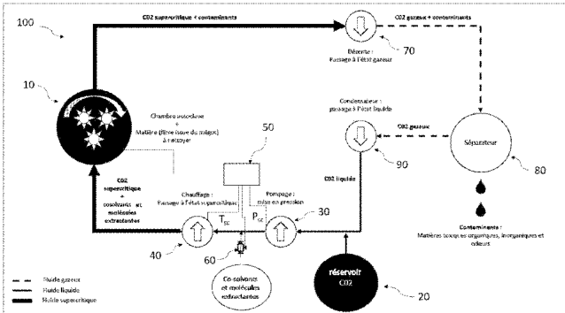
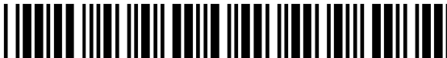
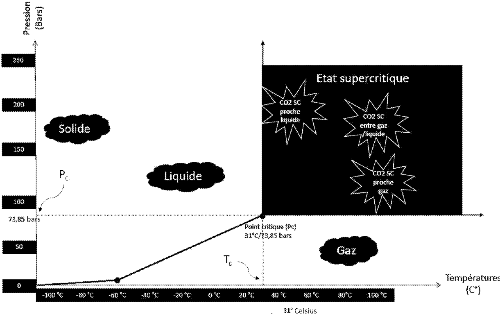
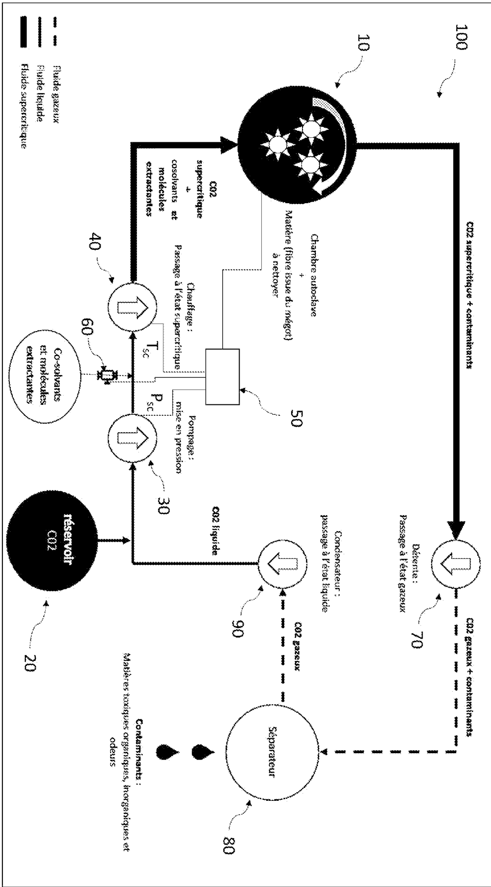
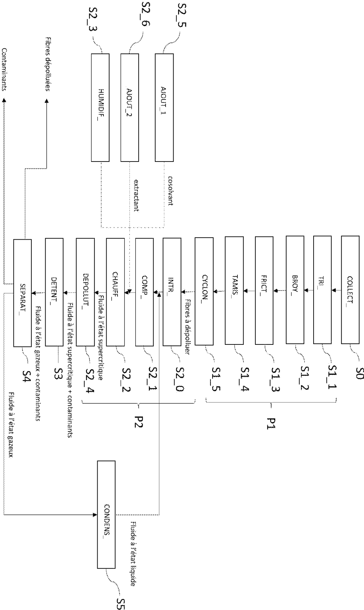

<!-- Page 0 | source: demo_ac80f16d_page_0.md | kind: md -->

(19) RÉPUBLIQUE FRANÇAISE
INSTITUT NATIONAL
DE LA PROPRIÉTÉ INDUSTRIELLE
COURBEVOIE

(11) N° de publication : 3 102 180
(à n'utiliser que pour les commandes de reproduction)

(21) N° d'enregistrement national : 20 00806

(51) Int Cl⁸ : C 08 J 11/04 (2019.12), A 24 F 47/00, B 09 B 3/00, 5/00, C 08 J 11/06

(12) DEMANDE DE BREVET D'INVENTION

A1

(22) Date de dépôt : 28.01.20.

(30) Priorité : 22.10.19 FR 1911822.

(43) Date de mise à la disposition du public de la demande : 23.04.21 Bulletin 21/16.

(56) Liste des documents cités dans le rapport de recherche préliminaire : Se reporter à la fin du présent fascicule

(60) Références à d'autres documents nationaux apparentés :

○ Demande(s) d'extension :

(71) Demandeur(s) : PAQUE Julien — FR.

(72) Inventeur(s) : PAQUE Julien.

(73) Titulaire(s) : PAQUE Julien.

(74) Mandataire(s) : Cabinet Rifflart Vandenbossche.

(54) Nettoyage des fibres issues des mégots de cigarette par mise en contact avec un fluide supercritique et recyclage des fibres dépolluées.

(57) La présente invention concerne une installation (200) de nettoyage de mégots de cigarette comprenant : - une cuve de traitement configurée pour traiter lesdits mégots afin d'en extraire des fibres à dépolluer ; et - des moyens de dépollution (100) configurés pour dépolluer lesdites fibres par une mise en contact de celles-ci avec un fluide à l'état supercritique, dit fluide supercritique.

FR 3 102 180 - A1

---

<!-- Page 1 | source: demo_ac80f16d_page_1.md | kind: md -->

# Description

## Titre de l'invention : Nettoyage des fibres issues des mégots de cigarette par mise en contact avec un fluide supercritique et recyclage des fibres dépolluées.

### Domaine technique

[0001] La présente invention concerne le domaine du nettoyage des mégots de cigarette, et plus particulièrement le nettoyage et la dépollution des fibres provenant des filtres des mégots de cigarette.

[0002] Un des objectifs de la présente invention est de réduire l'impact des mégots de cigarette sur l'environnement en nettoyant/dépolluant les fibres issues des mégots de cigarettes et en valorisant ces fibres en fabriquant des produits éco-conçus.

[0003] L'objet de la présente invention porte ainsi sur un procédé et une installation de nettoyage exploitant la technologie des fluides supercritiques pour dépolluer les fibres provenant des filtres de mégots de cigarette.

[0004] L'objet de la présente invention porte également sur le recyclage et la réutilisation des fibres dépolluées obtenues à l'issue d'un tel nettoyage.

[0005] La présente invention trouvera de nombreuses applications avantageuses en proposant aussi bien aux industriels qu'aux collectivités une technologie de dépollution des mégots de cigarette simple à mettre en œuvre et respectueuse de l'environnement.

### Art antérieur

[0006] Le recyclage des mégots de cigarette est devenu un véritable enjeu écologique et environnemental.

[0007] Les mégots de cigarette représentent en effet l'un des déchets les plus importants dans le monde avec plus de quatre milliards de mégots jetés chaque année dans la nature ; ceci représente à titre illustratif près de 40% des déchets présents dans les océans.

[0008] On notera ici qu'un mégot de cigarette se décompose dans la nature après environ 15 ans ; durant cette période, le mégot pollue jusqu'à 500 litres d'eau à lui seul. Malgré ces chiffres alarmants, le Demandeur constate que très peu de moyens ont été déployés jusqu'à présent pour la mise en œuvre du recyclage des mégots de cigarette, ceci tant pour des raisons techniques, financières et/ou écologiques/environnementales.

[0009] On connaît notamment le document FR 17 54267 A1 qui porte sur le recyclage des mégots. Dans ce document, le recyclage comprend une étape de nettoyage essentiellement à base d'eau.

[0010] On connaît également le document US 55 04119 A qui porte sur le recyclage des déchets provenant de la fabrication de cigarettes ; dans ce document, on utilise---

<!-- Page 2 | source: demo_ac80f16d_page_2.md | kind: md -->

également une étape de nettoyage à base d'eau.

[0011] La dépollution des mégots de cigarettes impliquant un nettoyage à base d'eau (par trempage, aspersion, essuyage, etc.) requiert nécessairement une étape additionnelle de traitement et de filtrage de l'eau polluée qui a servi pour le nettoyage.

[0012] Ceci rend le procédé coûteux et fastidieux.

[0013] Le Demandeur soumet en outre que certaines substances toxiques présentes dans les mégots ne peuvent pas se solubiliser dans l'eau de sorte que les performances associées à ce type de technologie ne sont pas satisfaisantes.

[0014] D'autres technologies sont proposées pour le recyclage des mégots de cigarette comme par exemple celle proposée dans le document WO 2019167054 A1 qui propose un recyclage des mégots de cigarettes utilisant des absorbants naturels tels que par exemple de la terre pour nettoyer la fibre des mégots de cigarettes et fabriquer des tampons hygiéniques ; un tel document vise principalement à améliorer les conditions sanitaires dans des pays défavorisés.

[0015] En revanche, l'enseignement technique de ce document ne s'applique pas au nettoyage et à la dépollution des mégots de cigarettes.

[0016] Le Demandeur soumet, après de nombreuses recherches sur le sujet, qu'il n'existe pas à ce jour de solution fiable et performante assurant un nettoyage et une dépollution à grande échelle et à moindre des coûts pour nettoyer et dépolluer les mégots de cigarette afin de recycler les fibres et notamment les fibres d'acétate de cellulose.

## Résumé de l'invention

[0017] La présente invention vise à améliorer la situation décrite ci-dessus.

[0018] La présente invention vise plus particulièrement à remédier à au moins un des différents inconvénients mentionnés ci-dessus en proposant une technique de nettoyage et de dépollution innovante mettant en œuvre une mise en contact desdits mégots avec un fluide dense sous pression, et notamment un fluide à l'état supercritique.

[0019] A cet effet, l'objet de la présente invention concerne selon un premier aspect un procédé de nettoyage de mégots de cigarette comprenant les étapes suivantes :
- un traitement des mégots pour en extraire des fibres à dépolluer ; et
- une dépollution des fibres à dépolluer par une mise en contact de celles-ci avec un fluide dense sous pression, de préférence un fluide à l'état supercritique, dit fluide supercritique.

[0020] La mise en contact d'un fluide dense sous pression, de préférence un fluide supercritique, avec les fibres à dépolluer permet d'extraire desdites fibres une très grande majorité, voire la totalité, des substances toxiques et des odeurs accumulées dans les filtres de cigarette.

[0021] Le fluide dense sous pression (de préférence un fluide amené à l'état supercritique)---

<!-- Page 3 | source: demo_ac80f16d_page_3.md | kind: md -->

joue le rôle d'un puissant solvant notamment pour les composés organiques comprenant des contaminants et des polluants.

[0022] Une telle extraction des substances toxiques et des odeurs accumulées dans les filtres de cigarette par une technologie de fluide dense sous pression (et notamment de fluide supercritique) permet une dépollution des fibres ; après dépollution, ces fibres deviennent propres et sont aptes à être réutilisées pour de nouveaux matériaux et/ou d'autres applications.

[0023] De telles fibres dépolluées sont appréciées notamment pour leurs propriétés thermiques et/ou phoniques, leurs capacités filtrantes et/ou leurs propriétés mécaniques.

[0024] L'utilisation d'un fluide dense sous pression ou d'un fluide supercritique est avantageuse en ce qu'elle ne nécessite aucun post-traitement après dépollution, contrairement aux techniques de nettoyage à base d'eau qui requièrent un traitement de l'eau de nettoyage contaminée.

[0025] La fibre des mégots ainsi dépolluée peut ensuite être transformée en produit semi-fini ou fini sous différentes formes pour devenir un matériau éco-conçu utilisable dans plusieurs domaines. On comprendra qu'en fonction du domaine d'application, le niveau de nettoyage et de purification de la fibre peut varier en fonction des exigences et des normes appliquées aux domaines.

[0026] Dans un mode de réalisation avantageux, le procédé selon la présente invention comprend une phase initiale de collecte des mégots au cours de laquelle on collecte des mégots.

[0027] Une telle collecte peut être réalisée par des particuliers, des associations, des collectivités, des entreprises et/ou des industriels, notamment des industriels exerçant dans le domaine de la fabrication de cigarettes.

[0028] Une telle collecte peut ainsi être organisée aussi bien au niveau local qu'au niveau national.

[0029] Avantageusement, les fibres des mégots de cigarette comprennent des fibres d'acétate de cellulose. La réutilisation de ces fibres d'acétate de cellulose, une fois dépolluées, est appréciée pour les applications de type par exemple :

- des articles d'habillement textiles (rembourrage isolant de manteau, matelassage isolant, fils de couture, tissus, laine à utiliser dans la création d'habits ou d'objets à base de textile : matelas, coussin, duvet, chapeau, couvre-chef, sac à main...);

- des matériaux d'isolation thermique et/ou phonique (bâtiment, électronique, automobile : isolant batterie lithium de véhicule électriques, aéronautique, constructions navales, etc.);

- des matériaux filtrants (liquide, gaz, etc.); sous forme de plaques fibreuses ou de fibres en vrac conformes aux normes du domaine d'utilisation.---

<!-- Page 4 | source: demo_ac80f16d_page_4.md | kind: md -->

[0030] Elle est aussi appréciée dans le domaine de la plasturgie afin de créer de nouveaux matériaux solides éco-conçus avec ou sans mélange.
[0031] Dans un mode de réalisation avantageux, les fibres à dépolluer sont introduites dans une chambre de nettoyage. Ceci est réalisé de préférence lors de la phase de dépollution avant mise en contact.
[0032] De préférence, une telle chambre se présente sous la forme d'une enceinte clause telle que par exemple un autoclave.
[0033] Avantageusement, lors de la phase de dépollution, le fluide est comprimé jusqu'à une pression déterminée dite supercritique et est chauffé jusqu'à une température dite supercritique, lesdites pression et température supercritiques étant déterminées en fonction du fluide.
[0034] De préférence, la pression supercritique est comprise entre 0 et 2000 bars, de préférence entre 50 et 350 bars, de préférence entre 280 et 320 bars.
[0035] De préférence, la température supercritique est comprise entre 0° et 400° Celsius, de préférence entre 15° et 80° Celsius.
[0036] Un des aspects de la présente invention est ainsi de prévoir une dépollution efficace en réglant notamment les paramètres de pression et de température afin d'amener le fluide dans un état supercritique suffisamment puissant et solvant pour éliminer (extraire) les substances toxiques et les odeurs présentes dans les fibres de cigarette, après combustion du tabac.
[0037] La performance d'extraction des substances dépend des domaines d'application envisagés pour la valorisation de la fibre. On comprendra que les paramètres associés à la pression et la température seront susceptibles de changer selon les résultats de pureté de fibre nécessaire.
[0038] Avantageusement, le fluide est sélectionné parmi : le dioxyde de carbone ; certains liquides organiques comme le méthanol ou l'éthanol ; l'eau ; le Tétrafluoroéthane ; les alcanes légers, tels que par exemple le méthane, le propane, le butane, l'isobutane et le pentane ; le monoxyde de dihydrogène ; les alcènes comme l'éthylène et le propylène.
[0039] Tous ces fluides peuvent être utilisés à l'état de fluide dense sous pression, à l'état subcritique (oxydation par voie humide) ou supercritique.
[0040] Dans un mode de réalisation avantageux de la présente invention, le fluide sélectionné pour la phase de dépollution est le dioxyde de carbone. On prévoit de préférence que, dans ce mode, la température supercritique est supérieure ou égale à 31° Celsius et la pression supercritique est supérieure ou égale à 73.85 bars.
[0041] L'utilisation du dioxyde de carbone comme fluide est avantageuse en ce qu'elle permet de dépolluer un déchet tel que le mégot de cigarettes à l'aide d'un autre déchet émis en très grande quantité par les industries (le dioxyde de carbone).
[0042] Les conditions de température (température supérieure ou égale à 31° Celsius) et de---

<!-- Page 5 | source: demo_ac80f16d_page_5.md | kind: md -->

pression (pression supérieure ou égale à 73.85 bars) pour amener le dioxyde à l'état supercritique sont satisfaisantes et peuvent être atteintes sans difficulté dans une enceinte telle qu'un autoclave.

[0043] Bien évidemment, l'homme du métier pourra sélectionner d'autres fluides et/ou d'autres paramètres de pression et/ou de température pour cette opération de dépollution.

[0044] On comprend ici que le degré d'extraction et les capacités de transport du fluide peuvent varier en agissant sur ces paramètres de température et de pression. A travers cette technologie, on possède un fluide solubilisant avec un pouvoir modulable, notamment des contaminants à extraire de la fibre issue du filtre.

[0045] Avantageusement, un cosolvant est ajouté au fluide pour extraire des fibres des substances organiques non souhaitées, tout en conservant la qualité et les caractéristiques techniques de la fibre.

[0046] L'ajout d'un tel cosolvant permet de retirer des fibres certaines substances organiques présentes dans les fibres afin d'améliorer le process de nettoyage.

[0047] On comprendra que cet ajout de cosolvant peut être réalisé avant, pendant et/ou encore après la mise en contact du fluide avec les fibres à dépolluer.

[0048] Avantageusement, le cosolvant est sélectionné parmi : le monoxyde de dihydrogène ; les alcools, par exemple les alcools aliphatiques, tels que l'éthanol, le méthanol, le butanol ; les solutions aqueuses (par exemple de l'eau) ; les terpènes ; le benzène ; les cyclohexanes et leurs mélanges ; les cétones ; les hydrofluoroéthers et tous autres cosolvants capables de dépolluer les substances indésirables présentent dans la fibre.

[0049] Avantageusement, un extractant est ajouté au fluide pour extraire des fibres des substances inorganiques de type par exemple métaux lourds.

[0050] L'ajout d'un tel extractant permet de retirer des fibres certaines substances inorganiques présentes dans les fibres afin d'améliorer les performances de la phase de dépollution.

[0051] On comprendra que cet ajout d'extractant peut être réalisé avant, pendant et/ou encore après la mise en contact du fluide avec les fibres à dépolluer.

[0052] De préférence, l'extractant comprend une gamme de molécules du type calixarènes et/ou des solutions d'agents capables d'extraire les substances inorganiques (complexants, chelatants, antioxydants, solutions tampons).

[0053] L'ajout de cosolvant(s) peut aussi avoir un impact sur les molécules inorganiques, et inversement, l'ajout d'extractant(s) peut aussi avoir un impact sur les molécules organiques.

[0054] On comprendra que les cosolvants et les extractants sont choisis en fonction des substances indésirables à extraire, selon les normes correspondantes aux débouchés.

[0055] En effet, selon les débouchés, les résultats de pureté de la fibre souhaitée peuvent---

<!-- Page 6 | source: demo_ac80f16d_page_6.md | kind: md -->

varier.
[0056] Ainsi, les paramètres (pression, température, débit, temps de nettoyage, etc.) ainsi que l'utilisation ou non de cosolvants et/ou d'extractants peuvent varier selon les résultats souhaités.
[0057] Avantageusement, l'étape de dépollution comprend, préalablement à la mise en contact, une humidification des fibres.
[0058] D'autres paramètres associés à la mise en contact du fluide dense sous pression (par exemple un fluide supercritique) peuvent être envisagés : débit et/ou vitesse du fluide, durée de mise en contact, etc.
[0059] Avantageusement, la mise en contact comprend une action d'un jet du fluide en direction des fibres.
[0060] De préférence, le jet présente une vitesse comprise entre 1 et 500 mètres par seconde.
[0061] De préférence, le jet comprend un débit compris entre 1 et 4000 litres par heure.
[0062] De préférence, la mise en contact est réalisée pendant une durée comprise entre une minute et huit heures.
[0063] Le débit et la durée du nettoyage peuvent ainsi varier, ceci notamment en fonction de la quantité de matière à traiter, des paramètres et des substances ciblées.
[0064] On peut aussi prévoir par exemple la mise en rotation des fibres par exemple dans un tambour rotatif à l'intérieur de la chambre de nettoyage.
[0065] On peut encore prévoir des variations de pression selon des cycles de compression et de dépression.
[0066] Plus largement, on peut prévoir durant le cycle de nettoyage que la pression, la température et le débit du fluide sont susceptibles de rester constant ou de varier.
[0067] Avantageusement, la phase de traitement comprend un broyage des mégots.
[0068] De préférence, un tel broyage est réalisé par exemple dans un broyeur ou une cuve dite de traitement après une phase de collecte et éventuellement une opération de tri.
[0069] Les mégots broyés sont alors entraînés sur une chaîne de production pour subir une pluralité d'opérations de traitement (friction et/ou tamisage et/ou cyclonage et/ou broyage secondaire).
[0070] Avantageusement, la phase de traitement comprend notamment un tamisage.
[0071] Ce ou ces différentes opérations visent principalement à séparer les fibres des autres déchets, les autres déchets étant du type feuilles, cendres et/ou tabacs.
[0072] Seule la fibre constituée en partie d'acétate de cellulose est récupérée. De préférence, les autres déchets (feuilles, tabacs, cendres) sont recyclés sous forme de compost.
[0073] Ces opérations de traitement peuvent être réalisées dans une cuve de traitement adaptée à cet effet ; cette cuve peut être indépendante de l'autoclave ou éventuellement être directement intégrée dans l'autoclave.
[0074] L'objet de la présente invention concerne selon un deuxième aspect une fibre---

<!-- Page 7 | source: demo_ac80f16d_page_7.md | kind: md -->

nettoyée (ou dépolluée) obtenue à l'issue d'une mise en œuvre d'un procédé de nettoyage tel que celui décrit ci-dessus.

[0075] Une telle fibre ainsi dépolluée peut être réutilisée pour de nombreuses applications notamment dans le domaine du bâtiment, de l'habillement et tout autre domaine pouvant exploiter cette fibre.

[0076] L'objet de la présente invention concerne selon un troisième aspect une installation de nettoyage de mégots de cigarette comprenant :

- une cuve de traitement configurée pour traiter les mégots afin d'en extraire des fibres à dépolluer ; et

- des moyens de dépollution configurés pour dépolluer les fibres par une mise en contact de celles-ci avec un fluide dense sous pression (de préférence un fluide à l'état supercritique, dit fluide supercritique).

[0077] Dans un mode de réalisation préféré, les moyens de dépollution comprenant une ou plusieurs chambres de nettoyage de type autoclave.

[0078] De préférence, un tel autoclave est capable de résister à des hautes voire très hautes pressions.

[0079] La capacité de la chambre peut par exemple varier de 0,2L à 1500L, cependant celles-ci n'est pas limitée.

[0080] Avantageusement, l'installation comporte des moyens de type buses, canalisations et/ou vannes afin d'injecter le fluide supercritique dans la ou les chambres.

[0081] Avantageusement, la chambre peut s'étendre verticalement ou horizontalement.

[0082] On notera que l'inclinaison verticale de la chambre facilite le chargement/déchargement et assure une bonne propagation du fluide (dioxyde de carbone) dans les fibres à dépolluer.

[0083] De préférence, une porte hermétique verrouille chacune des chambres de nettoyage.

[0084] De préférence, les buses et canalisations d'entrée et de sortie du fluide de la chambre de nettoyage sont munies de grilles à fin cadrillage, dites grilles filtrantes, afin de retenir les fines particules de fibres lors de l'évacuation du fluide transportant les substances indésirables. De telles grilles évitent que les fines fibres soient transportées pendant le nettoyage et se retrouvent avec les résidus indésirables extraits à la sortie.

[0085] De préférence, l'installation comprend un réservoir contenant un fluide (à l'état liquide), ledit réservoir étant relié à ladite chambre de nettoyage.

[0086] Un tel fluide est de préférence destiné à être amené à l'état supercritique.

[0087] Avantageusement, l'installation comprend des moyens de chauffe et des moyens de mise sous pression, commandables par une unité centrale, configurés respectivement pour chauffer le fluide jusqu'à une température supercritique déterminée et comprimer le fluide jusqu'à une pression supercritique déterminée, ladite unité centrale déterminant les température et pression supercritiques en fonction du fluide.---

<!-- Page 8 | source: demo_ac80f16d_page_8.md | kind: md -->

[0088] L'installation comprend en outre des moyens de détente configurés pour détendre le fluide afin de séparer en continu tout au long du cycle, le fluide des contaminants solides et liquides transportés, afin de recycler ledit fluide.
[0089] Les moyens de détente sont de préférence situés dans l'installation en amont de ladite chambre de nettoyage ; c'est-à-dire en sortie de la chambre.
[0090] L'installation est dimensionnée proportionnellement aux paramètres choisis et est capable d'accueillir les paramètres définis (pression, température, débit, filtration, etc.). Elle comprend des composants tels que des buses, des tuyaux, des canalisations, des cuves, des séparateurs, des réservoirs, des pompes, des condensateurs, des résistances chauffantes, des capteurs et des régulateurs pneumatiques, hydraulique et mécanique (débitmètres, etc.).
[0091] Avantageusement, la chambre de nettoyage comprend un tambour rotatif dans lequel sont introduites les fibres. On comprend ici qu'un tel tambour peut être monté sur un axe de rotation (magnétique ou mécanique par exemple) permettant au tambour d'être en rotation sur lui-même.
[0092] L'objet de la présente invention concerne selon un quatrième aspect une utilisation des fibres issues des filtres de mégots de cigarette pour la fabrication d'un isolant thermique et/ou phonique, de filtres et/ou d'objets plastiques biodégradables.
[0093] Il est ainsi possible de fabriquer des matériaux éco-conçus à base de fibres provenant des mégots de cigarettes.
[0094] De préférence, les fibres sont des fibres d'acétate de cellulose.
[0095] Dans un mode de réalisation particulier, on prévoit ici une mise en œuvre du procédé tel que décrit ci-dessus pour dépolluer lesdites fibres.
[0096] Selon une première variante, l'utilisation du procédé est réalisée pour fabriquer des plaques d'isolation (thermique ou phonique), une telle utilisation étant particulièrement avantageuse dans le domaine du bâtiment et/ou de l'énergie.
[0097] Dans un mode, ces plaques sont réalisées en mélangeant la fibre dépolluée issue du filtre avec une matière bi-composante ou autres composés.
[0098] Cette utilisation pour la fabrication de plaques d'isolation est appréciée dans le domaine des bâtiments du type HQE (pour Haute Qualité Environnementale) ou THQE (pour Très Haute Qualité Environnementale), mais aussi dans d'autres domaines tels que l'automobile, le milieu agricole, l'aéronautique, l'électronique, l'électrique, etc.
[0099] Selon une deuxième variante, l'utilisation du procédé est réalisée pour confectionner des articles d'habillement textiles, de tels articles étant appréciés pour leurs propriétés thermiques et/ou phoniques notamment.
[0100] Dans un mode de réalisation particulier, les fibres et les plaques isolantes sont cousues et/ou insérées à l'intérieur des vêtements, en guise de matelassage afin de---

<!-- Page 9 | source: demo_ac80f16d_page_9.md | kind: md -->

créer un isolant écologique.

[0101] Selon une troisième variante, les fibres sont conditionnées pour redevenir des filtres pour la filtration, principalement de liquide ou de gaz.

[0102] Selon une quatrième variante, les fibres sont utilisées, dans les procédés et la transformation plastique, pures ou mélangées pour créer de nouveaux matériaux solides.

[0103] Ainsi, la présente invention met à disposition de l'ensemble des acteurs intervenants dans le recyclage des mégots de cigarette une technologie innovante utilisant les propriétés des fluides supercritiques pour dépolluer les fibres, et notamment les fibres d'acétate de cellulose.

[0104] Brève description des figures annexées

[0105] D'autres caractéristiques et avantages de la présente invention ressortiront de la description ci-dessous, en référence aux figures annexées qui en illustrent deux exemples de réalisation dépourvus de tout caractère limitatif et sur lesquelles :

[0106] [fig.1]

[0107] La figure 1 représente le diagramme de phase du dioxyde de carbone ;

[0108] [fig.2]

[0109] La figure 2 représente une vue schématique d'une installation de nettoyage mettant en œuvre une technologie de fluide supercritique pour le nettoyage des fibres provenant des filtres de mégots de cigarette ; et

[0110] [fig.3]

[0111] La figure 3 représente un organigramme d'un procédé de nettoyage des fibres provenant des filtres de mégots de cigarette.

## Description détaillée

[0112] Un procédé de nettoyage des mégots de cigarette selon un exemple de réalisation de la présente invention ainsi que l'installation qui lui est associée vont maintenant être décrits dans ce qui va suivre en référence conjointement aux figures 1 à 3.

[0113] Comme rappelé en préambule, le nettoyage des mégots de cigarette est une problématique pour laquelle il existe aujourd'hui peu de technologie efficace, ceci tant pour des raisons écologiques/environnementales que financières.

[0114] Un des objectifs de la présente invention consiste à récupérer et dépolluer les fibres présentes dans les mégots de cigarette, et plus précisément dans les filtres de cigarette, en prenant en considération les contraintes écologiques/environnementales et financières ci-dessus.

[0115] Un des autres objectifs de la présente invention consiste à proposer des solutions alternatives pour le recyclage et/ou la réutilisation des fibres dépolluées.

[0116] Ceci est rendu possible dans l'exemple décrit ci-après.

[0117] On sait que les fibres issues des mégots de cigarette adsorbent des substances---

<!-- Page 10 | source: demo_ac80f16d_page_10.md | kind: md -->

toxiques et des mauvaises odeurs lors de la combustion.

[0118] Parmi ces substances, on retrouve des substances organiques et inorganiques, dont notamment :

- de la nicotine,

- des métaux lourds,

- des acides organiques (acide acétique et/ou acide tartrique),

- des nitrosamines,

- des flumétralines, pendiméthalines et/ou trifluralines,

- des phénols,

- des hydrocarbures aromatiques polycycliques (HAP),

- des formaldéhydes et acétaldéhydes,

- des dioxines et/ou des furanes,

- des anions (chlorures, nitrates, phosphates, sulfates et/ou ammonium).

[0119] Le nettoyage et la dépollution de ces fibres consistent à extraire ces substances toxiques adsorbées dans ces fibres lors de la combustion afin de transformer le mégot de cigarette, déchet dangereux (classé : HP 14 : écotoxique et HP6 : toxicité aigüe), en matière première exploitable.

[0120] Le concept sous-jacent à la présente invention est d'exploiter la technologie des fluides dense sous pression, et notamment les fluides supercritiques, en retirant ces substances pour nettoyer efficacement les fibres des filtres pollués.

[0121] L'utilisation des fluides dense sous pression, et notamment les fluides supercritiques, se présente comme une technologie émergente efficace qui présente des propriétés de transport très intéressantes.

[0122] Le Demandeur observe que la technologie des fluides supercritiques est classiquement utilisée pour l'extraction des arômes (café ou huiles essentielles par exemple).

[0123] Cette technologie est également utilisée pour teindre des textiles sans eau.

[0124] En revanche, l'utilisation de tels fluides supercritiques n'a jamais été envisagée jusqu'à présent pour le nettoyage et la dépollution des mégots de cigarette et notamment des fibres de mégots de cigarette.

[0125] Dans l'exemple décrit ici, on utilise comme fluide le dioxyde de carbone.

[0126] Le Demandeur soumet que l'utilisation du dioxyde de carbone présente l'avantage d'être un déchet industriel produit en grande quantité. La réutilisation de ce déchet s'avère donc très intéressante : Le dioxyde de carbone est disponible à haute pureté et à bas prix.

[0127] L'homme du métier comprendra que d'autres fluides comme ceux énumérés précédemment dans la description pourront être réutilisés dans le cadre de la présente invention.---

<!-- Page 11 | source: demo_ac80f16d_page_11.md | kind: md -->

[0128] La figure 1 représente donc le diagramme de phase du dioxyde de carbone.
[0129] On sait qu'un tel diagramme de phase expose les différents états de la matière selon les différents paramètres associés à la pression et la température du fluide.
[0130] Aux conditions normales de température et de pression, le dioxyde de carbone peut se présenter sous les états gazeux, liquide ou solide. Cependant, celui-ci possède un point critique $P_c$ correspondant à une pression et une température critiques, notées $T_c$ et $P_c$. Lorsque le dioxyde de carbone est soumis à une pression et une température supérieures à celles de son point critique $P_c$, celui-ci se retrouve dans un état supercritique.
[0131] Au-delà de la pression critique $P_c$, toute augmentation de température imposée au liquide conduit à la formation d'un liquide moins dense et différent de l'état gazeux.
[0132] Au-delà des température critique $T_c$, toute augmentation de pression appliquée au gaz conduit à la formation d'un fluide supercritique (plus condensé) sans passer par l'état liquide.
[0133] A l'état supercritique, le dioxyde de carbone présente alors un comportement intermédiaire entre l'état liquide et l'état gazeux, avec des propriétés particulières :
- la masse volumique est plus élevée et donc similaire à celle des liquides ;
- le coefficient de diffusivité se situe entre celui des liquides et des gaz ;
- la viscosité est faible, ce qui est similaire à celle des gaz.
[0134] Ces différents états, formations et paramètres sont intéressants et permettent d'obtenir un solvant modulable afin de toucher une large gamme de substances à extraire.
[0135] On parle ainsi de fluide supercritique lorsqu'un fluide est chauffé au-delà de sa température critique $T_c$ et lorsqu'il est comprimé au-dessus de sa pression critique $P_c$.
[0136] Le réglage de ces paramètres de température et de pression permet d'obtenir un fluide supercritique présentant un pouvoir solvant comparable à celui des solvants liquides, avec des propriétés de transports intéressantes qui les rapprochent des gaz.
[0137] On notera ici que le Demandeur a de plus observé qu'en combinant un fluide supercritique comme le dioxyde de carbone avec des fibres telles que l'acétate de cellulose, les propriétés de la fibre d'acétate de cellulose étaient améliorées : cette mise en contact entraine en effet une modification des propriétés intrinsèques du polymère. Elle permet de baisser sa viscosité (transition vitreuse).
[0138] La faible viscosité et les coefficients de diffusion élevés du dioxyde de carbone à l'état supercritique permettent un nettoyage efficace dû à la pénétration importante du solvant au cœur de la fibre. Combiner les propriétés de transport et l'extraction performante du dioxyde de carbone permet un nettoyage total.
[0139] Selon le concept de l'invention, le dioxyde de carbone vient remplacer l'utilisation de solvants organiques efficaces (mais très polluants) comme l'hexane, le dichlo----

<!-- Page 12 | source: demo_ac80f16d_page_12.md | kind: md -->

rométhane, le perchloroéthylène, le trichloréthylène et le chloroforme, ou l'utilisation de solution aqueuse comme l'eau.

[0140] On comprend ainsi que l'état supercritique du dioxyde de carbone crée des propriétés de transports très efficaces pour la dépollution des fibres, et notamment des fibres d'acétate de cellulose présentes dans les filtres de cigarette, sans les endommager.

[0141] Pour le dioxyde de carbone, le diagramme de phase de la figure 1 montre que le point critique $P_c$ correspond à une température critique $T_c$ supérieure ou égale à 31°Celsius et une pression critique $P_c$ supérieure ou égale à environ 73.85 bars.

[0142] En faisant varier ces paramètres correctement au-delà de ces valeurs critiques (31°Celsius et 73.85 bars), il est possible d'amener le dioxyde de carbone à un état supercritique et d'obtenir un nettoyage très efficace.

[0143] Avant de procéder au nettoyage à proprement parler, le procédé selon la présente invention comprend une étape de collecte S0.

[0144] Cette étape de collecte S0 peut impliquer aussi bien les particuliers que les associations, les collectivités, les entreprises et tous les autres acteurs de collecte.

[0145] Il s'agit d'un acte citoyen pour une démarche environnementale. Tous les acteurs ci-dessus pourront être engagés dans une telle démarche.

[0146] Dans l'exemple décrit ici, on prévoit en outre une suite d'opérations de traitement des mégots lors d'une phase P1 dont notamment une étape de tri S1_1 pour séparer les mégots de cigarette des éventuels autres déchets, une étape de broyage S1_2, et une étape de tamisage S1_3 qui pourront être répétées plusieurs fois, afin d'extraire un maximum de tabac, cendre, et feuille.

[0147] En fonction du lot reçu, une étape de friction S1_3, une étape de tamisage S1_4 et une étape de cyclonage S1_5 pourront également être ajoutées ou non.

[0148] La succession de ces différentes étapes en phase P1 vise principalement à séparer les fibres de cigarette à dépolluer des autres déchets tels que par exemple les feuilles de cigarette, les cendres, le tabac.

[0149] On notera que, dans l'exemple décrit ici, seules les fibres des filtres contenant notamment de l'acétate de cellulose sont conservées pour la phase de dépollution P2, les autres déchets étant utilisés lors d'une phase pour la réalisation de compost.

[0150] Un tel compost est réalisé par exemple selon une autre filière.

[0151] Dans l'exemple de réalisation décrit ici, les différentes étapes de traitement sont réalisées par l'installation qui comprend une chaîne de production comprenant notamment une cuve de traitement (non représentée ici) mettant en œuvre un broyeur, un tamiseur et/ou des moyens de cyclonage et/ou de friction (non représentés ici).

[0152] On comprend que l'installation 200 ne comprend pas nécessairement cette chaîne de production ; celle-ci pourra être déportée sur un autre site (traitement réalisé par de la sous-traitance par exemple).---

<!-- Page 13 | source: demo_ac80f16d_page_13.md | kind: md -->

[0153] L'installation 200 comprend en outre une chambre de nettoyage 10 se présentant sous la forme d'un autoclave, ladite chambre 10 étant configurée pour nettoyer les fibres provenant des filtres de cigarette par une mise en contact de ces fibres avec le fluide à l'état supercritique.
[0154] La chambre 10 est donc configurée pour contenir un fluide à l'état supercritique, et donc supporter des températures et pressions élevées.
[0155] Dans l'exemple décrit ici, cette chambre 10 est une enceinte fermée hermétiquement.
[0156] La première étape S2_0 de cette phase de dépollution P2 comprend donc l'introduction et le positionnement des fibres à dépolluer dans la chambre de nettoyage 10.
[0157] Ici, les fibres sont introduites dans un contenant fixe.
[0158] Cependant plusieurs alternatives peuvent être envisagées lors du nettoyage pour optimiser et réduire les paramètres utilisés à l'intérieur de la chambre de nettoyage. En effet, en combinant la technologie supercritique à d'autres moyens mécaniques, électriques ou chimiques, il est possible de réduire les éléments nécessaires au nettoyage. Pour optimiser le procédé, c'est-à-dire réduire le temps, la quantité de fluide, la pression et/ou la température, le nettoyage peut être complété de l'un ou l'autre de ces éléments :
- un tambour rotatif placé dans la cuve et entrainé par un couple magnétique ou mécanique permettant de mettre en mouvement la matière afin de faciliter la diffusion du fluide supercritique (de forme crible ou bétonnière) ; et/ou
- un système de vibration et d'ultrasons permettant que les substances ciblées soient extraites plus facilement, en combinant les avantages de l'ultrasons à celui du dioxyde de carbone supercritique ; et/ou
- des moyens de compression mécanique, notamment par vérin pneumatique ou hydraulique, ou vis sans fin afin de compresser la fibre et forcer l'extraction des molécules à extraire ; et/ou
- un mélangeur situé à l'intérieur permettant d'homogénéiser le nettoyage ; et/ou
- un système centrifuge afin de diriger toutes les substances extraites vers l'extérieur évitant ainsi qu'elles soient ré-adsorbées à un autre endroit de la fibre ; et/ou une mise sous tension à l'intérieur de la cuve, afin d'électrocuter la fibre et faciliter l'extraction ; et/ou
- un trempage dans une solution aqueuse durant le cycle de nettoyage (configuration fluide-liquide supercritique).
[0159] Toutes ces améliorations peuvent être utilisées seules ou bien cumulées. L'agitation, les vibrations, la compression, la tension ou tout autre mouvement et action pourront être ajoutés afin d'améliorer ou d'optimiser avantageusement les conditions de nettoyage sur n'importe quelle quantité de matière.---

<!-- Page 14 | source: demo_ac80f16d_page_14.md | kind: md -->

[0160] Ces applications restent bien évidemment optionnelles et ne présentent en aucun cas un caractère limitatif.
[0161] Le concept sous-jacent à la présente invention est de mettre en contact ces fibres dans la chambre 10 avec un fluide à l'état supercritique, ici le dioxyde de carbone.
[0162] Dans cet exemple, on prévoit donc de relier la chambre de nettoyage 10 à un réservoir 20 contenant le dioxyde de carbone.
[0163] On prévoit à cet effet un jeu de vannes, de buses et de canalisations d'entrée et de sortie (non représentées ici) configurées pour relier la chambre de nettoyage 10 et le réservoir 20.
[0164] De préférence, ces éléments sont munis de grilles à fin cadrillage afin de retenir et filtrer les fines particules de fibres pouvant être entrainées lors de l'évacuation du fluide transportant les substances indésirables.
[0165] De telles grilles évitent que ces fines fibres soient transportées hors de la chambre pendant le nettoyage et se retrouvent avec les résidus indésirables extraits à la sortie.
[0166] Préalablement à la mise en contact du fluide avec les fibres à dépolluer, il est souhaitable d'amener ledit fluide à l'état supercritique.
[0167] Dans cet exemple, on prévoit alors que la chambre de nettoyage 10 comprend des moyens de compression 30 et des moyens de chauffe 40 configurés respectivement pour comprimer lors d'une étape S2_1 ledit fluide jusqu'à une pression cible supercritique $P_{sc}$ et pour chauffer lors d'une étape S2_2 ledit fluide jusqu'à une température cible supercritique $T_{sc}$.
[0168] Dans cet exemple, les moyens de compression 30 et de chauffe 40 sont commandables par une unité centrale 50.
[0169] Cette unité de centrale 50 comprend ainsi des moyens de stockage électronique (non représentés ici) stockant les informations relatives aux paramétrages associés au nettoyage supercritique tels que les température et pression supercritiques $T_{sc}$ et $P_{sc}$ en fonction du fluide utilisé.
[0170] Dans cet exemple, ces température et pression supercritiques $T_{sc}$ et $P_{sc}$ correspondent respectivement à une température supérieure ou égale à 31° Celsius et une pression supérieure ou égale à 73.85 bars. Ces paramètres sont ici associés au dioxyde de carbone comme énoncé précédemment.
[0171] On notera ici que les ressources en énergie pour atteindre ces paramètres sont très faibles et peu énergivores.
[0172] Dans l'exemple décrit ici, c'est l'unité centrale 50 qui commande les moyens de compression 30 et de chauffe 40 pour amener le fluide à l'état supercritique.
[0173] Dans cet exemple, on peut prévoir en outre une étape supplémentaire d'humidification S2_3 des fibres. Une telle humidification S2_3 joue le rôle de cosolvant des fibres et permet de solubiliser plus facilement la nicotine durant---

<!-- Page 15 | source: demo_ac80f16d_page_15.md | kind: md -->

l'opération de nettoyage.

[0174] Cette étape S2_3 reste optionnelle.

[0175] Une fois le fluide amené à l'état supercritique, la phase de dépollution P2 comprend la mise en contact S2_4 du fluide supercritique avec les fibres à dépolluer (éventuellement humidifiées) à l'intérieur de l'autoclave 10. Comme expliqué précédemment, le dioxyde de carbone à l'état supercritique s'avère un solvant puissant : la mise en contact S2_4 d'un tel fluide supercritique avec les fibres de mégots de cigarette à dépolluer permet d'extraire des fibres des molécules organiques apolaires, de telles molécules étant majoritairement formées de longues chaînes carbonées de faible masse molaire (lipides et corps gras).

[0176] La mise en contact S2_4 peut se faire sous plusieurs formes, potentiellement combinées entre elles : vaporisation haute pression, trempage, buse à jet, pulvérisation, etc.

[0177] Dans l'exemple décrit ici, on prévoit un trempage combiné à l'action d'un jet.

[0178] La chambre de nettoyage 10, ou autoclave, comprend ainsi des moyens d'aspersion (non représentés ici) apte à émettre un jet de dioxyde de carbone à l'état supercritique.

[0179] Dans cet exemple, les moyens de stockage électronique stockent d'autres paramètres relatifs au nettoyage tel que par exemple la durée de mise en contact (durée du trempage), le débit du jet et/ou la vitesse du jet.

[0180] Dans cet exemple, on prévoit que le jet propulsé en direction des fibres présente une vitesse variable comprise entre 1 et 500 mètres par seconde avec un débit compris entre 1 et 4000 litres par heure.

[0181] Dans cet exemple, on prévoit que la mise en contact S2_4 est réalisée pendant une durée comprise entre une minute et huit heures, cette durée variant en fonction des caractéristiques de propretés souhaitées et de la quantité de matière à traiter.

[0182] Dans cet exemple, les moyens de stockage électronique stockent encore d'autres paramètres associés à la mise en contact.

[0183] On peut prévoir des variations de pression et de température selon des cycles de compression et de dépression, de tels cycles améliorent les performances de la dépollution.

[0184] On peut aussi prévoir des paramètres relatifs à la vitesse de rotation du tambour rotatif.

[0185] Celui-ci pourra être aussi animé par saccade ou par des mouvements autres que rotatifs (pendulaire ou autres).

[0186] Afin d'améliorer les performances associées à la dépollution P2, on peut prévoir d'ajouter lors d'une étape S2_5 un cosolvant au fluide.

[0187] L'ajout S2_5 d'un cosolvant (méthanol, éthanol, etc.) durant la phase de dépollution augmente la polarité et la sélectivité du nettoyage afin d'extraire aussi les molécules organiques polaires avec des chaînes plus courtes (sucre, ions...).---

<!-- Page 16 | source: demo_ac80f16d_page_16.md | kind: md -->

[0188] Dans l'exemple décrit ici, on prévoit cet ajout S2_5 entre l'étape de compression S2_1 et l'étape de chauffe S2_2. L'edit cosolvant peut aussi être ajouté en amont ou aval du nettoyage. Le choix et l'utilisation de ces dits cosolvants dépend des substances ciblées à extraire pour correspondre aux normes des différents débouchés.
[0189] On notera que le développement de chambre fonctionnant à haute pression (au-delà de 350 bars) permet d'extraire des molécules de plus en plus polaires sans ajout de cosolvants.
[0190] Pour extraire les matières inorganiques comme les métaux lourds par exemple, l'installation 200 est configuré en outre pour lors d'une étape S2_6 ajouter des molécules extractantes du type calixarènes, ou des solutions d'agents capables d'extraire les substances inorganiques (complexants, chelatants, antioxydants...) au fluide supercritique.
[0191] Cet ajout supplémentaire S2_6 permet la formation de complexes avec les composés inorganiques, qui permettront de les transporter par la même occasion.
[0192] Dans l'exemple décrit ici, on prévoit comme pour l'étape S2_5 que cet ajout S2_6 est réalisé entre l'étape de compression S2_1 et l'étape de chauffe S2_2. L'edit extractant peut aussi être ajouté en amont ou aval du nettoyage. Le choix et l'utilisation de ces dits extractants dépend des substances ciblées à extraire pour correspondre aux normes des différents débouchés.
[0193] Les ajouts des colsolvants et/ou des extractants est mis en œuvre par l'unité centrale 50 qui commande des moyens 60 apte à injecter dans ledit fluide des cosolvants et/ou des extractants.
[0194] En sortie de chambre, le fluide est refroidi et dépressurisé par des moyens de détente 70 lors d'une étape S3 pour un passage à l'état gazeux (ou détente). Ces moyens de détente 70 permettent de détendre le fluide afin de séparer en continu le fluide des contaminants solides et liquides transportés.
[0195] Le dioxyde de carbone est alors libéré sous forme gazeux grâce à un système de récupération 80 servant de séparateur entre le fluide et les contaminants. Ces étapes se réalisent en continue pendant le cycle de nettoyage ; ce séparateur 80 évacue lors d'une étape S4 le dioxyde de carbone à l'état gazeux vers un condensateur 90 qui transforme lors d'une étape S5 le dioxyde de carbone à l'état liquide pour le renvoyer vers le réservoir 20 de stockage pour être réutilisé.
[0196] Ce séparateur 80 évacue les contaminants dans un contenant séparé et isolé.
[0197] En fin de cycle, plusieurs étapes de filtrations ou absorption particulaires / moléculaires peuvent éventuellement être ajoutées (en plus de la séparation en continue réalisée lors du passage de l'état supercritique à gazeux lors du nettoyage) en étape supplémentaires sur le fluide à l'état liquide, gazeux, ou supercritique, pendant ou après le cycle afin d'assurer une séparation complète des particules liquides et/ou---

<!-- Page 17 | source: demo_ac80f16d_page_17.md | kind: md -->

solides indésirables qui auraient pu rester solubilisées dans le fluide, afin de récupérer du fluide supercritique pur à réinjecter sur les cycles suivants.

[0198] Ce fluide sera susceptible de passer à travers du charbon actif afin de capturer les molécules odorantes et COV éventuels. Du charbon actif pourra éventuellement être ajouté dans la chambre de nettoyage si nécessaire.
[0199] On notera que ce fluide peut retourner dans la chambre de nettoyage 10 autant de fois que nécessaire. Le reste du flux pollué est ensuite évacué puis traité, car en se libérant et en passant à l'état gazeux, le dioxyde de carbone se sépare des contaminants.
[0200] Ces contaminants étant utilisés lors d'une phase de valorisation des substances organiques et inorganiques (hydrocarbures, métaux lourds, pesticides, sucres...). Une telle valorisation est réalisée par exemple selon une autre filière de traitement.
[0201] On récupère alors la fibre dépolluée.
[0202] Ainsi, la technologie de nettoyage des fibres par fluide supercritique permet au fluide de se recycler automatiquement en continu en changeant d'état. En sorti de chambre, il passe lors de la détente (perte de masse volumique) de l'état supercritique à l'état gazeux et perd son efficacité de solvant puissant, larguant les substances indésirables (sous forme liquide ou solide) transportées durant l'état supercritique. Ces substances indésirables sont récupérées dans des contenants spécialisés afin d'être traitées et valorisées.
[0203] La séparation physico-chimique terminée, le fluide peut être injecté de nouveau dans la chambre à l'état supercritique. Une étape de séparation par filtration/absorption peut être ajoutée pour faciliter la récupération des résidus solubilisés dans le fluide (pendant ou après nettoyage, à l'état gazeux, liquide ou supercritique), et purifier le fluide afin de récupérer toute son efficacité d'extraction.
[0204] Le fluide passe par une ou plusieurs enceintes et séparateurs (accompagné de vannes de détentes) capables de le purifier et le rendre réutilisable, en capturant et collectant la totalité des contaminants.
[0205] Dans l'exemple décrit ici, le fluide passe en outre à travers un filtre de charbon actif afin de piéger les molécules odorantes et les composés organiques volatiles. Du charbon actif peut également être ajouté dans la chambre. Cette étape n'est pas obligatoire.
[0206] La forte volatilité des fluides aux conditions atmosphériques catégorise le fluide comme solvant sec, ne nécessitant alors aucune étape de séchage.
[0207] Le fluide solvant inerte, non-toxique, et non dangereux ne risque pas d'endommager les conditions de travaux des utilisateurs.
[0208] La présente invention permet d'obtenir une technologie qui ne présente pas les inconvénients de l'art antérieur.
[0209] En adaptant la technologie des fluides supercritique et en réglant les paramètres---

<!-- Page 18 | source: demo_ac80f16d_page_18.md | kind: md -->

relatifs notamment au réglage de la pression, la température, le débit, la durée de mise en contact, les cosolvants et les extractants, la présente invention permet de dépolluer les fibres provenant des filtres des mégots de cigarette par une extraction des odeurs, des matières organiques et inorganiques qui classe le mégot en déchet indésirables.

[0210] Cette extraction se fait en séparant ces substances toxiques et odeurs de la matière fibreuse. Une telle technologie met alors à disposition un nettoyage écologique n'impliquant que très peu d'eau et/ou de solvants chimiques.

[0211] Une telle technologie permet de gérer de très grande quantité facilement, avec peu d'effluents à traiter.

[0212] Un tel nettoyage permet alors de revaloriser le mégot de cigarette qui est devenu un vrai déchet toxique pour l'environnement.

[0213] La valorisation de ces mégots de cigarette est un des autres aspects avantageux qui découle directement de la présente invention.

[0214] En effet, il devient possible en dépolluant les fibres de réutiliser celles-ci et d'exploiter les caractéristiques techniques de ces fibres et notamment de ces fibres d'acétate de cellulose, de telles fibres présentant des propriétés acoustiques et/ou thermiques intéressantes.

[0215] Il est donc possible d'utiliser les fibres dépolluées pour le domaine de l'isolation, sous forme vrac ou de telle sorte que ces fibres peuvent être par exemple arrangées et transformées en plaques afin de créer des rouleaux d'isolation.

[0216] Pour cela, il est préférable de relier et de solidifier les fibres d'acétate de cellulose recyclées, entre elles. Une matière bi-composante est alors ajoutée et mélangée à la fibre. Cette matière bi-composante de type Trevira 255 2,2 dtex/6 mm : PES copolyéthylène est une matière composée d'un cœur et de son contour. Son contour plus sensible à la chaleur fond à des températures inférieures à celle du cœur et des autres composants, ce qui permet d'unifier l'ensemble des fibres. Ces matières bi-composantes ont donc été choisies en fonction des caractéristiques des fibres recyclées. Ce procédé fonctionne aussi avec tout type de matière bi-composante (éventuellement bio).

[0217] Il est souhaitable de réaliser un mélange et un brassage homogène des fibres d'acétate de cellulose et de la matière bi-composante initiale (par exemple 15% de matière bi-composante et 85% de fibre d'acétate) afin d'obtenir une bonne répartition des matières pour une bonne solidification et harmonisation de la plaque.

[0218] La répartition de matière bi-composante et des fibres d'acétate peut varier en fonction des caractéristiques souhaitées du matériaux (plus ou moins solide, souple, résistante, etc.).

[0219] On comprendra que l'ajout de matière bi-composante rend le matériaux plus résistant et plus rigide. Ces plaques peuvent aussi être mises en forme par d'autres procédés---

<!-- Page 19 | source: demo_ac80f16d_page_19.md | kind: md -->

type collage, tissage, cardage, filage, compression, etc. Le matériau isolant obtenu peut alors être utilisé pour de l'isolation dans le domaine du bâtiment, mais aussi dans le domaine de l'habillement et dans tout autre domaine nécessitant une fibre isolante.

[0220] Cette fibre dépolluée peut aussi être utilisée pour former des filtres et/ou systèmes de filtrations d'air, d'eau, de liquide ou de gaz (domaine urbain, automobile, aéronautique, hydrocarbure, etc.).

[0221] Il est encore possible de réduire l'acétate de cellulose en une matière utilisable dans tous types de procédés plastiques (notamment le moulage) afin que cette matière recyclée soit transformée en objets. Elle peut être mélangée à d'autres matières afin de créer des produits biodégradables. De plus, elle peut aussi être utilisée dans le domaine du composite en la mélangeant à d'autres matières. Elle est aussi utilisée dans tout type de matériaux.

[0222] Pour cette utilisation, on prévoit de réduire la fibre en poudre, ou de la mettre dans un état utilisable par les procédés de plasturgie. Cela permet de l'insérer dans des machines de type machines d'extrusion, d'injection, de moulage, de thermocompression ou encore de thermoformage. On notera qu'un tel matériau se transforme à des températures comprises entre 80°C et 300°C dans ces différents procédés.

[0223] Ainsi, on comprendra que la présente invention prévoit la mise en œuvre d'une technologie des fluides supercritiques pour un nettoyage et une dépollution des fibres issues des filtres des mégots de cigarette. Un tel nettoyage et une telle dépollution sont obtenus par une mise en contact desdites fibres avec un fluide du type dioxyde de carbone à l'état supercritique.

[0224] En réglant les paramètres de l'autoclave dans lequel sont introduites les fibres de mégots, il est possible d'amener ledit fluide à une température cible et une pression cible dites supercritiques permettant une bonne extraction des substances toxiques contenues dans les fibres. Le process mis en œuvre est par ailleurs respectueux de l'environnement et présente un coût financier acceptable sur le plan industriel.

[0225] Une fois dépolluée sans eau à décontaminer, il devient possible de réutiliser ces fibres sous forme de nouveau matériau éco-conçu utilisé en vrac et/ou transformé dans plusieurs domaines comme par exemple :

- des articles d'habillement textiles (rembourrage isolant de manteau, matelassage isolant, fils de couture, tissus, laine à utiliser dans la création d'habits ou d'objets à base de textile : matelas, coussin, duvet, chapeau, couvre-chef, sac à main...);

- des matériaux d'isolation thermique et/ou phonique (bâtiment, électronique, automobile : isolant batterie lithium de véhicule électriques, aéronautique, constructions navales et tous autres domaines nécessitant un isolant thermique et/ou phonique...);

- des matériaux filtrants (liquide, gaz...);

sous forme de plaques fibreuses ou de fibres en vrac conformes aux normes du---

<!-- Page 20 | source: demo_ac80f16d_page_20.md | kind: md -->

domaine d'utilisation.

[0226] Ces fibres sont aussi appréciées dans le domaine de la plasturgie afin de créer de nouveaux matériaux solides éco-conçus avec ou sans mélange.

[0227] On comprendra que ces nouveaux matériaux seront de type matière première, produits semi-finis ou finis.

[0228] D'autres utilisations sont également envisagées dans le cadre de la présente invention.

[0229] Cette technologie de nettoyage par fluide supercritique comporte des propriétés extractantes et nettoyantes très intéressantes et voire plus efficaces que les solvants, détergents et solutions aqueuses polluants qui sont utilisés jusqu'à présent. Ce nettoyage par fluide supercritique présente l'avantage d'être totalement vert, neutre et écologique avec de faibles quantités de rejet (effluent résiduel quasi-nul suite au nettoyage, nécessitant peu de traitement secondaire donc intéressant économiquement), qui permettent de gérer de grandes quantités facilement.

[0230] Il devra être observé que cette description détaillée porte sur plusieurs exemples de réalisation particuliers de la présente invention, mais qu'en aucun cas cette description ne revêt un quelconque caractère limitatif à l'objet de l'invention ; bien au contraire, elle a pour objectif d'ôter toute éventuelle imprécision ou toute mauvaise interprétation des revendications qui suivent---

<!-- Page 21 | source: demo_ac80f16d_page_21.md | kind: md -->

Revendications

<table><tr><td>[Revendication 1]</td><td>Procédé de nettoyage de mégots de cigarette comprenant les étapes suivantes : - un traitement (S1_1, S1_2, S1_3, S1_4, S1_5) desdits mégots pour en extraire des fibres à dépolluer ; et - une dépollution (S2_0, S2_1, S2_2, S2_3, S2_4, S2_5, S2_6) desdites fibres par une mise en contact (S2_4) de celles-ci avec un fluide dense sous pression.</td></tr><tr><td>[Revendication 2]</td><td>Procédé selon la revendication 1, dans lequel le fluide est dans un état supercritique, ledit fluide étant un fluide dit supercritique.</td></tr><tr><td>[Revendication 3]</td><td>Procédé selon la revendication 1 ou 2, dans lequel lesdites fibres sont préalablement introduites (S2_0) dans une chambre de nettoyage.</td></tr><tr><td>[Revendication 4]</td><td>Procédé selon au moins la revendication 2, dans lequel le fluide est comprimé (S2_1) jusqu'à une pression (Psc) déterminée dite supercritique et est chauffé (S2_2) jusqu'à une température (Tsc) déterminée dite supercritique, lesdites pression (Psc) et température (Tsc) supercritiques étant déterminées en fonction dudit fluide.</td></tr><tr><td>[Revendication 5]</td><td>Procédé selon la revendication 4, dans lequel ladite température supercritique (Tsc) est comprise entre 0° et 400° Celsius, de préférence entre 15° et 80° Celsius, et ladite pression supercritique (Psc) est comprise entre 0 et 2000 bars, de préférence entre 50 et 350 bars, de préférence entre 280 et 320 bars.</td></tr><tr><td>[Revendication 6]</td><td>Procédé selon l'une quelconque des revendications précédentes, dans lequel ledit fluide est sélectionné parmi : le dioxyde de carbone ; des liquides organiques comme le méthanol ou l'éthanol ; l'eau ; le Tétra-fluoroéthane ; les alcanes légers, tels que par exemple le méthane, le propane, le butane, l'isobutane et le pentane ; le monoxyde de di-hydrogène ; les alcènes comme l'éthylène et le propylène.</td></tr><tr><td>[Revendication 7]</td><td>Procédé selon la revendication 6 rattachée à la revendication 5, dans lequel ledit fluide est le dioxyde de carbone et dans lequel ladite température supercritique (Tsc) est supérieure ou égale à 31° Celsius et ladite pression supercritique (Psc) est supérieure ou égale à 73.85 bars.</td></tr><tr><td>[Revendication 8]</td><td>Procédé selon l'une quelconque des revendications 1 à 7, dans lequel un cosolvant est ajouté (S2_5) audit fluide pour extraire desdites fibres des substances organiques.</td></tr><tr><td>[Revendication 9]</td><td>Procédé selon la revendication 8, dans lequel le cosolvant est sélectionné parmi : monoxyde de dihydrogène ; les alcools, par exemple</td></tr></table>---

<!-- Page 22 | source: demo_ac80f16d_page_22.md | kind: md -->

<table><tr><td></td><td>les alcools aliphatiques, tels que l'éthanol, le méthanol, le butanol ; les solutions aqueuses (par exemple de l'eau) ; les terpènes ; le benzène ; les cyclohexanes et leurs mélanges ; les cétones ; les hydrofluoroéthers.</td></tr><tr><td>[Revendication 10]</td><td>Procédé selon l'une quelconque des revendications 1 à 9, dans lequel un extractant est ajouté (S2_6) au fluide pour extraire desdites fibres des substances inorganiques de type par exemple métaux lourds.</td></tr><tr><td>[Revendication 11]</td><td>Procédé selon la revendication 10, dans lequel ledit extractant appartenant à la famille des molécules du type calixarènes.</td></tr><tr><td>[Revendication 12]</td><td>Procédé selon l'une quelconque des revendications 1 à 11, dans lequel la dépollution comprend, préalablement à la mise en contact (S2_4), une humidification (S2_3) desdites fibres.</td></tr><tr><td>[Revendication 13]</td><td>Procédé selon l'une quelconque des revendications précédentes, dans lequel la mise en contact (S2_4) comprend une action d'un jet dudit fluide en direction desdites fibres.</td></tr><tr><td>[Revendication 14]</td><td>Procédé selon la revendication 13, dans lequel ledit jet présente une vitesse comprise entre 1 et 500 mètres par seconde.</td></tr><tr><td>[Revendication 15]</td><td>Procédé selon la revendication 13 ou 14, dans lequel ledit jet comprend un débit compris entre 1 et 4000 litres par heure.</td></tr><tr><td>[Revendication 16]</td><td>Procédé selon l'une quelconque des revendications précédentes, dans lequel la mise en contact (S2_4) est réalisée pendant une durée comprise entre une minute et huit heures.</td></tr><tr><td>[Revendication 17]</td><td>Procédé selon l'une quelconque des revendications précédentes, dans lequel le traitement comprend un broyage (S1_2) desdits mégots.</td></tr><tr><td>[Revendication 18]</td><td>Procédé selon la revendication 17, dans lequel le traitement comprend, suite à l'étape de broyage (S1_2), un tamisage (S1_4) afin de séparer les fibres des autres déchets, les autres déchets étant du type feuilles, cendres et/ou tabacs.</td></tr><tr><td>[Revendication 19]</td><td>Procédé selon la revendication 18, dans lequel les autres déchets sont recyclés sous forme de compost.</td></tr><tr><td>[Revendication 20]</td><td>Procédé selon l'une quelconque des revendications précédentes, dans lequel lesdites fibres comprennent des fibres d'acétate de cellulose.</td></tr><tr><td>[Revendication 21]</td><td>Procédé selon l'une quelconque des revendications précédentes, lequel comprend une étape initiale de collecte (S0) desdits mégots.</td></tr><tr><td>[Revendication 22]</td><td>Fibre nettoyée obtenue à l'issue d'une mise en œuvre d'un procédé de nettoyage selon l'une quelconque des revendications précédentes.</td></tr><tr><td>[Revendication 23]</td><td>Installation (200) de nettoyage de mégots de cigarette comprenant : - une cuve de traitement configurée pour traiter lesdits mégots afin d'en extraire des fibres à dépolluer ; et</td></tr></table>---

<!-- Page 23 | source: demo_ac80f16d_page_23.md | kind: md -->

- des moyens de dépollution (100) configurés pour dépolluer lesdites fibres par une mise en contact de celles-ci avec un fluide dense sous pression.

[Revendication 24] Installation (200) selon la revendication 23, dans laquelle lesdites moyens de dépollution (100) comprenant une chambre de nettoyage (10) de type autoclave.

[Revendication 25] Installation (200) selon la revendication 24, dans laquelle ladite chambre de nettoyage (10) est reliée à un réservoir (20) contenant ledit fluide.

[Revendication 26] Installation (200) selon la revendication 24 ou 25, dans laquelle ladite chambre de nettoyage (10) comprend des moyens de chauffe (40) et des moyens de compression (30), commandables par une unité centrale (50), configurés respectivement pour chauffer ledit fluide jusqu'à une température supercritique ($T_{sc}$) et comprimer ledit fluide jusqu'à une pression supercritique ($P_{sc}$), ladite unité centrale (50) déterminant lesdites température ($T_{sc}$) et pression ($P_{sc}$) supercritiques en fonction dudit fluide.

[Revendication 27] Installation (200) selon l'une quelconque des revendications 23 à 26, dans laquelle ladite chambre de nettoyage (10) comprend un tambour rotatif dans lequel sont introduites lesdites fibres.

[Revendication 28] Utilisation de fibres issues des filtres de mégots de cigarette dépolluées par le procédé de nettoyage selon l'une quelconque des revendications 1 à 21 pour la fabrication d'un isolant thermique et/ou phonique, de filtres et/ou d'objets plastiques biodégradables.

[Revendication 29] Utilisation selon la revendication 28, dans laquelle les fibres sont des fibres d'acétate de cellulose.

[Revendication 30] Utilisation selon la revendication 28 ou 29 pour fabriquer des plaques d'isolation thermique et/ou phonique pour le bâtiment et/ou l'énergie.

[Revendication 31] Utilisation selon la revendication 28 ou 29, dans laquelle l'isolant thermique sert à confectionner des articles textiles.

[Revendication 32] Utilisation selon la revendication 28 ou 29 pour confectionner des filtres à air, gaz, liquides.

[Revendication 33] Utilisation selon la revendication 28 ou 29 pour confectionner des matières plastiques notamment biodégradables.---

<!-- Page 24 | source: demo_ac80f16d_page_24.md | kind: md -->
<!-- Printed page: 1 -->

---

<!-- Page 25 | source: demo_ac80f16d_page_25.md | kind: md -->
<!-- Printed page: 2 -->

---

<!-- Page 26 | source: demo_ac80f16d_page_26.md | kind: md -->
<!-- Printed page: 3 -->

---

<!-- Page 27 | source: demo_ac80f16d_page_27.md | kind: md -->
<!-- Printed page: 1 -->

RÉPUBLIQUE FRANÇAISE

inpi
INSTITUT NATIONAL
DE LA PROPRIÉTÉ
INDUSTRIELLE

RAPPORT DE RECHERCHE
PRÉLIMINAIRE

établi sur la base des dernières revendications
déposées avant le commencement de la recherche

N° d'enregistrement
national

FA 877186
FR 2000806

<table><thead><tr><th colspan="2">DOCUMENTS CONSIDÉRÉS COMME PERTINENTS</th><th rowspan="2">Revendication(s) concernée(s)</th><th rowspan="2">Classement attribué à l'invention par l'INPI</th></tr><tr><th>Catégorie</th><th>Citation du document avec indication, en cas de besoin, des parties pertinentes</th></tr></thead><tbody><tr><td>X</td><td>EP 0 595 184 A1 (HOECHST CELANESE CORP [US]) 4 mai 1994 (1994-05-04)</td><td>1,2,4-7, 23</td><td>C08J11/04 A24F47/00</td></tr><tr><td>Y</td><td>* revendications 1,7,8 *</td><td>3,8,9, 12-22, 24-33</td><td>B09B3/00 B09B5/00 C08J11/06</td></tr><tr><td>A</td><td></td><td>10,11</td><td></td></tr><tr><td>Y,D</td><td>US 5 504 119 A (HOPKINS JOHN B JR [US] ET AL) 2 avril 1996 (1996-04-02)</td><td>3,8,9, 12-22, 24-33</td><td></td></tr><tr><td>A</td><td>* le document en entier *</td><td>10,11</td><td></td></tr><tr><td>Y</td><td>FR 3 066 128 A1 (MEGO! [FR]) 16 novembre 2018 (2018-11-16)</td><td>3,8,9, 12-22, 24-33</td><td></td></tr><tr><td>A</td><td>* revendication 1 *</td><td>10,11</td><td></td></tr><tr><td colspan="2"></td><td></td><td>DOMAINES TECHNIQUES RECHERCHÉS (IPC) B09B C09J C08J D21C A24D</td></tr><tr><td colspan="2">Date d'achèvement de la recherche 3 juillet 2020</td><td colspan="2">Examinateur Devilers, Erick</td></tr><tr><td colspan="2">CATÉGORIE DES DOCUMENTS CITÉS X : particulièrement pertinent à lui seul Y : particulièrement pertinent en combinaison avec un autre document de la même catégorie A : arrière-plan technologique O : divulgation non-écrite P : document intercalaire</td><td colspan="2">T : théorie ou principe à la base de l'invention E : document de brevet bénéficiant d'une date antérieure à la date de dépôt et qui n'a été publié qu'à cette date de dépôt ou qu'à une date postérieure. D : cité dans la demande L : cité pour d'autres raisons & : membre de la même famille, document correspondant</td></tr></tbody></table>

EPO FORM 1503 12.99 (P04C14)---

<!-- Page 28 | source: demo_ac80f16d_page_28.md | kind: md -->

ANNEXE AU RAPPORT DE RECHERCHE PRÉLIMINAIRE
RELATIF A LA DEMANDE DE BREVET FRANÇAIS NO.

FR 2000806 FA 877186

La présente annexe indique les membres de la famille de brevets relatifs aux documents brevets cités dans le rapport de recherche préliminaire visé ci-dessus.

Les dits membres sont contenus au fichier informatique de l'Office européen des brevets à la date du 03-07-2020

Les renseignements fournis sont donnés à titre indicatif et n'engagent pas la responsabilité de l'Office européen des brevets, ni de l'Administration française

<table><thead><tr><th>Document brevet cité au rapport de recherche</th><th></th><th>Date de publication</th><th>Membre(s) de la famille de brevet(s)</th><th>Date de publication</th></tr></thead><tbody><tr><td rowspan="6">EP 0595184</td><td rowspan="6">A1</td><td rowspan="6">04-05-1994</td><td>AT 135599 T</td><td>15-04-1996</td></tr><tr><td>CN 1089117 A</td><td>13-07-1994</td></tr><tr><td>DE 69301892 T2</td><td>05-09-1996</td></tr><tr><td>EP 0595184 A1</td><td>04-05-1994</td></tr><tr><td>JP H06206060 A</td><td>26-07-1994</td></tr><tr><td>US 5328934 A</td><td>12-07-1994</td></tr><tr><td>US 5504119</td><td>A</td><td>02-04-1996</td><td>AUCUN</td><td></td></tr><tr><td>FR 3066128</td><td>A1</td><td>16-11-2018</td><td>AUCUN</td><td></td></tr></tbody></table>

EPO FORM P0465

Pour tout renseignement concernant cette annexe : voir Journal Officiel de l'Office européen des brevets, No.12/82
