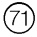

19 RÉPUBLIQUE FRANÇAISE

INSTITUT NATIONAL

DE LA PROPRIÉTÉ INDUSTRIELLE

COURBEVOIE

11 N° de publication : 3 110 470

(à n'utiliser que pour les

commandes de reproduction)

② $ N^{o} $ d'enregistrement national : 20 05076

51 Int Cl $ ^{8} $: B 09 B 3/00 (2019.12), C 08 L 1/12, 77/00, D 21 C 5/02, C 08 J 11/06

#### DEMANDE DE BREVET D'INVENTION

##### A1

22 Date de dépôt : 19.05.20.

30 Priorité :

(71) Demandeur(s) : KEENAT Société par actions simplifiée — FR.

(72) Inventeur(s) : FOURNIER Teddy.

(73) Titulaire(s) : KEENAT Société par actions simplifiée.

(74) Mandataire(s) : AQUINOV.

Demand(s) d'extension :

## Description

Titre de l'invention : Procédé de recyclage des mégots de cigarette

[0001] L'invention se rapporte au domaine du recyclage des mégots de cigarette. Ainsi, l'invention propose un nouveau procédé de recyclage des dits mégots, des matériaux composites comprenant des filtres recyclés et au moins un polymère thermoplastique et ses utilisations.

[0002] En plus d'occasionner des problèmes de santé publique majeure dans le monde, la cigarette et ses déchets, en particulier les mégots de cigarette occasionnent également des problématiques de pollution à l'échelle planétaire. Les mégots de cigarette sont bien connus pour contenir des restes de tabac non consumés, du papier, des filtres comprenant de l'acétate de cellulose et surtout de nombreux constituants toxiques. Or, les mégots comprenant lesdites constituants toxiques sont considérés comme de simples déchets que l'on retrouve malheureusement dans la nature et les océans, engendrant de fortes pollutions. En effet, un seul mégot de cigarette peut ainsi polluer jusqu'à 500 litres d'eau. Des études ont montré que les mégots de cigarette constituent la principale source de pollution des océans et ce avant les déchets plastiques.

[0003] Non seulement, les mégots de cigarette sont polluants, mais leur élimination ou recyclage est difficile en raison essentiellement, des nombreuses substances chimiques présentes.

[0004] C'est ainsi que des solutions ont vu le jour afin que les mégots de cigarette ne soient plus considérés comme des simples déchets mais comme d'une nouvelle matière première. Ainsi, la demande de brevet US2009113789 décrit un procédé de recyclage des mégots de cigarette comprenant les étapes suivantes : séparation de la fraction comprenant le papier et tabac de la fraction comprenant les filtres, broyage des filtres, ajout d'un solvant et essences minérales, mise en forme et séchage. Le solvant étant préféréntiellement l'acétone. Il est également connu un procédé similaire comprenant en outre l'utilisation d'enzymes fongiques (MX2017008258L).

[0005] De façon alternative, il a également été décrit dans la demande de brevet FR3066128 un procédé similaire comprenant une étape de dépollution à l'eau.

Toutefois, l'ensemble de ces solutions n'est pas entièrement satisfaisant du fait de la présence soit de solvant, soit d'eau pour dépolluer les mégots de cigarettes, en particulier l'acétate de cellulose. Or, il est nécessaire d'éliminer les substances chimiques de l'acétate afin de pouvoir être réutilisé dans d'autres processus de fabrication. Néanmoins, de tels procédés nécessitent des étapes supplémentaires de recyclage des solvants ou de l'eau afin de ne pas engendrer de pollution supplémentaire. Lesdits procédés sont de plus, couteux.

[0007] La présente invention propose ainsi de surmonter ces inconvénients et de répondre

aux problématiques de l'art antérieur en proposant un procédé permettant de recycler les mégots de cigarette en éliminant certaines substances chimiques présentes.

Pour y répondre, l'invention propose ainsi un procédé de recyclage des mégots de cigarette, chaque mégot de cigarette comprenant au moins du tabac, du papier et un filtre, ledit filtre comprenant de l'acétate de cellulose et du papier.

De manière surprenante, les inventeurs ont observé l'élimination de la plupart des substances chimiques par chauffage des filtres. Ils ont notamment sélectionné une gamme de température particulière, comprise entre 80 et 100°C pour obtenir la dépollution des filtres de mégots de cigarette, suivie d'une seconde étape de chauffage d'au moins 170°C.

Ainsi, les filtres dépollués peuvent être réutilisés pour fabriquer des matériaux composites comprenant des filtres de mégots recyclés et au moins un polymère thermoplastique.

[0011] De tels matériaux sont ensuite destinés à être utilisés comme matériaux non alimentaires, préférentiellement pour la fabrication de mobilier, tuyau, pieds, cendrier, support de communication, panneaux.

[0012] Les inventeurs ont également observé le maintien ou l'amélioration des performances mécaniques telles que la rigidité, la résistance, la déformation à la rupture, la tenue au choc, la dureté lorsque le matériau composite incorpore les filtres de mégots recyclés, en particulier l'acétate de cellulose.

[0013] L'invention a ainsi pour objet un procédé de recyclage des mégots de cigarette, chaque mégot de cigarette comprenant au moins du tabac, du papier et un filtre, ledit filtre comprenant de l'acétate de cellulose et du papier, caractérisé en ce que le procédé comprend les étapes suivantes:

a) séparer dans une première fraction F1 les filtres et dans une deuxième fraction F2 le tabac et le papier issu d'un mélange comprenant le tabac, le papier et les filtres séparés les uns des autres, puis récupérer la première fraction F1,

b) sécher et dépolluer ladite fraction F1 contenant les filtres à une température comprise en 80 et 100°C,

c) broyer la fraction F1 contenant les filtres séchés et dépollués issu de l'étape b)

d) mélanger et dépolluer simultanément dans une extrudeuse les filtres broyés obtenus à l'étape c) avec au moins un polymère thermoplastique pour obtenir un matériau composite.

L'invention a également pour objet un matériau composite comprenant entre 10 et 30% de filtres de mégots recyclés et entre 70 et 90% d'au moins un polymère thermoplastique. Le matériau composite est préférentiellement sous forme de granulé.

Enfin, l'invention a pour objet l'utilisation du matériau composite selon l'invention, comme matériau non alimentaire, préférentiellement pour la fabrication de mobilier,

tuyau, pieds, cendrier, support de communication, panneaux, matériaux divers...

L'invention est à présent décrite en détail. D'autres caractéristiques et avantages resortiront de la description détaillée de l'invention et des exemples qui vont suivre.

[0017]  $ \underline{\text{Définitions}} $

##### Description détaillée de l'invention

] Par « diffus » on entend au sens de l'invention, des déchets ne comprenant pas les mégots de cigarette et issus majoritairement des cendriers susceptibles de contenir un ou plusieurs produits chimiques pouvant présenter un risque important pour la santé et/ou l'environnement. On y trouve également papiers divers, bâton de sucette, tickets de transport en commun, plastiques divers...

Par « mégot de cigarette » on entend au sens de l'invention, le déchet ou reste d'une cigarette après son usage. Il s'agit donc d'un déchet toxique, difficile à collecter et à valoriser malgré que l'acétate de cellulose soit recyclable. Un mégot de cigarette comprend notamment du papier, du tabac et un filtre comprenant de l'acétate de cellulose.

[0020] Par « broyeur » on entend au sens de l'invention, un dispositif permettant d'effectuer un broyage, c'est-à-dire de réduire une matière à une dimension donnée et/ou de faciliter la séparation de différents constituants. Par exemple, séparer d'un mégot, ses différents constituants et/ou d'obtenir des fragments de mégots. Ainsi, il permet de rendre accessibles les différents constituants les mégots et ainsi, faciliter son recyclage.

[0021] Par «compoundage » on entend au sens de l'invention, un procédé

d'extrusion-granulation permettant le mélange par fusion d'un polymère telle qu'un polymère thermoplastique avec un ou plusieurs additifs telles que l'acétate de cellulose recyclé afin d'obtenir une matière plastique sous forme de compounds.

[0022]  $ \underline{\text{Procédé selon l'invention}} $

[0023] L'invention vise donc un procédé de recyclage des mégots de cigarette, chaque mégot de cigarette comprenant au moins du tabac, du papier et un filtre, ledit filtre comprenant de l'acétate de cellulose et du papier, caractérisé en ce que le procédé comprend les étapes suivantes:

a) séparer dans une première fraction F1 les filtres et dans une deuxième fraction F2 le tabac et le papier issu d'un mélange comprenant du tabac, du papier et des filtres, puis récupérer la première fraction F1,

b) sécher et dépolluer par chauffage la fraction F1 contenant les filtres à une température comprise en 80 et 100°C,

c) broyer la fraction F1 contenant les filtres séchés et dépollués issu de l'étape b),

d) mélanger et dépolluer simultanément par chauffage dans une extrudeuse les filtres broyés obtenus à l'étape c) avec au moins un polymère thermoplastique pour obtenir

un matériau composite.

0024] De façon particulièrement préférée, le procédé selon l'invention ne comprend aucun ajout de solvant ou d'eau, préférentiellement lors des étapes de dépollution.

Selon un mode de réalisation, le procédé peut comprendre une étape supplémentaire, avant l'étape a), d'extraction du tabac contenu dans les mégots de cigarettes. Ladite extraction est réalisée avec un broyeur. Préférentiellement, ce broyeur est un broyeur de type doseur mono-vis, doseur bi-vis sans fin ou broyeur à couteaux.

Selon un autre mode de réalisation de l'invention, le procédé peut comprendre une première étape d'extraction au moyen d'un premier broyeur et une deuxième étape de broyage lors de l'étape c) au moyen d'un deuxième broyeur, ledit premier broyeur est caractérisé en ce que le broyat ou les fragments obtenus sont plus gros que le broyat ou les fragments obtenus lors du second broyage lors de l'étape c). Le deuxième broyage permet ainsi, d'obtenir un broyat ou des fragments plus fins que lors de l'extraction du tabac au moyen d'un premier broyeur.

[0027] Selon un autre mode de réalisation, le procédé peut comprendre deux étapes supplémentaires avant l'étape a). Ainsi, le procédé peut comprendre les étapes préliminaires suivantes :

- trier pour récupérer uniquement les mégots de cigarette à partir d'un mélange de déchets diffus et de mégots de cigarettes, et

- extraire le tabac contenu dans les mégots de cigarette avec un broyeur.

28] Le tri permet de séparer les différentes fractions contenues dans les cendriers, soit une fraction contenant le diffus et une fraction contenant les mégots de cigarette. Le tri peut être mis en œuvre par criblage horizontal et/ou rotatif, préférentiellement un tamis vibrant et/ou un cribleur. Le cribleur rotatif peut-être un trommel automatisé. Par exemple, le tri peut être effectué à l'aide d'un Tamis Rotatif horticole de Type Ménart TH0924.

[0029] A la fin du tri, deux fractions différentes sont ainsi séparées, chacune comprenant soit les mégots de cigarette comprenant le tabac, le papier et le filtre, soit le diffus. La fraction comprenant le diffus sera ensuite transformée en combustibles de substitution solides (CSS), à haut pouvoir calorifique et valorisée à travers les filières de valorisation énergétique telles que les usines d'incinération alimentant ainsi les fours de ci-menteries

[0030] La fraction d'intérêt comprenant les mégots poursuivra le processus afin d'en extraire le tabac et le papier contenu dans lesdits mégots de cigarette avec un premier broyeur.

[0031] Afin d'extraire le tabac et le papier, le broyeur utilisé est un broyeur apte à séparer le tabac des filtres sans broyer les filtres. Préférentiellement, le broyeur compresse les mégots pour en extraire le tabac. De façon particulièrement préférée, le premier broyeur peut être un broyeur de type doseur mono-vis, doseur bi-vis sans fin ou

broyeur à couteaux.

[0032] A la fin de cette étape d'extraction, un mélange comprenant le tabac, le papier et les filtres séparés les uns des autres est obtenu.

[0033] A partir de ce mélange, le procédé selon l'invention met en œuvre une étape a) de séparation des différents constituants du mélange. Cela permet d'obtenir dans une première fraction F1 les filtres et dans une deuxième fraction F2 le tabac et le papier issu du mélange obtenu lors de l'étape précédente, puis la première fraction F1 est récupérée.

[0034] La séparation en deux fractions lors de l'étape a) est effectuée avec un moyen de tri. Un tel moyen de tri peut être un tamis ou un cribleur rotatif, préférentiellement un trommel. De façon particulièrement préférée, le diamètre de la grille du tamis est compris entre 3 et 6mm.

[0035] Préférentiellement, l'étape a) est répétée de 3 à 5 fois sur la fraction F1 comprenant les filtres.

[0036] Le tabac et le papier contenu dans la deuxième fraction F2 seront alors transformés en combustibles de substitution solides (CSS), à haut pouvoir calorifique et valorisés à travers les filières de valorisation énergétique telles que les usines d'incinération.

[0037] La première fraction F1 comprenant les filtres est ensuite séchée et dépolluée par chauffage à une température comprise en 80 et 160°C, préférentiellement à une température de 90°C. Le chauffage permet à la fraction F1 d'être, d'une part séchée pour faciliter le broyage lors de l'étape suivant, et d'autre part de dépolluer partiellement les filtres.

[0038] Selon un mode de réalisation, le chauffage est suivi d'un passage dans une étuve sous vide qui permet d'éliminer des substances telles que le Fluoranthène, le Benzo(a)pyrène ou le Benzo(b)fluoranthène.

[0039] La durée de l'étape de séchage et de dépollution, préférentiellement par chauffage, lors de l'étape b) est comprise entre 3 et 12 heures.

[0040] Le séchage et la dépollution peuvent être effectués par tout moyen de chauffage adapté. Toutefois, selon un mode de réalisation préféré, le moyen de chauffage est une cuve à étuver.

[0041] De façon particulièrement préférée, ledit procédé comprend une étape supplémentaire de séchage entre l'étape b) et c). Cette étape de séchage supplémentaire est mise en œuvre dans une étuve sous vide qui permet de maximiser la dépollution des filtres. A faible taux d'oxygène, la température de dégradation de la cellulose plus élevée associée à une pression faible favorise l'évaporation des polluants organiques.

[0042] La fraction F1 une fois séchée et dépolluée lors de l'étape b) est alors broyée de nouveau lors d'une étape c) avec un broyeur. L'étape c) permet de broyer grossièrement les filtres comprenant l'acétate de cellulose afin de faciliter l'étape d)

d'incorporation d'au moins un thermoplastique et de dépollution.

[8] Préférentiellement le broyeur utilisé à l'étape c) est un broyeur à couteaux à basse vitesse ou un broyeur à végétaux. Par exemple, le broyeur à végétaux peut-être un broyeur à végétaux de type ELIET MAJOR 4S ou de type Viking GE 250.1. Le broyage de l'étape c) est suivi éventuellement d'un passage en trommel ou tamis rotatif avec une grille 8 mm afin de conserver uniquement les filtres broyés contenant l'acétate de cellulose.

[0044] Préférentiellement, la durée du broyage à l'étape c) est comprise entre 20 et 40 minutes, plus préférentiellement 30 minutes.

[0045] Selon un mode de réalisation alternatif, le broyeur de l'étape c) peut être identique au broyeur de l'étape préliminaire d'extraction, préférentiellement il s'agit d'un broyeur à couteaux.

[0046] A la fin du broyage à l'étape c), on obtient ainsi des fragments de filtres d'un diamètre compris entre 3 et 5mm.

[0047] A partir des fragments de filtres obtenus lors de l'étape c), le procédé comprend une étape d) de mélange et de dépollution simultanée dans une extrudeuse avec au moins un polymère thermoplastique pour obtenir un matériau composite.

[0048] Préférentiellement, le mélange est obtenu par compoundage.

[0049] Ainsi, l'étape d) est mise en œuvre en chauffant le mélange dans une extrudeuse à une température d'au moins 170°C, de façon particulièrement préféré la température est comprise en 170 et 240°C.

[0050] Le matériau composite en fusion ressort alors de l'extrudeuse en joncs. Ces joncs sont ensuite refroidis et découpés pour obtenir des granulés.

[0051] Lors de l'étape d), en particulier lors du compoundage, la température d'au moins  $ 170^{\circ} $C permet de dépolluer une seconde fois les filtres. Ainsi, des composés toxiques tels que le Fluoranthène, le Benzo(b)fluorenhène, le Benzo(b)pyrène sont évaporés et permettent la dépollution des filtres.

[0052] Préférentiellement la durée de l'étape d) est relativement courte, d'au plus 5 minutes, préférentiellement de 1 à 2 minutes.

[0053] Selon un mode de réalisation préféré, des pressions faibles et/ou faible taux d'oxygène permettent de favoriser l'évaporation des composés toxiques

[0054] Selon un mode de réalisation préféré, le polymère thermoplastique est choisi parmi les polyamides et les poly(butylène). Préférentiellement, le polymère thermoplastique est choisi parmi le polyamide 6 (PA6), le polyamide 6.6 (PA66), le polyamide 11 (PA11), le polyamide 12 (PA12), et le poly(butylène succinate) (PBS) et le poly(butylène succinate adipate) (PBSA).

[0055] Les polyamides (PA) sont des polymères contenant des fonctions amide pouvant résulter de la polycondensation entre les fonctions acide carboxylique et amine et sont

bien connus de l'homme de l'art.

[0056] Les poly(butylène) sont des polyoléfines ou des polymères saturés ayant la formule chimique (C4H8)n.

[0057] Préférentiellement, le mélange lors de l'étape d) comprend entre 10 à 30% de filtres et entre 70 à 90% d'au moins un polymère thermoplastique.

[0058] Selon un mode de réalisation de l'invention, le mélange lors de l'étape d) est réalisé avec au moins un polymère thermoplastique, des fragments de filtres d'un diamètre compris entre 3 à 5 mm et au moins un stabilisateur d'odeur.

[0059] Le stabilisateur d'odeur peut être tous composés ou molécules aptes à emprisonner les odeurs et diffuser une seconde odeur. Préférentiellement, ce peut être un désodorisant ou un absorbeur d'odeur.

[0060] A la fin de l'étape d), un matériau composite est obtenu. Préférentiellement, le matériau composite peut-être sous toute forme non filamenteuse ou non fibreuse, de façon particulièrement préféré sous forme de granulé ou de poudre.

[0061]  $ \underline{\text{Matériau composite selon l'invention}} $

[0062] Ainsi, l'invention concerne également un matériau composite comprenant entre 10 et 30% de filtres de mégots recyclés obtenu par la mise en œuvre des étapes a) à d) du procédé selon l'invention et entre 70 et 90% d'au moins un polymère thermoplastique.

[0063] Préférentiellement, le polymère thermoplastique est choisi parmi les polyamides tels que le polyamide 6 (PA6), le polyamide 6.6 (PA66), le polyamide 11 (PA11), le polyamide 12 (PA12), et le poly(butylène succinate) (PBS) et le poly(butylène succinate adipate) (PBSA).

[0064] Une fois le matériau composite obtenu, préférentiellement sous forme de granulé. Les granulés peuvent être utilisés en injection pour réaliser de nombreux objets, en particulier des plastiques à usage non alimentaire.

[0065]  $ \underline{\text{Utilisations}} $

[0066] Ainsi, l'invention concerne également l'utilisation du matériau composite selon l'invention, comme matériau non alimentaire, préférentiellement pour la fabrication de mobilier, tuyau, pieds, cendrier, support de communication, panneaux.

[0067] De façon particulièrement préféré, ces nouveaux matériaux non alimentaires sont recyclables après une étape de broyage suivi de l'étape d) du procédé selon l'invention.

[0068] L'invention est à présent illustrée par des exemples de composite et des résultats d'essais démontrant ses caractéristiques.

##### Exemples

[0069] Exemple 1 de composite selon l'invention

[0070] Matériau composite à base de résine polyamide 11 (PA11) comprenant 10% de filtres recyclés selon le procédé de l'invention avec les propriétés suivantes.

[0071] [Tableaux1]

<table border=1 style='margin: auto; word-wrap: break-word;'><tr><td style='text-align: center; word-wrap: break-word;'>Propriétés mécaniques</td><td style='text-align: center; word-wrap: break-word;'>Valeur</td><td style='text-align: center; word-wrap: break-word;'>Unité</td><td style='text-align: center; word-wrap: break-word;'>Norme</td></tr><tr><td style='text-align: center; word-wrap: break-word;'>Module d&#x27;Young à 20°C\n(1mm/min)</td><td style='text-align: center; word-wrap: break-word;'>1580</td><td style='text-align: center; word-wrap: break-word;'>MPa</td><td style='text-align: center; word-wrap: break-word;'>ISO 527-1/2</td></tr><tr><td style='text-align: center; word-wrap: break-word;'>Contrainte Maximum à 20°C\n(50mm/min)</td><td style='text-align: center; word-wrap: break-word;'>45</td><td style='text-align: center; word-wrap: break-word;'>MPa</td><td style='text-align: center; word-wrap: break-word;'>ISO 527-1/2</td></tr><tr><td style='text-align: center; word-wrap: break-word;'>Déformation à rupture à 20°C\n(50mm/min)</td><td style='text-align: center; word-wrap: break-word;'>17</td><td style='text-align: center; word-wrap: break-word;'>%</td><td style='text-align: center; word-wrap: break-word;'>ISO 527-1/2</td></tr><tr><td style='text-align: center; word-wrap: break-word;'>Choc Charpy entaillé à 20°C</td><td style='text-align: center; word-wrap: break-word;'>3</td><td style='text-align: center; word-wrap: break-word;'>$ Kj/m^{{2}} $</td><td style='text-align: center; word-wrap: break-word;'>ISO 179/1eA</td></tr><tr><td style='text-align: center; word-wrap: break-word;'>Propriétés physiques</td><td style='text-align: center; word-wrap: break-word;'>Valeur</td><td style='text-align: center; word-wrap: break-word;'>Unité</td><td style='text-align: center; word-wrap: break-word;'>Norme</td></tr><tr><td style='text-align: center; word-wrap: break-word;'>Densité à 20°C</td><td style='text-align: center; word-wrap: break-word;'>1,05</td><td style='text-align: center; word-wrap: break-word;'>$ g/cm^{{3}} $</td><td style='text-align: center; word-wrap: break-word;'>ISO 1183</td></tr><tr><td style='text-align: center; word-wrap: break-word;'>Dureté 20°C à 30s</td><td style='text-align: center; word-wrap: break-word;'>72</td><td style='text-align: center; word-wrap: break-word;'>Shore D</td><td style='text-align: center; word-wrap: break-word;'>ISO 868</td></tr><tr><td style='text-align: center; word-wrap: break-word;'>Taux de cendre</td><td style='text-align: center; word-wrap: break-word;'>2</td><td style='text-align: center; word-wrap: break-word;'>%</td><td style='text-align: center; word-wrap: break-word;'>ISO 3451/A</td></tr></table>

[0072]  $ \underline{\text{Exemple 2 de composite selon l'invention}} $

[0073] Matériau composite à base de résine polyamide 11 (PA11) comprenant 30% de filtres recyclés selon le procédé de l'invention avec les propriétés suivantes.

<table border=1 style='margin: auto; word-wrap: break-word;'><tr><td style='text-align: center; word-wrap: break-word;'>Propriétés mécaniques</td><td style='text-align: center; word-wrap: break-word;'>Valeur</td><td style='text-align: center; word-wrap: break-word;'>Unité</td><td style='text-align: center; word-wrap: break-word;'>Norme</td></tr><tr><td style='text-align: center; word-wrap: break-word;'>Module d&#x27;Young à 20°C\n(1mm/min)</td><td style='text-align: center; word-wrap: break-word;'>2040</td><td style='text-align: center; word-wrap: break-word;'>MPa</td><td style='text-align: center; word-wrap: break-word;'>ISO 527-1/2</td></tr><tr><td style='text-align: center; word-wrap: break-word;'>Contrainte Maximum à 20°C\n(50mm/min)</td><td style='text-align: center; word-wrap: break-word;'>48</td><td style='text-align: center; word-wrap: break-word;'>MPa</td><td style='text-align: center; word-wrap: break-word;'>ISO 527-1/2</td></tr><tr><td style='text-align: center; word-wrap: break-word;'>Déformation à rupture à 20°C\n(50mm/min)</td><td style='text-align: center; word-wrap: break-word;'>6</td><td style='text-align: center; word-wrap: break-word;'>%</td><td style='text-align: center; word-wrap: break-word;'>ISO 527-1/2</td></tr><tr><td style='text-align: center; word-wrap: break-word;'>Choc Charpy entaillé à 20°C</td><td style='text-align: center; word-wrap: break-word;'>2,9</td><td style='text-align: center; word-wrap: break-word;'>$ Kj/m^{{2}} $</td><td style='text-align: center; word-wrap: break-word;'>ISO 179/1eA</td></tr><tr><td style='text-align: center; word-wrap: break-word;'>Propriétés physiques</td><td style='text-align: center; word-wrap: break-word;'>Valeur</td><td style='text-align: center; word-wrap: break-word;'>Unité</td><td style='text-align: center; word-wrap: break-word;'>Norme</td></tr><tr><td style='text-align: center; word-wrap: break-word;'>Densité à 20°C</td><td style='text-align: center; word-wrap: break-word;'>1,13</td><td style='text-align: center; word-wrap: break-word;'>$ g/cm^{{3}} $</td><td style='text-align: center; word-wrap: break-word;'>ISO 1183</td></tr><tr><td style='text-align: center; word-wrap: break-word;'>Dureté 20°C à 30s</td><td style='text-align: center; word-wrap: break-word;'>75</td><td style='text-align: center; word-wrap: break-word;'>Shore D</td><td style='text-align: center; word-wrap: break-word;'>ISO 868</td></tr><tr><td style='text-align: center; word-wrap: break-word;'>Taux de cendre</td><td style='text-align: center; word-wrap: break-word;'>5,7</td><td style='text-align: center; word-wrap: break-word;'>%</td><td style='text-align: center; word-wrap: break-word;'>ISO 3451/A</td></tr></table>

[0075]  $ \underline{\text{Exemple 3 de composite selon l'invention}} $

[0076] Matériau composite à base de résine polybutylène succinate (PBS) compostable comprenant 30% de filtres recyclés selon le procédé de l'invention avec les propriétés

suivantes.

[0077] [Tableaux3]

<table border=1 style='margin: auto; word-wrap: break-word;'><tr><td style='text-align: center; word-wrap: break-word;'>Propriétés mécaniques</td><td style='text-align: center; word-wrap: break-word;'>Valeur</td><td style='text-align: center; word-wrap: break-word;'>Unité</td><td style='text-align: center; word-wrap: break-word;'>Norme</td></tr><tr><td style='text-align: center; word-wrap: break-word;'>Module d&#x27;Young à 20°C\n(1mm/min)</td><td style='text-align: center; word-wrap: break-word;'>1590</td><td style='text-align: center; word-wrap: break-word;'>MPa</td><td style='text-align: center; word-wrap: break-word;'>ISO 527-1/2</td></tr><tr><td style='text-align: center; word-wrap: break-word;'>Contrainte Maximum à 20°C\n(50mm/min)</td><td style='text-align: center; word-wrap: break-word;'>33</td><td style='text-align: center; word-wrap: break-word;'>MPa</td><td style='text-align: center; word-wrap: break-word;'>ISO 527-1/2</td></tr><tr><td style='text-align: center; word-wrap: break-word;'>Déformation à rupture à 20°C\n(50mm/min)</td><td style='text-align: center; word-wrap: break-word;'>4</td><td style='text-align: center; word-wrap: break-word;'>%</td><td style='text-align: center; word-wrap: break-word;'>ISO 527-1/2</td></tr><tr><td style='text-align: center; word-wrap: break-word;'>Choc Charpy entaillé à 20°C</td><td style='text-align: center; word-wrap: break-word;'>1,8</td><td style='text-align: center; word-wrap: break-word;'>$ Kj/m^{{2}} $</td><td style='text-align: center; word-wrap: break-word;'>ISO 179/1eA</td></tr><tr><td style='text-align: center; word-wrap: break-word;'>Propriétés physiques</td><td style='text-align: center; word-wrap: break-word;'>Valeur</td><td style='text-align: center; word-wrap: break-word;'>Unité</td><td style='text-align: center; word-wrap: break-word;'>Norme</td></tr><tr><td style='text-align: center; word-wrap: break-word;'>Densité à 20°C</td><td style='text-align: center; word-wrap: break-word;'>1,36</td><td style='text-align: center; word-wrap: break-word;'>$ g/cm^{{3}} $</td><td style='text-align: center; word-wrap: break-word;'>ISO 1183</td></tr><tr><td style='text-align: center; word-wrap: break-word;'>Dureté 20°C à 30s</td><td style='text-align: center; word-wrap: break-word;'>71</td><td style='text-align: center; word-wrap: break-word;'>Shore D</td><td style='text-align: center; word-wrap: break-word;'>ISO 868</td></tr><tr><td style='text-align: center; word-wrap: break-word;'>Taux de cendre</td><td style='text-align: center; word-wrap: break-word;'>8,5</td><td style='text-align: center; word-wrap: break-word;'>%</td><td style='text-align: center; word-wrap: break-word;'>ISO 3451/A</td></tr></table>

[0078] Exemple 4 de composite selon l'invention

[0079] Matériau composite à base de résine polybutylène succinate adipate (PBSA) compostable comprenant 30% de filtres recyclés selon le procédé de l'invention avec les propriétés suivantes.

[0080] [Tableaux4]

<table border=1 style='margin: auto; word-wrap: break-word;'><tr><td style='text-align: center; word-wrap: break-word;'>Propriétés mécaniques</td><td style='text-align: center; word-wrap: break-word;'>Valeur</td><td style='text-align: center; word-wrap: break-word;'>Unité</td><td style='text-align: center; word-wrap: break-word;'>Norme</td></tr><tr><td style='text-align: center; word-wrap: break-word;'>Module d&#x27;Young à 20°C\n(1mm/min)</td><td style='text-align: center; word-wrap: break-word;'>780</td><td style='text-align: center; word-wrap: break-word;'>MPa</td><td style='text-align: center; word-wrap: break-word;'>ISO 527-1/2</td></tr><tr><td style='text-align: center; word-wrap: break-word;'>Contrainte Maximum à 20°C\n(50mm/min)</td><td style='text-align: center; word-wrap: break-word;'>16,5</td><td style='text-align: center; word-wrap: break-word;'>MPa</td><td style='text-align: center; word-wrap: break-word;'>ISO 527-1/2</td></tr><tr><td style='text-align: center; word-wrap: break-word;'>Déformation à rupture à 20°C\n(50mm/min)</td><td style='text-align: center; word-wrap: break-word;'>18</td><td style='text-align: center; word-wrap: break-word;'>%</td><td style='text-align: center; word-wrap: break-word;'>ISO 527-1/2</td></tr><tr><td style='text-align: center; word-wrap: break-word;'>Choc Charpy entaillé à 20°C</td><td style='text-align: center; word-wrap: break-word;'>3,8</td><td style='text-align: center; word-wrap: break-word;'>$ Kj/m^{{2}} $</td><td style='text-align: center; word-wrap: break-word;'>ISO 179/1eA</td></tr><tr><td style='text-align: center; word-wrap: break-word;'>Propriétés physiques</td><td style='text-align: center; word-wrap: break-word;'>Valeur</td><td style='text-align: center; word-wrap: break-word;'>Unité</td><td style='text-align: center; word-wrap: break-word;'>Norme</td></tr><tr><td style='text-align: center; word-wrap: break-word;'>Densité à 20°C</td><td style='text-align: center; word-wrap: break-word;'>1,31</td><td style='text-align: center; word-wrap: break-word;'>$ g/cm^{{3}} $</td><td style='text-align: center; word-wrap: break-word;'>ISO 1183</td></tr><tr><td style='text-align: center; word-wrap: break-word;'>Dureté 20°C à 30s</td><td style='text-align: center; word-wrap: break-word;'>59</td><td style='text-align: center; word-wrap: break-word;'>Shore D</td><td style='text-align: center; word-wrap: break-word;'>ISO 868</td></tr><tr><td style='text-align: center; word-wrap: break-word;'>Taux de cendre</td><td style='text-align: center; word-wrap: break-word;'>7,0</td><td style='text-align: center; word-wrap: break-word;'>%</td><td style='text-align: center; word-wrap: break-word;'>ISO 3451/A</td></tr></table>

### Revendications

[Revendication 1] Procédé de recyclage des mégots de cigarette, chaque mégot de cigarette comprenant au moins du tabac, du papier et un filtre, ledit filtre comprenant de l'acétate de cellulose et du papier, caractérisé en ce que le procédé comprend les étapes suivantes:

a) séparer dans une première fraction F1 les filtres et dans une deuxième fraction F2 le tabac et le papier issu d'un mélange comprenant le tabac, le papier et les filtres séparés les uns des autres, puis récupérer la première fraction F1,

b) sécher et dépolluer par chauffage ladite fraction F1 contenant les filtres à une température comprise en 80 et 100°C,

c) broyer la fraction F1 contenant les filtres séchés et dépollués issu de l'étape b)

d) mélanger et dépolluer simultanément par chauffage dans une extrudeuse les filtres broyés obtenus à l'étape c) avec au moins un polymère thermoplastique pour obtenir un matériau composite.

[Revendication 2] Procédé selon la revendication 1, caractérisé en ce qu'il n'utilise ni de solvant, ni d'eau.

[Revendication 3] Procédé selon l'une des revendications précédentes, caractérisé en ce que ledit procédé comprend les étapes préliminaires suivantes : - tri pour récupérer uniquement les mégots de cigarette à partir d'un mélange de déchets diffus et de mégots de cigarettes, et - extraction du tabac contenu dans les mégots de cigarette avec un broyeur.

[Revendication 4] Procédé selon la revendication précédente, dans lequel le broyeur utilisé pour l'extraction du tabac contenu dans les mégots de cigarette est un est un doseur mono-vis ou un doseur bi-vis sans fin.

[Revendication 5] Procédé selon l'une des revendications précédentes, dans lequel la dé- pollution par chauffage lors de l'étape d) est effectuée à une température d'au moins 170°C.

[Revendication 6] Procédé selon la revendication précédente, caractérisé en ce que la température est comprise en 170 et 240°C.

[Revendication 7] Procédé selon l'une des revendications précédentes, caractérisé en ce que l'étape a) est répétée de 3 à 5 fois sur la fraction F1 comprenant les filtres.

[Revendication 8] Procédé selon l'une des revendications précédentes, caractérisé en ce qu'il comprend une étape supplémentaire entre l'étape c) et d) de

[Revendication 9] Procédé selon l'une des revendications précédentes, caractérisé en ce que l'étape c) est effectuée avec un broyeur à couteaux ou un broyeur à végétaux.

[Revendication 10] Procédé selon l'une des revendications précédentes, caractérisé en ce que la durée de l'étape de dépollution lors de l'étape b) est comprise entre 3 et 12 heures.

[Revendication 11] Procédé selon l'une des revendications précédentes, caractérisé en ce que la dépollution lors de l'étape b) est effectuée par chauffage dans une cuve à étuver.

[Revendication 12] Procédé selon l'une des revendications précédentes, dans lequel la dé- pollution lors de l'étape d) est effectuée à pression faible et/ou faible taux d'oxygène.

[Revendication 13] Procédé selon l'une des revendications précédentes, caractérisé en ce que le mélange de l'étape d) comprend entre 10 à 30% de filtres et entre 70 à 90% d'au moins un polymère thermoplastique.

[Revendication 14] Procédé selon l'une des revendications précédentes, caractérisé en ce que le polymère thermoplastique de l'étape d) est choisi parmi le PA6, le PA11, le PBS et le PBSA.

[Revendication 15] Matériau composite comprenant entre 10 et 30% de filtres de mégots recyclés obtenu par la mise en œuvre des étapes a) à d) du procédé selon l'une des revendications 1 à 14 et entre 70 et 90% d'au moins un noirmère thermonlastique.

[Revendication 16] Matériau composite selon la revendication précédente caractérisé en ce que le polymère thermoplastique est choisi parmi le PA6, le PA11, le PRS et le PRSA

[Revendication 17] Utilisation d'un matériau composite selon la revendication 15, comme matériau non alimentaire, préférentiellement pour la fabrication de mobilier, tuyau, pieds, cendrier, support de communication, panneaux.

FA 881172

FR 2005076

<table border=1 style='margin: auto; word-wrap: break-word;'><tr><td colspan="3">DOCUMENTS CONSIDÉRES COMME PERTINENTS</td><td style='text-align: center; word-wrap: break-word;'>Revendication(s) concernée(s)</td><td style='text-align: center; word-wrap: break-word;'>Classement atribué à l&#x27;invention par l&#x27;INPI</td></tr><tr><td style='text-align: center; word-wrap: break-word;'>Catégorie</td><td colspan="2">Citation du document avec indication, en cas de besoin, des parties pertinentes</td><td style='text-align: center; word-wrap: break-word;'></td><td style='text-align: center; word-wrap: break-word;'></td></tr><tr><td style='text-align: center; word-wrap: break-word;'>X</td><td style='text-align: center; word-wrap: break-word;'>US 5 482 216 A (HESS MARKUS [CA]) 9 janvier 1996 (1996-01-09) * colonne 2, ligne 34 - colonne 3, ligne 30  $ ^{{*}} $</td><td style='text-align: center; word-wrap: break-word;'></td><td style='text-align: center; word-wrap: break-word;'>15-17</td><td style='text-align: center; word-wrap: break-word;'>B09B3/00 C08L1/12 C08L77/00 D21C5/02 C08J11/06</td></tr><tr><td style='text-align: center; word-wrap: break-word;'>X</td><td style='text-align: center; word-wrap: break-word;'>US 2014/287144 A1 (BURICH BLAKE [US] ET AL) 25 septembre 2014 (2014-09-25)  $ ^{{*}} $ le document en entier  $ ^{{*}} $</td><td style='text-align: center; word-wrap: break-word;'></td><td style='text-align: center; word-wrap: break-word;'>15-17</td><td style='text-align: center; word-wrap: break-word;'></td></tr><tr><td style='text-align: center; word-wrap: break-word;'>A</td><td style='text-align: center; word-wrap: break-word;'>DE 693 01 892 T2 (HOECHST CELANESE CORP [US]) 5 septembre 1996 (1996-09-05)  $ ^{{*}} $ le document en entier  $ ^{{*}} $</td><td style='text-align: center; word-wrap: break-word;'></td><td style='text-align: center; word-wrap: break-word;'>1-14</td><td style='text-align: center; word-wrap: break-word;'></td></tr><tr><td style='text-align: center; word-wrap: break-word;'>A</td><td style='text-align: center; word-wrap: break-word;'>US 2014/018502 A1 (SHERGA RONALD MATTHEW [US] ET AL) 16 janvier 2014 (2014-01-16)  $ ^{{*}} $ le document en entier  $ ^{{*}} $</td><td style='text-align: center; word-wrap: break-word;'></td><td style='text-align: center; word-wrap: break-word;'>1-17</td><td style='text-align: center; word-wrap: break-word;'></td></tr><tr><td style='text-align: center; word-wrap: break-word;'>A</td><td style='text-align: center; word-wrap: break-word;'>DE 199 02 368 A1 (LUTZE HANS [DE]; MORSCHETT PETER [DE] ET AL.) 10 août 2000 (2000-08-10)  $ ^{{*}} $ le document en entier  $ ^{{*}} $</td><td style='text-align: center; word-wrap: break-word;'></td><td style='text-align: center; word-wrap: break-word;'>1-17</td><td style='text-align: center; word-wrap: break-word;'></td></tr><tr><td style='text-align: center; word-wrap: break-word;'>A</td><td style='text-align: center; word-wrap: break-word;'>KR 2016 0005297 A (PARK JONG HO [KR]) 14 janvier 2016 (2016-01-14)  $ ^{{*}} $ le document en entier  $ ^{{*}} $</td><td style='text-align: center; word-wrap: break-word;'></td><td style='text-align: center; word-wrap: break-word;'>1-17</td><td style='text-align: center; word-wrap: break-word;'>B29K B09B B09C B29B</td></tr><tr><td style='text-align: center; word-wrap: break-word;'>A</td><td style='text-align: center; word-wrap: break-word;'>CN 110 090 848 A (ZHUHAI 58 TECH CO LTD) 6 août 2019 (2019-08-06)  $ ^{{*}} $ le document en entier  $ ^{{*}} $</td><td style='text-align: center; word-wrap: break-word;'></td><td style='text-align: center; word-wrap: break-word;'>1-17</td><td style='text-align: center; word-wrap: break-word;'>C09J C08J</td></tr><tr><td style='text-align: center; word-wrap: break-word;'>A</td><td style='text-align: center; word-wrap: break-word;'>IT MI20 100 481 A1 (MATTERI FABIO TT S R L) 24 septembre 2011 (2011-09-24)  $ ^{{*}} $ le document en entier  $ ^{{*}} $</td><td style='text-align: center; word-wrap: break-word;'></td><td style='text-align: center; word-wrap: break-word;'>1-17</td><td style='text-align: center; word-wrap: break-word;'></td></tr><tr><td style='text-align: center; word-wrap: break-word;'>A</td><td style='text-align: center; word-wrap: break-word;'>DE 44 20 902 C1 (FRAUNHOFER GES FORSCHUNG [DE]) 13 juillet 1995 (1995-07-13)  $ ^{{*}} $ le document en entier  $ ^{{*}} $</td><td style='text-align: center; word-wrap: break-word;'></td><td style='text-align: center; word-wrap: break-word;'>1-17</td><td style='text-align: center; word-wrap: break-word;'></td></tr><tr><td colspan="3">Date d&#x27;achèvement de la recherche</td><td colspan="2">Examinateur</td></tr><tr><td colspan="3">11 janvier 2021</td><td colspan="2">Rüdiger, Patrick</td></tr><tr><td colspan="3">CATEGORIE DES DOCUMENTS CITÉS</td><td colspan="2">T : théorie ou principe à la base de l&#x27;invention E : document de brevet bénéficiant d&#x27;une date antérieure à la date de dépot et qui n&#x27;a été publié qu&#x27;à cette date</td></tr><tr><td colspan="3">X : particulièrement pertinent à lui seul Y : particulièrement pertinent en combinaison avec un autre document de la même catégorie A : arrière-plan technologique O : divulgation non-écrite P : document intercalaire</td><td colspan="2">D : cité dans la demande L : cité pour d&#x27;autres raisons</td></tr><tr><td colspan="3">&amp; : membre de la même famille, document correspondant</td><td colspan="2"></td></tr></table>

# ANNEXE AU RAPPORT DE RECHERCHE PRÉLIMINAIRE RELATIF A LA DEMANDE DE BREVET FRANÇAIS NO. FR 2005076 FA 881172

La présente annexe indique les membres de la famille de brevets relatifs aux documents brevets cités dans le rapport de recherche préliminaire visé ci-dessus.

Les dits membres sont contenus au fichier informatique de l'Office européenne des brevets à la date du 11-01-2021

Les renseignements fournis sont donnés à titre indicatif et n'engagent pas la responsabilité de l'Office européenne des brevets,

ni de l'Administration française

<table border=1 style='margin: auto; word-wrap: break-word;'><tr><td style='text-align: center; word-wrap: break-word;'>Document brevet cite au rapport de recherche</td><td style='text-align: center; word-wrap: break-word;'>Date de publication</td><td style='text-align: center; word-wrap: break-word;'>Membre(s) de la famille de brevet(s)</td><td style='text-align: center; word-wrap: break-word;'>Date de publication</td></tr><tr><td style='text-align: center; word-wrap: break-word;'>US 5482216</td><td style='text-align: center; word-wrap: break-word;'>A 09-01-1996</td><td style='text-align: center; word-wrap: break-word;'>AU 6790994 A CA 2094567 A1 US 5482216 A WO 9423919 A1</td><td style='text-align: center; word-wrap: break-word;'>08-11-1994 22-10-1994 09-01-1996 27-10-1994</td></tr><tr><td style='text-align: center; word-wrap: break-word;'>US 2014287144</td><td style='text-align: center; word-wrap: break-word;'>A1 25-09-2014</td><td style='text-align: center; word-wrap: break-word;'>AUCUN</td><td style='text-align: center; word-wrap: break-word;'></td></tr><tr><td style='text-align: center; word-wrap: break-word;'>DE 69301892</td><td style='text-align: center; word-wrap: break-word;'>T2 05-09-1996</td><td style='text-align: center; word-wrap: break-word;'>AT AT 135599 T CN 1089117 A DE 69301892 T2 EP JP H06206060 A US 5328934 A</td><td style='text-align: center; word-wrap: break-word;'>15-04-1996 13-07-1994 05-09-1996 04-05-1994 26-07-1994 12-07-1994</td></tr><tr><td style='text-align: center; word-wrap: break-word;'>US 2014018502</td><td style='text-align: center; word-wrap: break-word;'>A1 16-01-2014</td><td style='text-align: center; word-wrap: break-word;'>US 2014018502 A1 US 2016032098 A1 US 2019338122 A1</td><td style='text-align: center; word-wrap: break-word;'>16-01-2014 04-02-2016 07-11-2019</td></tr><tr><td style='text-align: center; word-wrap: break-word;'>DE 19902368</td><td style='text-align: center; word-wrap: break-word;'>A1 10-08-2000</td><td style='text-align: center; word-wrap: break-word;'>AUCUN</td><td style='text-align: center; word-wrap: break-word;'></td></tr><tr><td style='text-align: center; word-wrap: break-word;'>KR 20160005297</td><td style='text-align: center; word-wrap: break-word;'>A 14-01-2016</td><td style='text-align: center; word-wrap: break-word;'>AUCUN</td><td style='text-align: center; word-wrap: break-word;'></td></tr><tr><td style='text-align: center; word-wrap: break-word;'>CN 110090848</td><td style='text-align: center; word-wrap: break-word;'>A 06-08-2019</td><td style='text-align: center; word-wrap: break-word;'>AUCUN</td><td style='text-align: center; word-wrap: break-word;'></td></tr><tr><td style='text-align: center; word-wrap: break-word;'>IT MI20100481</td><td style='text-align: center; word-wrap: break-word;'>A1 24-09-2011</td><td style='text-align: center; word-wrap: break-word;'>AUCUN</td><td style='text-align: center; word-wrap: break-word;'></td></tr><tr><td style='text-align: center; word-wrap: break-word;'>DE 4420902</td><td style='text-align: center; word-wrap: break-word;'>C1 13-07-1995</td><td style='text-align: center; word-wrap: break-word;'>AUCUN</td><td style='text-align: center; word-wrap: break-word;'></td></tr></table>

