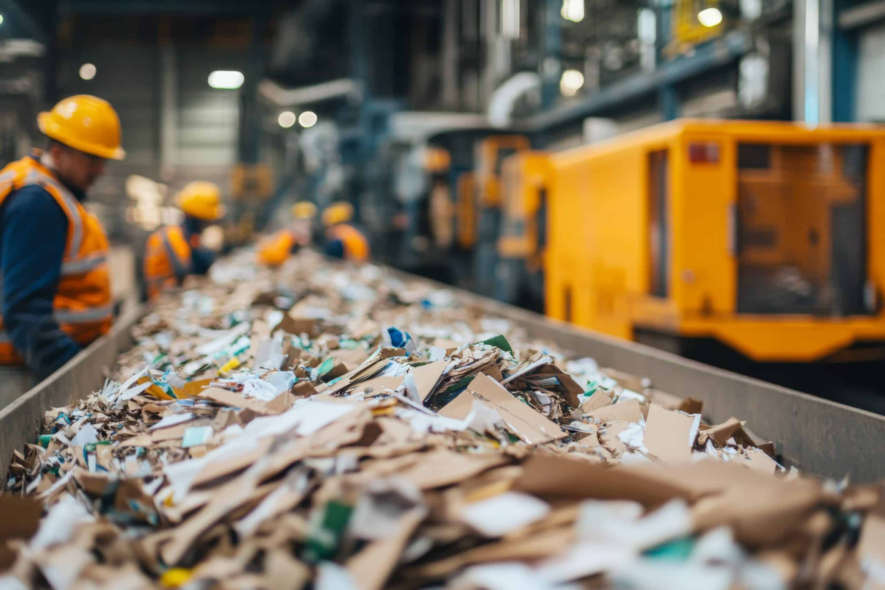

Le recyclage des filtres de cigarette : une impasse environnementale, sanitaire et technique

Environment

# Recycling cigarette filters: an environmental, health and technical impasse

Par: National Committee Against Smoking September 19, 2025

Dernière mise à jour: September 19, 2025 Temps de lecture: 17 minutes

Amid international discussions on plastic pollution, cigarette filters are raising growing concerns about waste management. While some recycling initiatives are being highlighted, available data reveal major technical, environmental, and economic limitations. Highly toxic, non-biodegradable, and difficult to recycle, cigarette filters pose structural challenges that are incompatible with the principles of the circular economy. Their treatment also raises issues related to public health, worker safety, and environmental governance.

## A major source of toxic plastic pollution

Cigarette filters are one of the world's leading sources of plastic pollution. Every year, more than 4.5 trillion cigarette butts are discarded into the environment.[1], a significant portion of

Le recyclage des filtres de cigarette : une impasse environnementale, sanitaire et technique which escapes traditional collection and processing channels. This massive and diffuse flow makes cigarette filters the most common plastic waste found during clean-up campaigns worldwide.

Made of cellulose acetate, a non-biodegradable plastic polymer, the filters are designed for single use. After consumption, they retain a significant amount of toxic substances from tobacco combustion. Among the compounds identified is nicotine, which is toxic to aquatic organisms and the nervous system.[2] –, polycyclic aromatic hydrocarbons (PAHs)[3], heavy metals (cadmium, lead, arsenic)[4], tobacco-specific nitrosamines (TSNAs)[5] as well as several volatile organic compounds such as benzene or formaldehyde[6]These substances are classified among the persistent pollutants of greatest concern to human health and ecosystems.

Contamination generated by a single cigarette butt can reach up to 1,000 liters of water, causing lethal or sublethal effects in fish.[7]-[8]-[9], amphibians or invertebrates[10]Studies have observed developmental alterations, neurological disorders, or genetic mutations in exposed species. Beyond chemical pollution, filters fragment over time into plastic microfibers, which can be ingested by marine and terrestrial wildlife, with a risk of accumulation throughout the food chain.[11].

The persistence of cellulose acetate in the environment – often for more than ten years – increases the ecological footprint of this waste. Cigarette butts abandoned on public roads, beaches, or aquatic environments thus contribute to the lasting degradation of ecosystems. In response to this observation, the European Union has classified cigarette filters among the products covered by the Single-Use Plastics Directive, due to their significant contribution to pollution and their very low recycling potential.[12]-[13].

## Unsuitable and technologically restrictive treatment processes

Cigarette filters have physical and chemical characteristics that significantly complicate any recycling attempt. Unlike homogeneous plastics such as PET (polyethylene terephthalate) bottles, filters are both composed of a non-biodegradable plastic—cellulose acetate—and contaminated with toxic substances absorbed during product use. This combination makes them difficult to recycle using conventional treatment processes.

Among the technologies explored, pyrolysis[14] and carbonization are the most frequently cited. These processes involve heating waste to very high temperatures, often up to 800°C, in the absence of oxygen, in order to transform it into gases, oils, or carbonaceous residues. These energy-intensive techniques significantly increase the carbon footprint of recycling efforts, in direct contradiction with climate and circular economy objectives.[15]-[16]However, these techniques have several major limitations. They require specialized infrastructure, consume a significant amount of energy, and generate a carbon footprint incompatible with

Le recyclage des filtres de cigarette : une impasse environnementale, sanitaire et technique greenhouse gas emission reduction targets. In addition, studies have shown that pyrolysis of cigarette filters releases volatile organic compounds, requiring sophisticated filtration and emission control systems to avoid secondary pollution.[17].

Even after treatment, filters can retain a significant proportion of toxic substances. The residual presence of heavy metals, nicotine, or polycyclic aromatic hydrocarbons raises questions about the safety of the resulting materials. To date, there is no independent scientific evidence to confirm that these treatments completely eliminate the toxic load of filters.[18].

Furthermore, the opacity of the processes applied by certain specialized structures - particularly in private cigarette butt recycling initiatives - limits the possibility of a rigorous evaluation. Projects led by companies such as TerraCycle[19], Ecomégot[20] or EconCare[21] are generally not the subject of peer-reviewed scientific publications. The traceability of residues from recycling, their exact composition, their fate and their health impact therefore remain poorly documented. TerraCycle has established direct partnerships with the tobacco industry for several years to develop cigarette filter collection and recycling programs. Since 2012, collaborations have been established with subsidiaries of large groups such as Santa Fe Natural Tobacco Company (owned by Reynolds American, itself owned by British American Tobacco) to finance cigarette butt recovery systems. These partnerships have given rise to communication campaigns such as No Ifs, Ands or Butts About It, aiming to collect used filters, transform them into composite materials (panels, furniture, pallets) and donate a portion of the funds to local associations[22].

At the same time, collection itself poses a major operational challenge. Cigarette butts are often scattered throughout public spaces, contaminated by other organic or chemical waste, making them difficult to sort and incompatible with existing processing lines. Automated sorting technologies are not designed to effectively detect or isolate cigarette filters on a large scale, and manual sorting is costly and poses health risks for operators.

These technical, energy, and health constraints make treatment processes unsuitable for the sustainable management of cigarette filters. In the absence of guarantees regarding the elimination of toxic substances, and given the logistical and financial complexity of their treatment, the recycling of this waste cannot be assimilated to the solutions generally implemented within the framework of a circular economy based on the regeneration of resources.

## Costly and economically unviable management

The management of cigarette filters poses major economic constraints, both for communities and treatment facilities. Due to their dispersion in public spaces and their low unit mass, cigarette butts require specific and intensive collection systems, which are not compatible with

Le recyclage des filtres de cigarette : une impasse environnementale, sanitaire et technique rationalized urban waste management. Their small size, combined with their frequent contamination by food residues, liquids, or organic materials, makes their recovery particularly time-consuming and inefficient.

These logistical characteristics translate into high costs for municipal services. In some large cities, the costs of cleaning cigarette butts alone can reach several million euros per year. In France alone, the Ministry of Ecological Transition estimates that 100 million euros per year for the management of tobacco product waste. These costs weigh disproportionately on local finances, particularly in contexts where budgetary resources are already limited.

Furthermore, experimental cigarette butt recycling initiatives have failed to demonstrate a sustainable economic model. The materials resulting from these operations (plastic granules, composite panels, bricks, insulation, etc.) are often limited to very limited uses. Their low commercial value, combined with uncertainties regarding their safety, limits their integration into traditional production chains. The difficulties in structuring sustainable demand for these products are hampering any transition to industrial scale.

In low- and middle-income countries, the constraints are even more pronounced. The deployment of specific filter collection and processing channels appears unrealistic in contexts where waste management services are already under-resourced or fragmented. The implementation of suitable recovery technologies would require significant investments, which would be difficult to mobilize in the short or medium term.

Finally, informal sorting and recovery activities expose workers to poorly managed health risks. Handling contaminated waste without adequate protective equipment can lead to repeated exposure to harmful substances. These situations, documented in other waste management sectors, illustrate the socio-environmental imbalances associated with economically fragile and poorly regulated systems.

## A structural incompatibility with the circular economy

The circular economy aims to limit resource extraction, extend product lifespans, and reduce the environmental impact of waste, particularly through reuse, repair, or closed-loop recycling. This model relies on resource regeneration and the phasing out of single-use products, particularly those containing hazardous substances. In this context, cigarette filters have structural characteristics that are incompatible with circularity objectives.

Designed to be discarded immediately after use, filters do not meet any of the logic of reuse, repurposing, or sustainable recycling. They are made from a plastic polymer—cellulose acetate —which is neither biodegradable under natural conditions nor suitable for safe recovery, due to the toxic load it absorbs during the combustion of tobacco. This toxicity prevents their

Le recyclage des filtres de cigarette : une impasse environnementale, sanitaire et technique reintegration into safe production cycles and makes them unsuitable for any form of recycling that complies with circular economy standards.

Several experiments have attempted to incorporate cigarette butts into composite materials, particularly in road surfacing, insulation, and battery components. However, available independent studies indicate that these processes do not guarantee the safety of the finished products. Toxic leachates may remain, even after treatment or encapsulation, and release potentially hazardous compounds into the environment during use or at the end of the materials' life. These limitations prevent the cycle from being satisfactorily closed and raise regulatory, health, and environmental uncertainties.

Furthermore, the presence of filters in tobacco products fuels confusion about their function. Although they do not reduce the dangers of smoking,[23], their appearance can induce a false perception of filtration or protection. This ambiguity has been identified as a factor contributing to the maintenance or initiation of tobacco consumption, particularly among young smokers. Article 9 of the WHO Framework Convention on Tobacco Control (FCTC) prohibits any product characteristic likely to increase its attractiveness or minimize its harmful effects.

Some manufacturers have developed so-called "eco-designed" or "biodegradable" filters, replacing cellulose acetate with paper, hemp, or other plant fibers. However, these materials, once contaminated by substances from smoke, retain high toxicity.[24]Their effective biodegradability also depends on specific conditions rarely found in the natural environment (temperature, humidity, aeration), which severely limits their ability to decompose outside of industrial composting systems.

The introduction of these alternative filters often relies on a sustainability narrative that fails to reflect technical and environmental realities. It can reinforce the misconception that the pollution generated by tobacco products can be controlled through technical adjustments, even though their impact is based on a fundamentally linear model: extraction, consumption, discharge.[25].

## A strategic lever for the tobacco industry

In a context of progressively tightening environmental regulations, the tobacco industry is actively mobilizing issues related to cigarette filter management as a strategic positioning lever. Initiatives for recycling or voluntary collection of cigarette butts, as well as the development of so-called "innovative" filters, are increasingly integrated into corporate communication focused on sustainability. This orientation allows the industry to highlight environmental commitments, while preserving the place of filters on the market and delaying the adoption of restrictive measures such as their ban.

Le recyclage des filtres de cigarette : une impasse environnementale, sanitaire et technique The appropriation of the language of the circular economy—through notions such as "recyclable," "sustainable," "biodegradable," or even "plastic-neutral"—contributes to the construction of a narrative favorable to technical management of the problem, without questioning the source of the pollution. One-off collection actions, often carried out in partnership with startups or local authorities, are highlighted as operational solutions, even though they represent a tiny portion of the waste generated. This framing allows filters to be positioned not as an externality to be eliminated, but as a waste stream that can be addressed within the framework of a logic of shared responsibility.

These initiatives are rarely accompanied by independent data on their effectiveness or actual impact. However, they are part of a broader strategy aimed at influencing the perceptions of public decision-makers, maintaining the legitimacy of manufacturers in environmental policy dialogue processes, and limiting the scope of measures based on source reduction.

Analyses conducted by several public health and tobacco control organizations have highlighted the use of these devices as part of environmental lobbying efforts. The integration of recycling programs into corporate social responsibility reports, partnerships with certain municipalities, and the promotion of alternative technologies allow the industry to claim a positive contribution to the ecological transition. This stance, referred to as greenwashing[26]- [27] in several scientific and institutional publications, is part of an effort to standardize the role of industry in waste management policies.

At the same time, the active presence of tobacco industry representatives in debates on plastic pollution raises governance concerns. In accordance with Article 5.3 of the WHO Framework Convention on Tobacco Control (FCTC), public health policies must be protected from any form of influence exerted by tobacco-related stakeholders. The increasing involvement of these stakeholders in environmental forums, or their participation in working groups on product sustainability, raises the question of whether this principle is respected in decision-making processes related to plastic pollution.

Finally, by presenting filters as recyclable or transformable elements, the industry contributes to maintaining their presence in industrial cigarettes, despite the absence of any proven benefit to consumers' health. This maintenance promotes the perception of a "filtered" product, supposedly less harmful, and contributes to strengthening the attractiveness of cigarettes.[28], particularly among certain populations sensitive to environmental communication. This strategy thus makes it possible to consolidate sales while limiting exposure to bans based on the danger of the filter as a toxic, single-use plastic product.

In the context of international negotiations on plastic pollution, it therefore appears essential to consider cigarette filters not as a waste stream to be managed, but as a useless and polluting product to be eliminated at source.[29]Banning them would represent a coherent

Le recyclage des filtres de cigarette : une impasse environnementale, sanitaire et technique public health and environmental measure, reducing the burden of plastic pollution while putting an end to an illusion of protection that maintains tobacco consumption.

©Generation Without Tobacco

AE

[1] Novotny, T. et al. (2009). Cigarette butts and the case for an environmental policy on hazardous cigarette waste. IJERPH, 6(5): 1691–1705.

[2] Slaughter, E. et al. (2011). Toxicity of cigarette butts and their chemical components. TobaccoControl, 20(Suppl 1): i25–i29

[3] Kocher, C. et al. (2023). Toxicity and environmental risk of cigarette butt leachates. Science of the Total Environment, 904, 166667

[4] Belzagui, F. et al. (2021). Cigarette butts as a source of microplastic pollution. Sci. TotalApprox., 762, 144165

[5] Pauly, JL et al. (1995). Fibers released from cigarette filters: A health risk to the smoker? Cancer Research, 55(2), 253–258

[6] WHO (2014). The Health Consequences of Smoking: 50 Years of Progress.

[7] Slaughter, E. et al. (2011). Toxicity of cigarette butts and their chemical components. TobaccoControl, 20(Suppl 1): i25–i29

[8] Ariza-Montobbio, P. et al. (2021). Challenges on the recycling of cigarette butts. ResearchGate.

[9] Harris, B. (2011). The intractable cigarette 'filter problem'. Tobacco Control, 20(Suppl 1), i10– i16

[10] Yu, C. et al. (2018). The Recovery of Waste Cigarette Butts for N-Doped Carbon Anode in Lithium Ion Battery. Forehead. Mater., 5, 63.

[11] Mohajerani, A. et al. (2022). Bitumen and paraffin wax encapsulated cigarette butts:Leachate analysis. Int. J. Pavement Res. Technol., 15, 931–947.

[12] European Commission (2019). Directive (EU) 2019/904 on the reduction of the impact of certain plastic products on the environment.

Le recyclage des filtres de cigarette : une impasse environnementale, sanitaire et technique [13] ScienceDirect. F Rebischung, L Chabot, H Biaudet, P Pandard. Cigarette butts: A small but hazardous waste, according to European regulation. Available : https://www.sciencedirect.com/science/article/abs/pii/S0956053X18305798

[14] Rollinson, A. (2018). Why pyrolysis is not a solution to the plastic problem. LowImpact.org

[15] Rollinson, A. & Oladejo, J. (2019). Patented blunderings and pyrolysis inefficiencies. EnergyPolicy, 141, 233–242

[16] Rollinson, A. (2018). Why pyrolysis is not a solution to the plastic problem. LowImpact.org.

[17] Code Effort (2021). Recycling India's Most Littered Item: Cigarette Butts. NDTV.

[18] Greenbutts Inc. (2020). Feasibility Report on Biodegradable Cigarette Filters.

[19] TerraCycle (2024). Our Recycling Process. https://www.terracycle.com

[20] Ecomégot / Keenat (2024). Recycling and recovery of cigarette butts. https://ecomegot.com18

[21] EconCare (2024). Senza Filtri. https://erioncare.it

[22] Case Study: TerraCycle Teams with Tobacco Company for Cigarette Waste Collection Effort—No Ifs, Ands or Butts About It, PR News, published November 3, 2013, accessed August 25, 2025

[23] Song, MA et al. (2017). Filter ventilation and risk of adenocarcinoma. JNCI, 109(12).

[24] Plastic Pollution Coalition (2023). Filters Are Not Biodegradable.

[25] Healton, CG et al. (2011). Cigarette littering behavior. Tobacco Control, 20(Suppl 1), i10–i13

[26] GGTC/STPA (2022). Tobacco Industry Greenwashing Report.

[27] Tobacco-free generation, Mégothon: a citizen mobilization exploited by the tobacco industry, published May 20, 2025, accessed August 25, 2025

[28] Tobacco Control. K Evans-Reeves, Hathrin Lauber, Rosemary Hiscock. The 'filter fraud' persists: the tobacco industry is still using filters to suggest lower health risks while destroying the environment. (April 26, 2021). Available : https://tobaccocontrol.bmj.com/content/31/e1/e80

[29] GGTC (2023). Why the UN Plastics Treaty Must Address Filters.

National Committee Against Smoking |