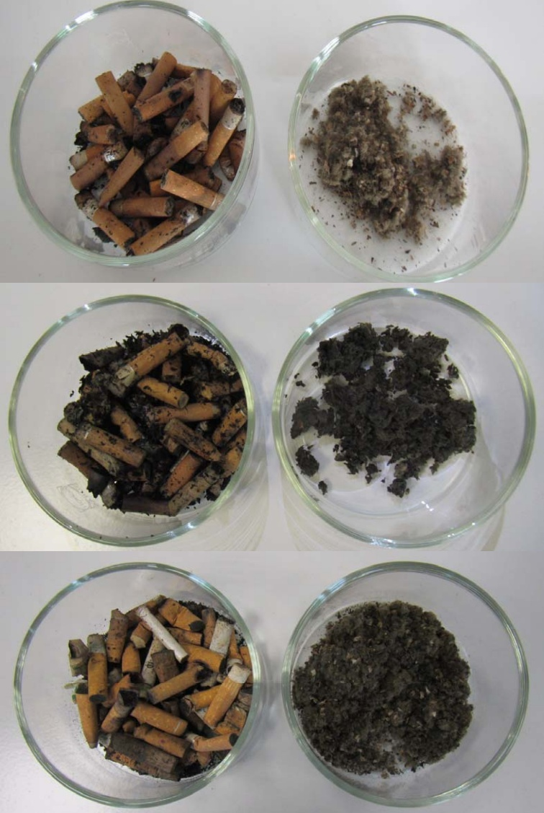
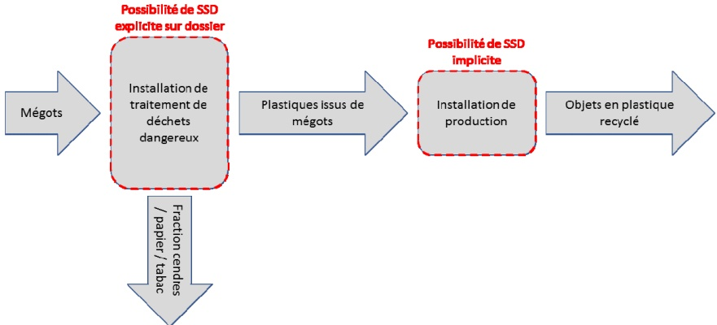
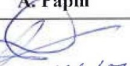
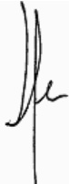

RAPPORT D'ÉTUDE

INERIS-DRC-17-162405-01313C

12/09/2017

# Etude des filières de collecte et de traitement des mégots de cigarettes

# Etude des filières de collecte et de traitement des mégots de cigarettes

Rapport réalisé pour le Ministère de la Transition Ecologique et Solidaire

Liste des personnes ayant participé à l'étude : Lionel AUFAUVRE, Hugues BIAUDET, Olivier BOUR, Laure CHABOT, Ahmad EL MASRI, Pascal PANDARD, Arnaud PAPIN, Hélène PARTAIX, Benoît SCHNURIGER, Isabelle ZDANEVITCH

#### PRÉAMBULE

Le présent rapport a été établi sur la base des informations fournies à l'INERIS, des données (scientifiques ou techniques) disponibles et objectives et de la réglementation en vigueur.

La responsabilité de l'INERIS ne pourra être engagée si les informations qui lui ont été communiquées sont incomplètes ou erronées.

Les avis, recommandations, préconisations ou équivalent qui seraient portés par l'INERIS dans le cadre des prestations qui lui sont confiées, peuvent aider à la prise de décision. Etant donné la mission qui incombe à l'INERIS de par son décret de création, l'INERIS n'intervient pas dans la prise de décision proprement dite. La responsabilité de l'INERIS ne peut donc se substituer à celle du décideur.

Le destinataire utilisera les résultats inclus dans le présent rapport intégralement ou sinon de manière objective. Son utilisation sous forme d'extraits ou de notes de synthèse sera faite sous la seule et entière responsabilité du destinataire. Il en est de même pour toute modification qui y serait apportée.

L'INERIS dégage toute responsabilité pour chaque utilisation du rapport en dehors de la destination de la prestation.

<table border=1 style='margin: auto; word-wrap: break-word;'><tr><td style='text-align: center; word-wrap: break-word;'></td><td style='text-align: center; word-wrap: break-word;'>Réduction</td><td style='text-align: center; word-wrap: break-word;'>Vérification</td><td style='text-align: center; word-wrap: break-word;'>Approbation</td></tr><tr><td style='text-align: center; word-wrap: break-word;'>NOM</td><td style='text-align: center; word-wrap: break-word;'>Flore REBISCHUNG</td><td style='text-align: center; word-wrap: break-word;'>Roger REVALOR</td><td style='text-align: center; word-wrap: break-word;'>Martine RAMEL</td></tr><tr><td style='text-align: center; word-wrap: break-word;'>Qualité</td><td style='text-align: center; word-wrap: break-word;'>Ingénieur de l&#x27;unité Comportement des Contaminants dans les Sols et les Matériaux</td><td style='text-align: center; word-wrap: break-word;'>Responsable de l&#x27;Unité Comportement des Contaminants dans les Sols et les Matériaux</td><td style='text-align: center; word-wrap: break-word;'>Responsable du Pôle Risque et Technologies Durables</td></tr><tr><td style='text-align: center; word-wrap: break-word;'>Visa</td><td style='text-align: center; word-wrap: break-word;'></td><td style='text-align: center; word-wrap: break-word;'></td><td style='text-align: center; word-wrap: break-word;'></td></tr></table>

#### TABLE DES MATIÈRES

1. RESUME.....8    
2. CONTEXTE ET OBJET DE L'ETUDE.....9    
3. ETAT DES LIEUX DES FILIERES .....10    
4. ECHANTILLONS COLLECTES ET PREPARATION.....11    
5. BIBLIOGRAPHIE SCIENTIFIQUE, PROGRAMME ANALYTIQUE ET D'ESSAIS .....13    
6. RESULTATS D'ESSAIS ET D'ANALYSES SUR LES MEGOTS .....15    
7. CLASSEMENT EN DANGEROSITE SELON LA REGLEMENTATION DECHETS.....25    
8. CLASSEMENT AU TITRE DE LA REGLEMENTATION ADR.....33    
9. EVALUATION DES FILIERES DE GESTION .....37    
10. CONCLUSION.....46    
11. LISTE DES ANNEXES .....47

#### LISTE DES TABLEAUX

Tableau 1 : Tableau récapitulatif des essais d'écotoxicité réalisés sur les échantillons de mégots 14    
Tableau 2 : Résultats des essais d'inhibition de la mobilité de D. magna ..... 15    
Tableau 3 : Résultats des essais d'inhibition de la luminescence de Vibrio fischeri ..... 16    
Tableau 4 : Résultats des essais d'inhibition de la croissance de P. subcapitata ..... 16    
Tableau 5 : Récapitulatif des CE₂₀/ CE₅₀ calculées pour les trois premiers essais d'écotoxicité aquatique ..... 17    
Tableau 6 : Résultats de l'essai d'inhibition de la reproduction de C. dubia par l'éluat de 16BB634 ..... 17    
Tableau 7 : Résultats de l'essai d'émergence et croissance des végétaux supérieurs (laitue et navet) ..... 19    
Tableau 8 : Résultats de l'essai de mortalité des vers de terre ..... 19    
Tableau 9 : Résultats de l'essai d'évitement des vers de terre ..... 20    
Tableau 10 : Résultats de l'essai d'inhibition de l'activité déshydrogénase de Arthrobacter globiformis ..... 20    
Tableau 11 : Récapitulatif des CE₅₀ calculées pour les essais d'écotoxicité terrestre ..... 21    
Tableau 12 : Bilan de masse obtenu sur les trois échantillons en tenant compte des limites de quantification ..... 21    
Tableau 13 : Eléments saillants des analyses menées sur les trois échantillons (résultats exprimés en % MS) ..... 23    
Tableau 14 : Eléments essentiels des analyses sur lixiviats menées sur les trois échantillons ..... 24    
Tableau 15 : Synthèse des résultats des essais écotoxicologiques et classement des trois échantillons de mégots ..... 27    
Tableau 16 : Règles de classement applicables pour HP 14 ..... 28    
Tableau 17 : Indices de dangerosité calculés pour HP 14 ..... 28    
Tableau 18 : Règles de classement applicables pour HP 4, HP 5, HP 6, HP 7, HP 8, HP 10, HP 11 et HP 13 ..... 30    
Tableau 19 : Indices de dangerosité calculés pour HP 4, HP 5, HP 6, HP 7, HP 8, HP 10, HP 11 et HP 13 ..... 31    
Tableau 20 : Classes de danger de l'ADR et situation des mégots au regard de ces classes ..... 33    
Tableau 21 : Table d'attribution des valeurs ponctuelles estimées de toxicité aiguë d'après les catégories de danger (extrait du règlement CLP) ..... 35    
Tableau 22 : Règles d'attribution des groupes d'emballage en fonction des valeurs de  $ \Sigma $ C/T et de T $ _{M} $ ..... 36    
Tableau 23 : Valeurs de T $ _{M} $ calculées pour les trois échantillons ..... 36    
Tableau 24 : Critères d'admission en ISDD ..... 38    
Tableau 25 : Seuils de la nomenclature ICPE pour la rubrique 2661 ..... 44

#### LISTE DES FIGURES

Figure 1 : Photographie des trois échantillons bruts et broyés à l'aide du broyeur à couteaux – de haut en bas : 16BB634, 16BB635, 16BB636 .....12    
Figure 2 : Synthèse des éléments relatifs à la filière de valorisation .....45

## 1.  $ \underline{\text{RESUME}} $

La présente étude visait à déterminer la dangerosité, aux sens des réglementations déchets et transports, des mégots de cigarettes collectés séparément et à évaluer les filières de gestion actuelles ou pressenties des mégots, et des conditions dans lesquelles les modes de traitement appliqués seraient appropriés.

Des analyses et essais ont été menés sur 3 échantillons de mégots collectés auprès d'entreprises, parmi lesquelles Eco-Action +. Les analyses menées, dont la liste a été établie sur la base de la bibliographie scientifique réalisée, n'ont pas permis de boucler le bilan de masse de façon aussi satisfaisante qu'espérée, mettant ainsi en avant la complexité de la matrice étudiée.

Ces éléments se sont toutefois avérés suffisants pour classer les mégots comme des déchets dangereux. En effet, le contenu en nicotine, substance analysée au cours des investigations, conduit au classement des mégots au titre de la propriété HP 6 (toxicité aigüe). Les essais écotoxicologiques réalisés par ailleurs (et prévalant sur une évaluation par calcul, d'autant plus que le bilan de masse analytique est incomplet) mettent en évidence une forte toxicité des mégots, de nature à leur attribuer la propriété de danger HP 14 (écotoxique).

Etant donné que la rubrique de la nomenclature des déchets qui apparaît aujourd'hui être la plus appropriée pour les mégots est la 20 01 99, il est nécessaire que les autorités françaises compétentes notifient cette situation à la Commission Européenne.

Par ailleurs, la concentration en nicotine conduit également à classer les mégots comme matières dangereuses pour le transport, et à leur attribuer le code ONU 2811, assorti du groupe d'emballage III.

Le caractère dangereux des mégots mis en lumière par cette étude a des répercussions sur les filières de gestion envisageables. Compte-tenu de leur fort contenu en substances organiques, les mégots ne sont pas acceptables en l'état en installation de stockage, et l'incinération semble être à privilégier parmi les filières traditionnelles. Le caractère dangereux des mégots étant essentiellement porté par la nicotine, et cette substance étant dégradée dans les conditions de température atteintes dans les installations de traitement thermique des déchets non dangereux, une dérogation similaire à celle mise en place pour les DASRI pourrait être étudiée.

Toutefois, la hiérarchie des modes de traitement des déchets impose de privilégier les voies de valorisation lorsqu'elles existent. Dans le cas des mégots, celles-ci sont encore au stade embryonnaire, et il est aujourd'hui difficile, sur la base du peu d'éléments disponibles, notamment concernant la performance des procédés de lavage des filtres, d'évaluer leur pertinence et leur respect du cadre réglementaire existant. Compte-tenu des signes forts de développement des filières de valorisation, ce point sera à suivre de près dans les années à venir.

## 2. CONTEXTE ET OBJET DE L'ETUDE

Par un courrier du 11 mai 2016, le Ministère de l'Environnement, de l'Energie et de la Mer (MEEM) a sollicité l'INERIS pour apporter un regard d'expert sur les filières de collecte et de gestion des mégots de cigarettes collectés séparément.

Ce travail s'est inscrit dans le cadre de la mission d'appui aux pouvoirs publics de l'INERIS, au sein de deux programmes additionnels couvrant respectivement les années 2016 et 2017, et avait pour objectifs :

- la détermination de la dangerosité, aux sens des réglementations déchets et transports, des mégots collectés séparément - ce travail d'évaluation de la dangerosité constitue en effet une étape préalable à la mise en place et à l'encadrement par les autorités d'une solution de gestion adaptée ;

l'évaluation des filières de gestion actuelles ou pressenties des mégots, et des conditions dans lesquelles les modes de traitement appliqués sont appropriés.

##### Pour ce faire, l'INERIS a :

- contacté plusieurs organismes réalisant la collecte séparée de mégots, et collecté auprès d'eux des échantillons représentatifs de ce flux ;

- fait réaliser des analyses sur ces échantillons, orientées selon le double objectif d'obtenir un bilan de masse le plus complet possible, et de quantifier un maximum de polluants susceptibles d'être présents dans les mégots, d'après une étude bibliographique préalablement menée ;

- sur la base des données obtenues via ces deux premières tâches, établi une proposition de classement en dangerosité pour les mégots, au titre des réglementations déchets et transport ;

- contacté plusieurs organismes proposant actuellement, ou cherchant à développer, des solutions de valorisation des mégots ;

- émis un avis d'expert sur les risques associés aux filières existantes ou à créer.

Le présent document constitue le rapport d'expertise de l'INERIS sur ce sujet.

## 3. ETAT DES LIEUX DES FILIERES

Ces dernières années ont vu émerger de nouvelles structures de collecte séparée des mégots de cigarettes. Des micro-entreprises aux associations, les objectifs et les business models sont variés. La présente étude n'a pas cherché à identifier de façon exhaustive l'ensemble de ces acteurs, qui restent encore peu nombreux sur le territoire, mais a ciblé les plus importants (au sens médiatiquement exposés) et accessibles. Deux entreprises ont ainsi été rencontrées au cours de l'étude, qui ont par ailleurs accepté de fournir des échantillons de mégots.

Ces deux TPE ont développé leurs propres systèmes de collecte (cendriers design), et assurent le regroupement des flux en provenance de leurs différents clients.

Pour la première, les volumes collectés sont ensuite envoyés en Angleterre auprès de TerraCycle, qui en assure la valorisation. Les données disponibles sur internet concernant le procédé mis en œuvre mettent en évidence une séparation des déchets de mégots en deux flux : d'une part les résidus de papier, tabac et cendres, qui sont envoyés vers une filière de compostage, d'autre part le filtre, recyclé en tant que matière plastique.

La seconde (Eco-Action +) développait au moment de l'étude un procédé de valorisation sur son installation de Bourg-Blanc (29), dont la mise en service, initialement prévue pour juin 2017, a été reportée à l'automne de la même année.

Aucune filière de valorisation active n'a donc été identifiée en France au moment de l'étude. Toutefois, la récente acquisition par Suez de 30 % de la filiale européenne de TerraCycle, ainsi que le projet de développement d'une filière locale de valorisation des mégots par EcoMégots (soutenu par Bordeaux Métropole, la Nouvelle-Aquitaine, le fonds social européen mais aussi Suez) semblent être les prémices du développement du recyclage des mégots sur le territoire national à grande échelle.

## 4. ECHANTILLONS COLLECTES ET PREPARATION

Trois échantillons ont été collectés au cours de l'étude, auprès d'entreprises réalisant la collecte de mégots :

- un premier échantillon « sec » (référence 16BB634) ;

- un échantillon « humide », provenant des sites de collecte sur lesquels les bonnes pratiques associées à l'éteignement des mégots ne sont pas encore acquises, ce qui oblige parfois les utilisateurs à verser de l'eau dans le cendrier, dont les mégots se gorgent (référence 16BB635) ;

- un second échantillon « sec » (référence 16BB636).

L'échantillonnage, réalisé par les deux entreprises de collecte, a été réalisé conformément aux recommandations fournies par l'INERIS. En particulier, la constitution d'échantillons composites, rassemblant des prélèvements issus de plusieurs flux de mégots collectés auprès de différents clients de chacune des deux entreprises, a permis une homogénéisation et une meilleure représentativité des échantillons étudiés.

En vue des investigations, les échantillons collectés ont été broyés à l'INERIS selon différentes techniques :

- un broyage (s'apparentant plutôt à un déchiquetage) a été réalisé à l'aide d'un broyeur à couteaux ; les broyats obtenus ont servi pour la réalisation des lixiviations et des essais écotoxicologiques ;

un broyage cryogenique a également été réalisé, permettant d'obtenir une granulométrie plus fine, et ainsi d'homogénéiser plus facilement la prise d'échantillon en vue des analyses nécessitant peu de matière ; les broyats obtenus ont ainsi été utilisés pour les analyses chimiques.

Figure 1 : Photographie des trois échantillons bruts et broyés à l'aide du broyeur à couteaux – de haut en bas : 16BB634, 16BB635, 16BB636
 

## 5.  $ \underline{\text{BIBLIOGRAPHIE SCIENTIFIQUE, PROGRAMME ANALYTIQUE ET D'ESSAIS}} $

La bibliographie réalisée avait pour objectif principal d'identifier les substances pertinentes à rechercher spécifiquement dans les mégots de cigarettes, et les éventuels niveaux de concentration mesurés. Les publications concernant des essais d'écotoxicité ont également été consultées.

Sous ces deux angles, la littérature scientifique sur les mégots de cigarettes est assez peu fournie – on trouve beaucoup plus facilement des articles relatifs au dénombrement de mégots dans l'environnement, en particulier sur les plages.

Les références utilisées dans le cadre de la présente étude sont listées ci-après :

- de Granda-Orive JI, Girón-Matute W, López-Yepes L. Cigarette butts: The collateral effects of cigarettes on humans, animals and the environment. Arch Bronconeumol. 2016; 52: 285

- Novotny TE, Slaughter E. Tobacco Product Waste: An Environmental Approach to Reduce Tobacco Consumption. Curr Envir Health Rpt. 2014; 1: 208-216

- Roder Green LA et al. Littered cigarette butts as a source of nicotine in urban waters. Journal of Hydrology. 2014; 519: 3466-3474

Moriwaki H et al. Waste on the roadside, 'poi-sute' waste: Its distribution and elution potential of pollutants into environment. Waste Management. 2009; 29: 1192-1197

- Slaughter E et al. Toxicity of cigarette butts, and their chemical components, to marine and freshwater fish. Tobacco Control. 2011; 20 (Suppl 1): i25-i29

Lee W and Lee CC. Developmental toxicity of cigarette butts – An underdeveloped issue. Ecotoxicology and Environmental Safety. 2015; 113: 362-368

- Booth DJ et al. Impact of cigarette butt leachate on tidepool snails. Marine Pollution Bulletin. 2015; 95: 362-364.

Les informations issues de ces publications, ainsi que les données de la base nationale du LNE portant sur les composants des cigarettes ont permis d'aboutir à la définition du programme analytique suivant (les analyses indiquées en italique ont été réalisées à l'INERIS, et les autres sous-traitées à des laboratoires extérieurs) :

- métaux,

- sels de métaux alcalins (dosage de l'acide acétique et de l'acide tartrique),

nitrosamines.

pesticides ou herbicides, notamment : nicotine, flumétraline, pendiméthaline et trifluraline,

- phénols, notamment : éthylphénol et phénol,

HAP (16 congénères classiquement mesurés),

glycols, notamment : éthyleneglycol et diéthyleneglycol,

- sucres et amidon (analyses couvrant notamment le polyacétate de cellulose, principal constituent des filtres),

composés volatils tels que : formaldéhyde, acétaldéhyde, benzène, pyridine, acétone,

- dioxines et furanes (17 congénères classiquement mesurés).

Par ailleurs, des essais d'écotoxicité aquatique (sur éluat de mégots broyés) et terrestre ont été menés sur les trois échantillons, conformément à la batterie d'essais couramment pratiquée en France, qui comporte six essais.

Compte tenu de la cohérence des effets inhibiteurs observés pour les éluats des trois échantillons sur les trois premiers essais aquatiques (V. fischeri, D. magna et P. subcapitata), l'essai de toxicité chronique sur C. dubia ainsi que les essais d'écotoxicité terrestre n'ont été menés que sur un seul des trois échantillons (16BB634).

Les investigations, pour cet échantillon, ont alors été complétées par la réalisation des essais d'écotoxicité proposés dans la batterie conventionnelle franco-allemande et non-communs avec la batterie d'essais utilisée en France.

L'ensemble des essais effectués est présenté dans le Tableau 1

Tableau 1 : Tableau récapitulatif des essais d'écotoxicité réalisés sur les échantillons de mégots
 

<table border=1 style='margin: auto; word-wrap: break-word;'><tr><td colspan="2">Organismes</td><td style='text-align: center; word-wrap: break-word;'>Paramètres mesurés</td><td style='text-align: center; word-wrap: break-word;'>Références normatives</td><td style='text-align: center; word-wrap: break-word;'>Echantillons testés</td><td style='text-align: center; word-wrap: break-word;'>Batterie fr.</td><td style='text-align: center; word-wrap: break-word;'>Batterie fr.-all.</td></tr><tr><td colspan="7">Essais aquatiques</td></tr><tr><td style='text-align: center; word-wrap: break-word;'>Bactéries</td><td style='text-align: center; word-wrap: break-word;'>V. fischeri</td><td style='text-align: center; word-wrap: break-word;'>Inhibition de la luminescence</td><td style='text-align: center; word-wrap: break-word;'>NF EN ISO 11348-3 (AFNOR 2009)</td><td rowspan="3">Eluats des 3 échantillons broyés</td><td colspan="2">X</td></tr><tr><td style='text-align: center; word-wrap: break-word;'>Micro-crustacés</td><td style='text-align: center; word-wrap: break-word;'>D. magna</td><td style='text-align: center; word-wrap: break-word;'>Inhibition de la mobilité</td><td style='text-align: center; word-wrap: break-word;'>NF EN ISO 6341 (AFNOR 2012)</td><td colspan="2">X</td></tr><tr><td style='text-align: center; word-wrap: break-word;'>Micro-algues</td><td style='text-align: center; word-wrap: break-word;'>P. subcapitata</td><td style='text-align: center; word-wrap: break-word;'>Inhibition de la croissance</td><td style='text-align: center; word-wrap: break-word;'>NF EN ISO 8692 (AFNOR 2012)</td><td colspan="2">X</td></tr><tr><td style='text-align: center; word-wrap: break-word;'>Micro-crustacés</td><td style='text-align: center; word-wrap: break-word;'>C. dubia</td><td style='text-align: center; word-wrap: break-word;'>Inhibition de la reproduction</td><td style='text-align: center; word-wrap: break-word;'>NF ISO 20665 (AFNOR 2009)</td><td style='text-align: center; word-wrap: break-word;'>Eluat de 16BB634 broyé</td><td style='text-align: center; word-wrap: break-word;'>X</td><td style='text-align: center; word-wrap: break-word;'></td></tr><tr><td colspan="7">Essais terrestres</td></tr><tr><td rowspan="2">Plantes</td><td style='text-align: center; word-wrap: break-word;'>L. sativa</td><td rowspan="2">Inhibition de l&#x27;émergence et de la croissance</td><td rowspan="2">NF EN ISO 11269-2 (AFNOR 2013)</td><td rowspan="5">16BB634</td><td style='text-align: center; word-wrap: break-word;'>X</td><td style='text-align: center; word-wrap: break-word;'></td></tr><tr><td style='text-align: center; word-wrap: break-word;'>B. rapa</td><td style='text-align: center; word-wrap: break-word;'></td><td style='text-align: center; word-wrap: break-word;'>X</td></tr><tr><td rowspan="2">Vers de terre</td><td rowspan="2">E. fetida</td><td style='text-align: center; word-wrap: break-word;'>Mortalité</td><td style='text-align: center; word-wrap: break-word;'>NF EN ISO 11268 – 1 (AFNOR 2012)</td><td style='text-align: center; word-wrap: break-word;'>X</td><td style='text-align: center; word-wrap: break-word;'></td></tr><tr><td style='text-align: center; word-wrap: break-word;'>Evitement</td><td style='text-align: center; word-wrap: break-word;'>NF ISO 17512-1 (AFNOR 2009)</td><td style='text-align: center; word-wrap: break-word;'></td><td style='text-align: center; word-wrap: break-word;'>X</td></tr><tr><td style='text-align: center; word-wrap: break-word;'>Bactéries</td><td style='text-align: center; word-wrap: break-word;'>A. globiformis</td><td style='text-align: center; word-wrap: break-word;'>Inhibition de l&#x27;activité déshydro-génase</td><td style='text-align: center; word-wrap: break-word;'>ISO 18187 (ISO 2016)</td><td style='text-align: center; word-wrap: break-word;'></td><td style='text-align: center; word-wrap: break-word;'>X</td></tr></table>

# 6. RESULTATS D'ESSAIS ET D'ANALYSES SUR LES MEGOTS

### 6.1 ESSAIS ECOTOXICOLOGIQUES

#### 6.1.1 ESSAIS D'ECOTOXICITE AQUATIQUE

Les essais d'écotoxicité aquatique ont été conduits sur des éluats générés, pour les 3 échantillons broyés, conformément aux préconisations de la norme NF EN 14735 :

- mise en contact avec de l'eau déionisée dans un ratio solide/liquide de 1/10.

- agitation rotative à 10 cycles / minute pendant 24h.

- décantation pendant 15 minutes.

centrifugation à 2 500 G pendant 30 minutes.

Les éluats obtenus ont alors été filtrés à 100 µm (essais sur D. magna et C. dubia) puis à 0,45 µm (essai sur algues et bactéries), sur filtres nylon.

Les résultats des essais aquatiques sur les trois échantillons sont présentés dans les Tableau 2 à Tableau 4. Les CE $ _{20} $/CE $ _{50} $, lorsqu'elles ont pu être calculées, sont présentées dans le Tableau 5. Le Tableau 6, quant à lui, synthétise, les résultats de l'essai d'inhibition de la reproduction de C. dubia sur l'éluat de l'échantillon 16BB634.

Tableau 2 : Résultats des essais d'inhibition de la mobilité de D. magna
 

<table border=1 style='margin: auto; word-wrap: break-word;'><tr><td rowspan="2">Concentration d&#x27;essai (% d&#x27;éluat)</td><td style='text-align: center; word-wrap: break-word;'>16BB634</td><td style='text-align: center; word-wrap: break-word;'>16BB635</td><td style='text-align: center; word-wrap: break-word;'>16BB636</td></tr><tr><td colspan="3">Inhibition de la mobilité après 48h (en %)</td></tr><tr><td style='text-align: center; word-wrap: break-word;'>0,10</td><td style='text-align: center; word-wrap: break-word;'>0</td><td style='text-align: center; word-wrap: break-word;'>0</td><td style='text-align: center; word-wrap: break-word;'>0</td></tr><tr><td style='text-align: center; word-wrap: break-word;'>0,26</td><td style='text-align: center; word-wrap: break-word;'>0</td><td style='text-align: center; word-wrap: break-word;'>5</td><td style='text-align: center; word-wrap: break-word;'>0</td></tr><tr><td style='text-align: center; word-wrap: break-word;'>0,64</td><td style='text-align: center; word-wrap: break-word;'>5</td><td style='text-align: center; word-wrap: break-word;'>100</td><td style='text-align: center; word-wrap: break-word;'>80</td></tr><tr><td style='text-align: center; word-wrap: break-word;'>1,6</td><td style='text-align: center; word-wrap: break-word;'>100</td><td style='text-align: center; word-wrap: break-word;'>100</td><td style='text-align: center; word-wrap: break-word;'>100</td></tr><tr><td style='text-align: center; word-wrap: break-word;'>4</td><td style='text-align: center; word-wrap: break-word;'>100</td><td style='text-align: center; word-wrap: break-word;'>100</td><td style='text-align: center; word-wrap: break-word;'>100</td></tr><tr><td style='text-align: center; word-wrap: break-word;'>10</td><td style='text-align: center; word-wrap: break-word;'>100</td><td style='text-align: center; word-wrap: break-word;'>100</td><td style='text-align: center; word-wrap: break-word;'>100</td></tr></table>

Pour les éluats des échantillons 16BB634 et 16BB636, une inhibition complète de la mobilité a été observée dès 1,6 % d'éluat. Pour le déchet 16BB635, ce pourcentage d'inhibition a été constaté à partir de la concentration 0,64% d'éluat.

Tableau 3 : Résultats des essais d'inhibition de la luminescence de Vibrio fischeri
 

<table border=1 style='margin: auto; word-wrap: break-word;'><tr><td rowspan="2">Concentration d&#x27;essai (% d&#x27;éluat)</td><td style='text-align: center; word-wrap: break-word;'>16BB634</td><td style='text-align: center; word-wrap: break-word;'>16BB635</td><td style='text-align: center; word-wrap: break-word;'>16BB636</td></tr><tr><td colspan="3">Inhibition de la luminescence après 30 min (en %)</td></tr><tr><td style='text-align: center; word-wrap: break-word;'>0,05</td><td style='text-align: center; word-wrap: break-word;'>6,2</td><td style='text-align: center; word-wrap: break-word;'>1,5</td><td style='text-align: center; word-wrap: break-word;'>13,4</td></tr><tr><td style='text-align: center; word-wrap: break-word;'>0,12</td><td style='text-align: center; word-wrap: break-word;'>11,4</td><td style='text-align: center; word-wrap: break-word;'>2,8</td><td style='text-align: center; word-wrap: break-word;'>18,0</td></tr><tr><td style='text-align: center; word-wrap: break-word;'>0,31</td><td style='text-align: center; word-wrap: break-word;'>20,6</td><td style='text-align: center; word-wrap: break-word;'>7,8</td><td style='text-align: center; word-wrap: break-word;'>33,6</td></tr><tr><td style='text-align: center; word-wrap: break-word;'>0,77</td><td style='text-align: center; word-wrap: break-word;'>35,6</td><td style='text-align: center; word-wrap: break-word;'>18,4</td><td style='text-align: center; word-wrap: break-word;'>47,2</td></tr><tr><td style='text-align: center; word-wrap: break-word;'>1,9</td><td style='text-align: center; word-wrap: break-word;'>54,4</td><td style='text-align: center; word-wrap: break-word;'>36,3</td><td style='text-align: center; word-wrap: break-word;'>62,5</td></tr><tr><td style='text-align: center; word-wrap: break-word;'>4,8</td><td style='text-align: center; word-wrap: break-word;'>73,6</td><td style='text-align: center; word-wrap: break-word;'>57,1</td><td style='text-align: center; word-wrap: break-word;'>73,9</td></tr><tr><td style='text-align: center; word-wrap: break-word;'>12,0</td><td style='text-align: center; word-wrap: break-word;'>90,2</td><td style='text-align: center; word-wrap: break-word;'>76,2</td><td style='text-align: center; word-wrap: break-word;'>86,4</td></tr><tr><td style='text-align: center; word-wrap: break-word;'>30,0</td><td style='text-align: center; word-wrap: break-word;'>96,3</td><td style='text-align: center; word-wrap: break-word;'>87,0</td><td style='text-align: center; word-wrap: break-word;'>93,9</td></tr></table>

Des relation « effets – concentrations d'éluat » assez similaires ont été constatées pour les trois échantillons testés.

Tableau 4 : Résultats des essais d'inhibition de la croissance de P. subcapitata
 

<table border=1 style='margin: auto; word-wrap: break-word;'><tr><td rowspan="2">Concentration d&#x27;essai (% d&#x27;éluat)</td><td style='text-align: center; word-wrap: break-word;'>16BB634</td><td style='text-align: center; word-wrap: break-word;'>16BB635</td><td style='text-align: center; word-wrap: break-word;'>16BB636</td></tr><tr><td colspan="3">Inhibition la croissance après 72h (en %)</td></tr><tr><td style='text-align: center; word-wrap: break-word;'>0,05</td><td style='text-align: center; word-wrap: break-word;'>1,1</td><td style='text-align: center; word-wrap: break-word;'>0</td><td style='text-align: center; word-wrap: break-word;'>0</td></tr><tr><td style='text-align: center; word-wrap: break-word;'>0,12</td><td style='text-align: center; word-wrap: break-word;'>1,5</td><td style='text-align: center; word-wrap: break-word;'>0</td><td style='text-align: center; word-wrap: break-word;'>0,8</td></tr><tr><td style='text-align: center; word-wrap: break-word;'>0,31</td><td style='text-align: center; word-wrap: break-word;'>3,2</td><td style='text-align: center; word-wrap: break-word;'>0,5</td><td style='text-align: center; word-wrap: break-word;'>10,7</td></tr><tr><td style='text-align: center; word-wrap: break-word;'>0,77</td><td style='text-align: center; word-wrap: break-word;'>64,7</td><td style='text-align: center; word-wrap: break-word;'>26,2</td><td style='text-align: center; word-wrap: break-word;'>51,5</td></tr><tr><td style='text-align: center; word-wrap: break-word;'>1,9</td><td style='text-align: center; word-wrap: break-word;'>71,4</td><td style='text-align: center; word-wrap: break-word;'>43,0</td><td style='text-align: center; word-wrap: break-word;'>57,8</td></tr><tr><td style='text-align: center; word-wrap: break-word;'>4,8</td><td style='text-align: center; word-wrap: break-word;'>90,5</td><td style='text-align: center; word-wrap: break-word;'>83,0</td><td style='text-align: center; word-wrap: break-word;'>75,4</td></tr><tr><td style='text-align: center; word-wrap: break-word;'>12,0</td><td style='text-align: center; word-wrap: break-word;'>100</td><td style='text-align: center; word-wrap: break-word;'>82,6</td><td style='text-align: center; word-wrap: break-word;'>100</td></tr><tr><td style='text-align: center; word-wrap: break-word;'>30,0</td><td style='text-align: center; word-wrap: break-word;'>100</td><td style='text-align: center; word-wrap: break-word;'>100</td><td style='text-align: center; word-wrap: break-word;'>100</td></tr></table>

Des effets significatifs sur la croissance des algues ont été observés pour les éluats des trois échantillons à partir de 0,77% d'éluat.

Les résultats de ces trois premiers essais d'écotoxicité aquatique ont mis en évidence des effets inhibiteurs significatifs pour les éluats des trois échantillons, conduisant à des valeurs de  $ CE_{50} $ inférieures à 2 % à l'exception de l'échantillon 16BB635 pour V. fischeri (Cf. Tableau 5).

Du fait de la cohérence de ces résultats conduisant au classement de ces trois échantillons en déchets dangereux, l'essai chronique d'inhibition de la reproduction de C. dubia a été réalisé uniquement sur l'éluat de l'échantillon 16BB634.

Tableau 5 : Récapitulatif des  $ CE_{20}/CE_{50} $ calculées pour les trois premiers essais d'écotoxicité aquatique
 

<table border=1 style='margin: auto; word-wrap: break-word;'><tr><td colspan="2">Essai et paramètre d&#x27;étude (intervalle de confiance)</td><td style='text-align: center; word-wrap: break-word;'>16BB634</td><td style='text-align: center; word-wrap: break-word;'>16BB635</td><td style='text-align: center; word-wrap: break-word;'>16BB636</td></tr><tr><td style='text-align: center; word-wrap: break-word;'>Inhibition de la mobilité des daphnies</td><td style='text-align: center; word-wrap: break-word;'>$ CE_{{50}} $ (IC 95%)</td><td style='text-align: center; word-wrap: break-word;'>Comprise entre 0,64 et 1,6% /</td><td style='text-align: center; word-wrap: break-word;'>Comprise entre 0,26 et 0,64% /</td><td style='text-align: center; word-wrap: break-word;'>Comprise entre 0,26 et 0,64% /</td></tr><tr><td style='text-align: center; word-wrap: break-word;'>Inhibition de la luminescence de Vibrio fischeri</td><td style='text-align: center; word-wrap: break-word;'>$ CE_{{50}} $ (IC 95%)</td><td style='text-align: center; word-wrap: break-word;'>1,22% (1,07 – 1,39)</td><td style='text-align: center; word-wrap: break-word;'>3,73 % (3,49 – 3,98)</td><td style='text-align: center; word-wrap: break-word;'>0,87% (0,76 – 0,99)</td></tr><tr><td rowspan="2">Inhibition de la croissance des algues</td><td style='text-align: center; word-wrap: break-word;'>$ CE_{{50}} $ (IC 95%)</td><td style='text-align: center; word-wrap: break-word;'>0,76% (0,63 – 0,92)</td><td style='text-align: center; word-wrap: break-word;'>1,99% (1,75 – 2,31)</td><td style='text-align: center; word-wrap: break-word;'>1,16% (0,92 – 1,44)</td></tr><tr><td style='text-align: center; word-wrap: break-word;'>$ CE_{{20}} $ (IC 95%)</td><td style='text-align: center; word-wrap: break-word;'>0,33% (0,24 – 0,45)</td><td style='text-align: center; word-wrap: break-word;'>0,71% (0,56 – 0,91)</td><td style='text-align: center; word-wrap: break-word;'>0,29% (0,19 – 0,41)</td></tr></table>

Les CEx ont été calculées en utilisant une régression logistique avec une estimation bootstrap de l'intervalle de confiance à 95 %.

Tableau 6 : Résultats de l'essai d'inhibition de la reproduction de C. dubia par l'éluat de 16BB634
 

<table border=1 style='margin: auto; word-wrap: break-word;'><tr><td style='text-align: center; word-wrap: break-word;'>Concentration d&#x27;essai (% d&#x27;éluat)</td><td style='text-align: center; word-wrap: break-word;'>Mortalité des mères (en %)</td><td style='text-align: center; word-wrap: break-word;'>Nombre moyens de juvéniles par mère</td><td style='text-align: center; word-wrap: break-word;'>Nombre moyen de juvéniles par mère vivante en fin d&#x27;essai</td></tr><tr><td style='text-align: center; word-wrap: break-word;'>Témoin</td><td style='text-align: center; word-wrap: break-word;'>0</td><td style='text-align: center; word-wrap: break-word;'>46,8</td><td style='text-align: center; word-wrap: break-word;'>46,8</td></tr><tr><td style='text-align: center; word-wrap: break-word;'>0,01</td><td style='text-align: center; word-wrap: break-word;'>0</td><td style='text-align: center; word-wrap: break-word;'>35,0</td><td style='text-align: center; word-wrap: break-word;'>35,0</td></tr><tr><td style='text-align: center; word-wrap: break-word;'>0,03</td><td style='text-align: center; word-wrap: break-word;'>10</td><td style='text-align: center; word-wrap: break-word;'>17,9</td><td style='text-align: center; word-wrap: break-word;'>19,9</td></tr><tr><td style='text-align: center; word-wrap: break-word;'>0,06</td><td style='text-align: center; word-wrap: break-word;'>100 (après 96h)</td><td style='text-align: center; word-wrap: break-word;'>0</td><td style='text-align: center; word-wrap: break-word;'>/</td></tr><tr><td style='text-align: center; word-wrap: break-word;'>0,16</td><td style='text-align: center; word-wrap: break-word;'>100 (après 24h)</td><td style='text-align: center; word-wrap: break-word;'>0</td><td style='text-align: center; word-wrap: break-word;'>/</td></tr><tr><td style='text-align: center; word-wrap: break-word;'>0,4</td><td style='text-align: center; word-wrap: break-word;'>100 (après 24h)</td><td style='text-align: center; word-wrap: break-word;'>0</td><td style='text-align: center; word-wrap: break-word;'>/</td></tr><tr><td style='text-align: center; word-wrap: break-word;'>1,0</td><td style='text-align: center; word-wrap: break-word;'>100 (après 24h)</td><td style='text-align: center; word-wrap: break-word;'>0</td><td style='text-align: center; word-wrap: break-word;'>/</td></tr><tr><td style='text-align: center; word-wrap: break-word;'>2,5</td><td style='text-align: center; word-wrap: break-word;'>100 (après 24h)</td><td style='text-align: center; word-wrap: break-word;'>0</td><td style='text-align: center; word-wrap: break-word;'>/</td></tr></table>

Les résultats de cet essai ont mis en évidence

une forte toxicité de l'éluat dès 0,06% vis-à-vis des adultes,

- un effet statistiquement significatif sur la reproduction dès 0,01% (25,2 % d'inhibition).

Ces résultats ont permis de calculer les valeurs suivantes :

 $$ \mathrm{CE}_{20}=\mathbf{0},\mathbf{01}\%\mathrm{(0,007-0,013)} $$ 

 $$ \mathrm{CE}_{50}=\mathbf{0},\mathbf{02}\%\mathrm{(0,016-0,022)} $$ 

#### 6.1.2 ESSAIS D'ECOTOXICITE TERRESTRE

Les essais d'écotoxicité terrestre de la batterie utilisée en France et ceux de la batterie franco-allemande ont été conduits sur l'échantillon 16BB634 broyé, présentant les caractéristiques suivantes :

- pH(KCl) = 8.3

- taux d'humidité = 16,8%

- capacité de rétention en eau = 300 %.

Pour les essais végétaux et vers de terre, les mélanges ont été réalisés en utilisant un sol artificiel, préparé conformément aux recommandations de la norme NF EN ISO 11268-1, dans lequel on a rajouté différentes concentrations de broyats de mégots :

- tourbe de sphaigne broyée 10 %

- Kaolin 20 %

- Sable de quartz 70 %

- CaCO_{3} 0,45 %

permettant d'ajuster le pH à  $ 6.0 \pm 0.5 $

Pour l'essai utilisant Arthrobacter globiformis, les mélanges ont été préparés dans un sable de quartz, conformément aux recommandations de la norme ISO 18187.

Les résultats des essais terrestres végétaux et vers de terre sont reportés dans les Tableau 7 à Tableau 9. Les CE $ _{50} $, lorsqu'elles ont pu être calculées, sont présentées dans le Tableau 11.

Un premier essai d'émergence et croissance des végétaux a été conduit, conformément aux préconisations de la batterie française sur la laitue. Les résultats ont mis en évidence :

- un effet significatif de l'échantillon sur l'émergence des graines à partir de la concentration à 4 %, avec une faible émergence à 10 % et une absence totale d'émergence à 25 % ;

- une inhibition significative de la croissance de la laitue dès la concentration 0,64% (53 % d'inhibition de la masse sèche).

Tableau 7 : Résultats de l'essai d'émergence et croissance des végétaux supérieurs (laitue et navet)
 

<table border=1 style='margin: auto; word-wrap: break-word;'><tr><td rowspan="2">Concentrations testées (% de mégots secs)</td><td colspan="2">Inhibition de l&#x27;émergence en fin d&#x27;essai (en %)</td><td colspan="2">Inhibition de la croissance en fin d&#x27;essai (en %)</td></tr><tr><td style='text-align: center; word-wrap: break-word;'>Laitue Latuca sativa</td><td style='text-align: center; word-wrap: break-word;'>Navet Brassica rapa</td><td style='text-align: center; word-wrap: break-word;'>Laitue Latuca sativa</td><td style='text-align: center; word-wrap: break-word;'>Navet Brassica rapa</td></tr><tr><td style='text-align: center; word-wrap: break-word;'>0,26</td><td style='text-align: center; word-wrap: break-word;'>/</td><td style='text-align: center; word-wrap: break-word;'>5,4</td><td style='text-align: center; word-wrap: break-word;'>/</td><td style='text-align: center; word-wrap: break-word;'>14,7</td></tr><tr><td style='text-align: center; word-wrap: break-word;'>0,64</td><td style='text-align: center; word-wrap: break-word;'>6,6</td><td style='text-align: center; word-wrap: break-word;'>-5,4</td><td style='text-align: center; word-wrap: break-word;'>53,0</td><td style='text-align: center; word-wrap: break-word;'>61,3</td></tr><tr><td style='text-align: center; word-wrap: break-word;'>1,6</td><td style='text-align: center; word-wrap: break-word;'>16,4</td><td style='text-align: center; word-wrap: break-word;'>2,7</td><td style='text-align: center; word-wrap: break-word;'>84,5</td><td style='text-align: center; word-wrap: break-word;'>85,4</td></tr><tr><td style='text-align: center; word-wrap: break-word;'>4,0</td><td style='text-align: center; word-wrap: break-word;'>36,1</td><td style='text-align: center; word-wrap: break-word;'>45,9</td><td style='text-align: center; word-wrap: break-word;'>88,4</td><td style='text-align: center; word-wrap: break-word;'>90,7</td></tr><tr><td style='text-align: center; word-wrap: break-word;'>10,0</td><td style='text-align: center; word-wrap: break-word;'>86,9</td><td style='text-align: center; word-wrap: break-word;'>100</td><td style='text-align: center; word-wrap: break-word;'>98,4</td><td style='text-align: center; word-wrap: break-word;'>100 (Aucune émergence)</td></tr><tr><td style='text-align: center; word-wrap: break-word;'>25,0</td><td style='text-align: center; word-wrap: break-word;'>100</td><td style='text-align: center; word-wrap: break-word;'>/</td><td style='text-align: center; word-wrap: break-word;'>100 (Aucune émergence)</td><td style='text-align: center; word-wrap: break-word;'>/</td></tr></table>

Lors du second essai, sur le navet, espèce recommandée dans la batterie franco-allemande, la gamme de concentrations a été modifiée afin de tester une concentration inférieure à 0,64 % (0,26 %).

Les effets sur l'émergence sont apparus significatifs à la même concentration que pour la laitue (4 %) et une absence d'émergence a été observée à la concentration de 10 %. Pour la croissance, les résultats montrent une inhibition significative à la concentration de 0,64 %.

L'essai de mortalité des vers de terre a été conduit pour une gamme de concentrations entre 0,64 % et 25 % de mégots. Les résultats sont présentés dans le Tableau 8.

Tableau 8 : Résultats de l'essai de mortalité des vers de terre
 

<table border=1 style='margin: auto; word-wrap: break-word;'><tr><td style='text-align: center; word-wrap: break-word;'>Concentrations testées (% de mégots secs)</td><td style='text-align: center; word-wrap: break-word;'>Mortalité des vers à 7 jours (%)</td><td style='text-align: center; word-wrap: break-word;'>Mortalité des vers à 14 jours (%)</td></tr><tr><td style='text-align: center; word-wrap: break-word;'>0,64</td><td style='text-align: center; word-wrap: break-word;'>0</td><td style='text-align: center; word-wrap: break-word;'>0</td></tr><tr><td style='text-align: center; word-wrap: break-word;'>1,6</td><td style='text-align: center; word-wrap: break-word;'>0</td><td style='text-align: center; word-wrap: break-word;'>0</td></tr><tr><td style='text-align: center; word-wrap: break-word;'>4,0</td><td style='text-align: center; word-wrap: break-word;'>47,5</td><td style='text-align: center; word-wrap: break-word;'>50</td></tr><tr><td style='text-align: center; word-wrap: break-word;'>10,0</td><td style='text-align: center; word-wrap: break-word;'>100</td><td style='text-align: center; word-wrap: break-word;'>100</td></tr><tr><td style='text-align: center; word-wrap: break-word;'>25,0</td><td style='text-align: center; word-wrap: break-word;'>100</td><td style='text-align: center; word-wrap: break-word;'>100</td></tr></table>

Un effet significatif des mégots sur la survie des vers de terre a été observé à partir de la concentration à 4 %. Pour les concentrations à 10 et 25 %, un phénomène de non pénétration dans le sol (vers en surface) avait été noté dès le premier jour d'essai.

L'essai de mortalité sur vers de terre a été complété par un essai d'évitement, préconisé la batterie franco-allemande. Les résultats sont présentés dans le Tableau 9.

Tableau 9 : Résultats de l'essai d'évitement des vers de terre
 

<table border=1 style='margin: auto; word-wrap: break-word;'><tr><td style='text-align: center; word-wrap: break-word;'>Concentrations testées (% de mégots secs)</td><td style='text-align: center; word-wrap: break-word;'>Nombre de vers dans le compartiment témoin</td><td style='text-align: center; word-wrap: break-word;'>Nombre de vers dans le compartiment contaminé</td><td style='text-align: center; word-wrap: break-word;'>% d&#x27;évitement</td></tr><tr><td style='text-align: center; word-wrap: break-word;'>0,26</td><td style='text-align: center; word-wrap: break-word;'>48</td><td style='text-align: center; word-wrap: break-word;'>2</td><td style='text-align: center; word-wrap: break-word;'>92</td></tr><tr><td style='text-align: center; word-wrap: break-word;'>0,64</td><td style='text-align: center; word-wrap: break-word;'>44</td><td style='text-align: center; word-wrap: break-word;'>6</td><td style='text-align: center; word-wrap: break-word;'>76</td></tr><tr><td style='text-align: center; word-wrap: break-word;'>1,6</td><td style='text-align: center; word-wrap: break-word;'>42</td><td style='text-align: center; word-wrap: break-word;'>8</td><td style='text-align: center; word-wrap: break-word;'>68</td></tr><tr><td style='text-align: center; word-wrap: break-word;'>4,0</td><td style='text-align: center; word-wrap: break-word;'>50</td><td style='text-align: center; word-wrap: break-word;'>0</td><td style='text-align: center; word-wrap: break-word;'>100</td></tr><tr><td style='text-align: center; word-wrap: break-word;'>10,0</td><td style='text-align: center; word-wrap: break-word;'>49</td><td style='text-align: center; word-wrap: break-word;'>0</td><td style='text-align: center; word-wrap: break-word;'>100</td></tr></table>

Un évitement significatif du compartiment contenant les mégots en mélange avec le sol artificiel a été observé dès la concentration de 0,26 %.

La CE $ _{50} $ n'a pu être calculée précisément mais les résultats obtenus permettent de conclure que celle-ci est inférieure à la concentration 0,26 %.

Un dernier essai d'écotoxicité terrestre a été conduit, conformément aux préconisations de la batterie franco-allemande, à savoir l'inhibition de l'activité déshydrogénase de la bactérie Arthrobacter globiformis. Les résultats sont présentés dans le Tableau 10.

Tableau 10 : Résultats de l'essai d'inhibition de l'activité déshydrogénase de Arthrobacter globiformis
 

<table border=1 style='margin: auto; word-wrap: break-word;'><tr><td style='text-align: center; word-wrap: break-word;'>Concentrations testées (% de mégots secs)</td><td style='text-align: center; word-wrap: break-word;'>Inhibition de l&#x27;activité déshydrogénase (en %)</td></tr><tr><td style='text-align: center; word-wrap: break-word;'>0,15</td><td style='text-align: center; word-wrap: break-word;'>3,2</td></tr><tr><td style='text-align: center; word-wrap: break-word;'>0,45</td><td style='text-align: center; word-wrap: break-word;'>2,7</td></tr><tr><td style='text-align: center; word-wrap: break-word;'>1,35</td><td style='text-align: center; word-wrap: break-word;'>21,3</td></tr><tr><td style='text-align: center; word-wrap: break-word;'>4,05</td><td style='text-align: center; word-wrap: break-word;'>56,9</td></tr><tr><td style='text-align: center; word-wrap: break-word;'>12,15</td><td style='text-align: center; word-wrap: break-word;'>76,9</td></tr></table>

Les valeurs de  $ CE_{50} $ obtenues pour les différents essais terrestres sont reportées dans le Tableau 11.

Tableau 11 : Récapitulatif des  $ CE_{50} $ calculées pour les essais d'écotoxicité terrestre
 

<table border=1 style='margin: auto; word-wrap: break-word;'><tr><td style='text-align: center; word-wrap: break-word;'>Organisme</td><td style='text-align: center; word-wrap: break-word;'>Paramètre</td><td style='text-align: center; word-wrap: break-word;'>$ CE_{50} $ (en %)\n(IC 95%)</td></tr><tr><td rowspan="2">Laitue</td><td style='text-align: center; word-wrap: break-word;'>Emergence</td><td style='text-align: center; word-wrap: break-word;'>4,33\n(1,84 – 8,96)</td></tr><tr><td style='text-align: center; word-wrap: break-word;'>Croissance</td><td style='text-align: center; word-wrap: break-word;'>0,56\n(0,29 – 0,78)</td></tr><tr><td rowspan="2">Navet</td><td style='text-align: center; word-wrap: break-word;'>Emergence</td><td style='text-align: center; word-wrap: break-word;'>4,13\n(3,83 – 4,38)</td></tr><tr><td style='text-align: center; word-wrap: break-word;'>Croissance</td><td style='text-align: center; word-wrap: break-word;'>0,54\n(0,47 – 0,64)</td></tr><tr><td rowspan="2">Vers de terre</td><td style='text-align: center; word-wrap: break-word;'>Mortalité</td><td style='text-align: center; word-wrap: break-word;'>4,00\n(3,84 – 4,13)</td></tr><tr><td style='text-align: center; word-wrap: break-word;'>Evitement</td><td style='text-align: center; word-wrap: break-word;'>&lt; 0,26</td></tr><tr><td style='text-align: center; word-wrap: break-word;'>A. globiformis</td><td style='text-align: center; word-wrap: break-word;'>Activité déshydrogénase</td><td style='text-align: center; word-wrap: break-word;'>3,64\n(3,28 – 4,09)</td></tr></table>

### 6.2 ANALYSES CHIMIQUES ET BILAN DE MASSE

L'ensemble des résultats des analyses chimiques réalisées sur les trois échantillons est présenté en annexe 1 du présent rapport. Les résultats correspondants ont été sommés afin d'évaluer la portion massique de chaque déchet dont la composition a été identifiée : le Tableau 12 met ainsi en évidence le bilan massique obtenu sur chaque échantillon à l'aide de ces investigations.

Tableau 12 : Bilan de masse obtenu sur les trois échantillons en tenant compte des limites de quantification
 

<table border=1 style='margin: auto; word-wrap: break-word;'><tr><td style='text-align: center; word-wrap: break-word;'></td><td colspan="2">16BB634</td><td colspan="2">16BB635</td><td colspan="2">16BB636</td></tr><tr><td style='text-align: center; word-wrap: break-word;'>Analyses</td><td style='text-align: center; word-wrap: break-word;'>% MS</td><td style='text-align: center; word-wrap: break-word;'>% MB</td><td style='text-align: center; word-wrap: break-word;'>% MS</td><td style='text-align: center; word-wrap: break-word;'>% MB</td><td style='text-align: center; word-wrap: break-word;'>% MS</td><td style='text-align: center; word-wrap: break-word;'>% MB</td></tr><tr><td style='text-align: center; word-wrap: break-word;'>Teneur en eau</td><td style='text-align: center; word-wrap: break-word;'>-</td><td style='text-align: center; word-wrap: break-word;'>22,0</td><td style='text-align: center; word-wrap: break-word;'>-</td><td style='text-align: center; word-wrap: break-word;'>76,2</td><td style='text-align: center; word-wrap: break-word;'>-</td><td style='text-align: center; word-wrap: break-word;'>17,6</td></tr><tr><td style='text-align: center; word-wrap: break-word;'>Résidu calciné à 550 °C (moins métaux)</td><td style='text-align: center; word-wrap: break-word;'>5,2</td><td style='text-align: center; word-wrap: break-word;'>4,1</td><td style='text-align: center; word-wrap: break-word;'>15,5</td><td style='text-align: center; word-wrap: break-word;'>3,7</td><td style='text-align: center; word-wrap: break-word;'>5,5</td><td style='text-align: center; word-wrap: break-word;'>4,5</td></tr><tr><td style='text-align: center; word-wrap: break-word;'>Teneurs en métaux</td><td style='text-align: center; word-wrap: break-word;'>3,5</td><td style='text-align: center; word-wrap: break-word;'>2,7</td><td style='text-align: center; word-wrap: break-word;'>4,4</td><td style='text-align: center; word-wrap: break-word;'>1,0</td><td style='text-align: center; word-wrap: break-word;'>4,5</td><td style='text-align: center; word-wrap: break-word;'>3,7</td></tr><tr><td style='text-align: center; word-wrap: break-word;'>Substances organiques (hors sucres)</td><td style='text-align: center; word-wrap: break-word;'>2,4</td><td style='text-align: center; word-wrap: break-word;'>1,8</td><td style='text-align: center; word-wrap: break-word;'>0,5</td><td style='text-align: center; word-wrap: break-word;'>0,1</td><td style='text-align: center; word-wrap: break-word;'>2,9</td><td style='text-align: center; word-wrap: break-word;'>2,4</td></tr><tr><td style='text-align: center; word-wrap: break-word;'>Sucres</td><td style='text-align: center; word-wrap: break-word;'>50,2</td><td style='text-align: center; word-wrap: break-word;'>39,2</td><td style='text-align: center; word-wrap: break-word;'>41,1</td><td style='text-align: center; word-wrap: break-word;'>9,8</td><td style='text-align: center; word-wrap: break-word;'>47,5</td><td style='text-align: center; word-wrap: break-word;'>39,2</td></tr><tr><td style='text-align: center; word-wrap: break-word;'>Bilan massique</td><td style='text-align: center; word-wrap: break-word;'>61,3</td><td style='text-align: center; word-wrap: break-word;'>69,8</td><td style='text-align: center; word-wrap: break-word;'>61,5</td><td style='text-align: center; word-wrap: break-word;'>90,8</td><td style='text-align: center; word-wrap: break-word;'>60,2</td><td style='text-align: center; word-wrap: break-word;'>67,3</td></tr></table>

On observe une cohérence globale entre les deux échantillons secs (16BB334 et 16BB336), également identifiée au niveau des analyses individuelles. Cela laisse penser que ces deux échantillons sont globalement similaires et qu'il n'y a pas de différence significative entre les deux flux de déchets obtenus par des opérateurs de collecte différents.

L'échantillon humide présente, de façon attendue, une teneur en eau beaucoup plus importante que les deux autres (76,2 % contre 17,6 % et 22 %). Cela participe notamment à augmenter le bilan de masse total (qui varie d'environ 70 % pour les échantillons secs à 91 % pour l'échantillon humide), mais le bilan sur masse sèche est similaire dans les trois échantillons. L'objectif poursuivi à travers la norme expérimentale AFNOR XP X30-489 d'un bilan massique atteignant 90 % de la masse sèche ou une masse proche la plus élevée possible n'a pu être atteint – ce point constitue une limite dans l'application des règles de classement par calcul réalisée ultérieurement, une partie conséquence de la masse des mégots n'ayant pu être identifiée. Aucune piste n'a pu être identifiée à ce jour, permettant de compléter ce bilan de masse et d'affiner la connaissance des mégots.

Les résultats analytiques essentiels pour le classement en dangerosité présenté ci-après sont mis en exergue dans le Tableau 13.

Tableau 13 : Eléments saillants des analyses menées sur les trois échantillons (résultats exprimés en % MS)
 

<table border=1 style='margin: auto; word-wrap: break-word;'><tr><td style='text-align: center; word-wrap: break-word;'>Famille</td><td style='text-align: center; word-wrap: break-word;'>Parametre</td><td style='text-align: center; word-wrap: break-word;'>16BB634</td><td style='text-align: center; word-wrap: break-word;'>16BB635</td><td style='text-align: center; word-wrap: break-word;'>16BB636</td></tr><tr><td style='text-align: center; word-wrap: break-word;'>HAP</td><td style='text-align: center; word-wrap: break-word;'>Somme des 16 HAP</td><td style='text-align: center; word-wrap: break-word;'>&lt;0,0019</td><td style='text-align: center; word-wrap: break-word;'>&lt;0,0018</td><td style='text-align: center; word-wrap: break-word;'>&lt;0,0011</td></tr><tr><td style='text-align: center; word-wrap: break-word;'>Métaux</td><td style='text-align: center; word-wrap: break-word;'>Al</td><td style='text-align: center; word-wrap: break-word;'>0,12</td><td style='text-align: center; word-wrap: break-word;'>0,12</td><td style='text-align: center; word-wrap: break-word;'>0,15</td></tr><tr><td style='text-align: center; word-wrap: break-word;'>Métaux</td><td style='text-align: center; word-wrap: break-word;'>As</td><td style='text-align: center; word-wrap: break-word;'>0,000019</td><td style='text-align: center; word-wrap: break-word;'>0,000020</td><td style='text-align: center; word-wrap: break-word;'>0,000017</td></tr><tr><td style='text-align: center; word-wrap: break-word;'>Métaux</td><td style='text-align: center; word-wrap: break-word;'>B</td><td style='text-align: center; word-wrap: break-word;'>0,022</td><td style='text-align: center; word-wrap: break-word;'>0,022</td><td style='text-align: center; word-wrap: break-word;'>0,030</td></tr><tr><td style='text-align: center; word-wrap: break-word;'>Métaux</td><td style='text-align: center; word-wrap: break-word;'>Ba</td><td style='text-align: center; word-wrap: break-word;'>0,0026</td><td style='text-align: center; word-wrap: break-word;'>0,0055</td><td style='text-align: center; word-wrap: break-word;'>0,0040</td></tr><tr><td style='text-align: center; word-wrap: break-word;'>Métaux</td><td style='text-align: center; word-wrap: break-word;'>Ca</td><td style='text-align: center; word-wrap: break-word;'>1,87</td><td style='text-align: center; word-wrap: break-word;'>1,99</td><td style='text-align: center; word-wrap: break-word;'>1,98</td></tr><tr><td style='text-align: center; word-wrap: break-word;'>Métaux</td><td style='text-align: center; word-wrap: break-word;'>Cd</td><td style='text-align: center; word-wrap: break-word;'>0,000034</td><td style='text-align: center; word-wrap: break-word;'>0,000052</td><td style='text-align: center; word-wrap: break-word;'>0,000046</td></tr><tr><td style='text-align: center; word-wrap: break-word;'>Métaux</td><td style='text-align: center; word-wrap: break-word;'>Cr</td><td style='text-align: center; word-wrap: break-word;'>0,000139</td><td style='text-align: center; word-wrap: break-word;'>0,000371</td><td style='text-align: center; word-wrap: break-word;'>0,000231</td></tr><tr><td style='text-align: center; word-wrap: break-word;'>Métaux</td><td style='text-align: center; word-wrap: break-word;'>Cu</td><td style='text-align: center; word-wrap: break-word;'>0,00165</td><td style='text-align: center; word-wrap: break-word;'>0,00171</td><td style='text-align: center; word-wrap: break-word;'>0,000971</td></tr><tr><td style='text-align: center; word-wrap: break-word;'>Métaux</td><td style='text-align: center; word-wrap: break-word;'>Fe</td><td style='text-align: center; word-wrap: break-word;'>0,161</td><td style='text-align: center; word-wrap: break-word;'>0,201</td><td style='text-align: center; word-wrap: break-word;'>0,26</td></tr><tr><td style='text-align: center; word-wrap: break-word;'>Métaux</td><td style='text-align: center; word-wrap: break-word;'>Hg</td><td style='text-align: center; word-wrap: break-word;'>&lt;0,00000063</td><td style='text-align: center; word-wrap: break-word;'>&lt;0,00000063</td><td style='text-align: center; word-wrap: break-word;'>0,00000089</td></tr><tr><td style='text-align: center; word-wrap: break-word;'>Métaux</td><td style='text-align: center; word-wrap: break-word;'>K</td><td style='text-align: center; word-wrap: break-word;'>0,609</td><td style='text-align: center; word-wrap: break-word;'>1,13</td><td style='text-align: center; word-wrap: break-word;'>1,24</td></tr><tr><td style='text-align: center; word-wrap: break-word;'>Métaux</td><td style='text-align: center; word-wrap: break-word;'>Li</td><td style='text-align: center; word-wrap: break-word;'>&lt;0,00025</td><td style='text-align: center; word-wrap: break-word;'>0,000315</td><td style='text-align: center; word-wrap: break-word;'>0,000364</td></tr><tr><td style='text-align: center; word-wrap: break-word;'>Métaux</td><td style='text-align: center; word-wrap: break-word;'>Mg</td><td style='text-align: center; word-wrap: break-word;'>0,149</td><td style='text-align: center; word-wrap: break-word;'>0,333</td><td style='text-align: center; word-wrap: break-word;'>0,28</td></tr><tr><td style='text-align: center; word-wrap: break-word;'>Métaux</td><td style='text-align: center; word-wrap: break-word;'>Mn</td><td style='text-align: center; word-wrap: break-word;'>0,00602</td><td style='text-align: center; word-wrap: break-word;'>0,0116</td><td style='text-align: center; word-wrap: break-word;'>0,00906</td></tr><tr><td style='text-align: center; word-wrap: break-word;'>Métaux</td><td style='text-align: center; word-wrap: break-word;'>Mo</td><td style='text-align: center; word-wrap: break-word;'>0,000019</td><td style='text-align: center; word-wrap: break-word;'>0,000049</td><td style='text-align: center; word-wrap: break-word;'>0,000033</td></tr><tr><td style='text-align: center; word-wrap: break-word;'>Métaux</td><td style='text-align: center; word-wrap: break-word;'>Na</td><td style='text-align: center; word-wrap: break-word;'>0,0321</td><td style='text-align: center; word-wrap: break-word;'>0,0447</td><td style='text-align: center; word-wrap: break-word;'>0,044</td></tr><tr><td style='text-align: center; word-wrap: break-word;'>Métaux</td><td style='text-align: center; word-wrap: break-word;'>Ni</td><td style='text-align: center; word-wrap: break-word;'>0,000174</td><td style='text-align: center; word-wrap: break-word;'>0,001</td><td style='text-align: center; word-wrap: break-word;'>0,000358</td></tr><tr><td style='text-align: center; word-wrap: break-word;'>Métaux</td><td style='text-align: center; word-wrap: break-word;'>P</td><td style='text-align: center; word-wrap: break-word;'>0,0655</td><td style='text-align: center; word-wrap: break-word;'>0,147</td><td style='text-align: center; word-wrap: break-word;'>0,125</td></tr><tr><td style='text-align: center; word-wrap: break-word;'>Métaux</td><td style='text-align: center; word-wrap: break-word;'>Pb</td><td style='text-align: center; word-wrap: break-word;'>0,000087</td><td style='text-align: center; word-wrap: break-word;'>0,000104</td><td style='text-align: center; word-wrap: break-word;'>0,000053</td></tr><tr><td style='text-align: center; word-wrap: break-word;'>Métaux</td><td style='text-align: center; word-wrap: break-word;'>Sb</td><td style='text-align: center; word-wrap: break-word;'>&lt;0,0000063</td><td style='text-align: center; word-wrap: break-word;'>0,000012</td><td style='text-align: center; word-wrap: break-word;'>&lt;0,0000063</td></tr><tr><td style='text-align: center; word-wrap: break-word;'>Métaux</td><td style='text-align: center; word-wrap: break-word;'>Se</td><td style='text-align: center; word-wrap: break-word;'>0,000017</td><td style='text-align: center; word-wrap: break-word;'>0,000022</td><td style='text-align: center; word-wrap: break-word;'>0,000012</td></tr><tr><td style='text-align: center; word-wrap: break-word;'>Métaux</td><td style='text-align: center; word-wrap: break-word;'>Si</td><td style='text-align: center; word-wrap: break-word;'>0,151</td><td style='text-align: center; word-wrap: break-word;'>0,161</td><td style='text-align: center; word-wrap: break-word;'>0,191</td></tr><tr><td style='text-align: center; word-wrap: break-word;'>Métaux</td><td style='text-align: center; word-wrap: break-word;'>Ti</td><td style='text-align: center; word-wrap: break-word;'>0,316</td><td style='text-align: center; word-wrap: break-word;'>0,186</td><td style='text-align: center; word-wrap: break-word;'>0,211</td></tr><tr><td style='text-align: center; word-wrap: break-word;'>Métaux</td><td style='text-align: center; word-wrap: break-word;'>Zn</td><td style='text-align: center; word-wrap: break-word;'>0,00289</td><td style='text-align: center; word-wrap: break-word;'>0,0046</td><td style='text-align: center; word-wrap: break-word;'>0,00285</td></tr><tr><td style='text-align: center; word-wrap: break-word;'>Pesticides</td><td style='text-align: center; word-wrap: break-word;'>Nicotine</td><td style='text-align: center; word-wrap: break-word;'>0,62</td><td style='text-align: center; word-wrap: break-word;'>0,38</td><td style='text-align: center; word-wrap: break-word;'>0,73</td></tr><tr><td style='text-align: center; word-wrap: break-word;'>Pesticides</td><td style='text-align: center; word-wrap: break-word;'>2-phenylphenol</td><td style='text-align: center; word-wrap: break-word;'>0,00011</td><td style='text-align: center; word-wrap: break-word;'>0,00024</td><td style='text-align: center; word-wrap: break-word;'>7,6E-05</td></tr><tr><td style='text-align: center; word-wrap: break-word;'>Pesticides</td><td style='text-align: center; word-wrap: break-word;'>Biphenyl</td><td style='text-align: center; word-wrap: break-word;'>0,00026</td><td style='text-align: center; word-wrap: break-word;'>0,00071</td><td style='text-align: center; word-wrap: break-word;'>0,00013</td></tr><tr><td style='text-align: center; word-wrap: break-word;'>Pesticides</td><td style='text-align: center; word-wrap: break-word;'>Flumetraline</td><td style='text-align: center; word-wrap: break-word;'>5,6E-06</td><td style='text-align: center; word-wrap: break-word;'>&lt;8,4E-06</td><td style='text-align: center; word-wrap: break-word;'>&lt;2,4E-06</td></tr><tr><td style='text-align: center; word-wrap: break-word;'>Phénols</td><td style='text-align: center; word-wrap: break-word;'>2-ethylphenol</td><td style='text-align: center; word-wrap: break-word;'>0,0013</td><td style='text-align: center; word-wrap: break-word;'>0,00073</td><td style='text-align: center; word-wrap: break-word;'>0,0012</td></tr><tr><td style='text-align: center; word-wrap: break-word;'>Phénols</td><td style='text-align: center; word-wrap: break-word;'>m+p cresol</td><td style='text-align: center; word-wrap: break-word;'>0,013</td><td style='text-align: center; word-wrap: break-word;'>0,0067</td><td style='text-align: center; word-wrap: break-word;'>0,011</td></tr><tr><td style='text-align: center; word-wrap: break-word;'>Phénols</td><td style='text-align: center; word-wrap: break-word;'>o-cresol</td><td style='text-align: center; word-wrap: break-word;'>0,018</td><td style='text-align: center; word-wrap: break-word;'>0,0086</td><td style='text-align: center; word-wrap: break-word;'>0,015</td></tr><tr><td style='text-align: center; word-wrap: break-word;'>Phénols</td><td style='text-align: center; word-wrap: break-word;'>Phénol</td><td style='text-align: center; word-wrap: break-word;'>0,058</td><td style='text-align: center; word-wrap: break-word;'>0,027</td><td style='text-align: center; word-wrap: break-word;'>0,049</td></tr><tr><td style='text-align: center; word-wrap: break-word;'>Volatils</td><td style='text-align: center; word-wrap: break-word;'>Acétaldehyde</td><td style='text-align: center; word-wrap: break-word;'>0,0032</td><td style='text-align: center; word-wrap: break-word;'>0,0018</td><td style='text-align: center; word-wrap: break-word;'>0,0023</td></tr><tr><td style='text-align: center; word-wrap: break-word;'>Volatils</td><td style='text-align: center; word-wrap: break-word;'>Formaldehyde</td><td style='text-align: center; word-wrap: break-word;'>0,0013</td><td style='text-align: center; word-wrap: break-word;'>0,0016</td><td style='text-align: center; word-wrap: break-word;'>0,0012</td></tr><tr><td style='text-align: center; word-wrap: break-word;'>Sucres</td><td style='text-align: center; word-wrap: break-word;'>Amidon</td><td style='text-align: center; word-wrap: break-word;'>0,94</td><td style='text-align: center; word-wrap: break-word;'>0,51</td><td style='text-align: center; word-wrap: break-word;'>1,46</td></tr><tr><td style='text-align: center; word-wrap: break-word;'>Sucres</td><td style='text-align: center; word-wrap: break-word;'>Arabian</td><td style='text-align: center; word-wrap: break-word;'>0,57</td><td style='text-align: center; word-wrap: break-word;'>0,53</td><td style='text-align: center; word-wrap: break-word;'>0,59</td></tr><tr><td style='text-align: center; word-wrap: break-word;'>Sucres</td><td style='text-align: center; word-wrap: break-word;'>Galactan</td><td style='text-align: center; word-wrap: break-word;'>0,74</td><td style='text-align: center; word-wrap: break-word;'>0,66</td><td style='text-align: center; word-wrap: break-word;'>0,71</td></tr><tr><td style='text-align: center; word-wrap: break-word;'>Sucres</td><td style='text-align: center; word-wrap: break-word;'>Glucan</td><td style='text-align: center; word-wrap: break-word;'>44,2</td><td style='text-align: center; word-wrap: break-word;'>36,34</td><td style='text-align: center; word-wrap: break-word;'>41,72</td></tr><tr><td style='text-align: center; word-wrap: break-word;'>Sucres</td><td style='text-align: center; word-wrap: break-word;'>Mannan</td><td style='text-align: center; word-wrap: break-word;'>0,9</td><td style='text-align: center; word-wrap: break-word;'>0,76</td><td style='text-align: center; word-wrap: break-word;'>0,65</td></tr><tr><td style='text-align: center; word-wrap: break-word;'>Sucres</td><td style='text-align: center; word-wrap: break-word;'>Xylan</td><td style='text-align: center; word-wrap: break-word;'>2,83</td><td style='text-align: center; word-wrap: break-word;'>2,28</td><td style='text-align: center; word-wrap: break-word;'>2,38</td></tr><tr><td style='text-align: center; word-wrap: break-word;'>PCDD/F</td><td style='text-align: center; word-wrap: break-word;'>Somme des dioxines (OMS 2005 PCDD/F-TEQ) sans LQ</td><td style='text-align: center; word-wrap: break-word;'>1,2E-11</td><td style='text-align: center; word-wrap: break-word;'>9,5E-12</td><td style='text-align: center; word-wrap: break-word;'>1,38E-11</td></tr><tr><td style='text-align: center; word-wrap: break-word;'>PCDD/F</td><td style='text-align: center; word-wrap: break-word;'>Somme des dioxines (OMS 2005 PCDD/F-TEQ) avec LQ</td><td style='text-align: center; word-wrap: break-word;'>2,2E-10</td><td style='text-align: center; word-wrap: break-word;'>2,47E-10</td><td style='text-align: center; word-wrap: break-word;'>2,49E-10</td></tr><tr><td style='text-align: center; word-wrap: break-word;'>Nitrosamines</td><td style='text-align: center; word-wrap: break-word;'>NNN</td><td style='text-align: center; word-wrap: break-word;'>7,7E-05</td><td style='text-align: center; word-wrap: break-word;'>4,6E-05</td><td style='text-align: center; word-wrap: break-word;'>7,1E-05</td></tr><tr><td style='text-align: center; word-wrap: break-word;'>Nitrosamines</td><td style='text-align: center; word-wrap: break-word;'>NNK</td><td style='text-align: center; word-wrap: break-word;'>5,6E-05</td><td style='text-align: center; word-wrap: break-word;'>1,8E-05</td><td style='text-align: center; word-wrap: break-word;'>3,9E-05</td></tr><tr><td style='text-align: center; word-wrap: break-word;'>Nitrosamines</td><td style='text-align: center; word-wrap: break-word;'>NAT</td><td style='text-align: center; word-wrap: break-word;'>7,5E-05</td><td style='text-align: center; word-wrap: break-word;'>4,4E-05</td><td style='text-align: center; word-wrap: break-word;'>6,7E-05</td></tr><tr><td style='text-align: center; word-wrap: break-word;'>Nitrosamines</td><td style='text-align: center; word-wrap: break-word;'>NAB</td><td style='text-align: center; word-wrap: break-word;'>8,3E-06</td><td style='text-align: center; word-wrap: break-word;'>5,6E-06</td><td style='text-align: center; word-wrap: break-word;'>7,0E-06</td></tr><tr><td style='text-align: center; word-wrap: break-word;'>Anions</td><td style='text-align: center; word-wrap: break-word;'>CN-</td><td style='text-align: center; word-wrap: break-word;'>0,0065</td><td style='text-align: center; word-wrap: break-word;'>0,0014</td><td style='text-align: center; word-wrap: break-word;'>0,0038</td></tr><tr><td style='text-align: center; word-wrap: break-word;'>Anions</td><td style='text-align: center; word-wrap: break-word;'>Acide acétique</td><td style='text-align: center; word-wrap: break-word;'>1,44</td><td style='text-align: center; word-wrap: break-word;'>&lt;0,04</td><td style='text-align: center; word-wrap: break-word;'>1,84</td></tr><tr><td style='text-align: center; word-wrap: break-word;'>Anions</td><td style='text-align: center; word-wrap: break-word;'>Acide tartrique</td><td style='text-align: center; word-wrap: break-word;'>0,047</td><td style='text-align: center; word-wrap: break-word;'>&lt;0,001</td><td style='text-align: center; word-wrap: break-word;'>0,047</td></tr></table>

### 6.3 ANALYSES SUR LIXIVIATS

Des analyses ont également été menées sur les éluats de mégots broyés, obtenus pour un rapport liquide/solide de 10 L/kg. Le détail des résultats est présenté en annexe 1, et la synthèse en est réalisée dans le Tableau 14.

Tableau 14 : Eléments essentiels des analyses sur lixiviats menées sur les trois échantillons
 

<table border=1 style='margin: auto; word-wrap: break-word;'><tr><td style='text-align: center; word-wrap: break-word;'>Paramètre</td><td style='text-align: center; word-wrap: break-word;'>Unité</td><td style='text-align: center; word-wrap: break-word;'>16BB634</td><td style='text-align: center; word-wrap: break-word;'>16BB635</td><td style='text-align: center; word-wrap: break-word;'>16BB636</td></tr><tr><td style='text-align: center; word-wrap: break-word;'>pH</td><td style='text-align: center; word-wrap: break-word;'>unité pH</td><td style='text-align: center; word-wrap: break-word;'>8,5</td><td style='text-align: center; word-wrap: break-word;'>6,4</td><td style='text-align: center; word-wrap: break-word;'>7,9</td></tr><tr><td style='text-align: center; word-wrap: break-word;'>As</td><td style='text-align: center; word-wrap: break-word;'>mg/kg MS</td><td style='text-align: center; word-wrap: break-word;'>0,10</td><td style='text-align: center; word-wrap: break-word;'>0,083</td><td style='text-align: center; word-wrap: break-word;'>0,10</td></tr><tr><td style='text-align: center; word-wrap: break-word;'>Ba</td><td style='text-align: center; word-wrap: break-word;'>mg/kg MS</td><td style='text-align: center; word-wrap: break-word;'>2,5</td><td style='text-align: center; word-wrap: break-word;'>7,6</td><td style='text-align: center; word-wrap: break-word;'>2,6</td></tr><tr><td style='text-align: center; word-wrap: break-word;'>Cd</td><td style='text-align: center; word-wrap: break-word;'>mg/kg MS</td><td style='text-align: center; word-wrap: break-word;'>0,052</td><td style='text-align: center; word-wrap: break-word;'>0,029</td><td style='text-align: center; word-wrap: break-word;'>0,061</td></tr><tr><td style='text-align: center; word-wrap: break-word;'>Cr</td><td style='text-align: center; word-wrap: break-word;'>mg/kg MS</td><td style='text-align: center; word-wrap: break-word;'>0,60</td><td style='text-align: center; word-wrap: break-word;'>1,3</td><td style='text-align: center; word-wrap: break-word;'>0,37</td></tr><tr><td style='text-align: center; word-wrap: break-word;'>Cu</td><td style='text-align: center; word-wrap: break-word;'>mg/kg MS</td><td style='text-align: center; word-wrap: break-word;'>10,2</td><td style='text-align: center; word-wrap: break-word;'>2,1</td><td style='text-align: center; word-wrap: break-word;'>8,5</td></tr><tr><td style='text-align: center; word-wrap: break-word;'>Hg</td><td style='text-align: center; word-wrap: break-word;'>mg/kg MS</td><td style='text-align: center; word-wrap: break-word;'>0,0045</td><td style='text-align: center; word-wrap: break-word;'>0,0014</td><td style='text-align: center; word-wrap: break-word;'>0,0011</td></tr><tr><td style='text-align: center; word-wrap: break-word;'>Mo</td><td style='text-align: center; word-wrap: break-word;'>mg/kg MS</td><td style='text-align: center; word-wrap: break-word;'>0,27</td><td style='text-align: center; word-wrap: break-word;'>0,019</td><td style='text-align: center; word-wrap: break-word;'>0,19</td></tr><tr><td style='text-align: center; word-wrap: break-word;'>Ni</td><td style='text-align: center; word-wrap: break-word;'>mg/kg MS</td><td style='text-align: center; word-wrap: break-word;'>0,77</td><td style='text-align: center; word-wrap: break-word;'>0,69</td><td style='text-align: center; word-wrap: break-word;'>0,68</td></tr><tr><td style='text-align: center; word-wrap: break-word;'>Pb</td><td style='text-align: center; word-wrap: break-word;'>mg/kg MS</td><td style='text-align: center; word-wrap: break-word;'>0,033</td><td style='text-align: center; word-wrap: break-word;'>0,013</td><td style='text-align: center; word-wrap: break-word;'>0,025</td></tr><tr><td style='text-align: center; word-wrap: break-word;'>Sb</td><td style='text-align: center; word-wrap: break-word;'>mg/kg MS</td><td style='text-align: center; word-wrap: break-word;'>0,011</td><td style='text-align: center; word-wrap: break-word;'>0,011</td><td style='text-align: center; word-wrap: break-word;'>0,018</td></tr><tr><td style='text-align: center; word-wrap: break-word;'>Se</td><td style='text-align: center; word-wrap: break-word;'>mg/kg MS</td><td style='text-align: center; word-wrap: break-word;'>0,041</td><td style='text-align: center; word-wrap: break-word;'>0,024</td><td style='text-align: center; word-wrap: break-word;'>0,055</td></tr><tr><td style='text-align: center; word-wrap: break-word;'>Zn</td><td style='text-align: center; word-wrap: break-word;'>mg/kg MS</td><td style='text-align: center; word-wrap: break-word;'>5,2</td><td style='text-align: center; word-wrap: break-word;'>2,6</td><td style='text-align: center; word-wrap: break-word;'>12,8</td></tr><tr><td style='text-align: center; word-wrap: break-word;'>$ F^{-} $</td><td style='text-align: center; word-wrap: break-word;'>mg/kg MS</td><td style='text-align: center; word-wrap: break-word;'>&lt;0,5</td><td style='text-align: center; word-wrap: break-word;'>&lt;0,5</td><td style='text-align: center; word-wrap: break-word;'>&lt;0,5</td></tr><tr><td style='text-align: center; word-wrap: break-word;'>$ Cl^{-} $</td><td style='text-align: center; word-wrap: break-word;'>mg/kg MS</td><td style='text-align: center; word-wrap: break-word;'>5 390</td><td style='text-align: center; word-wrap: break-word;'>2 781</td><td style='text-align: center; word-wrap: break-word;'>6 319</td></tr><tr><td style='text-align: center; word-wrap: break-word;'>$ SO_{{4}}^{{2-}} $</td><td style='text-align: center; word-wrap: break-word;'>mg/kg MS</td><td style='text-align: center; word-wrap: break-word;'>5 560</td><td style='text-align: center; word-wrap: break-word;'>2 271</td><td style='text-align: center; word-wrap: break-word;'>5 499</td></tr><tr><td style='text-align: center; word-wrap: break-word;'>Indice phénol</td><td style='text-align: center; word-wrap: break-word;'>mg/kg MS</td><td style='text-align: center; word-wrap: break-word;'>150</td><td style='text-align: center; word-wrap: break-word;'>110</td><td style='text-align: center; word-wrap: break-word;'>160</td></tr><tr><td style='text-align: center; word-wrap: break-word;'>COT</td><td style='text-align: center; word-wrap: break-word;'>mg/kg MS</td><td style='text-align: center; word-wrap: break-word;'>84 002</td><td style='text-align: center; word-wrap: break-word;'>59 024</td><td style='text-align: center; word-wrap: break-word;'>81 988</td></tr><tr><td style='text-align: center; word-wrap: break-word;'>Résidu à sec à 105°C</td><td style='text-align: center; word-wrap: break-word;'>mg/kg MS</td><td style='text-align: center; word-wrap: break-word;'>187 005</td><td style='text-align: center; word-wrap: break-word;'>123 050</td><td style='text-align: center; word-wrap: break-word;'>202 970</td></tr></table>

### 7.1 EVALUATION DES PROPRIETES HP

#### 7.1.1 PROPRIETES HP 1, HP 2, HP 3, HP 9, HP 12 ET HP 15

Les propriétés HP 1 (explosif), HP 2 (comburant), HP 3 (inflammable), HP 9 (infectieux), HP 12 (dégagement de gaz toxique au contact de l'eau ou d'un acide) et HP 15 (déchets capables de présenter une des propriétés dangereuses HP 1 à HP 14 que ne présente pas directement le déchet d'origine) ne sont à évaluer que lorsque cela est approprié et proportionné. En particulier, pour les propriétés HP 1, HP 2, HP 3, HP 12 et HP 15, la présence dans le déchet de substances présentant l'une des mentions de danger suivantes est de nature à laisser suspecter le caractère dangereux :

- H200 – explosif instable.

- H201 – explosif, danger d'explosion en masse,

- H202 – explosif, danger sérieux de projection,

- H203 – explosif, danger d'incendie, d'effet de souffle ou de projection

-  $ H_{2}O_{4} $ – danger d'incendie ou de projection.

- H240 – peut exploser en cas d'échauffement.

- H241 – peut s'enflammer ou exploser en cas d'échauffement,

- H270 – peut provoquer ou aggraver un incendie ; comburant,

- H271 – peut provoquer un incendie ou une explosion ; comburant puissant,

- H272 – peut aggraver un incendie ; comburant.

- H220 – gaz extrêmement inflammable.

- H221 – gaz inflammable.

- H222 – aérosol extrêmement inflammable.

- H223 — aérosol inflammable,

- H224 – liquide et vapeurs extrêmement inflammables.

- H225 – liquide et vapeurs très inflammables.

- H226 – liquide et vapeurs inflammables.

- H228 – matière solide inflammable.

- H242 – peut s'enflammer en cas d'auto-échauffement.

- H250 – s'enflamme spontanément au contact de l'air.

- H251 – matière auto-échauffante ; peut s'enflammer,

- H252 – matière auto-échauffante en grandes quantités ; peut s'enflammer

- H260 – dégage, au contact de l'eau, des gaz inflammables qui peuvent s'enflammer spontanément.

- H261 – dégage, au contact de l'eau, des gaz inflammables.

- EUH029 – au contact de l'eau, dégage des gaz toxiques.

- EUH031 – au contact d'un acide, dégage un gaz toxique,

- EUH032 – au contact d'un acide, dégage un gaz très toxique,

- H205 – danger d'explosion en masse en cas d'incendie

- EUH001 - explosif à l'état sec

- EUH019 – peut former des peroxydes explosifs

EUH044 – risque d'explosion si chauffé en ambiance confinée.

Sur la base de la bibliographie réalisée et des analyses menées, il apparaît qu'aucun de ces dangers ne doive être suspecté sur les mégots de cigarettes, et les propriétés HP correspondantes peuvent donc être écartées.

#### 7.1.2 PROPRIETE HP 14

##### 7.1.2.1 EVALUATION PAR ESSAIS ECOTOXICOLOGIQUES

La synthèse des résultats des investigations menées et présentées au chapitre 6.1, est reprise dans le Tableau 15, où sont mentionnées les propositions de seuils de classement associées, selon les deux approches envisagées : batterie française et batterie franco-allemande. En complément de ces seuils qui, sans être réglementaires, font consensus chez les utilisateurs de ces approches expérimentales, une proposition alternative de valeurs seuils déterminées sur la base d'une étude visant à mettre en cohérence les méthodes de classement a été également considérée (seuils adaptés).

Le classement des échantillons au regard de ces seuils est traduit par un code couleur : rouge si le déchet est classé dangereux par l'essai, vert s'il n'est pas classé. On rappelle ici que pour chacune des trois approches, un seul essai classant suffit à attribuer la propriété HP 14 au déchet concerné.

Les résultats obtenus font apparaître une forte toxicité des trois échantillons testés, qu'il s'agisse des essais d'écotoxicité aquatique sur éluat (16BB634, 16BB635, 16BB636) ou des essais d'écotoxicité terrestres (16BB634). Ces résultats conduisent à classer ces trois échantillons comme déchets dangereux sur la base de la propriété HP14, que l'on considère la batterie d'essais française ou la batterie d'essais franco-allemande ; les valeurs de  $ CE_{20} $ /  $ CE_{50} $ déterminées pour chacun des essais entrainant le classement de l'échantillon testé. En ce qui concerne les seuils alternatifs pour la batterie d'essais franco-allemande, la concordance des résultats n'est pas aussi marquée puisque la valeur de  $ CE_{50} $ calculée lors de l'essai d'inhibition déshydrogénase de Arthrobacter globiformis ne conduirait pas au classement en déchet dangereux de l'échantillon 16BB634.

Tableau 15 : Synthèse des résultats des essais écotoxicologiques et classement des trois échantillons de mégots
 

<table border=1 style='margin: auto; word-wrap: break-word;'><tr><td rowspan="3">Essai</td><td colspan="3">Règles de classement</td><td colspan="8">Résultats</td><td style='text-align: center; word-wrap: break-word;'></td></tr><tr><td rowspan="2">Batterie française (bf)</td><td rowspan="2">Batterie franco-allemande (bfa)</td><td rowspan="2">Batterie franco-allemande, seuils adaptés (sa)</td><td colspan="3">16BB634</td><td colspan="3">16BB635</td><td colspan="2">16BB636</td><td style='text-align: center; word-wrap: break-word;'></td></tr><tr><td style='text-align: center; word-wrap: break-word;'>bf</td><td style='text-align: center; word-wrap: break-word;'>bfa</td><td style='text-align: center; word-wrap: break-word;'>sa</td><td style='text-align: center; word-wrap: break-word;'>bf</td><td style='text-align: center; word-wrap: break-word;'>bfa</td><td style='text-align: center; word-wrap: break-word;'>sa</td><td style='text-align: center; word-wrap: break-word;'>bf</td><td style='text-align: center; word-wrap: break-word;'>bfa</td><td style='text-align: center; word-wrap: break-word;'>sa</td></tr><tr><td style='text-align: center; word-wrap: break-word;'>Daphnies</td><td colspan="2">$ CE_{50}&lt;10\% $</td><td style='text-align: center; word-wrap: break-word;'>$ CE_{50}&lt;7,95\% $</td><td colspan="3">[0,64% ; 1,6%]</td><td colspan="3">[0,26% ; 0,64%]</td><td colspan="2">[0,26% ; 0,64%]</td><td style='text-align: center; word-wrap: break-word;'></td></tr><tr><td style='text-align: center; word-wrap: break-word;'>Microtox</td><td colspan="2">$ CE_{50}&lt;10\% $</td><td style='text-align: center; word-wrap: break-word;'>$ CE_{50}&lt;15,8\% $</td><td colspan="3">1,22 %</td><td colspan="3">3,73 %</td><td colspan="2">0,87%</td><td style='text-align: center; word-wrap: break-word;'></td></tr><tr><td style='text-align: center; word-wrap: break-word;'>Algues</td><td style='text-align: center; word-wrap: break-word;'>$ CE_{20}&lt;1\% $</td><td style='text-align: center; word-wrap: break-word;'>$ CE_{50}&lt;10\% $</td><td style='text-align: center; word-wrap: break-word;'>$ CE_{50}&lt;7,03\% $</td><td colspan="3">$ CE_{20}=0,33\% $
 $ CE_{50}=0,76\% $</td><td colspan="3">$ CE_{20}=0,71\% $
 $ CE_{50}=1,99\% $</td><td colspan="2">$ CE_{20}=0,29\% $
 $ CE_{50}=1,16\% $</td><td style='text-align: center; word-wrap: break-word;'></td></tr><tr><td style='text-align: center; word-wrap: break-word;'>Cério-daphnies</td><td style='text-align: center; word-wrap: break-word;'>$ CE_{20}&lt;1\% $</td><td style='text-align: center; word-wrap: break-word;'>/</td><td style='text-align: center; word-wrap: break-word;'>/</td><td colspan="3">0,01%</td><td rowspan="6" colspan="5">Non réalisé</td><td style='text-align: center; word-wrap: break-word;'></td></tr><tr><td style='text-align: center; word-wrap: break-word;'>Végétaux (laitue, L. sativa)</td><td style='text-align: center; word-wrap: break-word;'>$ CE_{50}&lt;10\% $</td><td style='text-align: center; word-wrap: break-word;'>/</td><td style='text-align: center; word-wrap: break-word;'>/</td><td colspan="3">0,56%</td><td style='text-align: center; word-wrap: break-word;'></td></tr><tr><td style='text-align: center; word-wrap: break-word;'>Végétaux (navet, B. rapa)</td><td style='text-align: center; word-wrap: break-word;'>/</td><td style='text-align: center; word-wrap: break-word;'>$ CE_{50}&lt;10\% $</td><td style='text-align: center; word-wrap: break-word;'>$ CE_{50}&lt;13,7\% $</td><td colspan="3">0,54%</td><td style='text-align: center; word-wrap: break-word;'></td></tr><tr><td style='text-align: center; word-wrap: break-word;'>Vers de terre (mortalité)</td><td style='text-align: center; word-wrap: break-word;'>$ CE_{50}&lt;10\% $</td><td style='text-align: center; word-wrap: break-word;'>/</td><td style='text-align: center; word-wrap: break-word;'>/</td><td colspan="3">4,00%</td><td style='text-align: center; word-wrap: break-word;'></td></tr><tr><td style='text-align: center; word-wrap: break-word;'>Vers de terre (évitement)</td><td style='text-align: center; word-wrap: break-word;'>/</td><td style='text-align: center; word-wrap: break-word;'>$ CE_{50}&lt;10\% $</td><td style='text-align: center; word-wrap: break-word;'>$ CE_{50}&lt;3,75\% $</td><td colspan="3">&lt;0,26%</td><td style='text-align: center; word-wrap: break-word;'></td></tr><tr><td style='text-align: center; word-wrap: break-word;'>Arthrobacter globiformis</td><td style='text-align: center; word-wrap: break-word;'>/</td><td style='text-align: center; word-wrap: break-word;'>$ CE_{50}&lt;10\% $</td><td style='text-align: center; word-wrap: break-word;'>$ CE_{50}&lt;2,25\% $</td><td colspan="3">3,64%</td><td style='text-align: center; word-wrap: break-word;'></td></tr></table>

##### 7.1.2.2 EVALUATION PAR CALCUL

En alternative aux essais écotoxicologiques, deux méthodes d'évaluation de la propriété HP 14 par calcul ont été appliquées :

- « M1 », méthode portée par la Commission Européenne, et qui rentrera en application au 5 juillet 2018, et

- « M2M », méthode défendue par la France, en cohérence avec la réglementation Seveso, et appliquée sur le territoire national d'ici là.

Les règles de calcul appliquées dans le cadre de chacune de ces méthodes sont présentées dans le Tableau 16.

Tableau 16 : Règles de classement applicables pour HP 14
 

<table border=1 style='margin: auto; word-wrap: break-word;'><tr><td style='text-align: center; word-wrap: break-word;'>Prop.</td><td style='text-align: center; word-wrap: break-word;'>Danger</td><td style='text-align: center; word-wrap: break-word;'>Mentions de danger des substances prises en compte dans les calculs</td><td style='text-align: center; word-wrap: break-word;'>Valeurs seuils (« cut-off values »)</td><td style='text-align: center; word-wrap: break-word;'>Règles de classement</td></tr><tr><td style='text-align: center; word-wrap: break-word;'>HP 14 M1</td><td rowspan="2">Eco-toxique</td><td style='text-align: center; word-wrap: break-word;'>H400, H410, H411, H412, H413, H420</td><td style='text-align: center; word-wrap: break-word;'>/</td><td style='text-align: center; word-wrap: break-word;'>A :  $ \sum $ H400  $ \ge $ 25 %\nB :  $ \sum $ (H410/0,25 %) + (H411/2,5%) + (H412/25 %)  $ \ge $ 1\nC :  $ \sum $ (H410 + H411 + H412 + H413)  $ \ge $ 25 %\nD : max(H420)  $ \ge $ 0,1 %</td></tr><tr><td style='text-align: center; word-wrap: break-word;'>HP 14 M2M</td><td style='text-align: center; word-wrap: break-word;'>H400, H410, H411, H420</td><td style='text-align: center; word-wrap: break-word;'>H400 et H410 :\n0,1 % / M\nH411 : 1 %</td><td style='text-align: center; word-wrap: break-word;'>A :  $ \sum $ H400 $ ^{{*}} $M $ _{ai $gu $  $ \ge $ 25 %\nB :  $ \sum $ H410 $ ^{{*}} $M $ _{chronique $}  $ \ge $ 25 %\nC :  $ \sum $ (H410 $ ^{{*}} $M $ _{chronique/2,5\%} $) + (H411/25%)  $ \ge $ 1\nD : max(H420)  $ \ge $ 0,1 %</td></tr></table>

Ces règles ont été appliquées aux trois échantillons, sur la base des résultats analytiques précédemment présentés. Le Tableau 17 présente ainsi les résultats des calculs des indices de dangerosité, sur la base de deux hypothèses :

- d'une part en tenant compte des substances les plus dangereuses connues pour chaque règle de classement (« pire cas »);

- d'autre part en écartant de cette liste certaines des substances les plus rares – cette seconde approche, probablement plus réaliste, n'a toutefois pas été justifiée au cas par cas pour chaque substance et chaque élément, du fait de l'absence d'enjeux, liée aux résultats des essais écotoxicologiques précédemment exposés et primant sur l'approche par calculs.

Tableau 17 : Indices de dangerosité calculés pour HP 14
 

<table border=1 style='margin: auto; word-wrap: break-word;'><tr><td rowspan="2">Méthode</td><td rowspan="2">Règle</td><td colspan="2">16BB634</td><td colspan="2">16BB635</td><td colspan="2">16BB636</td><td rowspan="2">Substances / éléments à enjeu de classement</td></tr><tr><td style='text-align: center; word-wrap: break-word;'>Pire cas</td><td style='text-align: center; word-wrap: break-word;'>Avec excl.</td><td style='text-align: center; word-wrap: break-word;'>Pire cas</td><td style='text-align: center; word-wrap: break-word;'>Avec excl.</td><td style='text-align: center; word-wrap: break-word;'>Pire cas</td><td style='text-align: center; word-wrap: break-word;'>Avec excl.</td></tr><tr><td rowspan="4">M1</td><td style='text-align: center; word-wrap: break-word;'>A</td><td style='text-align: center; word-wrap: break-word;'>0,6</td><td style='text-align: center; word-wrap: break-word;'>0,2</td><td style='text-align: center; word-wrap: break-word;'>0,3</td><td style='text-align: center; word-wrap: break-word;'>0,1</td><td style='text-align: center; word-wrap: break-word;'>1,0</td><td style='text-align: center; word-wrap: break-word;'>0,2</td><td style='text-align: center; word-wrap: break-word;'>Ca, K</td></tr><tr><td style='text-align: center; word-wrap: break-word;'>B</td><td style='text-align: center; word-wrap: break-word;'>59,2</td><td style='text-align: center; word-wrap: break-word;'>0,1</td><td style='text-align: center; word-wrap: break-word;'>25,7</td><td style='text-align: center; word-wrap: break-word;'>0,1</td><td style='text-align: center; word-wrap: break-word;'>98,0</td><td style='text-align: center; word-wrap: break-word;'>0,4</td><td style='text-align: center; word-wrap: break-word;'>Al, B, Ca, Fe, K, Na, Si</td></tr><tr><td style='text-align: center; word-wrap: break-word;'>C</td><td style='text-align: center; word-wrap: break-word;'>1,6</td><td style='text-align: center; word-wrap: break-word;'>0,001</td><td style='text-align: center; word-wrap: break-word;'>0,8</td><td style='text-align: center; word-wrap: break-word;'>0,01</td><td style='text-align: center; word-wrap: break-word;'>3,1</td><td style='text-align: center; word-wrap: break-word;'>0,03</td><td style='text-align: center; word-wrap: break-word;'>Ca, K</td></tr><tr><td style='text-align: center; word-wrap: break-word;'>D</td><td style='text-align: center; word-wrap: break-word;'>0,0</td><td style='text-align: center; word-wrap: break-word;'>0,0</td><td style='text-align: center; word-wrap: break-word;'>0,0</td><td style='text-align: center; word-wrap: break-word;'>0,0</td><td style='text-align: center; word-wrap: break-word;'>0,0</td><td style='text-align: center; word-wrap: break-word;'>0,0</td><td style='text-align: center; word-wrap: break-word;'></td></tr><tr><td rowspan="4">M2M</td><td style='text-align: center; word-wrap: break-word;'>A</td><td style='text-align: center; word-wrap: break-word;'>13,8</td><td style='text-align: center; word-wrap: break-word;'>0,01</td><td style='text-align: center; word-wrap: break-word;'>5,1</td><td style='text-align: center; word-wrap: break-word;'>0,004</td><td style='text-align: center; word-wrap: break-word;'>17,7</td><td style='text-align: center; word-wrap: break-word;'>0,01</td><td style='text-align: center; word-wrap: break-word;'>Al, Ca, K, Mg, Na</td></tr><tr><td style='text-align: center; word-wrap: break-word;'>B</td><td style='text-align: center; word-wrap: break-word;'>3,4</td><td style='text-align: center; word-wrap: break-word;'>0,004</td><td style='text-align: center; word-wrap: break-word;'>1,5</td><td style='text-align: center; word-wrap: break-word;'>0,002</td><td style='text-align: center; word-wrap: break-word;'>5,3</td><td style='text-align: center; word-wrap: break-word;'>0,004</td><td style='text-align: center; word-wrap: break-word;'>K, Na</td></tr><tr><td style='text-align: center; word-wrap: break-word;'>C</td><td style='text-align: center; word-wrap: break-word;'>33,6</td><td style='text-align: center; word-wrap: break-word;'>0,1</td><td style='text-align: center; word-wrap: break-word;'>14,8</td><td style='text-align: center; word-wrap: break-word;'>0,02</td><td style='text-align: center; word-wrap: break-word;'>52,6</td><td style='text-align: center; word-wrap: break-word;'>0,1</td><td style='text-align: center; word-wrap: break-word;'>Al, B, Ca, Fe, K, Na, Si</td></tr><tr><td style='text-align: center; word-wrap: break-word;'>D</td><td style='text-align: center; word-wrap: break-word;'>0,0</td><td style='text-align: center; word-wrap: break-word;'>0,0</td><td style='text-align: center; word-wrap: break-word;'>0,0</td><td style='text-align: center; word-wrap: break-word;'>0,0</td><td style='text-align: center; word-wrap: break-word;'>0,0</td><td style='text-align: center; word-wrap: break-word;'>0,0</td><td style='text-align: center; word-wrap: break-word;'></td></tr></table>

Les éléments porteurs d'enjeu de classement pour les règles potentiellement classantes (règles A, B, et C des deux méthodes) sont les suivants : Al, B, Ca, Fe, K, Mg, Na et Si. S'agissant d'éléments majeurs, il est probable que les formes en présence dans les mégots ne soient pas des formes dangereuses pour l'environnement – bien qu'elles n'aient pas fait l'objet d'une justification au cas par cas – les exclusions prises en compte dans la seconde approche apparaissent

donc comme vraisemblables, ce qui amènerait à qualifier les mégots de déchets non dangereux au titre de la propriété HP 14, via une évaluation par calcul.

##### 7.1.2.3 DISCUSSION SUR LES DEUX METHODES D'EVALUATION

Les mégots constituent un exemple de classement potentiellement discordant au titre de la propriété HP 14 :

l'évaluation par essais met en avant, sans aucune ambiguïté, le caractère dangereux des mégots, à la fois d'après la batterie française et d'après la batterie franco-allemande, avec 9 essais classants sur les 9 réalisés, tandis que

- l'évaluation par calcul conduirait quant à elle à considérer les mégots comme des déchets non dangereux.

Il est classiquement admis que les résultats des essais priment sur ceux obtenus par calcul. Dès lors, il est pertinent de se questionner sur les origines de la « sous-évaluation » potentielle de la dangerosité des mégots via l'approche calculatoire. Les hypothèses que nous pouvons formuler à ce sujet sont les suivantes :

malgré des recherches analytiques poussées, notamment concernant les substances organiques, il est probable que certains composés dangereux aient échappé à ces investigations, et soient responsables d'une écotoxicité non prise en compte dans les calculs,

- il est également possible que les mentions de danger et/ou facteurs M utilisés dans les calculs pour les substances identifiées soient sous-estimés. A titre d'exemple, seule la mention de danger H411 a été retenue pour la nicotine, conformément à sa classification harmonisée, mais certaines déclarations de notifiants à l'ECHA proposent également un classement H400 pour cette substance.

#### 7.1.3 PROPRIETES HP 4, HP 5, HP 6, HP 7, HP 8, HP 10, HP 11 ET HP 13

Les règles de calcul applicables pour l'évaluation des propriétés de danger pour la santé sont présentées dans le Tableau 18.

De la même façon que pour HP 14, ces règles ont été appliquées aux trois échantillons, sur la base des résultats analytiques précédemment présentés. Le Tableau 19 présente ainsi les résultats des calculs des indices de dangerosité et sur la base de deux hypothèses :

- d'une part en tenant compte des substances les plus dangereuses connues pour chaque règle de classement (« pire cas »);

- d'autre part en écartant de cette liste certaines des substances les plus rares – cette seconde approche, probablement plus réaliste, n'a toutefois pas été justifiée au cas par cas pour chaque substance et chaque élément, du fait de l'absence d'enjeux, cette fois-ci liée à la concentration en nicotine, qui s'est avérée classante à elle seule pour la propriété de danger HP 6 sur les deux échantillons secs.

Tableau 18 : Règles de classement applicables pour HP 4, HP 5, HP 6, HP 7, HP 8, HP 10, HP 11 et HP 13
 

<table border=1 style='margin: auto; word-wrap: break-word;'><tr><td style='text-align: center; word-wrap: break-word;'>Prop.</td><td style='text-align: center; word-wrap: break-word;'>Danger</td><td style='text-align: center; word-wrap: break-word;'>Mentions, classes et catégories de danger des substances prises en compte dans les calculs</td><td style='text-align: center; word-wrap: break-word;'>Valeurs seuils (« cut-off values »)</td><td style='text-align: center; word-wrap: break-word;'>Règles de classement</td></tr><tr><td style='text-align: center; word-wrap: break-word;'>HP 4</td><td style='text-align: center; word-wrap: break-word;'>Irritant</td><td style='text-align: center; word-wrap: break-word;'>H314 Skin corr. 1A\nH318 Eye dam. 1\nH315 Skin irrit. 2,\nH319 Eye irrit. 2</td><td style='text-align: center; word-wrap: break-word;'>1 %</td><td style='text-align: center; word-wrap: break-word;'>A :  $ \sum $ H314 1A ≥ 1 %\nB :  $ \sum $ H318 ≥ 10 %\nC :  $ \sum $ (H315 et H319) ≥ 20 %</td></tr><tr><td style='text-align: center; word-wrap: break-word;'>HP 5</td><td style='text-align: center; word-wrap: break-word;'>Toxicité spéc. pour un organe cible (STOT) / Toxicité par aspiration</td><td style='text-align: center; word-wrap: break-word;'>H370 STOT SE 1\nH371 STOT SE 2\nH335 STOT SE 3\nH372 STOT RE 1\nH373 STOT RE 2\nH304 Asp. Tox. 1</td><td style='text-align: center; word-wrap: break-word;'>/</td><td style='text-align: center; word-wrap: break-word;'>A : max (H370) ≥ 1 %\nB : max (H371) ≥ 10 %\nC : max (H335) ≥ 20 %\nD : max (H372) ≥ 1 %\nE : max (H373) ≥ 10 %\nF : max (H304) ≥ 10 %\nG :  $ \sum $ H304 ≥ 10 % et viscosité cinématique globale du déchet à 40 °C &lt; 20,5  $ mm^{2}/s $</td></tr><tr><td style='text-align: center; word-wrap: break-word;'>HP 6</td><td style='text-align: center; word-wrap: break-word;'>Toxique</td><td style='text-align: center; word-wrap: break-word;'>Oral:\nH300 Acute Tox.1\nH300 Acute Tox. 2\nH301 Acute Tox. 3\nH302 Acute Tox 4\nDermal:\nH310 Acute Tox.1\nH310 Acute Tox.2\nH311 Acute Tox. 3\nH312 Acute Tox 4\nInhal.:\nH330 Acute Tox 1\nH330 Acute Tox.2\nH331 Acute Tox. 3\nH332 Acute Tox. 4</td><td style='text-align: center; word-wrap: break-word;'>Cat. 1, 2 ou 3 : 0,1 %\nCat. 4 : 1 %</td><td style='text-align: center; word-wrap: break-word;'>A :  $ \sum $ H300 cat. 1 ≥ 0,1 %\nB :  $ \sum $ H300 cat. 2 ≥ 0,25 %\nC :  $ \sum $ H301 ≥ 5 %\nD :  $ \sum $ H302 ≥ 25 %\nE :  $ \sum $ H310 cat. 1 ≥ 0,25 %\nF :  $ \sum $ H310 cat. 2 ≥ 2,5 %\nG :  $ \sum $ H311 ≥ 15 %\nH :  $ \sum $ H312 ≥ 55 %\nI :  $ \sum $ H330 cat. 1 ≥ 0,1 %\nJ :  $ \sum $ H330 cat. 2 ≥ 0,5 %\nK :  $ \sum $ H331 ≥ 3,5 %\nL :  $ \sum $ H332 ≥ 22,5 %</td></tr><tr><td style='text-align: center; word-wrap: break-word;'>HP 7</td><td style='text-align: center; word-wrap: break-word;'>Cancé-rogène</td><td style='text-align: center; word-wrap: break-word;'>H350 Carc. 1A et 1B\nH351 Carc. 2</td><td style='text-align: center; word-wrap: break-word;'>/</td><td style='text-align: center; word-wrap: break-word;'>A : max (H350) ≥ 0,1 %\nB : max (H351) ≥ 1 %</td></tr><tr><td style='text-align: center; word-wrap: break-word;'>HP 8</td><td style='text-align: center; word-wrap: break-word;'>Corrosif</td><td style='text-align: center; word-wrap: break-word;'>H314 Skin Corr. 1A, 1B et 1C</td><td style='text-align: center; word-wrap: break-word;'>1 %</td><td style='text-align: center; word-wrap: break-word;'>A :  $ \sum $ H314 ≥ 5 %</td></tr><tr><td style='text-align: center; word-wrap: break-word;'>HP 10</td><td style='text-align: center; word-wrap: break-word;'>Toxique pour la reproduction</td><td style='text-align: center; word-wrap: break-word;'>H360 Repr. 1A et 1B\nH361 Repr. 2</td><td style='text-align: center; word-wrap: break-word;'>/</td><td style='text-align: center; word-wrap: break-word;'>A : max (H360) ≥ 0,3 %\nB : max (H361) ≥ 3 %</td></tr><tr><td style='text-align: center; word-wrap: break-word;'>HP 11</td><td style='text-align: center; word-wrap: break-word;'>Mutagène</td><td style='text-align: center; word-wrap: break-word;'>H340 Muta. 1A et 1B\nH341 Muta. 2</td><td style='text-align: center; word-wrap: break-word;'>/</td><td style='text-align: center; word-wrap: break-word;'>A : max (H340) ≥ 0,1 %\nB : max (H341) ≥ 1 %</td></tr><tr><td style='text-align: center; word-wrap: break-word;'>HP 13</td><td style='text-align: center; word-wrap: break-word;'>Sensi-bilisant</td><td style='text-align: center; word-wrap: break-word;'>H317, H334</td><td style='text-align: center; word-wrap: break-word;'>/</td><td style='text-align: center; word-wrap: break-word;'>A : max (H317) ≥ 10 %\nB : max (H334) ≥ 10 %</td></tr></table>

Tableau 19 : Indices de dangerosité calculés pour HP 4, HP 5, HP 6, HP 7, HP 8, HP 10, HP 11 et HP 13
 

<table border=1 style='margin: auto; word-wrap: break-word;'><tr><td rowspan="2">Prop. de danger</td><td rowspan="2">Règle</td><td colspan="2">16BB634</td><td colspan="2">16BB635</td><td colspan="2">16BB636</td><td rowspan="2">Substances / éléments à enjeu de classement (en gras avec excl.)</td></tr><tr><td style='text-align: center; word-wrap: break-word;'>Pire cas</td><td style='text-align: center; word-wrap: break-word;'>Avec excl.</td><td style='text-align: center; word-wrap: break-word;'>Pire cas</td><td style='text-align: center; word-wrap: break-word;'>Avec excl.</td><td style='text-align: center; word-wrap: break-word;'>Pire cas</td><td style='text-align: center; word-wrap: break-word;'>Avec excl.</td></tr><tr><td rowspan="3">HP 4</td><td style='text-align: center; word-wrap: break-word;'>A</td><td style='text-align: center; word-wrap: break-word;'>5,2</td><td style='text-align: center; word-wrap: break-word;'>0,05</td><td style='text-align: center; word-wrap: break-word;'>2,5</td><td style='text-align: center; word-wrap: break-word;'>0,02</td><td style='text-align: center; word-wrap: break-word;'>9,7</td><td style='text-align: center; word-wrap: break-word;'>0,07</td><td style='text-align: center; word-wrap: break-word;'>Al, B, K, Si</td></tr><tr><td style='text-align: center; word-wrap: break-word;'>B</td><td style='text-align: center; word-wrap: break-word;'>1,2</td><td style='text-align: center; word-wrap: break-word;'>0,3</td><td style='text-align: center; word-wrap: break-word;'>0,5</td><td style='text-align: center; word-wrap: break-word;'>0,1</td><td style='text-align: center; word-wrap: break-word;'>1,8</td><td style='text-align: center; word-wrap: break-word;'>0,3</td><td style='text-align: center; word-wrap: break-word;'>K</td></tr><tr><td style='text-align: center; word-wrap: break-word;'>C</td><td style='text-align: center; word-wrap: break-word;'>0,5</td><td style='text-align: center; word-wrap: break-word;'>0,3</td><td style='text-align: center; word-wrap: break-word;'>0,2</td><td style='text-align: center; word-wrap: break-word;'>0,1</td><td style='text-align: center; word-wrap: break-word;'>0,8</td><td style='text-align: center; word-wrap: break-word;'>0,5</td><td style='text-align: center; word-wrap: break-word;'></td></tr><tr><td rowspan="7">HP 5</td><td style='text-align: center; word-wrap: break-word;'>A</td><td style='text-align: center; word-wrap: break-word;'>0,0</td><td style='text-align: center; word-wrap: break-word;'>0,0</td><td style='text-align: center; word-wrap: break-word;'>0,0</td><td style='text-align: center; word-wrap: break-word;'>0,0</td><td style='text-align: center; word-wrap: break-word;'>0,0</td><td style='text-align: center; word-wrap: break-word;'>0,0</td><td style='text-align: center; word-wrap: break-word;'></td></tr><tr><td style='text-align: center; word-wrap: break-word;'>B</td><td style='text-align: center; word-wrap: break-word;'>0,1</td><td style='text-align: center; word-wrap: break-word;'>0,0</td><td style='text-align: center; word-wrap: break-word;'>0,1</td><td style='text-align: center; word-wrap: break-word;'>0,0</td><td style='text-align: center; word-wrap: break-word;'>0,2</td><td style='text-align: center; word-wrap: break-word;'>0,0</td><td style='text-align: center; word-wrap: break-word;'></td></tr><tr><td style='text-align: center; word-wrap: break-word;'>C</td><td style='text-align: center; word-wrap: break-word;'>0,5</td><td style='text-align: center; word-wrap: break-word;'>0,3</td><td style='text-align: center; word-wrap: break-word;'>0,2</td><td style='text-align: center; word-wrap: break-word;'>0,1</td><td style='text-align: center; word-wrap: break-word;'>0,8</td><td style='text-align: center; word-wrap: break-word;'>0,4</td><td style='text-align: center; word-wrap: break-word;'></td></tr><tr><td style='text-align: center; word-wrap: break-word;'>D</td><td style='text-align: center; word-wrap: break-word;'>28,3</td><td style='text-align: center; word-wrap: break-word;'>0,0</td><td style='text-align: center; word-wrap: break-word;'>11,5</td><td style='text-align: center; word-wrap: break-word;'>0,0</td><td style='text-align: center; word-wrap: break-word;'>41,1</td><td style='text-align: center; word-wrap: break-word;'>0,0</td><td style='text-align: center; word-wrap: break-word;'>Al, B, Ca, Fe, K, Mg, Na, Si</td></tr><tr><td style='text-align: center; word-wrap: break-word;'>E</td><td style='text-align: center; word-wrap: break-word;'>0,6</td><td style='text-align: center; word-wrap: break-word;'>0,0</td><td style='text-align: center; word-wrap: break-word;'>0,3</td><td style='text-align: center; word-wrap: break-word;'>0,0</td><td style='text-align: center; word-wrap: break-word;'>1,1</td><td style='text-align: center; word-wrap: break-word;'>0,0</td><td style='text-align: center; word-wrap: break-word;'>K</td></tr><tr><td style='text-align: center; word-wrap: break-word;'>F</td><td style='text-align: center; word-wrap: break-word;'>0,0</td><td style='text-align: center; word-wrap: break-word;'>0,0</td><td style='text-align: center; word-wrap: break-word;'>0,0</td><td style='text-align: center; word-wrap: break-word;'>0,0</td><td style='text-align: center; word-wrap: break-word;'>0,0</td><td style='text-align: center; word-wrap: break-word;'>0,0</td><td style='text-align: center; word-wrap: break-word;'></td></tr><tr><td style='text-align: center; word-wrap: break-word;'>G</td><td style='text-align: center; word-wrap: break-word;'>0,0</td><td style='text-align: center; word-wrap: break-word;'>0,0</td><td style='text-align: center; word-wrap: break-word;'>0,0</td><td style='text-align: center; word-wrap: break-word;'>0,0</td><td style='text-align: center; word-wrap: break-word;'>0,0</td><td style='text-align: center; word-wrap: break-word;'>0,0</td><td style='text-align: center; word-wrap: break-word;'></td></tr><tr><td rowspan="12">HP 6</td><td style='text-align: center; word-wrap: break-word;'>A</td><td style='text-align: center; word-wrap: break-word;'>0,0</td><td style='text-align: center; word-wrap: break-word;'>0,0</td><td style='text-align: center; word-wrap: break-word;'>0,0</td><td style='text-align: center; word-wrap: break-word;'>0,0</td><td style='text-align: center; word-wrap: break-word;'>0,0</td><td style='text-align: center; word-wrap: break-word;'>0,0</td><td style='text-align: center; word-wrap: break-word;'></td></tr><tr><td style='text-align: center; word-wrap: break-word;'>B</td><td style='text-align: center; word-wrap: break-word;'>16,9</td><td style='text-align: center; word-wrap: break-word;'>0,0</td><td style='text-align: center; word-wrap: break-word;'>5,8</td><td style='text-align: center; word-wrap: break-word;'>0,0</td><td style='text-align: center; word-wrap: break-word;'>20,4</td><td style='text-align: center; word-wrap: break-word;'>0,0</td><td style='text-align: center; word-wrap: break-word;'>Al, B, Ca, Mg, Na</td></tr><tr><td style='text-align: center; word-wrap: break-word;'>C</td><td style='text-align: center; word-wrap: break-word;'>1,3</td><td style='text-align: center; word-wrap: break-word;'>0,5</td><td style='text-align: center; word-wrap: break-word;'>0,6</td><td style='text-align: center; word-wrap: break-word;'>0,2</td><td style='text-align: center; word-wrap: break-word;'>2,4</td><td style='text-align: center; word-wrap: break-word;'>0,8</td><td style='text-align: center; word-wrap: break-word;'>K</td></tr><tr><td style='text-align: center; word-wrap: break-word;'>D</td><td style='text-align: center; word-wrap: break-word;'>0,7</td><td style='text-align: center; word-wrap: break-word;'>0,3</td><td style='text-align: center; word-wrap: break-word;'>0,3</td><td style='text-align: center; word-wrap: break-word;'>0,1</td><td style='text-align: center; word-wrap: break-word;'>1,1</td><td style='text-align: center; word-wrap: break-word;'>0,5</td><td style='text-align: center; word-wrap: break-word;'>K</td></tr><tr><td style='text-align: center; word-wrap: break-word;'>E</td><td style='text-align: center; word-wrap: break-word;'>2,4</td><td style='text-align: center; word-wrap: break-word;'>1,9</td><td style='text-align: center; word-wrap: break-word;'>0,5</td><td style='text-align: center; word-wrap: break-word;'>0,4</td><td style='text-align: center; word-wrap: break-word;'>3,0</td><td style='text-align: center; word-wrap: break-word;'>2,4</td><td style='text-align: center; word-wrap: break-word;'>Nicotine</td></tr><tr><td style='text-align: center; word-wrap: break-word;'>F</td><td style='text-align: center; word-wrap: break-word;'>0,0</td><td style='text-align: center; word-wrap: break-word;'>0,0</td><td style='text-align: center; word-wrap: break-word;'>0,0</td><td style='text-align: center; word-wrap: break-word;'>0,0</td><td style='text-align: center; word-wrap: break-word;'>0,0</td><td style='text-align: center; word-wrap: break-word;'>0,0</td><td style='text-align: center; word-wrap: break-word;'></td></tr><tr><td style='text-align: center; word-wrap: break-word;'>G</td><td style='text-align: center; word-wrap: break-word;'>0,5</td><td style='text-align: center; word-wrap: break-word;'>0,1</td><td style='text-align: center; word-wrap: break-word;'>0,2</td><td style='text-align: center; word-wrap: break-word;'>0,0</td><td style='text-align: center; word-wrap: break-word;'>0,9</td><td style='text-align: center; word-wrap: break-word;'>0,2</td><td style='text-align: center; word-wrap: break-word;'></td></tr><tr><td style='text-align: center; word-wrap: break-word;'>H</td><td style='text-align: center; word-wrap: break-word;'>0,1</td><td style='text-align: center; word-wrap: break-word;'>0,0</td><td style='text-align: center; word-wrap: break-word;'>0,0</td><td style='text-align: center; word-wrap: break-word;'>0,0</td><td style='text-align: center; word-wrap: break-word;'>0,2</td><td style='text-align: center; word-wrap: break-word;'>0,0</td><td style='text-align: center; word-wrap: break-word;'></td></tr><tr><td style='text-align: center; word-wrap: break-word;'>I</td><td style='text-align: center; word-wrap: break-word;'>0,0</td><td style='text-align: center; word-wrap: break-word;'>0,0</td><td style='text-align: center; word-wrap: break-word;'>0,0</td><td style='text-align: center; word-wrap: break-word;'>0,0</td><td style='text-align: center; word-wrap: break-word;'>0,0</td><td style='text-align: center; word-wrap: break-word;'>0,0</td><td style='text-align: center; word-wrap: break-word;'></td></tr><tr><td style='text-align: center; word-wrap: break-word;'>J</td><td style='text-align: center; word-wrap: break-word;'>14,1</td><td style='text-align: center; word-wrap: break-word;'>0,0</td><td style='text-align: center; word-wrap: break-word;'>6,6</td><td style='text-align: center; word-wrap: break-word;'>0,0</td><td style='text-align: center; word-wrap: break-word;'>24,4</td><td style='text-align: center; word-wrap: break-word;'>0,0</td><td style='text-align: center; word-wrap: break-word;'>Al, B, Ca, K, Mg, Na</td></tr><tr><td style='text-align: center; word-wrap: break-word;'>K</td><td style='text-align: center; word-wrap: break-word;'>1,2</td><td style='text-align: center; word-wrap: break-word;'>0,5</td><td style='text-align: center; word-wrap: break-word;'>0,6</td><td style='text-align: center; word-wrap: break-word;'>0,2</td><td style='text-align: center; word-wrap: break-word;'>2,3</td><td style='text-align: center; word-wrap: break-word;'>0,8</td><td style='text-align: center; word-wrap: break-word;'>K</td></tr><tr><td style='text-align: center; word-wrap: break-word;'>L</td><td style='text-align: center; word-wrap: break-word;'>0,4</td><td style='text-align: center; word-wrap: break-word;'>0,1</td><td style='text-align: center; word-wrap: break-word;'>0,2</td><td style='text-align: center; word-wrap: break-word;'>0,0</td><td style='text-align: center; word-wrap: break-word;'>0,8</td><td style='text-align: center; word-wrap: break-word;'>0,1</td><td style='text-align: center; word-wrap: break-word;'></td></tr><tr><td rowspan="2">HP 7</td><td style='text-align: center; word-wrap: break-word;'>A</td><td style='text-align: center; word-wrap: break-word;'>479,9</td><td style='text-align: center; word-wrap: break-word;'>0,4</td><td style='text-align: center; word-wrap: break-word;'>186,7</td><td style='text-align: center; word-wrap: break-word;'>0,2</td><td style='text-align: center; word-wrap: break-word;'>671,3</td><td style='text-align: center; word-wrap: break-word;'>0,4</td><td style='text-align: center; word-wrap: break-word;'>Al, B, Ca, Fe, K, Mg, Na, Si</td></tr><tr><td style='text-align: center; word-wrap: break-word;'>B</td><td style='text-align: center; word-wrap: break-word;'>9,1</td><td style='text-align: center; word-wrap: break-word;'>0,0</td><td style='text-align: center; word-wrap: break-word;'>4,6</td><td style='text-align: center; word-wrap: break-word;'>0,0</td><td style='text-align: center; word-wrap: break-word;'>17,7</td><td style='text-align: center; word-wrap: break-word;'>0,0</td><td style='text-align: center; word-wrap: break-word;'>B, K, Si</td></tr><tr><td style='text-align: center; word-wrap: break-word;'>HP 8</td><td style='text-align: center; word-wrap: break-word;'>A</td><td style='text-align: center; word-wrap: break-word;'>3,2</td><td style='text-align: center; word-wrap: break-word;'>0,5</td><td style='text-align: center; word-wrap: break-word;'>1,4</td><td style='text-align: center; word-wrap: break-word;'>0,2</td><td style='text-align: center; word-wrap: break-word;'>5,2</td><td style='text-align: center; word-wrap: break-word;'>0,9</td><td style='text-align: center; word-wrap: break-word;'>Ca, K</td></tr><tr><td rowspan="2">HP 10</td><td style='text-align: center; word-wrap: break-word;'>A</td><td style='text-align: center; word-wrap: break-word;'>28,6</td><td style='text-align: center; word-wrap: break-word;'>0,3</td><td style='text-align: center; word-wrap: break-word;'>14,6</td><td style='text-align: center; word-wrap: break-word;'>0,1</td><td style='text-align: center; word-wrap: break-word;'>56,2</td><td style='text-align: center; word-wrap: break-word;'>0,5</td><td style='text-align: center; word-wrap: break-word;'>B, K, Na, Si</td></tr><tr><td style='text-align: center; word-wrap: break-word;'>B</td><td style='text-align: center; word-wrap: break-word;'>0,1</td><td style='text-align: center; word-wrap: break-word;'>0,0</td><td style='text-align: center; word-wrap: break-word;'>0,1</td><td style='text-align: center; word-wrap: break-word;'>0,0</td><td style='text-align: center; word-wrap: break-word;'>0,2</td><td style='text-align: center; word-wrap: break-word;'>0,0</td><td style='text-align: center; word-wrap: break-word;'></td></tr><tr><td rowspan="2">HP 11</td><td style='text-align: center; word-wrap: break-word;'>A</td><td style='text-align: center; word-wrap: break-word;'>19,0</td><td style='text-align: center; word-wrap: break-word;'>0,0</td><td style='text-align: center; word-wrap: break-word;'>10,6</td><td style='text-align: center; word-wrap: break-word;'>0,0</td><td style='text-align: center; word-wrap: break-word;'>39,9</td><td style='text-align: center; word-wrap: break-word;'>0,0</td><td style='text-align: center; word-wrap: break-word;'>K, Na</td></tr><tr><td style='text-align: center; word-wrap: break-word;'>B</td><td style='text-align: center; word-wrap: break-word;'>3,3</td><td style='text-align: center; word-wrap: break-word;'>0,0</td><td style='text-align: center; word-wrap: break-word;'>1,5</td><td style='text-align: center; word-wrap: break-word;'>0,0</td><td style='text-align: center; word-wrap: break-word;'>6,1</td><td style='text-align: center; word-wrap: break-word;'>0,0</td><td style='text-align: center; word-wrap: break-word;'>B, K, Si</td></tr><tr><td rowspan="2">HP 13</td><td style='text-align: center; word-wrap: break-word;'>A</td><td style='text-align: center; word-wrap: break-word;'>11,1</td><td style='text-align: center; word-wrap: break-word;'>0,2</td><td style='text-align: center; word-wrap: break-word;'>6,0</td><td style='text-align: center; word-wrap: break-word;'>0,1</td><td style='text-align: center; word-wrap: break-word;'>22,6</td><td style='text-align: center; word-wrap: break-word;'>0,4</td><td style='text-align: center; word-wrap: break-word;'>Ca, K</td></tr><tr><td style='text-align: center; word-wrap: break-word;'>B</td><td style='text-align: center; word-wrap: break-word;'>1,2</td><td style='text-align: center; word-wrap: break-word;'>0,2</td><td style='text-align: center; word-wrap: break-word;'>0,5</td><td style='text-align: center; word-wrap: break-word;'>0,1</td><td style='text-align: center; word-wrap: break-word;'>1,7</td><td style='text-align: center; word-wrap: break-word;'>0,4</td><td style='text-align: center; word-wrap: break-word;'>Ca, K</td></tr></table>

Les éléments porteurs d'enjeu de classement pour les règles potentiellement classantes sont les suivants : Al, B, Ca, Fe, K, Mg, Na, Si et la nicotine. En-dehors de cette dernière, s'agissant d'éléments majeurs, il est probable que les formes en présence dans les mégots ne soient pas des formes dangereuses pour l'environnement – bien qu'elles n'aient pas fait l'objet d'une justification au cas par cas, les exclusions prises en compte dans la seconde approche apparaissent donc comme vraisemblables, ce qui amènerait à qualifier les mégots de déchets non dangereux au titre des propriétés HP 4, HP 5, HP 7, HP 8, HP 10, HP 11 et HP 13, via une évaluation par calcul.

Toutefois, la teneur mesurée en nicotine dans les deux déchets de mégots secs (respectivement 0,48 % et 0,6 % sur MB) suffit à classer ces deux échantillons au titre de la propriété HP 6, par dépassement du seuil de 0,25 % associé aux substances toxiques par voie cutanée, de catégorie 1 (mention de danger H310 cat. 1). La quantité de nicotine dans l'échantillon humide (0,09 % sur MB) reste inférieure au seuil de classement – cette non-dangerosité est toutefois imputable à l'effet de « dilution » lié à l'eau ajoutée aux mégots avant leur collecte, et probablement, toutefois de façon moins significative, à une perte par lixiviation de la nicotine à cette même étape (la teneur en nicotine sur matière sèche étant diminuée par rapport aux échantillons secs – voir Tableau 13).

### 7.2 ATTRIBUTION D'UNE RUBRIQUE DE LA NOMENCLATURE

Parmi les rubriques de la nomenclature européenne des déchets figurant dans la décision n°2000/532/CE du 3 mai 2000 révisée en 2014 par la décision n°2014/955/UE, la plus appropriée pour les mégots collectés séparément semble être la rubrique 20 01 99 :

- Chapitre 20 : déchets municipaux (déchets ménagers et déchets assimilés provenant des commerces, des industries et des administrations), y compris les fractions collectées séparément.

○ Section 20 01 : fractions collectées séparément (sauf section 15 01)

Rubrique 20 01 99 : autres fractions non spécifiées ailleurs.

Il convient de noter que la position française relative au statut des rubriques 99 est de considérer celles-ci comme des « entrées miroirs à elles seules », autrement dit qu'un déchet relevant de cette rubrique peut être un déchet dangereux ou un déchet non dangereux.

Cette position est différente de celle portée par la Commission Européenne et présentée dans son document de référence « Guidance Document on the definition and classification of hazardous waste », qui considère la rubrique 20 01 99 comme étant une entrée « absolue non dangereuse ». Cela signifierait qu'un déchet relevant de cette rubrique serait à considérer comme un déchet non dangereux par défaut.

Dans le cas des mégots de cigarettes, cette seconde interprétation de la nomenclature entre donc en contradiction avec les éléments précédemment exposés mettant en avant le caractère dangereux de mégots en tant que déchets. Par conséquent, il conviendrait de mettre en application l'alinéa 2 de l'article 7 de la Directive Cadre Déchets : « Un État membre peut considérer des déchets comme dangereux dans le cas où, même s'ils ne figurent pas comme tels sur la liste de déchets, ils présentent une ou plusieurs des propriétés énumérées à l'annexe III. L'État membre notifie sans délai tout cas de ce type à la Commission. Il l'enregistre dans le rapport prévu à l'article 37, paragraphe 1, et fournit à la Commission toutes les informations s'y rapportant. Au vu des notifications reçues, la liste est réexaminée afin de déterminer s'il y a lieu de l'adapter. »

## 8. CLASSEMENT AU TITRE DE LA REGLEMENTATION ADR

### 8.1 LES 9 CLASSES DE DANGER DE L'ADR

La réglementation ADR prévoit 9 classes de danger qui régissent les conditions de transports applicables à une matière dangereuse. Le Tableau 20 liste ces différentes classes et positionne en première approche les mégots sur la base des données déjà présentées.

Tableau 20 : Classes de danger de l'ADR
 

et situation des mégots au regard de ces classes
 

<table border=1 style='margin: auto; word-wrap: break-word;'><tr><td style='text-align: center; word-wrap: break-word;'>Classe</td><td style='text-align: center; word-wrap: break-word;'>Danger / Division</td><td style='text-align: center; word-wrap: break-word;'>Cas des mégots</td></tr><tr><td style='text-align: center; word-wrap: break-word;'>1</td><td style='text-align: center; word-wrap: break-word;'>Matières et objets explosibles</td><td style='text-align: center; word-wrap: break-word;'>Non concerné en raison de la nature et de la composition du matériau</td></tr><tr><td style='text-align: center; word-wrap: break-word;'>2</td><td style='text-align: center; word-wrap: break-word;'>Gaz Divisions : 2.1, 2.2 et 2.3</td><td style='text-align: center; word-wrap: break-word;'>Non concerné car le matériau est sous forme solide</td></tr><tr><td style='text-align: center; word-wrap: break-word;'>3</td><td style='text-align: center; word-wrap: break-word;'>Liquides inflammables</td><td style='text-align: center; word-wrap: break-word;'>Non concerné car le matériau est sous forme solide</td></tr><tr><td rowspan="3">4</td><td style='text-align: center; word-wrap: break-word;'>4.1 Matières solides inflammables</td><td style='text-align: center; word-wrap: break-word;'>Non concerné en raison de la nature et de la composition du matériau</td></tr><tr><td style='text-align: center; word-wrap: break-word;'>4.2 Matières sujettes à l&#x27;inflammation spontanée</td><td style='text-align: center; word-wrap: break-word;'>Non concerné en raison de la nature et de la composition du matériau</td></tr><tr><td style='text-align: center; word-wrap: break-word;'>4.3 Matières qui, au contact de l&#x27;eau, dégagent des gaz inflammables</td><td style='text-align: center; word-wrap: break-word;'>Non concerné en raison de la nature et de la composition du matériau</td></tr><tr><td rowspan="2">5</td><td style='text-align: center; word-wrap: break-word;'>5.1 Matières comburantes</td><td style='text-align: center; word-wrap: break-word;'>Non concerné en raison de la nature et de la composition du matériau</td></tr><tr><td style='text-align: center; word-wrap: break-word;'>5.2 Peroxydes organiques</td><td style='text-align: center; word-wrap: break-word;'>Non concerné en raison de la nature et de la composition du produit</td></tr><tr><td rowspan="2">6</td><td style='text-align: center; word-wrap: break-word;'>Matières toxiques</td><td style='text-align: center; word-wrap: break-word;'>A vérifier plus précisément</td></tr><tr><td style='text-align: center; word-wrap: break-word;'>Matières infectieuses</td><td style='text-align: center; word-wrap: break-word;'>Non concerné en raison de la nature et de la composition du matériau</td></tr><tr><td style='text-align: center; word-wrap: break-word;'>7</td><td style='text-align: center; word-wrap: break-word;'>Matières radioactives</td><td style='text-align: center; word-wrap: break-word;'>Non concerné en raison de la nature et de la composition du matériau</td></tr><tr><td style='text-align: center; word-wrap: break-word;'>8</td><td style='text-align: center; word-wrap: break-word;'>Matières corrosives</td><td style='text-align: center; word-wrap: break-word;'>Non concerné en raison de la nature et de la composition du matériau</td></tr><tr><td style='text-align: center; word-wrap: break-word;'>9</td><td style='text-align: center; word-wrap: break-word;'>Matières et objets dangereux divers</td><td style='text-align: center; word-wrap: break-word;'>A retenir par défaut dans le cas où aucune autre classe ne serait retenue, du fait du caractère écotoxicologique précédemment mis en évidence</td></tr></table>

Cette première approche met en évidence le fait que seule la classe 6.1 « matières toxiques » est à investiguer de façon plus approfondie.

### 8.2 EVALUATION DE LA CLASSE 6.1

L'évaluation du caractère toxique des déchets doit couvrir les trois voies d'exposition mentionnées par l'ADR :

- inhalation.

- ingestion.

- absorption cutanée.

Concernant la première, l'ADR spécifie que :

« 2.2.61.1.3. [...] Une matière solide doit être soumise à une épreuve si 10% (masse) au moins de sa masse totale risquent d'être constitués de poussières susceptibles d'être inhalées, par exemple si le diamètre aérodynamique de cette fraction-particules est au plus de 10 microns. »

Les mégots ne remplissent pas cette condition, ce qui permet d'écarter cette première voie d'exposition.

Concernant les voies d'ingestion et d'absorption cutanée, faute de données toxicologiques directement disponibles pour les déchets, la méthode appliquée a été celle décrite au point b) du paragraphe 2.2.61.1.10.2. de l'ADR :

« Si un mélange contient plus d'une substance active, on peut recourir à trois méthodes possibles pour calculer sa DL50 à l'ingestion ou à l'absorption cutanée. La méthode recommandée consiste à obtenir des données fiables sur la toxicité aiguë à l'ingestion et à l'absorption cutanée concernant le mélange réel à transporter. S'il n'existe pas de données précises fiables, on aura recours à l'une des méthodes suivantes :

a) Classer la préparation en fonction du constituent le plus dangereux du mélange comme s'il était présent dans la même concentration que la concentration totale de tous les constituants actifs ; ou

b) Appliquer la formule :

 $$ \frac{\mathrm{C}_{\mathrm{A}}}{\mathrm{T}_{\mathrm{A}}}+\frac{\mathrm{C}_{\mathrm{B}}}{\mathrm{T}_{\mathrm{B}}}+\ldots+\frac{\mathrm{C}_{\mathrm{Z}}}{\mathrm{T}_{\mathrm{Z}}}~=~\frac{100}{\mathrm{T}_{\mathrm{M}}} $$ 

dans laquelle :

C = la concentration en pourcentage du constituent A, B, ... Z du mélange ;

T = la DL50 à l'ingestion du constituent A, B, ... Z ;

 $ T_M = la \, DL50 $ à l'ingestion du mélange.

NOTA : Cette formule peut aussi servir pour les toxicités à l'absorption cutanée, à condition que ce renseignement existe pour les mêmes espèces en ce qui concerne tous les constituants. L'utilisation de cette formule ne tient pas compte des phénomènes éventuels de potentialisation ou de protection. »

La démarche appliquée a donc consisté à associer à chacune des substances identifiées dans les mégots une valeur de DL50, à partir de sa classification $ ^{1} $ (mentions et catégorie de danger) sur la base de la table de conversion du règlement CLP reprise dans le Tableau 21. De même que pour le classement au titre de la réglementation déchets, dans le cas des substances minérales, deux spéciations ont été envisagées :

- une spéciation « pire cas » privilégiant la forme la plus toxique connue de l'élément en question,

une spéciation écartant certaines des substances les plus rares – cette seconde approche, probablement plus réaliste, n'a toutefois pas été justifiée au cas par cas pour chaque substance et chaque élément, du fait de l'absence d'enjeux, liée à nouveau au rôle joué par la nicotine.

Tableau 21 : Table d'attribution des valeurs ponctuelles estimées de toxicité aiguë d'après les catégories de danger (extrait du règlement CLP)
 

<table border=1 style='margin: auto; word-wrap: break-word;'><tr><td style='text-align: center; word-wrap: break-word;'>Voies d&#x27;exposition</td><td style='text-align: center; word-wrap: break-word;'>Catégorie de classification ou intervalles de valeurs expérimentales de toxicité aiguë</td><td style='text-align: center; word-wrap: break-word;'>Conversion en valeurs ponctuelles estimées de toxicité aiguë (voir note 1)</td></tr><tr><td style='text-align: center; word-wrap: break-word;'>Orale\n(mg/kg\npoids\ncorporel)</td><td style='text-align: center; word-wrap: break-word;'>0 &lt; catégorie 1 ≤ 5\n5 &lt; catégorie 2 ≤ 50\n50 &lt; catégorie 3 ≤ 300\n300 &lt; catégorie 4 ≤ 2 000</td><td style='text-align: center; word-wrap: break-word;'>0,5\n5\n100\n500</td></tr><tr><td style='text-align: center; word-wrap: break-word;'>Cutanée\n(mg/kg\npoids\ncorporel)</td><td style='text-align: center; word-wrap: break-word;'>0 &lt; catégorie 1 ≤ 50\n50 &lt; catégorie 2 ≤ 200\n200 &lt; catégorie 3 ≤ 1 000\n1 000 &lt; catégorie 4 ≤ 2 000</td><td style='text-align: center; word-wrap: break-word;'>5\n50\n300\n1 100</td></tr></table>

Une fois attribuées les DL50 à chaque composant, la somme des rapports C/T a été calculée, et la valeur de  $ T_{M} $ en a été déduite, permettant ainsi d'attribuer un groupe d'emballage, conformément au Tableau 22.

Les résultats des calculs correspondant sont présentés dans le Tableau 23.

Tableau 22 : Règles d’attribution des groupes d’emballage en fonction des valeurs de  $ \sum C/T $ et de  $ T_{M} $
 

<table border=1 style='margin: auto; word-wrap: break-word;'><tr><td style='text-align: center; word-wrap: break-word;'>Valeur de la somme des C/T</td><td style='text-align: center; word-wrap: break-word;'>Valeur de  $ T_M $</td><td style='text-align: center; word-wrap: break-word;'>Groupe d&#x27;emballage ADR</td></tr><tr><td colspan="3">Par ingestion</td></tr><tr><td style='text-align: center; word-wrap: break-word;'>≥ 20</td><td style='text-align: center; word-wrap: break-word;'>≤ 5</td><td style='text-align: center; word-wrap: break-word;'>I</td></tr><tr><td style='text-align: center; word-wrap: break-word;'>2 ≤ &lt; 20</td><td style='text-align: center; word-wrap: break-word;'>5 &lt; ≤ 50</td><td style='text-align: center; word-wrap: break-word;'>II</td></tr><tr><td style='text-align: center; word-wrap: break-word;'>0,33 ≤ &lt; 2</td><td style='text-align: center; word-wrap: break-word;'>50 &lt; ≤ 300</td><td style='text-align: center; word-wrap: break-word;'>III</td></tr><tr><td style='text-align: center; word-wrap: break-word;'>&lt; 0,33</td><td style='text-align: center; word-wrap: break-word;'>≥ 300</td><td style='text-align: center; word-wrap: break-word;'>non classé</td></tr><tr><td colspan="3">Par voie cutanée</td></tr><tr><td style='text-align: center; word-wrap: break-word;'>≥ 2</td><td style='text-align: center; word-wrap: break-word;'>≤ 50</td><td style='text-align: center; word-wrap: break-word;'>I</td></tr><tr><td style='text-align: center; word-wrap: break-word;'>0,5 ≤ &lt; 2</td><td style='text-align: center; word-wrap: break-word;'>50 &lt; ≤ 200</td><td style='text-align: center; word-wrap: break-word;'>II</td></tr><tr><td style='text-align: center; word-wrap: break-word;'>0,1 ≤ &lt; 0,5</td><td style='text-align: center; word-wrap: break-word;'>200 &lt; ≤ 1000</td><td style='text-align: center; word-wrap: break-word;'>III</td></tr><tr><td style='text-align: center; word-wrap: break-word;'>&lt; 0,1</td><td style='text-align: center; word-wrap: break-word;'>≥ 1000</td><td style='text-align: center; word-wrap: break-word;'>non classé</td></tr></table>

Tableau 23 : Valeurs de  $ T_{M} $ calculées pour les trois échantillons
 

<table border=1 style='margin: auto; word-wrap: break-word;'><tr><td rowspan="2">Classe de danger</td><td rowspan="2">Voie</td><td colspan="2">16BB634</td><td colspan="2">16BB635</td><td colspan="2">16BB636</td><td rowspan="2">Substances à enjeu de classement</td></tr><tr><td style='text-align: center; word-wrap: break-word;'>Pire cas</td><td style='text-align: center; word-wrap: break-word;'>Avec excl.</td><td style='text-align: center; word-wrap: break-word;'>Pire cas</td><td style='text-align: center; word-wrap: break-word;'>Avec excl.</td><td style='text-align: center; word-wrap: break-word;'>Pire cas</td><td style='text-align: center; word-wrap: break-word;'>Avec excl.</td></tr><tr><td rowspan="2">6.1</td><td style='text-align: center; word-wrap: break-word;'>Orale</td><td style='text-align: center; word-wrap: break-word;'>1483</td><td style='text-align: center; word-wrap: break-word;'>&gt; 1483</td><td style='text-align: center; word-wrap: break-word;'>3318</td><td style='text-align: center; word-wrap: break-word;'>&gt; 3318</td><td style='text-align: center; word-wrap: break-word;'>938</td><td style='text-align: center; word-wrap: break-word;'>&gt; 938</td><td style='text-align: center; word-wrap: break-word;'></td></tr><tr><td style='text-align: center; word-wrap: break-word;'>Cutanée</td><td style='text-align: center; word-wrap: break-word;'>919</td><td style='text-align: center; word-wrap: break-word;'>1010</td><td style='text-align: center; word-wrap: break-word;'>4320</td><td style='text-align: center; word-wrap: break-word;'>5137</td><td style='text-align: center; word-wrap: break-word;'>724</td><td style='text-align: center; word-wrap: break-word;'>797</td><td style='text-align: center; word-wrap: break-word;'>Nicotine</td></tr></table>

Ces résultats mettent en évidence l'absence de classement des trois échantillons pour la voie orale. En ce qui concerne la voie cutanée, le contenu en nicotine de l'échantillon 16BB636 conduit à devoir retenir le groupe d'emballage III. En effet, le seul contenu en nicotine permet d'affirmer que :  $ \sum C/T \geq 0,6/5 $, soit  $ 100/T_M \geq 0,12 $, soit  $ T_M \leq 833 $. Exprimé autrement, la nicotine étant une substance classée H310 cat.1, sa DL50 est estimée à 5 mg/kg. Elle classe donc à elle seule un mélange en groupe de catégorie III dès que sa concentration dans ledit mélange dépasse 0,5 %. Pour l'autre échantillon sec, le contenu en nicotine est légèrement plus faible (0,48 %), ce qui permet à première vue d'éviter le classement. Toutefois, compte-tenu des incertitudes analytiques (les analyses ont été tripiquées, et l'une des prises d'essai pour cet échantillon indiquait une concentration de 0,5 %), il apparaît pertinent de retenir le classement au titre de la classe de danger 6.1 par précaution.

De même que pour le classement au titre de la réglementation déchets, le contenu en nicotine de l'échantillon humide ne classe pas le déchet – cette absence de classement est toutefois imputable à l'effet de « dilution » lié à l'eau ajoutée aux mégots avant leur collecte, ainsi qu'à une probable perte par lixiliation de la nicotine à cette même étape. Ce flux de déchets n'étant pas issu d'un procédé évaluable et contrôlé, mais résultant de comportements déviant des instructions d'éteignement correct des mégots et ayant vocation à disparaître (les entreprises de collecte mettent en tout cas en œuvre des moyens en ce sens, notamment en termes de communication), l'attribution de cette même classe 6.1 pour ces flux est proposée.

### 8.3 CODE ONU

Sur la base des éléments précédemment présentés, l'attribution du code ONU 2811 « SOLIDE ORGANIQUE TOXIQUE, N.S.A. », assorti du groupe d'emballage III, est préconisée.

## 9. EVALUATION DES FILIERES DE GESTION

Les filières de collecte qui se développement en France visent à proposer le recyclage des mégots. Toutefois, en l'absence de filière de valorisation établie à ce jour en France, les alternatives envisageables sur le territoire national restent le stockage et l'incinération.

L'objectif de cette partie était donc d'évaluer l'acceptabilité des mégots dans chacune de ces filières, et d'identifier les éventuels verrous techniques ou réglementaires pouvant être anticipés.

Il convient de noter qu'actuellement, en l'absence de collecte séparée largement établie, les mégots de cigarettes sont dans l'ensemble traités simultanément avec les déchets avec lesquels ils sont collectés, comme les déchets de nettoyage des rues (20 03 03) ou les déchets ménagers en mélange (20 03 01), et la présente étude s'est limitée à la question des flux de mégots collectés séparément.

### 9.1 STOCKAGE

Les installations de stockage de déchets se divisent en trois catégories :

installations de stockage de déchets inertes (ISDI),

installations de stockage de déchets non dangereux (ISDND),

installations de stockage de déchets dangereux (ISDD).

Compte-tenu du caractère dangereux des mégots mis en évidence au chapitre 7, le stockage en ISDI ou en ISDND est exclus.

Concernant les ISDD, l'arrêté du 30 décembre 2002 relatif au stockage de déchets dangereux fixe les critères d'admission, repris dans le Tableau 24.

Ces éléments mettent en évidence le fait que la charge minérale des mégots n'est pas problématique pour leur admission en ISDD, mais que leur contenu en substances organiques, s'exprimant à travers le COT, est incompatible avec le stockage. De façon moins marquée, la fraction soluble présente également des valeurs rédhibitoires pour les trois échantillons.

Ainsi, la filière stockage ne constitue pas un exutoire acceptable pour les mégots collectés séparément.

Toutefois, un traitement de la fraction soluble (par lavage) devrait permettre de réduire fortement cette fraction soluble comprenant le COT lixiviable et la nicotine. Le caractère dangereux écotogique étant probablement liée en grande partie à la nicotine et à d'autres polluants lessivables, ce type de pré-traitement permettrait d'envisager éventuellement un stockage en ISDD, voire en ISDND. Cette option poserait néanmoins la question du traitement des eaux de lavage ainsi obtenues, et de la pertinence environnementale d'un tel procédé.

Tableau 24 : Critères d'admission en ISDD
 

<table border=1 style='margin: auto; word-wrap: break-word;'><tr><td style='text-align: center; word-wrap: break-word;'>Paramètre</td><td style='text-align: center; word-wrap: break-word;'>16BB634</td><td style='text-align: center; word-wrap: break-word;'>16BB635</td><td style='text-align: center; word-wrap: break-word;'>16BB636</td><td style='text-align: center; word-wrap: break-word;'>Critère d&#x27;admission</td></tr><tr><td style='text-align: center; word-wrap: break-word;'>pH (unite pH)</td><td style='text-align: center; word-wrap: break-word;'>8,5</td><td style='text-align: center; word-wrap: break-word;'>6,4</td><td style='text-align: center; word-wrap: break-word;'>7,9</td><td style='text-align: center; word-wrap: break-word;'>4 &lt; &lt; 13</td></tr><tr><td style='text-align: center; word-wrap: break-word;'>Fraction soluble (% MS)</td><td style='text-align: center; word-wrap: break-word;'>18,7</td><td style='text-align: center; word-wrap: break-word;'>12,3</td><td style='text-align: center; word-wrap: break-word;'>20,3</td><td style='text-align: center; word-wrap: break-word;'>&lt; 10</td></tr><tr><td style='text-align: center; word-wrap: break-word;'>Siccité (% MS)</td><td colspan="3">Non mesurée</td><td style='text-align: center; word-wrap: break-word;'>&gt; 30</td></tr><tr><td colspan="5">Fraction lixiviable</td></tr><tr><td style='text-align: center; word-wrap: break-word;'>COT (mg/kg MS)</td><td style='text-align: center; word-wrap: break-word;'>84 002</td><td style='text-align: center; word-wrap: break-word;'>59 024</td><td style='text-align: center; word-wrap: break-word;'>81 988</td><td style='text-align: center; word-wrap: break-word;'>&lt; 1000</td></tr><tr><td style='text-align: center; word-wrap: break-word;'>Cr (mg/kg MS)</td><td style='text-align: center; word-wrap: break-word;'>0,60</td><td style='text-align: center; word-wrap: break-word;'>1,3</td><td style='text-align: center; word-wrap: break-word;'>0,37</td><td style='text-align: center; word-wrap: break-word;'>&lt; 70</td></tr><tr><td style='text-align: center; word-wrap: break-word;'>Pb (mg/kg MS)</td><td style='text-align: center; word-wrap: break-word;'>0,033</td><td style='text-align: center; word-wrap: break-word;'>0,013</td><td style='text-align: center; word-wrap: break-word;'>0,025</td><td style='text-align: center; word-wrap: break-word;'>&lt; 50</td></tr><tr><td style='text-align: center; word-wrap: break-word;'>Zn (mg/kg MS)</td><td style='text-align: center; word-wrap: break-word;'>5,2</td><td style='text-align: center; word-wrap: break-word;'>2,6</td><td style='text-align: center; word-wrap: break-word;'>12,8</td><td style='text-align: center; word-wrap: break-word;'>&lt; 200</td></tr><tr><td style='text-align: center; word-wrap: break-word;'>Cd (mg/kg MS)</td><td style='text-align: center; word-wrap: break-word;'>0,052</td><td style='text-align: center; word-wrap: break-word;'>0,029</td><td style='text-align: center; word-wrap: break-word;'>0,061</td><td style='text-align: center; word-wrap: break-word;'>&lt; 5</td></tr><tr><td style='text-align: center; word-wrap: break-word;'>Ni (mg/kg MS)</td><td style='text-align: center; word-wrap: break-word;'>0,77</td><td style='text-align: center; word-wrap: break-word;'>0,69</td><td style='text-align: center; word-wrap: break-word;'>0,68</td><td style='text-align: center; word-wrap: break-word;'>&lt; 40</td></tr><tr><td style='text-align: center; word-wrap: break-word;'>As (mg/kg MS)</td><td style='text-align: center; word-wrap: break-word;'>0,10</td><td style='text-align: center; word-wrap: break-word;'>0,083</td><td style='text-align: center; word-wrap: break-word;'>0,10</td><td style='text-align: center; word-wrap: break-word;'>&lt; 25</td></tr><tr><td style='text-align: center; word-wrap: break-word;'>Hg (mg/kg MS)</td><td style='text-align: center; word-wrap: break-word;'>0,0045</td><td style='text-align: center; word-wrap: break-word;'>0,0014</td><td style='text-align: center; word-wrap: break-word;'>0,0011</td><td style='text-align: center; word-wrap: break-word;'>&lt; 2</td></tr><tr><td style='text-align: center; word-wrap: break-word;'>Ba (mg/kg MS)</td><td style='text-align: center; word-wrap: break-word;'>2,5</td><td style='text-align: center; word-wrap: break-word;'>7,6</td><td style='text-align: center; word-wrap: break-word;'>2,6</td><td style='text-align: center; word-wrap: break-word;'>&lt; 300</td></tr><tr><td style='text-align: center; word-wrap: break-word;'>Cu (mg/kg MS)</td><td style='text-align: center; word-wrap: break-word;'>10,2</td><td style='text-align: center; word-wrap: break-word;'>2,1</td><td style='text-align: center; word-wrap: break-word;'>8,5</td><td style='text-align: center; word-wrap: break-word;'>&lt; 100</td></tr><tr><td style='text-align: center; word-wrap: break-word;'>Mo (mg/kg MS)</td><td style='text-align: center; word-wrap: break-word;'>0,27</td><td style='text-align: center; word-wrap: break-word;'>0,019</td><td style='text-align: center; word-wrap: break-word;'>0,19</td><td style='text-align: center; word-wrap: break-word;'>&lt; 30</td></tr><tr><td style='text-align: center; word-wrap: break-word;'>Sb (mg/kg MS)</td><td style='text-align: center; word-wrap: break-word;'>0,011</td><td style='text-align: center; word-wrap: break-word;'>0,011</td><td style='text-align: center; word-wrap: break-word;'>0,018</td><td style='text-align: center; word-wrap: break-word;'>&lt; 5</td></tr><tr><td style='text-align: center; word-wrap: break-word;'>Se (mg/kg MS)</td><td style='text-align: center; word-wrap: break-word;'>0,041</td><td style='text-align: center; word-wrap: break-word;'>0,024</td><td style='text-align: center; word-wrap: break-word;'>0,055</td><td style='text-align: center; word-wrap: break-word;'>&lt; 7</td></tr><tr><td style='text-align: center; word-wrap: break-word;'>Fluorures (mg/kg MS)</td><td style='text-align: center; word-wrap: break-word;'>&lt;0,5</td><td style='text-align: center; word-wrap: break-word;'>&lt;0,5</td><td style='text-align: center; word-wrap: break-word;'>&lt;0,5</td><td style='text-align: center; word-wrap: break-word;'>&lt; 500</td></tr></table>

### 9.2 INCINERATION

Compte tenu de la fraction organique attendue dans les mégots, l'incinération semble être une filière pertinente pour l'élimination des mégots collectés séparément. Au regard des résultats de caractérisation de ces déchets présentés dans le Tableau 12, la part résiduelle après combustion devrait être inférieure à 10 % des mégots bruts.

L'incinération des déchets est réglementée par les arrêtés ministériels du 20 septembre 2002 relatifs :

- d'une part aux installations d'incinération et de co-incinération de déchets dangereux et

d'autre part aux installations d'incinération et de co-incinération de déchets non-dangereux et aux installations d'incinération de déchets d'activités de soins à risques infectieux.

Les déchets sont orientés vers l'une ou l'autre des catégories d'incinérateurs en fonction de leur dangerosité. Il y a cependant une exception pour les déchets d'activités de soins à risques infectieux (DASRI) qui peuvent sous certaines conditions être incinérés conjointement à des déchets non dangereux dans la même installation.

Du point de vue pratique, il convient de noter que :

- pour être incinérés, les mégots devront être conditionnés de façon à éviter une manipulation en vrac qui pourrait entraîner leur dispersion ;

les conditions minimales d'incinération (gaz portés à 850°C en conditions oxydantes pendant au moins 2 secondes et teneur résiduelle en COT inférieure à 3 % dans les mâchefers) sont identiques dans les deux catégories d'incinérateur (déchets dangereux vs non dangereux). Ces conditions de combustion paraissent suffisantes pour détruire la nicotine qui se décompose à partir de 247°C.

Ainsi, une fois conditionnés, les mégots pourraient, au même titre que les DASRI, être orientés vers une installation dédiée au traitement de déchets non dangereux, sous réserve du respect de certaines bonnes pratiques. Pour cela, il serait nécessaire d'ajouter des prescriptions analogues à celles faites pour les DASRI dans l'arrêté ministériel du 20/09/2002 aux articles 8 et 9, respectivement pour la manipulation et l'introduction des déchets dans le four, telles que :

- les déchets ne peuvent être acceptés que s'ils sont conditionnés dans des récipients étanches pouvant assurer une bonne résistance, à usage unique avec un marquage indiquant la nature des déchets et leur provenance ;

- les récipients sont facilement incinérables ;

- le transit par la fosse est interdit ;

- les déchets sont incinérés au plus tard 48 h après leur réception ;

- les récipients sont introduits directement dans le four, sans manipulation humaine, par l'intermédiaire d'une trémie, un sas ou un poussoir, et la détérioration des récipients avant l'entrée dans le four doit être évitée ;

- les déchets ne peuvent être enfournés que lors d'un fonctionnement normal du four.

Un mode de gestion analogue à celui adopté pour l'incinération des DASRI parait d'autant plus opportun que les quantités de mégots concernées restent faibles. Une approximation basée sur la quantité de cigarettes mises sur le marché en France aboutit à une quantité d'environ 13 000 t/an de mégots. A titre de comparaison, la quantité de DASRI à traiter annuellement est estimée à environ 170 000 t/an dont 85 % sont incinérés (source ADEME²).

L'incinération semble donc être une filière adaptée au traitement des mégots collectés séparément dans la mesure où ce déchet est principalement organique et que la principale substance toxique présente est détruite à une température inférieure à la température minimale de fonctionnement d'un four. Cependant, s'agissant d'un déchet classé dangereux, il devrait être orienté à priori vers des installations d'incinération de déchets dangereux. D'un point de vue technique, aucune contre-indication à l'établissement d'une dérogation similaire à celle accordée aux DASRI n'a été identifiée ; cette dérogation permettrait d'incinérer les mégots dans des installations de déchet non dangereux, sous réserve du respect de quelques principes basiques. Il serait ainsi nécessaire d'adapter la réglementation actuelle, de façon analogue à ce qui a été mis en place pour les DASRI, pour encadrer réglementairement cette pratique et permettre une gestion à moindre coût dans cette filière, en profitant du maillage territorial plus dense des installations d'incinération de déchets non dangereux.

### 9.3 RECYCLAGE

Lors de la réalisation de l'étude, la filière de recyclage des mégots était encore émergente sur le territoire français (voir chapitre 3). De ce fait, aucune donnée analytique n'a pu être utilisée pour évaluer la performance ou la légitimité de la valorisation des mégots. La présente sous-partie se limitera donc à des aspects théoriques et réglementaires pour l'évaluation de cette filière, dans laquelle seront distingués les deux fractions sortantes, à savoir :

- la fraction composée des résidus de tabac, papiers et cendres, destinée au compostage outre-Manche par Terracycle – la possibilité d'un tel mode de gestion en France sera donc discutée ;

- la fraction « plastique », composée des filtres de mégots, et destinée à une valorisation en tant que matière première secondaire. Il convient de noter que les modes de valorisation sont susceptibles de varier selon les acteurs (TerraCycle produit des billes de plastiques destinées à être intégrées dans d'autres flux de plastiques recyclés pour former de nouvelles matrices, tandis qu'Eco-Action + promeut la valorisation de la matière telle quelle, sans mélange avec d'autres flux de plastiques).

#### 9.3.1 COMPOSTAGE DE LA FRACTION TABAC-PAPIER-CENDRES : ASPECTS REGLEMENTAIRES

En France, pour que le compost soit valorisable par retour au sol sans suivi particulier, il doit être conforme à la norme NF U 44-051 : 2006, d'application obligatoire. Le compost devient alors un produit et la responsabilité de son utilisation passe à l'utilisateur. Si le compost n'est pas conforme, il reste un déchet, et la responsabilité reste au producteur, qui doit, pour un retour au sol, élaborer un plan d'épendage.

La situation est différente en Grande-Bretagne, où des déchets trop chargés en contaminants (éléments traces métalliques et/ou hydrocarbures aromatiques polycycliques) pour être incorporés à un compost conforme aux prescriptions du PAS 100 du BSI³, peuvent néanmoins être utilisés pour élaborer un matériau « compost-like », qui garde le statut de déchet, mais peut être utilisé par exemple, pour la couverture d'ISDND ou la réhabilitation de sols pollués ou de friches industrielles.

En ce qui concerne la fraction de « cendres » (partie minérale), l'ajout aux matières premières (déchets verts ou FFOM) en vue du compostage n'est normalement pas possible, car selon l'amendement A1 de la norme NF U 44-051 (publié en décembre 2010) : « L'ajout de matières minérales définies au 3.1.4 $ ^{4} $ est bien autorisé dans les dénominations 3, 4, 5, 7, 8, 9, 10 et 11 correspondant aux composts et aux mélanges ». Or les cendres ne rentrent dans aucune catégorie de matière minérale précisée par cet amendment.

Les fractions « tabac » et « papier » sont susceptibles d'être composées :

- le tabac résiduel des mégots, peu brûlé, est un déchet végétal qui n'est pas considéré nommément dans les catégories décrites par l'amendement A1 de la norme NF U 44-051, mais il pourrait éventuellement rentrer dans la catégorie 6, « mono-produit provenant de la même origine végétale sans addition, sans transformation autre que physique », à condition donc de ne pas avoir subi d'ajouts avant sa mise en œuvre dans les cigarettes — condition aujourd'hui non respectée ;

- les résidus de papier sont intéressants constitués de matière organique pure qui se dégrade facilement. Leur ajout aux matières premières pour le compostage est ainsi prévu expressément dans la catégorie 5, « compost de fermentescibles alimentaires ou ménagers ».

Cependant, l'introduction de ces matières ne doit pas augmenter le niveau des contaminants dans le compost fini, de sorte qu'il ne soit plus conforme à la norme NF U 44-051. Par ailleurs, l'amendement A1 de la norme précise que « le mélange de divers déchets ou le retour en tête de composts dans le seul but de diluer les polluants ou indésirables est interdit ». Cette prescription ne s'applique pas si les matières entrantes ont des contenus en ETM et HAP compatibles avec la conformité à la norme NF U 44-051, notamment si de façon répétée sur différents lots d'intrants, les concentrations de tous les contaminants sont inférieures à 50 % des valeurs limites prescrites par la norme. On admet en effet qu'un procédé de compostage efficace diminue de 50 % le contenu en matière organique des intrants. Comme pour ce type de déchets, le contenu en matière organique est proche du contenu en matière sèche, le compostage a pour effet de concentrer les contaminants d'un facteur de l'ordre de 2. Des intrants présentent des teneurs en contaminants inférieures à 50 % des valeurs limites de la norme seront donc toujours conformes à cette norme après compostage.

Toutefois, il convient de noter que les mégots contiennent des polluants spécifiques non couverts par la norme NF U 44-051, qu'il conviendrait de considérer.

En conclusion, bien que l'utilisation des résidus tabac et papier des mégots ne soit pas formellement interdite par les normes, il conviendrait de s'assurer de l'innocuité de ces matières (en particulier vis-à-vis du contenu en ETM et HAP, ainsi que des autres substances non couvertes par la norme NF U 44-051) avant leur utilisation ou leur mélange avec d'autres matières premières pour l'élaboration de composts. De plus, la présence de cendres n'autorise normalement pas l'utilisation de ces matières comme co-intrants en compostage ou en méthanisation.

#### 9.3.2 VALORISATION PLASTIQUE DES FILTRES

Selon les procédés décrits par les différents acteurs identifiés, la valorisation en tant que matière première secondaire de la fraction plastique composée des filtres de mégots est envisagée soit pure soit par fabrication de billes de plastiques destinées à être intégrées dans d'autres flux de plastiques recyclés.

Les mégots étant des déchets, la fraction plastique qui en est issue a également le statut de déchet. Toutefois, des dispositions juridiques premettent la sortie du statut de déchet, qu'elle soit implicite ou explicite. Ces deux cas de figure sont envisagés ci-après.

##### 9.3.2.1 SORTIE EXPLICITE DU STATUT DE DECHET

La directive cadre 2008/98/CE $ ^{6} $ relative aux déchets a établi les dispositions permettant à un déchet de sortir de ce statut pour devenir un produit (sortie du statut de déchet, ou SSD).

Cette procédure, transposée à l'article L.541-4-3 du Code de l'environnement et aux articles D.541-12-4 et suivants du Code de l'environnement établit les critères précis qui doivent être respectés :

« Un déchet cesse d'être un déchet après avoir été traité dans une installation de type IOTA $ ^{7} $ ou IC $ ^{8} $ et avoir subi une opération de valorisation, notamment de recyclage ou de préparation en vue de la réutilisation, s'il répond à des critères remplissant l'ensemble des conditions suivantes :

- la substance ou l'objet est couramment utilisé à des fins spécifiques ;

- il existe une demande pour une telle substance ou objet ou elle répond à un marché ;

- la substance ou l'objet remplit les exigences techniques aux fins spécifiques et respecte la législation et les normes applicables aux produits ;

son utilisation n'aura pas d'effets globaux nocifs pour l'environnement ou la santé humaine. »

Ces critères spécifiques sont fixés au cas par cas, pour chaque type de déchets, par l'autorité administrative compétente :

- au niveau européenne par règlement ;

- en l'absence de décision européenne, au niveau national par arrêté ministériel.

A noter que dans ce dernier cas, la Commission Européenne, interrogée sur le sujet, a précisé que les critères nationaux n'ayant qu'une portée nationale, ils ne sauraient être imposés aux états membres qui ne les auraient pas reconnus. Un produit ayant fait l'objet d'une sortie de statut de déchet en France, resterait un déchet au regard des législations d'un Etat pour lequel la même procédure nationale n'aurait pas été menée $ ^{9} $.

Les critères comprennent le cas échéant des teneurs limites en substances polluantes et sont fixés en prenant en compte les effets nocifs des substances sur l'environnement.

Dans le cas des mégots, une étude approfondie sur les substances polluantes résiduelles présentes dans les plastiques issus de la valorisation des filtres serait ainsi nécessaire pour fixer des critères pertinents.

Par ailleurs, pour la SSD, le déchet doit être traité dans une installation visée à l'article L. 214-1 soumise à autorisation ou à déclaration ou dans une installation visée à l'article L. 511-1 soumise à autorisation, à enregistrement ou à déclaration et avoir subi une opération de valorisation, notamment de recyclage ou de préparation en vue de la réutilisation. L'avis de 13 janvier 2016 $ ^{10} $ précise que l'on entend par « installations de traitement de déchet » les installations dont l'activité relève d'un des codes 27XX de la nomenclature des Installations classées, notamment :

- 2790 : Traitement de déchets dangereux.

- 2791 : Traitement de déchets non dangereux.

Seule la première de ces deux rubriques serait adaptée au cas des mégots, compte-tenu du caractère dangereux de ces déchets précédemment mis en avant dans l'étude.

##### 9.3.2.2 SORTIE IMPLICITE DU STATUT DE DECHET

L'avis du 13 janvier 2016 relatif à la SSD implicite indique qu'un article, un assemblage d'articles constituent un objet, une substance ou un mélange, au sens des règlements REACH et CLP, élaborés dans une installation de production qui utilise pour tout ou partie des déchets comme matières premières, n'ont pas le statut de déchet quand le produit ou article en résultant est similaire à la substance ou au mélange qui aurait été produit sans avoir recours à des déchets.

Cette notion de SSD implicite, confirmée par la jurisprudence, semble néanmoins être remise en question par la Commission Européenne.

Par installation de production, on entend les installations inscrites à la nomenclature des IC (qu'elles soient soumises à un régime d'autorisation, d'enregistrement ou de déclaration ou non) et dont l'intitulé de la rubrique comprend les termes exacts « production de... », « fabrication de... », « préparation de... », « élaboration de... » ou « transformation de... ».

Dans le cas des mégots, et quel que soit le procédé de valorisation envisagé pour les filtres, la fraction plastique issue des mégots devrait forcément passer par une installation entrant dans le champ de la rubrique 2661 « transformation de matières plastiques, caoutchoucs, élastomères, résines et adhésifs synthétiques » (voir Tableau 25).

Tableau 25 : Seuils de la nomenclature ICPE pour la rubrique 2661
 

<table border=1 style='margin: auto; word-wrap: break-word;'><tr><td colspan="2">1. Par des procédés exigeant des conditions particulières de température ou de pression (extrusion, injection, moulage, segmentation à chaud, vulcanisation, etc.), la quantité de matière susceptible d&#x27;être traitée étant :</td></tr><tr><td style='text-align: center; word-wrap: break-word;'>a) Supérieure ou égale à 70 t/j</td><td style='text-align: center; word-wrap: break-word;'>(A-1)</td></tr><tr><td style='text-align: center; word-wrap: break-word;'>b) Supérieure ou égale à 10 t/j mais inférieure à 70 t/j</td><td style='text-align: center; word-wrap: break-word;'>(E)</td></tr><tr><td style='text-align: center; word-wrap: break-word;'>c) Supérieure ou égale à 1 t/j, mais inférieure à 10 t/j</td><td style='text-align: center; word-wrap: break-word;'>(D)</td></tr><tr><td colspan="2">2. Par tout procédé exclusivement mécanique (sciage, découpage, meulage, broyage, etc.), la quantité de matière susceptible d&#x27;être traitée étant :</td></tr><tr><td style='text-align: center; word-wrap: break-word;'>a) Supérieure ou égale à 20 t/j</td><td style='text-align: center; word-wrap: break-word;'>(E)</td></tr><tr><td style='text-align: center; word-wrap: break-word;'>b) Supérieure ou égale à 2 t/j, mais inférieure à 20 t/j</td><td style='text-align: center; word-wrap: break-word;'>(D)</td></tr></table>

La première condition pour la SSD implicite devrait ainsi être rempli.

En ce qui concerne la démonstration de la similitude des substances ou mélanges avec l'équivalent qui aurait été produit sans avoir recours à des déchets, celle-ci se fait selon les règles de la section 5 du Guide pour l'identification et la désignation des substances dans le cadre de REACH et du CLP $ ^{11} $. Dans le cas de la production d'articles, cette notion de similitude n'est pas applicable. Cette démonstration de la similitude devra en tout état de cause s'appuyer sur des données de caractérisation (en termes de dangerosité et de présence de polluants résiduels) des flux de déchets entrants dans le procédé de production (filtres de mégots lavés et plus ou moins transformés selon les procédés) : à titre d'exemple, l'apport de polluants supplémentaires dans un procédé de production du fait de l'introduction de déchets en remplacement de matières premières usuelles serait de nature invalider la SSD implicite. L'absence de données de caractérisation des flux issus des procédés de séparation des mégots en plusieurs fractions ne permet pas d'aller plus loin à ce jour dans l'évaluation de cette filière.

Toutefois, on peut noter également que la SSD implicite concerne non pas le producteur du déchet mais son utilisateur, qui va effectuer l'étape de transformation. En effet, la transformation se fait au sein d'un établissement de production entrant dans le champ des Installations Classées, auquel cas le fait de remplacer tout ou partie d'une matière première par un déchet pourrait faire l'objet d'une modification notable, à porter à la connaissance du préfet avant sa réalisation (dans le cas d'une installation déclarée $ ^{12} $, enregistrée $ ^{13} $ ou autorisée $ ^{14} $). Ce dernier peut, s'il estime que la modification est substantielle, demander à l'exploitant de déposer un nouveau dossier. La démonstration de l'absence d'impact sanitaire et sur l'environnement, au niveau du site de fabrication de l'article, en lien avec le remplacement de la matière première par le déchet, pourrait donc être envisagée dans ce cadre.

Par ailleurs, en application des articles L541-1-II-3 et L541-2 du code de l'environnement, tout producteur ou détenteur de déchets est tenu d'en assurer ou d'en faire assurer la gestion, notamment sans mettre en danger la santé humaine et sans nuire à l'environnement. Au regard de ces dispositions, le producteur du déchet se doit de vérifier que l'utilisation de son déchet, en substitution d'une matière première, ne génère pas d'impact sanitaire ou environnemental supplémentaire au niveau du site où il est mis en œuvre, mais aussi dans l'usage qu'il est fait de l'article ultérieurement.

#### 9.3.3 SYNTHESE

La synthèse des éléments présentés dans ce chapitre consacré aux voies de recyclage est présentée sur la Figure 2. De nombreuses inconnues entourent encore cette filière, car celle-ci est encore à l'état embryonnaire sur le territoire français. Toutefois, elle semble amenée à se développer, et les enjeux associés sont nombreux.

Figure 2 : Synthèse des éléments relatifs à la filière de valorisation
 

## 10. CONCLUSION

Les investigations menées sur les échantillons de mégots collectés séparément mettent en avant la complexité de la matrice étudiée. Elles permettent toutefois de classer les mégots comme des déchets dangereux. En effet, les résultats des essais écotoxicologiques traduisent une forte toxicité des mégots, de nature à leur attribuer la propriété de danger HP 14 (écotoxique). Le contenu en nicotine, participe également au classement des mégots au titre de la propriété HP 6 (toxicité aiguë).

Par ailleurs, la concentration en nicotine conduit également à classer les mégots comme matières dangereuses pour le transport, et à leur attribuer le code ONU 2811, assorti du groupe d'emballage III.

En ce qui concerne les filières de gestion, le fort contenu en substances organiques des mégots ne leur permet pas d'accéder en l'état aux installations de stockage, et l'incinération semble être à privilégier parmi les filières traditionnelles. Le caractère dangereux des mégots étant essentiellement porté par la nicotine, et cette substance étant dégradée dans les conditions de température atteintes dans les installations de traitement thermique des déchets non dangereux, une dérogation similaire à celle mise en place pour les DASRI pourrait s'envisager.

Toutefois, la hiérarchie des modes de traitement des déchets impose de privilégier les voies de valorisation lorsqu'elles existent. Dans le cas des mégots, celles-ci sont encore au stage embryonnaire, et il est aujourd'hui difficile, sur la base du peu d'éléments disponibles, notamment concernant la performance des procédés de lavage des filtres, d'évaluer leur pertinence et leur respect du cadre réglementaire existant. Compte-tenu des signes forts de développement de la filière, ce point sera à suivre de près dans les années à venir.

## 11. LISTE DES ANNEXES

<table border=1 style='margin: auto; word-wrap: break-word;'><tr><td style='text-align: center; word-wrap: break-word;'>Repère</td><td style='text-align: center; word-wrap: break-word;'>Désignation</td><td style='text-align: center; word-wrap: break-word;'>Nombre de pages</td></tr><tr><td style='text-align: center; word-wrap: break-word;'>Annexe 1</td><td style='text-align: center; word-wrap: break-word;'>Rapports d&#x27;analyses</td><td style='text-align: center; word-wrap: break-word;'>44</td></tr></table>

##### Nota : ce document a été émis et est géré par DRC/CARA/RESA

<table border=1 style='margin: auto; word-wrap: break-word;'><tr><td style='text-align: center; word-wrap: break-word;'>Responsable d&#x27;affaires :</td><td style='text-align: center; word-wrap: break-word;'>Flore REBISCHUNG</td><td style='text-align: center; word-wrap: break-word;'>Date de réception des objets soumis à essai :</td><td style='text-align: center; word-wrap: break-word;'>21/10/2016</td></tr><tr><td style='text-align: center; word-wrap: break-word;'>Demandeur :</td><td style='text-align: center; word-wrap: break-word;'>Flore REBISCHUNG</td><td style='text-align: center; word-wrap: break-word;'>Prestation n°:</td><td style='text-align: center; word-wrap: break-word;'>162405</td></tr><tr><td style='text-align: center; word-wrap: break-word;'>Demande de travail n°:</td><td style='text-align: center; word-wrap: break-word;'>20761</td><td style='text-align: center; word-wrap: break-word;'>Contribution n°:</td><td style='text-align: center; word-wrap: break-word;'>162406</td></tr><tr><td style='text-align: center; word-wrap: break-word;'>Demande du :</td><td style='text-align: center; word-wrap: break-word;'>09/11/2016</td><td style='text-align: center; word-wrap: break-word;'>Date du rapport :</td><td style='text-align: center; word-wrap: break-word;'>10/11/2016</td></tr></table>

Exposé de la demande (description des objets soumis à essai si besoin) :

Analyse d'acétone, de benzène, de pyridine dans les échantillons 16BB634, 16BB635, 16BB636 (mégots de cigarettes)

Description du mode opératoire, dates de traitement (extraction, minéralisation...) et d'analyse, nom des opérateurs :

<table border=1 style='margin: auto; word-wrap: break-word;'><tr><td style='text-align: center; word-wrap: break-word;'>Date</td><td style='text-align: center; word-wrap: break-word;'>Traitement / analyse</td><td style='text-align: center; word-wrap: break-word;'>Référentiel MO, norme / version</td><td style='text-align: center; word-wrap: break-word;'>Opérateur</td></tr><tr><td style='text-align: center; word-wrap: break-word;'>Le 06/11/2016</td><td style='text-align: center; word-wrap: break-word;'>Extraction d’environ 100 mg de 16BB634 et de 16BB636 ; et 500 mg de 16BB635 dans 5 mL de méthanol</td><td rowspan="2">MetroPol M-188, M-192</td><td style='text-align: center; word-wrap: break-word;'>HK</td></tr><tr><td style='text-align: center; word-wrap: break-word;'>Du 8/11/2016 au 9/11/2016</td><td style='text-align: center; word-wrap: break-word;'>Analyse en GC-FID colonne A290</td><td style='text-align: center; word-wrap: break-word;'>SST</td></tr><tr><td colspan="4">Prestations réalisées :</td></tr><tr><td colspan="4">ISO 9001 seul</td></tr><tr><td colspan="4">COFRAC NF EN ISO 17025</td></tr><tr><td colspan="4">Art. annexe II à l’art. D523-8 du code de l’Environnement du 16/10/07 (BPL)</td></tr></table>

Sauf avis contraire et hors BPL, les objets soumis à essai et leur préparation seront éliminés 4 semaines après l'envoi des résultats. Dans le cas d'études BPL, les éléments d'essais seront conservés 3 mois.

L'incertitude sur les résultats et les contrôles qualité peuvent être communiaus sur demande.

#### Résultats :

<table border=1 style='margin: auto; word-wrap: break-word;'><tr><td rowspan="2"></td><td style='text-align: center; word-wrap: break-word;'>Référence INERIS :</td><td style='text-align: center; word-wrap: break-word;'>16BB634</td><td style='text-align: center; word-wrap: break-word;'>16BB635</td><td style='text-align: center; word-wrap: break-word;'>16BB636</td></tr><tr><td style='text-align: center; word-wrap: break-word;'>Limite de Quantification  $ \mu g/g $</td><td style='text-align: center; word-wrap: break-word;'>$ \mu g/g $</td><td style='text-align: center; word-wrap: break-word;'>$ \mu g/g $</td><td style='text-align: center; word-wrap: break-word;'>$ \mu g/g $</td></tr><tr><td style='text-align: center; word-wrap: break-word;'>Acétone</td><td style='text-align: center; word-wrap: break-word;'>10-50  $ \mu g/g $</td><td style='text-align: center; word-wrap: break-word;'>&lt; 50</td><td style='text-align: center; word-wrap: break-word;'>&lt; 10</td><td style='text-align: center; word-wrap: break-word;'>&lt; 50</td></tr><tr><td style='text-align: center; word-wrap: break-word;'>Benzène</td><td style='text-align: center; word-wrap: break-word;'>10-50  $ \mu g/g $</td><td style='text-align: center; word-wrap: break-word;'>&lt; 50</td><td style='text-align: center; word-wrap: break-word;'>&lt; 10</td><td style='text-align: center; word-wrap: break-word;'>&lt; 50</td></tr><tr><td style='text-align: center; word-wrap: break-word;'>Pyridine</td><td style='text-align: center; word-wrap: break-word;'>100-500  $ \mu g/g $</td><td style='text-align: center; word-wrap: break-word;'>&lt; 500</td><td style='text-align: center; word-wrap: break-word;'>&lt; 100</td><td style='text-align: center; word-wrap: break-word;'>&lt; 500</td></tr></table>

Observations (interférents, écarts par rapport aux normes et méthodes appliquées, etc...)

Objets soumis à essais : Entièrement consommés

Retournés pour destruction après stockage Retournés pour restitution au demandeur
 

<table border=1 style='margin: auto; word-wrap: break-word;'><tr><td style='text-align: center; word-wrap: break-word;'></td><td style='text-align: center; word-wrap: break-word;'>Technicien</td><td style='text-align: center; word-wrap: break-word;'>Responsable technique</td><td style='text-align: center; word-wrap: break-word;'>Responsable d&#x27;unité</td></tr><tr><td style='text-align: center; word-wrap: break-word;'>NOM</td><td style='text-align: center; word-wrap: break-word;'>S. Stavrovski</td><td style='text-align: center; word-wrap: break-word;'>A. El Masri</td><td style='text-align: center; word-wrap: break-word;'>H. Biaudet</td></tr><tr><td style='text-align: center; word-wrap: break-word;'>Visa</td><td style='text-align: center; word-wrap: break-word;'></td><td style='text-align: center; word-wrap: break-word;'></td><td style='text-align: center; word-wrap: break-word;'></td></tr></table>

##### Nota : ce document a été émis et est géré par DRC/CARA/RESA

<table border=1 style='margin: auto; word-wrap: break-word;'><tr><td style='text-align: center; word-wrap: break-word;'>Responsable d&#x27;affaires :</td><td style='text-align: center; word-wrap: break-word;'>F. REBISCHUNG</td><td style='text-align: center; word-wrap: break-word;'>Date de réception des objets soumis à essai :</td><td style='text-align: center; word-wrap: break-word;'>25/11/2016 et 05/12/2016</td></tr><tr><td style='text-align: center; word-wrap: break-word;'>Demandeur :</td><td style='text-align: center; word-wrap: break-word;'>F. REBISCHUNG</td><td style='text-align: center; word-wrap: break-word;'>Prestation n°:</td><td style='text-align: center; word-wrap: break-word;'>162405</td></tr><tr><td style='text-align: center; word-wrap: break-word;'>Demande de travail n°:</td><td style='text-align: center; word-wrap: break-word;'>Bon léopard N° 20796</td><td style='text-align: center; word-wrap: break-word;'>Contribution n°:</td><td style='text-align: center; word-wrap: break-word;'>162406</td></tr><tr><td style='text-align: center; word-wrap: break-word;'>Demande du :</td><td style='text-align: center; word-wrap: break-word;'>05/12/2016</td><td style='text-align: center; word-wrap: break-word;'>Date du rapport :</td><td style='text-align: center; word-wrap: break-word;'>25/01/2017</td></tr></table>

Exposé de la demande (description des objets soumis à essai si besoin) : Dosage  $ F^{-} $,  $ Cl^{-} $,  $ NO_{3}^{-} $,  $ PO_{4}^{3-} $,  $ SO_{4}^{2-} $,  $ CO_{3}^{2-} $ et  $ NH_{3} $ sur trois lixiviats de mégots.

Description du mode opératoire, dates de traitement (extraction, minéralisation...) et d'analyse, nom des opérateurs :

<table border=1 style='margin: auto; word-wrap: break-word;'><tr><td style='text-align: center; word-wrap: break-word;'>Date</td><td style='text-align: center; word-wrap: break-word;'>Traitement / analyse</td><td style='text-align: center; word-wrap: break-word;'>Référentiel MO, norme / version</td><td style='text-align: center; word-wrap: break-word;'>Opérateur</td></tr><tr><td style='text-align: center; word-wrap: break-word;'>15/12/2016</td><td style='text-align: center; word-wrap: break-word;'>Dosage  $ Cl^{-}, NO_{3}^{-}, PO_{4}^{3-} , SO_{4}^{2-} $</td><td style='text-align: center; word-wrap: break-word;'>NF EN 10304 (juillet 2009)</td><td style='text-align: center; word-wrap: break-word;'>VMT</td></tr><tr><td style='text-align: center; word-wrap: break-word;'>19/12/2016</td><td style='text-align: center; word-wrap: break-word;'>Dosage  $ NH_{3} $</td><td style='text-align: center; word-wrap: break-word;'>NF EN ISO 14911 (octobre 1999)</td><td style='text-align: center; word-wrap: break-word;'>VMT</td></tr><tr><td style='text-align: center; word-wrap: break-word;'>20/12/2016</td><td style='text-align: center; word-wrap: break-word;'>Dosage  $ CO_{3}^{2-} $</td><td style='text-align: center; word-wrap: break-word;'>NF EN ISO 9963 (février 1996)</td><td style='text-align: center; word-wrap: break-word;'>VMT</td></tr><tr><td style='text-align: center; word-wrap: break-word;'>21/12/2016</td><td style='text-align: center; word-wrap: break-word;'>Dosage  $ F^{-} $</td><td style='text-align: center; word-wrap: break-word;'>NF T90-004 (août 2002)</td><td style='text-align: center; word-wrap: break-word;'>VMT</td></tr></table>

Prestations réalisées :

ISO 9001 seul

COFRAC NF EN ISO 17025

Art. annexe II à l'art. D523-8 du code de l'Environnement du 16/10/07 (BPL)

Sauf avis contraire et hors BPL, les objets soumis à essai et leur préparation seront éliminés 4 semaines après l'envoi des résultats. Dans le cas d'études BPL, les éléments d'essais seront conservés 3 mois.

L'incertitude sur les résultats et les contrôles qualité peuvent être communiaus sur demande.

##### Résultats :

<table border=1 style='margin: auto; word-wrap: break-word;'><tr><td style='text-align: center; word-wrap: break-word;'>Référence échantillon</td><td style='text-align: center; word-wrap: break-word;'>16BB634</td><td style='text-align: center; word-wrap: break-word;'>16BB635</td><td style='text-align: center; word-wrap: break-word;'>16BB636</td><td style='text-align: center; word-wrap: break-word;'>LQ (mg/l)</td></tr><tr><td style='text-align: center; word-wrap: break-word;'>$ Cl^{-} $ (mg/l)</td><td style='text-align: center; word-wrap: break-word;'>539</td><td style='text-align: center; word-wrap: break-word;'>278</td><td style='text-align: center; word-wrap: break-word;'>632</td><td style='text-align: center; word-wrap: break-word;'>0,05</td></tr><tr><td style='text-align: center; word-wrap: break-word;'>$ NO_{3}^{-} $ (mg/l)</td><td style='text-align: center; word-wrap: break-word;'>173</td><td style='text-align: center; word-wrap: break-word;'>84,5</td><td style='text-align: center; word-wrap: break-word;'>238</td><td style='text-align: center; word-wrap: break-word;'>0,05</td></tr><tr><td style='text-align: center; word-wrap: break-word;'>$ PO_{4}^{3-} $ (mg/l)</td><td style='text-align: center; word-wrap: break-word;'>2,32</td><td style='text-align: center; word-wrap: break-word;'>99,2</td><td style='text-align: center; word-wrap: break-word;'>30,6</td><td style='text-align: center; word-wrap: break-word;'>0,10</td></tr><tr><td style='text-align: center; word-wrap: break-word;'>$ SO_{4}^{2-} $ (mg/l)</td><td style='text-align: center; word-wrap: break-word;'>556</td><td style='text-align: center; word-wrap: break-word;'>227</td><td style='text-align: center; word-wrap: break-word;'>550</td><td style='text-align: center; word-wrap: break-word;'>0,05</td></tr><tr><td style='text-align: center; word-wrap: break-word;'>$ NH_{3} $ (mg/l)</td><td style='text-align: center; word-wrap: break-word;'>93,1</td><td style='text-align: center; word-wrap: break-word;'>52,5</td><td style='text-align: center; word-wrap: break-word;'>92,4</td><td style='text-align: center; word-wrap: break-word;'>0,01</td></tr><tr><td style='text-align: center; word-wrap: break-word;'>$ F^{-} $ (mg/l)</td><td style='text-align: center; word-wrap: break-word;'>&lt; 0,05</td><td style='text-align: center; word-wrap: break-word;'>&lt; 0,05</td><td style='text-align: center; word-wrap: break-word;'>&lt; 0,05</td><td style='text-align: center; word-wrap: break-word;'>0,05</td></tr><tr><td style='text-align: center; word-wrap: break-word;'>$ pH^{*} $</td><td style='text-align: center; word-wrap: break-word;'>~ 6,7</td><td style='text-align: center; word-wrap: break-word;'>~ 6,1</td><td style='text-align: center; word-wrap: break-word;'>~ 6,1</td><td style='text-align: center; word-wrap: break-word;'></td></tr></table>

(*) Compte tenu du pH initial de l'échantillon, l'espèce  $ CO_{3}^{2-} $ ne peut pas exister.

#### Observations (interférents, écarts par rapport aux normes et méthodes appliquées, etc...)

Lixiviats reçus le 25/11/2016. Echantillon 16BB636 reçu cassé.

Réception du nouveau lixiviat 16BB636 le 05/12/2016.

Objets soumis à essais : Entièrement consommés

Retournées pour destruction après stockage

Retournés pour restitution au demandeur

<table border=1 style='margin: auto; word-wrap: break-word;'><tr><td style='text-align: center; word-wrap: break-word;'></td><td style='text-align: center; word-wrap: break-word;'>Technicienne</td><td style='text-align: center; word-wrap: break-word;'>Responsable technique</td><td style='text-align: center; word-wrap: break-word;'>Responsable d&#x27;unité</td></tr><tr><td style='text-align: center; word-wrap: break-word;'>NOM</td><td style='text-align: center; word-wrap: break-word;'>V. Minguet (25/01/17)</td><td style='text-align: center; word-wrap: break-word;'></td><td style='text-align: center; word-wrap: break-word;'>H. Biaudet</td></tr><tr><td style='text-align: center; word-wrap: break-word;'>Visa</td><td style='text-align: center; word-wrap: break-word;'></td><td style='text-align: center; word-wrap: break-word;'> 27/11/14</td><td style='text-align: center; word-wrap: break-word;'></td></tr></table>

##### Nota : ce document a été émis et est géré par DRC/CARA/RESA

<table border=1 style='margin: auto; word-wrap: break-word;'><tr><td style='text-align: center; word-wrap: break-word;'>Responsable d&#x27;affaires :</td><td style='text-align: center; word-wrap: break-word;'>F. REBISCHUNG</td><td style='text-align: center; word-wrap: break-word;'>Date de réception des objets soumis à essai :</td><td style='text-align: center; word-wrap: break-word;'>09/11/2016</td></tr><tr><td style='text-align: center; word-wrap: break-word;'>Demandeur :</td><td style='text-align: center; word-wrap: break-word;'>F. Rebischung</td><td style='text-align: center; word-wrap: break-word;'>Prestation n°:</td><td style='text-align: center; word-wrap: break-word;'>162405</td></tr><tr><td style='text-align: center; word-wrap: break-word;'>Demande de travail n°:</td><td style='text-align: center; word-wrap: break-word;'>20761</td><td style='text-align: center; word-wrap: break-word;'>Contribution n°:</td><td style='text-align: center; word-wrap: break-word;'>162406</td></tr><tr><td style='text-align: center; word-wrap: break-word;'>Demande du :</td><td style='text-align: center; word-wrap: break-word;'>09/11/2016</td><td style='text-align: center; word-wrap: break-word;'>Date du rapport :</td><td style='text-align: center; word-wrap: break-word;'>20/02/2017</td></tr></table>

#### Annule et remplace le rapport du 11/01/2017

Exposé de la demande (description des objets soumis à essai si besoin) :

Dosage de cyanure, d'acide acétique et d'acide tartrique dans trois échantillons de mégots de cigarettes. Détermination de la perte à  $ 550^{\circ} $C.

Description du mode opératoire, dates de traitement (extraction, minéralisation...) et d'analyse, nom des opérateurs :

<table border=1 style='margin: auto; word-wrap: break-word;'><tr><td style='text-align: center; word-wrap: break-word;'>Date</td><td style='text-align: center; word-wrap: break-word;'>Traitement / analyse</td><td style='text-align: center; word-wrap: break-word;'>Référentiel MO, norme / version</td><td style='text-align: center; word-wrap: break-word;'>Opérateur</td></tr><tr><td style='text-align: center; word-wrap: break-word;'>19/12/16</td><td style='text-align: center; word-wrap: break-word;'>Distillation</td><td style='text-align: center; word-wrap: break-word;'>NF T 90-107 (08/2002)</td><td style='text-align: center; word-wrap: break-word;'>NC</td></tr><tr><td style='text-align: center; word-wrap: break-word;'>21/12/16</td><td style='text-align: center; word-wrap: break-word;'>Dosage par CI à détection ampérométrique</td><td style='text-align: center; word-wrap: break-word;'>/</td><td style='text-align: center; word-wrap: break-word;'>NC</td></tr><tr><td style='text-align: center; word-wrap: break-word;'>10/02/17</td><td style='text-align: center; word-wrap: break-word;'>Extraction à l’eau et dosage des acides acétique et tartrique par CEI</td><td style='text-align: center; word-wrap: break-word;'>/</td><td style='text-align: center; word-wrap: break-word;'>NC</td></tr><tr><td style='text-align: center; word-wrap: break-word;'>09/02/17</td><td style='text-align: center; word-wrap: break-word;'>Perte à 550°C</td><td style='text-align: center; word-wrap: break-word;'>NF EN 15169 (05/2007)</td><td style='text-align: center; word-wrap: break-word;'>NC</td></tr></table>

Prestations réalisées :

ISO 9001 seul

COFRAC NF EN ISO 17025

Art. annexe II à l'art. D523-8 du code de l'Environnement du 16/10/07 (BPL)

Sauf avis contraire et hors BPL, les objets soumis à essai et leur préparation seront éliminés 4 semaines après l'envoi des résultats. Dans le cas d'études BPL, les éléments d'essais seront conservés 3 mois.

L'incertitude sur les résultats et les contrôles qualité peuvent être communiaus sur demande.

Résultats :

Exprimés sur sec

<table border=1 style='margin: auto; word-wrap: break-word;'><tr><td rowspan="2"></td><td style='text-align: center; word-wrap: break-word;'>Référence INERIS :</td><td style='text-align: center; word-wrap: break-word;'>16BB634</td><td style='text-align: center; word-wrap: break-word;'>16BB635</td><td style='text-align: center; word-wrap: break-word;'>16BB636</td></tr><tr><td style='text-align: center; word-wrap: break-word;'>Limite de Quantification  $ \mu g $ CN/g</td><td style='text-align: center; word-wrap: break-word;'>$ \mu g $ CN/g</td><td style='text-align: center; word-wrap: break-word;'>$ \mu g $ CN/g</td><td style='text-align: center; word-wrap: break-word;'>$ \mu g $ CN/g</td></tr><tr><td style='text-align: center; word-wrap: break-word;'>CN-</td><td style='text-align: center; word-wrap: break-word;'>2</td><td style='text-align: center; word-wrap: break-word;'>65</td><td style='text-align: center; word-wrap: break-word;'>14</td><td style='text-align: center; word-wrap: break-word;'>38</td></tr></table>

<table border=1 style='margin: auto; word-wrap: break-word;'><tr><td style='text-align: center; word-wrap: break-word;'>Réf. INERIS</td><td style='text-align: center; word-wrap: break-word;'>Eau sur brut</td><td style='text-align: center; word-wrap: break-word;'>Perte sur sec</td><td style='text-align: center; word-wrap: break-word;'>Ac acétique sur sec</td><td style='text-align: center; word-wrap: break-word;'>Ac Tartrique sur sec</td></tr><tr><td style='text-align: center; word-wrap: break-word;'>/</td><td style='text-align: center; word-wrap: break-word;'>%</td><td style='text-align: center; word-wrap: break-word;'>%</td><td style='text-align: center; word-wrap: break-word;'>mg/g</td><td style='text-align: center; word-wrap: break-word;'>mg/g</td></tr><tr><td style='text-align: center; word-wrap: break-word;'>16BB634</td><td style='text-align: center; word-wrap: break-word;'>7,54</td><td style='text-align: center; word-wrap: break-word;'>91,24</td><td style='text-align: center; word-wrap: break-word;'>14,4</td><td style='text-align: center; word-wrap: break-word;'>0,47</td></tr><tr><td style='text-align: center; word-wrap: break-word;'>16BB635</td><td style='text-align: center; word-wrap: break-word;'>84,65</td><td style='text-align: center; word-wrap: break-word;'>80,13</td><td style='text-align: center; word-wrap: break-word;'>&lt; LQ</td><td style='text-align: center; word-wrap: break-word;'>&lt; LQ</td></tr><tr><td style='text-align: center; word-wrap: break-word;'>16BB636</td><td style='text-align: center; word-wrap: break-word;'>7,97</td><td style='text-align: center; word-wrap: break-word;'>89,99</td><td style='text-align: center; word-wrap: break-word;'>18,4</td><td style='text-align: center; word-wrap: break-word;'>0,47</td></tr><tr><td style='text-align: center; word-wrap: break-word;'>LQ</td><td style='text-align: center; word-wrap: break-word;'>/</td><td style='text-align: center; word-wrap: break-word;'>/</td><td style='text-align: center; word-wrap: break-word;'>0,4</td><td style='text-align: center; word-wrap: break-word;'>0,01</td></tr></table>

Observations (interférents, écarts par rapport aux normes et méthodes appliquées, etc...)

RAS

Objets soumis à essais : Entièrement consommés

Retournés pour destruction après stockage

Retournés pour restitution au demandeur

<table border=1 style='margin: auto; word-wrap: break-word;'><tr><td style='text-align: center; word-wrap: break-word;'></td><td style='text-align: center; word-wrap: break-word;'>Technicien</td><td style='text-align: center; word-wrap: break-word;'>Responsable technique</td><td style='text-align: center; word-wrap: break-word;'>Responsable d&#x27;unité</td></tr><tr><td style='text-align: center; word-wrap: break-word;'>NOM</td><td style='text-align: center; word-wrap: break-word;'>N. Châtellier</td><td style='text-align: center; word-wrap: break-word;'>A. papin</td><td style='text-align: center; word-wrap: break-word;'>H. Biaudet</td></tr><tr><td style='text-align: center; word-wrap: break-word;'>Visa</td><td style='text-align: center; word-wrap: break-word;'></td><td style='text-align: center; word-wrap: break-word;'></td><td style='text-align: center; word-wrap: break-word;'></td></tr></table>

Sauf avis contraire et hors BPL, les objets soumis à essai et leur préparation seront éliminés 4 semaines après l'envoi des résultats. Dans le cas d'études BPL, les éléments d'essais seront conservés 3 mois.

L'incertitude sur les résultats et les contrôles qualité peuvent être communiaués sur demande.

##### Nota : ce document a été émis et est géré par DRC/CARA/RESA

<table border=1 style='margin: auto; word-wrap: break-word;'><tr><td style='text-align: center; word-wrap: break-word;'>Responsable d’affaires :</td><td style='text-align: center; word-wrap: break-word;'>Flore REBISCHUNG</td><td style='text-align: center; word-wrap: break-word;'>Date de réception des objets soumis à essai :</td><td style='text-align: center; word-wrap: break-word;'>03/02/2017</td></tr><tr><td style='text-align: center; word-wrap: break-word;'>Demandeur :</td><td style='text-align: center; word-wrap: break-word;'>Flore REBISCHUNG</td><td style='text-align: center; word-wrap: break-word;'>Prestation n°:</td><td style='text-align: center; word-wrap: break-word;'>162405</td></tr><tr><td style='text-align: center; word-wrap: break-word;'>Demande de travail n°:</td><td style='text-align: center; word-wrap: break-word;'>20761</td><td style='text-align: center; word-wrap: break-word;'>Contribution n°:</td><td style='text-align: center; word-wrap: break-word;'>162406</td></tr><tr><td style='text-align: center; word-wrap: break-word;'>Demande du :</td><td style='text-align: center; word-wrap: break-word;'>09/11/2016</td><td style='text-align: center; word-wrap: break-word;'>Date du rapport :</td><td style='text-align: center; word-wrap: break-word;'>01/03/2017</td></tr></table>

Ce bon annule et remplace le 162405_17_03_CG_FID

Exposé de la demande (description des objets soumis à essai si besoin) :

Quantification du Diethylèneglycol contenu dans des broyats de mégots.

Description du mode opératoire, dates de traitement (extraction, minéralisation...) et d'analyse, nom des opérateurs :

<table border=1 style='margin: auto; word-wrap: break-word;'><tr><td style='text-align: center; word-wrap: break-word;'>Date</td><td style='text-align: center; word-wrap: break-word;'>Traitement / analyse</td><td style='text-align: center; word-wrap: break-word;'>Référentiel MO, norme / version</td><td style='text-align: center; word-wrap: break-word;'>Opérateur</td></tr><tr><td style='text-align: center; word-wrap: break-word;'>06/02/17</td><td style='text-align: center; word-wrap: break-word;'>Extraction par agitation d&#x27;environ 100 mg de 16BB634 et de 16BB636 et 500 mg de 16BB635 dans 5 mL de méthanol.\nAnalyse par GC-FID Varian (M-CC-0230) colonne CPWAX57CB n°149 (25m;0.32μm).</td><td style='text-align: center; word-wrap: break-word;'>/</td><td style='text-align: center; word-wrap: break-word;'>FFV</td></tr></table>

Prestations réalisées :

ISO 9001 seul

COFRAC NF EN ISO 17025

Art. annexe II à l'art. D523-8 du code de l'Environnement du 16/10/07 (BPL)

Sauf avis contraire et hors BPL, les objets soumis à essai et leur préparation seront éliminés 4 semaines après l'envoi des résultats. Dans le cas d'études BPL, les éléments d'essais seront conservés 3 mois.

L'incertitude sur les résultats et les contrôles qualité peuvent être communiaus sur demande.

Résultats : en  $ \mu $g/g de matière brute.

<table border=1 style='margin: auto; word-wrap: break-word;'><tr><td rowspan="2"></td><td style='text-align: center; word-wrap: break-word;'>Référence INERIS :</td><td style='text-align: center; word-wrap: break-word;'>16BB634</td><td style='text-align: center; word-wrap: break-word;'>16BB635</td><td style='text-align: center; word-wrap: break-word;'>16BB636</td></tr><tr><td style='text-align: center; word-wrap: break-word;'>Limite de Quantification  $ \mu g/g $</td><td style='text-align: center; word-wrap: break-word;'>$ \mu g/g $</td><td style='text-align: center; word-wrap: break-word;'>$ \mu g/g $</td><td style='text-align: center; word-wrap: break-word;'>$ \mu g/g $</td></tr><tr><td style='text-align: center; word-wrap: break-word;'>Diéthylèneglycol</td><td style='text-align: center; word-wrap: break-word;'>10 ou 50 $ \mu g/g $</td><td style='text-align: center; word-wrap: break-word;'>&lt;50</td><td style='text-align: center; word-wrap: break-word;'>&lt;10</td><td style='text-align: center; word-wrap: break-word;'>&lt;50</td></tr></table>

Observations (interférents, écarts par rapport aux normes et méthodes appliquées, etc...)

Objets soumis à essais : Entièrement consommés

Retournés pour destruction après stockage

Retournés pour restitution au demandeur

<table border=1 style='margin: auto; word-wrap: break-word;'><tr><td style='text-align: center; word-wrap: break-word;'></td><td style='text-align: center; word-wrap: break-word;'>Technicien</td><td style='text-align: center; word-wrap: break-word;'>Responsable technique</td><td style='text-align: center; word-wrap: break-word;'>Responsable d&#x27;unité</td></tr><tr><td style='text-align: center; word-wrap: break-word;'>NOM</td><td style='text-align: center; word-wrap: break-word;'>F. FUVEL</td><td style='text-align: center; word-wrap: break-word;'>u. ADR16w</td><td style='text-align: center; word-wrap: break-word;'>H. Biaudet</td></tr><tr><td style='text-align: center; word-wrap: break-word;'>Visa</td><td style='text-align: center; word-wrap: break-word;'></td><td style='text-align: center; word-wrap: break-word;'></td><td style='text-align: center; word-wrap: break-word;'></td></tr></table>

Sauf avis contraire et hors BPL, les objets soumis à essai et leur préparation seront éliminés 4 semaines après l'envoi des résultats. Dans le cas d'études BPL, les éléments d'essais seront conservés 3 mois.

L'incertitude sur les résultats et les contrôles qualité peuvent être communiaués sur demande.

##### Nota : ce document a été émis et est géré par DRC/CARA/RESA

<table border=1 style='margin: auto; word-wrap: break-word;'><tr><td style='text-align: center; word-wrap: break-word;'>Responsable d’affaires :</td><td style='text-align: center; word-wrap: break-word;'>Flore REBISCHUNG</td><td style='text-align: center; word-wrap: break-word;'>Date de réception des objets soumis à essai :</td><td style='text-align: center; word-wrap: break-word;'>21/10/2016</td></tr><tr><td style='text-align: center; word-wrap: break-word;'>Demandeur :</td><td style='text-align: center; word-wrap: break-word;'>Flore REBISCHUNG</td><td style='text-align: center; word-wrap: break-word;'>Prestation n°:</td><td style='text-align: center; word-wrap: break-word;'>162405</td></tr><tr><td style='text-align: center; word-wrap: break-word;'>Demande de travail n°:</td><td style='text-align: center; word-wrap: break-word;'>20761</td><td style='text-align: center; word-wrap: break-word;'>Contribution n°:</td><td style='text-align: center; word-wrap: break-word;'>162406</td></tr><tr><td style='text-align: center; word-wrap: break-word;'>Demande du :</td><td style='text-align: center; word-wrap: break-word;'>09/11/2016</td><td style='text-align: center; word-wrap: break-word;'>Date du rapport :</td><td style='text-align: center; word-wrap: break-word;'>21/11/2016</td></tr></table>

Exposé de la demande (description des objets soumis à essai si besoin) : Analyse de formaldéhyde et d'acétaldéhyde dans les échantillons de mégots 16BB634, 16BB635, 16BB636

Description du mode opératoire, dates de traitement (extraction, minéralisation...) et d'analyse, nom des opérateurs :

<table border=1 style='margin: auto; word-wrap: break-word;'><tr><td style='text-align: center; word-wrap: break-word;'>Date</td><td style='text-align: center; word-wrap: break-word;'>Traitement / analyse</td><td style='text-align: center; word-wrap: break-word;'>Référentiel MO, norme / version</td><td style='text-align: center; word-wrap: break-word;'>Opérateur</td></tr><tr><td style='text-align: center; word-wrap: break-word;'>28/10/2016</td><td style='text-align: center; word-wrap: break-word;'>Extraction d’environ 100 mg de 16BB634 et de 16BB636 ; et 500 mg de 16BB635 dans 5 mL d’ACN. Dérivatisation des aldéhydes en ajoutant dans 0.5 mL de chaque extrait 0.5 mL de la solution de 2,4-DNPH à 1,3 mg/mL</td><td rowspan="2">NIOSH\n5700</td><td rowspan="2">sst</td></tr><tr><td style='text-align: center; word-wrap: break-word;'>29/10/2016</td><td style='text-align: center; word-wrap: break-word;'>Analyse par HPLC/DAD (M-CC-308)\nColonne 464</td></tr></table>

#### Prestations réalisées :

ISO 9001 seul

COFRAC NF EN ISO 17025

Art. annexe II à l'art. D523-8 du code de l'Environnement du 16/10/07 (BPL)

Sauf avis contraire et hors BPL, les objets soumis à essai et leur préparation seront éliminés 4 semaines après l'envoi des résultats. Dans le cas d'études BPL, les éléments d'essais seront conservés 3 mois.

L'incertitude sur les résultats et les contrôles qualité peuvent être communiaus sur demande.

<table border=1 style='margin: auto; word-wrap: break-word;'><tr><td style='text-align: center; word-wrap: break-word;'>INERIS</td><td style='text-align: center; word-wrap: break-word;'>RESULTATS D&#x27;ANALYSES</td><td style='text-align: center; word-wrap: break-word;'>Parc Technologique Alata\nBP2\n60550 VERNEUIL-EN-HALATTE\nTél : 03.44.55.66.77\nwww.ineris.fr</td></tr></table>

#### Résultats :

<table border=1 style='margin: auto; word-wrap: break-word;'><tr><td rowspan="2"></td><td style='text-align: center; word-wrap: break-word;'>Référence INERIS :</td><td style='text-align: center; word-wrap: break-word;'>16BB634</td><td style='text-align: center; word-wrap: break-word;'>16BB636</td></tr><tr><td style='text-align: center; word-wrap: break-word;'>Limit de Quantification  $ \mu g/g $</td><td style='text-align: center; word-wrap: break-word;'>$ \mu g/g $</td><td style='text-align: center; word-wrap: break-word;'>$ \mu g/g $</td></tr><tr><td style='text-align: center; word-wrap: break-word;'>Formaldehyde</td><td style='text-align: center; word-wrap: break-word;'>5</td><td style='text-align: center; word-wrap: break-word;'>10,5</td><td style='text-align: center; word-wrap: break-word;'>9,5</td></tr><tr><td style='text-align: center; word-wrap: break-word;'>Acétaldehyde</td><td style='text-align: center; word-wrap: break-word;'>5</td><td style='text-align: center; word-wrap: break-word;'>25,2</td><td style='text-align: center; word-wrap: break-word;'>18,7</td></tr></table>

<table border=1 style='margin: auto; word-wrap: break-word;'><tr><td rowspan="2"></td><td style='text-align: center; word-wrap: break-word;'>Référence INERIS :</td><td style='text-align: center; word-wrap: break-word;'>16BB635</td></tr><tr><td style='text-align: center; word-wrap: break-word;'>Limité de Quantification  $ \mu g/g $</td><td style='text-align: center; word-wrap: break-word;'>$ \mu g/g $</td></tr><tr><td style='text-align: center; word-wrap: break-word;'>Formaldéhyde</td><td style='text-align: center; word-wrap: break-word;'>1</td><td style='text-align: center; word-wrap: break-word;'>3,7</td></tr><tr><td style='text-align: center; word-wrap: break-word;'>Acétaldéhyde</td><td style='text-align: center; word-wrap: break-word;'>1</td><td style='text-align: center; word-wrap: break-word;'>4,3</td></tr></table>

Sauf avis contraire et hors BPL, les objets soumis à essai et leur préparation seront éliminés 4 semaines après l'envoi des résultats. Dans le cas d'études BPL, les éléments d'essais seront conservés 3 mois.

L'incertitude sur les résultats et les contrôles qualité peuvent être communiaus sur demande.

<table border=1 style='margin: auto; word-wrap: break-word;'><tr><td style='text-align: center; word-wrap: break-word;'>INERIS</td><td style='text-align: center; word-wrap: break-word;'>RESULTATS D&#x27;ANALYSES</td><td style='text-align: center; word-wrap: break-word;'>Parc Technologique Alata\nBP2\n60550 VERNEUIL-EN-HALATTE\nTél : 03.44.55.66.77\nwww.ineris.fr</td></tr></table>

Observations (interférents, écarts par rapport aux normes et méthodes appliquées, etc...)

Objets soumis à essais : Entièrement consommés

Retournées pour destruction après stockage

Retournées pour restitution au demandeur

□□□

<table border=1 style='margin: auto; word-wrap: break-word;'><tr><td style='text-align: center; word-wrap: break-word;'></td><td style='text-align: center; word-wrap: break-word;'>Technicien</td><td style='text-align: center; word-wrap: break-word;'>Responsable technique</td><td style='text-align: center; word-wrap: break-word;'>Responsable d&#x27;unité</td></tr><tr><td style='text-align: center; word-wrap: break-word;'>NOM</td><td style='text-align: center; word-wrap: break-word;'>S. Stavrovski</td><td style='text-align: center; word-wrap: break-word;'>A. El Masri</td><td style='text-align: center; word-wrap: break-word;'>H. Biaudet</td></tr><tr><td style='text-align: center; word-wrap: break-word;'>Visa</td><td style='text-align: center; word-wrap: break-word;'></td><td style='text-align: center; word-wrap: break-word;'></td><td style='text-align: center; word-wrap: break-word;'></td></tr></table>

Sauf avis contraire et hors BPL, les objets soumis à essai et leur préparation seront éliminés 4 semaines après l'envoi des résultats. Dans le cas d'études BPL, les éléments d'essais seront conservés 3 mois.

L'incertitude sur les résultats et les contrôles qualité peuvent être communiaués sur demande.

##### Nota : ce document a été émis et est géré par DRC/CARA/RESA

<table border=1 style='margin: auto; word-wrap: break-word;'><tr><td style='text-align: center; word-wrap: break-word;'>Responsable d’affaires :</td><td style='text-align: center; word-wrap: break-word;'>Flore REBISCHUNG</td><td style='text-align: center; word-wrap: break-word;'>Date de réception des objets soumis à essai :</td><td style='text-align: center; word-wrap: break-word;'>03/02/2017</td></tr><tr><td style='text-align: center; word-wrap: break-word;'>Demandeur :</td><td style='text-align: center; word-wrap: break-word;'>Flore REBISCHUNG</td><td style='text-align: center; word-wrap: break-word;'>Prestation n°:</td><td style='text-align: center; word-wrap: break-word;'>162405</td></tr><tr><td style='text-align: center; word-wrap: break-word;'>Demande de travail n°:</td><td style='text-align: center; word-wrap: break-word;'>20761</td><td style='text-align: center; word-wrap: break-word;'>Contribution n°:</td><td style='text-align: center; word-wrap: break-word;'>162406</td></tr><tr><td style='text-align: center; word-wrap: break-word;'>Demande du :</td><td style='text-align: center; word-wrap: break-word;'>09/11/2016</td><td style='text-align: center; word-wrap: break-word;'>Date du rapport :</td><td style='text-align: center; word-wrap: break-word;'>08/02/2017</td></tr></table>

Exposé de la demande (description des objets soumis à essai si besoin) :

Quantification du Glycol contenu dans des broyats de mégots.

Description du mode opératoire, dates de traitement (extraction, minéralisation...) et d'analyse, nom des opérateurs :

<table border=1 style='margin: auto; word-wrap: break-word;'><tr><td style='text-align: center; word-wrap: break-word;'>Date</td><td style='text-align: center; word-wrap: break-word;'>Traitement / analyse</td><td style='text-align: center; word-wrap: break-word;'>Référentiel MO, norme / version</td><td style='text-align: center; word-wrap: break-word;'>Opérateur</td></tr><tr><td style='text-align: center; word-wrap: break-word;'>06/02/17</td><td style='text-align: center; word-wrap: break-word;'>Extraction par agitation d’environ 100 mg de 16BB634 et de 16BB636 et 500 mg de 16BB635 dans 5 mL de méthanol.\nAnalyse par GC-FID Varian (M-CC-0230) colonne VF5ms n° A290.</td><td style='text-align: center; word-wrap: break-word;'>/</td><td style='text-align: center; word-wrap: break-word;'>FFV</td></tr><tr><td colspan="4">Prestations réalisées :\n☑ ISO 9001 seul\n☐ COFRAC NF EN ISO 17025\n☐ Art. annexe II à l’art. D523-8 du code de l’Environnement du 16/10/07 (BPL)</td></tr></table>

Sauf avis contraire et hors BPL, les objets soumis à essai et leur préparation seront éliminés 4 semaines après l'envoi des résultats. Dans le cas d'études BPL, les éléments d'essais seront conservés 3 mois.

L'incertitude sur les résultats et les contrôles qualité peuvent être communiaus sur demande.

Résultats :

<table border=1 style='margin: auto; word-wrap: break-word;'><tr><td rowspan="2"></td><td style='text-align: center; word-wrap: break-word;'>Référence INERIS :</td><td style='text-align: center; word-wrap: break-word;'>16BB634</td><td style='text-align: center; word-wrap: break-word;'>16BB635</td><td style='text-align: center; word-wrap: break-word;'>16BB636</td></tr><tr><td style='text-align: center; word-wrap: break-word;'>Limite de Quantification  $ \mu g/g $</td><td style='text-align: center; word-wrap: break-word;'>$ \mu g/g $</td><td style='text-align: center; word-wrap: break-word;'>$ \mu g/g $</td><td style='text-align: center; word-wrap: break-word;'>$ \mu g/g $</td></tr><tr><td style='text-align: center; word-wrap: break-word;'>Glycol</td><td style='text-align: center; word-wrap: break-word;'>170 ou 850 $ \mu g/g $</td><td style='text-align: center; word-wrap: break-word;'>&lt; 850</td><td style='text-align: center; word-wrap: break-word;'>&lt; 170</td><td style='text-align: center; word-wrap: break-word;'>&lt; 850</td></tr></table>

Observations (interférents, écarts par rapport aux normes et méthodes appliquées, etc...)

Objets soumis à essais : Entièrement consommés

Retournés pour destruction après stockage

Retournés pour restitution au demandeur

<table border=1 style='margin: auto; word-wrap: break-word;'><tr><td style='text-align: center; word-wrap: break-word;'></td><td style='text-align: center; word-wrap: break-word;'>Technicien</td><td style='text-align: center; word-wrap: break-word;'>Responsable technique</td><td style='text-align: center; word-wrap: break-word;'>Responsable d&#x27;unité</td></tr><tr><td style='text-align: center; word-wrap: break-word;'>NOM</td><td style='text-align: center; word-wrap: break-word;'>F. FUVEL</td><td style='text-align: center; word-wrap: break-word;'>u. ADR16w</td><td style='text-align: center; word-wrap: break-word;'>H. Biaudet</td></tr><tr><td style='text-align: center; word-wrap: break-word;'>Visa</td><td style='text-align: center; word-wrap: break-word;'></td><td style='text-align: center; word-wrap: break-word;'></td><td style='text-align: center; word-wrap: break-word;'></td></tr></table>

Sauf avis contraire et hors BPL, les objets soumis à essai et leur préparation seront éliminés 4 semaines après l'envoi des résultats. Dans le cas d'études BPL, les éléments d'essais seront conservés 3 mois.

L'incertitude sur les résultats et les contrôles qualité peuvent être communiaués sur demande.

##### Nota : ce document a été émis et est géré par DRC/CARA/RESA

<table border=1 style='margin: auto; word-wrap: break-word;'><tr><td style='text-align: center; word-wrap: break-word;'>Responsable d’affaires :</td><td style='text-align: center; word-wrap: break-word;'>Flore REBISCHUNG</td><td style='text-align: center; word-wrap: break-word;'>Date de réception des objets soumis à essai :</td><td style='text-align: center; word-wrap: break-word;'>21/10/2016</td></tr><tr><td style='text-align: center; word-wrap: break-word;'>Demandeur :</td><td style='text-align: center; word-wrap: break-word;'>Flore REBISCHUNG</td><td style='text-align: center; word-wrap: break-word;'>Prestation n°:</td><td style='text-align: center; word-wrap: break-word;'>162405</td></tr><tr><td style='text-align: center; word-wrap: break-word;'>Demande de travail n°:</td><td style='text-align: center; word-wrap: break-word;'>20761</td><td style='text-align: center; word-wrap: break-word;'>Contribution n°:</td><td style='text-align: center; word-wrap: break-word;'>162406</td></tr><tr><td style='text-align: center; word-wrap: break-word;'>Demande du :</td><td style='text-align: center; word-wrap: break-word;'>09/11/2016</td><td style='text-align: center; word-wrap: break-word;'>Date du rapport :</td><td style='text-align: center; word-wrap: break-word;'>10/11/2016</td></tr></table>

Exposé de la demande (description des objets soumis à essai si besoin) : Analyses des HAP dans les échantillons de mégots de cigarettes 16BB634, 16BB635, 16BB636.

Description du mode opératoire, dates de traitement (extraction, minéralisation...) et d'analyse, nom des opérateurs :

<table border=1 style='margin: auto; word-wrap: break-word;'><tr><td style='text-align: center; word-wrap: break-word;'>Date</td><td style='text-align: center; word-wrap: break-word;'>Traitement / analyse</td><td style='text-align: center; word-wrap: break-word;'>Référentiel MO, norme / version</td><td style='text-align: center; word-wrap: break-word;'>Opérateur</td></tr><tr><td style='text-align: center; word-wrap: break-word;'>28/10/2016</td><td style='text-align: center; word-wrap: break-word;'>Extraction d’environ 100 mg de 16BB634 et de 16BB636 ; et 500 mg de 16BB635 dans 5 mL.\nConcentration au Zymarck avec un ajout de 0,2 mL de DMF. Reprise dans 1 mL d’ACN</td><td rowspan="2">NF X43-329</td><td rowspan="2">SST</td></tr><tr><td style='text-align: center; word-wrap: break-word;'>03/11/2016</td><td style='text-align: center; word-wrap: break-word;'>Analyze sur UHPLC Thermo U 3000\nColonne N° 473</td></tr></table>

##### Prestations réalisées :

ISO 9001 seul

COFRAC NF EN ISO 17025

Art. annexe II à l'art. D523-8 du code de l'Environnement du 16/10/07 (BPL)

Sauf avis contraire et hors BPL, les objets soumis à essai et leur préparation seront éliminés 4 semaines après l'envoi des résultats. Dans le cas d'études BPL, les éléments d'essais seront conservés 3 mois.

L'incertitude sur les résultats et les contrôles qualité peuvent être communiaus sur demande.

#### Résultats :

<table border=1 style='margin: auto; word-wrap: break-word;'><tr><td rowspan="2"></td><td style='text-align: center; word-wrap: break-word;'>Référence INERIS :</td><td style='text-align: center; word-wrap: break-word;'>16BB634</td><td style='text-align: center; word-wrap: break-word;'>16BB636</td></tr><tr><td style='text-align: center; word-wrap: break-word;'>Limite de Quantification  $ \mu g/g $</td><td style='text-align: center; word-wrap: break-word;'>$ \mu g/g $</td><td style='text-align: center; word-wrap: break-word;'>$ \mu g/g $</td></tr><tr><td style='text-align: center; word-wrap: break-word;'>Naphtalène</td><td style='text-align: center; word-wrap: break-word;'>0,02</td><td style='text-align: center; word-wrap: break-word;'>9,48</td><td style='text-align: center; word-wrap: break-word;'>5,16</td></tr><tr><td style='text-align: center; word-wrap: break-word;'>Acénaphtène</td><td style='text-align: center; word-wrap: break-word;'>0,02</td><td style='text-align: center; word-wrap: break-word;'>0,59</td><td style='text-align: center; word-wrap: break-word;'>0,48</td></tr><tr><td style='text-align: center; word-wrap: break-word;'>Fluorène</td><td style='text-align: center; word-wrap: break-word;'>0,01</td><td style='text-align: center; word-wrap: break-word;'>1,55</td><td style='text-align: center; word-wrap: break-word;'>1,27</td></tr><tr><td style='text-align: center; word-wrap: break-word;'>Phénanthène</td><td style='text-align: center; word-wrap: break-word;'>0,01</td><td style='text-align: center; word-wrap: break-word;'>0,92</td><td style='text-align: center; word-wrap: break-word;'>0,72</td></tr><tr><td style='text-align: center; word-wrap: break-word;'>Anthracène</td><td style='text-align: center; word-wrap: break-word;'>0,01</td><td style='text-align: center; word-wrap: break-word;'>0,21</td><td style='text-align: center; word-wrap: break-word;'>0,16</td></tr><tr><td style='text-align: center; word-wrap: break-word;'>Pyrène</td><td style='text-align: center; word-wrap: break-word;'>0,02</td><td style='text-align: center; word-wrap: break-word;'>0,65</td><td style='text-align: center; word-wrap: break-word;'>0,56</td></tr><tr><td style='text-align: center; word-wrap: break-word;'>B(a)A</td><td style='text-align: center; word-wrap: break-word;'>0,01</td><td style='text-align: center; word-wrap: break-word;'>&lt; LQ</td><td style='text-align: center; word-wrap: break-word;'>0,01</td></tr><tr><td style='text-align: center; word-wrap: break-word;'>Chrysène</td><td style='text-align: center; word-wrap: break-word;'>0,01</td><td style='text-align: center; word-wrap: break-word;'>0,12</td><td style='text-align: center; word-wrap: break-word;'>0,07</td></tr><tr><td style='text-align: center; word-wrap: break-word;'>B(b)F</td><td style='text-align: center; word-wrap: break-word;'>0,01</td><td style='text-align: center; word-wrap: break-word;'>0,11</td><td style='text-align: center; word-wrap: break-word;'>0,10</td></tr><tr><td style='text-align: center; word-wrap: break-word;'>B(k)F</td><td style='text-align: center; word-wrap: break-word;'>0,01</td><td style='text-align: center; word-wrap: break-word;'>&lt; LQ</td><td style='text-align: center; word-wrap: break-word;'>&lt; LQ</td></tr><tr><td style='text-align: center; word-wrap: break-word;'>B(a)P</td><td style='text-align: center; word-wrap: break-word;'>0,01</td><td style='text-align: center; word-wrap: break-word;'>0,06</td><td style='text-align: center; word-wrap: break-word;'>0,06</td></tr><tr><td style='text-align: center; word-wrap: break-word;'>D(a,h)A</td><td style='text-align: center; word-wrap: break-word;'>0,01</td><td style='text-align: center; word-wrap: break-word;'>&lt; LQ</td><td style='text-align: center; word-wrap: break-word;'>&lt; LQ</td></tr><tr><td style='text-align: center; word-wrap: break-word;'>B(g,h,i)P</td><td style='text-align: center; word-wrap: break-word;'>0,01</td><td style='text-align: center; word-wrap: break-word;'>0,02</td><td style='text-align: center; word-wrap: break-word;'>0,02</td></tr><tr><td style='text-align: center; word-wrap: break-word;'>Fluoranthène</td><td style='text-align: center; word-wrap: break-word;'>0,01</td><td style='text-align: center; word-wrap: break-word;'>0,25</td><td style='text-align: center; word-wrap: break-word;'>0,23</td></tr><tr><td style='text-align: center; word-wrap: break-word;'>Indéno</td><td style='text-align: center; word-wrap: break-word;'>0,01</td><td style='text-align: center; word-wrap: break-word;'>&lt; LQ</td><td style='text-align: center; word-wrap: break-word;'>&lt; LQ</td></tr><tr><td style='text-align: center; word-wrap: break-word;'>Acénaphtylène</td><td style='text-align: center; word-wrap: break-word;'>0,50</td><td style='text-align: center; word-wrap: break-word;'>&lt; LQ</td><td style='text-align: center; word-wrap: break-word;'>&lt; LQ</td></tr></table>

<table border=1 style='margin: auto; word-wrap: break-word;'><tr><td style='text-align: center; word-wrap: break-word;'>INERIS</td><td style='text-align: center; word-wrap: break-word;'>RESULTATS D&#x27;ANALYSES</td><td style='text-align: center; word-wrap: break-word;'>Parc Technologique AlataBP260550 VERNEUIL-EN-HALATTETél : 03.44.55.66.77www.ineris.fr</td></tr></table>

<table border=1 style='margin: auto; word-wrap: break-word;'><tr><td rowspan="2"></td><td style='text-align: center; word-wrap: break-word;'>Référence INERIS :</td><td style='text-align: center; word-wrap: break-word;'>16BB635</td></tr><tr><td style='text-align: center; word-wrap: break-word;'>Limite de Quantification  $ \mu g/g $</td><td style='text-align: center; word-wrap: break-word;'>$ \mu g/g $</td></tr><tr><td style='text-align: center; word-wrap: break-word;'>Naphtalène</td><td style='text-align: center; word-wrap: break-word;'>0,004</td><td style='text-align: center; word-wrap: break-word;'>2,84</td></tr><tr><td style='text-align: center; word-wrap: break-word;'>Acénaphtène</td><td style='text-align: center; word-wrap: break-word;'>0,004</td><td style='text-align: center; word-wrap: break-word;'>0,18</td></tr><tr><td style='text-align: center; word-wrap: break-word;'>Fluorène</td><td style='text-align: center; word-wrap: break-word;'>0,002</td><td style='text-align: center; word-wrap: break-word;'>0,36</td></tr><tr><td style='text-align: center; word-wrap: break-word;'>Phénanthène</td><td style='text-align: center; word-wrap: break-word;'>0,002</td><td style='text-align: center; word-wrap: break-word;'>0,32</td></tr><tr><td style='text-align: center; word-wrap: break-word;'>Anthracène</td><td style='text-align: center; word-wrap: break-word;'>0,002</td><td style='text-align: center; word-wrap: break-word;'>0,07</td></tr><tr><td style='text-align: center; word-wrap: break-word;'>Pyrène</td><td style='text-align: center; word-wrap: break-word;'>0,004</td><td style='text-align: center; word-wrap: break-word;'>0,16</td></tr><tr><td style='text-align: center; word-wrap: break-word;'>B(a)A</td><td style='text-align: center; word-wrap: break-word;'>0,002</td><td style='text-align: center; word-wrap: break-word;'>0,01</td></tr><tr><td style='text-align: center; word-wrap: break-word;'>Chrysène</td><td style='text-align: center; word-wrap: break-word;'>0,002</td><td style='text-align: center; word-wrap: break-word;'>0,02</td></tr><tr><td style='text-align: center; word-wrap: break-word;'>B(b)F</td><td style='text-align: center; word-wrap: break-word;'>0,002</td><td style='text-align: center; word-wrap: break-word;'>0,05</td></tr><tr><td style='text-align: center; word-wrap: break-word;'>B(k)F</td><td style='text-align: center; word-wrap: break-word;'>0,002</td><td style='text-align: center; word-wrap: break-word;'>&lt; LQ</td></tr><tr><td style='text-align: center; word-wrap: break-word;'>B(a)P</td><td style='text-align: center; word-wrap: break-word;'>0,002</td><td style='text-align: center; word-wrap: break-word;'>0,02</td></tr><tr><td style='text-align: center; word-wrap: break-word;'>D(a,h)A</td><td style='text-align: center; word-wrap: break-word;'>0,002</td><td style='text-align: center; word-wrap: break-word;'>&lt; LQ</td></tr><tr><td style='text-align: center; word-wrap: break-word;'>B(g,h,i)P</td><td style='text-align: center; word-wrap: break-word;'>0,002</td><td style='text-align: center; word-wrap: break-word;'>0,006</td></tr><tr><td style='text-align: center; word-wrap: break-word;'>Fluoranthène</td><td style='text-align: center; word-wrap: break-word;'>0,002</td><td style='text-align: center; word-wrap: break-word;'>0,08</td></tr><tr><td style='text-align: center; word-wrap: break-word;'>Indéno</td><td style='text-align: center; word-wrap: break-word;'>0,002</td><td style='text-align: center; word-wrap: break-word;'>&lt; LQ</td></tr><tr><td style='text-align: center; word-wrap: break-word;'>Acénaphtylène</td><td style='text-align: center; word-wrap: break-word;'>0,100</td><td style='text-align: center; word-wrap: break-word;'>&lt; LQ</td></tr></table>

Sauf avis contraire et hors BPL, les objets soumis à essai et leur préparation seront éliminés 4 semaines après l'envoi des résultats. Dans le cas d'études BPL, les éléments d'essais seront conservés 3 mois.

L'incertitude sur les résultats et les contrôles qualité peuvent être communiaus sur demande.

Observations (interférents, écarts par rapport aux normes et méthodes appliquées, etc...)

Objets soumis à essais : Entièrement consommés

Retournés pour destruction après stockage

Retournés pour restitution au demandeur

□□□

<table border=1 style='margin: auto; word-wrap: break-word;'><tr><td style='text-align: center; word-wrap: break-word;'></td><td style='text-align: center; word-wrap: break-word;'>Technicien</td><td style='text-align: center; word-wrap: break-word;'>Responsable technique</td><td style='text-align: center; word-wrap: break-word;'>Responsable d&#x27;unité</td></tr><tr><td style='text-align: center; word-wrap: break-word;'>NOM</td><td style='text-align: center; word-wrap: break-word;'>S. Stavrovski</td><td style='text-align: center; word-wrap: break-word;'>A. El Masri</td><td style='text-align: center; word-wrap: break-word;'>H. Biaudet</td></tr><tr><td style='text-align: center; word-wrap: break-word;'>Visa</td><td style='text-align: center; word-wrap: break-word;'></td><td style='text-align: center; word-wrap: break-word;'></td><td style='text-align: center; word-wrap: break-word;'></td></tr></table>

Sauf avis contraire et hors BPL, les objets soumis à essai et leur préparation seront éliminés 4 semaines après l'envoi des résultats. Dans le cas d'études BPL, les éléments d'essais seront conservés 3 mois.

L'incertitude sur les résultats et les contrôles qualité peuvent être communiaus sur demande.

##### Nota : ce document a été émis et est géré par DRC/CARA/RESA

<table border=1 style='margin: auto; word-wrap: break-word;'><tr><td style='text-align: center; word-wrap: break-word;'>Responsable d&#x27;affaires :</td><td style='text-align: center; word-wrap: break-word;'>Flore REBISCHUNG</td><td style='text-align: center; word-wrap: break-word;'>Date de réception des objets soumis à essai :</td><td style='text-align: center; word-wrap: break-word;'>07/11/2016-05/12/2016</td></tr><tr><td style='text-align: center; word-wrap: break-word;'>Demandeur :</td><td style='text-align: center; word-wrap: break-word;'>Flore REBISCHUNG</td><td style='text-align: center; word-wrap: break-word;'>Prestation n° :</td><td style='text-align: center; word-wrap: break-word;'>162405</td></tr><tr><td style='text-align: center; word-wrap: break-word;'>Demande de travail n°:</td><td style='text-align: center; word-wrap: break-word;'>20761-20796</td><td style='text-align: center; word-wrap: break-word;'>Contribution n° :</td><td style='text-align: center; word-wrap: break-word;'>162406</td></tr><tr><td style='text-align: center; word-wrap: break-word;'>Demande du :</td><td style='text-align: center; word-wrap: break-word;'>09/11/2016-05/12/2016</td><td style='text-align: center; word-wrap: break-word;'>Date du rapport :</td><td style='text-align: center; word-wrap: break-word;'>13/12/2016</td></tr></table>

Exposé de la demande (description des objets soumis à essai si besoin) :

Analyse de 19 métaux sur des mégots brut et sur des lixiviats de mégots.

Description du mode opératoire, dates de traitement (extraction, minéralisation...) et d'analyse, nom des opérateurs :

<table border=1 style='margin: auto; word-wrap: break-word;'><tr><td style='text-align: center; word-wrap: break-word;'>Date</td><td style='text-align: center; word-wrap: break-word;'>Traitement / analyse</td><td style='text-align: center; word-wrap: break-word;'>Référentiel MO, norme / version</td><td style='text-align: center; word-wrap: break-word;'>Opérateur</td></tr><tr><td style='text-align: center; word-wrap: break-word;'>07/11/2016</td><td style='text-align: center; word-wrap: break-word;'>Minéralisation en four micro-ondes</td><td style='text-align: center; word-wrap: break-word;'>Protocolle interne</td><td style='text-align: center; word-wrap: break-word;'>YBA</td></tr><tr><td style='text-align: center; word-wrap: break-word;'>18/11/2016-08/12/2016</td><td style='text-align: center; word-wrap: break-word;'>Analyse par ICP-OES</td><td style='text-align: center; word-wrap: break-word;'>NF-EN-11885\n(Nov 2009)</td><td style='text-align: center; word-wrap: break-word;'>YBA</td></tr><tr><td style='text-align: center; word-wrap: break-word;'>21/11/2016-08/12/2016</td><td style='text-align: center; word-wrap: break-word;'>Analyse par ICP-MS</td><td style='text-align: center; word-wrap: break-word;'>NF-EN-17294/2\n(Avril 2005)</td><td style='text-align: center; word-wrap: break-word;'>YBA</td></tr></table>

Prestations réalisées :

ISO 9001 seul

COFRAC NF EN ISO 17025

Art. annexe II à l'art. D523-8 du code de l'Environnement du 16/10/07 (BPL)

Sauf avis contraire et hors BPL, les objets soumis à essai et leur préparation seront éliminés 4 semaines après l'envoi des résultats. Dans le cas d'études BPL, les éléments d'essais seront conservés 3 mois.

L'incertitude sur les résultats et les contrôles qualité peuvent être communiaus sur demande.

Résultats : Analyse qualitative en  $ \mu $g/g de mégots secs et en  $ \mu $g/L pour les lixiviats :

<table border=1 style='margin: auto; word-wrap: break-word;'><tr><td style='text-align: center; word-wrap: break-word;'></td><td colspan="3">Mégots</td><td colspan="3">Lixiviats</td></tr><tr><td style='text-align: center; word-wrap: break-word;'></td><td style='text-align: center; word-wrap: break-word;'>16BB634</td><td style='text-align: center; word-wrap: break-word;'>16BB635</td><td style='text-align: center; word-wrap: break-word;'>16BB636</td><td style='text-align: center; word-wrap: break-word;'>16BE776</td><td style='text-align: center; word-wrap: break-word;'>16BE777</td><td style='text-align: center; word-wrap: break-word;'>16BE778</td></tr><tr><td style='text-align: center; word-wrap: break-word;'>Li</td><td style='text-align: center; word-wrap: break-word;'>&lt;LQ</td><td style='text-align: center; word-wrap: break-word;'>3.15</td><td style='text-align: center; word-wrap: break-word;'>3.64</td><td style='text-align: center; word-wrap: break-word;'>545</td><td style='text-align: center; word-wrap: break-word;'>445</td><td style='text-align: center; word-wrap: break-word;'>763</td></tr><tr><td style='text-align: center; word-wrap: break-word;'>B</td><td style='text-align: center; word-wrap: break-word;'>218</td><td style='text-align: center; word-wrap: break-word;'>218</td><td style='text-align: center; word-wrap: break-word;'>304</td><td style='text-align: center; word-wrap: break-word;'>890</td><td style='text-align: center; word-wrap: break-word;'>641</td><td style='text-align: center; word-wrap: break-word;'>1050</td></tr><tr><td style='text-align: center; word-wrap: break-word;'>Na</td><td style='text-align: center; word-wrap: break-word;'></td><td style='text-align: center; word-wrap: break-word;'></td><td style='text-align: center; word-wrap: break-word;'></td><td style='text-align: center; word-wrap: break-word;'>72200</td><td style='text-align: center; word-wrap: break-word;'>60900</td><td style='text-align: center; word-wrap: break-word;'>205000</td></tr><tr><td style='text-align: center; word-wrap: break-word;'>Mg</td><td style='text-align: center; word-wrap: break-word;'>1490</td><td style='text-align: center; word-wrap: break-word;'>3330</td><td style='text-align: center; word-wrap: break-word;'>2800</td><td style='text-align: center; word-wrap: break-word;'>484000</td><td style='text-align: center; word-wrap: break-word;'>428000</td><td style='text-align: center; word-wrap: break-word;'>559000</td></tr><tr><td style='text-align: center; word-wrap: break-word;'>Al</td><td style='text-align: center; word-wrap: break-word;'></td><td style='text-align: center; word-wrap: break-word;'></td><td style='text-align: center; word-wrap: break-word;'></td><td style='text-align: center; word-wrap: break-word;'>5340</td><td style='text-align: center; word-wrap: break-word;'>8540</td><td style='text-align: center; word-wrap: break-word;'>5580</td></tr><tr><td style='text-align: center; word-wrap: break-word;'>Si</td><td style='text-align: center; word-wrap: break-word;'>1510</td><td style='text-align: center; word-wrap: break-word;'>1610</td><td style='text-align: center; word-wrap: break-word;'>1910</td><td style='text-align: center; word-wrap: break-word;'>18500</td><td style='text-align: center; word-wrap: break-word;'>32800</td><td style='text-align: center; word-wrap: break-word;'>21700</td></tr><tr><td style='text-align: center; word-wrap: break-word;'>P</td><td style='text-align: center; word-wrap: break-word;'>655</td><td style='text-align: center; word-wrap: break-word;'>1470</td><td style='text-align: center; word-wrap: break-word;'>1250</td><td style='text-align: center; word-wrap: break-word;'>26200</td><td style='text-align: center; word-wrap: break-word;'>146000</td><td style='text-align: center; word-wrap: break-word;'>73200</td></tr><tr><td style='text-align: center; word-wrap: break-word;'>S</td><td style='text-align: center; word-wrap: break-word;'>&lt;LQ</td><td style='text-align: center; word-wrap: break-word;'>&lt;LQ</td><td style='text-align: center; word-wrap: break-word;'>&lt;LQ</td><td style='text-align: center; word-wrap: break-word;'>291000</td><td style='text-align: center; word-wrap: break-word;'>179000</td><td style='text-align: center; word-wrap: break-word;'>353000</td></tr><tr><td style='text-align: center; word-wrap: break-word;'>K</td><td style='text-align: center; word-wrap: break-word;'>6090</td><td style='text-align: center; word-wrap: break-word;'>11300</td><td style='text-align: center; word-wrap: break-word;'>12400</td><td style='text-align: center; word-wrap: break-word;'>3330000</td><td style='text-align: center; word-wrap: break-word;'>2010000</td><td style='text-align: center; word-wrap: break-word;'>4040000</td></tr><tr><td style='text-align: center; word-wrap: break-word;'>Ca</td><td style='text-align: center; word-wrap: break-word;'></td><td style='text-align: center; word-wrap: break-word;'></td><td style='text-align: center; word-wrap: break-word;'></td><td style='text-align: center; word-wrap: break-word;'>109000</td><td style='text-align: center; word-wrap: break-word;'>332000</td><td style='text-align: center; word-wrap: break-word;'>128000</td></tr><tr><td style='text-align: center; word-wrap: break-word;'>Ti</td><td style='text-align: center; word-wrap: break-word;'></td><td style='text-align: center; word-wrap: break-word;'></td><td style='text-align: center; word-wrap: break-word;'></td><td style='text-align: center; word-wrap: break-word;'>190</td><td style='text-align: center; word-wrap: break-word;'>64.3</td><td style='text-align: center; word-wrap: break-word;'>206</td></tr><tr><td style='text-align: center; word-wrap: break-word;'>V</td><td style='text-align: center; word-wrap: break-word;'>&lt;LQ</td><td style='text-align: center; word-wrap: break-word;'>&lt;LQ</td><td style='text-align: center; word-wrap: break-word;'>&lt;LQ</td><td style='text-align: center; word-wrap: break-word;'>23.9</td><td style='text-align: center; word-wrap: break-word;'>&lt;LQ</td><td style='text-align: center; word-wrap: break-word;'>16.1</td></tr><tr><td style='text-align: center; word-wrap: break-word;'>Mn</td><td style='text-align: center; word-wrap: break-word;'></td><td style='text-align: center; word-wrap: break-word;'></td><td style='text-align: center; word-wrap: break-word;'></td><td style='text-align: center; word-wrap: break-word;'>2420</td><td style='text-align: center; word-wrap: break-word;'>8150</td><td style='text-align: center; word-wrap: break-word;'>2810</td></tr><tr><td style='text-align: center; word-wrap: break-word;'>Fe</td><td style='text-align: center; word-wrap: break-word;'></td><td style='text-align: center; word-wrap: break-word;'></td><td style='text-align: center; word-wrap: break-word;'></td><td style='text-align: center; word-wrap: break-word;'>3670</td><td style='text-align: center; word-wrap: break-word;'>1000</td><td style='text-align: center; word-wrap: break-word;'>4840</td></tr><tr><td style='text-align: center; word-wrap: break-word;'>Co</td><td style='text-align: center; word-wrap: break-word;'>&lt;LQ</td><td style='text-align: center; word-wrap: break-word;'>&lt;LQ</td><td style='text-align: center; word-wrap: break-word;'>&lt;LQ</td><td style='text-align: center; word-wrap: break-word;'>102</td><td style='text-align: center; word-wrap: break-word;'>321</td><td style='text-align: center; word-wrap: break-word;'>84.5</td></tr><tr><td style='text-align: center; word-wrap: break-word;'>Rb</td><td style='text-align: center; word-wrap: break-word;'>8.65</td><td style='text-align: center; word-wrap: break-word;'>14.2</td><td style='text-align: center; word-wrap: break-word;'>15.2</td><td style='text-align: center; word-wrap: break-word;'>3060</td><td style='text-align: center; word-wrap: break-word;'>1730</td><td style='text-align: center; word-wrap: break-word;'>3500</td></tr><tr><td style='text-align: center; word-wrap: break-word;'>Sr</td><td style='text-align: center; word-wrap: break-word;'></td><td style='text-align: center; word-wrap: break-word;'></td><td style='text-align: center; word-wrap: break-word;'></td><td style='text-align: center; word-wrap: break-word;'>2060</td><td style='text-align: center; word-wrap: break-word;'>4550</td><td style='text-align: center; word-wrap: break-word;'>2500</td></tr><tr><td style='text-align: center; word-wrap: break-word;'>W</td><td style='text-align: center; word-wrap: break-word;'>&lt;LQ</td><td style='text-align: center; word-wrap: break-word;'>3.26</td><td style='text-align: center; word-wrap: break-word;'>&lt;LQ</td><td style='text-align: center; word-wrap: break-word;'>14.7</td><td style='text-align: center; word-wrap: break-word;'>13.8</td><td style='text-align: center; word-wrap: break-word;'>&lt;LQ</td></tr><tr><td style='text-align: center; word-wrap: break-word;'>Os</td><td style='text-align: center; word-wrap: break-word;'>2.66</td><td style='text-align: center; word-wrap: break-word;'>&lt;LQ</td><td style='text-align: center; word-wrap: break-word;'>&lt;LQ</td><td style='text-align: center; word-wrap: break-word;'>&lt;LQ</td><td style='text-align: center; word-wrap: break-word;'>&lt;LQ</td><td style='text-align: center; word-wrap: break-word;'>&lt;LQ</td></tr><tr><td style='text-align: center; word-wrap: break-word;'>LQ</td><td colspan="3">2.5  $ \mu g/g $ de mégots secs</td><td colspan="3">10  $ \mu g/L $ de lixiviats</td></tr></table>

Les éléments suivants ont été analysés en analyse qualitative et leur quantité est inférieure à la limite de quantification: Be, Sc, Ga, Ge, Y, Zr, Nb, Tc, Ru, Rh, Pd, Ag, In, Sn, Te, Cs, La, Ce, Pr, Nd, Sm, Eu, Gd, Tb, Dy, Ho, Er, Tm, Yb, Lu, Hf, Ta, Re, Ir, Pt, Au, Tl, Bi, Th, U.

Les éléments des cases colorés ont fait l'objet d'une analyse quantitative et leurs résultats sont rendus dans les tableaux suivants.

<table border=1 style='margin: auto; word-wrap: break-word;'><tr><td colspan="8">Analyse quantitative des mégots en  $ \mu g/g $ de mégots secs :</td></tr><tr><td style='text-align: center; word-wrap: break-word;'></td><td style='text-align: center; word-wrap: break-word;'>Al</td><td style='text-align: center; word-wrap: break-word;'>As</td><td style='text-align: center; word-wrap: break-word;'>Ba</td><td style='text-align: center; word-wrap: break-word;'>Ca</td><td style='text-align: center; word-wrap: break-word;'>Cd</td><td style='text-align: center; word-wrap: break-word;'>Cr</td><td style='text-align: center; word-wrap: break-word;'></td></tr><tr><td style='text-align: center; word-wrap: break-word;'></td><td style='text-align: center; word-wrap: break-word;'>16BB634</td><td style='text-align: center; word-wrap: break-word;'>1210</td><td style='text-align: center; word-wrap: break-word;'>0.19</td><td style='text-align: center; word-wrap: break-word;'>26.2</td><td style='text-align: center; word-wrap: break-word;'>18700</td><td style='text-align: center; word-wrap: break-word;'>0.34</td><td style='text-align: center; word-wrap: break-word;'>1.39</td></tr><tr><td style='text-align: center; word-wrap: break-word;'></td><td style='text-align: center; word-wrap: break-word;'>16BB635</td><td style='text-align: center; word-wrap: break-word;'>1170</td><td style='text-align: center; word-wrap: break-word;'>0.20</td><td style='text-align: center; word-wrap: break-word;'>55.0</td><td style='text-align: center; word-wrap: break-word;'>19900</td><td style='text-align: center; word-wrap: break-word;'>0.52</td><td style='text-align: center; word-wrap: break-word;'>3.71</td></tr><tr><td style='text-align: center; word-wrap: break-word;'></td><td style='text-align: center; word-wrap: break-word;'>16BB636</td><td style='text-align: center; word-wrap: break-word;'>1480</td><td style='text-align: center; word-wrap: break-word;'>0.17</td><td style='text-align: center; word-wrap: break-word;'>39.8</td><td style='text-align: center; word-wrap: break-word;'>19800</td><td style='text-align: center; word-wrap: break-word;'>0.46</td><td style='text-align: center; word-wrap: break-word;'>2.31</td></tr><tr><td style='text-align: center; word-wrap: break-word;'></td><td style='text-align: center; word-wrap: break-word;'>LQ ( $ \mu g/g $)</td><td style='text-align: center; word-wrap: break-word;'>6.25</td><td style='text-align: center; word-wrap: break-word;'>0.063</td><td style='text-align: center; word-wrap: break-word;'>6.25</td><td style='text-align: center; word-wrap: break-word;'>2.50</td><td style='text-align: center; word-wrap: break-word;'>0.063</td><td style='text-align: center; word-wrap: break-word;'>0.13</td></tr><tr><td style='text-align: center; word-wrap: break-word;'></td><td style='text-align: center; word-wrap: break-word;'>Cu</td><td style='text-align: center; word-wrap: break-word;'>Fe</td><td style='text-align: center; word-wrap: break-word;'>Hg</td><td style='text-align: center; word-wrap: break-word;'>Mn</td><td style='text-align: center; word-wrap: break-word;'>Mo</td><td style='text-align: center; word-wrap: break-word;'>Na</td><td style='text-align: center; word-wrap: break-word;'></td></tr><tr><td style='text-align: center; word-wrap: break-word;'></td><td style='text-align: center; word-wrap: break-word;'>16BB634</td><td style='text-align: center; word-wrap: break-word;'>16.5</td><td style='text-align: center; word-wrap: break-word;'>1610.00</td><td style='text-align: center; word-wrap: break-word;'>&lt;LQ</td><td style='text-align: center; word-wrap: break-word;'>60.2</td><td style='text-align: center; word-wrap: break-word;'>0.19</td><td style='text-align: center; word-wrap: break-word;'>321</td></tr><tr><td style='text-align: center; word-wrap: break-word;'></td><td style='text-align: center; word-wrap: break-word;'>16BB635</td><td style='text-align: center; word-wrap: break-word;'>17.1</td><td style='text-align: center; word-wrap: break-word;'>2010.00</td><td style='text-align: center; word-wrap: break-word;'>&lt;LQ</td><td style='text-align: center; word-wrap: break-word;'>116</td><td style='text-align: center; word-wrap: break-word;'>0.49</td><td style='text-align: center; word-wrap: break-word;'>447</td></tr><tr><td style='text-align: center; word-wrap: break-word;'></td><td style='text-align: center; word-wrap: break-word;'>16BB636</td><td style='text-align: center; word-wrap: break-word;'>9.71</td><td style='text-align: center; word-wrap: break-word;'>2600.00</td><td style='text-align: center; word-wrap: break-word;'>0.0089</td><td style='text-align: center; word-wrap: break-word;'>90.6</td><td style='text-align: center; word-wrap: break-word;'>0.33</td><td style='text-align: center; word-wrap: break-word;'>440</td></tr><tr><td style='text-align: center; word-wrap: break-word;'></td><td style='text-align: center; word-wrap: break-word;'>LQ ( $ \mu g/g $)</td><td style='text-align: center; word-wrap: break-word;'>0.063</td><td style='text-align: center; word-wrap: break-word;'>2.5</td><td style='text-align: center; word-wrap: break-word;'>0.0063</td><td style='text-align: center; word-wrap: break-word;'>2.5</td><td style='text-align: center; word-wrap: break-word;'>0.063</td><td style='text-align: center; word-wrap: break-word;'>2.5</td></tr><tr><td style='text-align: center; word-wrap: break-word;'></td><td style='text-align: center; word-wrap: break-word;'>Ni</td><td style='text-align: center; word-wrap: break-word;'>Pb</td><td style='text-align: center; word-wrap: break-word;'>Sb</td><td style='text-align: center; word-wrap: break-word;'>Se</td><td style='text-align: center; word-wrap: break-word;'>Sr</td><td style='text-align: center; word-wrap: break-word;'>Ti</td><td style='text-align: center; word-wrap: break-word;'>Zn</td></tr><tr><td style='text-align: center; word-wrap: break-word;'></td><td style='text-align: center; word-wrap: break-word;'>16BB634</td><td style='text-align: center; word-wrap: break-word;'>1.74</td><td style='text-align: center; word-wrap: break-word;'>0.87</td><td style='text-align: center; word-wrap: break-word;'>&lt;LQ</td><td style='text-align: center; word-wrap: break-word;'>0.17</td><td style='text-align: center; word-wrap: break-word;'>34.9</td><td style='text-align: center; word-wrap: break-word;'>3160</td></tr><tr><td style='text-align: center; word-wrap: break-word;'></td><td style='text-align: center; word-wrap: break-word;'>16BB635</td><td style='text-align: center; word-wrap: break-word;'>10.0</td><td style='text-align: center; word-wrap: break-word;'>1.04</td><td style='text-align: center; word-wrap: break-word;'>0.12</td><td style='text-align: center; word-wrap: break-word;'>0.22</td><td style='text-align: center; word-wrap: break-word;'>64.1</td><td style='text-align: center; word-wrap: break-word;'>1860</td></tr><tr><td style='text-align: center; word-wrap: break-word;'></td><td style='text-align: center; word-wrap: break-word;'>16BB636</td><td style='text-align: center; word-wrap: break-word;'>3.58</td><td style='text-align: center; word-wrap: break-word;'>0.53</td><td style='text-align: center; word-wrap: break-word;'>&lt;LQ</td><td style='text-align: center; word-wrap: break-word;'>0.12</td><td style='text-align: center; word-wrap: break-word;'>52.4</td><td style='text-align: center; word-wrap: break-word;'>2110</td></tr><tr><td style='text-align: center; word-wrap: break-word;'></td><td style='text-align: center; word-wrap: break-word;'>LQ ( $ \mu g/g $)</td><td style='text-align: center; word-wrap: break-word;'>0.063</td><td style='text-align: center; word-wrap: break-word;'>0.063</td><td style='text-align: center; word-wrap: break-word;'>0.063</td><td style='text-align: center; word-wrap: break-word;'>0.063</td><td style='text-align: center; word-wrap: break-word;'>6.25</td><td style='text-align: center; word-wrap: break-word;'>2.5</td></tr><tr><td colspan="8">Les analyses ont été réalisées par :\n- ICP-OES : Al, Ba, Ca, Fe, Mn, Na, Sr, Ti et Zn;\n- ICP-MS : As, Cd, Cr, Cu, Hg, Mo, Ni, Pb, Sb et Se.</td></tr></table>

<table border=1 style='margin: auto; word-wrap: break-word;'><tr><td style='text-align: center; word-wrap: break-word;'></td><td style='text-align: center; word-wrap: break-word;'>As</td><td style='text-align: center; word-wrap: break-word;'>Ba</td><td style='text-align: center; word-wrap: break-word;'>Cd</td><td style='text-align: center; word-wrap: break-word;'>Cr</td><td style='text-align: center; word-wrap: break-word;'>Cu</td><td style='text-align: center; word-wrap: break-word;'>Hg</td></tr><tr><td style='text-align: center; word-wrap: break-word;'>16BB634</td><td style='text-align: center; word-wrap: break-word;'>10.2</td><td style='text-align: center; word-wrap: break-word;'>252</td><td style='text-align: center; word-wrap: break-word;'>5.15</td><td style='text-align: center; word-wrap: break-word;'>59.9</td><td style='text-align: center; word-wrap: break-word;'>1020</td><td style='text-align: center; word-wrap: break-word;'>0.45</td></tr><tr><td style='text-align: center; word-wrap: break-word;'>16BB635</td><td style='text-align: center; word-wrap: break-word;'>8.28</td><td style='text-align: center; word-wrap: break-word;'>761</td><td style='text-align: center; word-wrap: break-word;'>2.89</td><td style='text-align: center; word-wrap: break-word;'>127</td><td style='text-align: center; word-wrap: break-word;'>209</td><td style='text-align: center; word-wrap: break-word;'>0.14</td></tr><tr><td style='text-align: center; word-wrap: break-word;'>16BB636</td><td style='text-align: center; word-wrap: break-word;'>10.3</td><td style='text-align: center; word-wrap: break-word;'>263</td><td style='text-align: center; word-wrap: break-word;'>6.15</td><td style='text-align: center; word-wrap: break-word;'>37.1</td><td style='text-align: center; word-wrap: break-word;'>848</td><td style='text-align: center; word-wrap: break-word;'>0.11</td></tr><tr><td style='text-align: center; word-wrap: break-word;'>LQ ( $ \mu g/L $)</td><td style='text-align: center; word-wrap: break-word;'>0.20</td><td style='text-align: center; word-wrap: break-word;'>50</td><td style='text-align: center; word-wrap: break-word;'>0.20</td><td style='text-align: center; word-wrap: break-word;'>0.20</td><td style='text-align: center; word-wrap: break-word;'>50</td><td style='text-align: center; word-wrap: break-word;'>0.10</td></tr><tr><td style='text-align: center; word-wrap: break-word;'></td><td style='text-align: center; word-wrap: break-word;'>Mo</td><td style='text-align: center; word-wrap: break-word;'>Ni</td><td style='text-align: center; word-wrap: break-word;'>Pb</td><td style='text-align: center; word-wrap: break-word;'>Sb</td><td style='text-align: center; word-wrap: break-word;'>Se</td><td style='text-align: center; word-wrap: break-word;'>Zn</td></tr><tr><td style='text-align: center; word-wrap: break-word;'>16BB634</td><td style='text-align: center; word-wrap: break-word;'>27.2</td><td style='text-align: center; word-wrap: break-word;'>76.6</td><td style='text-align: center; word-wrap: break-word;'>3.28</td><td style='text-align: center; word-wrap: break-word;'>1.05</td><td style='text-align: center; word-wrap: break-word;'>4.08</td><td style='text-align: center; word-wrap: break-word;'>524</td></tr><tr><td style='text-align: center; word-wrap: break-word;'>16BB635</td><td style='text-align: center; word-wrap: break-word;'>1.85</td><td style='text-align: center; word-wrap: break-word;'>68.5</td><td style='text-align: center; word-wrap: break-word;'>1.32</td><td style='text-align: center; word-wrap: break-word;'>1.10</td><td style='text-align: center; word-wrap: break-word;'>2.36</td><td style='text-align: center; word-wrap: break-word;'>263</td></tr><tr><td style='text-align: center; word-wrap: break-word;'>16BB636</td><td style='text-align: center; word-wrap: break-word;'>19.1</td><td style='text-align: center; word-wrap: break-word;'>68.5</td><td style='text-align: center; word-wrap: break-word;'>2.48</td><td style='text-align: center; word-wrap: break-word;'>1.83</td><td style='text-align: center; word-wrap: break-word;'>5.48</td><td style='text-align: center; word-wrap: break-word;'>1280</td></tr><tr><td style='text-align: center; word-wrap: break-word;'>LQ ( $ \mu g/L $)</td><td style='text-align: center; word-wrap: break-word;'>1</td><td style='text-align: center; word-wrap: break-word;'>50</td><td style='text-align: center; word-wrap: break-word;'>0.20</td><td style='text-align: center; word-wrap: break-word;'>0.20</td><td style='text-align: center; word-wrap: break-word;'>0.50</td><td style='text-align: center; word-wrap: break-word;'>50</td></tr></table>

Les analyses ont été réalisées par :

- ICP-OES : Ba, Cu, Ni et Zn ;

- ICP-MS : As, Cd, Cr, Hg, Mo, Pb, Sb et Se.

Observations (interférents, écarts par rapport aux normes et méthodes appliquées, etc...)

Objets soumis à essais : Entièrement consommés

Retournés pour destruction après stockage

Retournés pour restitution au demandeur

<table border=1 style='margin: auto; word-wrap: break-word;'><tr><td style='text-align: center; word-wrap: break-word;'></td><td style='text-align: center; word-wrap: break-word;'>Technicien</td><td style='text-align: center; word-wrap: break-word;'>Responsable technique</td><td style='text-align: center; word-wrap: break-word;'>Responsable d&#x27;unité</td></tr><tr><td style='text-align: center; word-wrap: break-word;'>NOM</td><td style='text-align: center; word-wrap: break-word;'>Y. Baillon</td><td style='text-align: center; word-wrap: break-word;'>A. Papin</td><td style='text-align: center; word-wrap: break-word;'>H. Biaudet</td></tr><tr><td style='text-align: center; word-wrap: break-word;'>Visa</td><td style='text-align: center; word-wrap: break-word;'></td><td style='text-align: center; word-wrap: break-word;'></td><td style='text-align: center; word-wrap: break-word;'></td></tr></table>

Sauf avis contraire et hors BPL, les objets soumis à essai et leur préparation seront éliminés 4 semaines après l'envoi des résultats. Dans le cas d'études BPL, les éléments d'essais seront conservés 3 mois.

L'incertitude sur les résultats et les contrôles qualité peuvent être communiaus sur demande.

##### Nota : ce document a été émis et est géré par DRC/CARA/RESA

<table border=1 style='margin: auto; word-wrap: break-word;'><tr><td style='text-align: center; word-wrap: break-word;'>Responsable d&#x27;affaires :</td><td style='text-align: center; word-wrap: break-word;'>REBISCHUNG Flore</td><td style='text-align: center; word-wrap: break-word;'>Date de réception des objets soumis à essai :</td><td style='text-align: center; word-wrap: break-word;'>09/11/2016</td></tr><tr><td style='text-align: center; word-wrap: break-word;'>Demandeur :</td><td style='text-align: center; word-wrap: break-word;'>REBISCHUNG Flore</td><td style='text-align: center; word-wrap: break-word;'>Prestation n°:</td><td style='text-align: center; word-wrap: break-word;'>162405</td></tr><tr><td style='text-align: center; word-wrap: break-word;'>Demande de travail n°:</td><td style='text-align: center; word-wrap: break-word;'>20761</td><td style='text-align: center; word-wrap: break-word;'>Contribution n°:</td><td style='text-align: center; word-wrap: break-word;'>162406</td></tr><tr><td style='text-align: center; word-wrap: break-word;'>Demande du :</td><td style='text-align: center; word-wrap: break-word;'>09/11/2016</td><td style='text-align: center; word-wrap: break-word;'>Date du rapport :</td><td style='text-align: center; word-wrap: break-word;'>10/11/2016</td></tr></table>

Exposé de la demande Dosage de nicotine dans des échantillons mégots.

Description du mode opératoire, dates de traitement (extraction, minéralisation...) et d'analyse, nom des opérateurs :

<table border=1 style='margin: auto; word-wrap: break-word;'><tr><td style='text-align: center; word-wrap: break-word;'>Date</td><td style='text-align: center; word-wrap: break-word;'>Traitement / analyse</td><td style='text-align: center; word-wrap: break-word;'>Référentiel MO, norme / version</td><td style='text-align: center; word-wrap: break-word;'>Opérateur</td></tr><tr><td style='text-align: center; word-wrap: break-word;'>03/11/2016 à 04/11/2016</td><td style='text-align: center; word-wrap: break-word;'>Extraction des échantillons dans le méthanol.\nAnalyse CG/FID colonne Rtx-Wax 30m, 0.25mm,\n0.25μm (A252)</td><td style='text-align: center; word-wrap: break-word;'>CORESTA Method N° 9</td><td style='text-align: center; word-wrap: break-word;'>HK</td></tr></table>

Prestations réalisées :

ISO 9001 seul

COFRAC NF EN ISO 17025

Art. annexe II à l'art. D523-8 du code de l'Environnement du 16/10/07 (BPL)

Sauf avis contraire et hors BPL, les objets soumis à essai et leur préparation seront éliminés 4 semaines après l'envoi des résultats. Dans le cas d'études BPL, les éléments d'essais seront conservés 3 mois.

L'incertitude sur les résultats et les contrôles qualité peuvent être communiqués sur demande.

Résultats : mg/g par rapport à la matière brute sans tenir compte de taux d'humidité

<table border=1 style='margin: auto; word-wrap: break-word;'><tr><td colspan="2"></td><td style='text-align: center; word-wrap: break-word;'>prise d&#x27;essai</td><td style='text-align: center; word-wrap: break-word;'>Nicotine</td><td style='text-align: center; word-wrap: break-word;'>valeur moyenne</td></tr><tr><td style='text-align: center; word-wrap: break-word;'>Réf Client</td><td style='text-align: center; word-wrap: break-word;'>Réf. INERIS</td><td style='text-align: center; word-wrap: break-word;'></td><td style='text-align: center; word-wrap: break-word;'>mg/g</td><td style='text-align: center; word-wrap: break-word;'>mg/g</td></tr><tr><td colspan="3">Limite de quantification ( mg/g)</td><td style='text-align: center; word-wrap: break-word;'>0.25</td><td style='text-align: center; word-wrap: break-word;'></td></tr><tr><td rowspan="3" colspan="2">16BB634</td><td style='text-align: center; word-wrap: break-word;'>1</td><td style='text-align: center; word-wrap: break-word;'>4.8</td><td style='text-align: center; word-wrap: break-word;'></td></tr><tr><td style='text-align: center; word-wrap: break-word;'>2</td><td style='text-align: center; word-wrap: break-word;'>4.7</td><td style='text-align: center; word-wrap: break-word;'>4.8</td></tr><tr><td style='text-align: center; word-wrap: break-word;'>3</td><td style='text-align: center; word-wrap: break-word;'>5.0</td><td style='text-align: center; word-wrap: break-word;'></td></tr><tr><td rowspan="3" colspan="2">16BB635</td><td style='text-align: center; word-wrap: break-word;'>1</td><td style='text-align: center; word-wrap: break-word;'>0.9</td><td style='text-align: center; word-wrap: break-word;'></td></tr><tr><td style='text-align: center; word-wrap: break-word;'>2</td><td style='text-align: center; word-wrap: break-word;'>0.9</td><td style='text-align: center; word-wrap: break-word;'>0.9</td></tr><tr><td style='text-align: center; word-wrap: break-word;'>3</td><td style='text-align: center; word-wrap: break-word;'>0.9</td><td style='text-align: center; word-wrap: break-word;'></td></tr><tr><td rowspan="3" colspan="2">16BB636</td><td style='text-align: center; word-wrap: break-word;'>1</td><td style='text-align: center; word-wrap: break-word;'>6.0</td><td style='text-align: center; word-wrap: break-word;'></td></tr><tr><td style='text-align: center; word-wrap: break-word;'>2</td><td style='text-align: center; word-wrap: break-word;'>6.0</td><td style='text-align: center; word-wrap: break-word;'>6.0</td></tr><tr><td style='text-align: center; word-wrap: break-word;'>3</td><td style='text-align: center; word-wrap: break-word;'>5.9</td><td style='text-align: center; word-wrap: break-word;'></td></tr></table>

Observations (interférents, écarts par rapport aux normes et méthodes appliquées, etc...)

Objets soumis à essais : Entièrement consommés

Retournés pour destruction après stockage

Retournés pour restitution au demandeur

Sauf avis contraire et hors BPL, les objets soumis à essai et leur préparation seront éliminés 4 semaines après l'envoi des résultats. Dans le cas d'études BPL, les éléments d'essais seront conservés 3 mois.

L'incertitude sur les résultats et les contrôles qualité peuvent être communiqués sur demande.

<table border=1 style='margin: auto; word-wrap: break-word;'><tr><td style='text-align: center; word-wrap: break-word;'>INERIS</td><td style='text-align: center; word-wrap: break-word;'>RESULTATS D&#x27;ANALYSES</td><td style='text-align: center; word-wrap: break-word;'>Parc Technologique Alata\nBP2\n60550 VERNEUIL-EN-HALATTE\nTél : 03.44.55.66.77\nwww.ineris.fr</td></tr></table>

<table border=1 style='margin: auto; word-wrap: break-word;'><tr><td style='text-align: center; word-wrap: break-word;'></td><td style='text-align: center; word-wrap: break-word;'>Technicien</td><td style='text-align: center; word-wrap: break-word;'>Responsable technique</td><td style='text-align: center; word-wrap: break-word;'>Responsable d&#x27;unité</td></tr><tr><td style='text-align: center; word-wrap: break-word;'>NOM</td><td style='text-align: center; word-wrap: break-word;'>Halina KOZDRAS</td><td style='text-align: center; word-wrap: break-word;'>Ahmad EL, MASRI</td><td style='text-align: center; word-wrap: break-word;'>Hugues BIAUDET</td></tr><tr><td style='text-align: center; word-wrap: break-word;'>Visa</td><td style='text-align: center; word-wrap: break-word;'>K</td><td style='text-align: center; word-wrap: break-word;'></td><td style='text-align: center; word-wrap: break-word;'></td></tr></table>

Sauf avis contraire et hors BPL, les objets soumis à essai et leur préparation seront éliminés 4 semaines après l'envoi des résultats. Dans le cas d'études BPL, les éléments d'essais seront conservés 3 mois.

L'incertitude sur les résultats et les contrôles qualité peuvent être communiqués sur demande.

##### Nota : ce document a été émis et est géré par DRC/CARA/RESA

<table border=1 style='margin: auto; word-wrap: break-word;'><tr><td style='text-align: center; word-wrap: break-word;'>Responsable d&#x27;affaires :</td><td style='text-align: center; word-wrap: break-word;'>Flore REBISCHUNG</td><td style='text-align: center; word-wrap: break-word;'>Date de réception des objets soumis à essai :</td><td style='text-align: center; word-wrap: break-word;'>21/10/2016</td></tr><tr><td style='text-align: center; word-wrap: break-word;'>Demandeur :</td><td style='text-align: center; word-wrap: break-word;'>Flore REBISCHUNG</td><td style='text-align: center; word-wrap: break-word;'>Prestation n°:</td><td style='text-align: center; word-wrap: break-word;'>162405</td></tr><tr><td style='text-align: center; word-wrap: break-word;'>Demande de travail n°:</td><td style='text-align: center; word-wrap: break-word;'>20761</td><td style='text-align: center; word-wrap: break-word;'>Contribution n°:</td><td style='text-align: center; word-wrap: break-word;'>162406</td></tr><tr><td style='text-align: center; word-wrap: break-word;'>Demande du :</td><td style='text-align: center; word-wrap: break-word;'>09/11/2016</td><td style='text-align: center; word-wrap: break-word;'>Date du rapport :</td><td style='text-align: center; word-wrap: break-word;'>10/11/2016</td></tr></table>

Exposé de la demande (description des objets soumis à essai si besoin) : Analyse de phénols dans les échantillons de mégots 16BB634, 16BB635, 16BB636

Description du mode opératoire, dates de traitement (extraction, minéralisation...) et d'analyse, nom des opérateurs :

<table border=1 style='margin: auto; word-wrap: break-word;'><tr><td style='text-align: center; word-wrap: break-word;'>Date</td><td style='text-align: center; word-wrap: break-word;'>Traitement / analyse</td><td style='text-align: center; word-wrap: break-word;'>Référentiel MO, norme / version</td><td style='text-align: center; word-wrap: break-word;'>Opérateur</td></tr><tr><td style='text-align: center; word-wrap: break-word;'>Le 06/11/2016</td><td style='text-align: center; word-wrap: break-word;'>Extraction d’environ 100 mg de 16BB634 et de 16BB636 ; et 500 mg de 16BB635 dans 5 mL de méthanol</td><td rowspan="2">MétroPol M-182</td><td style='text-align: center; word-wrap: break-word;'>HK</td></tr><tr><td style='text-align: center; word-wrap: break-word;'>Du 07/11/2016 au 08/11/2016</td><td style='text-align: center; word-wrap: break-word;'>Analyse en HPLC colonne 455</td><td style='text-align: center; word-wrap: break-word;'>SST</td></tr></table>

Prestations réalisées :

ISO 9001 seul

COFRAC NF EN ISO 17025

Art. annexe II à l'art. D523-8 du code de l'Environnement du 16/10/07 (BPL)

Sauf avis contraire et hors BPL, les objets soumis à essai et leur préparation seront éliminés 4 semaines après l'envoi des résultats. Dans le cas d'études BPL, les éléments d'essais seront conservés 3 mois.

L'incertitude sur les résultats et les contrôles qualité peuvent être communiaus sur demande.

#### Résultats :

<table border=1 style='margin: auto; word-wrap: break-word;'><tr><td rowspan="2"></td><td style='text-align: center; word-wrap: break-word;'>Référence INERIS :</td><td style='text-align: center; word-wrap: break-word;'>16BB634</td><td style='text-align: center; word-wrap: break-word;'>16BB635</td><td style='text-align: center; word-wrap: break-word;'>16BB636</td></tr><tr><td style='text-align: center; word-wrap: break-word;'>Limite de Quantification  $ \mu g/g $</td><td style='text-align: center; word-wrap: break-word;'>16BB634</td><td style='text-align: center; word-wrap: break-word;'>16BB635</td><td style='text-align: center; word-wrap: break-word;'>16BB636</td></tr><tr><td style='text-align: center; word-wrap: break-word;'>Phénol</td><td style='text-align: center; word-wrap: break-word;'>0,25</td><td style='text-align: center; word-wrap: break-word;'>454</td><td style='text-align: center; word-wrap: break-word;'>63.6</td><td style='text-align: center; word-wrap: break-word;'>400</td></tr><tr><td style='text-align: center; word-wrap: break-word;'>O-Crésol</td><td style='text-align: center; word-wrap: break-word;'>0,25</td><td style='text-align: center; word-wrap: break-word;'>138</td><td style='text-align: center; word-wrap: break-word;'>20,5</td><td style='text-align: center; word-wrap: break-word;'>124</td></tr><tr><td style='text-align: center; word-wrap: break-word;'>m+p-Crésol</td><td style='text-align: center; word-wrap: break-word;'>0,25</td><td style='text-align: center; word-wrap: break-word;'>103</td><td style='text-align: center; word-wrap: break-word;'>16,0</td><td style='text-align: center; word-wrap: break-word;'>88,9</td></tr><tr><td style='text-align: center; word-wrap: break-word;'>2-Éthylphénol</td><td style='text-align: center; word-wrap: break-word;'>0,25</td><td style='text-align: center; word-wrap: break-word;'>10,5</td><td style='text-align: center; word-wrap: break-word;'>1,70</td><td style='text-align: center; word-wrap: break-word;'>9,65</td></tr></table>

Observations (interférents, écarts par rapport aux normes et méthodes appliquées, etc...)

Objets soumis à essais : Entièrement consommés

Retournés pour destruction après stockage

Retournés pour restitution au demandeur

<table border=1 style='margin: auto; word-wrap: break-word;'><tr><td style='text-align: center; word-wrap: break-word;'></td><td style='text-align: center; word-wrap: break-word;'>Technicien</td><td style='text-align: center; word-wrap: break-word;'>Responsable technique</td><td style='text-align: center; word-wrap: break-word;'>Responsable d&#x27;unité</td></tr><tr><td style='text-align: center; word-wrap: break-word;'>NOM</td><td style='text-align: center; word-wrap: break-word;'>S. Stavrovski</td><td style='text-align: center; word-wrap: break-word;'>A. El Masri</td><td style='text-align: center; word-wrap: break-word;'>H. Biaudet</td></tr><tr><td style='text-align: center; word-wrap: break-word;'>Visa</td><td style='text-align: center; word-wrap: break-word;'></td><td style='text-align: center; word-wrap: break-word;'></td><td style='text-align: center; word-wrap: break-word;'></td></tr></table>

Rapport: R/16/13803B

Réf. Dossier : 13/16/00003

Société : INERIS

Date d'édition : 14 septembre 2017

Nom : M. Hugues BIAUDET

Responsable : M. LACROIX

Adresse : Parc Technologique Alata, BP2

60550 VERNEUIL-EN-HALATTE

Date de réception : 03/11/2016

Date de commande : 25/10/2016

Vos références : CBCP 0161865

Votre n° d'Affaire : /

RAPPORT D'ANALYSES
 

<table border=1 style='margin: auto; word-wrap: break-word;'><tr><td style='text-align: center; word-wrap: break-word;'>Echantillon</td><td style='text-align: center; word-wrap: break-word;'>Paramètre (CAS)</td><td style='text-align: center; word-wrap: break-word;'>Technique</td><td style='text-align: center; word-wrap: break-word;'>Méthode</td><td style='text-align: center; word-wrap: break-word;'>L.Q. (mg/kg)</td><td style='text-align: center; word-wrap: break-word;'>Mesure (mg/kg)</td></tr><tr><td style='text-align: center; word-wrap: break-word;'>16BB634</td><td style='text-align: center; word-wrap: break-word;'>Flumetraline (A) (62924-70-3)</td><td style='text-align: center; word-wrap: break-word;'>GC-MS/MS</td><td style='text-align: center; word-wrap: break-word;'>Interne</td><td style='text-align: center; word-wrap: break-word;'>0,02</td><td style='text-align: center; word-wrap: break-word;'>0,044</td></tr><tr><td style='text-align: center; word-wrap: break-word;'>Broyat de mégots</td><td style='text-align: center; word-wrap: break-word;'>Pendimethaline (A) (40487-42-1)</td><td style='text-align: center; word-wrap: break-word;'>GC-MS/MS</td><td style='text-align: center; word-wrap: break-word;'>Interne</td><td style='text-align: center; word-wrap: break-word;'>0,02</td><td style='text-align: center; word-wrap: break-word;'>&lt; 0,02</td></tr><tr><td style='text-align: center; word-wrap: break-word;'>Prélevé le /.</td><td style='text-align: center; word-wrap: break-word;'>Trifluraline (A) (1582-09-8)</td><td style='text-align: center; word-wrap: break-word;'>GC-MS/MS</td><td style='text-align: center; word-wrap: break-word;'>Interne</td><td style='text-align: center; word-wrap: break-word;'>0,02</td><td style='text-align: center; word-wrap: break-word;'>&lt; 0,02</td></tr><tr><td rowspan="2">Analysé du 09 au 16/11/2016</td><td style='text-align: center; word-wrap: break-word;'>2-phenylphenol (A) (90-43-7)</td><td style='text-align: center; word-wrap: break-word;'>GC-MS/MS</td><td style='text-align: center; word-wrap: break-word;'>Interne</td><td style='text-align: center; word-wrap: break-word;'>0,05</td><td style='text-align: center; word-wrap: break-word;'>0,84</td></tr><tr><td style='text-align: center; word-wrap: break-word;'>Biphenyl (A) (92-52-4)</td><td style='text-align: center; word-wrap: break-word;'>GC-MS/MS</td><td style='text-align: center; word-wrap: break-word;'>Interne</td><td style='text-align: center; word-wrap: break-word;'>0,1</td><td style='text-align: center; word-wrap: break-word;'>2,0</td></tr><tr><td style='text-align: center; word-wrap: break-word;'>16BB635</td><td style='text-align: center; word-wrap: break-word;'>Flumetraline (A) (62924-70-3)</td><td style='text-align: center; word-wrap: break-word;'>GC-MS/MS</td><td style='text-align: center; word-wrap: break-word;'>Interne</td><td style='text-align: center; word-wrap: break-word;'>0,02</td><td style='text-align: center; word-wrap: break-word;'>&lt; 0,02</td></tr><tr><td style='text-align: center; word-wrap: break-word;'>Broyat de mégots</td><td style='text-align: center; word-wrap: break-word;'>Pendimethaline (A) (40487-42-1)</td><td style='text-align: center; word-wrap: break-word;'>GC-MS/MS</td><td style='text-align: center; word-wrap: break-word;'>Interne</td><td style='text-align: center; word-wrap: break-word;'>0,02</td><td style='text-align: center; word-wrap: break-word;'>&lt; 0,02</td></tr><tr><td style='text-align: center; word-wrap: break-word;'>Prélevé le /.</td><td style='text-align: center; word-wrap: break-word;'>Trifluraline (A) (1582-09-8)</td><td style='text-align: center; word-wrap: break-word;'>GC-MS/MS</td><td style='text-align: center; word-wrap: break-word;'>Interne</td><td style='text-align: center; word-wrap: break-word;'>0,02</td><td style='text-align: center; word-wrap: break-word;'>&lt; 0,02</td></tr><tr><td rowspan="2">Analysé du 09 au 16/11/2016</td><td style='text-align: center; word-wrap: break-word;'>2-phenylphenol (A) (90-43-7)</td><td style='text-align: center; word-wrap: break-word;'>GC-MS/MS</td><td style='text-align: center; word-wrap: break-word;'>Interne</td><td style='text-align: center; word-wrap: break-word;'>0,05</td><td style='text-align: center; word-wrap: break-word;'>0,57</td></tr><tr><td style='text-align: center; word-wrap: break-word;'>Biphenyl (A) (92-52-4)</td><td style='text-align: center; word-wrap: break-word;'>GC-MS/MS</td><td style='text-align: center; word-wrap: break-word;'>Interne</td><td style='text-align: center; word-wrap: break-word;'>0,1</td><td style='text-align: center; word-wrap: break-word;'>1,7</td></tr><tr><td style='text-align: center; word-wrap: break-word;'>16BB636</td><td style='text-align: center; word-wrap: break-word;'>Flumetraline (A) (62924-70-3)</td><td style='text-align: center; word-wrap: break-word;'>GC-MS/MS</td><td style='text-align: center; word-wrap: break-word;'>Interne</td><td style='text-align: center; word-wrap: break-word;'>0,02</td><td style='text-align: center; word-wrap: break-word;'>&lt; 0,02</td></tr><tr><td style='text-align: center; word-wrap: break-word;'>Broyat de mégots</td><td style='text-align: center; word-wrap: break-word;'>Pendimethaline (A) (40487-42-1)</td><td style='text-align: center; word-wrap: break-word;'>GC-MS/MS</td><td style='text-align: center; word-wrap: break-word;'>Interne</td><td style='text-align: center; word-wrap: break-word;'>0,02</td><td style='text-align: center; word-wrap: break-word;'>&lt; 0,02</td></tr><tr><td style='text-align: center; word-wrap: break-word;'>Prélevé le /.</td><td style='text-align: center; word-wrap: break-word;'>Trifluraline (A) (1582-09-8)</td><td style='text-align: center; word-wrap: break-word;'>GC-MS/MS</td><td style='text-align: center; word-wrap: break-word;'>Interne</td><td style='text-align: center; word-wrap: break-word;'>0,02</td><td style='text-align: center; word-wrap: break-word;'>&lt; 0,02</td></tr><tr><td rowspan="2">Analysé du 09 au 16/11/2016</td><td style='text-align: center; word-wrap: break-word;'>2-phenylphenol (A) (90-43-7)</td><td style='text-align: center; word-wrap: break-word;'>GC-MS/MS</td><td style='text-align: center; word-wrap: break-word;'>Interne</td><td style='text-align: center; word-wrap: break-word;'>0,05</td><td style='text-align: center; word-wrap: break-word;'>0,63</td></tr><tr><td style='text-align: center; word-wrap: break-word;'>Biphenyl (A) (92-52-4)</td><td style='text-align: center; word-wrap: break-word;'>GC-MS/MS</td><td style='text-align: center; word-wrap: break-word;'>Interne</td><td style='text-align: center; word-wrap: break-word;'>0,1</td><td style='text-align: center; word-wrap: break-word;'>1,1</td></tr></table>

Remarque(s) : Vous trouverez, pages suivantes, l'ensemble des composés recherchés lors de cette analyse.

Méthodologie : Ce rapport a été établi sur la base du rapport d'analyses d'un laboratoire, disposant d'une accréditation ISO 17025 (ILAC full member) pour le(s) paramètre(s) suivi(s) d'un (A), ayant réalisé la prestation.

J.-F. LACROIX

Direction scientifique & technique

Validé le : 14/09/2017 09:25

Adjoint à la Direction

scientifique & technique

Ce rapport ne concerne que l'échantillon soumis à l'analyse.

Reproduction partielle interdite sans l'accord d'Analytice. Seul le rapport original fait foi.

Vérifié le : 13/09/2017 16:21

Rapport: R/16/13803B

Date d'édition : 14 septembre 2017

Société : INERIS

Nom : M. Hugues BIAUDET

##### RAPPORT D'ANALYSES

<table border=1 style='margin: auto; word-wrap: break-word;'><tr><td style='text-align: center; word-wrap: break-word;'>Substance &amp; Accr.</td><td style='text-align: center; word-wrap: break-word;'>L.O.</td><td style='text-align: center; word-wrap: break-word;'>Substance &amp; Accr.</td><td style='text-align: center; word-wrap: break-word;'>L.O.</td></tr><tr><td style='text-align: center; word-wrap: break-word;'>2-phenylphenol (ortho-) (A)</td><td style='text-align: center; word-wrap: break-word;'>0,05 mg/kg</td><td style='text-align: center; word-wrap: break-word;'>acetochlor (A)</td><td style='text-align: center; word-wrap: break-word;'>0,02 mg/kg</td></tr><tr><td style='text-align: center; word-wrap: break-word;'>alachlor (A)</td><td style='text-align: center; word-wrap: break-word;'>0,04 mg/kg</td><td style='text-align: center; word-wrap: break-word;'>aldrin and dieldrin (aldrin and dieldrin combined expressed as dieldrin)</td><td style='text-align: center; word-wrap: break-word;'>0,05 mg/kg</td></tr><tr><td style='text-align: center; word-wrap: break-word;'>benalaxyl including other mixtures of constituent isomers including benalaxyl-M (sum of isomers) (A)</td><td style='text-align: center; word-wrap: break-word;'>0,02 mg/kg</td><td style='text-align: center; word-wrap: break-word;'>benfluralin (A)</td><td style='text-align: center; word-wrap: break-word;'>0,02 mg/kg</td></tr><tr><td style='text-align: center; word-wrap: break-word;'>bifenox (A)</td><td style='text-align: center; word-wrap: break-word;'>0,02 mg/kg</td><td style='text-align: center; word-wrap: break-word;'>bifenthrine (A)</td><td style='text-align: center; word-wrap: break-word;'>0,02 mg/kg</td></tr><tr><td style='text-align: center; word-wrap: break-word;'>bromophos-ethyl (A)</td><td style='text-align: center; word-wrap: break-word;'>0,02 mg/kg</td><td style='text-align: center; word-wrap: break-word;'>bromopropylate (A)</td><td style='text-align: center; word-wrap: break-word;'>0,02 mg/kg</td></tr><tr><td style='text-align: center; word-wrap: break-word;'>butralin (A)</td><td style='text-align: center; word-wrap: break-word;'>0,02 mg/kg</td><td style='text-align: center; word-wrap: break-word;'>butylate (A)</td><td style='text-align: center; word-wrap: break-word;'>0,04 mg/kg</td></tr><tr><td style='text-align: center; word-wrap: break-word;'>chinomethionate (A)</td><td style='text-align: center; word-wrap: break-word;'>0,02 mg/kg</td><td style='text-align: center; word-wrap: break-word;'>chlorbufam (A)</td><td style='text-align: center; word-wrap: break-word;'>0,02 mg/kg</td></tr><tr><td style='text-align: center; word-wrap: break-word;'>chlorfenson (A)</td><td style='text-align: center; word-wrap: break-word;'>0,02 mg/kg</td><td style='text-align: center; word-wrap: break-word;'>chlormephos (A)</td><td style='text-align: center; word-wrap: break-word;'>0,02 mg/kg</td></tr><tr><td style='text-align: center; word-wrap: break-word;'>chloroneb (A)</td><td style='text-align: center; word-wrap: break-word;'>0,02 mg/kg</td><td style='text-align: center; word-wrap: break-word;'>chlorothalonil</td><td style='text-align: center; word-wrap: break-word;'>0,02 mg/kg</td></tr><tr><td style='text-align: center; word-wrap: break-word;'>chlorpyriphos-methyl (A)</td><td style='text-align: center; word-wrap: break-word;'>0,02 mg/kg</td><td style='text-align: center; word-wrap: break-word;'>chlorthal-dimethyl (DCPA) (A)</td><td style='text-align: center; word-wrap: break-word;'>0,02 mg/kg</td></tr><tr><td style='text-align: center; word-wrap: break-word;'>crimidine (A)</td><td style='text-align: center; word-wrap: break-word;'>0,02 mg/kg</td><td style='text-align: center; word-wrap: break-word;'>cyanophenphos (A)</td><td style='text-align: center; word-wrap: break-word;'>0,05 mg/kg</td></tr><tr><td style='text-align: center; word-wrap: break-word;'>cyfluthrin (cyfluthrin including other mixtures of constituent isomers (sum of isomers))</td><td style='text-align: center; word-wrap: break-word;'>0,2 mg/kg</td><td style='text-align: center; word-wrap: break-word;'>cyhalofop-butyl (A)</td><td style='text-align: center; word-wrap: break-word;'>0,02 mg/kg</td></tr><tr><td style='text-align: center; word-wrap: break-word;'>DBCP</td><td style='text-align: center; word-wrap: break-word;'>0,02 mg/kg</td><td style='text-align: center; word-wrap: break-word;'>DDD (o,p&#x27;-)(A)</td><td style='text-align: center; word-wrap: break-word;'>0,02 mg/kg</td></tr><tr><td style='text-align: center; word-wrap: break-word;'>DDE (p,p&#x27;)</td><td style='text-align: center; word-wrap: break-word;'>0,02 mg/kg</td><td style='text-align: center; word-wrap: break-word;'>DDT (op&#x27;-)</td><td style='text-align: center; word-wrap: break-word;'>0,02 mg/kg</td></tr><tr><td style='text-align: center; word-wrap: break-word;'>DEET (N,N-diethyl-M-toluamide) (A)</td><td style='text-align: center; word-wrap: break-word;'>0,04 mg/kg</td><td style='text-align: center; word-wrap: break-word;'>deitamethrin (cis-deitamethrin) (A)</td><td style='text-align: center; word-wrap: break-word;'>0,02 mg/kg</td></tr><tr><td style='text-align: center; word-wrap: break-word;'>dichlorbenil (A)</td><td style='text-align: center; word-wrap: break-word;'>0,02 mg/kg</td><td style='text-align: center; word-wrap: break-word;'>dichlorfenthion (A)</td><td style='text-align: center; word-wrap: break-word;'>0,02 mg/kg</td></tr><tr><td style='text-align: center; word-wrap: break-word;'>dichlorvos (A)</td><td style='text-align: center; word-wrap: break-word;'>0,02 mg/kg</td><td style='text-align: center; word-wrap: break-word;'>dichlorof-methyl (A)</td><td style='text-align: center; word-wrap: break-word;'>0,02 mg/kg</td></tr><tr><td style='text-align: center; word-wrap: break-word;'>die�rin</td><td style='text-align: center; word-wrap: break-word;'>0,05 mg/kg</td><td style='text-align: center; word-wrap: break-word;'>dimethachloride (A)</td><td style='text-align: center; word-wrap: break-word;'>0,02 mg/kg</td></tr><tr><td style='text-align: center; word-wrap: break-word;'>ditalimfos (A)</td><td style='text-align: center; word-wrap: break-word;'>0,02 mg/kg</td><td style='text-align: center; word-wrap: break-word;'>DMSA (A)</td><td style='text-align: center; word-wrap: break-word;'>0,02 mg/kg</td></tr><tr><td style='text-align: center; word-wrap: break-word;'>endosulfan (sulphate-) (A)</td><td style='text-align: center; word-wrap: break-word;'>0,02 mg/kg</td><td style='text-align: center; word-wrap: break-word;'>endosulfan (sum of alpha- and beta-isomers and endosulfan-sulphate expresses as endosulfan) (A)</td><td style='text-align: center; word-wrap: break-word;'>0,02 mg/kg</td></tr><tr><td style='text-align: center; word-wrap: break-word;'>EPTC (ethyl dipropylthiocarbamate) (A)</td><td style='text-align: center; word-wrap: break-word;'>0,02 mg/kg</td><td style='text-align: center; word-wrap: break-word;'>esfenvalerate (A)</td><td style='text-align: center; word-wrap: break-word;'>0,02 mg/kg</td></tr><tr><td style='text-align: center; word-wrap: break-word;'>ethofumesate (A)</td><td style='text-align: center; word-wrap: break-word;'>0,04 mg/kg</td><td style='text-align: center; word-wrap: break-word;'>ethofumesate (sum of ethofumesate and the metabolite 2,3-dihydro-3,3-dimethyl-2-oxo-benzofuran-5-yl methane sulphonate expressed as ethofumesate) (A)</td><td style='text-align: center; word-wrap: break-word;'>0,04 mg/kg</td></tr><tr><td style='text-align: center; word-wrap: break-word;'>etofenprox (A)</td><td style='text-align: center; word-wrap: break-word;'>0,05 mg/kg</td><td style='text-align: center; word-wrap: break-word;'>etridiazole</td><td style='text-align: center; word-wrap: break-word;'>0,05 mg/kg</td></tr><tr><td style='text-align: center; word-wrap: break-word;'>fenchlorphos</td><td style='text-align: center; word-wrap: break-word;'>0,02 mg/kg</td><td style='text-align: center; word-wrap: break-word;'>fenchlorphos (A)</td><td style='text-align: center; word-wrap: break-word;'>0,02 mg/kg</td></tr><tr><td style='text-align: center; word-wrap: break-word;'>fenpropathrine (A)</td><td style='text-align: center; word-wrap: break-word;'>0,02 mg/kg</td><td style='text-align: center; word-wrap: break-word;'>fenpropimorphe (A)</td><td style='text-align: center; word-wrap: break-word;'>0,02 mg/kg</td></tr><tr><td style='text-align: center; word-wrap: break-word;'>fenvalerate (sum of SS,RR,SR and RS) (A)</td><td style='text-align: center; word-wrap: break-word;'>0,05 mg/kg</td><td style='text-align: center; word-wrap: break-word;'>fipronil (A)</td><td style='text-align: center; word-wrap: break-word;'>0,02 mg/kg</td></tr><tr><td style='text-align: center; word-wrap: break-word;'>fluocythrinate (fluocythrinate including other mixtures of</td><td style='text-align: center; word-wrap: break-word;'>0,02 mg/kg</td><td style='text-align: center; word-wrap: break-word;'>fludioxonil (A)</td><td style='text-align: center; word-wrap: break-word;'>0,02 mg/kg</td></tr><tr><td style='text-align: center; word-wrap: break-word;'>econazole (econazole) (A)</td><td style='text-align: center; word-wrap: break-word;'>0,02 mg/kg</td><td style='text-align: center; word-wrap: break-word;'>econazole (econazole) (A)</td><td style='text-align: center; word-wrap: break-word;'>0,02 mg/kg</td></tr></table>

Rapport: R/16/13803B

Date d'édition : 14 septembre 2017

Société : INERIS

Nom : M. Hugues BIAUDET

RAPPORT D'ANALYSES
 

<table border=1 style='margin: auto; word-wrap: break-word;'><tr><td style='text-align: center; word-wrap: break-word;'>Substance &amp; Accr.</td><td style='text-align: center; word-wrap: break-word;'>L.O.</td><td style='text-align: center; word-wrap: break-word;'>Substance &amp; Accr.</td><td style='text-align: center; word-wrap: break-word;'>L.O.</td></tr><tr><td style='text-align: center; word-wrap: break-word;'>acionifen (A)</td><td style='text-align: center; word-wrap: break-word;'>0,04 mg/kg</td><td style='text-align: center; word-wrap: break-word;'>acrinathrine (A)</td><td style='text-align: center; word-wrap: break-word;'>0,02 mg/kg</td></tr><tr><td style='text-align: center; word-wrap: break-word;'>aldrine (A)</td><td style='text-align: center; word-wrap: break-word;'>0,04 mg/kg</td><td style='text-align: center; word-wrap: break-word;'>anthraquinone (A)</td><td style='text-align: center; word-wrap: break-word;'>0,02 mg/kg</td></tr><tr><td style='text-align: center; word-wrap: break-word;'>benzoylprop-ethyl (A)</td><td style='text-align: center; word-wrap: break-word;'>0,02 mg/kg</td><td style='text-align: center; word-wrap: break-word;'>bifenazate (A)</td><td style='text-align: center; word-wrap: break-word;'>0,05 mg/kg</td></tr><tr><td style='text-align: center; word-wrap: break-word;'>biphenyl (A)</td><td style='text-align: center; word-wrap: break-word;'>0,1 mg/kg</td><td style='text-align: center; word-wrap: break-word;'>bromophos (bromophos-methyl)</td><td style='text-align: center; word-wrap: break-word;'>0,02 mg/kg</td></tr><tr><td style='text-align: center; word-wrap: break-word;'>butachlor (A)</td><td style='text-align: center; word-wrap: break-word;'>0,1 mg/kg</td><td style='text-align: center; word-wrap: break-word;'>butafenacil (A)</td><td style='text-align: center; word-wrap: break-word;'>0,02 mg/kg</td></tr><tr><td style='text-align: center; word-wrap: break-word;'>cadusafos (A)</td><td style='text-align: center; word-wrap: break-word;'>0,05 mg/kg</td><td style='text-align: center; word-wrap: break-word;'>carbophenothion (A)</td><td style='text-align: center; word-wrap: break-word;'>0,1 mg/kg</td></tr><tr><td style='text-align: center; word-wrap: break-word;'>chlordane (sum of cis- and trans-chlordane) (A)</td><td style='text-align: center; word-wrap: break-word;'>0,02 mg/kg</td><td style='text-align: center; word-wrap: break-word;'>chlorfenapyr (A)</td><td style='text-align: center; word-wrap: break-word;'>0,2 mg/kg</td></tr><tr><td style='text-align: center; word-wrap: break-word;'>chlorobenside (A)</td><td style='text-align: center; word-wrap: break-word;'>0,02 mg/kg</td><td style='text-align: center; word-wrap: break-word;'>chlorobenzilate (A)</td><td style='text-align: center; word-wrap: break-word;'>0,02 mg/kg</td></tr><tr><td style='text-align: center; word-wrap: break-word;'>chlorpropham (A)</td><td style='text-align: center; word-wrap: break-word;'>0,02 mg/kg</td><td style='text-align: center; word-wrap: break-word;'>chlorpyrifos-ethyl (A)</td><td style='text-align: center; word-wrap: break-word;'>0,05 mg/kg</td></tr><tr><td style='text-align: center; word-wrap: break-word;'>chlozolinate</td><td style='text-align: center; word-wrap: break-word;'>0,05 mg/kg</td><td style='text-align: center; word-wrap: break-word;'>coumaphos (A)</td><td style='text-align: center; word-wrap: break-word;'>0,02 mg/kg</td></tr><tr><td style='text-align: center; word-wrap: break-word;'>cycloate (A)</td><td style='text-align: center; word-wrap: break-word;'>0,02 mg/kg</td><td style='text-align: center; word-wrap: break-word;'>cyflufenamid: sum of cyflufenamid (Z-isomer) and its E-isomer (A)</td><td style='text-align: center; word-wrap: break-word;'>0,02 mg/kg</td></tr><tr><td style='text-align: center; word-wrap: break-word;'>cyhalothrin (sum of gamma and lambda) (A)</td><td style='text-align: center; word-wrap: break-word;'>0,04 mg/kg</td><td style='text-align: center; word-wrap: break-word;'>cypermethrin (cypermethrin including other mixtures of constituent isomers (sum of isomers)) (A)</td><td style='text-align: center; word-wrap: break-word;'>0,05 mg/kg</td></tr><tr><td style='text-align: center; word-wrap: break-word;'>DDD(p,p&#x27;-) = TDE</td><td style='text-align: center; word-wrap: break-word;'>0,02 mg/kg</td><td style='text-align: center; word-wrap: break-word;'>DDE (op&#x27;) (A)</td><td style='text-align: center; word-wrap: break-word;'>0,02 mg/kg</td></tr><tr><td style='text-align: center; word-wrap: break-word;'>DDT (pp&#x27;) (A)</td><td style='text-align: center; word-wrap: break-word;'>0,02 mg/kg</td><td style='text-align: center; word-wrap: break-word;'>DDT (sum of p,p&#x27;-DDT, o,p&#x27;-DDT, p-p&#x27;-DDE and p,p&#x27;-TDE (DDD) expressed as DDT) (F)</td><td style='text-align: center; word-wrap: break-word;'>0,02 mg/kg</td></tr><tr><td style='text-align: center; word-wrap: break-word;'>desmetryne</td><td style='text-align: center; word-wrap: break-word;'>0,2 mg/kg</td><td style='text-align: center; word-wrap: break-word;'>diazinon (A)</td><td style='text-align: center; word-wrap: break-word;'>0,02 mg/kg</td></tr><tr><td style='text-align: center; word-wrap: break-word;'>dichlofuanide (A)</td><td style='text-align: center; word-wrap: break-word;'>0,02 mg/kg</td><td style='text-align: center; word-wrap: break-word;'>dichlormide (A)</td><td style='text-align: center; word-wrap: break-word;'>0,02 mg/kg</td></tr><tr><td style='text-align: center; word-wrap: break-word;'>diclofop-methyl (A)</td><td style='text-align: center; word-wrap: break-word;'>0,02 mg/kg</td><td style='text-align: center; word-wrap: break-word;'>dicloran (A)</td><td style='text-align: center; word-wrap: break-word;'>0,02 mg/kg</td></tr><tr><td style='text-align: center; word-wrap: break-word;'>diphenamid (A)</td><td style='text-align: center; word-wrap: break-word;'>0,02 mg/kg</td><td style='text-align: center; word-wrap: break-word;'>diphenylamine (A)</td><td style='text-align: center; word-wrap: break-word;'>0,05 mg/kg</td></tr><tr><td style='text-align: center; word-wrap: break-word;'>endosulfan (alfa-) (A)</td><td style='text-align: center; word-wrap: break-word;'>0,02 mg/kg</td><td style='text-align: center; word-wrap: break-word;'>endosulfan (beta-) (A)</td><td style='text-align: center; word-wrap: break-word;'>0,02 mg/kg</td></tr><tr><td style='text-align: center; word-wrap: break-word;'>endrine (A)</td><td style='text-align: center; word-wrap: break-word;'>0,04 mg/kg</td><td style='text-align: center; word-wrap: break-word;'>EPN (A)</td><td style='text-align: center; word-wrap: break-word;'>0,04 mg/kg</td></tr><tr><td style='text-align: center; word-wrap: break-word;'>ethalfluralin (A)</td><td style='text-align: center; word-wrap: break-word;'>0,02 mg/kg</td><td style='text-align: center; word-wrap: break-word;'>ethion (A)</td><td style='text-align: center; word-wrap: break-word;'>0,02 mg/kg</td></tr><tr><td style='text-align: center; word-wrap: break-word;'>ethofumesate-2-keto (A)</td><td style='text-align: center; word-wrap: break-word;'>0,02 mg/kg</td><td style='text-align: center; word-wrap: break-word;'>ethoprophos (A)</td><td style='text-align: center; word-wrap: break-word;'>0,02 mg/kg</td></tr><tr><td style='text-align: center; word-wrap: break-word;'>etrimfos (A)</td><td style='text-align: center; word-wrap: break-word;'>0,02 mg/kg</td><td style='text-align: center; word-wrap: break-word;'>famoxadone (A)</td><td style='text-align: center; word-wrap: break-word;'>0,02 mg/kg</td></tr><tr><td style='text-align: center; word-wrap: break-word;'>fenchlorphos-oxon</td><td style='text-align: center; word-wrap: break-word;'>0,02 mg/kg</td><td style='text-align: center; word-wrap: break-word;'>fenitrothion</td><td style='text-align: center; word-wrap: break-word;'>0,02 mg/kg</td></tr><tr><td style='text-align: center; word-wrap: break-word;'>fenson (A)</td><td style='text-align: center; word-wrap: break-word;'>0,02 mg/kg</td><td style='text-align: center; word-wrap: break-word;'>fenvalerate (A)</td><td style='text-align: center; word-wrap: break-word;'>0,05 mg/kg</td></tr><tr><td style='text-align: center; word-wrap: break-word;'>fipronil (sum fipronil + sulfone metabolite (MB46136) expressed as fipronil) (A)</td><td style='text-align: center; word-wrap: break-word;'>0,02 mg/kg</td><td style='text-align: center; word-wrap: break-word;'>fipronil-sulfone (A)</td><td style='text-align: center; word-wrap: break-word;'>0,02 mg/kg</td></tr><tr><td style='text-align: center; word-wrap: break-word;'>fiumetralin (A)</td><td style='text-align: center; word-wrap: break-word;'>0,02 mg/kg</td><td style='text-align: center; word-wrap: break-word;'>formothion</td><td style='text-align: center; word-wrap: break-word;'>0,1 mg/kg</td></tr><tr><td style='text-align: center; word-wrap: break-word;'>le que l&#x27;échantillon soumis à l&#x27;analyse.</td><td style='text-align: center; word-wrap: break-word;'></td><td style='text-align: center; word-wrap: break-word;'></td><td style='text-align: center; word-wrap: break-word;'></td></tr><tr><td style='text-align: center; word-wrap: break-word;'>interdite sans l&#x27;accord d&#x27;Analytice. Soul le rapport original fait foi.</td><td style='text-align: center; word-wrap: break-word;'></td><td style='text-align: center; word-wrap: break-word;'></td><td style='text-align: center; word-wrap: break-word;'></td></tr><tr><td style='text-align: center; word-wrap: break-word;'>HCH (delta-) (A)</td><td style='text-align: center; word-wrap: break-word;'>0,05 mg/kg</td><td style='text-align: center; word-wrap: break-word;'>HCH (epsilon-) (A)</td><td style='text-align: center; word-wrap: break-word;'>0,05 mg/kg</td></tr></table>

Rapport: R/16/13803B

Date d'édition : 14 septembre 2017

Société : INERIS

Nom : M. Hugues BIAUDET

##### RAPPORT D'ANALYSES

<table border=1 style='margin: auto; word-wrap: break-word;'><tr><td style='text-align: center; word-wrap: break-word;'>Substance &amp; Accr.</td><td style='text-align: center; word-wrap: break-word;'>L.C.</td><td style='text-align: center; word-wrap: break-word;'>Substance &amp; Accr.</td><td style='text-align: center; word-wrap: break-word;'>L.C.</td></tr><tr><td style='text-align: center; word-wrap: break-word;'>heptachlor</td><td style='text-align: center; word-wrap: break-word;'>0,02 mg/kg</td><td style='text-align: center; word-wrap: break-word;'>heptachlor (sum of heptachlor and heptachlor epoxide expressed as heptachlor)</td><td style='text-align: center; word-wrap: break-word;'>0,02 mg/kg</td></tr><tr><td style='text-align: center; word-wrap: break-word;'>hexachlorobenzene (HCB) (A)</td><td style='text-align: center; word-wrap: break-word;'>0,02 mg/kg</td><td style='text-align: center; word-wrap: break-word;'>hexachlorociclohexane (HCH), sum of isomers, except the gamma isomer (A)</td><td style='text-align: center; word-wrap: break-word;'>0,05 mg/kg</td></tr><tr><td style='text-align: center; word-wrap: break-word;'>isocarbofos (A)</td><td style='text-align: center; word-wrap: break-word;'>0,1 mg/kg</td><td style='text-align: center; word-wrap: break-word;'>isofenphos (-ethyl) (A)</td><td style='text-align: center; word-wrap: break-word;'>0,1 mg/kg</td></tr><tr><td style='text-align: center; word-wrap: break-word;'>isopropalin (A)</td><td style='text-align: center; word-wrap: break-word;'>0,02 mg/kg</td><td style='text-align: center; word-wrap: break-word;'>lindane (Gamma-isomer of hexachlorocyclohexane (HCH)) (A)</td><td style='text-align: center; word-wrap: break-word;'>0,02 mg/kg</td></tr><tr><td style='text-align: center; word-wrap: break-word;'>malathion (sum of malathion and malaoxon expressed as malathion) (A)</td><td style='text-align: center; word-wrap: break-word;'>0,05 mg/kg</td><td style='text-align: center; word-wrap: break-word;'>mépronil (A)</td><td style='text-align: center; word-wrap: break-word;'>0,02 mg/kg</td></tr><tr><td style='text-align: center; word-wrap: break-word;'>methoprene</td><td style='text-align: center; word-wrap: break-word;'>0,2 mg/kg</td><td style='text-align: center; word-wrap: break-word;'>methoxychlore</td><td style='text-align: center; word-wrap: break-word;'>0,05 mg/kg</td></tr><tr><td style='text-align: center; word-wrap: break-word;'>mevinphos (sum of E- and Z-isomers) (A)</td><td style='text-align: center; word-wrap: break-word;'>0,02 mg/kg</td><td style='text-align: center; word-wrap: break-word;'>mirex (A)</td><td style='text-align: center; word-wrap: break-word;'>0,02 mg/kg</td></tr><tr><td style='text-align: center; word-wrap: break-word;'>oxadiargyl (A)</td><td style='text-align: center; word-wrap: break-word;'>0,02 mg/kg</td><td style='text-align: center; word-wrap: break-word;'>oxadiazon (A)</td><td style='text-align: center; word-wrap: break-word;'>0,04 mg/kg</td></tr><tr><td style='text-align: center; word-wrap: break-word;'>paraoxon-methyl</td><td style='text-align: center; word-wrap: break-word;'>0,05 mg/kg</td><td style='text-align: center; word-wrap: break-word;'>parathion (A)</td><td style='text-align: center; word-wrap: break-word;'>0,02 mg/kg</td></tr><tr><td style='text-align: center; word-wrap: break-word;'>pebulate (A)</td><td style='text-align: center; word-wrap: break-word;'>0,02 mg/kg</td><td style='text-align: center; word-wrap: break-word;'>pendimethalin (A)</td><td style='text-align: center; word-wrap: break-word;'>0,02 mg/kg</td></tr><tr><td style='text-align: center; word-wrap: break-word;'>penthiopyrade (A)</td><td style='text-align: center; word-wrap: break-word;'>0,02 mg/kg</td><td style='text-align: center; word-wrap: break-word;'>permethrin (sum of isomers) (A)</td><td style='text-align: center; word-wrap: break-word;'>0,1 mg/kg</td></tr><tr><td style='text-align: center; word-wrap: break-word;'>phosmet</td><td style='text-align: center; word-wrap: break-word;'>0,02 mg/kg</td><td style='text-align: center; word-wrap: break-word;'>phosmet (phosmet and phosmet oxon expressed as phosmet)</td><td style='text-align: center; word-wrap: break-word;'>0,02 mg/kg</td></tr><tr><td style='text-align: center; word-wrap: break-word;'>pirimiphos-méthyl (A)</td><td style='text-align: center; word-wrap: break-word;'>0,02 mg/kg</td><td style='text-align: center; word-wrap: break-word;'>pretilachlor (A)</td><td style='text-align: center; word-wrap: break-word;'>0,04 mg/kg</td></tr><tr><td style='text-align: center; word-wrap: break-word;'>prométryne (A)</td><td style='text-align: center; word-wrap: break-word;'>0,04 mg/kg</td><td style='text-align: center; word-wrap: break-word;'>propargite (A)</td><td style='text-align: center; word-wrap: break-word;'>0,2 mg/kg</td></tr><tr><td style='text-align: center; word-wrap: break-word;'>pyridabène (A)</td><td style='text-align: center; word-wrap: break-word;'>0,02 mg/kg</td><td style='text-align: center; word-wrap: break-word;'>pyriproxyfène (A)</td><td style='text-align: center; word-wrap: break-word;'>0,02 mg/kg</td></tr><tr><td style='text-align: center; word-wrap: break-word;'>silafluofen (A)</td><td style='text-align: center; word-wrap: break-word;'>0,02 mg/kg</td><td style='text-align: center; word-wrap: break-word;'>silthiofam (A)</td><td style='text-align: center; word-wrap: break-word;'>0,02 mg/kg</td></tr><tr><td style='text-align: center; word-wrap: break-word;'>sulfotep (A)</td><td style='text-align: center; word-wrap: break-word;'>0,02 mg/kg</td><td style='text-align: center; word-wrap: break-word;'>sulprofos (A)</td><td style='text-align: center; word-wrap: break-word;'>0,02 mg/kg</td></tr><tr><td style='text-align: center; word-wrap: break-word;'>téfluthrine (A)</td><td style='text-align: center; word-wrap: break-word;'>0,02 mg/kg</td><td style='text-align: center; word-wrap: break-word;'>terbacil (A)</td><td style='text-align: center; word-wrap: break-word;'>0,04 mg/kg</td></tr><tr><td style='text-align: center; word-wrap: break-word;'>tetrachlorvinphos</td><td style='text-align: center; word-wrap: break-word;'>0,02 mg/kg</td><td style='text-align: center; word-wrap: break-word;'>tetradifon (A)</td><td style='text-align: center; word-wrap: break-word;'>0,04 mg/kg</td></tr><tr><td style='text-align: center; word-wrap: break-word;'>tolfenpyrad (A)</td><td style='text-align: center; word-wrap: break-word;'>0,02 mg/kg</td><td style='text-align: center; word-wrap: break-word;'>tolylfluanid (sum of tolylfluanid and dimethylaminosulfotoluidide expressed as tolylfluanid) (R) (A)</td><td style='text-align: center; word-wrap: break-word;'>0,02 mg/kg</td></tr><tr><td style='text-align: center; word-wrap: break-word;'>tri-allate (A)</td><td style='text-align: center; word-wrap: break-word;'>0,02 mg/kg</td><td style='text-align: center; word-wrap: break-word;'>trifluralin (A)</td><td style='text-align: center; word-wrap: break-word;'>0,02 mg/kg</td></tr></table>

Rapport: R/16/13803B

Date d'édition : 14 septembre 2017

Société : INERIS

Nom : M. Hugues BIAUDET

##### RAPPORT D'ANALYSES

<table border=1 style='margin: auto; word-wrap: break-word;'><tr><td style='text-align: center; word-wrap: break-word;'>Substance &amp; Accr.</td><td style='text-align: center; word-wrap: break-word;'>L.C.</td><td style='text-align: center; word-wrap: break-word;'>Substance &amp; Accr.</td><td style='text-align: center; word-wrap: break-word;'>L.C.</td></tr><tr><td style='text-align: center; word-wrap: break-word;'>heptachlor epoxyde</td><td style='text-align: center; word-wrap: break-word;'>0,02 mg/kg</td><td style='text-align: center; word-wrap: break-word;'>heptenophos (A)</td><td style='text-align: center; word-wrap: break-word;'>0,02 mg/kg</td></tr><tr><td style='text-align: center; word-wrap: break-word;'>iodofenfos (A)</td><td style='text-align: center; word-wrap: break-word;'>0,02 mg/kg</td><td style='text-align: center; word-wrap: break-word;'>ipconazole (A)</td><td style='text-align: center; word-wrap: break-word;'>0,1 mg/kg</td></tr><tr><td style='text-align: center; word-wrap: break-word;'>isofenphos-methyl (A)</td><td style='text-align: center; word-wrap: break-word;'>0,02 mg/kg</td><td style='text-align: center; word-wrap: break-word;'>isoprocarb</td><td style='text-align: center; word-wrap: break-word;'>0,04 mg/kg</td></tr><tr><td style='text-align: center; word-wrap: break-word;'>malaoxon (A)</td><td style='text-align: center; word-wrap: break-word;'>0,05 mg/kg</td><td style='text-align: center; word-wrap: break-word;'>malathion (A)</td><td style='text-align: center; word-wrap: break-word;'>0,05 mg/kg</td></tr><tr><td style='text-align: center; word-wrap: break-word;'>methacrifos (A)</td><td style='text-align: center; word-wrap: break-word;'>0,02 mg/kg</td><td style='text-align: center; word-wrap: break-word;'>methidathion</td><td style='text-align: center; word-wrap: break-word;'>0,1 mg/kg</td></tr><tr><td style='text-align: center; word-wrap: break-word;'>metrafenone (A)</td><td style='text-align: center; word-wrap: break-word;'>0,02 mg/kg</td><td style='text-align: center; word-wrap: break-word;'>metribuzin</td><td style='text-align: center; word-wrap: break-word;'>0,1 mg/kg</td></tr><tr><td style='text-align: center; word-wrap: break-word;'>nitrofene (A)</td><td style='text-align: center; word-wrap: break-word;'>0,02 mg/kg</td><td style='text-align: center; word-wrap: break-word;'>nitrothale-isopropyl (A)</td><td style='text-align: center; word-wrap: break-word;'>0,02 mg/kg</td></tr><tr><td style='text-align: center; word-wrap: break-word;'>oxychlordane (A)</td><td style='text-align: center; word-wrap: break-word;'>0,2 mg/kg</td><td style='text-align: center; word-wrap: break-word;'>oxyfluorfen (A)</td><td style='text-align: center; word-wrap: break-word;'>0,02 mg/kg</td></tr><tr><td style='text-align: center; word-wrap: break-word;'>parathion-methyl</td><td style='text-align: center; word-wrap: break-word;'>0,05 mg/kg</td><td style='text-align: center; word-wrap: break-word;'>parathion-methyl (sum of parathion-methyl and paraoxon-methyl expressed as parathion-methyl)</td><td style='text-align: center; word-wrap: break-word;'>0,05 mg/kg</td></tr><tr><td style='text-align: center; word-wrap: break-word;'>pentachloraniline (PCA) (A)</td><td style='text-align: center; word-wrap: break-word;'>0,02 mg/kg</td><td style='text-align: center; word-wrap: break-word;'>pentachloroanisol (A)</td><td style='text-align: center; word-wrap: break-word;'>0,02 mg/kg</td></tr><tr><td style='text-align: center; word-wrap: break-word;'>phorate</td><td style='text-align: center; word-wrap: break-word;'>0,1 mg/kg</td><td style='text-align: center; word-wrap: break-word;'>phosalone (A)</td><td style='text-align: center; word-wrap: break-word;'>0,02 mg/kg</td></tr><tr><td style='text-align: center; word-wrap: break-word;'>pipéronyl-butoxyde (A)</td><td style='text-align: center; word-wrap: break-word;'>0,02 mg/kg</td><td style='text-align: center; word-wrap: break-word;'>pirimiphos-éthyl (A)</td><td style='text-align: center; word-wrap: break-word;'>0,02 mg/kg</td></tr><tr><td style='text-align: center; word-wrap: break-word;'>procymidone (A)</td><td style='text-align: center; word-wrap: break-word;'>0,02 mg/kg</td><td style='text-align: center; word-wrap: break-word;'>profluralin (A)</td><td style='text-align: center; word-wrap: break-word;'>0,02 mg/kg</td></tr><tr><td style='text-align: center; word-wrap: break-word;'>prothiofos (A)</td><td style='text-align: center; word-wrap: break-word;'>0,02 mg/kg</td><td style='text-align: center; word-wrap: break-word;'>pyrazophos (A)</td><td style='text-align: center; word-wrap: break-word;'>0,02 mg/kg</td></tr><tr><td style='text-align: center; word-wrap: break-word;'>quintozene (A)</td><td style='text-align: center; word-wrap: break-word;'>0,02 mg/kg</td><td style='text-align: center; word-wrap: break-word;'>quintozene (sum of quintozene and pentachloro-aniline expressed as quintozene) (A)</td><td style='text-align: center; word-wrap: break-word;'>0,02 mg/kg</td></tr><tr><td style='text-align: center; word-wrap: break-word;'>spirodiclofen (A)</td><td style='text-align: center; word-wrap: break-word;'>0,02 mg/kg</td><td style='text-align: center; word-wrap: break-word;'>spiromesifen (A)</td><td style='text-align: center; word-wrap: break-word;'>0,02 mg/kg</td></tr><tr><td style='text-align: center; word-wrap: break-word;'>tau-fluvalinate (A)</td><td style='text-align: center; word-wrap: break-word;'>0,02 mg/kg</td><td style='text-align: center; word-wrap: break-word;'>tecnazene (TCNB) (A)</td><td style='text-align: center; word-wrap: break-word;'>0,02 mg/kg</td></tr><tr><td style='text-align: center; word-wrap: break-word;'>terbuthylazine</td><td style='text-align: center; word-wrap: break-word;'>0,05 mg/kg</td><td style='text-align: center; word-wrap: break-word;'>terbutryne</td><td style='text-align: center; word-wrap: break-word;'>0,05 mg/kg</td></tr><tr><td style='text-align: center; word-wrap: break-word;'>tiocarbazil</td><td style='text-align: center; word-wrap: break-word;'>0,2 mg/kg</td><td style='text-align: center; word-wrap: break-word;'>tolclofos-méthyl (A)</td><td style='text-align: center; word-wrap: break-word;'>0,02 mg/kg</td></tr><tr><td style='text-align: center; word-wrap: break-word;'>tolylfluanide (A)</td><td style='text-align: center; word-wrap: break-word;'>0,02 mg/kg</td><td style='text-align: center; word-wrap: break-word;'>transfluthrin</td><td style='text-align: center; word-wrap: break-word;'>0,05 mg/kg</td></tr></table>

# RAPPORT D'ESSAIS

n° 16.0943/1.1

Ce rapport annule et remplace le rapport n°16.0943/1 daté du 1er décembre 2016.

## ESSAIS : DOSAGE D'AMIDON ET TENEUR EN CELLULOSE / HEMICELLULOSE.

#### ECHANTILLONS / OBJETS

<table border=1 style='margin: auto; word-wrap: break-word;'><tr><td style='text-align: center; word-wrap: break-word;'>Désignation :</td><td style='text-align: center; word-wrap: break-word;'>16BB634</td></tr><tr><td style='text-align: center; word-wrap: break-word;'></td><td style='text-align: center; word-wrap: break-word;'>16BB635</td></tr><tr><td style='text-align: center; word-wrap: break-word;'></td><td style='text-align: center; word-wrap: break-word;'>16BB636</td></tr><tr><td colspan="2">Observations :</td></tr><tr><td colspan="2">- Date de réception des échantillons : 03.11.2016</td></tr><tr><td colspan="2">- La désignation ci-dessus, et reprise dans le corps du rapport, provient des informations fournies par le demandeur. Elle n’engage pas la responsabilité du CTP.</td></tr><tr><td colspan="2">- Les échantillons ont été prélevés et expédiés sous la responsabilité du demandeur.</td></tr><tr><td colspan="2">- Les restes d&#x27;échantillons sont conservés au moins 3 mois.</td></tr></table>

#### DEMANDE

<table border=1 style='margin: auto; word-wrap: break-word;'><tr><td style='text-align: center; word-wrap: break-word;'>VI Réf :</td><td style='text-align: center; word-wrap: break-word;'>Commande n° CBCP0161877 du 27/10/16</td></tr><tr><td style='text-align: center; word-wrap: break-word;'>Demandeur :</td><td style='text-align: center; word-wrap: break-word;'>M. BIAUDET Hugues</td></tr><tr><td style='text-align: center; word-wrap: break-word;'>Raison sociale :</td><td style='text-align: center; word-wrap: break-word;'>INERIS\nParc Technologique Alata\nBP 2\nFR-60550 VERNEUIL EN HALATTE\nFrance</td></tr></table>

#### REALISATION DES ESSAIS

<table border=1 style='margin: auto; word-wrap: break-word;'><tr><td style='text-align: center; word-wrap: break-word;'>Laboratoire :</td><td colspan="2">ANALYSES CHIMIQUES</td></tr><tr><td style='text-align: center; word-wrap: break-word;'>Responsable des essais :</td><td style='text-align: center; word-wrap: break-word;'>Matthieu SCHELCHER</td><td style='text-align: center; word-wrap: break-word;'>Visa</td></tr><tr><td style='text-align: center; word-wrap: break-word;'>Opérateur principal :</td><td colspan="2">Julie BESSON</td></tr><tr><td style='text-align: center; word-wrap: break-word;'>Calendrier :</td><td colspan="2">semaines 46 à 48</td></tr></table>

Les résultats ne se rapportent qu'aux objets soumis aux essais.

La reproduction de ce rapport n'est autorisée que sous sa forme intégrale.

Ce rapport comporte 3 pages (page de garde incluse) et 0 annexe(s).

# ANALYSES CHIMIQUES

#### METHODE

##### AMIDON:

– Détermination de la teneur en amidon par la méthode à l'iode suivie d'une mesure spectrophotométrique à 580 nm selon la norme AFNOR TAPPI 419 (om-11).

– Utilisation pour l'étalonnage de l'amidon soluble « qualité pour analyse » de chez Merck Réf.1.01252.0250.

##### RESULTATS

Analyses réalisées du 17 au 21.11.2016.

<table border=1 style='margin: auto; word-wrap: break-word;'><tr><td style='text-align: center; word-wrap: break-word;'>Nos références</td><td style='text-align: center; word-wrap: break-word;'>Vos références</td><td style='text-align: center; word-wrap: break-word;'>Amidon\n(en % sec)</td></tr><tr><td style='text-align: center; word-wrap: break-word;'>E36308.13</td><td style='text-align: center; word-wrap: break-word;'>16BB634</td><td style='text-align: center; word-wrap: break-word;'>0,94</td></tr><tr><td style='text-align: center; word-wrap: break-word;'>E36308.14</td><td style='text-align: center; word-wrap: break-word;'>16BB635</td><td style='text-align: center; word-wrap: break-word;'>0,51</td></tr><tr><td style='text-align: center; word-wrap: break-word;'>E36308.15</td><td style='text-align: center; word-wrap: break-word;'>16BB636</td><td style='text-align: center; word-wrap: break-word;'>1,46</td></tr></table>

Remarque: On observe la formation d'un précipité lors de l'extraction de l'amidon (dès l'ajout d'acide chlorhydrique à 37%). Une analyse infrarouge a été réalisée afin d'identifier la nature de ce dépôt. Au vu des spectres obtenus, l'identification n'a pas pu être complète. Nous avons cependant pu mettre en évidence la présence d'ammonium ainsi que la présence d'un composé carbonylé.

Avant les analyses, l'échantillon « 16BB635 » (E36308.14) a été préalablement séché à température ambiante. A réception, cet échantillon était à 20,3% de matières sèches.

Référence(s) des échantillons :

(Cf. Tableau de résultats ci-dessous)

# ANALYSES CHIMIQUES

#### METHODE

#### TENEUR EN CELLULOSE / HEMICELLULOSE :

Quantification des sucres (arabinose, galactose, glucose, xylose, mannose) : hydrolyse des échantillons broyés en milieu acide et dosage en chromatographie ionique, détection ampérométrique. Expression des résultats en équivalent glucan, galactan, arabinan, xylan, mannan.

##### RESULTATS

Analyses réalisées du 22 au 29.11.2016.

<table border=1 style='margin: auto; word-wrap: break-word;'><tr><td style='text-align: center; word-wrap: break-word;'>Nos références</td><td style='text-align: center; word-wrap: break-word;'>Vos références</td><td style='text-align: center; word-wrap: break-word;'>Arabinan (% sec)</td><td style='text-align: center; word-wrap: break-word;'>Galactan (% sec)</td><td style='text-align: center; word-wrap: break-word;'>Glucan (% sec)</td><td style='text-align: center; word-wrap: break-word;'>Mannan (% sec)</td><td style='text-align: center; word-wrap: break-word;'>Xylan (% sec)</td></tr><tr><td style='text-align: center; word-wrap: break-word;'>E36308.13</td><td style='text-align: center; word-wrap: break-word;'>16BB634</td><td style='text-align: center; word-wrap: break-word;'>0,57</td><td style='text-align: center; word-wrap: break-word;'>0,74</td><td style='text-align: center; word-wrap: break-word;'>44,20</td><td style='text-align: center; word-wrap: break-word;'>0,90</td><td style='text-align: center; word-wrap: break-word;'>2,83</td></tr><tr><td style='text-align: center; word-wrap: break-word;'>E36308.14</td><td style='text-align: center; word-wrap: break-word;'>16BB635</td><td style='text-align: center; word-wrap: break-word;'>0,53</td><td style='text-align: center; word-wrap: break-word;'>0,66</td><td style='text-align: center; word-wrap: break-word;'>36,34</td><td style='text-align: center; word-wrap: break-word;'>0,76</td><td style='text-align: center; word-wrap: break-word;'>2,28</td></tr><tr><td style='text-align: center; word-wrap: break-word;'>E36308.15</td><td style='text-align: center; word-wrap: break-word;'>16BB636</td><td style='text-align: center; word-wrap: break-word;'>0,59</td><td style='text-align: center; word-wrap: break-word;'>0,71</td><td style='text-align: center; word-wrap: break-word;'>41,72</td><td style='text-align: center; word-wrap: break-word;'>0,65</td><td style='text-align: center; word-wrap: break-word;'>2,38</td></tr></table>

Remarque:

Avant les analyses, l'échantillon « 16BB635 » (E36308.14) a été préalablement séché à température ambiante. A réception, cet échantillon était à 20,3% de matières sèches.

# EUROFINS ANALYSES POUR L'ENVIRONNEMENT FRANCE SAS

INERIS

Madame Flore REBISCHUNG

Domaine du Petit Arbois

BP 33

13090 AIX EN PROVENCE

# RAPPORT D'ANALYSE

Dossier N° : 16E096527

Version du : 27/09/2017

Nº de rapport d'analyse : AR-16-LK-114572-02

Date de réception : 19/11/2016

Annule et remplace la version AR-16-LK-114572-01, qui doit être détruite ou nous être renvoyée

Référence Dossier : N° Projet : Mégots 162405

Nom Projet : PA Mégot

Référence Commande : CBCP 161882

Coordinateur de projet client : Mathieu Hubner / MathieuHubner@eurofins.com / +33 3 88 02 33 81

<table border=1 style='margin: auto; word-wrap: break-word;'><tr><td style='text-align: center; word-wrap: break-word;'>N° Ech</td><td style='text-align: center; word-wrap: break-word;'>Matrice</td><td style='text-align: center; word-wrap: break-word;'></td><td style='text-align: center; word-wrap: break-word;'>Référence échantillon</td></tr><tr><td style='text-align: center; word-wrap: break-word;'>001</td><td style='text-align: center; word-wrap: break-word;'>Eau de surface</td><td style='text-align: center; word-wrap: break-word;'>(ESU)</td><td style='text-align: center; word-wrap: break-word;'>Lixiviat 16BB634</td></tr><tr><td style='text-align: center; word-wrap: break-word;'>002</td><td style='text-align: center; word-wrap: break-word;'>Eau de surface</td><td style='text-align: center; word-wrap: break-word;'>(ESU)</td><td style='text-align: center; word-wrap: break-word;'>Lixiviat 16BB635</td></tr><tr><td style='text-align: center; word-wrap: break-word;'>003</td><td style='text-align: center; word-wrap: break-word;'>Eau de surface</td><td style='text-align: center; word-wrap: break-word;'>(ESU)</td><td style='text-align: center; word-wrap: break-word;'>Lixiviat 16BB636</td></tr><tr><td style='text-align: center; word-wrap: break-word;'>004</td><td style='text-align: center; word-wrap: break-word;'>Solides Divers</td><td style='text-align: center; word-wrap: break-word;'>(SLD)</td><td style='text-align: center; word-wrap: break-word;'>Broyat 16BB636</td></tr><tr><td style='text-align: center; word-wrap: break-word;'>005</td><td style='text-align: center; word-wrap: break-word;'>Solides Divers</td><td style='text-align: center; word-wrap: break-word;'>(SLD)</td><td style='text-align: center; word-wrap: break-word;'>Broyat 16BB634</td></tr><tr><td style='text-align: center; word-wrap: break-word;'>006</td><td style='text-align: center; word-wrap: break-word;'>Solides Divers</td><td style='text-align: center; word-wrap: break-word;'>(SLD)</td><td style='text-align: center; word-wrap: break-word;'>Broyat 16BB635</td></tr></table>

# EUROFINS ANALYSES POUR L'ENVIRONNEMENT FRANCE SAS

#### RAPPORT D'ANALYSE

<table border=1 style='margin: auto; word-wrap: break-word;'><tr><td style='text-align: center; word-wrap: break-word;'>N°</td><td style='text-align: center; word-wrap: break-word;'>Echantillon</td><td style='text-align: center; word-wrap: break-word;'>001</td><td style='text-align: center; word-wrap: break-word;'>002</td><td style='text-align: center; word-wrap: break-word;'>003</td><td style='text-align: center; word-wrap: break-word;'>004</td><td style='text-align: center; word-wrap: break-word;'>005</td><td style='text-align: center; word-wrap: break-word;'>006</td></tr><tr><td colspan="2">Référence client :</td><td style='text-align: center; word-wrap: break-word;'>Lixiviat\n16BB634</td><td style='text-align: center; word-wrap: break-word;'>Lixiviat\n16BB635</td><td style='text-align: center; word-wrap: break-word;'>Lixiviat\n16BB636</td><td style='text-align: center; word-wrap: break-word;'>Broyat\n16BB636</td><td style='text-align: center; word-wrap: break-word;'>Broyat\n16BB634</td><td style='text-align: center; word-wrap: break-word;'>Broyat\n16BB635</td></tr><tr><td colspan="2">Matrice :</td><td style='text-align: center; word-wrap: break-word;'>ESU</td><td style='text-align: center; word-wrap: break-word;'>ESU</td><td style='text-align: center; word-wrap: break-word;'>ESU</td><td style='text-align: center; word-wrap: break-word;'>SLD</td><td style='text-align: center; word-wrap: break-word;'>SLD</td><td style='text-align: center; word-wrap: break-word;'>SLD</td></tr><tr><td colspan="8">Date de prélevement :</td></tr><tr><td colspan="2">Date de début d&#x27;analyse :</td><td style='text-align: center; word-wrap: break-word;'>21/11/2016</td><td style='text-align: center; word-wrap: break-word;'>21/11/2016</td><td style='text-align: center; word-wrap: break-word;'>21/11/2016</td><td style='text-align: center; word-wrap: break-word;'>19/12/2016</td><td style='text-align: center; word-wrap: break-word;'>19/12/2016</td><td style='text-align: center; word-wrap: break-word;'>19/12/2016</td></tr></table>

Analyses immédiates
 

<table border=1 style='margin: auto; word-wrap: break-word;'><tr><td style='text-align: center; word-wrap: break-word;'>LS023 : Résidu sec à 105°C</td><td style='text-align: center; word-wrap: break-word;'>mg/l</td><td style='text-align: center; word-wrap: break-word;'>18700</td><td style='text-align: center; word-wrap: break-word;'>12300</td><td style='text-align: center; word-wrap: break-word;'>20300</td><td style='text-align: center; word-wrap: break-word;'></td><td style='text-align: center; word-wrap: break-word;'></td><td style='text-align: center; word-wrap: break-word;'></td></tr><tr><td colspan="8">Indices de pollution</td></tr><tr><td style='text-align: center; word-wrap: break-word;'>LS045 : Carbone Organique Total\n(COT)</td><td style='text-align: center; word-wrap: break-word;'>mg C/l</td><td style='text-align: center; word-wrap: break-word;'>8400</td><td style='text-align: center; word-wrap: break-word;'>5900</td><td style='text-align: center; word-wrap: break-word;'>8200</td><td style='text-align: center; word-wrap: break-word;'></td><td style='text-align: center; word-wrap: break-word;'></td><td style='text-align: center; word-wrap: break-word;'></td></tr><tr><td style='text-align: center; word-wrap: break-word;'>LS065 : Indice phénol</td><td style='text-align: center; word-wrap: break-word;'>$ \mu g/l $</td><td style='text-align: center; word-wrap: break-word;'>15000</td><td style='text-align: center; word-wrap: break-word;'>11000</td><td style='text-align: center; word-wrap: break-word;'>16000</td><td style='text-align: center; word-wrap: break-word;'></td><td style='text-align: center; word-wrap: break-word;'></td><td style='text-align: center; word-wrap: break-word;'></td></tr></table>

Sous-traitance | Eurofins GfA Lab Service GmbH (Hamburg)
 

<table border=1 style='margin: auto; word-wrap: break-word;'><tr><td style='text-align: center; word-wrap: break-word;'>CYP07 : Détermination de matière sèche</td><td style='text-align: center; word-wrap: break-word;'>%</td><td style='text-align: center; word-wrap: break-word;'></td><td style='text-align: center; word-wrap: break-word;'></td><td style='text-align: center; word-wrap: break-word;'>84.1</td><td style='text-align: center; word-wrap: break-word;'>81.0</td><td style='text-align: center; word-wrap: break-word;'>29.7</td></tr><tr><td style='text-align: center; word-wrap: break-word;'>CY111 : Dioxines - PCDD/F (17) ~ Environnement</td><td style='text-align: center; word-wrap: break-word;'></td><td style='text-align: center; word-wrap: break-word;'></td><td style='text-align: center; word-wrap: break-word;'></td><td style='text-align: center; word-wrap: break-word;'></td><td style='text-align: center; word-wrap: break-word;'></td><td style='text-align: center; word-wrap: break-word;'></td></tr><tr><td style='text-align: center; word-wrap: break-word;'>2,3,7,8-TCDD</td><td style='text-align: center; word-wrap: break-word;'>ng/kg MS</td><td style='text-align: center; word-wrap: break-word;'></td><td style='text-align: center; word-wrap: break-word;'></td><td style='text-align: center; word-wrap: break-word;'>&lt; 0.48</td><td style='text-align: center; word-wrap: break-word;'>&lt; 0.42</td><td style='text-align: center; word-wrap: break-word;'>&lt; 0.48</td></tr><tr><td style='text-align: center; word-wrap: break-word;'>1,2,3,7,8-PeCDD</td><td style='text-align: center; word-wrap: break-word;'>ng/kg MS</td><td style='text-align: center; word-wrap: break-word;'></td><td style='text-align: center; word-wrap: break-word;'></td><td style='text-align: center; word-wrap: break-word;'>&lt; 0.64</td><td style='text-align: center; word-wrap: break-word;'>&lt; 0.56</td><td style='text-align: center; word-wrap: break-word;'>&lt; 0.64</td></tr><tr><td style='text-align: center; word-wrap: break-word;'>1,2,3,4,7,8-HxCDD</td><td style='text-align: center; word-wrap: break-word;'>ng/kg MS</td><td style='text-align: center; word-wrap: break-word;'></td><td style='text-align: center; word-wrap: break-word;'></td><td style='text-align: center; word-wrap: break-word;'>&lt; 1.3</td><td style='text-align: center; word-wrap: break-word;'>&lt; 1.1</td><td style='text-align: center; word-wrap: break-word;'>&lt; 1.3</td></tr><tr><td style='text-align: center; word-wrap: break-word;'>1,2,3,6,7,8-HxCDD</td><td style='text-align: center; word-wrap: break-word;'>ng/kg MS</td><td style='text-align: center; word-wrap: break-word;'></td><td style='text-align: center; word-wrap: break-word;'></td><td style='text-align: center; word-wrap: break-word;'>&lt; 1.3</td><td style='text-align: center; word-wrap: break-word;'>&lt; 1.1</td><td style='text-align: center; word-wrap: break-word;'>&lt; 1.3</td></tr><tr><td style='text-align: center; word-wrap: break-word;'>1,2,3,7,8,9-HxCDD</td><td style='text-align: center; word-wrap: break-word;'>ng/kg MS</td><td style='text-align: center; word-wrap: break-word;'></td><td style='text-align: center; word-wrap: break-word;'></td><td style='text-align: center; word-wrap: break-word;'>&lt; 1.3</td><td style='text-align: center; word-wrap: break-word;'>&lt; 1.1</td><td style='text-align: center; word-wrap: break-word;'>&lt; 1.3</td></tr><tr><td style='text-align: center; word-wrap: break-word;'>1,2,3,4,6,7,8-HpCDD</td><td style='text-align: center; word-wrap: break-word;'>ng/kg MS</td><td style='text-align: center; word-wrap: break-word;'></td><td style='text-align: center; word-wrap: break-word;'></td><td style='text-align: center; word-wrap: break-word;'>1.60</td><td style='text-align: center; word-wrap: break-word;'>1.60</td><td style='text-align: center; word-wrap: break-word;'>&lt; 1.4</td></tr><tr><td style='text-align: center; word-wrap: break-word;'>OCDD</td><td style='text-align: center; word-wrap: break-word;'>ng/kg MS</td><td style='text-align: center; word-wrap: break-word;'></td><td style='text-align: center; word-wrap: break-word;'></td><td style='text-align: center; word-wrap: break-word;'>11.2</td><td style='text-align: center; word-wrap: break-word;'>10.1</td><td style='text-align: center; word-wrap: break-word;'>10.7</td></tr><tr><td style='text-align: center; word-wrap: break-word;'>2,3,7,8-TCDF</td><td style='text-align: center; word-wrap: break-word;'>ng/kg MS</td><td style='text-align: center; word-wrap: break-word;'></td><td style='text-align: center; word-wrap: break-word;'></td><td style='text-align: center; word-wrap: break-word;'>1.19</td><td style='text-align: center; word-wrap: break-word;'>0.971</td><td style='text-align: center; word-wrap: break-word;'>0.918</td></tr><tr><td style='text-align: center; word-wrap: break-word;'>1,2,3,7,8-PeCDF</td><td style='text-align: center; word-wrap: break-word;'>ng/kg MS</td><td style='text-align: center; word-wrap: break-word;'></td><td style='text-align: center; word-wrap: break-word;'></td><td style='text-align: center; word-wrap: break-word;'>&lt; 1.2</td><td style='text-align: center; word-wrap: break-word;'>&lt; 1.0</td><td style='text-align: center; word-wrap: break-word;'>&lt; 1.2</td></tr><tr><td style='text-align: center; word-wrap: break-word;'>2,3,4,7,8-PeCDF</td><td style='text-align: center; word-wrap: break-word;'>ng/kg MS</td><td style='text-align: center; word-wrap: break-word;'></td><td style='text-align: center; word-wrap: break-word;'></td><td style='text-align: center; word-wrap: break-word;'>&lt; 1.2</td><td style='text-align: center; word-wrap: break-word;'>&lt; 1.0</td><td style='text-align: center; word-wrap: break-word;'>&lt; 1.2</td></tr><tr><td style='text-align: center; word-wrap: break-word;'>1,2,3,4,7,8-HxCDF</td><td style='text-align: center; word-wrap: break-word;'>ng/kg MS</td><td style='text-align: center; word-wrap: break-word;'></td><td style='text-align: center; word-wrap: break-word;'></td><td style='text-align: center; word-wrap: break-word;'>&lt; 1.1</td><td style='text-align: center; word-wrap: break-word;'>&lt; 0.93</td><td style='text-align: center; word-wrap: break-word;'>&lt; 1.1</td></tr><tr><td style='text-align: center; word-wrap: break-word;'>1,2,3,6,7,8-HxCDF</td><td style='text-align: center; word-wrap: break-word;'>ng/kg MS</td><td style='text-align: center; word-wrap: break-word;'></td><td style='text-align: center; word-wrap: break-word;'></td><td style='text-align: center; word-wrap: break-word;'>&lt; 1.1</td><td style='text-align: center; word-wrap: break-word;'>&lt; 0.93</td><td style='text-align: center; word-wrap: break-word;'>&lt; 1.1</td></tr><tr><td style='text-align: center; word-wrap: break-word;'>1,2,3,7,8,9-HxCDF</td><td style='text-align: center; word-wrap: break-word;'>ng/kg MS</td><td style='text-align: center; word-wrap: break-word;'></td><td style='text-align: center; word-wrap: break-word;'></td><td style='text-align: center; word-wrap: break-word;'>&lt; 1.1</td><td style='text-align: center; word-wrap: break-word;'>&lt; 0.93</td><td style='text-align: center; word-wrap: break-word;'>&lt; 1.1</td></tr><tr><td style='text-align: center; word-wrap: break-word;'>2,3,4,6,7,8-HxCDF</td><td style='text-align: center; word-wrap: break-word;'>ng/kg MS</td><td style='text-align: center; word-wrap: break-word;'></td><td style='text-align: center; word-wrap: break-word;'></td><td style='text-align: center; word-wrap: break-word;'>&lt; 1.1</td><td style='text-align: center; word-wrap: break-word;'>&lt; 0.93</td><td style='text-align: center; word-wrap: break-word;'>&lt; 1.1</td></tr><tr><td style='text-align: center; word-wrap: break-word;'>1,2,3,4,6,7,8-HpCDF</td><td style='text-align: center; word-wrap: break-word;'>ng/kg MS</td><td style='text-align: center; word-wrap: break-word;'></td><td style='text-align: center; word-wrap: break-word;'></td><td style='text-align: center; word-wrap: break-word;'>&lt; 1.4</td><td style='text-align: center; word-wrap: break-word;'>&lt; 1.2</td><td style='text-align: center; word-wrap: break-word;'>&lt; 1.4</td></tr><tr><td style='text-align: center; word-wrap: break-word;'>1,2,3,4,7,8,9-HpCDF</td><td style='text-align: center; word-wrap: break-word;'>ng/kg MS</td><td style='text-align: center; word-wrap: break-word;'></td><td style='text-align: center; word-wrap: break-word;'></td><td style='text-align: center; word-wrap: break-word;'>&lt; 1.0</td><td style='text-align: center; word-wrap: break-word;'>&lt; 0.89</td><td style='text-align: center; word-wrap: break-word;'>&lt; 1.0</td></tr><tr><td style='text-align: center; word-wrap: break-word;'>OCDF</td><td style='text-align: center; word-wrap: break-word;'>ng/kg MS</td><td style='text-align: center; word-wrap: break-word;'></td><td style='text-align: center; word-wrap: break-word;'></td><td style='text-align: center; word-wrap: break-word;'>&lt; 8.5</td><td style='text-align: center; word-wrap: break-word;'>&lt; 7.5</td><td style='text-align: center; word-wrap: break-word;'>&lt; 8.6</td></tr><tr><td style='text-align: center; word-wrap: break-word;'>Dioxines et Furanes TEQ (OMS 1998) sans LQ</td><td style='text-align: center; word-wrap: break-word;'>ng/kg MS</td><td style='text-align: center; word-wrap: break-word;'></td><td style='text-align: center; word-wrap: break-word;'></td><td style='text-align: center; word-wrap: break-word;'>0.136</td><td style='text-align: center; word-wrap: break-word;'>0.114</td><td style='text-align: center; word-wrap: break-word;'>0.0929</td></tr><tr><td style='text-align: center; word-wrap: break-word;'>Dioxines et Furanes TEQ (OMS 1998) avec LQ</td><td style='text-align: center; word-wrap: break-word;'>ng/kg MS</td><td style='text-align: center; word-wrap: break-word;'></td><td style='text-align: center; word-wrap: break-word;'></td><td style='text-align: center; word-wrap: break-word;'>2.74</td><td style='text-align: center; word-wrap: break-word;'>2.39</td><td style='text-align: center; word-wrap: break-word;'>2.72</td></tr><tr><td style='text-align: center; word-wrap: break-word;'>Dioxines et furanes (OMS 2005 PCDD/F-TEQ) sans LQ</td><td style='text-align: center; word-wrap: break-word;'>ng/kg MS</td><td style='text-align: center; word-wrap: break-word;'></td><td style='text-align: center; word-wrap: break-word;'></td><td style='text-align: center; word-wrap: break-word;'>0.138</td><td style='text-align: center; word-wrap: break-word;'>0.116</td><td style='text-align: center; word-wrap: break-word;'>0.0950</td></tr><tr><td style='text-align: center; word-wrap: break-word;'>Dioxines et furanes (OMS 2005 PCDD/F-TEQ) avec LQ</td><td style='text-align: center; word-wrap: break-word;'>ng/kg MS</td><td style='text-align: center; word-wrap: break-word;'></td><td style='text-align: center; word-wrap: break-word;'></td><td style='text-align: center; word-wrap: break-word;'>2.49</td><td style='text-align: center; word-wrap: break-word;'>2.16</td><td style='text-align: center; word-wrap: break-word;'>2.47</td></tr><tr><td style='text-align: center; word-wrap: break-word;'>I-TEQ (NATO/CCMS)) sans LQ</td><td style='text-align: center; word-wrap: break-word;'>ng/kg MS</td><td style='text-align: center; word-wrap: break-word;'></td><td style='text-align: center; word-wrap: break-word;'></td><td style='text-align: center; word-wrap: break-word;'>0.146</td><td style='text-align: center; word-wrap: break-word;'>0.123</td><td style='text-align: center; word-wrap: break-word;'>0.103</td></tr><tr><td style='text-align: center; word-wrap: break-word;'>I-TEQ (NATO/CCMS) avec LQ</td><td style='text-align: center; word-wrap: break-word;'>ng/kg MS</td><td style='text-align: center; word-wrap: break-word;'></td><td style='text-align: center; word-wrap: break-word;'></td><td style='text-align: center; word-wrap: break-word;'>2.44</td><td style='text-align: center; word-wrap: break-word;'>2.12</td><td style='text-align: center; word-wrap: break-word;'>2.42</td></tr></table>

D : détecté / ND : non détecté

# EUROFINS ANALYSES POUR L'ENVIRONNEMENT FRANCE SAS

#### RAPPORT D'ANALYSE

Dossier N° : 16E096527

Version du : 27/09/2017

Nº de rapport d'analyse : AR-16-LK-114572-02

Date de réception : 19/11/2016

Annule et remplace la version AR-16-LK-114572-01, qui doit être détruite ou nous être renvoyée

Référence Dossier : N° Projet : Mégots 162405

Nom Projet : PA Mégots

Référence Commande : CBCP 161882

<table border=1 style='margin: auto; word-wrap: break-word;'><tr><td style='text-align: center; word-wrap: break-word;'>Observations</td><td style='text-align: center; word-wrap: break-word;'>N° Ech</td><td style='text-align: center; word-wrap: break-word;'>Réf client</td></tr><tr><td style='text-align: center; word-wrap: break-word;'>La date de prélèvement n&#x27;étant pas renseignée conformément aux exigences normatives et réglementaires, les délais de mise en analyse ont été calculés à partir de la date et heure de réception par le laboratoire.</td><td style='text-align: center; word-wrap: break-word;'>(001) (002) (003)</td><td style='text-align: center; word-wrap: break-word;'>Lixiviat 16BB634 / Lixiviat 16BB635 / Lixiviat 16BB636 /</td></tr></table>

L'information relative au seuil de détection d'un paramètre n'est pas couverte par l'accréditation Cofrac.

La reproduction de ce document n'est autorisée que sous sa forme intégrale. Il comporte 5 page(s). Le présent rapport ne concerne que les objets soumis à l'essai.

Les résultats précédés du signe < correspondent aux limites de quantification, elles sont la responsabilité du laboratoire et fonction de la matrice.

Tous les éléments de traçabilité sont disponibles sur demande.

Pour les résultats issus d'une sous-traitance, les rapports émis par des laboratoires accrédités sont disponibles sur demande.

Laboratoire agréé par le ministre chargé de l'environnement - se reporter à la liste des laboratoires sur le site internet de gestion des agréments du ministère chargé de l'environnement : http://www.labeau.ecologie.gouv.fr

Laboratoire agréé pour la réalisation des prélèvements et des analyses terrains et/ou des analyses des paramètres du contrôle sanitaire des eaux – portée détaillée de l'agrément disponible sur demande.

Laboratoire agréé par le ministre chargé des installations classées conformément à l'arrêté du 11 Mars 2010. Mention des types d'analyses pour lesquels l'agrément a été délivré sur : www.eurofins.fr ou disponible sur demande.

Mathieu Hubner

Coordinateur de Projets Clients

# EUROFINS ANALYSES POUR L'ENVIRONNEMENT FRANCE SAS

#### Annexe technique

Dossier N° : 16E096527

Nº de rapport d'analyse :AR-16-LK-114572-02

Emetteur : Mme Flore REBISCHUNG

Commande EOL : 00610514188923

Nom projet : PA Mégot

Référence commande : CBCP 161882

##### Eau de surface

<table border=1 style='margin: auto; word-wrap: break-word;'><tr><td style='text-align: center; word-wrap: break-word;'>Code</td><td style='text-align: center; word-wrap: break-word;'>Analyse</td><td style='text-align: center; word-wrap: break-word;'>Principe et référence de la méthode</td><td style='text-align: center; word-wrap: break-word;'>LQI</td><td style='text-align: center; word-wrap: break-word;'>Unité</td><td style='text-align: center; word-wrap: break-word;'>Prestation réalisée sur le site de :</td></tr><tr><td style='text-align: center; word-wrap: break-word;'>LS023</td><td style='text-align: center; word-wrap: break-word;'>Résidu sec à 105°C</td><td style='text-align: center; word-wrap: break-word;'>Gravimétrie - NF T 90-029</td><td style='text-align: center; word-wrap: break-word;'>100</td><td style='text-align: center; word-wrap: break-word;'>mg/l</td><td rowspan="3">Eurofins Analyse pour l&#x27;Environnement France</td></tr><tr><td style='text-align: center; word-wrap: break-word;'>LS045</td><td style='text-align: center; word-wrap: break-word;'>Carbone Organique Total (COT)</td><td style='text-align: center; word-wrap: break-word;'>Spectrophotométrie (IR) [à chaud en milieu acide]-NF EN 1484</td><td style='text-align: center; word-wrap: break-word;'>0.5</td><td style='text-align: center; word-wrap: break-word;'>mg C/l</td></tr><tr><td style='text-align: center; word-wrap: break-word;'>LS065</td><td style='text-align: center; word-wrap: break-word;'>Indice phénol</td><td style='text-align: center; word-wrap: break-word;'>Flux continu [Flux Continu] - NF EN ISO 14402</td><td style='text-align: center; word-wrap: break-word;'>10</td><td style='text-align: center; word-wrap: break-word;'>$ \mu g/l $</td></tr></table>

##### Solides Divers

<table border=1 style='margin: auto; word-wrap: break-word;'><tr><td style='text-align: center; word-wrap: break-word;'>Code</td><td style='text-align: center; word-wrap: break-word;'>Analyse</td><td style='text-align: center; word-wrap: break-word;'>Principe et référence de la méthode</td><td style='text-align: center; word-wrap: break-word;'>LQI</td><td style='text-align: center; word-wrap: break-word;'>Unité</td><td style='text-align: center; word-wrap: break-word;'>Prestation réalisée sur le site de :</td></tr><tr><td style='text-align: center; word-wrap: break-word;'>CY111</td><td style='text-align: center; word-wrap: break-word;'>Dioxines - PCDD/F (17) ~ Environnement\n2,3,7,8-TCDD\n1,2,3,7,8-PeCDD\n1,2,3,4,7,8-HxCDD\n1,2,3,6,7,8-HxCDD\n1,2,3,7,8,9-HxCDD\n1,2,3,4,6,7,8-HpCDD\nOCDD\n2,3,7,8-TCDF\n1,2,3,7,8-PeCDF\n2,3,4,7,8-PeCDF\n1,2,3,4,7,8-HxCDF\n1,2,3,6,7,8-HxCDF\n1,2,3,7,8,9-HxCDF\n2,3,4,6,7,8-HxCDF\n1,2,3,4,6,7,8-HpCDF\n1,2,3,4,7,8,9-HpCDF\nOCDF\nDioxines et Furanes TEQ (OMS 1998) sans LQ\nDioxines et Furanes TEQ (OMS 1998) avec LQ\nDioxines et furanes (OMS 2005 PCDD/F-TEQ) sans LQ\nDioxines et furanes (OMS 2005 PCDD/F-TEQ) avec LQ\nI-TEQ (NATO/CCMS)) sans LQ\nI-TEQ (NATO/CCMS) avec LQ</td><td style='text-align: center; word-wrap: break-word;'>GC/HRMS - Méthode interne</td><td style='text-align: center; word-wrap: break-word;'></td><td style='text-align: center; word-wrap: break-word;'>ng/kg\nng/kg\nng/kg\nng/kg\nng/kg\nng/kg\nng/kg\nng/kg\nng/kg\nng/kg\nng/kg\nng/kg\nng/kg\nng/kg\nng/kg\nng/kg\nng/kg\nng/kg\nng/kg</td><td style='text-align: center; word-wrap: break-word;'>Prestation soustraitée à Eurofins GfA Lab Service GmbH</td></tr><tr><td style='text-align: center; word-wrap: break-word;'>CYP07</td><td style='text-align: center; word-wrap: break-word;'>Détermination de matière sèche</td><td style='text-align: center; word-wrap: break-word;'>Gravimétrie - EC 152/2009</td><td style='text-align: center; word-wrap: break-word;'></td><td style='text-align: center; word-wrap: break-word;'>%</td><td style='text-align: center; word-wrap: break-word;'></td></tr></table>

# EUROFINS ANALYSES POUR L'ENVIRONNEMENT FRANCE SAS

#### Annexe de traçabilité des échantillons

Cette traçabilité recense les flaconnages des échantillons scannés dans EOL sur le terrain avant envoi au laboratoire

##### Dossier N° : 16E096527

Nº de rapport d'analyse : AR-16-LK-114572-02

Emetteur : Mme Flore REBISCHUNG

Nom projet : N° Projet : Mégots 162405

Commande EOL : 00610514188923

PA Mégots

Référence commande : CBCP 161882

##### Eau de surface

<table border=1 style='margin: auto; word-wrap: break-word;'><tr><td style='text-align: center; word-wrap: break-word;'>Référence Eurofins</td><td style='text-align: center; word-wrap: break-word;'>Référence Client</td><td style='text-align: center; word-wrap: break-word;'>Date&amp;Heure Prélèvement</td><td style='text-align: center; word-wrap: break-word;'>Code-barre</td><td style='text-align: center; word-wrap: break-word;'>Nom flacon</td></tr><tr><td style='text-align: center; word-wrap: break-word;'>16E096527-001</td><td style='text-align: center; word-wrap: break-word;'>Lixiviat 16BB634</td><td style='text-align: center; word-wrap: break-word;'></td><td style='text-align: center; word-wrap: break-word;'>16BE776</td><td style='text-align: center; word-wrap: break-word;'>Flaconnage non reconnu</td></tr><tr><td style='text-align: center; word-wrap: break-word;'>16E096527-002</td><td style='text-align: center; word-wrap: break-word;'>Lixiviat 16BB635</td><td style='text-align: center; word-wrap: break-word;'></td><td style='text-align: center; word-wrap: break-word;'>16BE777</td><td style='text-align: center; word-wrap: break-word;'>Flaconnage non reconnu</td></tr><tr><td style='text-align: center; word-wrap: break-word;'>16E096527-003</td><td style='text-align: center; word-wrap: break-word;'>Lixiviat 16BB636</td><td style='text-align: center; word-wrap: break-word;'></td><td style='text-align: center; word-wrap: break-word;'>16BE778</td><td style='text-align: center; word-wrap: break-word;'>Flaconnage non reconnu</td></tr></table>

##### Solides Divers

<table border=1 style='margin: auto; word-wrap: break-word;'><tr><td style='text-align: center; word-wrap: break-word;'>Référence Eurofins</td><td style='text-align: center; word-wrap: break-word;'>Référence Client</td><td style='text-align: center; word-wrap: break-word;'>Date&amp;Heure Prélèvement</td><td style='text-align: center; word-wrap: break-word;'>Code-barre</td><td style='text-align: center; word-wrap: break-word;'>Nom flacon</td></tr><tr><td style='text-align: center; word-wrap: break-word;'>16E096527-004</td><td style='text-align: center; word-wrap: break-word;'>Broyat 16BB636</td><td style='text-align: center; word-wrap: break-word;'></td><td style='text-align: center; word-wrap: break-word;'>16BB636</td><td style='text-align: center; word-wrap: break-word;'>Flaconnage non reconnu</td></tr><tr><td style='text-align: center; word-wrap: break-word;'>16E096527-005</td><td style='text-align: center; word-wrap: break-word;'>Broyat 16BB634</td><td style='text-align: center; word-wrap: break-word;'></td><td style='text-align: center; word-wrap: break-word;'>16BB634</td><td style='text-align: center; word-wrap: break-word;'>Flaconnage non reconnu</td></tr><tr><td style='text-align: center; word-wrap: break-word;'>16E096527-006</td><td style='text-align: center; word-wrap: break-word;'>Broyat 16BB635</td><td style='text-align: center; word-wrap: break-word;'></td><td style='text-align: center; word-wrap: break-word;'>16BB635</td><td style='text-align: center; word-wrap: break-word;'>Flaconnage non reconnu</td></tr></table>

Le progrès, une passion à partager

Dossier P163948 - Document DMSI/1 - Page 1/3

### RAPPORT D'ESSAI

Délivré à :

INERIS

Parc Technologique ALATA

B.P. 2

60550 Verneuil-en-Halatte

Date et référence de la commande : Commande N° CBCP 0161893 du 3 Novembre 2016

Objet:

Analyse de nitrosamines (nitrosonornicotine (NNN), nitrosonornicotine cétone (NNK), nitrosoanabasine (NAB), nitrosoanatabine (NAT)) dans des broyats de mégots de cigarettes par dilution isotopique associée à la chromatographie en phase liquide couplée à la spectrométrie de masse en tandem (DI-LC/MS²).

Date de réception : 10 Novembre 2016

Date de réalisation des essais : 9-11 Janvier 2017

La reproduction du présent document n'est autorisée que sous sa forme intégrale.

Il comporte 3 pages.

##### Laboratoire national de métrologie et d'essais

## 1. DESCRIPTION DES ECHANTILLONS

Trois échantillons ont été analysés :

• Echantillon 1 : réf 16BB636 mégots secs

• Echantillon 2 : réf 16BB634 mégots secs

• Echantillon 3 : réf 16BB635 mégots humides

## 2. PREPARATION ET ANALYSES DES ECHANTILLONS

Les échantillons sont extraits (5 g d'échantillon environ) en ajoutant 50 mL d'une solution d'acétate d'ammonium (0,1 M). La solution est agitée à température ambiante pendant 60 minutes. La filtration des extraits est réalisée sur des filtres de polyethersulfone de 0,45 µm.

Une quantité connue de molécules marquées (une molécule marquée pour chaque molécule analysée) par des isotopes stables (deutérés) est ajoutée à l'échantillon avant extraction par l'acétate d'ammonium.

L'analyse des extraits est réalisée par chromatographie en phase liquide couplée à la spectrométrie de masse en tandem. L'étalonnage est réalisé avec 5 solutions étalon.

Des blancs d'acétate d'ammonium sont analysés afin de s'assurer qu'il n'y ait aucune contamination. Au niveau de l'analyse, des blancs solvants sont réalisés entre chaque extrait analysé.

Afin de s'affranchir des effets d'extinction de signal, fréquents lors d'analyses de nitrosamines dans des matrices complexes tels que les mégots de cigarettes, des ajouts de composés et de composés marqués ont été réalisés sur les différents échantillons afin de vérifier que les phénomènes observés étaient du même ordre de grandeur pour la molécule étudiée et son homologue marqué.

## 3. RESULTATS

L'analyse des blancs d'acétate d'ammonium n'a pas mis en évidence de présence de NNN, NNK, NAB ni NAT.

suite du rapport page suivante

Les concentrations sont exprimées en ng de composé/g de broyat de mégots. Les résultats et les incertitudes élargies associées (k=2) sont rassemblés dans le tableau ci-dessous :

<table border=1 style='margin: auto; word-wrap: break-word;'><tr><td rowspan="2"></td><td colspan="2">16BB636</td><td colspan="2">16BB634</td><td colspan="2">16BB635</td><td rowspan="2">megots humides</td></tr><tr><td style='text-align: center; word-wrap: break-word;'>Conc (ng/g)</td><td style='text-align: center; word-wrap: break-word;'>U (ng/g)</td><td style='text-align: center; word-wrap: break-word;'>Conc (ng/g)</td><td style='text-align: center; word-wrap: break-word;'>U (ng/g)</td><td style='text-align: center; word-wrap: break-word;'>Conc (ng/g)</td><td style='text-align: center; word-wrap: break-word;'>U (ng/g)</td></tr><tr><td style='text-align: center; word-wrap: break-word;'>NNN</td><td style='text-align: center; word-wrap: break-word;'>583</td><td style='text-align: center; word-wrap: break-word;'>52</td><td style='text-align: center; word-wrap: break-word;'>604</td><td style='text-align: center; word-wrap: break-word;'>84</td><td style='text-align: center; word-wrap: break-word;'>109</td><td style='text-align: center; word-wrap: break-word;'>30</td><td style='text-align: center; word-wrap: break-word;'></td></tr><tr><td style='text-align: center; word-wrap: break-word;'>NNK</td><td style='text-align: center; word-wrap: break-word;'>324</td><td style='text-align: center; word-wrap: break-word;'>96</td><td style='text-align: center; word-wrap: break-word;'>439</td><td style='text-align: center; word-wrap: break-word;'>30</td><td style='text-align: center; word-wrap: break-word;'>43</td><td style='text-align: center; word-wrap: break-word;'>12</td><td style='text-align: center; word-wrap: break-word;'></td></tr><tr><td style='text-align: center; word-wrap: break-word;'>NAT</td><td style='text-align: center; word-wrap: break-word;'>551</td><td style='text-align: center; word-wrap: break-word;'>166</td><td style='text-align: center; word-wrap: break-word;'>589</td><td style='text-align: center; word-wrap: break-word;'>137</td><td style='text-align: center; word-wrap: break-word;'>104</td><td style='text-align: center; word-wrap: break-word;'>59</td><td style='text-align: center; word-wrap: break-word;'></td></tr><tr><td style='text-align: center; word-wrap: break-word;'>NAB</td><td style='text-align: center; word-wrap: break-word;'>58</td><td style='text-align: center; word-wrap: break-word;'>12</td><td style='text-align: center; word-wrap: break-word;'>65</td><td style='text-align: center; word-wrap: break-word;'>20</td><td style='text-align: center; word-wrap: break-word;'>13.4</td><td style='text-align: center; word-wrap: break-word;'>4.5</td><td style='text-align: center; word-wrap: break-word;'></td></tr></table>

Paris, le 23 Janvier 2017

La Responsable du Département Biomédical et Chimie Organique

Béatrice LALERE

  
  Laboratoire national de métrologie et d'essais LNE  
   

Le Responsable de l'essai

Véronique LE DIOURON

Les résultats mentionnés ne sont applicables qu'aux échantillons, aux produits ou aux matériels soumis au LNE et tels qu'ils sont définis dans le présent document.

maîtriser le risque pour un développement durable

Institut national de l'environnement industriel et des risques

Parc Technologique Alata

BP 2 - 60550 Verneuil-en-Halatte

Tél. : +33 (0)3 44 55 66 77 - Fax : +33 (0)3 44 55 66 99

E-mail : ineris@ineris.fr - Internet : http://www.ineris.fr

