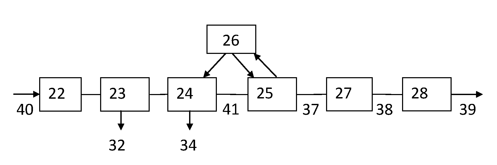

Brevet PROCEDE DE VALORISATION DES MEGOTS DE CIGARETTE

Extrait de data.inpi.fr

Extrait de la base Brevets du site DATA INPI 7 novembre 2026

**Notice n° FR3066128:**

**Figure:**

**Titre:** PROCEDE DE VALORISATION DES MEGOTS DE CIGARETTE

**N° et date de publication de la demande:** FR3066128 - 16/11/2018 (BOPI 2018-46 )

Source : INPI. Dernière mise à jour de la base Brevets français : 06/11/2026

Brevet PROCEDE DE VALORISATION DES MEGOTS DE CIGARETTE

**Type de la demande:** A1

**N° et date de dépôt:** FR1754267 - 15/05/2017

**N° et date de priorité:** FR1754267 - 15/05/2017

**Classification internationale des brevets - CIB:** B09B 3/70 ; A24F 47/00 ; B09B 3/32 ; B09B 3/35 ; C02F 1/52

**Classification coopérative des brevets - CPC:** C08J 11/06 ; D21C 5/02 ; A24F 47/00 ; C08J2301/12 ; Y02W 30/64 ; Y02W 30/62 ;

3/32

**Famille de brevets:** FR3066128A1

**Abrégé:** L'invention concerne un procédé de valorisation des mégots de cigarette (40), composé d'un

filtre (41) et de matière organique (32) composée de cendres, de feuilles de papier et de tabac, ledit filtre (41) étant composé d'acétate de cellulose (33) et de papier (34), caractérisé en ce que le procédé comporte les étapes suivantes de : a) premier broyage (22) à partir de mégots de cigarette (40) dans un premier broyeur pour séparer le filtre (41) de la matière organique (32) ; b) tamisage (23) du filtre (41) et de la matière organique (32), pour récupérer l'acétate de cellulose (33) contenu dans le filtre ; c) lavage (24) du filtre (41) pour une séparation de l'acétate de cellulose (33) et du papier (34) avec de l'eau, dans une cuve de lavage ; d) lavage de dépollution (25) de l'acétate de cellulose (33) avec de l'eau dans une cuve de dépollution pour obtenir de l'acétate de cellulose dépollué (37) ; e) recyclage de l'eau (26) des étapes c) et d) par un recycleur à eau ; f) séchage par pré-cuisson (27) pour obtenir de l'acétate de cellulose séché (38) ; g) deuxième broyage (28) pour obtenir de fines particules fibreuses d'acétate de cellulose (39).

**INTERVENANTS:**

**Déposant:** MEGO! (MEGO!) - FR

**Inventeur:** LUCAS BASTIEN (LUCAS, BASTIEN) - FR LUCAS ANDRIANINA (LUCAS, ANDRIANINA) - FR

ANDRE GUILLAUME (ANDRE, GUILLAUME) - FR MONTEIRO TOINELO (MONTEIRO, TOINELO) - FR

**STATUT EN FRANCE:**

**Publication du rapport de recherche préliminaire Délivrance:** 16/11/2018 (BOPI 2018-46 )

**Dernière annuité payée:** 16/04/2026

**Quantième- N° de l'annuité payée :** 10

Source : INPI. Dernière mise à jour de la base Brevets français : 06/11/2026

Brevet PROCEDE DE VALORISATION DES MEGOTS DE CIGARETTE

**Date de paiement de la prochaine annuité:** 31/05/2027

Source : INPI. Dernière mise à jour de la base Brevets français : 06/11/2026