PAPER • OPEN ACCESS

# Research on the road performance of cigarette butts modified asphalt mixture

To cite this article: Jimei Jin et al 2019 J. Phys.: Conf. Ser. 1168 022053

View the  $ \underline{\text{article online}} $ for updates and enhancements.

## You may also like

- The water stability research of the rubber powder-modified asphalt mixture

Jie Sun, Xi Lv, Yao Zhang et al.

- Experimental study on high-temperature stability of rubber powder-modified Asphalt mixture

Jie Sun, Bingyan Wei, Yao Zhang et al.

- Improving the tensile strength and durability of asphalt concrete as sustainable surface layer

Yassir Nashaat A. Kareem and Mohammed Abbas Al-jumaili

# Enabling Electrochemistry Inside and Outside the Lab

Discover our diverse range of Potentiostats engineered to support your research wherever it takes you

Intuitive software for Windows and Android

Proven in over 4000 scientific publications

Single-channel and multi-channel

Benchtop, portable and wearable

Discover More

# Research on the road performance of cigarette butts modified asphalt mixture

Jimei Jin $ ^{1} $, Zhaorong Wu $ ^{1*} $, JinSong $ ^{1} $, Xue Liu $ ^{2} $

 $ ^{1} $Department of Transportation Engineering, Tongji Zhejiang College, Jiaxing, Zhejiang, 314051, China

 $ ^{2} $Jiaxing traffic engineering quality and safety supervision station, Jiaxing, Zhejiang, 314001, China

 $ ^{*} $Corresponding author's email: wuzhaorong110@126.com

Abstract. In the view of that similarity of butts and plastic material, like thermosets and thermoplastics, it is inferred that it can be used to make the modified asphalt mixture. Such as rubber powder and waste plastic, by research results, according to the waste cigarette butts main composition and the principle of preparation of modified asphalt mixture, our team developed the old cigarette butts, modified asphalt mixture with the concept of sustainable development of environmental resources. With ordinary asphalt mixture Marshall test and rutting test data contrast, prove that cigarette butts as a new kind of modifier in asphalt mixture has a broad development prospect and space.

## 1. Introduction

The use of recyclable materials for road construction has been widely studied, but the cigarette butt as a new renewable plastic material has not been officially developed in China. Foreign countries, such as Australia and Brazil, had used cigarette butts to make construction materials, and the recycling of cigarette butts has been carried out in foreign countries. In the same way, cigarette butts have very high exploitability in China. So, this paper compares the properties of modified bituminous mixtures and ordinary bituminous mixtures.

## 2. Material and Methods

### 2.1 Reasons for selection of modifier

As the cigarette butt is mainly composed of acetate fiber and polypropylene fiber bundles, the specific composition, and related properties are as follows:

Polypropylene: A semi-crystalline thermoplastic, plastic with strong mechanical properties and high impact resistance, resistant to a variety of organic solvents and acid-base corrosion.

● Acetate fibre: Thermoplastic resin and porous membrane material are characterized by high selectivity, high water permeability and simple processing [1].

● Melting point: 164~170°C.

Green benefits: Environmental protection, energy conservation, and emission reduction. Therefore, cigarette butts are selected as a modifier in this experiment.

### 2.2 Treatment of modifier

In this experiment, recycled waste cigarette butts were used as a new modifier to be mixed with asphalt mixture. The new modifier was combined with ore mixture by artificial shear to make asphalt mixture, and the parameters were compared with the control group.

Pre-processing method of cigarette butts: manual skinning and cutting with scissors for about 0.6mm cigarette butts.

Determination of cigarette butts drying temperature: select temperature is  $ 105^{\circ}C $.

Selection of cigarette butt input method: the external mixing method is selected to put the butt into stone to make modified asphalt mixture.

Determination of the optimal content of cigarette butt: control the factors other than the amount of cigarette butt during the mixing of asphalt mixture [2].

### 2.3 The asphalt performance

The penetration test, ductility test, and softening point test obtained the experimental data of No.70 asphalt, as shown in table 1 below.

Table 1. Three indexes of test asphalt
 

<table border=1 style='margin: auto; word-wrap: break-word;'><tr><td style='text-align: center; word-wrap: break-word;'>Item</td><td style='text-align: center; word-wrap: break-word;'>Penetration (25°C, 0.1mm)</td><td style='text-align: center; word-wrap: break-word;'>Ductility (15°C. cm)</td><td style='text-align: center; word-wrap: break-word;'>Softening point (°C)</td></tr><tr><td style='text-align: center; word-wrap: break-word;'>Normal</td><td style='text-align: center; word-wrap: break-word;'>60~80</td><td style='text-align: center; word-wrap: break-word;'>&gt;20</td><td style='text-align: center; word-wrap: break-word;'>&gt;46</td></tr><tr><td style='text-align: center; word-wrap: break-word;'>Measured</td><td style='text-align: center; word-wrap: break-word;'>60.04</td><td style='text-align: center; word-wrap: break-word;'>&gt;100</td><td style='text-align: center; word-wrap: break-word;'>49.9</td></tr></table>

2.4 Target mixture proportion design of plain asphalt mixture

2.4.1 Determine the mixture type and scope of gradation. The Marshall specimens are graded as AC-13C, as shown in table2 below.

Table 2. Recommended values for technical requirements of AC-13C asphalt mixtures
 

<table border=1 style='margin: auto; word-wrap: break-word;'><tr><td style='text-align: center; word-wrap: break-word;'>Gradation type</td><td style='text-align: center; word-wrap: break-word;'>16</td><td style='text-align: center; word-wrap: break-word;'>13.2</td><td style='text-align: center; word-wrap: break-word;'>9.5</td><td style='text-align: center; word-wrap: break-word;'>4.75</td><td style='text-align: center; word-wrap: break-word;'>2,36</td><td style='text-align: center; word-wrap: break-word;'>1.18</td><td style='text-align: center; word-wrap: break-word;'>0.6</td><td style='text-align: center; word-wrap: break-word;'>0.3</td><td style='text-align: center; word-wrap: break-word;'>0.15</td><td style='text-align: center; word-wrap: break-word;'>0.075</td></tr><tr><td style='text-align: center; word-wrap: break-word;'>AC-13</td><td style='text-align: center; word-wrap: break-word;'>100</td><td style='text-align: center; word-wrap: break-word;'>90~100</td><td style='text-align: center; word-wrap: break-word;'>60~80</td><td style='text-align: center; word-wrap: break-word;'>38~49</td><td style='text-align: center; word-wrap: break-word;'>24~35</td><td style='text-align: center; word-wrap: break-word;'>15~25</td><td style='text-align: center; word-wrap: break-word;'>10~19</td><td style='text-align: center; word-wrap: break-word;'>7~15</td><td style='text-align: center; word-wrap: break-word;'>5~12</td><td style='text-align: center; word-wrap: break-word;'>4~8</td></tr></table>

2.4.2 Select raw materials. The relative mass of coarse and fine aggregate was measured by the net basket method and the volumetric flask method, and table 3 was calculated.
 

<table border=1 style='margin: auto; word-wrap: break-word;'><tr><td style='text-align: center; word-wrap: break-word;'>Aggregate number</td><td style='text-align: center; word-wrap: break-word;'>Apparent relative density( $ g/cm^{3} $)</td><td style='text-align: center; word-wrap: break-word;'>Bulk specific gravity( $ g/cm^{3} $)</td><td style='text-align: center; word-wrap: break-word;'>Water absorption (%)</td></tr><tr><td style='text-align: center; word-wrap: break-word;'>No. 1</td><td style='text-align: center; word-wrap: break-word;'>2.830</td><td style='text-align: center; word-wrap: break-word;'>2.710</td><td style='text-align: center; word-wrap: break-word;'>1.25</td></tr><tr><td style='text-align: center; word-wrap: break-word;'>No. 2</td><td style='text-align: center; word-wrap: break-word;'>2.806</td><td style='text-align: center; word-wrap: break-word;'>2.680</td><td style='text-align: center; word-wrap: break-word;'>1.30</td></tr><tr><td style='text-align: center; word-wrap: break-word;'>aggregate chips</td><td style='text-align: center; word-wrap: break-word;'>2.656</td><td style='text-align: center; word-wrap: break-word;'>2.677</td><td style='text-align: center; word-wrap: break-word;'>——</td></tr><tr><td style='text-align: center; word-wrap: break-word;'>Mineral powder</td><td style='text-align: center; word-wrap: break-word;'>2.644</td><td style='text-align: center; word-wrap: break-word;'>2.644</td><td style='text-align: center; word-wrap: break-word;'>——</td></tr></table>

2.4.3 Select mineral aggregate gradation. According to the test results of the mineral mixture, the synthetic apparent relative density of mineral mixture was calculated from table 4 and figure 1. The results are shown in table 5. Finally, gravel No. 1, No. 2, aggregate chips and mineral powder were divided into 16%, 23%, 55%, and 6% respectively.

Table 4. Results of a screening test of ore
 

<table border=1 style='margin: auto; word-wrap: break-word;'><tr><td rowspan="2">Aggregate number</td><td colspan="10">Percentage passing through the following screen hole (mm) (%)</td></tr><tr><td style='text-align: center; word-wrap: break-word;'>16</td><td style='text-align: center; word-wrap: break-word;'>13.2</td><td style='text-align: center; word-wrap: break-word;'>9.5</td><td style='text-align: center; word-wrap: break-word;'>4.75</td><td style='text-align: center; word-wrap: break-word;'>2.36</td><td style='text-align: center; word-wrap: break-word;'>1.18</td><td style='text-align: center; word-wrap: break-word;'>0.6</td><td style='text-align: center; word-wrap: break-word;'>0.3</td><td style='text-align: center; word-wrap: break-word;'>0.15</td><td style='text-align: center; word-wrap: break-word;'>0.075</td></tr><tr><td style='text-align: center; word-wrap: break-word;'>No.1</td><td style='text-align: center; word-wrap: break-word;'>100</td><td style='text-align: center; word-wrap: break-word;'>88.4</td><td style='text-align: center; word-wrap: break-word;'>18.6</td><td style='text-align: center; word-wrap: break-word;'>0.1</td><td style='text-align: center; word-wrap: break-word;'>0</td><td style='text-align: center; word-wrap: break-word;'>0</td><td style='text-align: center; word-wrap: break-word;'>0</td><td style='text-align: center; word-wrap: break-word;'>0</td><td style='text-align: center; word-wrap: break-word;'>0</td><td style='text-align: center; word-wrap: break-word;'>0</td></tr></table>

IOP Conf. Series: Journal of Physics: Conf. Series 1168 (2019) 022053 doi:10.1088/1742-6596/1168/2/022053
 

<table border=1 style='margin: auto; word-wrap: break-word;'><tr><td style='text-align: center; word-wrap: break-word;'>No. 2</td><td style='text-align: center; word-wrap: break-word;'>100</td><td style='text-align: center; word-wrap: break-word;'>100</td><td style='text-align: center; word-wrap: break-word;'>97.7</td><td style='text-align: center; word-wrap: break-word;'>6.7</td><td style='text-align: center; word-wrap: break-word;'>0.6</td><td style='text-align: center; word-wrap: break-word;'>0.3</td><td style='text-align: center; word-wrap: break-word;'>0.2</td><td style='text-align: center; word-wrap: break-word;'>0.1</td><td style='text-align: center; word-wrap: break-word;'>0</td><td style='text-align: center; word-wrap: break-word;'>0</td></tr><tr><td style='text-align: center; word-wrap: break-word;'>aggregate chips</td><td style='text-align: center; word-wrap: break-word;'>100</td><td style='text-align: center; word-wrap: break-word;'>100</td><td style='text-align: center; word-wrap: break-word;'>100</td><td style='text-align: center; word-wrap: break-word;'>93.6</td><td style='text-align: center; word-wrap: break-word;'>64.1</td><td style='text-align: center; word-wrap: break-word;'>40.8</td><td style='text-align: center; word-wrap: break-word;'>22.4</td><td style='text-align: center; word-wrap: break-word;'>11</td><td style='text-align: center; word-wrap: break-word;'>5.1</td><td style='text-align: center; word-wrap: break-word;'>2.9</td></tr><tr><td style='text-align: center; word-wrap: break-word;'>mineral powder</td><td style='text-align: center; word-wrap: break-word;'>100</td><td style='text-align: center; word-wrap: break-word;'>100</td><td style='text-align: center; word-wrap: break-word;'>100</td><td style='text-align: center; word-wrap: break-word;'>100</td><td style='text-align: center; word-wrap: break-word;'>100</td><td style='text-align: center; word-wrap: break-word;'>100</td><td style='text-align: center; word-wrap: break-word;'>100</td><td style='text-align: center; word-wrap: break-word;'>99.4</td><td style='text-align: center; word-wrap: break-word;'>98.2</td><td style='text-align: center; word-wrap: break-word;'>87.6</td></tr></table>

Table 5. Related synthetic densities of mineral mixtures
 

<table border=1 style='margin: auto; word-wrap: break-word;'><tr><td colspan="3">Aggregate contents (%)</td><td rowspan="2">The dosage of mineral powder (%)</td><td rowspan="2">Synthetic apparent relative density  $ \gamma_{sa} $</td><td rowspan="2">Volume relative density of synthetic wool  $ \gamma_{sb} $</td><td rowspan="2">Effective relative density  $ \gamma_{se} $</td></tr><tr><td style='text-align: center; word-wrap: break-word;'>No.1</td><td style='text-align: center; word-wrap: break-word;'>No.2</td><td style='text-align: center; word-wrap: break-word;'>aggregate chips</td></tr><tr><td style='text-align: center; word-wrap: break-word;'>16</td><td style='text-align: center; word-wrap: break-word;'>23</td><td style='text-align: center; word-wrap: break-word;'>55</td><td style='text-align: center; word-wrap: break-word;'>6</td><td style='text-align: center; word-wrap: break-word;'>2.716</td><td style='text-align: center; word-wrap: break-word;'>2.680</td><td style='text-align: center; word-wrap: break-word;'>2.725</td></tr></table>

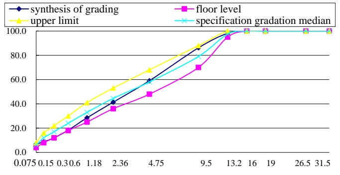

Figure 1. Curves of mineral composition grading
 

2.4.4 Measure physical and mechanical indexes of specimens. According to the experience of similar experiments, the five types of asphalt dosage are prepared, including 4.2%, 4.5%, 4.8%, 5.1% and 5.4%. The test data are summarized in table 6.

Table 6. Table of volume parameters of Marshall test - summary of test results of mechanical indexes
 

<table border=1 style='margin: auto; word-wrap: break-word;'><tr><td style='text-align: center; word-wrap: break-word;'>Aggregate grading type</td><td style='text-align: center; word-wrap: break-word;'>Amount of asphalt (%)</td><td style='text-align: center; word-wrap: break-word;'>Stability (kN)</td><td style='text-align: center; word-wrap: break-word;'>Flow value (mm)</td><td style='text-align: center; word-wrap: break-word;'>Void age (%)</td><td style='text-align: center; word-wrap: break-word;'>Clearance rate(%)</td><td style='text-align: center; word-wrap: break-word;'>Storability (%)</td><td style='text-align: center; word-wrap: break-word;'>Density ( $ g/cm^{{2}} $)</td></tr><tr><td rowspan="5">AC-13</td><td style='text-align: center; word-wrap: break-word;'>4.2</td><td style='text-align: center; word-wrap: break-word;'>8.55</td><td style='text-align: center; word-wrap: break-word;'>2.0</td><td style='text-align: center; word-wrap: break-word;'>5.7</td><td style='text-align: center; word-wrap: break-word;'>15.7</td><td style='text-align: center; word-wrap: break-word;'>67.3</td><td style='text-align: center; word-wrap: break-word;'>2.373</td></tr><tr><td style='text-align: center; word-wrap: break-word;'>4.5</td><td style='text-align: center; word-wrap: break-word;'>10.78</td><td style='text-align: center; word-wrap: break-word;'>3.0</td><td style='text-align: center; word-wrap: break-word;'>5.6</td><td style='text-align: center; word-wrap: break-word;'>14.9</td><td style='text-align: center; word-wrap: break-word;'>65.7</td><td style='text-align: center; word-wrap: break-word;'>2.389</td></tr><tr><td style='text-align: center; word-wrap: break-word;'>4.8</td><td style='text-align: center; word-wrap: break-word;'>13.56</td><td style='text-align: center; word-wrap: break-word;'>3.9</td><td style='text-align: center; word-wrap: break-word;'>5.2</td><td style='text-align: center; word-wrap: break-word;'>15.2</td><td style='text-align: center; word-wrap: break-word;'>65.0</td><td style='text-align: center; word-wrap: break-word;'>2.395</td></tr><tr><td style='text-align: center; word-wrap: break-word;'>5.1</td><td style='text-align: center; word-wrap: break-word;'>10.42</td><td style='text-align: center; word-wrap: break-word;'>4.0</td><td style='text-align: center; word-wrap: break-word;'>4.7</td><td style='text-align: center; word-wrap: break-word;'>15.5</td><td style='text-align: center; word-wrap: break-word;'>69.4</td><td style='text-align: center; word-wrap: break-word;'>2.395</td></tr><tr><td style='text-align: center; word-wrap: break-word;'>5.4</td><td style='text-align: center; word-wrap: break-word;'>8.44</td><td style='text-align: center; word-wrap: break-word;'>3.3</td><td style='text-align: center; word-wrap: break-word;'>3.0</td><td style='text-align: center; word-wrap: break-word;'>16.7</td><td style='text-align: center; word-wrap: break-word;'>74.9</td><td style='text-align: center; word-wrap: break-word;'>2.393</td></tr></table>

2.4.5 Determine the optimum asphalt content.

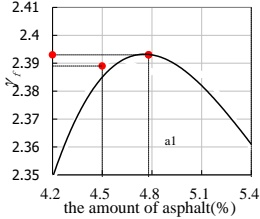

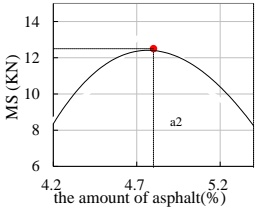

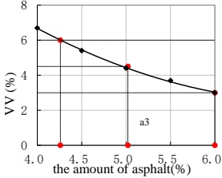

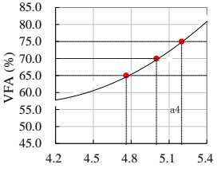

the amount of asphalt(%)
 

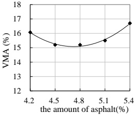

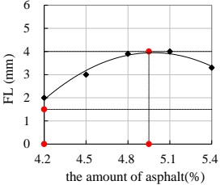

<table border=1 style='margin: auto; word-wrap: break-word;'><tr><td style='text-align: center; word-wrap: break-word;'>$ a_{{1}} $</td><td style='text-align: center; word-wrap: break-word;'>$ a_{{2}} $</td><td style='text-align: center; word-wrap: break-word;'>$ a_{{3}} $</td><td style='text-align: center; word-wrap: break-word;'>$ a_{{4}} $</td></tr><tr><td style='text-align: center; word-wrap: break-word;'>4.50</td><td style='text-align: center; word-wrap: break-word;'>4.80</td><td style='text-align: center; word-wrap: break-word;'>4.90</td><td style='text-align: center; word-wrap: break-word;'>5.00</td></tr><tr><td style='text-align: center; word-wrap: break-word;'>$ \text{{OAC}}_{{max}} $</td><td style='text-align: center; word-wrap: break-word;'>$ \text{{OAC}}_{{min}} $</td><td style='text-align: center; word-wrap: break-word;'>$ \text{{OAC}}_{{1}} $</td><td style='text-align: center; word-wrap: break-word;'>$ \text{{OAC}}_{{2}} $</td></tr><tr><td style='text-align: center; word-wrap: break-word;'>4.95</td><td style='text-align: center; word-wrap: break-word;'>4.76</td><td style='text-align: center; word-wrap: break-word;'>4.80</td><td style='text-align: center; word-wrap: break-word;'>4.86</td></tr><tr><td colspan="2">Optimum asphalt consumption (%)</td><td colspan="2">4.83</td></tr><tr><td colspan="2">bulk volume relative density of OAC</td><td colspan="2">2.389</td></tr></table>

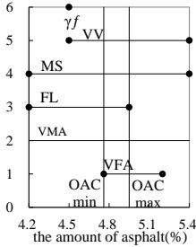

Figure 2. Illustration of test results of general asphalt Marshall test
 

From figure 2, the method to calculate the optimum asphalt content is as follows:

The asphalt content corresponding calculates the first date to the maximum density, maximum stability, moderate range of porosity and maximum saturation.  $ OAC_1 = (4.5 + 4.8 + 4.9 + 5.0)/4 = 4.8\% $, quote equation (1), and calculated by the minimum oil-stone ratio and the maximum ratio of  $ OAC_2 = (OAC_{min} + OAC_{max})/2 = 4.86\% $, quote equation (2), the optimum asphalt content  $ OAC = (OAC_1 + OAC_2)/2 = 4.83\% $, quote equation (3). It is expected that there may be a rut, so the best asphalt content of OAC is 4.8%.

 $$ \mathrm{OAC}_{1}=(\mathrm{a}_{1}+\mathrm{a}_{2}+\mathrm{a}_{3}+\mathrm{a}_{4})/4 $$ 

 $$ \mathrm{OAC}_{2}=(\mathrm{OAC}_{\min}+\mathrm{OAC}_{\max})/2 $$ 

 $$  OAC=(OAC_{1}+OAC_{2})/2 $$ 

2.4.6 Road performance test. Road performance test refers to rut test, and the stability and flow value of Marshall specimen are shown in figure 8 and 7.

### 2.5 Target mixture proportion design of cigarette modified bitumen mixture

2.5.1 Determination method of mixture type and scope of gradation. AC-13C is still used as the mixture type. By mixing cigarette butt and asphalt mixture with external mixing method, the best

cigarette butt mixing amount can be obtained by changing different cigarette butt mixing amount and comparing Marshall stability and flow value.

2.5.2 Selection and determination of raw materials. Choose cigarette end, gravel 1, 2, aggregate chips, mineral powder.

2.5.3 The Specific method to determine the content of cigarette butt. In the beginning, three kinds of cigarette butts (1%, 3%, and 5%) were prepared. Because of serious segregation when mixing the mixture of 3% cigarette butts, three kinds of cigarette butts (1%, 1.5%, and 2%) were prepared again for making parts, and the reasonable proportion was determined by Marshall test conclusion.

2.5.4 The Marshall test. As shown in figure 3, the optimal value of stability and flow value is selected, so the optimal amount of cigarette butt is determined to be 2%.

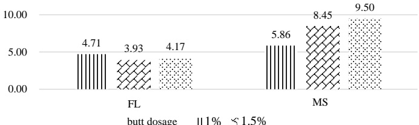

Figure 3. Test results of Marshall test of modified asphalt mixture with a cigarette butt
 

2.5.5 Pavement performance test. For the method of common asphalt mixture, the specific values are shown in figure 6 and 7.

2.5.6 Conclusions. The target mixture proportion of the material of the Marshall specimens of modified asphalt mixture is 16:23:55:6:2, and the asphalt content is 4.8%. The results of the rut test of cigarette modified asphalt Marshall specimens, ordinary asphalt mixture and cigarette butt modified asphalt mixture is compared as shown in figure 4 and figure 5.

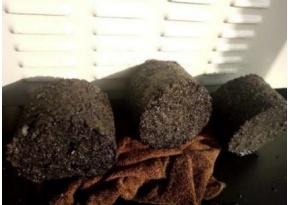

Figure4. The sample of cigarette butt Marshall
 

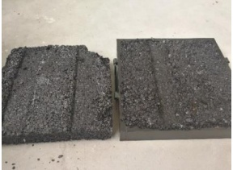

Figure5. Comparison of rut specimens
 

## 3. Test results

3.1 Comparison of Marshall test results of two asphalt mixtures

Marshall test instrument is used to evaluate the collapsing strength and anti-deforming capability of general bituminous mixtures and bituminous modified bituminous mixtures. See figure 6.

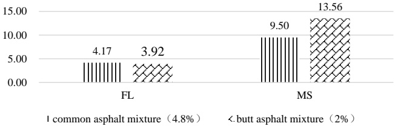

Figure6. Comparison of Marshall specimens
 

Conclusion 1: The stability of modified asphalt pavement with cigarette butts (the maximum damage load) is higher than that of ordinary asphalt pavement, indicating that the road anti-deforming capability has been improved.

### 3.2 Comparison of test results of two kinds of asphalt mixture in rut test

Marshall rutting test used to evaluate the high-temperature stability of ordinary asphalt mixture and butt modified asphalt mixture. See figure 7.

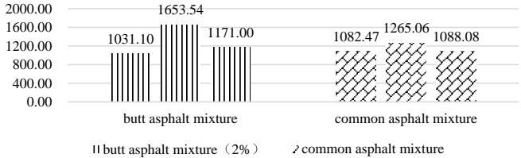

Figure 7. Comparison of rutting experiment between ordinary asphalt mixture and cigarette modified asphalt mixture
 

Conclusion 2: The flow value of modified asphalt pavement is less than that of ordinary asphalt pavement, indicating that the anti-deformation ability is improved compared with that of the ordinary asphalt mixture.

To sum up, the pavement collapsing strength, anti-deformation ability and high-temperature stability of modified bituminous mixtures are superior to ordinary bituminous mixtures.

## 4. Discussion

### 4.1 Cause analysis

Pre-processing method of cigarette butts: to avoid the influence of different source and physical state of recycled cigarette butts on the experiment, the cigarette butts were pretreated. At the same time, considering the method of treating cigarette butts with a shearing machine, it will destroy its fiber structure, unable to give play to its advantages.

The influence of the drying temperature of the cigarette butts: The temperature should be in the main components of the cigarette butts under the melting point of polypropylene (164~170°C), the drying temperature of Marshall mold is known to be 105°C, set the 105°C, convenient experiment operation.

Selection of cigarette butts input method: due to limited experimental conditions, no appropriate instrument was used to mix the cigarette butts and asphalt.

For determination of optimum dosage of cigarette butts: according to the control variable method, determine the optimal amount of cigarette butts modified asphalt mixture.

Selection of the pavement performance parameter: the experimental results of stability, flow degree, dynamic stability respectively represents it can withstand the peak load, its maximum breaking

IOP Conf. Series: Journal of Physics: Conf. Series 1168 (2019) 022053 doi:10.1088/1742-6596/1168/2/022053

weight on vertical deformation of the specimens, the standard axle load carried by the number of walking. Comparing the size of the correlation value that can represent the pavement performance of the cigarette butts modified asphalt mixture.

### 4.2 Economic and social benefits

On the basis that the maximum life of the original grade road is 15 years, if the new method proposed in this paper is applied to road engineering, the anti-rutting performance of the asphalt mixture can be improved, and the negative impact of traffic volume. Moreover, vehicle load on the road can be avoided to some extent, and the service life of the road can be extended. The cost of asphalt pavement is reduced by collecting abandoned tobacco as a modifier.

## 5. Conclusions

The next experiment will further calibrate the test date:

The subsequent trial will explore the chemical bond between the base and asphalt based on the micro-interface of the base material and the framework structure of the base material, and then study the permeability performance of the modified asphalt mixture of the base and give play to its physical characteristics [3].

To sum up, this paper first introduced cigarette butts as modified agents into the application of pavement materials. This resource-oriented utilization technology is environment-friendly, in line with the national economic and social development needs, and by the road performance requirements and the engineering characteristics of cigarette butts, the pre-treatment method of cigarette butts is systematically proposed. This research also creates a new recycling method for the substantial number and low utilization of cigarette butts, which not only improves the road performance but also extends the service life of the road [4].

## Acknowledgments

Firstly, I would like to extend my most sincere gratitude to the instructor of this subject. Secondly, thanks for the support from Tongji Zhejiang College. Finally, we would like to thank the organizer of ISTTCA 2018 for giving us the opportunity to publish the research article.

## References:

[1] Zhang, Y.H. (2015) Study on the mechanism and road performance of SBS modified asphalt and rubber powder modified asphalt. Chang'an University, Xi'an.

[2] Ren, R.B., GengL.T, Xu Q, TanT.(2015)Study on-road performance of stabilized rubber-plastic modified asphalt mixture. Highway, 60(07):11-15.

[3] Jiang, X.H. (2010) Experimental study on properties of modified asphalt of lifewaste plastics. Chongqing Jiaotong University, Chongqing.

[4] Xiao, P., Chen, Y.Y. (2010) Comparative experimental study on properties of rubber powder physical and chemical modified asphalt. Highway, 03:130-133.

