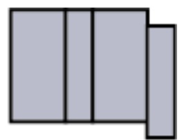
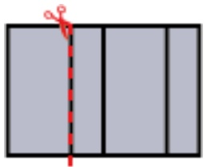
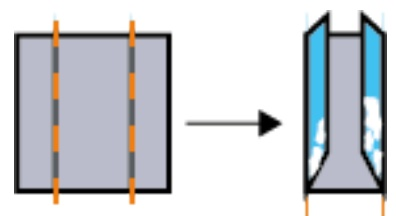
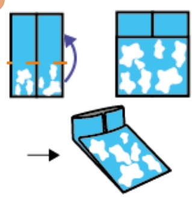
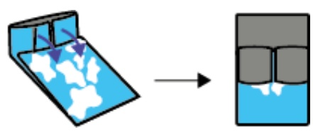

## CONSTRUISEZ VOUS MÊME VOTRE CENDRIER DE POCHE

Matériel nécessaire en amont : 1 brique alimentaire

+ 1 paire de ciseaux

Commencer par découper le haut et le bas de la brique.

Aplatir au maximum et plier les arrêtes, afin d'obtenir quelque de plat.

Couper une des

grandes partie à l'aide

de ciseaux

Plier deux bandes qui se rejoigent au centre.

Plier le tout, de façon à laisser de l'espace en haut pour refermer le cendrier.

Couper les bords avec les ciseaux.

Rabattre les deux languettes coupées.

Les insérer à l'intérieur des rebords pour former le corps du cendrier.

A l'aide d'un scratch, vous pouvez refermer correctement votre cendrier.

Prenez des photos, et partagez vous vos créations !

Bravo pour votre démarche responsable !

