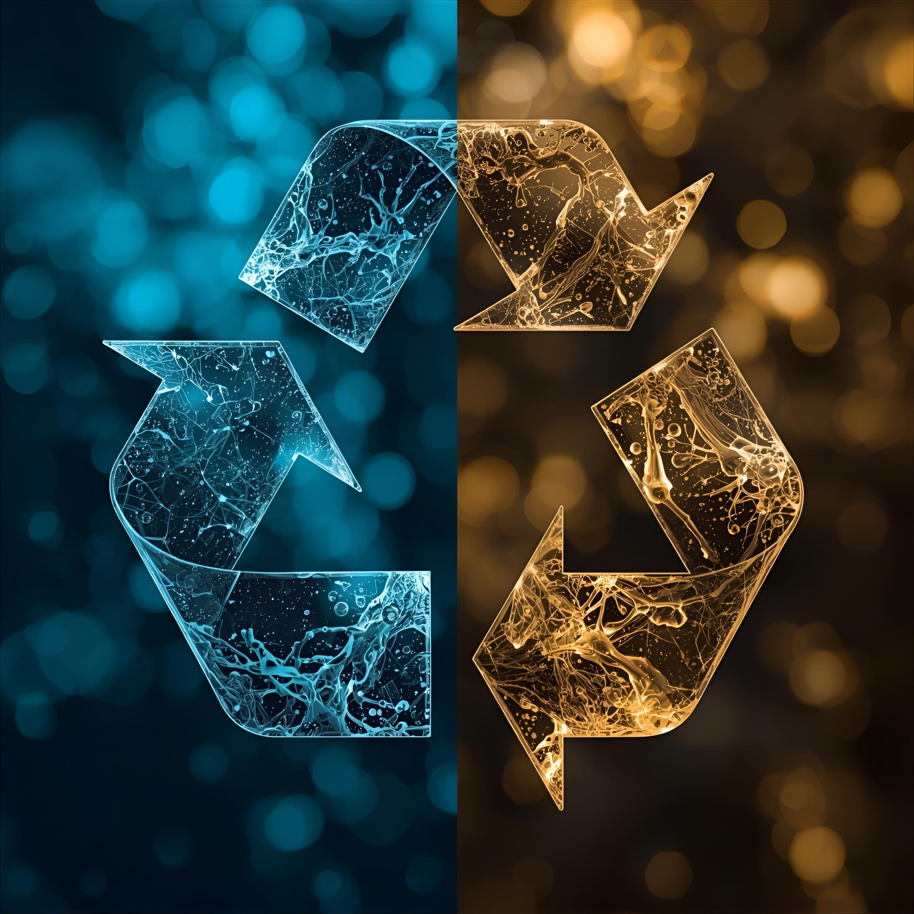
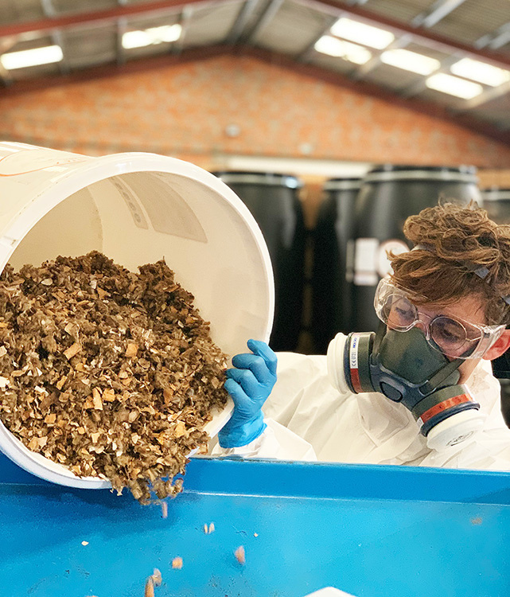
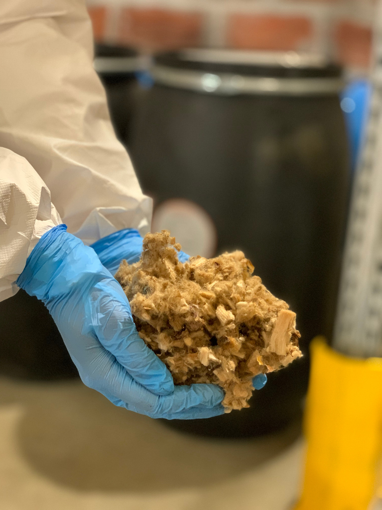
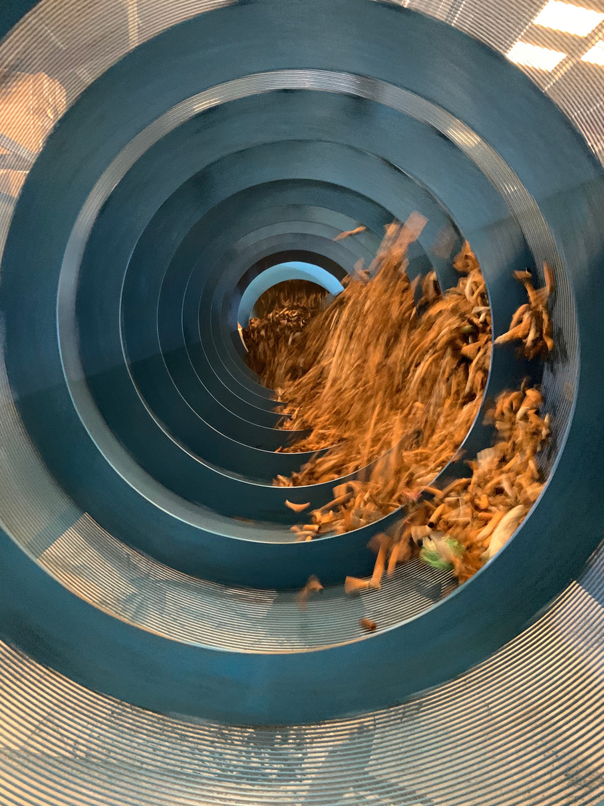
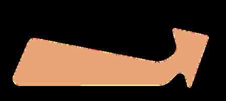
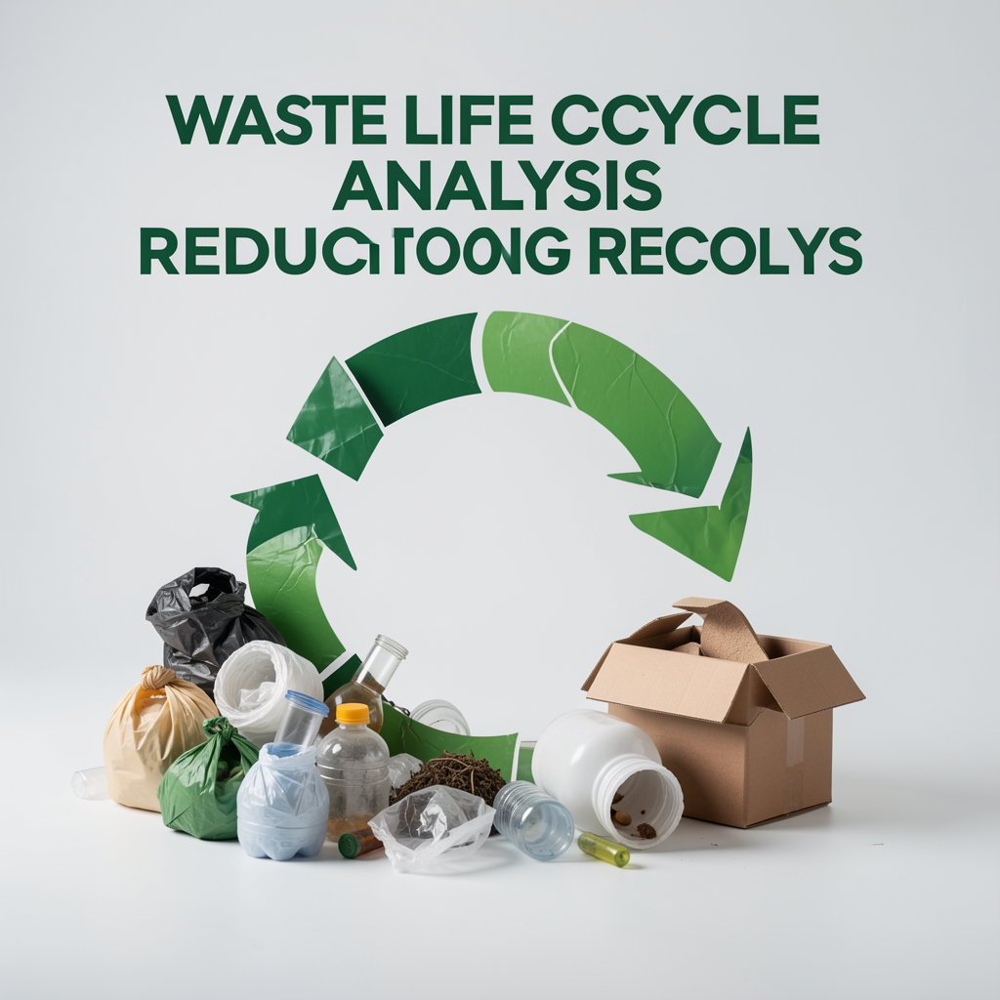
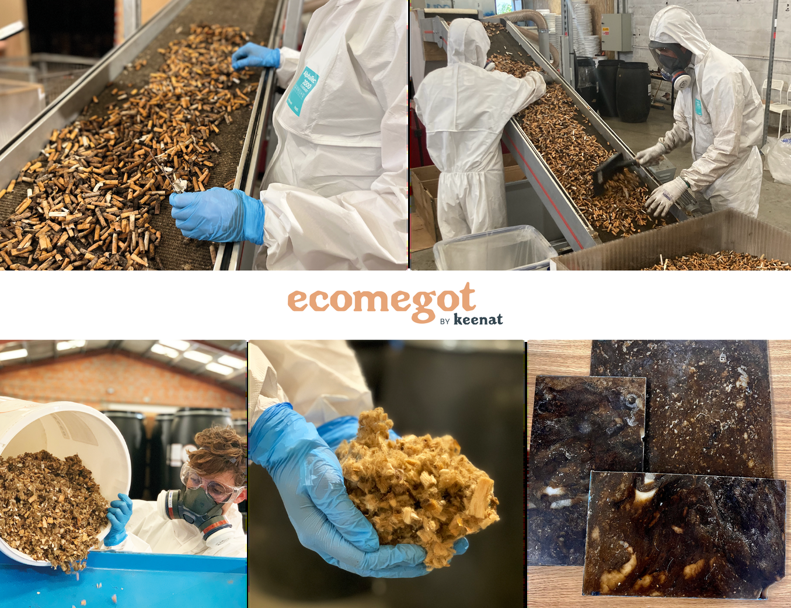
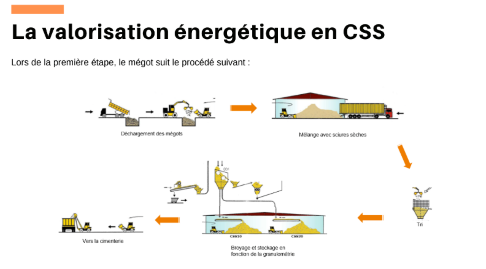
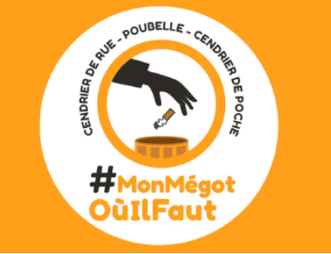
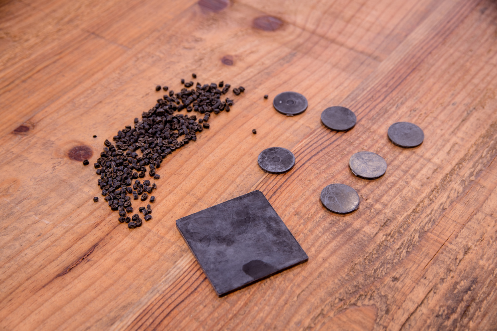

Guide expert – Pollution des mégots

# Recyclage vs valorisation ?

# La science au service d'une gestion responsable des déchets complexes

Par

PREAMBULE

# L'urgence d'une vision claire

L'économie circulaire n'est plus une option, mais une nécessité. Face à l'épuisement des ressources vierges et à l'impératif de décarbonation de notre économie, la manière dont nous considérons nos déchets est en pleine révolution. Ils ne sont plus un rebut, mais une ressource potentielle.

En nous appuyant sur le cadre réglementaire, les analyses scientifiques et l'exemple concret du mégot de cigarette – un des déchets les plus complexes et les plus toxiques au monde – nous démontrerons que la meilleure solution environnementale n'est pas toujours la plus évidente. C'est le fruit d'une analyse rigoureuse des impacts, de la collecte à la transformation finale. C'est ce cheminement, basé sur notre propre expérience industrielle, que nous souhaitons partager.

Cependant, cette transition s'accompagne d'un bruit de fond sémantique où des termes complexes sont souvent simplifiés à l'extrême. Le "recyclage" est devenu un mot-totem, une solution perçue comme universellement vertueuse, tandis que la "valorisation énergétique" souffre encore d'une image parfois dégradée, injustement assimilée à l'incinération "à l'ancienne". Ce livre blanc a pour vocation de dépasser les idées reçues. Il s'adresse aux décideurs – entreprises, collectivités, acteurs publics – qui cherchent à mettre en œuvre une politique de gestion des déchets efficace, transparente et fondée sur la science.

# Table des matières

|**Chapitre 2 : comment choisir la bonne filière ?** **L'Analyse de Cycle de Vie (ACV)** **Chapitre 3 : le cas critique des déchets dangereux** **Chapitre 1 : fondamentaux de l'Économie** **Circulaire - définir pour mieux agir**|**4** **6** **8**|
|---|---|
|**Chapitre 4 : le duel du mégot - Analyse** **comparative des filières**|**9**|
|**Chapitre 5 : le cadre réglementaire en France et en** **Europe**|**12**|
|**Chapitre 6 : le parcours de Keenat - de l'Innovation à** **la responsabilisation** **Conclusion : pour une écologie industrielle et** **territoriale**|**14** **15**|

CHAPITRE 1

# Fondamentaux de l'économie circulaire : définir pour mieux agir

#### Le Code de l'environnement français (Art. L541-1-1)

Il transpose la directive européenne, offre des définitions claires :

Valorisation : « Toute opération dont le résultat principal est que des déchets servent à des fins utiles en remplaçant d'autres matières qui auraient été utilisées à une fin particulière [...]. » C'est un terme chapeau qui englobe toutes les formes de réutilisation de la ressource "déchet".

Recyclage : « Toute opération de valorisation par laquelle les déchets [...] sont retraités en substances, matières ou produits aux fins de leur fonction initiale ou à d'autres fins. » Le recyclage est donc une des formes de la valorisation matière. Valorisation énergétique : C'est l'utilisation de déchets comme combustible principal ou d'appoint pour produire de l'énergie. La réglementation impose des critères de haute efficacité énergétique pour que l'opération soit qualifiée de "valorisation" et non "d'élimination".

Co-processing (ou co-incinération) : Technique de valorisation utilisée dans des installations industrielles (cimenteries, fours à chaux, sidérurgie) où les déchets sont utilisés simultanément comme source d'énergie et comme matière première de substitution.

Élimination : « Toute opération qui n'est pas de la valorisation ». Cela inclut principalement la mise en décharge (stockage) et l'incinération sans récupération d'énergie ou avec une faible efficacité.

La hiérarchie des modes de traitement : un principe directeur

La Directive Cadre Européenne 2008/98/CE établit une hiérarchie des modes de traitement des déchets qui favorise, dans l'ordre :

1.Prévention 2.Préparation en vue du réemploi 3.Recyclage 4.Autre valorisation (notamment énergétique) 5.Élimination

Cette hiérarchie est un principe fondamental. Toutefois, la directive elle-même précise que des dérogations sont possibles pour des flux de déchets spécifiques "si cela se justifie pour des raisons de faisabilité technique, de viabilité économique et de protection de l’environnement". En d'autres termes, pour un déchet complexe et dangereux, une valorisation énergétique (niveau 4) peut avoir un meilleur bilan environnemental global qu'un recyclage (niveau 3) énergivore et polluant.

Valorisation, Recyclage, Co-processing : clarifications sémantiques

Il est crucial de comprendre que ces termes ne s'opposent pas toujours.

Valorisation est le concept global. Recyclage est une méthode de valorisation matière. Le Co-processing en cimenterie est une méthode de valorisation à la fois énergétique et matière.

Le débat ne devrait donc pas être "Recyclage OU Valorisation", mais plutôt : "Pour ce déchet spécifique, quelle forme de valorisation (recyclage, co-processing, compostage...) offre le meilleur bilan environnemental, économique et sanitaire ?"

CHAPITRE 2

# Comment choisir la bonne filière ? L'Analyse de Cycle de Vie (ACV)

### Au-delà de l'intuition : la nécessité d'une approche scientifique

Un processus de recyclage qui nécessite de transporter un déchet sur 1000 km, de le laver à grande eau chaude avec des produits chimiques, puis de le fondre à haute température, peut avoir une empreinte carbone et un impact sur les écosystèmes (eutrophisation de l'eau) bien supérieurs à une valorisation énergétique locale dans une usine déjà existante.

L'intuition suggère que transformer un déchet en un nouvel objet (recyclage) est toujours préférable à le brûler pour produire de l'énergie. La réalité est plus complexe.

#### LE PARADOXE DU RECYCLAGE

### L'Analyse de Cycle de Vie (ACV) : normes et principes (ISO 14040 & 14044)

L'ACV est l'outil le plus

L'ACV est une méthode standardisée qui évalue les impacts environnementaux d'un produit, d'un service ou d'un procédé sur l'ensemble de son cycle de vie, "du berceau à la tombe". Pour comparer deux filières de traitement d'un déchet, l'ACV va quantifier :

abouti pour une évaluation globale et multicritère des impacts

environnementaux.

Source : ADEME (Agence de la transition écologique), Pôle Éco-

conception.

Les consommations de ressources (énergie, eau, matières premières). Les émissions dans l'air (gaz à effet de serre, polluants), dans l'eau (substances toxiques) et dans les sols. Les impacts potentiels sur la santé humaine, la qualité des écosystèmes et l'épuisement des ressources. Une ACV rigoureuse est le seul moyen de comparer objectivement deux scénarios et de statuer sur le bénéfice environnemental réel de l'un par rapport à l'autre.

### Critères de décision clés pour une filière de traitement

L'ACV se nourrit de données précises sur plusieurs critères :

|**Critère**|**Questions à se poser**|**Exemple du mégot**|
|---|---|---|
|Nature dudéchet|Est-il homogène?Pur ?Souillé? Dangereux ?|Hétérogène,souillé, etclassé dangereux.|
|Bilanénergétique|Leprocessest-ilénergivoreou producteur netd'énergie?|Recyclage :trèsénergivore. ValorisationCSS :producteur net d'énergie.|
|Bilan matière|Y a-t-ildes pertes ?Des sous- produits toxiques ?|Recyclage :génère deseffluents pollués.ValorisationCSS :pasde déchet ultime.|
|Bilancarbone|Quelest l'impactdu transportet du process sur lesémissionsde GES?|Recyclage :transportcentralisé+ process.ValorisationCSS : transport local + substitution d'énergiesfossiles (bilan souvent négatif).|
|Qualité & débouchés|Leproduit recyclé a-t-il un marché ?Est-ildehautequalité?|Matièrerecyclée de faiblequalité ("downcycling").Le CSS est un combustiblerecherché et standardisé.|
|Sécuritésanitaire|La filièregarantit-elleune destruction totale des polluants ?|Recyclage :non, déplacementde lapollution.ValorisationCSS : oui, àplusde1400°C.|

CHAPITRE 3

# Le cas critique des déchets dangereux

#### Tailoring Your Pitches

Les déchets dangereux (DD) obéissent à des règles de gestion bien plus strictes que les déchets ménagers classiques, pour une raison simple : leur potentiel de nuisance pour l'environnement et la santé humaine est immense.

### Le mégot de cigarette : archétype du déchet dangereux diffus

Le mégot est un cas d'école. Il n'est pas un simple morceau de plastique.

Quantité : 4 500 milliards de mégots sont jetés dans la nature chaque année dans le monde. En France, on estime ce chiffre à plus de 30 milliards. (Source : OMS, Rapport "Tobacco and its environmental impact", 2017).

### Qu'est-ce qu'un Déchet Dangereux (DD) ?

Selon la réglementation, un déchet est classé comme dangereux s'il présente une ou plusieurs des 15 propriétés de danger (HP) : explosif, inflammable, toxique, cancérigène, corrosif, infectieux, écotoxique (dangereux pour l'environnement aquatique), etc. Leur gestion est encadrée par une traçabilité obligatoire via un Bordereau de Suivi de Déchets (BSD), qui assure un suivi de la responsabilité du producteur jusqu'à l'installation de traitement final.

Composition : le filtre est en acétate de cellulose, une matière plastique. Mais après combustion, il devient une "éponge à toxines", concentrant des milliers de substances chimiques.

Toxicité : on y retrouve des métaux lourds (plomb, cadmium, mercure), des cancérigènes avérés (goudrons, benzène, arsenic) et de la nicotine.

Écotoxicité : il est classé comme déchet dangereux avec la mention de danger HP 14 "Écotoxique". Des études scientifiques ont démontré qu'un seul mégot peut polluer jusqu'à 500 litres d'eau et la rendre impropre à la vie aquatique. (Source : Slaughter, E. et al. "Toxicity of cigarette butts, and their chemical components, to marine and freshwater fish." Tobacco Control, 2011).

### L'impératif de destruction des polluants

La problématique centrale des DD n'est pas tant de recycler leur "contenant" (le plastique, le métal...) mais de neutraliser ou détruire de manière irréversible leur "contenu" dangereux. Un traitement qui se contenterait d'extraire les polluants pour les concentrer dans un autre effluent (boues, eaux de lavage) ne fait que déplacer le problème. la plus sûre est celle qui garantit la destruction moléculaire des substances toxiques. C'est ce que permettent les traitements à très haute température, comme la vitrification ou l'incinération à haute efficacité en fours industriels.

Le traiter comme un simple déchet plastique serait une grave erreur environnementale. La priorité absolue est la destruction de sa charge toxique.

CHAPITRE 4

# Le duel du mégot : analyse comparative des filières

Appliquons les critères de l'ACV aux deux scénarios de traitement des mégots.

### Scénario A : le recyclage matière

#### Le procédé technique : dépollution et transformation

Le bilan environnemental : énergie, chimie et sous- produits

#### La problématique du "downcycling" et de la logistique

Logistique centralisée : L'extrême technicité du process implique une centralisation. Le bilan carbone du transport des mégots collectés dans toute la France vers une seule usine est souvent prohibitif.

Ce procédé présente plusieurs failles environnementales majeures :

Collecte et Transport : les

mégots sont collectés puis acheminés vers un site de

traitement unique ou très

Bilan énergétique négatif : Le chauffage de l'eau, le séchage et l'extrusion consomment une quantité d'énergie considérable, souvent supérieure à celle nécessaire pour produire du plastique vierge.

peu nombreux, impliquant

souvent de longues distances.

Dépollution : c'est l'étape

"Downcycling" : Le plastique issu des mégots est de qualité médiocre. Il ne peut être utilisé pour des applications nobles et se retrouve dans des objets de faible valeur (pots de fleurs, palettes...), sans garantie qu'il sera à nouveau recyclé en fin de vie. On parle de "sous-recyclage" ou "downcycling".

la plus critique. Les mégots

sont plongés dans des

bains (généralement d'eau chauffée, parfois avec

Déplacement de la pollution : Les toxines ne sont pas détruites, mais extraites et concentrées dans les eaux de lavage. Le problème est simplement déplacé d'un déchet solide à un déchet liquide, dont le traitement a lui-même un impact.

ajout de solvants) pour "laver" les filtres et en

extraire les substances

toxiques.

Traitement des effluents : l'eau de lavage, désormais

chargée en métaux lourds et produits chimiques,

Consommation de ressources : Le procédé requiert de grandes quantités d'eau et potentiellement des solvants chimiques.

devient un déchet dangereux liquide qui doit

être traité dans une station

d'épuration spécialisée.

Séchage : la fibre plastique

nettoyée doit être séchée,

une étape très énergivore.

Transformation : la fibre est broyée puis extrudée (fondue) pour former des

granulés ou des plaques de

plastique, qui serviront à fabriquer de nouveaux objets.

### Scénario B : La Valorisation Énergétique en Combustible Solide de Substitution (CSS)

#### Le CSS : un combustible standardisé issu de déchets

La symbiose industrielle avec les cimenteries : Le co-processing

#### La double valorisation : énergie et matière

La cimenterie est l'exutoire idéal pour le CSS pour plusieurs raisons :

C'est l'avantage décisif du co- processing :

Les CSS (ou CSR en anglais) sont des combustibles

préparés à partir de déchets

Valorisation Énergétique : Le CSS a un haut pouvoir calorifique (PCI). Il se substitue directement au charbon, au fioul lourd ou au coke de pétrole. Chaque tonne de CSS permet d'éviter l'émission de près d'une tonne de CO2 d'origine fossile.

non dangereux et non recyclables dans les

Températures extrêmes : Les fours à ciment fonctionnent en continu à plus de 1450°C (et 2000°C à la flamme). À ces températures, toutes les molécules organiques complexes, y compris les toxines les plus récalcitrantes (dioxines, furanes), sont complètement détruites.

conditions techniques et

économiques actuelles. Ils

doivent respecter des normes

strictes (pouvoir calorifique, taux de chlore, taux de métaux

lourds...) pour être utilisés en

cimenterie. Le mégot, une fois collecté et préparé, s'intègre

Valorisation Matière : Les cendres minérales contenues dans le CSS sont riches en silice et en alumine. Elles ne deviennent pas un déchet mais sont intégrées chimiquement dans la structure du ciment (le clinker), se substituant à des matières premières extraites de carrières (calcaire, argile). Il n'y a donc aucun déchet résiduel.

parfaitement dans le flux de

production des CSS.

Temps de séjour long : Les gaz passent plusieurs secondes à ces hautes températures, garantissant une combustion complète.

L'utilisation de combustibles de

Atmosphère basique : Le milieu alcalin des fours neutralise les gaz acides (SOx, HCl) qui pourraient être émis.

substitution en cimenterie est une

des meilleures

techniques disponibles (MTD)

Systèmes de filtration performants : Les cimenteries sont des Installations Classées pour la Protection de l'Environnement (ICPE) soumises à des contrôles d'émissions atmosphériques très stricts.

pour réduire

l'empreinte environnementale

de l'industrie

cimentière.

Source : Commission Européenne, BREF (Best

### La valorisation énergétique en CSS

Available Techniques Reference Document) for Cement, Lime and Magnesium

Oxide Manufacturing.

### Tableau comparatif détaillé

|**Critère**|**Scénario A : Recyclage Matière**|**Scénario B : Valorisation** **en CSS**|
|---|---|---|
|**Gestion des** **polluants**|Déplacementdelapollutiondans leseffluents.Risque de dispersion.|Destructioncomplète et irréversible à>1400°C.|
|**Bilan énergétique**|Négatif(consommationd'énergie pour leprocess).|Positif(production d'énergiethermique).|
|**Bilan carbone**|Élevé(transportcentralisé+ processénergivore).|Trèsfavorable(transport local + substitution d'énergiesfossiles).|
|**Bilan matière**|Générationdesous-produits pollués.Consommationd'eau.|Pasde déchet ultime. Substitutiondematières premières vierges.|
|**Qualité du produit**|Plastique"downcyclé"de faible valeur.|Combustiblestandardisé et cimentdequalitéidentique.|
|**Sécurité &** **Traçabilité**|Filière émergentepeu standardisée.|Filière ICPEmature, réglementée et ultra- contrôlée.|
|**Viabilité** **économique**|Coûtsdetraitement trèsélevés, marché final incertain.|Coûts maîtrisés, forte demande des industriels pour le CSS.|

CHAPITRE 5 Le cadre réglementaire en France et en Europe

Le choix d'une filière de traitement n'est pas libre, il est encadré par un corpus législatif et réglementaire dense visant à protéger l'environnement et à promouvoir une véritable économie circulaire.

La Directive Cadre Déchets Européenne (2008/98/CE, révisée en 2018)

Priorité à la dépollution : Le cahier des charges de l'agrément d'Alcome met l'accent sur la neutralisation de l'impact environnemental du déchet. Il ne privilégie ni n'impose le recyclage matière, reconnaissant implicitement la complexité du traitement et la priorité donnée à la destruction des polluants.

Elle est le socle de la politique européenne. Outre la hiérarchie des traitements, elle a introduit le principe de Responsabilité Élargie du Producteur (REP). Ce principe impose aux fabricants de produits générant des déchets spécifiques (emballages, équipements électriques, et maintenant tabac) de financer et d'organiser la gestion de la fin de vie de leurs produits.

#### Le statut de sortie de déchet et les filières ICPE

Sortie de statut de déchet : pour qu'une matière issue du recyclage ne soit plus considérée comme un déchet, elle doit répondre à des critères très stricts (qualité, usage spécifique, conformité légale...). C'est un parcours exigeant, difficile à atteindre pour un plastique issu d'un déchet dangereux.

La Loi AGEC et la Responsabilité Élargie du Producteur (REP) Tabac

La loi française Anti-Gaspillage pour une Économie Circulaire (AGEC) de 2020 a transposé ces principes en droit national. Elle a notamment créé une filière REP pour les produits du tabac, entrée en vigueur en 2021.

Le CSS, un statut clair : Le Combustible Solide de Substitution, bien que préparé à partir de déchets, conserve un statut de déchet jusqu'à son utilisation finale. Il doit être géré dans des filières agréées.

Objectif : Les fabricants de tabac doivent financer, via un éco- organisme, la gestion des mégots jetés dans l'espace public (sensibilisation, collecte, transport, traitement).

La sécurité des ICPE : Une cimenterie est une Installation Classée pour la Protection de l'Environnement, soumise à un arrêté préfectoral d'exploitation qui fixe des limites d'émissions (VLE) très basses et impose des auto-contrôles permanents et des inspections régulières par les services de l'État (DREAL). C'est la garantie d'un traitement sécurisé et transparent.

L'éco-organisme Alcome : C'est l'entité agréée par l'État pour remplir cette mission. Alcome a pour rôle de contractualiser avec les collectivités et les opérateurs de déchets (comme Keenat) pour assurer une dépollution efficace du territoire.

CHAPITRE 6 Le parcours de Keenat : de l'innovation à la responsabilisation

Notre position en faveur de la valorisation énergétique en CSS n'est pas une posture théorique, mais la conclusion d'un parcours industriel et d'un pivot stratégique mûrement réfléchi.

L'innovation brevetée : une expertise unique du recyclage matière

Le pivot stratégique : un choix dicté par les données et l'expérience

#### Convergence avec la vision de l'éco- organisme Alcome

C'est précisément cette expertise qui nous a conduits à réorienter notre stratégie. Nos propres analyses de cycle de vie, corroborées par l'expérience opérationnelle, ont mis en évidence les limites rédhibitoires du recyclage matière pour ce flux spécifique :

Notre décision s'est avérée être en parfaite adéquation avec la stratégie mise en place par l'éco-organisme Alcome. En ne faisant pas du recyclage matière une priorité et en se concentrant sur la dépollution efficace, Alcome valide une approche pragmatique : l'essentiel est de traiter le déchet de la manière la plus sûre et la plus bénéfique pour l'environnement, sans dogmatisme technologique.

Dès sa création, Keenat s'est

positionné comme un pionnier dans la recherche de solutions

pour le traitement des

mégots. Nos efforts en R&D

ont abouti au développement et au brevetage d'un procédé

de recyclage matière innovant,

capable de dépolluer les filtres

Un bilan environnemental global décevant une fois tous les impacts (énergie, eau, transport, traitement des effluents) pris en compte. Des coûts d'exploitation prohibitifs rendant le modèle économiquement non viable sans subventions massives. Une complexité opérationnelle et une incertitude persistante sur la gestion à long terme des polluants extraits.

et d'en extraire la matière

plastique.

Pendant plusieurs années,

nous avons opéré ce procédé à l'échelle industrielle. Nous

avons été l'un des seuls acteurs en Europe à maîtriser

Notre choix de la filière CSS est donc non seulement une décision d'entreprise, mais aussi un alignement avec la stratégie nationale de la filière REP Tabac.

cette technologie,

transformant avec succès des

tonnes de mégots en une

matière première secondaire. Cette expérience nous

confère une légitimité et une connaissance intime des

avantages et des limites de

Face à ces constats, poursuivre dans cette voie aurait été contraire à notre mission de proposer la solution la plus pertinente et la plus responsable. Nous avons donc pris la décision, en toute transparence, de cesser l'activité de recyclage matière pour nous concentrer sur la filière de valorisation énergétique en CSS, qui répondait positivement à tous les critères de sécurité, de performance environnementale et de viabilité.

cette filière.

Brevet FR : FR3110470

Brevet EU : EP3912739

CONCLUSION

# Pour une écologie industrielle et territoriale

L'économie circulaire ne se décrète pas, elle se construit. Elle repose sur des symbioses où le déchet d'un acteur devient la ressource d'un autre, au sein d'un territoire cohérent. L'opposition stérile entre "le bon recyclage" et "la mauvaise valorisation" nous fait perdre de vue l'objectif final : réduire notre impact environnemental global. La science, à travers des outils comme l'Analyse de Cycle de Vie, doit être notre seule boussole.

Pour les déchets complexes et dangereux comme le mégot de cigarette, cette boussole indique clairement la direction de la valorisation énergétique en co-processing. Cette filière offre une solution complète :

Elle détruit définitivement les polluants. Elle produit de l'énergie décarbonée. Elle préserve les ressources naturelles fossiles et minérales. Elle est sûre, tracée et s'inscrit dans un tissu industriel local.

Chez Keenat, notre parcours nous a enseigné l'humilité et le pragmatisme. En choisissant la voie de la valorisation énergétique, nous ne renonçons pas à l'innovation. Au contraire, nous choisissons l'innovation la plus pertinente : celle qui apporte aujourd'hui, avec les technologies disponibles et éprouvées, le plus grand bénéfice pour la planète. C'est le fondement de l'écologie industrielle : trouver la solution la plus intelligente, pas seulement la plus séduisante.

- SANDRINE POILPRÉ

#### 05 57 35 73 21 contact@keenat.com site web : keenat.com