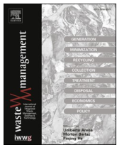
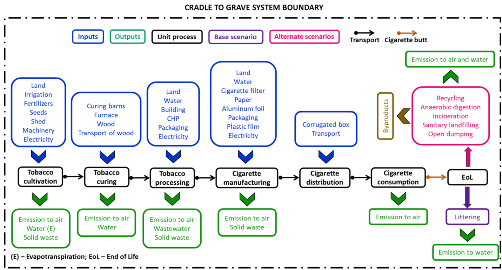
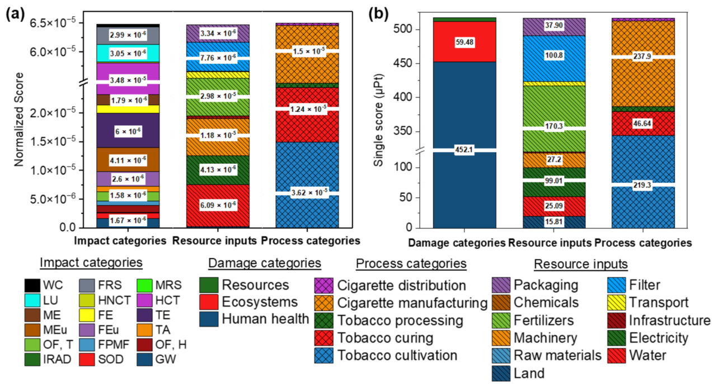
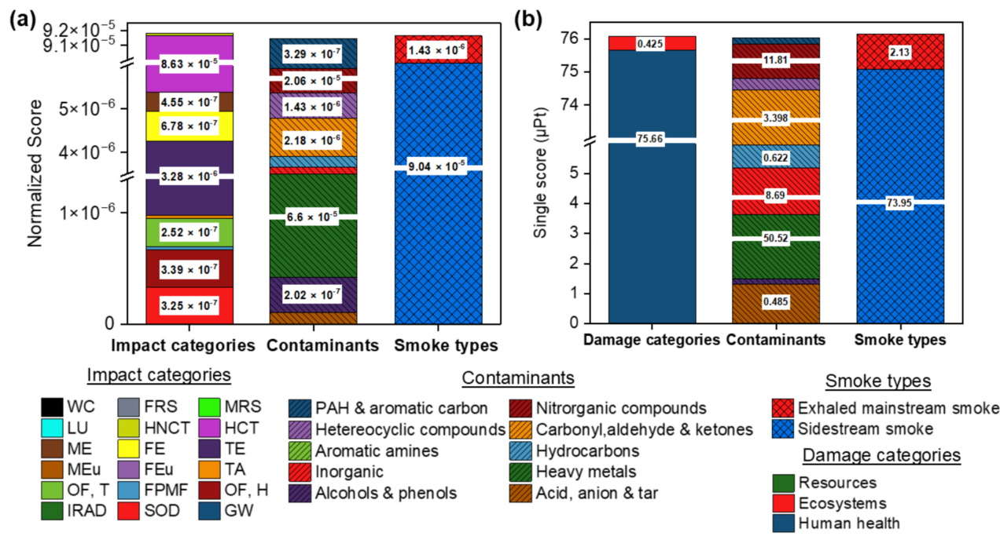
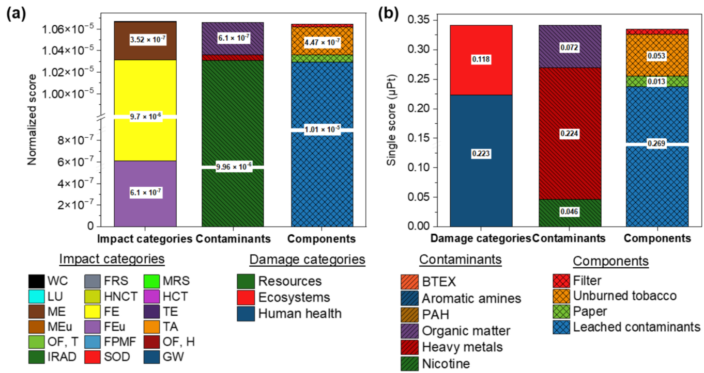
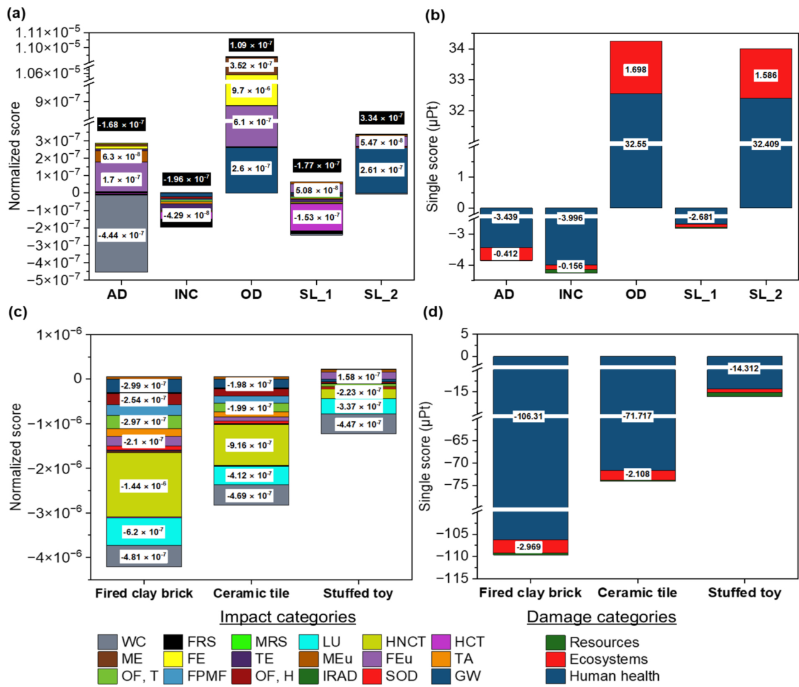
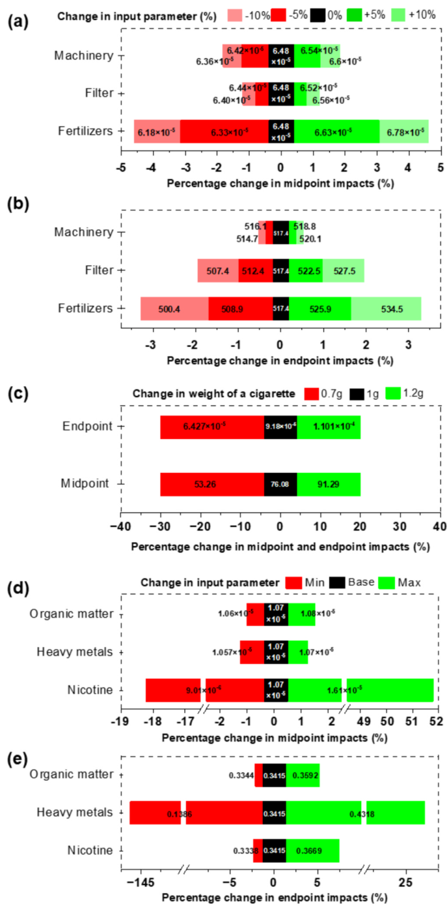

<!-- Page 0 | source: demo_cb0573d9_page_0.md | kind: md -->

Contents lists available at ScienceDirect

Waste Management

journal homepage: www.elsevier.com/locate/wasman

Research Paper

# Cradle to grave environmental analysis of cigarettes with emphasis on end-of-life management

Lourembam Nongdren, Naseeba Parveen, Kumar Raja Vanapalli*

Civil Engineering Department, National Institute of Technology Mizoram, Aizawl, Mizoram 796012, India

## ARTICLE INFO

### Keywords:

Life cycle assessment
Cigarette Butts
Scenario analysis
Waste management
End-of-life methods

## ABSTRACT

The study presents a comprehensive cradle-to-grave life cycle assessment (LCA) quantifying the environmental impacts across production, consumption, and end-of-life (EoL) phases of a cigarette's life cycle. Emphasis was given to the EoL phase, where the relative performance of littering, open dumping, landfilling, incineration, anaerobic digestion, and recycling was evaluated. The upstream phase was found to be a major contributor to impacts, with fertilizer application and wood-fired tobacco curing dominating human carcinogenic toxicity. The consumption phase emerged as the highest contributor to human health impacts, driven almost entirely by sidestream smoke emissions. In the downstream phase, littered cigarette butts (CBs) were identified as key drivers of freshwater ecotoxicity and eutrophication potential, primarily due to nicotine and other leached contaminants. Comparative scenario modelling revealed that incineration, anaerobic digestion, and sanitary landfilling with gas and leachate capture can yield net environmental credits through energy recovery, while open dumping and landfilling without gas collection retained >90% of the littering impact and resulted in net burdens at the endpoint level. Recycling CBs into fired clay bricks and ceramic tiles delivered the greatest reductions in life cycle impacts, while replacing conventional cellulose acetate filters with ≥90% flax/jute/hemp-based biodegradable alternatives achieved 31–62% reduction in the midpoint impacts. Collectively, the findings identify consumption and upstream processes as environmental hotspots. The findings highlight the environmental benefits of energy-recovering and recycling-based EoL strategies and provide evidence to support sustainable product redesign and targeted policy interventions aimed at mitigating the human health and ecological burdens of the cigarette industry.

## 1. Introduction

Cigarettes, the most prevalent form of tobacco consumption (≈72%) account for an estimated global production of 6 trillion units annually (WHO, 2024; WHO FCTC, 2022). Beyond the well-documented health effects of smoking, the cigarette industry exerts profound environmental pressures which has received far less attention (Food and Agriculture

Organization of the United Nations, 2025; Reitsma et al., 2021; Novotny et al., 2015). The cigarette industry drives an integrated transnational market through multi-faceted supply chains spanning several sectors including tobacco cultivation, primary and secondary processing, industrial-scale manufacturing, logistics, and global distribution (Hiscock and Bloomfield, 2021). Subject to the resource and energy intensity of these processes, they collectively impose substantial

Abbreviations: AD, Anaerobic Digestion; BF, Biodegradable Filter; BTEX, Benzene, Toluene, Ethylbenzene, Xylenes; CA, Cellulose Acetate; CB, Cigarette Butt; CBs, Cigarette Butts; CTRI, Central Tobacco Research Institute; DALY, Disability-Adjusted Life Year; DOC, Dissolved Organic Carbon; EoL, End-of-Life; FAO, Food and Agriculture Organization; FCV, Flue-Cured Virginia; FE, Freshwater Ecotoxicity; FEu, Freshwater Eutrophication; FPMF, Fine Particulate Matter Formation; FRS, Fossil Resource Scarcity; GW, Global Warming; HCT, Human Carcinogenic Toxicity; HMs, Heavy Metals; HNCT, Human Noncarcinogenic Toxicity; INC, Incineration; IRAD, Ionizing Radiation; ISO, International Organization for Standardization; ITC, India Tobacco Company; LCA, Life Cycle Assessment; LCI, Life Cycle Inventory; LU, Land Use; MAP, Monoammonium Phosphate; ME, Marine Ecotoxicity; MEu, Marine Eutrophication; MRS, Mineral Resource Scarcity; NOx, Nitrogen Oxides; OD, Open Dumping; OF, H, Ozone Formation, Human Health; OF, T, Ozone Formation, Terrestrial Ecosystems; PAH, Polycyclic Aromatic Hydrocarbon; PET, Polyethylene Terephthalate; PP, Polypropylene; SDG, Sustainable Development Goals; SL_1, Sanitary Landfilling with Gas and Leachate Collection; SL_2, Sanitary Landfilling with Only Leachate Collection; SOD, Stratospheric Ozone Depletion; TA, Terrestrial Acidification; TE, Terrestrial Ecotoxicity; USEPA, United States Environmental Protection Agency; VOC, Volatile Organic Compound; WC, Water Consumption.

* Corresponding author.
E-mail address: kumar.ce@nitmz.ac.in (K.R. Vanapalli).

https://doi.org/10.1016/j.wasman.2026.115553

Received 26 October 2025; Received in revised form 15 February 2026; Accepted 21 April 2026

Available online 25 April 2026

0956-053X/© 2026 Elsevier Ltd. All rights are reserved, including those for text and data mining, AI training, and similar technologies.---

<!-- Page 1 | source: demo_cb0573d9_page_1.md | kind: md -->

environmental burdens across the cigarette's supply chain. Moreover, cigarette smoking itself contributes to environmental impacts from the release of hazardous atmospheric contaminants thereby contributing to indoor and outdoor air pollution (Wallace, 2024).

In recent years, the environmental implications of cigarette butt (CB) have received significant attention. CBs are one of the most frequently littered items globally with an estimated 4.5 trillion discarded annually (Vanapalli et al., 2023; Torkashvand et al., 2020). CBs are composed primarily of cellulose acetate (CA)-based filters. Studies have demonstrated that CA filters can act as a source of persistent microplastics (Belzagui et al., 2021) and vectors for toxic chemical leachates including heavy metals (HMs), nicotine, polycyclic aromatic hydrocarbons (PAHs), and other carcinogenic compounds (Acarer Arat, 2024). These contaminants can enter terrestrial and aquatic environments and can pose threats to microbial processes, soil health, and various organisms (Koroleva et al., 2021). For instance, the toxic effects of CBs exposure to various biota including marine and freshwater fish (Slaughter et al., 2011), tidepool snails (Booth et al., 2015), soil snails (Gill et al., 2018), female mice (Cardoso et al., 2018), red onions (Allium cepa) (Montalvão et al., 2019) were reported by ecotoxicological studies. However, most of this research is often focused on isolated toxicity endpoints to different organisms without fully integrating impacts into broader environmental or lifecycle contexts.

Despite growing environmental concerns, systematic and comprehensive evaluations of environmental impacts across the full cigarette lifecycle remain scarce. Life cycle assessment (LCA) is a widely recognized methodology for assessing the environmental impacts of products and processes. Previous cigarette industry-related LCAs have concentrated primarily on the production phase, with minimal attention to the consumption and end-of-life (EoL) stages. For instance, Cao et al. (2023) analyzed the carbon footprint of cigar production at the factory level (gate-to-gate). In another LCA study, Zafeiridou et al. (2018) excluded several key contaminants emitted during smoking and landfill disposal. Recently expanding the scope of research in the EoL stage, some studies have evaluated the environmental performance of recycling and valorization strategies, such as converting cigarette butts (CBs) into hydrogen (Mahmud et al., 2026) or incorporating them into gypsum-based construction materials (Cavagnoli et al., 2024). However, these studies consider CBs as waste and have not integrated the full cradle-to-grave life cycle of the cigarettes, thereby neglecting the influence of upstream phases on the overall impact. Moreover, they have only evaluated a single valorization pathway without consideration for other EoL scenarios.

While Chen et al. (2026) have considered a comprehensive approach considering all the phases of the cigarettes life cycle through a cradle-to-grave LCA, the study considered organized waste treatment (primarily incineration) as the baseline disposal pathway. This assumption while reflective of the region-specific waste management practices, may not effectively capture the widespread reality of CB littering, which is the most common EoL pathway globally (Vanapalli et al., 2023). Further, the downstream phase was represented primarily through aggregated inventory flows and impact categories and did not explicitly examine the role of key contaminants associated with cigarette smoking and CB leaching. Consequently, the EoL stage characterized by intricate behavioural, infrastructural, and environmental dynamics that critically shape the disposal pathways and fate of CBs remains largely unexplored within a comprehensive LCA framework.

To address these gaps, the present study implemented a cradle-to-grave LCA to quantify the cumulative environmental impacts of a cigarette across three phases of its life cycle: production, consumption, and EoL (with littering considered as the base scenario). The impacts captured across multiple impact categories were classified across resource inputs, contaminants, and processes to identify the critical environmental hotspots. Based on the identified hotspots, scenario analyses for alternate EoL strategies and cigarette filter materials were carried out to determine their relative environmental performance.

Further, sensitivity and uncertainty analyses were conducted to determine the respective effects of variability and uncertainty of the model input parameters on overall impacts. The findings from this study offer valuable insights for mitigating the environmental impacts across the cigarette life cycle.

## 2. Methodology

### 2.1. Goal and scope definition

The goal of the study was to analyze the environmental impacts of a cigarette across its lifecycle through a cradle-to-grave LCA. The system boundary included three phases of the cigarette life cycle: i) upstream, ii) consumption, and iii) downstream. The upstream phase included the cigarette production stages covering a) tobacco cultivation, b) curing, c) processing, d) manufacturing, and e) distribution. The consumption phase considered the atmospheric emissions associated with cigarette smoking (Fig. 1). In the downstream phase, littering of smoked CB (to terrestrial and aquatic environments) was taken as the base scenario as it is the most prevalent EoL path for CBs globally (Vanapalli et al., 2023). All resource inputs and emissions associated with each phase were included. Transportation of products/materials between phases was accounted for and material recovery options across different EoL scenarios of CBs were modeled in the EoL phase to reflect potential waste valorization strategies. The functional unit (FU) was defined as 1 g of Flue-Cured Virginia (FCV) cigarette production and consumption. The geographical scope of this analysis was limited to India.

### 2.2. Life cycle inventory

The Life cycle inventory (LCI) compiles data about the material inputs, energy usage, outputs, and emissions involved in various phases of the cigarette life cycle (Table 1). Due to the absence of industrial data concerning the cigarette lifecycle, the study relied on secondary data sources and existing literature, such as the Tobacco Board Annual Report 2023–24 (Ministry of Commerce & Industry, 2025), Central Tobacco Research Institute (CTRI) (Indian Council of Agricultural Research, 2025), United Nations Food and Agriculture Organization (FAO) (Food and Agriculture Organization of the United Nations, 2025), India Tobacco Company (ITC) Limited (ITC, 2025), various government publications and reports, and peer-reviewed journal articles (Gadaleta et al., 2023; Soleimani et al., 2022). This data was used to develop LCA models. The background information was sourced from the EcoInvent v3.10 database (Table S1, in supplementary information). The detailed LCI of the consumption phase and other disposal methods in the life cycle of cigarettes are provided in Table S2, S3, S4 and S5. Due to the absence of complete and region-specific data, necessary assumptions were made for preparing LCI, which are detailed in the supporting information.

### 2.3. Life cycle impact assessment

The LCA was conducted using the ReCiPe 2016 (H) method in SimaPro v9.5 PhD software to evaluate the environmental impacts at both the midpoint and endpoint levels (PRé Sustainability, 2023). According to the ReCiPe methodology, environmental impacts are evaluated along a cause-effect chain at two levels: midpoint and endpoint. Midpoint impacts represent specific environmental changes occurring at an intermediate stage of the environmental mechanism, such as climate change, eutrophication, or ecotoxicity. These help in isolating product/ process level hotspots along with environmental trade-offs. Subsequently, these midpoint impacts are aggregated into broader endpoint categories: human health, ecosystems, and resource scarcity. These impacts serve as simpler, more accessible sustainability metrics for broader decision-making purposes. Table S6 provides a detailed list of these categories and their units. The midpoint and endpoint impacts---

<!-- Page 2 | source: demo_cb0573d9_page_2.md | kind: md -->

Fig. 1. System boundary for the life cycle assessment of cigarettes.

depicted as independent characterization values were aggregated into normalized as well as single-point scores. Based on these normalized results, the most significant impact categories along with the key phases, processes, components, and contaminants were identified.

## 2.4. Scenario analysis – EoL pathways for CBs and filter alternatives

Scenario analysis was used to evaluate the relative environmental performance of different EoL pathways for smoked CBs as compared to the base scenario, i.e., littering. Further, considering the recalcitrant nature of CA-based filters and the resource-intensity of production technique, the relative environmental performance of filters produced from alternate natural and biodegradable fibers was also analyzed.

Based on the most common waste management techniques adopted for municipal solid waste, the following alternate EoL scenarios were modeled for CBs: i) anaerobic digestion (AD), ii) incineration (INC), iii) open dumping (OD), iv) sanitary landfilling with gas and leachate collection (SL_1), v) sanitary landfilling with only leachate collection (SL_2), and vi) various recycling and valorization strategies. Here, the base scenario (littering) considered smoked CBs discarded on streets, in open sewers, aquatic bodies, or flushed down toilets (Nongdren et al., 2024). In this scenario, the potential of littered CBs to contribute to water pollution was assessed by considering both the leaching of contaminants retained in the filter and the release of dissolved organic carbon (DOC) resulting from CA degradation. Atmospheric emissions or secondary reactions during this degradation were exempted from the model considering the uncertainties associated. On the other hand, OD represents accumulation of CBs at unmanaged sites. Therefore, in the OD model both leaching of trapped contaminants from the filter similar to that of base scenario as well as the atmospheric emissions from potential degradation of CA filter under anaerobic conditions were considered (Gadaleta et al., 2023). In AD, the nutrient-rich digestate generated as a by-product is assumed to undergo composting. Further, the recycling and waste valorization scenarios for smoked CBs were based on previous studies where CB was used to partially substitute conventional materials in i) fire clay bricks, ii) ceramic tiles, and iii) stuffed toys. These

scenarios were modeled by substituting a quantity of conventional material equivalent to a single CB.

The biodegradable fibers (BFs) used as alternative for CA filter were hemp, flax, cotton, and jute in different combinations bound together with carboxymethyl cellulose polymer used as water-soluble biodegradable binding agent (Lisauskas et al., 2022). The combinations selected were BF_1: biodegradable filter with 75% flax + 25% cotton, BF_2: biodegradable filter with 90% flax + 10% cotton, BF_3: biodegradable filter with 75% hemp + 25% cotton, BF_4: biodegradable filter with 90% hemp + 10% cotton, BF_5: biodegradable filter with 75% jute + 25% cotton, and BF_6: biodegradable filter with 90% jute + 10% cotton. The environmental performance of these BFs was compared to that of the conventional CA-based filters and their influence on the overall environmental performance of the upstream phase was analyzed.

## 2.5. Sensitivity and uncertainty analysis

Sensitivity analysis was conducted to evaluate the influence of modeling assumptions and data uncertainties on key impact categories. In the upstream phase, the three most influencing factors of identified hotspots were individually varied by ±5% and ±10% to evaluate their impact on the overall environmental outcome. In the consumption phase the effect of variation in the weight of cigarettes (0.7 to 1.2 g) based on the available sizes in market was considered. For the downstream littering phase, the sensitivity analysis focused on evaluating the effect of variations (minimum and maximum values) in the leaching concentrations of identified hotspot contaminants. Further, an uncertainty analysis was conducted using Monte Carlo simulations (10,000 simulations) with a 95% confidence interval in SimaPro software using the ReCiPe 2016 midpoint (H) method.

# 3. Results and discussion

## 3.1. Upstream phase

In the upstream phase, HCT was identified as the main hotspot---

<!-- Page 3 | source: demo_cb0573d9_page_3.md | kind: md -->

**Table 1**
Life cycle inventory data for cigarettes.

<table><thead><tr><th>Life cycle phase</th><th>Process</th><th>Input/output</th><th>Unit</th><th>Value</th></tr></thead><tbody><tr><td rowspan="25">Upstream</td><td rowspan="25">Tobacco cultivation</td><td>Land for cultivation (input)</td><td>ha</td><td>4.996 × 10-07</td></tr><tr><td>Land for nursery beds (input)</td><td>m2</td><td>43.91 × 10-06</td></tr><tr><td>Tobacco seeds (input)</td><td>kg</td><td>36.16 × 10-10</td></tr><tr><td>Trays (input)</td><td>kg</td><td>5.644 × 10-06</td></tr><tr><td>Seedlings irrigation (input)</td><td>m3</td><td>1.764 × 10-06</td></tr><tr><td>Tobacco irrigation (input)</td><td>tonne</td><td>2.498 × 10-03</td></tr><tr><td>Greenhouse energy for seedlings (input)</td><td>MJ</td><td>6.013 × 10-06</td></tr><tr><td>Sheds (input)</td><td>m2</td><td>8.4 × 10-13</td></tr><tr><td>Agricultural machinery (input)</td><td>tonne</td><td>2.24 × 10-10</td></tr><tr><td>Green manure (input)</td><td>ha</td><td>3.153 × 10-06</td></tr><tr><td>Cocopeat for tray nursery (input)</td><td>kg</td><td>3.979 × 10-06</td></tr><tr><td>Inorganic nitrogen fertilizer (ammonium sulphate) (input)</td><td>kg</td><td>149.9 × 10-06</td></tr><tr><td>Inorganic potassium fertilizer (potash salt) (input)</td><td>kg</td><td>119.9 × 10-06</td></tr><tr><td>Inorganic phosphorus fertilizer (single superphosphate) (input)</td><td>kg</td><td>124.9 × 10-06</td></tr><tr><td>Pesticide (input)</td><td>kg</td><td>1.4 × 10-10</td></tr><tr><td>Dodecanol suckericide (input)</td><td>kg</td><td>6.228 × 10-07</td></tr><tr><td>Tillage and harrowing (input)</td><td>ha</td><td>0.0693 × 10-06</td></tr><tr><td>Transport of harvest (input)</td><td>tkm</td><td>7 × 10-06</td></tr><tr><td>Solid waste (output)</td><td>tonne</td><td>0.42 × 10-06</td></tr><tr><td>Water loss (evapotranspiration) (output)</td><td>tonne</td><td>749.5 × 10-06</td></tr><tr><td>CO2 emission (output)</td><td>tonne</td><td>0.451 × 10-06</td></tr><tr><td rowspan="8">Tobacco curing</td><td>Wood (feedstock) (input)</td><td>tonne</td><td>3.15 × 10-06</td></tr><tr><td>Curing barn (input)</td><td>m2</td><td>9.117 × 10-08</td></tr><tr><td>Furnace (input)</td><td>p</td><td>13.62 × 10-08</td></tr><tr><td>Transport of wood logs (input)</td><td>tkm</td><td>31.5 × 10-06</td></tr><tr><td>Transport of cured tobacco to processing facilities (input)</td><td>tkm</td><td>42 × 10-05</td></tr><tr><td>Water loss (output)</td><td>tonne</td><td>0.28 × 10-05</td></tr><tr><td>CO2 emission (output)</td><td>tonne</td><td>9.646 × 10-07</td></tr><tr><td>Solid waste from shed construction (output)</td><td>tonne</td><td>5.88 × 10-08</td></tr><tr><td rowspan="5">Tobacco processing</td><td>Transportation from processing to storage (input)</td><td>tkm</td><td>1.26 × 10-07</td></tr><tr><td>Energy for storage (input)</td><td>MJ</td><td>1.841 × 10-04</td></tr><tr><td>Land (input)</td><td>m2</td><td>8.632 × 10-06</td></tr><tr><td>Water (input)</td><td>tonne</td><td>5.313 × 10-06</td></tr></tbody></table>

**Table 1 (continued)**

<table><thead><tr><th>Life cycle phase</th><th>Process</th><th>Input/output</th><th>Unit</th><th>Value</th></tr></thead><tbody><tr><td rowspan="25">Upstream</td><td rowspan="25">Tobacco cultivation</td><td>Heat & Power cogenerating unit (input)</td><td>p</td><td>1.89 × 10-11</td></tr><tr><td>Energy for tobacco processing (input)</td><td>MJ</td><td>9.66 × 10-06</td></tr><tr><td>Storage building (input)</td><td>m3</td><td>2.8 × 10-08</td></tr><tr><td>Corrugated cardboard boxes for shipping (input)</td><td>tonne</td><td>1.05 × 10-08</td></tr><tr><td>Shipping by road (input)</td><td>tkm</td><td>6.3 × 10-04</td></tr><tr><td>CO2 emission (output)</td><td>tonne</td><td>12.53 × 10-08</td></tr><tr><td>Waste water (output)</td><td>tonne</td><td>5.325 × 10-06</td></tr><tr><td>Tobacco waste (output)</td><td>tonne</td><td>5.88 × 10-08</td></tr><tr><td>Solid waste (output)</td><td>tonne</td><td>1.062 × 10-07</td></tr><tr><td>Land for manufacturing plant and buildings (input)</td><td>m2</td><td>5.27 × 10-07</td></tr><tr><td>Water (input)</td><td>tonne</td><td>2.59 × 10-06</td></tr><tr><td>Cellulose acetate / filter (input)</td><td>tonne</td><td>1.7 × 10-07</td></tr><tr><td>Energy (input)</td><td>GJ</td><td>5.2 × 10-06</td></tr><tr><td>Cigarette paper and tipping paper (input)</td><td>tonne</td><td>8 × 10-08</td></tr><tr><td>Cigarette plug wrap (input)</td><td>tonne</td><td>4 × 10-08</td></tr><tr><td>Cigarette carton (input)</td><td>tonne</td><td>1.21 × 10-08</td></tr><tr><td>Cellophane (input)</td><td>tonne</td><td>7.84 × 10-08</td></tr><tr><td>Cigarette packs (input)</td><td>tonne</td><td>2.06 × 10-07</td></tr><tr><td>Aluminium foil (input)</td><td>tonne</td><td>26.86 × 10-09</td></tr><tr><td>CO2 emission (output)</td><td>tonne</td><td>3.4 × 10-07</td></tr><tr><td>Non-hazardous waste, landfill (output)</td><td>tonne</td><td>2.52 × 10-10</td></tr><tr><td>Non-hazardous waste, recovery (output)</td><td>tonne</td><td>18.39 × 10-08</td></tr><tr><td>Non-hazardous waste, incineration (output)</td><td>tonne</td><td>9.9 × 10-11</td></tr><tr><td>Hazardous waste, landfill (output)</td><td>tonne</td><td>8.1 × 10-11</td></tr><tr><td>Hazardous waste, recovery (output)</td><td>tonne</td><td>5.54 × 10-09</td></tr><tr><td>Hazardous waste, incineration (output)</td><td>tonne</td><td>1.46 × 10-10</td></tr><tr><td>Freight transport (input)</td><td>tkm</td><td>1 × 10-03</td></tr><tr><td>Corrugated board (input)</td><td>tonne</td><td>2.43 × 10-08</td></tr><tr><td rowspan="10">Tobacco curing</td><td rowspan="10">Tobacco curing</td><td>Emissions to air</td><td></td><td></td></tr><tr><td>Heavy metals (output)</td><td>µg</td><td>1.81 × 1002</td></tr><tr><td>PAHs and aromatic hydrocarbons (output)</td><td>µg</td><td>2.077 × 1003</td></tr><tr><td>Nitrorganic compounds (output)</td><td>µg</td><td>136.1</td></tr><tr><td>Aromatic amines (output)</td><td>µg</td><td>3.305</td></tr><tr><td>Hydrocarbons (output)</td><td>µg</td><td>3.793 × 1003</td></tr><tr><td>Carbonyl compounds, aldehydes and ketones (output)</td><td>µg</td><td>3.063 × 1003</td></tr><tr><td>Alcohols and phenols (output)</td><td>µg</td><td>966.9</td></tr><tr><td>Consumption</td><td>Cigarette smoking/use</td><td></td><td></td><td></td></tr></tbody></table>

(continued on next page)---

<!-- Page 4 | source: demo_cb0573d9_page_4.md | kind: md -->

**Table 1 (continued)**

<table><thead><tr><th>Life cycle phase</th><th>Process</th><th>Input/output</th><th>Unit</th><th>Value</th></tr></thead><tbody><tr><td rowspan="12">Downstream</td><td rowspan="12">Littering</td><td>Heterocyclic compounds (output)</td><td>µg</td><td>1.998 × 1003</td></tr><tr><td>Inorganic (output)</td><td>µg</td><td>5.518 × 1004</td></tr><tr><td>Acids, anions and tar (output)</td><td>µg</td><td>1.977 × 1004</td></tr><tr><td>Emissions to water</td><td></td><td></td></tr><tr><td>Nicotine (output)</td><td>µg</td><td>2.095 × 1003</td></tr><tr><td>Heavy metals (output)</td><td>µg</td><td>23.63</td></tr><tr><td>PAHs (output)</td><td>µg</td><td>4.301 × 10-02</td></tr><tr><td>BTEX (output)</td><td>µg</td><td>1.203 × 10-02</td></tr><tr><td>Aromatic amines (output)</td><td>µg</td><td>9.373 × 10-03</td></tr><tr><td>Dissolved Organic Carbon (DOC) (output)</td><td>mg</td><td>6.78</td></tr><tr><td>Paper waste (output)</td><td>g</td><td>0.01</td></tr><tr><td>Unburned tobacco waste (output)</td><td>g</td><td>0.04</td></tr></tbody></table>

among the midpoint environmental impact categories. It contributed 53.74% of the total upstream midpoint impacts (Fig. 2a, Table S8). Further, the impact categories of TE (9.25%), MEu (6.35%), LU (4.69%), and FRS (4.62%) represented significant contributions to the upstream impacts. The key resource inputs were the extensive use of fertilizers (46.17%) during tobacco cultivation, wood furnace operations used in tobacco curing (18.14%), and the use of CA filters in cigarette manufacturing (12.02%). Consequently, tobacco cultivation depicted the highest proportion of midpoint impacts (55.84%) among the process categories, followed by cigarette manufacturing (23.16%) and tobacco curing (19.18%). Cao et al. (2023) also reported HCT as the key contributor to the midpoint impacts, along with FE, ME, TE and FEu contributing significantly. These impacts were mainly attributed by the study to electricity, water usage and packaging materials. Consistent with the same, in the current study, several material and energy input flows such as water (9.44%), electricity (6.4%), and packaging (5.17%) across various processes, yielded minimal yet significant contributions

to the upstream phase midpoint impacts.

The tobacco cultivation phase was majorly characterized by intensive use of chemical fertilizers and pesticides, making it the largest contributing process in the upstream phase. The intensive use of nitrogen, phosphorus, and potassium fertilizers in tobacco cultivation and their potential to cause soil degradation, eutrophication, and toxic runoff in surrounding ecosystems could be attributed to this result (Mankong et al., 2024; Lencucha et al., 2022). Nitrogen fertilizers contribute significantly to nitrous oxide emissions, a potent greenhouse gas that drives climate change (Menegat et al., 2022). The dominant impact of chemical fertilizers in tobacco and related crops is consistent with findings from previous LCA studies (Shulner et al., 2025; Wu et al., 2025; Longo et al., 2017). Therefore, adopting sustainable agricultural practices such as integrated nutrient management, pest management strategies, shifting to organic farming, and implementation of sustainable water sourcing can reduce resource use and improve long-term ecological sustainability (Paramesh et al., 2023; Jiang et al., 2022; Reddy et al., 2017; Ahmad et al., 2014).

A previous study on tomato farming demonstrated a 35.04% reduction in the environmental impacts by adopting organic fertilizers and sustainable farming techniques (Kumar et al., 2024). Similarly, in carrot cultivation, substituting chemical fertilizers with organic manure reduced impacts by 12–76% across various environmental impact categories (Kowalczyk and Cupiał, 2020). While a complete reliance on organic methods may sound economically unfeasible (Reddy et al., 2009), blending organic methods with advanced agricultural technologies can enhance sustainability. Further, improving water-use efficiency through drip irrigation can significantly reduce evaporation losses (Reddy et al., 2022; Kumaresan et al., 2013). Socioeconomic and practical considerations in India contribute to the continued heavy reliance on chemical fertilizers and fuelwood (Ghosh, 2004). Limited access to affordable alternatives, gaps in farmer education and extension services, and yield-driven economic incentives often hinder the adoption of sustainable practices (Den Herder et al., 2025; Ashrit and Thakur, 2021; Piñeiro et al., 2020). Addressing these requires coordinated policy interventions, including subsidies for sustainable agriculture inputs, energy transition support, and capacity building among farmers.

The environmental impacts in the tobacco curing phase were majorly contributed by the use of wood furnace for tobacco curing, reflecting the

**Fig. 2.** Upstream cigarette production phase (a) midpoint indicators and (b) endpoint indicators of life cycle impacts.---

<!-- Page 5 | source: demo_cb0573d9_page_5.md | kind: md -->

predominance of traditional curing methods in India (Kar, 2017). These environmental impacts could be associated with the demand for a huge quantity of fuelwood (4.5 tonnes per tonne of tobacco) as feedstock for wood furnace operation. It has been reported that the demand for fuelwood for tobacco curing was responsible for 15% and 26% of the deforestation within the Miomba ecoregion of Zimbabwe and Malawi, respectively (Jimu et al., 2017). Moreover, combustion of fuelwood releases GHGs such as $CO_2$ (1590 $g kg^{-1}$), as well as particulate matters (PMs) (17.3 $g kg^{-1}$) and volatile organic compounds (VOCs) (114.5 $g kg^{-1}$) (CPCB, 2025; Lai et al., 2024; Bhattacharya et al., 2002). Therefore, adopting energy-efficient curing techniques such as solar-assisted or other renewable systems, and transitioning to cleaner fuels such as biomass briquettes or alcohols, can improve sustainability (Zhu et al., 2025; Ren et al., 2023). Further, optimized kiln designs with improved efficiencies could be a promising intervention to mitigate these emissions and resource demands (Nayak, 2013). For instance, implementation of solar thermal interventions reduces fuelwood consumption by up to 33% and increases overall system efficiency by $\approx$40% (Ministry of Commerce & Industry, 2025; Bortolini et al., 2019). Furthermore, transitioning to biomass-based fuels decreases the GHG emissions by 90% relative to coal (Ren et al., 2025). Similarly, integrating a venturi furnace with barn insulation improves the quality of cured tobacco leaves and decreases fuel consumption by 15–20% (Ministry of Commerce & Industry, 2025; Food and Agriculture Organization of the United Nations, 2010).

Among the cigarette manufacturing phase, the use of the CA filter was identified as the major hotspot. CA is a biopolymer that is conventionally produced through a multi-step chemical reaction process called acetylation. It involves reacting cellulose with acetic anhydride in the presence of an acid catalyst (Liu et al., 2025). This process results in the final product of CA tow, which is used as the raw material for cigarette filter. The environmental impacts of CA production are mainly linked to the use of acetic acid in the acetylation process and the cellulose feedstock (Fathi et al., 2024). Therefore, exploring alternate materials for filter production prominently sourced from renewable and natural feedstocks presents a potential pathway to reduce this material's environmental impact (Vanapalli et al., 2023). For instance, studies have detailed the potential for using alternate filter materials such as food-starch-based polymer, organic cotton, hemp fiber, flax fiber, and

jute fiber, and reported improved biodegradability of these filters (Lisauskas et al., 2022; Kubica, 1996). However, it is vital to consider the trade-offs involved, including the water and land use intensities of these alternative crops, which demand further research for a fully optimized solution.

For the endpoint level impacts of the upstream phase, damage to human health was the predominant impact category, followed by ecosystem and resources (Fig. 2b, Table S8). This was principally attributed to fertilizer application during tobacco cultivation, CA filter use in cigarette manufacture, and electricity consumption across various processes. These results are consistent with the observations of midpoint impacts. However, in contrast to the midpoint impacts, the contribution of the process categories to the endpoint impacts followed the order of cigarette manufacturing > tobacco cultivation > tobacco curing. The differences in contributions of resource inputs and process categories between midpoint and endpoint impacts arise from the weightings used in translating impacts. Midpoint results are scaled by damage factors that account for fate, exposure, effect, and severity on human health, ecosystem quality, and resource scarcity (Huijbregts et al., 2017).

## 3.2. Consumption phase

During the cigarette consumption phase, HCT (93.97%) was identified as the most critical midpoint environmental impact category, followed by TE (3.57%) and FE (0.74%) (Fig. 3a, Table S8). The HCT was quantified to be $8.89 \times 10^{-04}$ kg 1,4-DCB eq. This can be primarily attributed to the atmospheric emissions from organic and inorganic contaminants released through mainstream and sidestream smoking. Considering the midpoint impacts, the HMs (71.89%) followed by nitro-organic compounds (22.45%) were identified as the primary contributors to the overall environmental impacts (Fig. 3a, b, Table S8). Especially, high concentrations of cadmium, chromium, nickel, lead, mercury, copper, arsenic, zinc and manganese present in the cigarette smoke were responsible for a major portion of these impacts (Ashraf, 2012). Previous epidemiological studies on various model organisms such as mice, hamsters, rats, dogs, and rabbits depicted the potential carcinogenic impacts of these organic and inorganic contaminants released from cigarette smoking on human health (Coggins, 2007; Finch et al., 1996; Cross et al., 1982; Wehner et al., 1981; Kozlowski et al.,

Fig. 3. Cigarette consumption phase (a) midpoint indicators and (b) endpoint indicators.---

<!-- Page 6 | source: demo_cb0573d9_page_6.md | kind: md -->

1963). The sidestream smoke carries higher concentrations of toxic contaminants and therefore, it contributed a higher proportion to the impacts as compared to the mainstream smoke. Soleimani et al. (2022) observed HMs concentration 100 to 300 times higher in the sidestream smoke than in the mainstream smoke, with cadmium, chromium, and lead showing the highest emission level.

The analysis quantified the TE and FE potential impact as $4.98 \times 10^{-02}$ kg 1,4-DCBeq. and $1.71 \times 10^{-05}$ kg 1,4-DCBeq. respectively. Ecotoxicity impacts from cigarette smoking were mainly caused by atmospheric deposition of HMs and heterocyclic compounds, which can travel long distances before depositing on land and in water bodies (Ogwu et al., 2024). Many of the contaminants in cigarette smoke (Table 1), such as certain HMs, PAHs, and hydrocarbons, have the ability to bioaccumulate within the organisms and bio-magnify at higher trophic levels (Chormare and Kumar, 2022). Further, a previous study noted that the FE resulting from consuming a cigarette is equivalent to the impact generated during the manufacturing of 2.85 L of paracetamol syrups (Sharma et al., 2022).

After FE and TE, ozone formation (OF) was the next significant impact, caused by the emissions of nitrogen oxides (NOx) and VOCs (Ma et al., 2025; Nguyen et al., 2022). A single cigarette has a ground-level OF potential of $1.14 \times 10^{-5}$ kg of NOx. This is equivalent to driving a China 6 vehicle for 29 km using CNG fuel (Lv et al., 2023). Further, the same level OF impact is comparable to burning 2.976 g of rice straw (Zhang et al., 2013), 3.393 g of corn residue, 3,825 g of cotton residue, 5.616 g of sugarcane residue (Wu et al., 2020). It is also equivalent to the OF that may arise while producing 3.904 g of ordinary Portland cement (Olagunju et al., 2021) and 293.7 kg potash fertilizer (Chen et al., 2018). Similarly, open burning of 1 kg of municipal solid waste within a dense core urban area results in the same OF potential produced by smoking 5,877 cigarettes (Ramadan et al., 2022) (Fig. S1, in supplementary information).

The SOD from cigarette consumption can be attributed to the hydrocarbons in smoke, such as chloromethane and 1,2-dibromoethane, which are recognized as ozone-depleting substances. The SOD associated with the entire life cycle of a typical European Union (EU) 2005 model refrigerator corresponds to the SOD resulting from the consumption of 11 cigarettes (Durand et al., 2024). Similarly, the production of 1 m$^3$ of concrete (cement: aggregate: water ratio of 1:7:0.45) generates an SOD impact equivalent to smoking 4,507 cigarettes (Monteiro et al., 2021).

Considering the hotspot in midpoint impact category, the HCT associated with the consumption of a single cigarette was compared to that of few other products, including recycled plastics, fertilizers and pharmaceuticals as reported by previous studies (Table S7). For instance, the HCT of cigarette smoking was found to be equivalent to that of production of 35 pharmaceutical paracetamol tablets (Sharma et al., 2022). Since the average number of cigarettes smoked per smoker per day is approximately 6 to 7 in India (median closer to 5), and the global range is 10 to 14 cigarettes daily (Das et al., 2023; Ritchie and Roser, 2023), the total HCT impact could be several times higher than the value reported in the current study. However, it should be noted that the human health impacts calculated in this study do not include the direct health effects on individual smokers. The reported impacts therefore represent indirect effects arising from environmental emissions of smoking and are independent of the direct effects of smoking.

Further, the analysis of endpoint impacts revealed that the damage to human health was the highest impact category (99.44%), with two-thirds of this being contributed by the emissions of HMs. A critical finding was that sidestream smoke was responsible for $\approx 97.2\%$ of the total environmental impact compared to exhaled mainstream smoke (Fig. 3, Table S8), although the sidestream smoke was 85% of the total. This was due to the unfiltered and incomplete combustion of tobacco at the burning tip as opposed to the filtered smoke that the smoking individual exhales (National Research Council et al., 1986). Exhaled mainstream smoke is less potent as it undergoes partial filtration while

smoking and is subsequently diluted through the smoker's inhalation and exhalation process (Sahu et al., 2013).

The cancer risk corresponding to one cigarette consumption observed in the current study, expressed in disability-adjusted life years (DALY), was $4.54 \times 10^{-09}$. This value represents $\approx 0.14$ s of healthy life loss in total. When scaled to the global annual consumption of approximately 5.5 trillion cigarettes, this translates to an estimated $\sim 25,000$ DALYs per year. The smoking in the consumption phase was mostly from sidestream smoke and mainstream smoke exhaled after consumption ($\approx 15\%$) (assumption 14). Thus, the DALY observed here primarily reflects human health impacts of sidestream and partially diluted mainstream smoke emissions. The current LCA does not account for the direct health effects of smoking. Previous epidemiological studies have estimated cancer risks associated with cigarette consumption, particularly from mainstream smoking. A study reported 2.5 million deaths and 56.4 million DALYs from smoking-related cancers in 2019 (Safiri et al., 2022). This is equivalent to $1.25 \times 10^{-05}$ DALY per cigarette. Among all, lung, tracheal, and bronchial cancers contribute the most, accounting for approximately 1.3 million deaths and 28.6 million DALYs worldwide for total cigarette consumption (Sharma and Rakshit, 2022). Exposure to secondhand smoke was found to pose an estimated 85.5 DALYs per 100,000 exposed population and increasing lung cancer risk in non-smokers by 20–30% (Sharma and Rakshit, 2022). The discrepancy between the DALY estimate in this study and epidemiological data arises because LCA quantifies marginal health impacts from emissions associated with an FU, whereas population-based studies capture the cumulative burden of smoking, including lifetime exposure and multiple diseases.

### 3.3. Downstream phase

In the downstream phase, where littering of smoked CB was considered as the base scenario, FE (90.9%) was identified as the most significant midpoint impact category, followed by FEu (5.71%) and ME (3.29%). The FE from a single littered CB ($2.44 \times 10^{-04}$ kg 1,4-DCBeq) is equivalent to the toxicity generated by sanitary landfilling of 4.1 g of used surgical masks (Li et al., 2022) and open dumping of 2.22 g of plastic waste (Dos Muchangos et al., 2025). Specifically, the leaching of trapped contaminants from smoked CB was responsible for approximately 94% of the total midpoint impacts (Fig. 4a, Table S8).

The CBs act as non-point sources through the diffuse leaching of nutrients and the release of chemicals from the trapped filters (Parveen et al., 2024). The unburned tobacco residue of the CB was responsible for 4.19% of the midpoint impacts, with minimal contributions of paper ($\approx 1\%$) and filter component ($\approx 0.5\%$). At the endpoint level, leached contaminants accounted for nearly 79%, while the filter and other components of smoked CB together contributed less than 21% (Fig. 4b, Table S8). Among the leached contaminants, the primary driver of the ecotoxicological impacts was nicotine contributing 93.31% to the total impacts, whose high water solubility facilitates its rapid leaching from littered CBs (Dobaradaran et al., 2024; Nongdren et al., 2024) (Fig. 4, Table S8). As a potent neurotoxin (Alkam and Nabeshima, 2019), nicotine is classified as a hazardous waste under the USEPA Toxic Release Inventory (Dobaradaran et al., 2024). It has been used as an insecticide and been reported that complete leaching from a single CB can contaminate up to 1 L of still water (Green et al., 2014). Oropesa et al. (2017) studied the toxicological effects of nicotine on aquatic species at different trophic levels and confirmed its significant bioavailability to these organisms. Further, in vivo experiments it was revealed that nicotine accumulates in the tissues of the exposed mussel, with concentrations increasing in response to higher CBs levels, thereby causing dose-dependent neurotoxic effects in the marine organisms (Lucia et al., 2023).

While the impacts on both FE and ME were primarily due to the leaching of nicotine and other toxic chemicals from the CB, the FEu impact from CB littering is mainly caused by the leaching of organic---

<!-- Page 7 | source: demo_cb0573d9_page_7.md | kind: md -->

Fig. 4. Downstream littering phase (a) midpoint indicators and (b) endpoint indicators.

matter from the components. On cigarettes, these components are CA filter, paper, and unburned tobacco. When CBs are littered in aquatic media, these components undergo various types of degradation (Vanapalli et al., 2023). The microbial decomposition of organic components consumes dissolved oxygen while releasing excess nutrients, contributing to hypoxic conditions and algal blooms (Akinnawo, 2023). FEu is directly dependent on the excess release of nutrient-rich compounds (nitrogen, N and phosphorus, P) and chemicals from sources such as industrial discharge, agricultural runoff, and untreated sewage into the aquatic ecosystems (Sukuman et al., 2025; Ahmad et al., 2024). The FEu potential from improper disposal of a single CB in water is comparable to the impact of landfilling 895.5 g of construction and demolition waste (Butera et al., 2015) and 0.378 g of plastic waste (Vlasopoulos et al., 2023). Similarly, applying 1 kg of phosphate fertilizer to agricultural land has the same FEu impacts as littering 12,626 CBs to water (Balasuriya et al., 2022).

At the endpoint level, damage to human health constitutes ≈65% of the total endpoint impact, whereas ecosystem and resource damage contribute 35% combined (Fig. 4b, Table S8). Among specific contaminants, PAHs and HMs emerged as the principal contributors to human health damage, together representing nearly 65% of the total contaminant score, followed by BTEX, aromatic amine, organic matter, and nicotine. According to the findings by Santos-Echeandía et al. (2021), smoked cigarette filters leached higher HMs compared to the unsmoked. They also demonstrated the capacity to accumulate further HMs when exposed to marine environments. Further, one of the major problems associated with CB is the slow degradability in the environment, which can last between 10–15 years (Shah et al., 2023). The degradability of the CA filters happens by a combination of photodegradation and biodegradation mechanisms, initially resulting in their fragmentation into microfibers supported by various environmental factors (Vanapalli et al., 2023). These microfibers can further undergo various chemical degradation mechanisms, resulting in the leaching of organic matter in the form of DOC (Parveen et al., 2024). In the current study, the impacts of the slow degradation of the CB in the environment were not modeled; rather complete degradation of the CA-based filter to dissolved organic matter was considered. Moreover, the potential of DOC as a precursor for other secondary contaminants was also not considered. This was due

to the complexities and uncertainties associated with these chemical phenomena, which are seldom studied. It may be noted that, to facilitate comprehensive data interpretation across different life cycle stages, Figs. 2-4 depict normalized midpoint and endpoint values rather than proportional contributions or absolute characterization values. However, to ensure complete data transparency, the midpoint characterisation and endpoint damage assessment data with their proportionate contributions to the normalized values for the three phases of the cigarette life cycle are presented in Table S8 of the supplementary information.

### 3.4. Overall life cycle impact

Considering the overall cigarette life cycle, the consumption phase accounted for over half of the total midpoint impact, while the upstream phase and the downstream phase contributed 38.7% and 6.38%, respectively (Fig. S2). In contrast, the endpoint impact analysis revealed the upstream phase to be the most significant contributor to the impacts (87.13%). This reflects that while the atmospheric emissions from the consumption phase and the resource inputs from the upstream phase pose near-term environmental pressures, the upstream phase was more consequential in integrating these impacts over long-term. Table S8 presents the midpoint and endpoint impact assessment results for the three phases of the cigarette life cycle.

Further, HCT (72.39%) emerged as the hotspot midpoint impact category, followed by FE (7.09%), TE (5.55%), MEu (2.46%) and FEu (1.92%). Evaluating the relative contributions of resource inputs and emissions across the life cycle, atmospheric emissions from smoking (especially, HMs and nitro-organic compounds), and fertilizer demand for tobacco cultivation emerged as the midpoint hotspots. Considering the endpoint impact contributions, along with the previously identified hotspots, the environmental significance of electricity demand across processes, and the CA filter production was also evident. Human health (88.9%), followed by ecosystems (10.11%) were the most severely affected impact categories.

Table S9 contextualizes the environmental hotspots and impact categories identified in the current study by comparing them with previous LCA studies on cigarettes and other products (Barros Lovate---

<!-- Page 8 | source: demo_cb0573d9_page_8.md | kind: md -->

Temporim et al., 2024; Kumar et al., 2024; Park et al., 2024; Ajaj et al., 2023; Cao et al., 2023; Baldowska-Witos et al., 2021; Parajuli et al., 2021; Zhou et al., 2021; Zafeiridou et al., 2018). The discrepancies in the results between these studies could stem from the methodological differences primarily associated with the LCI foreground data sources, system boundaries, functional units and allocation approaches (Vanapalli et al., 2024). For example, Zafeiridou et al. (2018) considered tobacco curing using coal as the primary energy source and modeled landfill as the EoL pathway. In contrast, the present study uses region-specific LCI data for India, reflected by commonly used wood-fired curing processes and littering as the baseline EoL scenario. These foreground LCI data choices can shift the dominant environmental hotspots and the overall magnitude of impacts. Furthermore, significant variations in the impact profiles can be noted from the use of truncated system boundaries, as the case of gate-to-gate approach adopted by Cao et al. (2023) as compared to our comprehensive cradle-to-grave framework. Moreover, variations in the FUs further complicate comparison between different studies. While the current study and Zafeiridou et al. (2018) defined the FU as cigarette itself (1 unit), studies such as Mahmud et al. (2026) and Cavagnoli et al. (2024) which focus on CB waste valorization, considered FUs based on the recovered product (1 kg of H₂ produced, and 1 m² of gypsum panel, respectively). This shift in the reference flow changes the interpretation of the results. Finally, the

choice of multi-product allocation methods can also define the variations in the impacts. The insufficiently defined allocation methods in previous studies (Mahmud et al., 2026; Cavagnoli et al., 2024) as compared to the clearly defined system expansion and substitution approach can introduce variance in the impact scores between the studies. All these key methodological differences underscore the need for transparent, and harmonized LCA frameworks to facilitate efficient product/process comparisons.

## 3.5. Scenario analysis

### 3.5.1. EoL phase

While the overall LCA results depict production and consumption stages as dominant drivers of aggregate environmental impacts, the scenario analysis focusses specifically on the EoL management options. This delineation is considering the distinct environmental profiles and mitigation potentials of each life cycle stage. The environmental burdens associated with tobacco cultivation can be effectively mitigated by adoption of well-established sustainable agricultural practices. Conversely, the impacts of the consumption stage are intrinsically linked to smoking itself, offering limited avenues for technical mitigation. In contrast, the EoL phase, specifically the fate of post-consumption CB waste remains critically underexplored and is frequently ignored in

**Fig. 5.** (a) Midpoint and (b) endpoint environmental impacts of alternate end-of-life methods for a single cigarette filter (AD: anaerobic digestion; INC: incineration; OD: open dumping; SL_1: sanitary landfilling with gas and leachate collection; SL_2: sanitary landfilling with only leachate collection); (c) midpoint and (d) endpoint environmental impacts of different valorization techniques paths for a single cigarette filter.---

<!-- Page 9 | source: demo_cb0573d9_page_9.md | kind: md -->

broad environmental assessments. Characterized by complex behavioural dynamics, such as ubiquitous littering and localised ecotoxicological hazards from contaminant leaching, the EoL stage represents a highly volatile and mismanaged phase. Through this scenario analysis of various EoL pathways, the study aims to determine the relative environmental significance of each pathway, thereby providing an evidence-based guide to waste management.

The relative midpoint and endpoint environmental impacts of various alternate EoL options and three waste valorization techniques are shown in Fig. 5 a-d. Three out of five conventional waste management techniques can achieve substantial reductions in environmental impact compared to littering. At the midpoint level, the environmental benefit was in the order $\text{INC} (-1.96 \times 10^{-07}) > \text{SL\_1} (-1.77 \times 10^{-07}) > \text{AD} (-1.68 \times 10^{-07})$ (Fig. 5 a, b). At the endpoint level, the trend was $\text{INC} > \text{AD} > \text{SL\_1}$. Table 2 depicts the relative environmental performance of alternate EoL techniques with respect to base scenario (littering). The detailed midpoint characterization and endpoint impact results with proportionate contributions for all the disposal methods are presented in Table S10.

The superior environmental performance of INC can be attributed to the good calorific value (16.99 MJ/kg) of the CA polymer (Mohajerani et al., 2020) and the benefit from the electricity generated during the process. Similarly, in the case of AD, the environmental benefits of methane generated were higher. However, it was offset by the environmental burdens associated with the cleaned CBs used as feedstock. This resulted in a relatively lower environmental credit for AD (Table 2). Although $\text{SL\_1}$ benefited from the methane capture process, its relative environmental efficiency was lower compared to the other two energy recovery processes. This could be attributed to i) the lower energy recovery efficiency of landfills compared to INC and AD and ii) the additional burdens associated with long-term leachate management and residual emissions. In both the cases of AD and $\text{SL\_1}$, the gas which was rich in methane (a potent GHG) was captured and converted into energy thus creating environmental credit. As shown in Table 2, FE, FEu, and ME were the major benefited impact categories from INC, AD, and $\text{SL\_1}$. This result indicates main benefits towards aquatic environmental components.

The OD and $\text{SL\_2}$ at both midpoint and endpoint levels showed net environmental burden (Table 2). OD showed 2.5% higher midpoint

**Table 2**
Comparative analysis of various end-of-life methods and valorization techniques for CB waste with respect to base scenario littering.

<table><thead><tr><th></th><th>Relative midpoint scorea</th><th>Relative endpoint scorea</th><th>Major benefitted midpoint impact categories</th></tr></thead><tbody><tr><td>Littering (base scenario)</td><td>1</td><td>1</td><td>—</td></tr><tr><td><strong>Alternate end-of-life method</strong></td><td></td><td></td><td></td></tr><tr><td>Anaerobic digestion (AD)</td><td>-0.016</td><td>-11.32</td><td>FE, WC, FEu</td></tr><tr><td>Incineration (INC)</td><td>-0.018</td><td>-12.76</td><td>FE, FEu, ME</td></tr><tr><td>Open dumping (OD)</td><td>1.025</td><td>100.26</td><td>—</td></tr><tr><td>Sanitary landfilling with gas and leachate collection (SL_1)</td><td>-0.017</td><td>-8.23</td><td>FE, ME, GW</td></tr><tr><td>Sanitary landfilling with only leachate collection (SL_2)</td><td>0.031</td><td>99.54</td><td>—</td></tr><tr><td><strong>Valorization technique</strong></td><td></td><td></td><td></td></tr><tr><td>Fired clay brick</td><td>-0.39</td><td>-320.99</td><td>FE, HCT, FEu</td></tr><tr><td>Ceramic tile</td><td>-0.26</td><td>-216.85</td><td>FE, HCT, FEu</td></tr><tr><td>Stuffed toys</td><td>-0.09</td><td>-47.09</td><td>FE, FEu, WC</td></tr></tbody></table>

aNormalized impact scores were calculated as the ratio of each scenario's midpoint/endpoint value to that of the base scenario (littering), which was set to 1. Scores < 0 indicate net environmental credits (avoided burdens), 0 < score < 1 indicate reduced impacts compared to littering but the impact is not an environmental credit, and scores > 1 indicate higher impacts than littering.

impact than littering. This could be attributed to the methane emissions from anaerobic degradation of the CA filter. The case of $\text{SL\_2}$ is interesting as it showed a net environmental burden, yet it had 96.9% lower midpoint impacts compared to the base scenario. This is because $\text{SL\_2}$ caused additional burdens to GW as compared to littering; however, the process incurred some benefits due to the collection and treatment of leachate which negates the environmental impacts associated with leached contaminants. However, the net environmental impact of $\text{SL\_2}$ depicts the significance of methane emissions from filter degradation. The substantially higher environmental potency of methane as compared to carbon dioxide to GWP was depicted by previous studies (IEA, 2021). From these results, it can be inferred that OD and sanitary landfilling without methane capture cannot be considered as sustainable techniques in the management of smoked CB waste, as these techniques pose higher environmental impacts compared to littering. Therefore, technologies that collectively mitigate the impacts associated with trapped contaminants and the CA filter should be opted for in CB waste management.

Amongst the three recycling and valorization techniques, incorporating CBs into fired clay bricks exhibited the best overall environmental performance at the midpoint and endpoint levels, followed by ceramic tiles and stuffed toys (Fig. 5 c, d). All three valorization techniques showed negative scores, indicating net environmental benefit (Table 2). The CA filter incorporated into fired clay or ceramic tiles was at least 200 times better than littering, and that of stuffed clay was almost 50 times better. The major improvements were observed in FE, HCT, and FEu categories, indicating the potential of these techniques to mitigate aquatic toxicity as well as human health risks. Studies have consistently shown that using waste CBs as a partial substitute for raw materials in brick and ceramic tile manufacturing can reduce the energy demand during kiln firing (Paulista et al., 2024; Girondi et al., 2020). For instance, replacing 1% of the total mass with CBs led to a 10.2% energy saving for bricks and 7.79% for ceramic tiles (Yuan et al., 2022; Kurmus and Mohajerani, 2020). Fig. S3 compares the environmental performance of conventional products with those incorporated with an optimized proportion of CBs as reported by the previous studies. Incorporation of 1% CBs (w/w) in a standard 3 kg fired clay brick and in a 1 kg ceramic tile resulted in 29.8% and 22.67% reduction, respectively, in the midpoint impacts of the products. In the case of stuffed toys, a complete substitution of the conventional fiberfill with the recycled CBs was observed to be substantially beneficial (263%) (Table S11).

Further, some studies have depicted the potential for the use of CA filter as substrate in the synthesis of advanced materials for energy and environmental remediation applications. However, most of these applications remain at the laboratory scale, and their large-scale feasibility is still limited. One major challenge for large-scale implementation is the separate collection of CB waste. Obtaining a clean stream of CBs is difficult due to their small size, widespread littering, and frequent mixing with regular waste (Conradi and Sánchez-Moyano, 2022). Therefore, establishing dedicated cigarette receptacles at smoking hotspots, encouraging proper disposal of CBs, and promoting environmental awareness can be effective strategies (Lakatos et al., 2024). Further research and development should focus on exploring practical valorization pathways for CA filters to maximize resource recovery and minimize their environmental footprint.

### 3.5.2. Filter alternatives

The relative midpoint and endpoint environmental impacts of conventional CA filters in comparison with six alternative filter materials are depicted in Fig. S4 (a, b). All alternatives showed relatively lower midpoint and endpoint impacts as compared to CA. The highest reductions were observed in FEu, HNCT (midpoint), and resource-related endpoint impact categories (Table S12). The lowest midpoint scores were recorded for flax, hemp, and jute-rich blends with $\text{BF\_2}$ achieving the highest reduction (61.9%), followed by $\text{BF\_4}$ (57.41%) and $\text{BF\_6}$---

<!-- Page 10 | source: demo_cb0573d9_page_10.md | kind: md -->

(44.16%). At the endpoint level, all filter alternatives achieved substantially lower impacts with ≈99.9% net impact reduction. Among these, jute and hemp dominant compositions exhibited the best overall performance, owing to the bio-based origin of all the raw materials. These results highlight that filters containing ≥90% flax/jute/hemp offer the greatest potential for sustainable cigarette design.

It should be noted that the impacts of these alternative materials were assessed only for their production phase. Since conventional CA filters are highly resistant to degradation, BFs are expected to perform better when paired with appropriate EoL strategies. While CA filters were best treated with INC, AD, and SL_1, BF filters, by design, would be more compatible with AD and SL_1. They can undergo microbial decomposition more rapidly than conventional CA filters, resulting in higher biogas yield and lower residual waste. Similarly, their complete combustion during INC would avoid the release of microplastic-like residues that CA filters can produce under suboptimal combustion conditions (Mušič et al., 2023). In contrast, if these BF filters are littered, they would contribute to FEu and ecotoxicity, albeit to a lesser extent than CA filters due to faster degradation and lower chemical persistence. However, uncontrolled biodegradation in the environment could lead to localized nutrient enrichment and oxygen depletion, exacerbating eutrophication in aquatic systems. Therefore, combining the switch to BF filters with proper EoL strategies such as AD, INC, or SL_1 is critical to achieving maximum environmental benefit.

## 3.6. Sensitivity and uncertainty analyses

### 3.6.1. Sensitivity analysis

Sensitivity analysis was conducted to evaluate how variations in the input parameters for the identified key environmental hotspots in the study would affect the overall environmental impacts (Fig. 6). The detailed sensitivity analysis results for the three phases of the life cycle of the cigarette are presented in Table S13, S14 and S15. In the upstream cigarette production phase, fertilizers were the most significant environmental hotspot. A variation of ±5% and ±10% in fertilizer input leads to corresponding changes of 2.3% and 4.6% in the overall midpoint impacts, and 1.6% and 3.29% in the overall endpoint impact of the upstream phase, respectively (Fig. 6 a, b). Similarly, the variations in the inputs of machinery depicted changes of 0.92% and 1.82% (midpoint), and 0.26% and 0.53% (endpoint). Further, the analysis indicated that while variations in CA filter production mechanisms demonstrated relatively lower sensitivity in terms of midpoint impacts, their contribution to the endpoint impacts is more substantial, where ±5% and ±10% changes in filter inputs result in 0.98% and 1.94% changes in the overall endpoint impacts of the phase, respectively.

During the consumption phase, the mass of combusted tobacco was the main factor driving the environmental impact, as the number of harmful contaminants released into the air is directly proportional to the mass of tobacco in cigarettes. Consequently, when compared to the standard 1 g cigarette, a lighter 0.7 g cigarette reduces both midpoint and endpoint impact by approximately 30% whereas a heavier 1.2 g cigarette increases these impacts by 20% (Fig. 6c). In the downstream littering phase, the sensitivity analysis was conducted using the minimum and maximum leached concentration values as reported by previous studies for the identified hotspot contaminants: nicotine, HMs and organic matter. Nicotine was found to be the primary driver of midpoint impacts, where varying its leached concentration from minimum to maximum values resulted in changes to the overall midpoint score of -18.45% and +51.57% (Fig. 6d). In contrast, HMs had the most significant influence at the endpoint level. A similar variation in their leached concentrations led to a substantial change in endpoint scores, ranging from -146.39% to +26.44% (Fig. 6e).

### 3.6.2. Uncertainty analysis

The uncertainty analysis for midpoint impacts across all the phases of the cigarette life cycle was conducted using Monte Carlo simulations

Fig. 6. Sensitivity analysis of the upstream phase with a change in the environmental hotspots (a) midpoint indicators and (b) endpoint indicators; consumption phase with a change in the weight of a cigarette (c) midpoint and endpoint indicators; downstream phase with a change in the environmental hotspots (d) midpoint indicators and (e) endpoint indicators.

involving 10,000 simulation runs with a 95% confidence interval (Table S16). The uncertainty analysis revealed that the downstream littering phase is the main source of variability in the midpoint impacts, exhibiting a high coefficient of variation (CV) ranging from 13.21% to 60.78% with the HCT impact category having the highest value. In contrast, the upstream and consumption phases showed significantly lower uncertainty, with CVs of 1.6–2.36% and 2.457%, respectively. These findings suggest that to enhance the reliability of the assessment, future research should focus on obtaining real-world data regarding the leaching concentrations of contaminants.---

<!-- Page 11 | source: demo_cb0573d9_page_11.md | kind: md -->

## 3.7. Outlook

Considering the overall lifecycle, the consumption and upstream phases were identified as environmental hotspots, with the latter posing potential long-term consequences. However, the downstream phase remains critical from a management perspective because it represents a controllable stage where interventions can be implemented to reduce localized pollution and environmental exposure. One important limitation of current LCA approaches is the simplified representation of contaminant fate in the environment. CBs undergo slow degradation, fragmentation, and leaching over extended periods. These processes influence the release and transport of toxic substances but are rarely captured in conventional LCA models. Future research should therefore focus on developing dynamic fate–exposure–effect models that integrate CB degradation kinetics, microfiber fragmentation, and DOC release into life cycle frameworks. Another important direction is the integration of environmental assessments with public health perspectives. LCA quantifies marginal impacts associated with emissions from a defined functional unit, whereas epidemiological studies estimate population-level disease burdens over long exposure periods. Coupling LCA with epidemiological risk assessment models could help bridge this gap and provide a more comprehensive understanding of the environmental and health implications of cigarette production, consumption, and disposal. Large-scale implementation of improved EoL management strategies will require practical interventions such as dedicated collection systems, improved public awareness, and policy support. Evaluating the effectiveness of such measures under real-world conditions remains an important area for future work.

## 4. Conclusion

The current study underscores the environmental significance of different processes, resource inputs, and emissions across all the phases of a cigarette’s life cycle. The upstream phase was dominated by HCT, primarily from fertilizer demand for tobacco cultivation and the use of wood furnaces during tobacco curing, suggesting that adopting sustainable agricultural practices and transitioning to cleaner energy sources could substantially reduce impacts. Cigarette consumption contributed to the highest overall human health burden, with sidestream smoke responsible for ≈97% of the total impact. The air emissions were dominated by the release of HMs and other organic contaminants. In the downstream phase, littered CBs were identified as a significant driver of FE and FEu potential. This was mainly due to the leaching of nicotine and other contaminants which accounted for 79–82% of downstream impacts. Scenario analysis revealed that INC, AD, and SL_1 yielded net environmental credits, largely through energy recovery. In contrast, OD and SL_2 retained >90% of the littering impact at the midpoint level and shifted to net burdens at the endpoint level, signifying their unsuitability as EoL management options. Recycling CBs into fired clay bricks provided the greatest environmental benefit, reducing midpoint and endpoint scores by 39% and 321%, respectively. Further, replacing conventional CA filters with BF alternatives, particularly those with ≥90% jute or hemp composition, achieved up to 100% reduction in endpoint impacts. This presents a promising strategy for sustainable cigarette design. The findings of this study highlight the importance of integrating improved waste management systems, material redesign, sustainable agricultural practices, and cleaner production strategies to reduce the overall environmental footprint of cigarettes.

## CRediT authorship contribution statement

Lourembam Nongdren: Writing – original draft, Visualization, Methodology, Investigation, Conceptualization. Naseeba Parveen: Writing – review & editing, Visualization, Validation. Kumar Raja Vanapalli: Writing – review & editing, Visualization, Supervision, Software, Resources.

## Funding

This research did not receive any specific grant from funding agencies in the public, commercial, or non-profit sectors.

## Declaration of competing interest

The authors declare that they have no known competing financial interests or personal relationships that could have appeared to influence the work reported in this paper.

## Appendix A. Supplementary data

Supplementary data to this article can be found online at https://doi.org/10.1016/j.wasman.2026.115553.

## Data availability

Data will be made available on request.

## References

Acarer Arat, S., 2024. A review on cigarette butts: environmental abundance, characterization, and toxic pollutants released into water from cigarette butts. Sci. Total Environ. 928, 172327. https://doi.org/10.1016/j.scitotenv.2024.172327.
Ahmad, I., Ul Islam, Z., Subhan, F., Imran, M., Khan, M., Hassan, S., 2014. Adoption of integrated pest management (IPM) practices in Flue Cured Virginia tobacco crop. Middle East Journal of Scientific Research 19, 760–768. https://doi.org/10.5829/idosi.mejsr.2014.19.6.12523.
Ahmad, N.B., Jaafaru, M.S., Isa, Z., Abdulhamid, Y., Kakudi, R.A., Ugya, A.Y., Meguellati, K., 2024. High pollution loads engineer oxygen dynamics, ecological niches, and pathogenicity shifts in freshwater environments. Journal of Hazardous Materials Advances 14, 100425. https://doi.org/10.1016/j.hazadv.2024.100425.
Ajaj, R., Dweik, R.A., Syed Ali, S.A., Stietiya, M.H., 2023. Life cycle assessment studies to evaluate the sustainability of various facemasks used during COVID-19: a UAE case study. J. Environ. Chem. Eng. 11, 110491. https://doi.org/10.1016/j.jece.2023.110491.
Akinnawo, S.O., 2023. Eutrophication: Causes, consequences, physical, chemical and biological techniques for mitigation strategies. Environ. Challenges 12, 100733. https://doi.org/10.1016/j.envc.2023.100733.
Alkam, T., Nabeshima, T., 2019. Molecular mechanisms for nicotine intoxication. Neurochem. Int. 125, 117–126. https://doi.org/10.1016/j.neuint.2019.02.006.
Ashraf, M.W., 2012. Levels of Heavy Metals in Popular Cigarette Brands and Exposure to these Metals via smoking. Sci. World J. 2012, 1–5. https://doi.org/10.1100/2012/729430.
Ashrit, R.R., Thakur, M.K., 2021. Is awareness a defining factor in the adoption of sustainable agricultural practices? evidence from small holder farmers in a southern state of India. SN Soc Sci 1, 218. https://doi.org/10.1007/s43545-021-00222-6.
Balasuriya, B.T.G., Ghose, A., Gheewala, S.H., Prapaspongsa, T., 2022. Assessment of eutrophication potential from fertiliser application in agricultural systems in Thailand. Sci. Total Environ. 833, 154993. https://doi.org/10.1016/j.scitotenv.2022.154993.
Bałdowska-Witos, P., Piasecka, I., Flizikowski, J., Tomporowski, A., Idzikowski, A., Zawada, M., 2021. Life Cycle Assessment of two Alternative Plastics for Bottle Production. Materials 14, 4552. https://doi.org/10.3390/ma14164552.
Barros Lovate Temporim, R., Di Giuseppe, A., Frota De Albuquerque Landi, F., Nicolini, A., 2024. Assessing the environmental performance of optimized commercial refrigerators with alternative refrigerants and remote monitoring system: A cradle-to-grave life cycle assessment. Heliyon 10, e29753. https://doi.org/10.1016/j.heliyon.2024.e29753.
Belzagui, F., Buscio, V., Gutiérrez-Bouzán, C., Vilaseca, M., 2021. Cigarette butts as a microfiber source with a microplastic level of concern. Sci. Total Environ. 762, 144165. https://doi.org/10.1016/j.scitotenv.2020.144165.
Bhattacharya, S.C., Albina, D.O., Abdul Salam, P., 2002. Emission factors of wood and charcoal-fired cookstoves. Biomass Bioenergy 23, 453–469. https://doi.org/10.1016/S0961-9534(02)00072-7.
Booth, D.J., Gribben, P., Parkinson, K., 2015. Impact of cigarette butt leachate on tidepool snails. Mar. Pollut. Bull. 95, 362–364. https://doi.org/10.1016/j.marpolbul.2015.04.004.
Bortolini, M., Gamberi, M., Mora, C., Regattieri, A., 2019. Greening the tobacco flue-curing process using biomass energy: a feasibility study for the flue-cured Virginia type in Italy. Int. J. Green Energy 16, 1220–1229. https://doi.org/10.1080/15435075.2019.1671397.
Butera, S., Christensen, T.H., Astrup, T.F., 2015. Life cycle assessment of construction and demolition waste management. Waste Manag. 44, 196–205. https://doi.org/10.1016/j.wasman.2015.07.011.
Cao, G., Guo, X., Feng, C., Li, T., Cui, F., Xu, Y., Yang, S., Wang, Q., Chen, L., Yuan, X., Chen, G., 2023. Carbon footprint accounting for cigar production processes: a life---

<!-- Page 12 | source: demo_cb0573d9_page_12.md | kind: md -->

cycle assessment perspective. Chinese Journal of Population, Resources and Environment 21, 231–238. https://doi.org/10.1016/j.cjpre.2023.11.004.
Cardoso, L.S., Estrela, F.N., Chagas, T.Q., Da Silva, W.A.M., Costa, D.R.D.O., Pereira, I., Vaz, B.G., Rodrigues, A.S.D.L., Malafaia, G., 2018. The exposure to water with cigarette residue changes the anti-predator response in female swiss albino mice. Environ. Sci. Pollut. Res. 25, 8592–8607. https://doi.org/10.1007/s11356-017-1150-4.
Cavagnoli, S., Pazzaglia, A., Fabiani, C., Frota de Albuquerque Landi, F., Castellani, B., Pisello, A., 2024. Sustainable Approach to Cigarette Butts Management: From Waste to Building Material Component. https://doi.org/10.2139/ssrn.4693352.
Chen, L., Yuan, X., Sheng, X., Liu, M., Li, Y., Wang, Q., Ma, Q., Zuo, J., 2026. Environmental impact and human health damage of cigarette production, consumption and disposal. Resour. Conserv. Recycl. 225, 108623. https://doi.org/10.1016/j.resconrec.2025.108623.
Chen, W., Geng, Y., Hong, J., Yang, D., Ma, X., 2018. Life cycle assessment of potash fertilizer production in China. Resour. Conserv. Recycl. 138, 238–245. https://doi.org/10.1016/j.resconrec.2018.07.028.
Chormare, R., Kumar, M.A., 2022. Environmental health and risk assessment metrics with special mention to biotransfer, bioaccumulation and biomagnification of environmental pollutants. Chemosphere 302, 134836. https://doi.org/10.1016/j.chemosphere.2022.134836.
Coggins, C.R.E., 2007. An Updated Review of Inhalation Studies with Cigarette Smoke in Laboratory Animals. Int. J. Toxicol. 26, 331–338. https://doi.org/10.1080/10915810701490190.
Conradi, M., Sánchez-Moyano, J.E., 2022. Toward a sustainable circular economy for cigarette butts, the most common waste worldwide on the coast. Sci. Total Environ. 847, 157634. https://doi.org/10.1016/j.scitotenv.2022.157634.
Cpcb, 2025. Emission Factors [WWW Document]. accessed 9.16.25. https://www.cpcb.nic.in/NGT/Annexure_3.1_27.02.2018.pdf.
Cross, F.T., Palmer, R.F., Filipy, R.E., Dagle, G.E., Stuart, B.O., 1982. Carcinogenic Effects of Radon Daughters, Uranium Ore Dust and Cigarette Smoke in Beagle dogs. Health Phys. 42, 33–52. https://doi.org/10.1097/00004032-198201000-00004.
Das, S., Jena, P.K., Satpathy, N., Kishore, J., Ak, K., Epari, V., Gadtia, R., 2023. Performance of the Heaviness of smoking Index in Indian Settings. Cureus. https://doi.org/10.7759/cureus.50433.
Den Herder, M., Westaway, S., Arguile, L., Dumper-Pollard, R., Borek, R., Żyłowski, T., Syp, A., Pisanelli, A., Consalvo, C., Ciolfi, M., Lorenzoni, D., Şandor, M., Gliga, A., Wustenberghs, H., Alonso-Adame, A., Michel-Villarreal, R., Orfanidou, T., Noble, N., Holzner, V., Riekötter, N., Smith, L.G., 2025. Evaluating the sustainability and leverage potential of innovative organic farming systems. Sustainable Prod. Consumption 57, 388–402. https://doi.org/10.1016/j.spc.2025.05.021.
Dobaradaran, S., Telgheder, U., De-la-Torre, G.E., Rockel, S.P., Mutke, X.A.M., Schmidt, T.C., 2024. Elucidating nicotine transfer into water environments via cigarette butt remaining parts. Environ. Pollut. 341, 122943. https://doi.org/10.1016/j.envpol.2023.122943.
Dos Muchangos, L.S., Ito, L., Tokai, A., 2025. Life cycle assessment of plastic waste management in Mozambique. J Mater Cycles Waste Manag 27, 624–637. https://doi.org/10.1007/s10163-024-02098-z.
Durand, A., Nwala, G.I., de la Rúa, C., Agyarko, K.A., 2024. Environmental assessment of used refrigerating appliances: why does an import ban make sense and what could other countries learn from Ghana? J. Clean. Prod. 463, 142596. https://doi.org/10.1016/j.jclepro.2024.142596.
Fathi, Z., Abdulkhani, A., Hamzeh, Y., Ashori, A., Shakeri, A., Lipponen, J., 2024. Innovative upcycling cigarette filters into high-performance cellulose nanofiber-epoxy composites. Int. J. Biol. Macromol. 281, 136561. https://doi.org/10.1016/j.ijbiomac.2024.136561.
Finch, G.L., Nikula, K.J., Belinsky, S.A., Barr, E.B., Stoner, G.D., Lechner, J.F., 1996. Failure of cigarette smoke to induce or promote lung cancer in the A/J mouse. Cancer Lett. 99, 161–167. https://doi.org/10.1016/0304-3835(95)04059-5.
Food and Agriculture Organization of the United Nations, 2025. Tobacco [WWW Document]. accessed 9.3.25. https://www.fao.org/land-water/databases-and-software/crop-information/tobacco/en/.
Food and Agriculture Organization of the United Nations, 2010. Venturi furnace for tobacco flue-curing and grain drying. PCARRD [Philippine Council for Agriculture, Forestry and Natural Resources Research and Development] Highlights 2009 (Philippines) 18.
Gadaleta, G., Ferrara, C., De Gisi, S., Notarnicola, M., De Feo, G., 2023. Life cycle assessment of end-of-life options for cellulose-based bioplastics when introduced into a municipal solid waste management system. Sci. Total Environ. 871, 161958. https://doi.org/10.1016/j.scitotenv.2023.161958.
Ghosh, N., 2004. Reducing dependence on chemical fertilizers and its financial implications for farmers in India. Ecological Economics, Papers of the eight meeting of the International Society for Ecological Economics, Montreal, Ont. Canada, pp. 149–162.
Gill, H., Rogers, K., Rehman, B., Moynihan, J., Bergey, E.A., 2018. Cigarette butts may have low toxicity to soil-dwelling invertebrates: evidence from a land snail. Sci. Total Environ. 628–629, 556–561. https://doi.org/10.1016/j.scitotenv.2018.02.080.
Girondi, G.D., Marvila, M.M., De Azevedo, A.R.G., De Souza, C.C., Souza, D., De Brito, J., Vieira, C.M.F., 2020. Recycling potential of powdered cigarette waste in the development of ceramic materials. J Mater Cycles Waste Manag 22, 1672–1681. https://doi.org/10.1007/s10163-020-01058-7.
Green, A.L.R., Putschew, A., Nehls, T., 2014. Littered cigarette butts as a source of nicotine in urban waters. J. Hydrol. 519, 3466–3474. https://doi.org/10.1016/j.jhydrol.2014.05.046.
Hiscock, R., Bloomfield, M., 2021. The value of studying supply chains for tobacco control. Tob. Prev. Cessation 7, 1–7. https://doi.org/10.18332/tpc/131811.

Huijbregts, M.A.J., Steinmann, Z.J.N., Elshout, P.M.F., Stam, G., Verones, F., Vieira, M., Zijp, M., Hollander, A., Van Zelm, R., 2017. ReCiPe2016: a harmonised life cycle impact assessment method at midpoint and endpoint level. Int. J. Life Cycle Assess. 22, 138–147. https://doi.org/10.1007/s11367-016-1246-y.
Iea, 2021. Methane and climate change – methane Tracker 2021 – Analysis [WWW Document]. accessed 9.17.25 IEA. https://www.iea.org/reports/methane-tracker-2021/methane-and-climate-change.
Indian Council of Agricultural Research, 2025. CTRI - FCV TOBACCO [WWW Document]. accessed 9.19.25. https://www.icar.org.in/node/15182.
ITC, 2025. ITC Sustainability Report 2024.
Jiang, Y., Li, K., Chen, S., Fu, X., Feng, S., Zhuang, Z., 2022. A sustainable agricultural supply chain considering substituting organic manure for chemical fertilizer. Sustainable Prod. Consumption 29, 432–446. https://doi.org/10.1016/j.spc.2021.10.025.
Jimu, L., Mataruse, L., Musemwa, L., Nyakudya, I.W., 2017. The miombo ecoregion up in smoke: the effect of tobacco curing. World Development Perspectives 5, 44–46. https://doi.org/10.1016/j.wdp.2017.03.007.
Kar, N.R., 2017. Fuel Consumption Study In Indian Fcv Tobacco Value Chain. International Journal of New Technology and Research 3, 109–111.
Koroleva, E., Mqulwa, A.Z., Norris-Jones, S., Reed, S., Tambe, Z., Visagie, A., Jacobs, K., 2021. Impact of cigarette butts on bacterial community structure in soil. Environ. Sci. Pollut. Res. 28, 33030–33040. https://doi.org/10.1007/s11356-021-13152-w.
Kowalczyk, Z., Cupiał, M., 2020. Environmental analysis of the conventional and organic production of carrot in Poland. J. Clean. Prod. 269, 122169. https://doi.org/10.1016/j.jclepro.2020.122169.
Kozłowski, E.J., Holland, R.H., Booker, L., 1963. The effect of cigarette smoke on the respiratory system of the rabbit. A final report. Cancer 16, 612–615. https://doi.org/10.1002/1097-0142(196305)16:5%253C612::AID-CNCR2820160511%253E3.0.CO;2-8.
Kubica, S.A., 1996. Cigarette and soluble cigarette filter therefor, US5497793A.
Kumar, R., Bhardwaj, A., Singh, L.P., Singh, G., Kumar, A., Pattnayak, K.C., 2024. Comparative life cycle assessment of environmental impacts and economic feasibility of tomato cultivation systems in northern plains of India. Sci. Rep. 14, 7084. https://doi.org/10.1038/s41598-024-57623-9.
Kumaresan, M., Rao, C.C.S., Murthy, T.G.K., 2013. Effect of drip irrigation on productivity and quality of chewing tobacco (Nicotiana tabacum). Indian J. Agron. 58, 402–407. https://doi.org/10.59797/ija.v58i3.4207.
Kurmus, H., Mohajerani, A., 2020. Recycling of Cigarette Butts in Fired Clay Bricks : a new laboratory investigation. Materials. https://doi.org/10.3390/ma13030790.
Lai, Y., Liu, X., Davies, M., Fisk, C., Holliday, M., King, D., Zhang, Y., Willmott, J., 2024. Characterisation of wood combustion and emission under varying moisture contents using multiple imaging techniques. Fuel 373, 132397. https://doi.org/10.1016/j.fuel.2024.132397.
Lakatos, E.S., Cioca, L.-I., Geng, Y., Rada, E.C., 2024. Environmental impacts of tobacco product waste: an investigation on littering attitudes. Circ. Econ. Sust. 4, 2199–2220. https://doi.org/10.1007/s43615-024-00372-8.
Lencucha, R., Drope, J., Magati, P., Sahadewo, G.A., 2022. Tobacco farming: overcoming an understated impediment to comprehensive tobacco control. Tob. Control 31, 308–312. https://doi.org/10.1136/tobaccocontrol-2021-056564.
Li, C., Yuan, X., Sun, Z., Suvarna, M., Hu, X., Wang, X., Ok, Y.S., 2022. Pyrolysis of waste surgical masks into liquid fuel and its life-cycle assessment. Bioresour. Technol. 346, 126582. https://doi.org/10.1016/j.biortech.2021.126582.
Lisauskas, T., Osten, X.A.V., Tipper, M., Chetty, V., Russell, S., 2022. Biodegradable cigarette filter tow and method of manufacture. CA2949484C.
Liu, Y., Zhang, L., Ain, Q.U., Tong, Z., 2025. Efficient one-step synthesis of cellulose acetate in ionic liquid using sodium acetate as a homogeneous catalyst. Carbohydr. Polym. 360, 123610. https://doi.org/10.1016/j.carbpol.2025.123610.
Longo, S., Mistretta, M., Guarino, F., Cellura, M., 2017. Life Cycle Assessment of organic and conventional apple supply chains in the North of Italy. Journal of Cleaner Production, Towards eco-efficient agriculture and food systems: selected papers addressing the global challenges for food systems, including those presented at the Conference “LCA for Feeding the planet and energy for life” (6-8 October 2015, Stresa & Milan Expo, Italy) 140, 654–663. https://doi.org/10.1016/j.jclepro.2016.02.049.
Lucia, G., Giuliani, M.E., d’Errico, G., Booms, E., Benedetti, M., Di Carlo, M., Fattorini, D., Gorbi, S., Regoli, F., 2023. Toxicological effects of cigarette butts for marine organisms. Environ. Int. 171, 107733. https://doi.org/10.1016/j.envint.2023.107733.
Lv, Z., Wu, L., Ma, C., Sun, L., Peng, J., Yang, L., Wei, N., Zhang, Q., Mao, H., 2023. Comparison of CO2, NOx, and VOCs emissions between CNG and E10 fueled light-duty vehicles. Sci. Total Environ. 858, 159966. https://doi.org/10.1016/j.scitotenv.2022.159966.
Ma, J., Liu, J., Chen, J., Pang, X., Jia, B., Zhao, G., Cheng, P., 2025. Laboratory investigations into secondary organic aerosol derived from polycyclic aromatic hydrocarbons: Formation processes, underlying mechanisms, and implications for health. Atmos. Environ. 360, 121415. https://doi.org/10.1016/j.atmosev.2025.121415.
Mahmud, K.S., Ahmed, M.R., Sarker, M.R.I., 2026. Sustainable hydrogen production from cigarette butts, textile, poultry and fish waste in Bangladesh: safe conversion of toxic by-products into valuable co-products. Energy Convers. Manage.: X 29, 101421. https://doi.org/10.1016/j.ecmx.2025.101421.
Mankong, P., Fantke, P., Ghose, A., Soheilifard, F., Oginah, S.A., Phenrat, T., Mungkalasiri, J., Gheewala, S.H., Prapaspongsa, T., 2024. Assessing life cycle impacts from toxic substance emissions in major crop production systems in Thailand. Sustainable Prod. Consumption 46, 717–732. https://doi.org/10.1016/j.spc.2024.03.013.---

<!-- Page 13 | source: demo_cb0573d9_page_13.md | kind: md -->

Menegat, S., Ledo, A., Tirado, R., 2022. Greenhouse gas emissions from global production and use of nitrogen synthetic fertilisers in agriculture. Sci. Rep. 12, 14490. https://doi.org/10.1038/s41598-022-18773-w.
Ministry of Commerce & Industry, 2025. Tobacco Board Annual Report 2023-24.
Mohajerani, A., Qun Hui, S., Shen, C., Suntovski, J., Rodwell, G., Kurmus, H., Hana, M., Rahman, M.T., 2020. Implementation of Recycling Cigarette Butts in Lightweight Bricks and a Proposal for ending the Littering of Cigarette Butts in our Cities. Materials 13, 4023. https://doi.org/10.3390/ma13184023.
Montalvão, M.F., Sampaio, L.L.G., Gomes, H.H.F., Malafaia, G., 2019. An insight into the cytotoxicity, genotoxicity, and mutagenicity of smoked cigarette butt leachate by using *Allium cepa* as test system. Environ. Sci. Pollut. Res. 26, 2013–2021. https://doi.org/10.1007/s11356-018-3731-2.
Monteiro, N.B.R., Moita Neto, J.M., da Silva, E.A., 2021. Environmental assessment in concrete industries. J. Clean. Prod. 327, 129516. https://doi.org/10.1016/j.jclepro.2021.129516.
Mušič, B., Jemec Kokalj, A., Sever Škapin, A., 2023. Influence of Weathering on the Degradation of Cellulose Acetate Microplastics Obtained from used Cigarette Butts. Polymers 15, 2751. https://doi.org/10.3390/polym15122751.
National Research Council, Commission on Life Science, Division on Earth, Committee on Passive Smoking, 1986. The Physicochemical Nature of Sidestream Smoke Environmental Tobacco Smoke. National Academies Press (US).
Nayak, N.S., 2013. Tobacco curing and fuel efficiency in Karnataka. South Asian Network for Development and Environmental Economics, Kathmandu, India.
Nguyen, D.-H., Lin, C., Vu, C.-T., Cheruiyot, N.K., Nguyen, M.K., Le, T.H., Lukhhasorn, W., Vo, T.-D.-H., Bui, X.-T., 2022. Tropospheric ozone and NOx: a review of worldwide variation and meteorological influences. Environ. Technol. Innovation 28, 102809. https://doi.org/10.1016/j.eti.2022.102809.
Nongdren, L., Parveen, N., Vanapalli, K.R., 2024. Cigarette butt littering as a potential source of water pollution and human health risk. J. Environ. Chem. Eng. 12, 114941. https://doi.org/10.1016/j.jece.2024.114941.
Novotny, T.E., Bialous, S.A., Burt, L., Curtis, C., Luiza da Costa, V., Iqtidar, S.U., Liu, Y., Pujari, S., Tursan d'Espaignet, E., 2015. The environmental and health impacts of tobacco agriculture, cigarette manufacture and consumption. Bull. World Health Organ. 93, 877–880. https://doi.org/10.2471/BLT.15.152744.
Ogwu, M.C., Imarhiagbe, O., Ikhajiagbe, B., Osawaru, M.E., 2024. Toward Understanding the Impacts of Air Pollution, in: Ogwu, Matthew Chidozie, Izah, S.C. (Eds.), Sustainable Strategies for Air Pollution Mitigation: Development, Economics, and Technologies. Springer Nature Switzerland, Cham, pp. 3–43. https://doi.org/10.1007/698_2024_1107.
Olagunju, B.D., Olanrewaju, O.A., Olagunju, B.D., Olanrewaju, O.A., 2021. Life Cycle Assessment of Ordinary Portland Cement (OPC) using both Problem Oriented (Midpoint) Approach and damage Oriented Approach (Endpoint). In: Product Life Cycle - Opportunities for Digital and Sustainable Transformation. Intechopen. https://doi.org/10.5772/intechopen.98398.
Oropesa, A.L., Floro, A.M., Palma, P., 2017. Toxic potential of the emerging contaminant nicotine to the aquatic ecosystem. Environ. Sci. Pollut. Res. 24, 16605–16616. https://doi.org/10.1007/s11356-017-9084-4.
Parajuli, R., Matlock, M.D., Thoma, G., 2021. Cradle to grave environmental impact evaluation of the consumption of potato and tomato products. Sci. Total Environ. 758, 143662. https://doi.org/10.1016/j.scitotenv.2020.143662.
Paramesh, V., Mohan Kumar, R., Rajanna, G.A., Gowda, S., Nath, A.J., Madival, Y., Jinger, D., Bhat, S., Toraskar, S., 2023. Integrated nutrient management for improving crop yields, soil properties, and reducing greenhouse gas emissions. Front. Sustain. Food Syst. 7. https://doi.org/10.3389/fsufs.2023.1173258.
Park, D., Lee, H., Won, W., 2024. Unveiling the environmental gains of biodegradable plastics in the waste treatment phase: a cradle-to-crave life cycle assessment. Chem. Eng. J. 487, 150540. https://doi.org/10.1016/j.cej.2024.150540.
Parveen, N., Singh, H., Vanapalli, K.R., Goel, S., 2024. Leaching of organic matter from cigarette butt filters as a potential disinfection by-products precursor. J. Hazard. Mater. 476, 134976. https://doi.org/10.1016/j.jhazmat.2024.134976.
Paulista, C.R., Ferreira, E.P., Guimarães, C.A.D.O., Delaqua, G.C.G., Lopera, H.A.C., Da Silva, M.G., Vieira, C.M.F., 2024. A new proposal to reduce microplastics from cigarette butts: production of eco-friendly fired clay bricks. Constr. Build. Mater. 449, 138514. https://doi.org/10.1016/j.conbuildmat.2024.138514.
Piñeiro, V., Arias, J., Dürr, J., Elverdin, P., Ibáñez, A.M., Kinengyere, A., Opazo, C.M., Owoo, N., Page, J.R., Prager, S.D., Torero, M., 2020. A scoping review on incentives for adoption of sustainable agricultural practices and their outcomes. Nat Sustain 3, 809–820. https://doi.org/10.1038/s41893-020-00617-y.
PRé Sustainability, 2023. SimaPro.
Ramadan, B.S., Rachman, I., Matsumoto, T., 2022. Activity and emission inventory of open waste burning at the household level in developing countries: a case study of Semarang City. J. Mater. Cycles Waste Manag. 24, 1194–1204. https://doi.org/10.1007/s10163-022-01371-3.
Reddy, S.V.K., Krishna, S.K., Reddy, D.D., Rao, C.C., Rao, K.N., 2017. Productivity, leaf quality and nutrient-use efficiency of FCV tobacco (*Nicotiana tabacum*) genotypes to levels of N and K application under irrigated Alfisols of Andhra Pradesh. Indian J. Agron. 62, 510–518. https://doi.org/10.5979/ija.v62i4.5560.
Reddy, S.V.K., Krishna, S.K., Singh, K.D., Kumar, P.H., Krishnamurthy, V., 2009. Integrated nutrient management in FCV tobacco (*Nicotiana tabacum*) in irrigated Alfisols. Indian J. Agron. 54, 74–79. https://doi.org/10.5979/ija.v54i1.4770.
Reddy, S.V.K., Rao, C.C.S., Krishna, S.K., 2022. Enhancement of productivity, water- and nutrient use efficiency and economics through drip fertigation and tray seedlings in FCV tobacco (*Nicotiana tabacum*) under irrigated Alfisols of Andhra Pradesh. Indian J. Agron. 67, 294–303. https://doi.org/10.5979/ija.v67i3.32.
Reitsma, M.B., Flor, L.S., Mullany, E.C., Gupta, V., Hay, S.I., Gakidou, E., 2021. Spatial, temporal, and demographic patterns in prevalence of smoking tobacco use and

initiation among young people in 204 countries and territories, 1990-2019. Lancet Public Health 6, e472–e481. https://doi.org/10.1016/S2468-2667(21)00102-X.
Ren, K., Ji, X., Chen, Y., Luo, H., Su, J., Jiang, Y., 2023. Assessing the thermal efficiency and emission reduction potential of alcohol-based fuel curing equipment in tobacco-curing. Sci. Rep. 13, 13301. https://doi.org/10.1038/s41598-023-40015-w.
Ren, T., Yan, D., Zhang, Y., Li, X., Chen, J., Wang, C., Wang, C., Li, P., Wang, L., Zeng, Q., Cai, X., 2025. Biomass moulding fuel for zero-emission agricultural waste management: a case study of tobacco curing in China. J. Environ. Manage. 377, 124612. https://doi.org/10.1016/j.jenvman.2025.124612.
Ritchie, H., Roser, M., 2023. Smoking [WWW Document]. Our World in Data. URL https://ourworldindata.org/smoking (accessed 8.31.25).
Safiri, S., Nejadghaderi, S.A., Abdollahi, M., Carson-Chahhoud, K., Kaufman, J.S., Bragazzi, N.L., Moradi-Lakeh, M., Mansournia, M.A., Sullman, M.J.M., Almasi-Hashiani, A., Taghizadieh, A., Collins, G.S., Kolahi, A., 2022. Global, regional, and national burden of cancers attributable to tobacco smoking in 204 countries and territories, 1990–2019. Cancer Med. 11, 2662–2678. https://doi.org/10.1002/cam4.4647.
Sahu, S.K., Tiwari, M., Bhangare, R.C., Pandit, G.G., 2013. Particle size distribution of mainstream and Exhaled Cigarette Smoke and Predictive Deposition in Human respiratory Tract. Aerosol Air Qual. Res. 13, 324–332. https://doi.org/10.4209/aaqr.2012.02.0041.
Santos-Echeandía, J., Zéler, A., Gago, J., Lacroix, C., 2021. The role of cigarette butts as vectors of metals in the marine environment: could it cause bioaccumulation in oysters? J. Hazard. Mater. 416, 125816. https://doi.org/10.1016/j.jhazmat.2021.125816.
Shah, G., Bhatt, U., Soni, V., 2023. Cigarette: an unsung anthropogenic evil in the environment. Environ. Sci. Pollut. Res. 30, 59151–59162. https://doi.org/10.1007/s11356-023-26867-9.
Sharma, R., Rakshit, B., 2022. Global burden of cancers attributable to tobacco smoking, 1990–2019: an ecological study. EPMA Journal 14, 167–182. https://doi.org/10.1007/s13167-022-00308-y.
Sharma, R.K., Raju, G., Sarkar, P., Singh, H., Singla, E., 2022. Comparing the environmental impacts of paracetamol dosage forms using life cycle assessment. Environ. Dev. Sustain. 24, 12446–12466. https://doi.org/10.1007/s10668-021-01948-2.
Shulner, I., Lati, R.N., Eizenberg, H., Asaf, E., Saadi, I., Laor, Y., Bar-Tal, A., Kissinger, M., 2025. Implementing a life cycle assessment (LCA) to evaluate organic farming weed control and fertilizers environmental implications. Sci. Total Environ. 995, 180114. https://doi.org/10.1016/j.scitotenv.2025.180114.
Slaughter, E., Gersberg, R.M., Watanabe, K., Rudolph, J., Stransky, C., Novotny, T.E., 2011. Toxicity of cigarette butts, and their chemical components, to marine and freshwater fish. Tob. Control 20, 25–29. https://doi.org/10.1136/tc.2010.040170.
Soleimani, F., Dobaradaran, S., De-la-Torre, G.E., Schmidt, T.C., Saeedi, R., 2022. Content of toxic components of cigarette, cigarette smoke vs cigarette butts: a comprehensive systematic review. Sci. Total Environ. 813, 152667. https://doi.org/10.1016/j.scitotenv.2021.152667.
Sukuman, T., Gheewala, S.H., Saizen, I., Prapaspongsa, T., 2025. Life cycle assessment of agricultural systems toward circularity. Sustainable Prod. Consumption 58, 203–220. https://doi.org/10.1016/j.spc.2025.06.015.
Torkashvand, J., Farzadkia, M., Sobhi, H.R., Esrafili, A., 2020. Littered cigarette butt as a well-known hazardous waste: a comprehensive systematic review. J. Hazard. Mater. 383, 121242. https://doi.org/10.1016/j.jhazmat.2019.121242.
Vanapalli, K.R., Nongdren, L., Maity, S.K., Kumar, V., 2024. Comparative Life Cycle Assessment of Glycerol Valorization Routes to 1,2- and 1,3-Propanediol based on Process Modeling. ACS Sustainable Chem. Eng. 12, 14716–14731. https://doi.org/10.1021/acssuschemeng.4c04691.
Vanapalli, K.R., Sharma, H.B., Anand, S., Ranjan, V.P., Singh, H., Dubey, B.K., Mohanty, B., 2023. Cigarettes butt littering: the story of the world's most littered item from the perspective of pollution, remedial actions, and policy measures. J. Hazard. Mater. 453, 131387. https://doi.org/10.1016/j.jhazmat.2023.131387.
Vlasopoulos, A., Malinauskaitė, J., Żabnieńska-Góra, A., Jouhara, H., 2023. Life cycle assessment of plastic waste and energy recovery. Energy 277, 127576. https://doi.org/10.1016/j.energy.2023.127576.
Wallace, L., 2024. Measured PM2.5 indoors and outdoors related to smoking prevalence by Zip code using 14,400 low-cost monitors in California, Washington, and Oregon. Indoor. Environments 1, 100043. https://doi.org/10.1016/j.indenv.2024.100043.
Wehner, A.P., Dagle, G.E., Milliman, E.M., Phelps, D.W., Carr, D.B., Decker, J.R., Filipy, R.E., 1981. Inhalation bioassay of cigarette smoke in rats. Toxicol. Appl. Pharmacol. 61, 1–17. https://doi.org/10.1016/0041-008X(81)90002-8.
Who, 2024. WHO global report on trends in prevalence of tobacco use 2000–2030. World Health Organization.
Fctc, W.H.O., 2022. World No Tobacco Day campaign raises alarm on tobacco industry environmental impact [WWW Document]. accessed 9.17.25. https://fctc.who.int/nehsroom/news/item/31-05-2022-world-no-tobacco-day-campaign-raises-alarm-on-tobacco-industry-environmental-impact.
Wu, J., Kong, S., Wu, F., Cheng, Y., Zheng, S., Qin, S., Liu, X., Yan, Q., Zheng, H., Zheng, M., Yan, Y., Liu, D., Ding, S., Zhao, D., Shen, G., Zhao, T., Qi, S., 2020. The moving of high emission for biomass burning in China: View from multi-year emission estimation and human-driven forces. Environ. Int. 142, 105812. https://doi.org/10.1016/j.envint.2020.105812.
Wu, Z., Xu, W., Wu, X., Ding, X., 2025. Life cycle environmental and economic assessment of raw silk production in China. Sustainable Prod. Consumption 55, 11–23. https://doi.org/10.1016/j.spc.2025.02.002.
Yuan, Q., Mohajerani, A., Kristoforus, A., Kurmus, H., Chowdhury, U., Robert, D., Pramanik, B., Tran, P., 2022. Recycling Cigarette Butts in Ceramic Tiles. Buildings 12, 17. https://doi.org/10.3390/buildings12010017.---

<!-- Page 14 | source: demo_cb0573d9_page_14.md | kind: md -->

Zafeiridou, M., Hopkinson, N.S., Voulvoulis, N., 2018. Cigarette smoking: an Assessment of Tobacco's Global Environmental Footprint across its Entire Supply Chain. Environ. Sci. Tech. 52, 8087–8094. https://doi.org/10.1021/acs.est.8b01533.
Zhang, Y., Shao, M., Lin, Y., Luan, S., Mao, N., Chen, W., Wang, M., 2013. Emission inventory of carbonaceous pollutants from biomass burning in the Pearl River Delta Region, China. Atmospheric Environment, Improving Regional Air Quality over the Pearl River Delta and Hong Kong: from Science to Policy 76, 189–199. https://doi.org/10.1016/j.atmosenv.2012.05.055.

Zhou, Y., Xiao, C., Yang, S., Yin, H., Yang, Z., Chi, R., 2021. Life cycle assessment and life cycle cost analysis of compound microbial fertilizer production in China. Sustainable Prod. Consumption 28, 1622–1634. https://doi.org/10.1016/j.spc.2021.09.003.
Zhu, Y., Jiang, Y., Chen, Y., Su, J., Li, M., Yu, Q., Gu, Z., Deng, J., Tang, S., Song, Z., Wang, X., Ma, B., 2025. Evaluating main gas emission and energy consumption economy during tobacco leaf curing life cycle based on clean energy. Sci. Rep. 15, 13835. https://doi.org/10.1038/s41598-025-98956-3.
