# Bilancio di Sostenibilità

# 2024

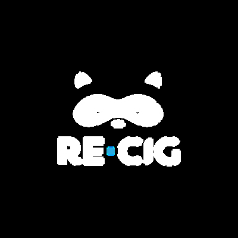

# Indice

# 01.

Introduzione

# 02.

Lettera agli Stakeholder

# 03. 04. 05. 06.

Highlights

Nota Metodologica

Siamo RE-CIG®

Prodotti e servizi

# 07. 08. 09. 10. 11.

Materialità e Stakeholder engagement

Strategia di Sostenibilità

Governance

Social

Ambiente

# 12.

Obiettivi 2025

# 13.

Annex

# Introduzione

Il Bilancio di Sostenibilità rappresenta per

Il presente Bilancio di Sostenibilità

noi un atto di coerenza con questi

nasce dalla volontà di RE-CIG® di

principi: è un modo per renderci

rendere trasparente e misurabile il

responsabili di fronte ai nostri

proprio impegno verso un futuro più

interlocutori, per dare valore alla

pulito, responsabile e rigenerativo.

trasparenza, e per orientare il nostro

Questo documento racconta non solo i

sviluppo verso un impatto sempre più

risultati ambientali, sociali ed economici

positivo. È anche un invito alla

raggiunti nel corso dell’anno, ma anche i

collaborazione, perché sappiamo che la

valori e gli obiettivi che guidano

transizione ecologica è una sfida che

quotidianamente la nostra attività.

richiede l’impegno condiviso di istituzioni,

imprese e cittadini.

Fin dalla sua nascita, RE-CIG® ha fatto

della sostenibilità una scelta concreta e

Con questo documento vogliamo

quotidiana. La nostra realtà è nata da

tracciare con chiarezza il cammino

una domanda semplice ma potente,

compiuto finora, riconoscere le sfide

capace di innescare un cambiamento:

ancora aperte e confermare la nostra

perché ignorare un problema ambientale

determinazione a costruire, giorno dopo

diffuso, quando esiste la possibilità di

giorno, una filiera del riciclo che non si

affrontarlo con soluzioni innovative?

limiti a gestire i rifiuti, ma generi cultura,

consapevolezza e valore.

Crediamo che ogni rifiuto contenga un

potenziale di trasformazione. Abbiamo

scelto di agire su ciò che viene spesso

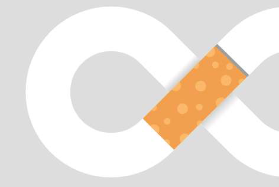

trascurato, muovendoci controcorrente

rispetto a un modello di consumo lineare

e poco consapevole. Il nostro approccio

si basa sulla responsabilità individuale e

collettiva, sull’innovazione come

strumento al servizio dell’ambiente, e

sulla convinzione che anche le abitudini

più radicate possano evolvere verso

pratiche più sostenibili.

# Lettera agli Stakeholders

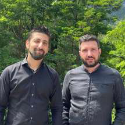

Cari stakeholder,

Per questo selezioniamo con attenzione i

è con grande soddisfazione che vi

nostri fornitori, privilegiando realtà del

presentiamo il nostro primo Bilancio di

territorio e del terzo settore, sosteniamo

#### Sostenibilità: un traguardo importante,

iniziative locali come camminate

ma soprattutto un punto di partenza per

ecologiche, percorsi educativi nelle

rafforzare il nostro impegno verso un

scuole e progetti di solidarietà come il

futuro più responsabile, circolare e

tatuaggio correttivo a fine medico.

consapevole.

#### Crediamo profondamente nella

#### RE-CIG® nasce da un’idea semplice

#### necessità di un cambiamento culturale

#### ma rivoluzionaria: trasformare un rifiuto

#### e industriale. Essere stati i primi a

altamente inquinante e purtroppo molto

promuovere il riciclo dei mozziconi di

diffuso – il mozzicone di sigaretta – in

sigaretta ci responsabilizza: vogliamo

una risorsa. Non si tratta solo di un

essere un esempio concreto di come si

progetto di riciclo, ma di un vero e proprio

possa unire sostenibilità e business, e

messaggio culturale. Vogliamo

ispirare altre realtà a fare lo stesso. Il

dimostrare che anche un gesto

nostro obiettivo non è solo offrire un

quotidiano, se fatto con consapevolezza,

servizio, ma contribuire a costruire

può generare un impatto positivo

modelli di produzione e consumo più

sull’ambiente e sulla società.

consapevoli e circolari.

Guardando al futuro, le sfide non

Il nostro impegno verso la sostenibilità

mancheranno. Il nostro percorso di

non si esaurisce nel servizio offerto. Al

crescita mira a espandersi su scala

contrario, si rafforza ogni giorno

nazionale ed europea, portando il

attraverso un lavoro costante di

modello RE-CIG® oltre i confini italiani.

miglioramento, revisione dei processi e

crescita consapevole. La sostenibilità,

Allo stesso tempo, lavoriamo per

per noi, non è solo ambientale: è un

automatizzare e rendere sempre più

efficiente il nostro processo produttivo,

concetto a 360°, che include la

mantenendo la sostenibilità al centro di

dimensione sociale ed economica.

ogni decisione strategica.

La nostra innovazione continuerà a

Ringraziamo tutte le persone, le aziende

essere guidata da valori solidi e da un

e le istituzioni che hanno creduto in noi e

forte senso di responsabilità: ambientale,

che continuano a camminare al nostro

sociale e culturale. Le certificazioni, i

fianco. Insieme possiamo davvero fare la

monitoraggi delle performance ambientali

differenza. Un piccolo gesto, se

e il dialogo continuo con i nostri

condiviso, può diventare un grande

stakeholder saranno le nostre bussole

cambiamento.

per non perdere mai la rotta.

Con gratitudine,

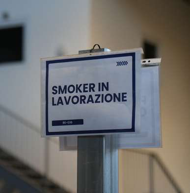

#### Marco Fimognari

Co Founder e CEO,

RE-CIG® S.r.l.

#### Nicola Bonetti

Co Founder e Direttore Produzione,

RE-CIG® S.r.l.

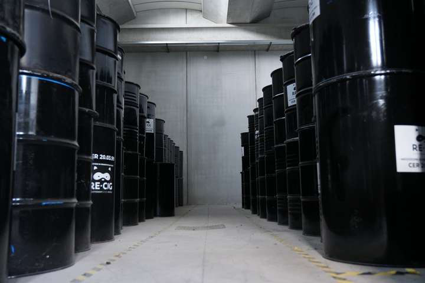

# Highlights

# 6.400

Kg di rifiuti riciclati in entrata nel 2024

# +21 mln

Sigarette equivalenti

# 2.496

Kg di RE-CA®, materiale plastico innovativo

ottenuto dal processo di riciclo nel 2024

# 14.912

Kg di CO2 evitata

# +300

Clienti nel 2024

# Nota Metolodogica

GRI: 2-1; 2-2; 2-23.

Il presente documento è stato redatto da

Quest’ultima introduce obblighi più

#### Habitech, Distretto Tecnologico Trentino

stringenti in materia di divulgazione delle

S.c. a r.l. Società Benefit, in

informazioni ambientali e sociali, con

collaborazione con EETRA S.r.l. SB.

l’obiettivo di supportare le valutazioni di

Il Report rappresenta uno strumento

investitori, organizzazioni della società

volontario di misurazione e

civile, consumatori e altri portatori di

comunicazione delle performance di

interesse, contribuendo così

sostenibilità di RE-CIG®, ed è stato

all’attuazione del Green Deal Europeo.

progettato per offrire agli stakeholder una

visione chiara, trasparente e dettagliata

Per la strutturazione dei dati, RE-CIG® ®

delle strategie adottate, dei progetti

ha seguito le linee guida del

realizzati e dei risultati raggiunti, con

#### Sustainability Accounting Standards

l’obiettivo di generare valore sostenibile

#### Board (SASB), focalizzandosi

nel lungo periodo.

sull’individuazione dei principali rischi e

opportunità con potenziali impatti sulla

In linea con i principali standard europei

continuità del business, in una

di rendicontazione – tra cui i Global

prospettiva di breve, medio e lungo

#### Reporting Initiative (GRI) e gli

termine.

#### European Sustainability Reporting

#### Standards (ESRS) – il documento è

I dati contenuti nel presente Bilancio di

stato redatto conformemente alla

Sostenibilità si riferiscono principalmente

Direttiva (UE) 2022/2464 relativa al

all’anno 2024. Tuttavia, al fine di offrire

#### Corporate Sustainability Reporting

un quadro più completo e comparabile

#### Directive (CSRD).

delle performance aziendali, alcuni

indicatori quantitativi sono presentati

secondo uno storico biennale (2023–

2024). Questo approccio è stato adottato

in considerazione del fatto che, sebbene

Re-Cig sia stata formalmente costituita

nel 2019, le attività operative hanno

avuto un avvio effettivo soltanto a partire

dal 2023.

Infine, è stata condotta una mappatura

A partire dal Bilancio di Sostenibilità

tra gli indicatori SASB e i 17 Obiettivi di

relativo all’esercizio 2025, Re-Cig si

#### Sviluppo Sostenibile (SDGs) delle

impegna a consolidare il proprio sistema

Nazioni Unite, con l’obiettivo di valutare

di rendicontazione adottando un

l’impatto delle attività aziendali su

monitoraggio triennale degli indicatori, al

ciascun obiettivo. Questo lavoro ha reso

fine di garantire una visione più

esplicito l’impegno di RE-CIG® ® a

strutturata e coerente dell’evoluzione nel

contribuire in modo concreto alla

tempo delle proprie performance

realizzazione di un futuro più sostenibile

ambientali, sociali ed economiche.

a livello globale.

La valutazione delle performance ESG è

stata condotta utilizzando il B Impact

#### Assessment, strumento sviluppato da B

Lab per misurare l’impatto complessivo

dell’impresa.

A seguito dell’entrata in vigore della

CSRD nel 2023, RE-CIG® ha svolto

un’analisi approfondita delle tematiche

#### materiali, utilizzando il protocollo SASB

e coinvolgendo attivamente gli

stakeholder interni, tra cui management e

dipendenti. Il principio di materialità ha

guidato la selezione delle informazioni da

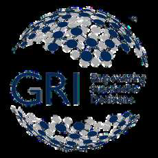

includere, assicurando il focus sui temi

più rilevanti emersi dall’analisi di

materialità condotta nel 2024. L’analisi ha

permesso di individuare impatti

significativi e relative opportunità e rischi

connessi al valore aziendale.

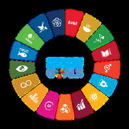

# Siamo RE-CIG®

## Profilo RE-CIG®

In Italia si contano circa 12,5 milioni di

fumatori e 70 miliardi di sigarette

consumate all’anno. Di queste, circa il

65% (oltre 45 miliardi)* viene disperso

nell’ambiente ogni anno, con

conseguenze gravi per ecosistemi

terrestri e marini: contaminano fiumi, mari

e falde acquifere, e nel Mediterraneo

rappresentano

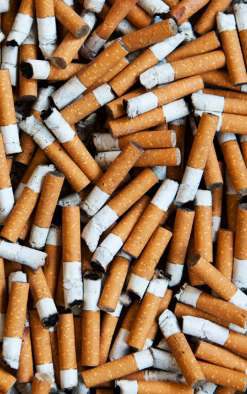

il 40% dei rifiuti plastici. I mozziconi

contengono microplastiche e sostanze

tossiche che mettono a rischio la fauna

marina e, attraverso la catena

alimentare, anche la salute umana.

Per rispondere a questa emergenza

ambientale nasce RE-CIG®, una startup

innovativa fondata a Civezzano, in

provincia di Trento, da Marco e Nicola. I

due giovani imprenditori hanno scelto di

trasformare un problema diffuso in

un'opportunità concreta. La missione di

RE-CIG® è raccogliere, riciclare e

rigenerare i mozziconi di sigaretta,

convertendo un rifiuto tossico in una

risorsa utile e sostenibile.

*Fonte: Erion Care e Ministero della Salute

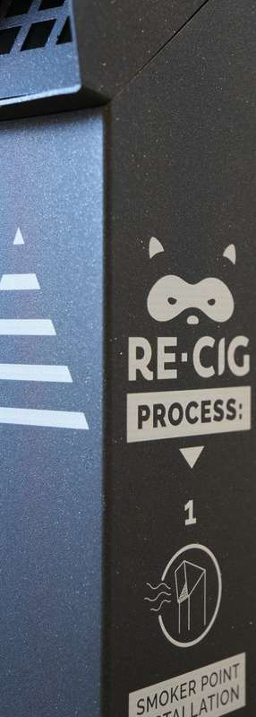

Attraverso un processo brevettato, RE-

CIG® tratta i mozziconi per ottenere una

nuova materia prima riutilizzabile in

diversi settori industriali, dalla produzione

di oggetti in plastica riciclata all’arredo

urbano.

Oltre alla componente tecnologica, RE-

CIG® promuove una cultura ecologica

più consapevole, sensibilizzando

cittadini, istituzioni e aziende

sull’importanza della raccolta

differenziata e della riduzione

dell’inquinamento da plastica.

Oggi RE-CIG® è una realtà in

espansione. Il CdA è composto da tre

amministratori. L’azienda conta su sette

dipendenti, dieci agenzie sul territorio e

una solida rete di collaborazione con enti

pubblici e aziende private.

Con un fatturato annuo superiore al

milione di euro, l’azienda dimostra come

sostenibilità ambientale, innovazione e

sviluppo economico possano procedere

insieme.

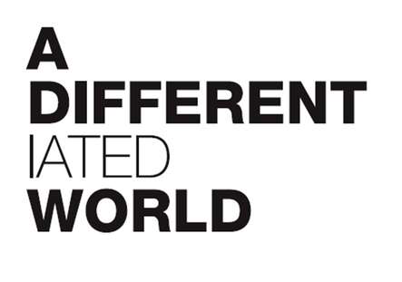

## La nostra storia

RE-CIG® nasce nel 2016 da

Un solo mozzicone abbandonato

un’intuizione tanto semplice quanto

nell’ambiente può inquinare fino a 1.000

innovativa: perché i mozziconi di

litri d’acqua in quanto, a contatto con

sigaretta non vengono riciclati? La

l’acqua, rilascia sostanze tossiche e

domanda, emersa quasi per caso

metalli pesanti ed ogni anno vengono

osservando un posacenere colmo, ha

abbandonati oltre 45 miliardi di mozziconi

acceso l’attenzione su una problematica

di sigaretta.*

ambientale diffusa e spesso invisibile. I

Secondo l’AGI, i mozziconi rilasciano

due soci fondatori, entrambi attenti ai

annualmente nell’ambiente circa 0,3

temi della sostenibilità, hanno colto in

milioni di tonnellate di fibre di plastica,

quell’immagine del posacenere colmo il

rendendoli una delle principali fonti di

simbolo di un’abitudine quotidiana le cui

microplastiche, e l’UNEP (Programma

conseguenze sull’ambiente sono ancora

delle Nazioni Unite per l’Ambiente) stima

largamente sottovalutate. Da lì ha preso

che costituiscano il 40% dei rifiuti marini

avvio un percorso di ricerca, guidato

nel Mediterraneo, minando la vita

dalla convinzione che anche un rifiuto

biologica e gli ecosistemi costieri.

apparentemente marginale possa essere

I primi tentativi di trattamento e riciclo da

trasformato in risorsa.

parte di RE-CIG sono avvenuti in ambito

domestico, con particolare attenzione al

I rifiuti di sigaretta avevano tre possibili

filtro in acetato di cellulosa, una plastica

destinazioni: l’incenerimento, con

difficile da degradare. La svolta è arrivata

emissioni derivanti dalla combustione;

grazie alla collaborazione con l’Università

l’interramento in discarica, dove

degli Studi dei Materiali di tre anni.

impiegano circa 25 anni per disgregarsi;

Durante questo periodo sono stati

e la dispersione in ambiente, con

condotti test, analisi e ottimizzazioni che

conseguenze devastanti per gli

hanno portato allo sviluppo di un

ecosistemi.

processo industriale efficace e sicuro per

il trattamento dei mozziconi.

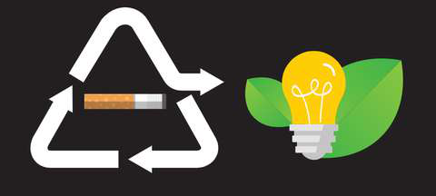

*Fonte: Erion Care e Ministero della Salute

Nel 2020 RE-CIG® realizza il primo

Oggi RE-CIG® continua il suo percorso

impianto industriale dedicato al riciclo dei

di crescita, grazie al contributo di

filtri di sigaretta e deposita il brevetto

professionisti, centri di ricerca e partner

nazionale per il proprio processo, esteso

che condividono l’obiettivo di ridurre

successivamente anche a livello

l’impatto ambientale attraverso soluzioni

europeo. Questo passaggio segna non

concrete. Una storia che testimonia

solo un progresso tecnologico, ma

come, da un’osservazione quotidiana

l’apertura a una nuova prospettiva nella

unita a impegno e competenze, possa

gestione dei rifiuti derivanti dal fumo.

nascere un cambiamento reale verso un

modello di sviluppo più sostenibile.

## 2016

Nasce l’idea del progetto

## 2019

Deposito del primo brevetto

Realizzazione impianto industriale per riciclo mozziconi

## 2020

Approvazione brevetto per riciclo dei mozziconi trasformati in RE-CA®

## 2021

Attività consolidata di riciclo e trasformazione dei mozziconi, deposito secondo brevetto 2024

## I nostri valori

Racchiudiamo la nostra visione nella mission “Contribuire attivamente ad un

futuro più pulito e sostenibile”, un impegno che va oltre la gestione

responsabile di rifiuti inquinanti, come i mozziconi di sigaretta, per includere

anche azioni di sensibilizzazione e formazione sui temi dell’economia

circolare.

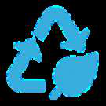

#### Sostenibilità ambientale

Al centro della visione di RE-CIG® vi è la volontà di offrire una

risposta concreta all’inquinamento causato dai mozziconi,

promuovendo un modello basato sull’economia circolare e sulla

valorizzazione dei rifiuti come risorsa. Ogni attività è orientata a

ridurre l’impatto ambientale e a incentivare comportamenti più

responsabili.

#### Responsabilità sociale

L’impegno ambientale si accompagna a una forte attenzione alla

dimensione sociale. RE-CIG® collabora con imprese sociali, sostiene

iniziative civiche e partecipa a progetti benefici, contribuendo alla

creazione di valore condiviso per le comunità locali.

#### Educazione e sensibilizzazione

Accanto all’attività tecnica di recupero e riciclo, l’azienda investe nella

diffusione di una cultura della sostenibilità. Attraverso campagne

informative, progetti educativi e collaborazioni con enti pubblici e

privati, RE-CIG® promuove una maggiore consapevolezza sulle

problematiche ambientali legate ai rifiuti da fumo.

#### Impatto consapevole

Ogni scelta aziendale viene valutata in funzione dell’impatto generato

sull’ambiente e sulla società. RE-CIG® adotta un approccio orientato

al miglioramento continuo, nella convinzione che il cambiamento

verso un’economia più giusta e responsabile passi anche attraverso la

coerenza delle proprie azioni.

## Certificazioni e brevetti

RE-CIG® ha sviluppato un processo

Nel 2024, l’attività di Ricerca e Sviluppo

brevettato per il riciclo dei mozziconi di

ha portato al deposito di un secondo

sigaretta, convertendo un rifiuto ad alto

brevetto, attualmente in fase di

impatto ambientale in Re-CA® (Acetato

valutazione. Questo riguarda un

di Cellulosa Riciclato), una materia prima

dispositivo per la raccolta dei mozziconi e

seconda ad alte prestazioni. Ottenuto

un sistema integrato per il loro recupero,

attraverso un trattamento innovativo e

con l’obiettivo di ottimizzare l’intero ciclo

sostenibile, il materiale conserva

di gestione.

proprietà meccaniche comparabili a

quelle dell’acetato vergine, rendendosi

Grazie a un approccio basato su rigore

adatto a numerose applicazioni

normativo e innovazione continua, RE-

industriali.

CIG® si posiziona come riferimento a

livello europeo per la gestione sostenibile

Il primo brevetto del processo è stato

dei rifiuti da fumo, proponendo soluzioni

depositato nel febbraio 2019 ed esteso

tecnologiche che coniugano tracciabilità,

successivamente a livello europeo.

efficienza e rispetto dell’ambiente.

Concesso a gennaio 2021, è prevista

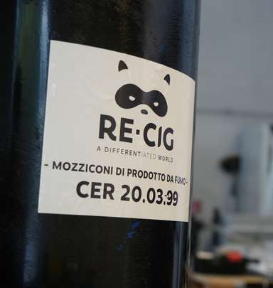

un’ulteriore estensione comunitaria entro

il 2025. A conferma della specificità del

metodo, RE-CIG® è attualmente l’unico

operatore in Italia e in Europa ad aver

ottenuto tutte le autorizzazioni necessarie

per il trattamento e il riciclo dei

mozziconi, in conformità con la normativa

vigente, in particolare con il Decreto

Ministeriale del 15 febbraio 2017 sui rifiuti

derivanti da prodotti da fumo e secondo

la delibera Nr. 5 del luglio 2019 dell’Albo

Nazionale Gestori Ambientali.

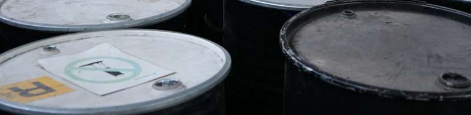

## La performance economica

Per RE-CIG®, la sostenibilità economica

Nel 2024 RE-CIG® ha registrato un

rappresenta un elemento centrale per

incremento del fatturato pari al 236,85%,

garantire nel tempo la solidità e la

un dato che conferma la solidità del

continuità delle pratiche ESG. Un

modello adottato e il crescente interesse

modello economico fondato su principi di

del mercato verso soluzioni ambientali

equilibrio e responsabilità consente non

orientate all’innovazione e alla circolarità.

solo di migliorare la redditività e ridurre i

rischi, ma anche di contribuire alla

Attualmente, l’azienda è impegnata in

costruzione di un’economia più resiliente

investimenti rilevanti in progetti ad alto

e consapevole.

impatto ambientale e sociale. La

definizione di un Piano Strategico di

La responsabilità economica dell’azienda

Sostenibilità, la redazione del presente

si traduce in una distribuzione del valore

Bilancio e la realizzazione di un nuovo

generato che coinvolge attivamente gli

impianto di concentrazione

stakeholder, attraverso scelte strategiche

rappresentano azioni concrete con cui

e investimenti capaci di generare benefici

RE-CIG® rafforza il proprio profilo ESG,

lungo tutta la catena del valore.

ponendo le basi per un percorso di

miglioramento continuo e strutturato.

### Fatturato aziendale (€)

2023 2024

2000000

1500000

1000000

500000

435.927 1.468.824

Fattuato aziendale 0

# I nostri numeri

# +1.4 mln

Fatturato nel 2024

# +230 %

Aumento di fatturato nel 2024

# +149 %

Aumento di capitale investito nel 2024

# +4.000

Numero di Smoker Point a fine 2024

GRI: 2-6; 201-1.

# Prodotti e servizi

## Business core e settori di competenza

Il cuore dell’attività di RE-CIG® è

A oggi, l’azienda ha installato oltre 4.000

rappresentato da un sistema integrato e

#### Smoker Point su tutto il territorio

brevettato per la gestione sostenibile dei

nazionale e collabora con più di 350

mozziconi di sigaretta, che consente di

#### aziende e circa 70 amministrazioni

trasformare un rifiuto altamente

#### pubbliche, offrendo soluzioni

inquinante in una risorsa riutilizzabile.

personalizzate per realtà di ogni

dimensione.

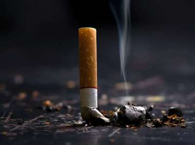

Il modello di business si basa su tre

Lo sviluppo di questo sistema ha dovuto

pilastri operativi:

affrontare ostacoli significativi, tra cui

#### Fornitura degli Smoker Point:

l’assenza iniziale di un inquadramento

posacenere progettati per una

normativo per i mozziconi. Grazie al

raccolta mirata ed efficiente dei

lavoro svolto da RE-CIG®, il mozzicone

mozziconi. Ogni unità può contenere

di sigaretta è oggi classificato con il

fino a 1.500 filtri e presenta un

codice CER 20.03.99. L’azienda opera

cappuccio a griglia per impedire

nel pieno rispetto della normativa vigente

l’inserimento di altri rifiuti. Alcuni

ed è in possesso di tutte le autorizzazioni

modelli sono dotati di sensori per il

necessarie, incluse quelle per le

monitoraggio del riempimento,

operazioni di recupero R3, R12 e R13,

facilitando la programmazione dei

oltre all’iscrizione all’Albo Nazionale

ritiri.

Gestori Ambientali.

#### Unità di conferimento: Contenitori

Sebbene il valore commerciale

sicuri destinati allo stoccaggio

dell’acetato di cellulosa riciclato sia

temporaneo dei mozziconi raccolti, in

contenuto, RE-CIG® ha sviluppato un

attesa del ritiro da parte di RE-CIG®.

modello economico sostenibile e

#### Gestione completa del ciclo:

replicabile, fondato sull’innovazione

L’azienda cura tutte le fasi del

tecnologica, sulla qualità del servizio

processo, dalla raccolta al trasporto,

offerto e su un impatto ambientale

fino al trattamento e al riciclo

misurabile. Il Re-CA®, materia prima

industriale. Il servizio è fornito in

seconda ottenuta dal processo di riciclo,

comodato d’uso, senza costi iniziali, e

rappresenta un esempio concreto

prevede una quota fissa che copre

dell’efficacia del modello circolare

l’intero ciclo operativo.

applicato ai rifiuti da fumo.

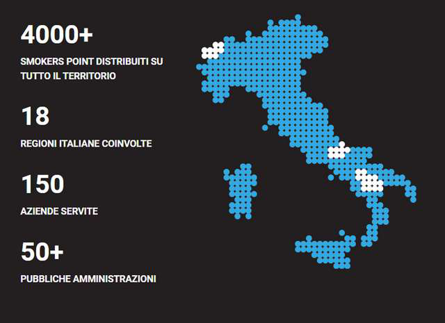

#### Re-Cig | Report di Sostenibilità 2024

GRI: 301-2; 301-3. ESRS: E5-1; E5-2; E5-3.

## Il processo produttivo

RE-CIG® è la prima realtà in Italia e in Europa ad aver sviluppato e brevettato un

processo industriale per il riciclo dei mozziconi di sigaretta, trasformandoli in una materia

prima seconda plastica idonea a nuovi impieghi. Il sistema, progettato per gestire in

modo efficiente un rifiuto altamente inquinante, si basa su un ciclo integrato di raccolta,

trattamento e rigenerazione, conforme alla normativa ambientale vigente.

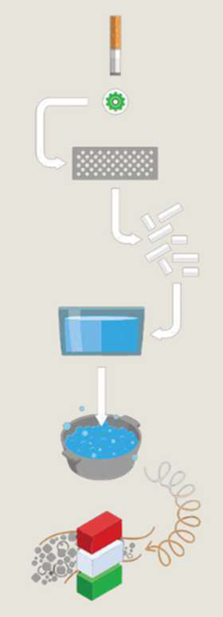

#### 1.Setacciatura

I mozziconi raccolti vengono sottoposti a una

selezione meccanica, volta a rimuovere impurità

come cenere, tabacco residuo e altri materiali

non idonei al riciclo.

#### 2. Pre-lavaggio

In questa fase avviene la separazione tra carta e

filtro in acetato di cellulosa. L’acqua utilizzata

viene successivamente trattata da aziende

specializzate nel recupero e nella depurazione.

#### 3. Lavaggio

Il filtro subisce una pulizia approfondita con

acqua a temperatura variabile, finalizzata alla

rimozione di sostanze nocive quali nicotina e

catrame. Anche in questo caso, l’acqua

impiegata viene trattata per minimizzarne

l’impatto ambientale.

#### 4. Essiccazione e miscelazione termica

I filtri asciutti vengono riscaldati e miscelati per

ottenere acetato di cellulosa riciclato (Re-CA®). Il

materiale viene poi granulato e reso disponibile

per l’impiego in tecnologie di trasformazione

come stampa 3D, stampaggio a iniezione e

pressofusione.

Attualmente l’output ottenuto dai processi

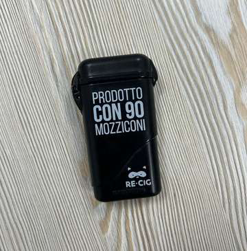

è destinato allo stoccaggio al fine di

individuare collaborazioni adeguate alla

vendita del materiale e per una

comunicazione efficace delle attività.

RE-CIG® si concentra sulla produzione

di granuli plastici, e sta cercando

collaborazioni con partner esterni per la

realizzazione dei prodotti finiti.

In questa fase, sono state individuate tre

principali aree applicative del Re-CA®:

produzione di posaceneri portatili

per la raccolta dei mozziconi,

realizzazione di accessori per

#### l’abbigliamento, come cerniere e

bottoni,

utilizzo nel settore occhialeria, per la

creazione di montature in materiale

riciclato.

A conclusione del processo, RE-CIG®

rilascia una dichiarazione di End of

#### Waste, che attesta la cessazione della

qualifica di rifiuto del materiale e la sua

trasformazione in risorsa.

Questo approccio si configura come un

esempio concreto di economia circolare

applicata ai rifiuti da fumo, contribuendo

a ridurre l’impatto ambientale e a

promuovere un utilizzo efficiente delle

risorse.

GRI: 2-29; 207-3.

# Materialità e stakeholder engagement

## Stakeholder engagement

Per RE-CIG®, lo sviluppo sostenibile

Un elemento distintivo del modello RE-

rappresenta una strategia centrale

CIG® è la rendicontazione degli

orientata alla creazione di valore nel

#### impatti ambientali generati dalle attività

lungo termine. Il raggiungimento di

dei clienti. Ogni anno, l’azienda elabora

questo obiettivo richiede il

report personalizzati che quantificano il

coinvolgimento attivo dei principali

contributo specifico di ciascun cliente alla

stakeholder, attraverso una

riduzione dell’inquinamento da mozziconi

comunicazione efficace, sia all’interno

di sigaretta e al recupero di materiali.

dell’organizzazione che all’esterno.

Questi dati possono essere integrati nei

#### bilanci di sostenibilità delle aziende

Un dialogo trasparente contribuisce a

partner, facilitando il monitoraggio e la

rafforzare le relazioni con dipendenti,

rendicontazione delle performance

clienti, fornitori, istituzioni e comunità

ambientali.

locali, favorendo un clima di fiducia

reciproca e supportando l’integrazione

Il percorso verso una maggiore

della sostenibilità nei processi aziendali.

responsabilità sociale e ambientale è

stato accompagnato da un’individuazione

In questo contesto, la comunicazione

degli stakeholder primari e secondari

assume un ruolo strategico nel

dell’azienda, condotta sulla base di criteri

consolidare la reputazione dell’impresa e

quali obblighi normativi, grado di

nel generare impatti positivi nei territori in

influenza reciproca e livello di

cui opera.

coinvolgimento nei processi aziendali.

Tale attività ha consentito di identificare i

gruppi più rilevanti, con i quali RE-CIG®

mantiene un confronto costante,

orientato alla costruzione di progetti

condivisi e all’avanzamento degli obiettivi

comuni di sostenibilità.

### Territorio e

### Management

### comunità

### Popolazione

### Utilizzatori

## Stakeholder

### aziendale

### finali

## Primari

### Collaboratori

### Clienti

### esterni

### Fornitori

GRI: 3-1; 3-2; 3-3.

ESRS: E2-6

## Analisi di Materialità

L’analisi di materialità di RE-CIG® è stata

Attraverso questionari strutturati e

realizzata con l’obiettivo di individuare i

interviste, sono stati raccolti dati

temi prioritari per il nostro business e per

qualitativi e quantitativi utili a mappare i

gli stakeholder, al fine di orientare e

temi rilevanti in una matrice di materialità.

ottimizzare la strategia di sostenibilità

Questa analisi ha consentito di

aziendale. Il processo ha previsto il

evidenziare i temi materiali che

coinvolgimento diretto di interlocutori

rappresentano rischi significativi per le

chiave, quali il management, i dipendenti,

attività di RE-CIG®, con particolare

collaboratori esterni (considerati

riferimento alla gestione dei rifiuti e

stakeholder interni), nonché fornitori e

all’impatto ambientale associato ai

clienti (stakeholder esterni). Il tasso di

mozziconi di sigaretta.

partecipazione è stato del 52,5%.

### Matrice di materialità

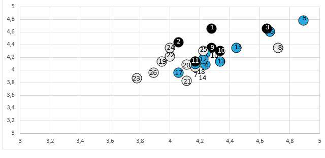

#### Ambiente (E) Social (S) Governance (G)

(7) Resilienza e adattabilità del modello di business (8) Etica aziendale (19) Design del prodotto, gestione del ciclo di vita e innovazione (20) Gestione catena di fornitura (21) Approvvigionamento dei materiali (22) Impatti fisici del cambiamento climatico (23) Comportamento competitivo (24) Gestione ambito legale e normativo (25) Gestione del rischio di incidenti critici (26) Gestione del rischio sistemico

(4) Relazioni con la comunità (5) Salute e sicurezza dei lavoratori (6) Gestione delle risorse umane (12) Privacy dei clienti (13) Sicurezza dei dati (14) Accessibilità del servizio (15) Qualità e sicurezza del servizio (16) Benessere dei clienti (17) Comunicazione e marketing trasparenti (18) Coinvolgimento della popolazione aziendale

(1) Qualità dell’aria (2) Emissioni GHG (3) Gestione dei rifiuti (9) Gestione dell’energia (10) Gestione dell’acqua (11) Gestione della biodiversità e degli ecosistemi

Consapevoli del doppio effetto della

nostra attività sull’ambiente e sulla

società, abbiamo distinto gli impatti in

attuali e potenziali.

### Analisi impatti potenziali negativi

Gli impatti attuali sono già identificabili e

misurabili, come ad esempio la riduzione

dell’inquinamento ambientale tramite il

1

riciclo dei mozziconi. Gli impatti potenziali

2

riguardano invece possibili sviluppi futuri,

quali l’adozione crescente del nostro

Gravità

3

modello da parte di ulteriori realtà

aziendali e istituzionali.

4

5

Per quanto concerne gli impatti negativi,

sono stati valutati rischi quali non

1 2 3 4 5

conformità normativa e possibili danni

Probabilità

ambientali, in base a criteri di gravità e

probabilità di accadimento. Gli impatti

positivi, quali il miglioramento

dell’efficienza operativa e la generazione

### Analisi impatti potenziali positivi

di valore condiviso per la comunità, sono

stati analizzati secondo il valore aggiunto

generato e la probabilità di

5

concretizzazione.

Valore aggiunto

4

Grazie a questo approccio strutturato,

abbiamo ottenuto una visione chiara dei

3

rischi e delle opportunità derivanti dalle

2

nostre attività, consentendoci di

sviluppare una strategia di sostenibilità

1

che risponda alle esigenze degli

1 2 3 4 5

stakeholder e alle sfide future. L’analisi

Probabilità

sarà ripetuta annualmente, con l’intento

di coinvolgere nuovi gruppi di stakeholder

e aggiornare costantemente la nostra

strategia aziendale.

Nella tabella sottostante si elencano gli impatti potenziali positivi (P+) e negativi (P-), gli

impatti attuali positivi (A+) e negativi (A-) sull’ambiente, sulle persone e sull’economia per

ciascun tema materiale individuato.

||**Ambiente (E)**|**Persone (S)**|**Economia (G)**|
|---|---|---|---|
|Qualità dell’aria|P-|P-|P-|
|Emissioni GHG|A+|A+|A+|
|Gestione dei rifiuti|P-|P-|P-|
|Relazioni con la comunità|A+|A+|A+|
|Salute e sicurezza dei lavoratori|P+|P+|P+|
|Gestione risorse umane|P+|P+|P+|
|Resilienza e adattabilità del modello di business|P+|P+|P+|
|Etica aziendale|P+|P+|P+|
|Gestione dell’energia|P+|P+|P+|
|Gestione dell’acqua|P-|P-|P-|
|Gestione della biodiversità ed ecosistemi|P-|P-|P-|
|Privacy dei clienti|P-|P-|P-|
|Sicurezza dei dati|P-|P-|P-|
|Accessibilità del servizio|P+|P+|P+|
|Qualità e sicurezza del servizio|P+|P+|P+|
|Benessere dei clienti|P+|P+|P+|
|Comunicazione e marketing trasparenti|P+|P+|P+|
|Coinvolgimento della popolazione aziendale|P+|P+|P+|
|Design del prodotto, gestione del ciclo di vita e innovazione nel processo produttivo|A+|A+|A+|

|Gestione catena di fornitura|P+|P+|P+|
|---|---|---|---|
|Approvvigionamento dei materiali|P+|P+|P+|
|Impatti fisici del cambiamento climatico|P-|P-|P-|
|Comportamento competitivo|P+|P+|P+|
|Gestione ambito legale e normativo|P+|P+|P+|
|Gestione rischio incidenti critici|P-|P-|P-|
|Gestione rischio sistemico|P-|P-|P-|

L’analisi degli impatti attuali si è concentrata sulla loro rilevanza e sulle ragioni per cui si

manifestano nel presente, valutandone le implicazioni per l’azienda e gli stakeholder.

|**TEMA**|**TIPO IMPATTO**|**DESCRIZIONE**|**RILEVANZA**|
|---|---|---|---|
|Emissioni GHG|A+|RE-CIG® ha calcolato la propria impronta di carbonio relativa all’organizzazione e al processo produttivo, includendo lo Scope 1 (emissioni dirette), Scope 2 (emissioni indirette) e lo Scope 3 (emissioni lungo tutta la catena del valore). In questo modo, l’azienda può monitorare l’andamento delle proprie emissioni e fissare dei target di riduzione annuali.|4.24|
|Relazioni con la comunità|A+|RE-CIG® supporta le associazioni del terzo settore e le fondazioni del territorio, contribuendo a donazioni per progetti con un forte impatto sociale sulla comunità e sul territorio.|4.16|
|Design del prodotto, gestione ciclo di vita e innovazione nel processo produttivo|A+|RE-CIG® ha sviluppato un processo brevettato per il riciclo dei mozziconi di sigaretta, convertendo un rifiuto ad alto impatto ambientale in Re-CA® (Acetato di Cellulosa Riciclato), una materia prima seconda ad alte prestazioni. Ottenuto attraverso un trattamento innovativo e sostenibile, il materiale conserva proprietà meccaniche comparabili a quelle dell’acetato vergine, rendendosi adatto a numerose applicazioni industriali.|4.03|

GRI: 2-22; 2-23

# Strategia di Sostenibilità

La strategia di RE-CIG® si basa su un

Tale politica riflette l’impegno della

modello di crescita sostenibile e

Direzione nel garantire una gestione

responsabile, che unisce competitività e

responsabile dell’ambiente e un

innovazione con il rispetto per l’ambiente

ambiente di lavoro sicuro e salutare per

e le persone. In un contesto di

tutti i dipendenti, collaboratori e

transizione ecologica e trasformazione

stakeholder.

industriale, l’azienda integra i principi

ESG (ambientali, sociali e di governance)

I principi guida sono:

nel proprio modello operativo, rendendo

etica professionale e responsabilità

la sostenibilità un elemento centrale e

individuale,

operativo delle proprie attività.

gestione proattiva delle emergenze,

controllo continuo delle attività e dei

Questo approccio guida le decisioni

fornitori,

lungo l’intero ciclo di vita del servizio,

coinvolgimento attivo delle risorse

dalla gestione e trattamento dei rifiuti al

umane,

coinvolgimento degli stakeholder, dalla

forte attenzione alla tutela ambientale

tutela della salute e sicurezza sul lavoro

e alla mitigazione del cambiamento

all’investimento in tecnologie per

climatico.

l’economia circolare. RE-CIG® si

impegna a prevenire e gestire i rischi,

incluso il cambiamento climatico,

contribuendo attivamente al benessere

ambientale e sociale.

La strategia si fonda su una politica

integrata che unisce ambiente, salute e

sicurezza in un approccio sistemico, volto

al miglioramento continuo.

Nel 2024, RE-CIG® ha compiuto un

L’obiettivo del BIA è fornire un quadro strutturato e comparabile della performance aziendale in termini di sostenibilità ambientale, sociale ed economica.

passo significativo nel suo percorso di

sostenibilità, completando la valutazione

della propria organizzazione attraverso il

#### B Impact Assessment (BIA).

L’assessment valuta il comportamento dell’azienda rispetto a cinque aree chiave:

L’iniziativa nasce dalla volontà

dell’azienda di dotarsi di strumenti

Governance Trasparenza, missione e accountability dell’impresa;

concreti e riconosciuti a livello

internazionale per analizzare,

comprendere e migliorare il proprio

Lavoratori Condizioni di lavoro, benefici, formazione e benessere;

impatto in modo oggettivo e trasparente.

Il B Impact Assessment è un tool

Comunità Impatti sociali, inclusione, diversità, relazioni con fornitori locali e impegno civico;

sviluppato da B Lab, l’organizzazione

non profit che promuove il movimento

delle B Corp a livello globale. È uno degli

Ambiente Uso delle risorse, emissioni, politiche ambientali e catena del valore;

strumenti di misurazione dell’impatto più

diffusi al mondo, utilizzato da oltre 50.000

#### aziende di ogni dimensione e settore, tra

Clienti Valore sociale e ambientale offerto ai clienti, etica del prodotto e impatti positivi.

cui più di 3.000 B Corp certificate.

Pur non avendo ancora avviato il

percorso per ottenere la certificazione B

Corp, RE-CIG® ha scelto di utilizzare il

BIA come strumento di analisi interna e

di orientamento strategico. Questo

approccio permette di identificare punti di

forza e aree di miglioramento, fornendo

una base solida per pianificare azioni

concrete volte a generare valore

condiviso e duraturo per tutti gli

stakeholder.

## Allineamento agli SDGs

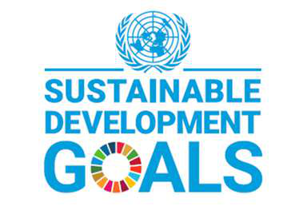

Questi obiettivi offrono una guida chiara

per costruire un futuro sostenibile e

inclusivo. Nel periodo di analisi, RE-

CIG® ha utilizzato l’SDG Action

#### Manager — uno strumento che integra il

B Impact Assessment di B Lab con i dieci

principi del Global Compact delle Nazioni

Unite — per facilitare un’autovalutazione

dinamica, benchmarking e miglioramento

continuo delle proprie azioni di

Gli SDGs (Sustainable Development

sostenibilità.

#### Goals), adottati nel 2015 dalle Nazioni

Questo approccio ha permesso di

Unite come parte dell’Agenda 2030,

mappare e monitorare l’impatto positivo

rappresentano 17 obiettivi globali volti ad

dell’azienda in relazione agli SDGs,

affrontare le sfide più urgenti a livello

evidenziando le aree in cui RE-CIG®

mondiale: dalla povertà e disuguaglianza,

concentra i propri sforzi e identificando

al cambiamento climatico e alla tutela

ambiti di potenziale miglioramento.

dell’ambiente.

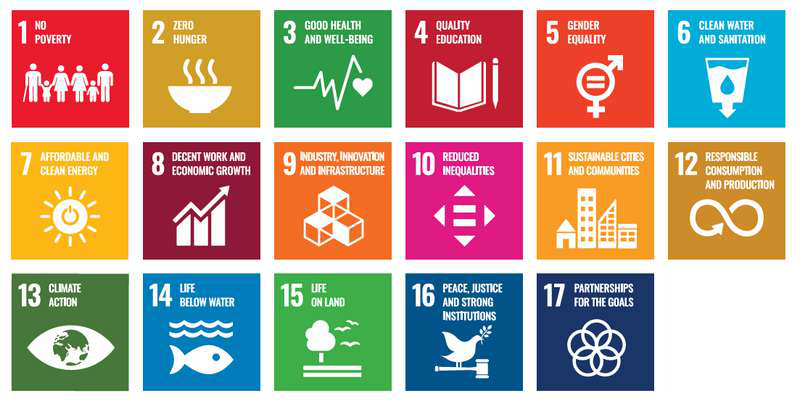

Principali Obiettivi di Sviluppo Sostenibile su cui RE-CIG® interviene:

#### SDG 12 – Consumo e produzione responsabili

RE-CIG® trasforma un rifiuto altamente inquinante — il

mozzicone di sigaretta — in una risorsa riutilizzabile, l’acetato di

cellulosa riciclato. Attraverso un processo produttivo brevettato e

innovativo, l’azienda promuove un’economia circolare che riduce

gli sprechi, limita l’uso di materie prime vergini e sensibilizza i

consumatori su una gestione responsabile dei rifiuti.

#### SDG 11 – Città e comunità sostenibili

Con la raccolta e il riciclo dei mozziconi di sigaretta, RE-CIG®

contribuisce a rendere gli spazi urbani più puliti e vivibili.

Collaborando con enti locali e promuovendo progetti di

sensibilizzazione, favorisce città più resilienti e sostenibili,

diffondendo una cultura di responsabilità ambientale e sociale.

#### SDG 14 – Vita sott’acqua

I mozziconi rappresentano una delle principali fonti di

inquinamento marino. RE-CIG® limita la dispersione di questi

rifiuti in mare attraverso programmi di raccolta e riciclo,

proteggendo così la biodiversità e la salute degli ecosistemi

acquatici.

#### SDG 9 – Industria, innovazione e infrastrutture

L’innovazione è al centro del modello di business di RE-CIG®. Lo

sviluppo di due brevetti e di un processo tecnologico sostenibile

dimostrano come l’azienda coniughi crescita economica,

progresso tecnologico e tutela ambientale, promuovendo

infrastrutture intelligenti e a basso impatto ambientale.

# Governance

GRI: 2-9; 2-10; 2-11; 2-12; 2-13; 2-14; 2-27

ESRS: G1-1

# Governance

Le decisioni aziendali sono valutate non

La governance di RE-CIG® rappresenta

solo in termini di performance

il fondamento di una gestione

economica, ma anche considerando gli

responsabile, trasparente e coerente con

effetti delle attività sull’ambiente, sulla

i principi di sostenibilità, responsabilità

comunità e sulla sicurezza dei lavoratori.

sociale e tutela ambientale. Strutturata

L’azienda pone particolare attenzione

secondo principi etici e normativi rigorosi,

alla gestione responsabile degli aspetti

assicura che tutte le decisioni e le azioni

ambientali, mirando a ridurre al minimo il

aziendali siano orientate al

proprio impatto ecologico, e al benessere

raggiungimento degli obiettivi strategici,

dei dipendenti, integrando così la

con un’attenzione costante agli impatti

sostenibilità in tutte le fasi operative.

ambientali e sociali.

La governance comprende un sistema di

La gestione aziendale di RE-CIG® si

monitoraggio continuo delle performance

basa su un’organizzazione snella e

ambientali, sociali ed economiche, che

dinamica, che promuove una

permette di valutare l’efficacia delle

comunicazione diretta ed efficace tra tutti

strategie adottate attraverso indicatori

i membri del team. Questa struttura

specifici. Questo sistema include anche

favorisce un ambiente di lavoro aperto, in

politiche retributive mirate a incentivare

cui il confronto costante e le riunioni

comportamenti responsabili e a

informali di pianificazione sono momenti

valorizzare il capitale umano,

cruciali per discutere, condividere idee e

promuovendo un ambiente lavorativo

prendere decisioni congiunte. Ogni

inclusivo e motivante.

membro del team è così coinvolto

attivamente nel miglioramento continuo

Infine, il controllo contabile, attraverso

dei processi, contribuendo alla crescita

procedure rigorose e audit interni,

dell’azienda.

garantisce trasparenza finanziaria e

conformità normativa, assicurando

Al centro del processo decisionale di RE-

l’allocazione efficiente delle risorse e il

CIG® ci sono le tematiche di sostenibilità

corretto impiego degli investimenti in

sociale e ambientale, che guidano ogni

sostenibilità.

scelta strategica.

In sintesi, la governance e la gestione

interna di RE-CIG® si fondano su un

modello integrato, capace di coniugare

### Collaboratori esterni

efficacia organizzativa, responsabilità

### Direzione e responsabili

ambientale e sociale, e coinvolgimento

attivo del team. Questo approccio

### Impiegati dipendenti

garantisce una gestione aziendale

trasparente e orientata a generare un

impatto positivo e duraturo per

l’ambiente, la società e tutti gli

stakeholder.

#### Direzione

#### Generale RSPPP Medico Competente

#### Responsabile

#### Tecnico

#### Responsabile Amministrazi

#### Direzione Produzione

#### Direzione Commerciale

#### Social Media

#### Manager Responsabile

#### Fornitori

#### one

#### Commerciali

#### Responsabile

#### Coordinatore

#### Impianto

#### Autisti

#### Autisti

# Strategia futura

### TEAM ESG

Nomina di un Team e/o di un referente ESG

### STAKEHOLDER ENGAGEMENT

Consolidamento del coinvolgimento degli stakeholder, avviato con il Bilancio di Sostenibilità 2024

### ETICA DI BUSINESS

Strutturazione formale di una condotta etica di business, coinvolgendo e sensibilizzando l’intera popolazione aziendale

### CERTIFICAZIONI ESG

Valutazione di percorsi di certificazione o rating ESG

### MATRICE DI MATERIALITA’

Aggiornamenti periodici della matrice di materialità

# Social

GRI: 2-7; 2-8; 2-30; 403-8; 403-9; 403-10. ESRS: S1-1; S1-6; S1-7; S1-8; S1-9; S1-10; S1-15; S1-17

# Le nostre persone

RE-CIG® è una realtà organizzativa

A supporto del lavoro interno, RE-CIG®

snella e dinamica, composta da un team

si avvale anche della collaborazione di

di 7 persone, inclusi i Soci fondatori, che

professionisti esterni. Il contributo di

rappresentano il nucleo operativo

queste figure, selezionate per

dell’azienda. Ogni componente apporta

competenze ed esperienza, si inserisce

competenze specifiche e un forte

in aree strategiche e consente all’azienda

coinvolgimento nel progetto,

di ampliare le proprie capacità operative,

contribuendo in modo attivo sia alla

mantenendo al contempo elevati

crescita dell’organizzazione sia

standard qualitativi.

all’attuazione delle strategie di

sostenibilità. La dimensione contenuta

La sinergia tra risorse interne ed esterne

non rappresenta un limite, bensì un punto

rappresenta un elemento chiave per il

di forza: flessibilità, spirito collaborativo e

consolidamento del modello

orientamento all’innovazione sono gli

organizzativo e per il perseguimento

elementi che caratterizzano l’approccio

degli obiettivi aziendali.

quotidiano del team, consentendo una

gestione agile delle attività e una

costante attenzione al risultato.

### Demografia aziendale

2023 2024

0 1 2 3 4 5

2 2 2 5 2 4 1 1 1 1 4 4 4 1 1

Part-time

Determinato

Indeterminato

Lavoratori a chiamata

Full-time

Collaboratori esterni

Soci

Dipendenti

### Divisione per genere 2024

Uomini Donne

4

3

2

1

2 4 1 4 2 2 4 3 1 1

0

Part-time

Determinato

Lavoratori a chiamata

Indeterminato

Full-time

Collaboratori esterni

Soci

Dipendenti

#### Sicurezza finanziaria e politiche retributive

RE-CIG® adotta il Contratto Collettivo Nazionale di Lavoro per la Nettezza

Urbana – Aziende Private come riferimento per la definizione delle

condizioni contrattuali. A partire da questo standard, l’azienda garantisce a

tutti i dipendenti una retribuzione superiore ai minimi previsti, con un

incremento medio pari all’11%. A integrazione della retribuzione, sono

previsti benefit aziendali, erogati nell’ambito delle misure di welfare interno.

In funzione delle mansioni, vengono inoltre stipulati accordi contrattuali

personalizzati, con l’obiettivo di rispondere in modo più mirato alle

caratteristiche dei diversi ruoli professionali.

#### Benefici finanziari e welfare

Parallelamente ai benefit già attivi, RE-CIG® sta ampliando il proprio piano

di welfare aziendale. Sono in fase di valutazione l’introduzione di fondi

pensionistici alternativi e una copertura sanitaria integrativa, che

andrebbero ad arricchire le tutele previste dal contratto collettivo applicato.

Tali strumenti sono pensati per rispondere alle esigenze di medio-lungo

periodo dei dipendenti, contribuendo a rafforzare la sicurezza economica e

la qualità della vita.

#### Salute, benessere e sicurezza

La tutela della salute e della sicurezza sul lavoro rappresenta un impegno

prioritario per RE-CIG®. L’azienda ha avviato un percorso strutturato per

l’adozione della certificazione ISO 45001, standard internazionale che

definisce i requisiti per un Sistema di Gestione per la Salute e Sicurezza sul

Lavoro.

Tale percorso punta al miglioramento continuo delle condizioni lavorative,

attraverso la gestione proattiva dei rischi, il coinvolgimento attivo dei

dipendenti tramite corsi di formazione e iniziative di sensibilizzazione, e il

monitoraggio sistematico delle performance in materia di sicurezza. Dal

2022 al 2024, ogni evento relativo alla sicurezza è stato registrato in un

apposito archivio. In questo triennio non sono stati segnalati incidenti o

infortuni, dato che evidenzia sia l’efficacia delle misure adottate, sia

l’attenzione diffusa tra i collaboratori.

#### Cultura aziendale e benessere

Per rafforzare le relazioni interne e favorire un clima aziendale positivo,

RE-CIG® promuove momenti di socialità e condivisione. Tra le iniziative

ricorrenti figura la cena aziendale annuale, occasione informale di incontro

tra colleghi. Allo stesso tempo, sono stati introdotti piccoli interventi di

valorizzazione degli spazi esterni per favorire il benessere quotidiano: è

stata installata una griglia nell’area antistante il capannone e, per il 2025 è

prevista la realizzazione di una zona verde lungo il fiume adiacente, dove i

dipendenti potranno trascorrere le pause in un ambiente rilassante.

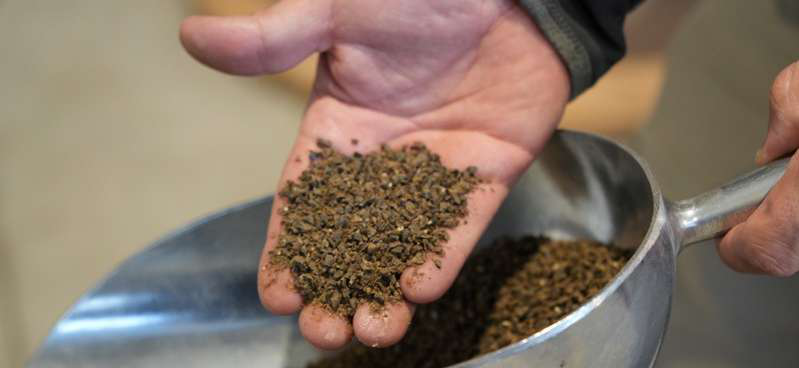

### BENESSERE E WELFARE

Valutazione di nuove azioni volte al benessere dei dipendenti e al welfare aziendale

### FORMAZIONE

Integrazione e sviluppo della pianificazione e del monitoraggio della formazione formale e informale della popolazione aziendale, includendo la sensibilizzazione sulle tematiche ESG

### COINVOLGIMENTO

Definizione di azioni volte al coinvolgimento, alla fidelizzazione e alla soddisfazione continua dei dipendenti, favorendo un clima aziendale positivo

### ONBOARDING

Strutturazione di un processo di onboarding per i nuovi assunti

### DIVERSITA’ E INCLUSIONE

Promozione di politiche di inclusione, diversità e pari opportunità

GRI: 413-1; 413-2; ESRS: S3-1; S3-2; S3-4; S3-5

# Comunità e territorio

RE-CIG® si configura fin dalla sua

nascita come un’impresa impegnata nel

miglioramento continuo delle proprie

performance sociali e ambientali, con

l’obiettivo di generare valore non solo per

l’azienda stessa, ma anche per la

comunità locale e il territorio in cui opera.

Oltre alla gestione responsabile dei rifiuti,

l’azienda mira a contribuire in modo

concreto al benessere ambientale e

sociale.

Un passaggio rilevante in questo

L’attenzione verso la comunità si

percorso è stato il riconoscimento

concretizza anche attraverso donazioni

ufficiale del mozzicone di sigaretta come

annuali a sostegno di progetti sociali,

rifiuto specifico. Fino al 2019, tale scarto

iniziative ambientali e campagne di

veniva trattato come rifiuto

sensibilizzazione. L’obiettivo è generare

indifferenziato. L’iniziativa avviata da RE-

un impatto positivo durevole sul territorio.

CIG® ha portato l’Albo Nazionale dei

In tale prospettiva, l’impegno civico di

Gestori Ambientali a emanare una

RE-CIG® non rappresenta solo un fattore

delibera che ha attribuito al mozzicone il

reputazionale, ma rafforza il rapporto con

#### codice CER 20.03.99, definendone una

i cittadini, sostiene lo sviluppo economico

classificazione distinta. Questo ha

locale e promuove un modello di crescita

permesso all’azienda di avviare processi

sostenibile.

dedicati alla raccolta e al riciclo del

materiale, contribuendo a una gestione

Nel 2024, RE-CIG® ha sostenuto diverse

più consapevole del rifiuto e

iniziative rilevanti, tra cui:

introducendo un cambiamento a livello

normativo.

## Walk of Butts

Le iniziative sono state rese possibili

grazie alla collaborazione con una rete di

associazioni locali, che ha contribuito

mettendo a disposizione risorse

operative e competenze specifiche, con

l’obiettivo di sensibilizzare la cittadinanza

sull’importanza della cura dell’ambiente.

Ogni appuntamento ha rappresentato

un’occasione per promuovere

comportamenti responsabili, rafforzando

la consapevolezza dei partecipanti

Nel corso di 11 camminate ecologiche,

rispetto alla tutela del territorio e alla

oltre 500 partecipanti hanno preso parte

corretta gestione dei rifiuti. Al tempo

attivamente alla raccolta dei rifiuti, con

stesso, le camminate hanno favorito la

particolare attenzione ai mozziconi di

coesione sociale e alimentato un senso

sigaretta, tra le principali fonti di

di responsabilità collettiva verso uno

inquinamento urbano.

sviluppo sostenibile.

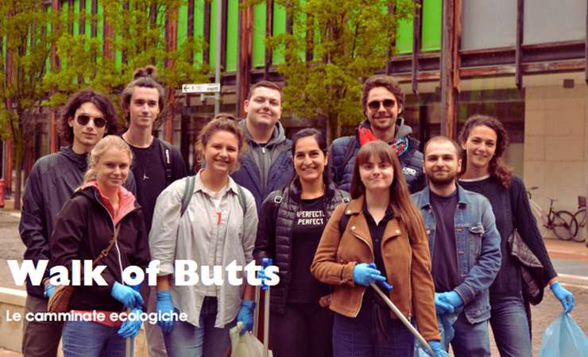

## InsideOut

Insieme all’intervento estetico, il percorso

psicologico contribuisce ad affrontare le

conseguenze emotive legate a

esperienze traumatiche, come incidenti,

interventi chirurgici o malattie

oncologiche. Il tatuaggio, in questo

contesto, viene impiegato per coprire

cicatrici visibili, restituendo alle persone

una percezione più positiva di sé.

Il progetto è stato reso possibile grazie

alla collaborazione tra professionisti di

Attraverso il progetto InsideOut sono stati

ambiti diversi – medici, psicoterapeuti e

realizzati 3 tatuaggi correttivi,

tatuatori – che hanno lavorato in sinergia

accompagnati da un percorso di supporto

per offrire un percorso di

psicologico. L’iniziativa utilizza il

accompagnamento integrato. Il contributo

tatuaggio come strumento di recupero

ricevuto ha consentito di supportare

personale, con l’obiettivo di migliorare la

direttamente tre persone nel loro

qualità della vita e il rapporto con la

percorso di ripresa fisica ed emotiva.

propria immagine corporea.

## Free Walls

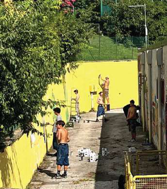

Nell’ambito del progetto “Muri Liberi”,

promosso dal Comune di Trento, è stata

organizzata una giornata di creatività

urbana che ha coinvolto 15 writer nella

realizzazione di un’opera collettiva lungo

400 metri di muro. L’iniziativa ha offerto

uno spazio dedicato all’espressione

artistica spontanea, con l’obiettivo di

valorizzare l’arte pubblica e stimolare una

riflessione condivisa sul ruolo della

rigenerazione urbana. Attraverso il

linguaggio del writing, l’evento ha

trasformato un'infrastruttura cittadina in

un luogo di identità e partecipazione.

## Io mi rifiuto!

Sono state realizzate due iniziative pilota

L’approccio ludico ha favorito

del progetto “Io mi rifiuto!”, rivolte a

l’apprendimento e stimolato la

scuole primarie e secondarie di primo

partecipazione attiva.

grado, con l’obiettivo di promuovere la

Il progetto mira a sensibilizzare le nuove

sostenibilità ambientale tramite attività

generazioni rispetto all’importanza della

educative. Attraverso giochi, laboratori e

tutela ambientale, contribuendo alla

strumenti interattivi, gli studenti sono stati

formazione di cittadini consapevoli e

coinvolti in un percorso formativo

attenti all’impatto delle proprie azioni sul

pensato per avvicinarli ai temi del riciclo,

pianeta.

della riduzione degli sprechi e della

responsabilità ambientale.

## Sensibilizzazione

Oltre ai progetti già descritti, RE-CIG®

porta avanti numerose iniziative di valore

sociale e territoriale. In collaborazione

con la Cooperativa Sociale CS4,

l’azienda sostiene percorsi di inclusione e

sviluppo professionale. Inoltre, mette a

disposizione i propri servizi gratuitamente

durante festival dedicati alla sostenibilità

ambientale, promossi in diverse località

italiane.

In collaborazione con il Centro Anti

Violenza di Trento e la Banca per il

L’impegno verso il territorio si estende

Trentino-Alto Adige, è stata realizzata

anche al mondo dello sport: RE-CIG®

una campagna di sensibilizzazione

sostiene attivamente diverse realtà

rivolta a oltre 400 dipendenti, focalizzata

sportive locali, promuovendo valori di

sui temi della violenza di genere e della

partecipazione e benessere. Tra le

violenza economica.

collaborazioni attive:

Aquila Basket

L’iniziativa ha previsto l’organizzazione di

Karate Trento

sessioni informative e workshop tematici,

Calcio Azzurra

con l’obiettivo di fornire strumenti utili per

Padel Trento

riconoscere e affrontare tali fenomeni.

Samuel Maranelli, atleta

Attraverso un approccio formativo, i

professionista di freccette a livello

partecipanti sono stati accompagnati in

europeo

un percorso di consapevolezza

individuale e collettiva.

L’azienda, quindi, integra la sostenibilità

ambientale con un approccio attento alla

L’intervento non si è limitato alla

dimensione sociale, contribuendo a

trasmissione di conoscenze, ma ha

generare un impatto positivo e duraturo

inteso favorire un cambiamento culturale

sul tessuto comunitario. Un modello

all’interno dell’ambiente di lavoro,

d’impresa che dimostra come la crescita

promuovendo un contesto improntato al

economica possa accompagnarsi a un

rispetto, alla prevenzione e al supporto

impegno civico concreto e virtuoso.

reciproco.

Totale donato per progetti a impatto sociale: €4.442,00

GRI: 308-1; 414-1. ESRS: S2-1; S2-2; S2-5; G1-2.

# Catena del valore

L’attenzione agli impatti sociali e

In quest’ottica, l’azienda privilegia

ambientali generati lungo la catena di

fornitori locali, con l’obiettivo di ridurre

fornitura rappresenta un elemento

l’impatto ambientale legato alla logistica

centrale nelle strategie operative di RE-

e allo stesso tempo contribuire allo

CIG®. La gestione responsabile dei

sviluppo economico del territorio.

rapporti con i fornitori è considerata un

fattore chiave per garantire la coerenza

Nel tempo, RE-CIG® ha individuato una

tra i valori aziendali e le pratiche adottate

rete di fornitori strategici per garantire la

lungo l’intero ciclo produttivo.

continuità e l’affidabilità della propria

attività, in particolare nelle fasi di

Promuovere criteri di sostenibilità nella

lavorazione, verniciatura e

catena del valore consente non solo di

personalizzazione (serigrafia) dei

ridurre i rischi ambientali e sociali

posaceneri. Particolare attenzione è stata

associati alle attività di

posta nella scelta dei partner produttivi:

approvvigionamento, ma anche di

per la realizzazione delle colonnine, RE-

generare effetti positivi estesi alla

CIG® si affida a un’impresa sociale

comunità e al territorio. Questo approccio

trentina.

viene integrato nelle politiche di

selezione e monitoraggio dei partner,

Anche nella selezione del fornitore per la

nella convinzione che la sostenibilità

verniciatura è stato adottato un approccio

condivisa sia un motore di sviluppo

responsabile: la valutazione ha

responsabile.

considerato l’intero ciclo produttivo, con

particolare attenzione al consumo di

La selezione dei fornitori in RE-CIG®

risorse idriche, alla natura delle vernici

avviene secondo criteri che integrano

utilizzate e alla sostenibilità dei processi

responsabilità ambientale, sostenibilità

adottati. In questo modo, RE-CIG®

sociale e coerenza con i valori aziendali.

intende costruire una filiera coerente con

Ogni partner viene scelto non solo per la

la propria missione, promuovendo

qualità del servizio offerto, ma anche per

un’economia più attenta, inclusiva e a

il suo impegno concreto verso pratiche

basso impatto.

produttive etiche e sostenibili.

### VOLONTARIATO

Sviluppo di opportunità di volontariato aziendale

### SENSIBILIZZAZIONE

Sviluppo di iniziative di sensibilizzazione della comunità

### IMPATTO SOCIALE

Implementazione di progettualità continuative ad impatto sociale positivo sulla comunità locale

### CATENA DI FORNITURA

Monitoraggio e gestione ESG della catena di fornitura

ESRS: S4-1; S4-2; S4-3; S4-4; S4-5

# I nostri clienti

La soddisfazione dei bisogni del cliente è

In un contesto in cui l'attenzione alla

il principale motore che guida le attività di

sostenibilità ambientale e sociale è

RE-CIG®.

sempre più rilevante, RE-CIG® si

Prendersi cura dei propri clienti, ascoltare

impegna a rispondere alle esigenze dei

attentamente le loro esigenze e risolvere

suoi clienti offrendo soluzioni che

i loro problemi rappresentano elementi

contribuiscono positivamente alla loro

chiave per il successo e la crescita

salute, educazione e cultura, generando

dell'azienda.

valore aggiunto attraverso il rispetto

dell'ambiente e della comunità.

### Numero clienti Principali clienti

350

500

300

400

250

200

300

150

200

100

100

50

307 70 18 5 1 1 21 1

0

Comuni

Basi militari

Ristoranti stella verde Michelin

Aeroporti

Pubblico

Strutture ricettive

Università

Aziende private

133 218 424

2022 2023 2024 0

## Comunicazione e supporto clienti

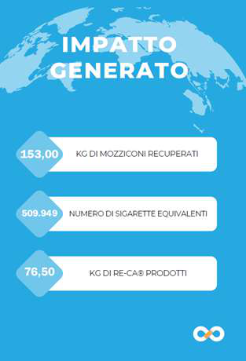

RE-CIG® dedica una sezione specifica

del proprio sito web per facilitare il

contatto diretto con i clienti, garantendo

trasparenza e accessibilità ai servizi

offerti.

L’azienda risponde tempestivamente a

reclami e richieste, offrendo un supporto

in tempo reale che favorisce la

risoluzione rapida delle problematiche e

consolida un rapporto di fiducia con la

clientela.

Al servizio di raccolta e riciclo dei

mozziconi, RE-CIG® affianca un

supporto informativo pensato per

valorizzare l’impegno ambientale dei

clienti e agevolare la comunicazione

interna ed esterna relativa alle azioni di

sostenibilità.

A questo scopo, ogni anno viene

elaborato un report dedicato che illustra

le azioni intraprese e gli impatti positivi

raggiunti grazie alla collaborazione con le

aziende clienti.

Tale documento mira a dimostrare

l’efficacia dell’iniziativa e a fornire nuovi

strumenti per sensibilizzare gli

stakeholder.

L’obiettivo è dimostrare l’effetto

dell’iniziativa e offrire alle aziende

strumenti nuovi per sensibilizzare tutti gli

stakeholder.

La reportistica fornita, integrata al

formulario di ritiro rifiuti, include i seguenti

dati:

Chilogrammi di mozziconi raccolti;

Equivalente in numero di sigarette;

Chilogrammi di Re-CA® prodotti nello

stabilimento di Civezzano (TN);

Emissioni di CO₂ equivalente evitate

rispetto alla termovalorizzazione;

Riduzione dei rifiuti indifferenziati

grazie alla raccolta dedicata.

I dati forniti all’interno del Report sono

supportati dall’analisi LCA di processo

condotta dall’azienda e aggiornata

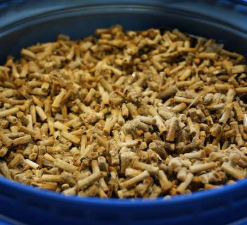

annualmente.

Questi indicatori possono essere inseriti

nei Report di Sostenibilità aziendali in

conformità con gli standard GRI 306

(rifiuti) e GRI 305 (emissioni),

contribuendo così a una maggiore

trasparenza e alla misurazione

dell’impatto ambientale delle

organizzazioni servite. In questo modo,

RE-CIG® non si limita alla gestione di un

rifiuto critico, ma assume il ruolo di

partner attivo nella strategia ESG dei

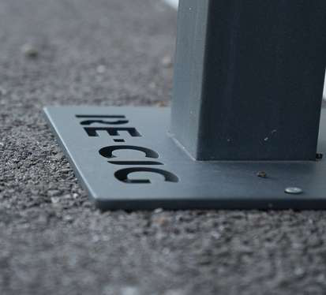

clienti.

Per garantire la qualità e la sicurezza dei

prodotti, RE-CIG® applica controlli

rigorosi: per ogni lotto di produzione

viene prelevato un campione inviato a un

laboratorio esterno per l’analisi delle

proprietà fisico-chimiche. Sulla base di

tali analisi viene emessa la dichiarazione

di End of Waste, che autorizza la

commercializzazione del prodotto come

materia prima seconda.

# Sensibilizzazione fumatori

RE-CIG® nasce con un obiettivo chiaro:

L’obiettivo è promuovere una maggiore

affrontare uno degli impatti meno visibili

consapevolezza ambientale e modificare

ma tra i più gravi legati al fumo di

comportamenti consolidati, partendo da

sigaretta, quello ambientale. Se è ormai

un gesto semplice ma quotidiano: dove

noto che fumare danneggia la salute

gettiamo un mozzicone?

umana, è ancora poco riconosciuto il

Attraverso campagne informative,

peso che i mozziconi abbandonati hanno

collaborazioni con enti pubblici e privati,

sull’ambiente. Eppure, parliamo di un

RE-CIG® diffonde un messaggio chiaro: i

rifiuto globale: ogni anno, nel mondo, si

mozziconi non devono essere gettati a

stima che vengano disperse

terra né smaltiti nei cestini tradizionali,

irresponsabilmente circa 850.000

ma raccolti in modo corretto e avviati a

#### tonnellate di mozziconi di sigaretta, di

un processo di recupero sostenibile. A

cui oltre 13.000 tonnellate solo in Italia.

oggi, grazie alla rete di colonnine per la

raccolta installate in tutta Italia, ha

I filtri delle sigarette sono composti da

permesso di raccogliere dal 2020 più di

materiali che possono impiegare fino a

#### 60 milioni di mozziconi, evitando che

#### 12 anni per degradarsi. Nel frattempo,

tonnellate di rifiuti tossici finissero

rilasciano nell’ambiente più di 200

nell’ambiente. Dietro ogni mozzicone

sostanze tossiche, tra cui nicotina, metalli

raccolto c’è un gesto consapevole, un

pesanti e microplastiche, che finiscono

passo avanti verso una società più

nei suoli, nelle acque e nella catena

attenta e responsabile.

alimentare. Nel Mar Mediterraneo, i

La missione di RE-CIG® è fermare

mozziconi rappresentano fino al 40% dei

questo inquinamento invisibile ma

#### rifiuti plastici galleggianti, minacciando

pericoloso, trasformando un’abitudine

la fauna marina e gli ecosistemi.

dannosa in un’opportunità di

cambiamento. Solo attraverso

Per questo, RE-CIG® non si limita a

l’informazione, l’educazione e la

proporre una soluzione tecnica al

partecipazione attiva sarà possibile

problema, ma si impegna attivamente

ridurre l’incidenza di questo rifiuto e

nella sensibilizzazione dei fumatori e

contribuire a un futuro in cui il rispetto per

della cittadinanza in generale.

l’ambiente sia parte integrante delle

nostre scelte quotidiane.

# 850.000

Tonnellate di mozziconi abbandonati all’anno nel mondo

# +13.000

Tonnellate di mozziconi abbandonati all’anno in Italia

# 200

Sostanze tossiche contenute nei filtri di sigarette

# 12 anni

Tempo impiegato dal filtro per degradarsi in natura

# +60 mln

Mozziconi raccolti da RE-CIG® dal 2020

### LIVELLO DI SODDISFAZIONE

Implementazione di un sistema formale e periodico di monitoraggio della soddisfazione dei clienti

### COMUNICAZIONE ESG

Sviluppo di un Piano di Comunicazione ESG interno ed esterno

# Ambiente

ESRS: E1-1; E1-2; E1-3; E1-4;

## L’impegno nei confronti dell’ambiente

L’impegno verso la tutela ambientale

A integrazione di questo percorso, nel

rappresenta un elemento centrale nella

2024 è stata condotta una nuova analisi

gestione delle attività di RE-CIG®.

di sostenibilità ambientale focalizzata sul

Consapevole degli impatti che le attività

ciclo di lavorazione interno, con l’obiettivo

industriali possono generare

di identificare ulteriori margini di

sull’ambiente, l’azienda promuove

miglioramento e ottimizzare le prestazioni

costantemente pratiche sostenibili lungo

ambientali dell’organizzazione.

l’intero ciclo operativo, con l’obiettivo di

minimizzare tali effetti.

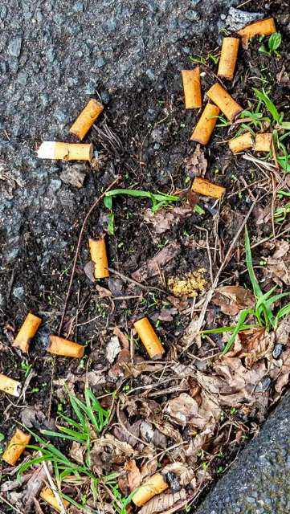

Uno degli aspetti prioritari della politica

ambientale riguarda l’uso responsabile

delle risorse idriche. Per limitare il

consumo di acqua potabile, RE-CIG® ha

installato un sistema di raccolta delle

acque piovane, impiegate poi nei

processi di lavaggio delle strutture.

Questa soluzione contribuisce a ridurre

l’estrazione dalle reti idriche tradizionali e

a favorire un impiego più efficiente e

sostenibile della risorsa.

Nel 2023 l’azienda ha realizzato una

valutazione del ciclo di vita (LCA) dei

propri servizi, con un successivo

aggiornamento relativo ai dati del 2024,

per analizzare in dettaglio l’impatto

ambientale delle proprie attività.

GRI: 305-1; 305-2; 305-3; 305-5;

ESRS: E1-6; E1-7;

## Decarbonizzazione e gestione delle emissioni di CO2

#### Carbon footprint di organizzazione

Le emissioni sono state suddivise

secondo i tre ambiti definiti dalla norma

Nell’ambito dell’analisi del Ciclo di Vita

ISO 14064-1:

del Prodotto (LCA), aggiornato nel 2024,

RE-CIG® ha condotto un’approfondita

#### Scope 1 – Emissioni dirette:

analisi della carbon footprint aziendale

derivanti principalmente dal consumo

riferita all’anno 2024, in conformità con la

di gas per il riscaldamento invernale

norma internazionale ISO 14064-1.

e/o gas refrigerante per la

climatizzazione estiva; carburante per

L’obiettivo è stato quello di misurare e

i mezzi aziendali utilizzati nel

comprendere le emissioni di gas serra

recupero dei mozziconi;

(GHG) generate lungo le principali attività

#### Scope 2 – Emissioni indirette da

aziendali, al fine di definire strategie

#### energia: associate all’energia

efficaci per la loro riduzione.

elettrica e al calore acquistati

dall’azienda;

L’analisi ha preso in considerazione due

#### Scope 3 – Altre emissioni indirette:

unità funzionali chiave, rappresentative

legate a materiali, acquisti di beni e

dei principali output produttivi

macchinari, trasporti, e processi

dell’organizzazione:

produttivi esternalizzati.

La produzione di un singolo Smoker

In mancanza di dati primari misurati, si è

Point, dispositivo per la raccolta dei

fatto ricorso a fattori di emissione

mozziconi di sigaretta;

standardizzati provenienti da fonti

La produzione di 1 kg di acetato di

istituzionali quali l’ISPRA (Istituto

cellulosa riciclato (Re-CA®).

Superiore per la Protezione e la Ricerca

Ambientale)

A partire dal 2023, la produzione di

Smoker Point è stata esternalizzata

all’Impresa Sociale Ruota Libera.

In particolare:

#### Carbon footprint di organizzazione

Per l’energia elettrica prelevata dalla

rete si è utilizzato il fattore di

Scope 1

conversione relativo al 2023 di

27.3%

0,2399 kgCO₂/kWh (location-based);

Per la produzione del ferro utilizzato,

si è stimato un valore medio di 1,2

kgCO₂/kg, basato su una

Scope 2

composizione 50% riciclata e 50% da

1%

materia prima primaria;

Per i trasporti, le emissioni sono state

Scope 3

71.7%

calcolate utilizzando i dati riportati nel

libretto di circolazione dei veicoli

aziendali.

L’analisi ha evidenziato che il principale

In linea con gli obiettivi di transizione

impatto ambientale in termini di emissioni

ecologica e miglioramento continuo,

di CO₂ è legato alla produzione degli

l’azienda ha pianificato una serie di

Smoker Points (Scope 3), che da sola

interventi per la riduzione delle emissioni

rappresenta circa il 72% delle emissioni

e l’ottimizzazione dei consumi energetici:

totali dell’azienda. È importante

sottolineare che tale attività è

Installazione di un impianto

completamente esternalizzata e dunque

fotovoltaico sul tetto del sito

soggetta a politiche ambientali dei

produttivo per l’autoproduzione di

partner produttivi.

energia da fonte rinnovabile;

Graduale sostituzione del parco

Le emissioni dirette (Scope 1) sono

mezzi aziendale, privilegiando veicoli

attribuibili principalmente al consumo di

elettrici o a basso impatto

carburante per i veicoli impiegati nella

ambientale;

logistica e nel recupero dei mozziconi di

Ottimizzazione dei processi

sigaretta. Per quanto riguarda le

produttivi, finalizzata a migliorare

emissioni indirette da energia (Scope 2),

l’efficienza energetica e ridurre il

nel 2024 RE-CIG® ha acquistato energia

consumo specifico di energia per

elettrica al 100% da fonti rinnovabili,

unità di prodotto.

riducendo a zero l’impatto derivante da

questa fonte emissiva.

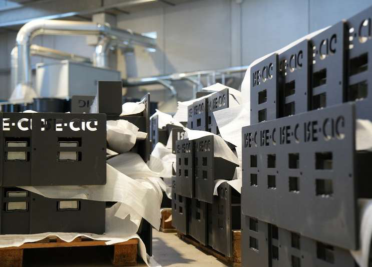

#### Carbon footprint di prodotto

Grazie a una visione proattiva e alla

Nel 2024 è stata calcolata anche la

volontà di integrare innovazione e

carbon footprint di prodotto per le

sostenibilità, l’azienda si impegna a

categorie di prodotto riportate di seguito.

minimizzare il proprio impatto

ambientale, contribuendo attivamente

Le valutazioni condotte si riferiscono a

agli obiettivi globali di mitigazione dei

dati forniti da RE-CIG® per il 2024. Le

cambiamenti climatici e promuovendo un

fasi coinvolte nel calcolo includono

modello produttivo circolare e

l’approvvigionamento dei mozziconi di

responsabile.

sigaretta (rifiuto), il trasporto e la

#### Carbon footprint di prodotto

trasformazione del rifiuto in acetato di

Produzione acetato di cellulosa

5.3%

cellulosa.

La stima della carbon footprint aziendale

rappresenta un passo fondamentale nella

strategia di decarbonizzazione di RE-

CIG®.

Produzione smokers point

92.6%

|**Prodotto**|**Descrizione del processo/prodotto**|
|---|---|
|Smokers point|Dispositivi metallici prodotti meccanicamente ed installati presso i punti di raccolta dei mozziconi di sigaretta. Dal 2023 l’attività produttiva è stata esternalizzata all’Impresa Sociale Ruota Libera di Rovereto (TN).|
|Acetato di cellulosa|Materia prima seconda derivata dal processo di recupero RE- CIG® dei mozziconi di sigaretta|

|**Attività**|**Quantità**|**Unità di misura**|
|---|---|---|
|Produzione Smoker Point (SP)|30,20|Kgco2/cadauno|
|Produzione acetato di cellulosa|1,72|KgCO2/kg|
|Processo di recupero|0,67|KgCO2/kg di mozziconi|

GRI: 302-1; 302-2; 302-3; 302-4; 302-5.

ESRS: E1-5.

## Efficienza energetica

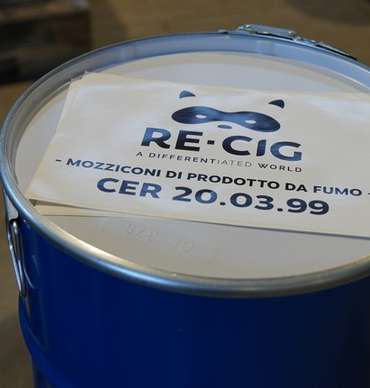

RE-CIG® adotta un approccio

responsabile verso l’ambiente,

implementando pratiche volte a ridurre

l’impatto energetico delle proprie attività.

L’azienda monitora costantemente i

consumi e si approvvigiona

esclusivamente da Dolomiti Energia,

fornitore che garantisce energia elettrica

al 100% da fonti rinnovabili. Nel 2024, il

consumo totale è stato di 8.933 kWh.

A sostegno di questa strategia

sostenibile, è prevista l’installazione di un

impianto fotovoltaico a cura della

Nel 2024, la valutazione del ciclo di vita

proprietà dell’immobile. Sono inoltre in

(LCA) ha stimato che la produzione di un

uso diverse soluzioni per migliorare

singolo Smoker Point richiede in media

l’efficienza energetica, quali:

0,5 kWh di energia elettrica. Con 2.700

Illuminazione LED a basso consumo,

unità prodotte, il consumo totale è stato

Sistemi di climatizzazione con

di circa 1.350 kWh. Ogni Smoker Point

programmazione intelligente,

pesa in media 20 kg, per un totale annuo

Dispositivi con stand-by automatico

di circa 54.000 kg di prodotto finito.

per ridurre i consumi degli apparecchi

inattivi.

Durante lo stesso anno, sono stati

lavorati 648 kg di mozziconi di sigaretta,

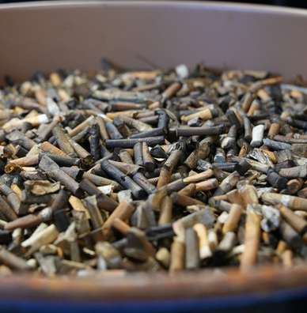

utilizzati come materia prima per

l’estrazione dell’acetato di cellulosa. La

lavorazione ha richiesto circa 64,8 ore di

attività e un consumo energetico

complessivo di circa 1.825 kWh.

RE-CIG® sta inoltre conducendo

un’analisi dettagliata delle

apparecchiature impiegate nel ciclo

produttivo dell’acetato di cellulosa, con

l’obiettivo di identificare ulteriori

opportunità di ottimizzazione energetica.

GRI: 303-1; 303-2; 303-3; 303-4; 303-5.

ESRS: E2-4; E3-1; E3-2; E3-3; E3-4.

## Gestione dell’acqua

RE-CIG® adotta un approccio

L’acqua impiegata nei cicli produttivi, in

responsabile nella gestione della risorsa

particolare per il lavaggio dei materiali,

idrica, con l’obiettivo di monitorare e

viene trattata tramite un impianto di

ridurre l’impatto ambientale dei propri

depurazione dedicato. Il sistema

processi produttivi. La strategia integrata

permette la rimozione degli inquinanti e,

comprende il controllo dei consumi, la

quando tecnicamente fattibile, il riutilizzo

corretta gestione degli scarichi e, quando

interno del refluo trattato. Il monitoraggio

possibile, il recupero dell’acqua.

continuo degli scarichi conferma la

conformità ai limiti normativi, in linea con

Nel 2024, il consumo totale di acqua è

la vigente legislazione ambientale.

stato pari a 19 metri cubi, ripartiti in 11

mc nel primo semestre (gennaio–giugno)

Per ridurre ulteriormente la dipendenza

e 8 mc nel secondo (luglio–dicembre),

dall’acqua potabile, RE-CIG® ha

dati basati su consumi stimati. Questo

implementato un sistema di raccolta delle

volume contenuto rispecchia il profilo

acque meteoriche, destinato a usi non

idrico dell’azienda, che non prevede usi

industriali. Inoltre, è in corso la

intensivi della risorsa.

realizzazione di un impianto di

concentrazione, progettato per diminuire

il volume d’acqua da trattare e contenere

gli sprechi durante il ciclo produttivo.

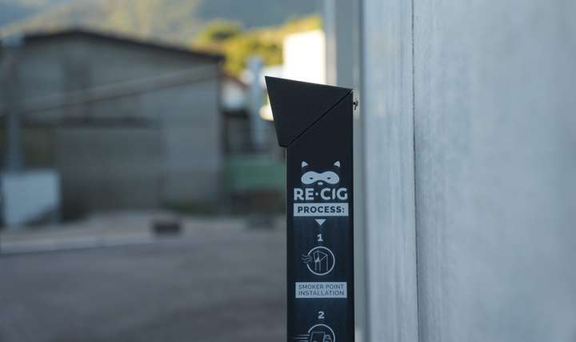

GRI: 306-1; 306-2; 306-3; 306-4; 306-5.

ESRS: E2-4; E2-5.

## Gestione dei rifiuti

RE-CIG® adotta un approccio strutturato

Lo smaltimento di questi rifiuti è gestito

e responsabile nella gestione dei rifiuti,

tramite un sistema di tracciamento

sia nelle attività d’ufficio sia nei processi

rigoroso, che prevede l’utilizzo di

produttivi.

formulari specifici, nel pieno rispetto delle

normative ambientali vigenti e delle

Nel contesto produttivo, l’azienda effettua

disposizioni relative alla gestione dei

una corretta raccolta e differenziazione

rifiuti speciali.

dei rifiuti generati durante le fasi di

lavorazione, tra cui:

Acque di lavaggio e acque di

condensa del compressore;

Imballaggi in legno;

Rifiuti metallici e scarti ferrosi;

Dischi della mola disco, il cui utilizzo

è stato dismesso a partire dal 2025.

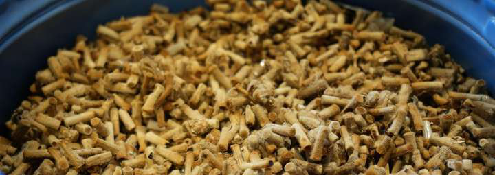

### ECONOMIA CIRCOLARE

Adozione di pratiche di economia circolare all’interno delle strutture aziendali

### QUALITA’ DELL’ARIA

Valutazione periodica della qualità dell’aria e del benessere dell’ambiente lavorativo

### RISPETTO AMBIENTALE

Promozione di una cultura aziendale rispettosa dell’ambiente

### ENERGIA RINNOVABILE

Installazione di un nuovo impianto fotovoltaico e di un impianto di co- generazione

### IMPRONTA DI CARBONIO

Monitoraggio e riduzione dell’impronta di carbonio dell’azienda, integrando la carbon footprint nel processo decisionale e adottando azioni di compensazione e mitigazione

# Obiettivi 2025

### GOVERNANCE

Rafforzare l’impegno ESG attraverso la nomina di un team dedicato, il coinvolgimento strutturato degli stakeholder, l’adozione di pratiche etiche formali e la valutazione di certificazioni ESG.

### LAVORATORI

Promuovere benessere, inclusione e coinvolgimento attraverso azioni di welfare, onboarding strutturato e sensibilizzazione ESG, rafforzando la soddisfazione e la coesione interna.

### COMUNITA’

Rafforzare l’impatto sociale attraverso iniziative di sensibilizzazione, volontariato aziendale e progetti continuativi sul territorio, promuovendo anche una filiera responsabile.

### CLIENTI

Migliorare l’ascolto e la trasparenza verso i clienti attraverso il monitoraggio della soddisfazione e una comunicazione ESG chiara e continuativa.

### AMBIENTE

Integrare la sostenibilità nel business tramite economia circolare, energie rinnovabili e riduzione della carbon footprint, promuovendo una cultura aziendale attenta all’ambiente.

# Annex

# GRI Content Index

|**Dichiarazione d’uso**|RE-CIG® ha rendicontato le informazioni citate nel presente indice dei contenuti GRI per il periodo 01.01.2024 – 31.12.2024, con riferimento agli Standard GRI.|
|---|---|
|**Utilizzato GRI 1**|GRI 1 - Principi Fondamentali - versione 2021|

|**GRI**|**Descrizione**|**Ubicazione**|**Omissioni**|
|---|---|---|---|
|2-1|Dettagli organizzativi|Nota Metodologica||
|2-2|Entità incluse nella rendicontazione di sostenibilità dell’organizzazione|Nota Metodologica||
|2-3|Periodo di rendicontazione, frequenza e punto di contatto|Nota Metodologica||
|2-4|Revisione delle informazioni||Non applicabile|
|2-5|Assurance esterna||Non applicabile|
|2-6|Attività, catena del valore e altri rapporti di business|Business core e settori di competenza||
|2-7|Dipendenti|Le nostre persone||
|2-8|Lavoratori non dipendenti|Le nostre persone||
|2-9|Struttura e composizione della governance|Governance||

|**GRI**|**Descrizione**|**Ubicazione**|**Omissioni**|
|---|---|---|---|
|2-10|Nomina e selezione del massimo organo di governo|Governance||
|2-11|Presidente del massimo organo di governo|Governance||
|2-12|Ruolo del massimo organo di governo|Governance||
|2-13|Delega di responsabilità per la gestione degli impatti|Governance||
|2-14|Ruolo del massimo organo di governo nella rendicontazione di sostenibilità|Governance||
|2-15|Conflitti d’interesse||Informazioni non disponibili|
|2-16|Comunicazione delle criticità||Informazioni non disponibili|
|2-17|Conoscenze collettive del massimo organo di governo||Informazioni non disponibili|
|2-18|Valutazione della performance del massimo organo di governo||Informazioni non disponibili|
|2-19|Norme riguardanti le remunerazioni|Le nostre persone||
|2-20|Procedura di determinazione della retribuzione||Informazioni non disponibili|
|2-21|Rapporto di retribuzione totale annuale||Informazioni non disponibili|
|2-22|Dichiarazione sulla strategia di sviluppo sostenibile|Strategia di sostenibilità||

|**GRI**|**Descrizione**|**Ubicazione**|**Omissioni**|
|---|---|---|---|
|2-23|Impegno in termini di policy|Strategia di sostenibilità||
|2-24|Integrazione degli impegni in termini di policy||Informazioni non disponibili|
|2-25|Processi volti a rimediare impatti negativi|Tabella degli impatti||
|2-26|Meccanismi per richiedere chiarimenti e sollevare preoccupazioni||Informazioni non disponibili|
|2-27|Conformità a leggi e regolamenti|Governance||
|2-28|Appartenenza ad associazioni||Non applicabile|
|2-29|Approccio al coinvolgimento degli stakeholder|Stakeholder engagement||
|2-30|Contratti collettivi|Le nostre persone||
|3-1|Processo di determinazione dei temi materiali||Informazioni non disponibili|
|3-2|Elenco dei temi materiali|Analisi di materialità||
|3-3|Gestione dei temi materiali|Analisi di materialità||
|201-1|Valore economico diretti generato e distribuito|Analisi di materialità||
|201-2|Implicazioni finanziarie e altri rischi e opportunità risultanti dal cambiamento climatico|Tabella degli impatti||

|**GRI**|**Descrizione**|**Ubicazione**|**Omissioni**|
|---|---|---|---|
|201-3|Obblighi riguardanti i piani di benefit definiti e altri piani pensionistici||Informazioni non disponibili|
|201-4|Assistenza finanziaria ricevuta dal governo||Informazioni non disponibili|
|202-1|Rapporto tra i salari base standard per genere rispetto al salario minimo locale||Informazioni non disponibili|
|202-2|Percentuale di alta dirigenza assunta attingendo dalla comunità locale||Informazioni non disponibili|
|203-1|Investimenti in infrastrutture e servizi supportati||Informazioni non disponibili|
|203-2|Impatti economici indiretti significativi|Tabella degli impatti||
|204-1|Proporzione della spesa effettuata a favore dei fornitori locali||Informazioni non disponibili|
|205-1|Operazioni valutate per determonare i rischi relativi alla corruzione||Informazioni non disponibili|
|205-2|Comunicazione e formazione su normative e procedure anticorruzione||Informazioni non disponibili|
|205-3|Incidenti confermati di corruzione e misure adottate||Informazioni non disponibili|
|206-1|Azioni legali relative a comportamento anti- competitivo, attività di trust e prassi monopolistiche||Informazioni non disponibili|

|**GRI**|**Descrizione**|**Ubicazione**|**Omissioni**|
|---|---|---|---|
|207-1|Approccio alle imposte||Informazioni non disponibili|
|207-2|Governance relativa alle imposte, controllo e gestione del rischio||Informazioni non disponibili|
|207-3|Coinvolgimento degli stakeholder e gestione delle preoccupazioni correlate alle imposte|Stakeholder engagement||
|207-4|Reportistica per Paese||Non applicabile|
|301-1|Materiali utilizzati in base al peso o al volume||Informazioni non disponibili|
|301-2|Materiali di ingresso riciclati utilizzati|Il processo produttivo||
|301-3|Prodotti recuperati e i relativi materiali di confezionamento|Il processo produttivo||
|302-1|Consumo di energia interno all’organizzazione|Efficienza energetica||
|302-2|Consumo di energia esterno all’organizzazione|Efficienza energetica||
|302-3|Intensità energetica|Efficienza energetica||
|302-4|Riduzione del consumo di energia|Efficienza energetica||

|**GRI**|**Descrizione**|**Ubicazione**|**Omissioni**|
|---|---|---|---|
|302-5|Riduzioni dei requisiti energetici di prodotti e servizi|Efficienza energetica||
|303-1|Interazioni con l’acqua come risorsa condivisa|Gestione dell’acqua||
|303-2|Gestione degli impatti legati allo scarico dell’acqua|Gestione dell’acqua||
|303-3|Prelievo idrico|Gestione dell’acqua||
|303-4|Scarico idrico|Gestione dell’acqua||
|303-5|Consumo idrico|Gestione dell’acqua||
|304-1|Siti operativi di proprietà, concessi in leasing o gestiti in aree protette e in aree di elevato valore in termini di biodiversità fuori da aree protette oppure vicini a tali aree||Informazioni non disponibili|
|304-2|Impatti significativi di attività, prodotti e servizi sulla biodiversità||Informazioni non disponibili|
|304-3|Habitat protetti o ripristinati||Informazioni non disponibili|
|304-4|Specie dell’elenco di preservazione nazionale e dell’Elenco rosso dell’IUCN con habitat in aree interessate da operazioni||Informazioni non disponibili|
|305-1|Emissioni di gas a effetto serra (GHG) dirette (Scope 1)|Decarbonizzaz ione e gestione delle emissioni di CO2||

|**GRI**|**Descrizione**|**Ubicazione**|**Omissioni**|
|---|---|---|---|
|305-2|Emissioni di gas a effetto serra (GHG) indirette da consumi energetici (Scope 2)|Decarbonizzaz ione e gestione delle emissioni di CO2||
|305-3|Altre emissioni di gas a effetto serra (GHG) indirette (Scope 3)|Decarbonizzaz ione e gestione delle emissioni di CO2||
|305-4|Intensità delle emissioni di gas a effetto (GHG)||Informazioni non disponibili|
|305-5|Riduzione di emissioni di gas a effetto serra (GHG)|Decarbonizzaz ione e gestione delle emissioni di CO2||
|305-6|Emissioni di sostanze che riducono lo strato di ozono (ODS)||Informazioni non disponibili|
|305-7|Ossidi di azoto (NOx), ossidi di zolfo (SOx) e altre emissioni nell’aria rilevanti||Informazioni non disponibili|
|306-1|Generazione di rifiuti e impatti significativi correlati ai rifiuti|Gestione dei rifiuti||
|306-2|Gestione di impatti significativi correlati ai rifiuti|Gestione dei rifiuti||
|306-3|Rifiuti generati|Gestione dei rifiuti||
|306-4|Rifiuti non conferiti in discarica|Gestione dei rifiuti||
|306-5|Rifiuti non conferiti in discarica|Gestione dei rifiuti||

|**GRI**|**Descrizione**|**Ubicazione**|**Omissioni**|
|---|---|---|---|
|308-1|Nuovi fornitori che sono stati selezionati utilizzando criteri ambientali|Catena del valore||
|308-2|Impatti ambientali negativi nella catena di fornitura e misure adottate||Informazioni non disponibili|
|401-1|Assunzioni di nuovi dipendenti e avvicendamento dei dipendenti|Gestione delle risorse umane||
|401-2|Benefici per i dipendenti a tempo pieno che non sono disponibili per i dipendenti a tempo determinato o part-time||Informazioni non disponibili|
|401-3|Congedo parentale||Informazioni non disponibili|
|402-1|Periodi minimi di preavviso in merito alle modifiche operative||Informazioni non disponibili|
|403-1|Sistema di gestione della salute e sicurezza sul lavoro||Informazioni non disponibili|
|403-2|Identificazione del pericolo, valutazione del rischio e indagini sugli incidenti||Informazioni non disponibili|
|403-3|Servizi per la salute professionale||Informazioni non disponibili|
|403-4|Partecipazione e consultazione dei lavoratori in merito a programmi di salute e sicurezza sul lavoro e relativa comunicazione||Informazioni non disponibili|
|403-5|Formazione dei lavoratori sulla salute e sicurezza sul lavoro||Informazioni non disponibili|

|**GRI**|**Descrizione**|**Ubicazione**|**Omissioni**|
|---|---|---|---|
|403-6|Promozione della salute dei lavoratori||Informazioni non disponibili|
|403-7|Prevenzione e mitigazione degli impatti in materia di salute e sicurezza sul lavoro direttamente collegati da rapporti di business||Informazioni non disponibili|
|403-8|Lavoratori coperti da un sistema di gestione della salute e sicurezza sul lavoro|Le nostre persone||
|403-9|Infortuni sul lavoro|Le nostre persone||
|403-10|Malattia professionale|Le nostre persone||
|404-1|Numero medio di ore di formazione all’anno per dipendente||Informazioni non disponibili|
|404-2|Programmi di aggiornamento delle competenze dei dipendenti e di assistenza nella transizione||Informazioni non disponibili|
|404-3|Percentuale di dipendenti che ricevono periodicamente valutazioni delle loro performance e dello sviluppo professionale||Informazioni non disponibili|
|405-1|Diversità negli organi di governance e tra i dipendenti||Informazioni non disponibili|
|405-2|Rapporto tra salario di base e retribuzione delle donne rispetto agli uomini||Informazioni non disponibili|
|406-1|Episodi di discriminazione e misure correttive adottate||Informazioni non disponibili|
|407-1|Attività e fornitori presso i quali il diritto alla libertà di associazione e di contrattazione collettiva potrebbero essere a rischio||Informazioni non disponibili|

|**GRI**|**Descrizione**|**Ubicazione**|**Omissioni**|
|---|---|---|---|
|408-1|Attività e fornitori che presentano un rischio significativo di episodi di lavoro minorile||Informazioni non disponibili|
|409-1|Attività e fornitori che presentano un rischio significativo di episodi di lavoro forzato o obbligatorio||Informazioni non disponibili|
|410-1|Personale di sicurezza che ha seguito corsi di formazione sulle pratiche o procedure riguardanti i diritti umani||Informazioni non disponibili|
|411-1|Episodi di violazioni dei diritti delle popolazioni indigene||Informazioni non disponibili|
|413-1|Operazioni con il coinvolgimento della comunità locale, valutazioni degli impatti e programmi di sviluppo|Comunità e territorio||
|413-2|Operazioni con rilevanti impatti effettivi e potenziali sulle comunità locali|Comunità e territorio||
|414-1|Nuovi fornitori che sono stati selezionati utilizzando criteri sociali|Catena del valore||
|414-2|Impatti sociali negativi nella catena di fornitura e azioni intraprese||Informazioni non disponibili|
|415-1|Contributi politici||Informazioni non disponibili|
|416-1|Valutazione degli impatti sulla salute e la sicurezza di categorie di prodotti e servizi||Informazioni non disponibili|
|416-2|Episodi di non conformità relativamente agli impatti su salute e sicurezza di prodotti e servizi||Informazioni non disponibili|

|**GRI**|**Descrizione**|**Ubicazione**|**Omissioni**|
|---|---|---|---|
|417-1|Requisiti relativi all’etichettatura e informazioni su prodotti e servizi||Informazioni non disponibili|
|417-2|Episodi di non conformità concernenti l’etichettatura e informazioni su prodotti e servizi||Informazioni non disponibili|
|417-3|Episodi di non conformità concernenti comunicazioni di marketing||Informazioni non disponibili|
|418-1|Fondati reclami riguardanti violazioni della privacy dei clienti e perdita di loro dati||Informazioni non disponibili|

# ESRS Content Index

|**ESRS**|**Descrizione**|**Ubicazione**|**Omissioni**|
|---|---|---|---|
|E1-1|Piano di transizione per la mitigazione dei cambiamenti climatici|L’impegno nei confronti dell’ambiente||
|E1-2|Politiche relative alla mitigazione dei cambiamenti climatici e all’adattamento agli stessi|L’impegno nei confronti dell’ambiente||
|E1-3|Azioni e risorse relative alle politiche in materia di cambiamenti climatici|L’impegno nei confronti dell’ambiente||
|E1-4|Obiettivi relativi alla mitigazione dei cambiamenti climatici e all’adattamento agli stessi|L’impegno nei confronti dell’ambiente||
|E1-5|Consumo di energia e mix energetico|Efficienza energetica||
|E1-6|Emissioni lorde di GES di ambito 1,2,3 ed emissioni totali di GES|Decarbonizzaz ione e gestione delle emissioni di CO2||
|E1-7|Assorbimenti di GES e progetti di mitigazione delle emissioni di GES finanziati con crediti di carbonio|Decarbonizzaz ione e gestione delle emissioni di CO2||
|E1-8|Fissazione del prezzo interno del carbonio||Informazioni non disponibili|

|**ESRS**|**Descrizione**|**Ubicazione**|**Omissioni**|
|---|---|---|---|
|E1-9|Effetti finanziari attesi di rischi fisici e di transazione rilevanti e potenziali opportunità legate al clima||Informazioni non disponibili|
|E2-1|Politiche relative all’inquinamento||Informazioni non disponibili|
|E2-2|Azioni e risorse connesse all’inquinamento||Informazioni non disponibili|
|E2-3|Obiettivi connessi all’inquinamento||Informazioni non disponibili|
|E2-4|Inquinamento di aria, acqua e suolo|Gestione dell’acqua; gestione dei rifiuti||
|E2-5|Sostanze preoccupanti e sostanze estremamente preoccupanti|Gestione dei rifiuti||
|E2-6|Effetti finanziari attesi di impatti, rischi e opportunità legati all’inquinamento|Analisi di materialità||
|E3-1|Politiche connesse alle acque e alle risorse marine|Gestione dell’acqua||
|E3-2|Azioni e risorse connesse alle acque e alle risorse marine|Gestione dell’acqua||
|E3-3|Obiettivi connessi alle acque e alle risorse marine|Gestione dell’acqua||
|E3-4|Consumo idrico|Gestione dell’acqua||
|E4-1|Piano di transizione e attenzione alla biodiversità e agli ecosistemi nella strategia e nel modello aziendale||Informazioni non disponibili|

|**ESRS**|**Descrizione**|**Ubicazione**|**Omissioni**|
|---|---|---|---|
|E4-2|Politiche relative alla biodiversità e agli ecosistemi||Informazioni non disponibili|
|E4-3|Azioni e risorse relative alla biodiversità e agli ecosistemi||Informazioni non disponibili|
|E4-4|Obiettivi relativi alla biodiversità e agli ecosistemi||Informazioni non disponibili|
|E4-5|Metriche di impatto relative ai cambiamenti della biodiversità e degli ecosistemi||Informazioni non disponibili|
|E4-6|Effetti finanziari attesi derivanti da rischi e opportunità connessi alla biodiversità e agli ecosistemi||Informazioni non disponibili|
|E5-1|Politiche relative all’uso delle risorse e all’economia circolare|Il processo produttivo||
|E5-2|Azioni e risorse relative all’uso delle risorse e all’economia circolare|Il processo produttivo||
|E5-3|Obiettivi relativi all’uso delle risorse e all’economia circolare|Il processo produttivo||
|E5-4|Flussi di risorse in entrata||Informazioni non disponibili|
|E5-5|Flussi di risorse in uscita||Informazioni non disponibili|
|E5-6|Effetti finanziari attesi derivanti da impatti, rischi e opportunità connessi all’uso delle risorse e all’economia circolare||Informazioni non disponibili|

|**ESRS**|**Descrizione**|**Ubicazione**|**Omissioni**|
|---|---|---|---|
|S1-1|Politiche relative alla forza lavoro propria|Le nostre persone||
|S1-2|Processi di coinvolgimento dei lavoratori propri e dei rappresentanti dei lavoratori in merito agli impatti||Informazioni non disponibili|
|S1-3|Processi per porre rimedio agli impatti negativi e canali che consentono ai lavoratori propri di sollevare preoccupazioni||Informazioni non disponibili|
|S1-4|Interventi su impatti rilevanti per la forza lavoro propria e approcci per la mitigazione dei rischi rilevanti e il perseguimento di opportunità rilevanti in relazione alla forza lavoro propria, nonché efficacia di tali azioni||Informazioni non disponibili|
|S1-5|Obiettivi legati alla gestione degli impatti negativi rilevanti, al potenziamento degli impatti positivi e alla gestione dei rischi e delle opportunità rilevanti||Informazioni non disponibili|
|S1-6|Caratteristiche dei dipendenti dell'impresa|Le nostre persone||
|S1-7|Caratteristiche dei lavoratori non dipendenti nella forza lavoro propria dell'impresa|Le nostre persone||
|S1-8|Copertura della contrattazione collettiva e dialogo sociale|Le nostre persone||
|S1-9|Metriche della diversità|Le nostre persone||
|S1-10|Salari adeguati|Le nostre persone||
|S1-11|Protezione sociale||Informazioni non disponibili|

|**ESRS**|**Descrizione**|**Ubicazione**|**Omissioni**|
|---|---|---|---|
|S1-12|Persone con disabilità||Informazioni non disponibili|
|S1-13|Metriche di formazione e sviluppo delle competenze||Informazioni non disponibili|
|S1-14|Metriche di salute e sicurezza||Informazioni non disponibili|
|S1-15|Metriche dell'equilibrio tra vita professionale e vita privata|Le nostre persone||
|S1-16|Metriche di retribuzione (divario retributivo e retribuzione totale)||Informazioni non disponibili|
|S1-17|Incidenti, denunce e impatti gravi in materia di diritti umani|||
|S2-1|Politiche connesse ai lavoratori nella catena del valore|Catena del valore||
|S2-2|Processi di coinvolgimento dei lavoratori nella catena del valore in merito agli impatti|Catena del valore||
|S2-3|Processi per porre rimedio agli impatti negativi e canali che consentono ai lavoratori nella catena del valore di esprimere preoccupazioni||Informazioni non disponibili|
|S2-4|Interventi su impatti rilevanti per i lavoratori nella catena del valore e approcci per la gestione dei rischi rilevanti e il conseguimento di opportunità rilevanti per i lavoratori nella catena del valore, nonché efficacia di tali azioni||Informazioni non disponibili|
|S2-5|Obiettivi legati alla gestione degli impatti negativi rilevanti, al potenziamento degli impatti positivi e alla gestione dei rischi e delle opportunità rilevanti|Catena del valore||

|**ESRS**|**Descrizione**|**Ubicazione**|**Omissioni**|
|---|---|---|---|
|S3-1|Politiche relative alle comunità interessate|Comunità e territorio||
|S3-2|Processi di coinvolgimento delle comunità interessate in merito agli impatti|Comunità e territorio||
|S3-3|Processi per porre rimedio agli impatti negativi e canali che consentono alle comunità interessate di esprimere preoccupazioni||Informazioni non disponibili|
|S3-4|Interventi su impatti rilevanti sulle comunità interessate e approcci per gestire i rischi rilevanti e conseguire opportunità rilevanti per le comunità interessate, nonché efficacia di tali azioni|Comunità e territorio||
|S3-5|Obiettivi alla gestione degli impatti rilevanti negativi, al potenziamento degli impatti positivi e alla gestione dei rischi e delle opportunità rilevanti|Comunità e territorio||
|S4-1|Politiche connesse ai consumatori e agli utilizzatori finali|I nostri clienti||
|S4-2|Processi di coinvolgimento dei consumatori e degli utilizzatori finali in merito agli impatti|I nostri clienti||
|S4-3|Processi per porre rimedio agli impatti negativi e canali che consentono ai consumatori e agli utilizzatori finali di esprimere preoccupazioni|I nostri clienti||
|S4-4|Interventi su impatti rilevanti per i consumatori e gli utilizzatori finali e approcci per la mitigazione dei rischi rilevanti e il conseguimento di opportunità rilevanti in relazione ai consumatori e agli utilizzatori finali, nonché efficacia di tali azioni|I nostri clienti||
|S4-5|Obiettivi legati alla gestione degli impatti rilevanti negativi, al potenziamento degli impatti positivi e alla gestione dei rischi e delle opportunità rilevanti|I nostri clienti||

|**ESRS**|**Descrizione**|**Ubicazione**|**Omissioni**|
|---|---|---|---|
|G1-1|Politiche in materia di cultura d’impresa e condotta delle imprese|Governance||
|G1-2|Gestione dei rapporti con i fornitori|Catena del valore||
|G1-3|Prevenzione e individuazione della corruzione attiva o passiva||Informazioni non disponibili|
|G1-4|Casi accertati di corruzione attiva o passiva||Informazioni non disponibili|
|G1-5|Influenza politica e attività di lobbying||Informazioni non disponibili|
|G1-6|Prassi di pagamento||Informazioni non disponibili|

|**ESRS**|**Descrizione**|**Ubicazione**|**Omissioni**|
|---|---|---|---|
|G1-1|Politiche in materia di cultura d’impresa e condotta delle imprese|Governance||
|G1-2|Gestione dei rapporti con i fornitori|Catena del valore||
|G1-3|Prevenzione e individuazione della corruzione attiva o passiva||Informazioni non disponibili|
|G1-4|Casi accertati di corruzione attiva o passiva||Informazioni non disponibili|
|G1-5|Influenza politica e attività di lobbying||Informazioni non disponibili|
|G1-6|Prassi di pagamento||Informazioni non disponibili|

Per qualsiasi informazione relativa al Bilancio di Sostenibilità 2024 contattare:

#### Roberto Rossi Raccagni

esg@re-cig.it

Il Report di Sostenibilità è stato curato da:

#### Marco Fimognari

#### Roberto Rossi Raccagni

Consulenza e realizzazione:

Con la collaborazione di:

Si ringrazia tutto il personale per il contributo alla realizzazione del primo Bilancio di

Sostenibilità di RE-CIG.

Frazione Mochena, 21

38045, Civezzano (TN)

Telefono: +39 0461 1721134

E-mail: info@re-cig.it

Sito web: https://www.re-cig.it/

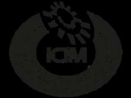

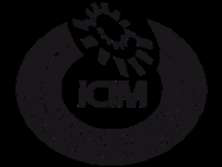

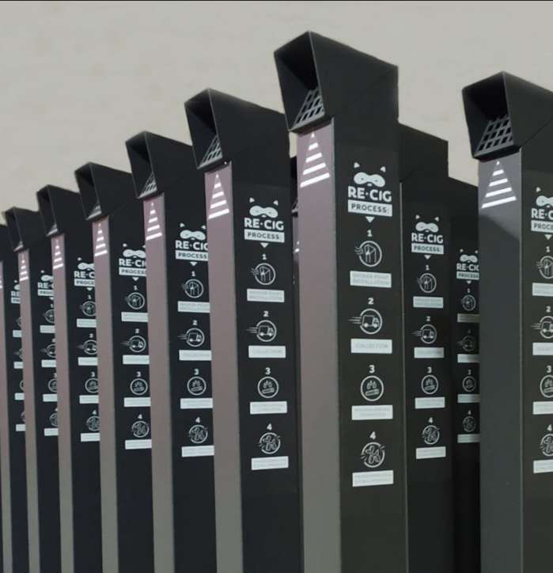

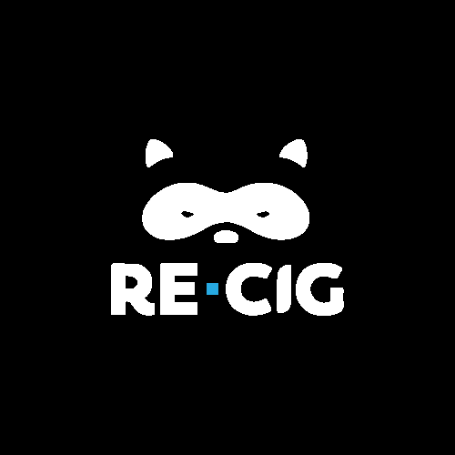