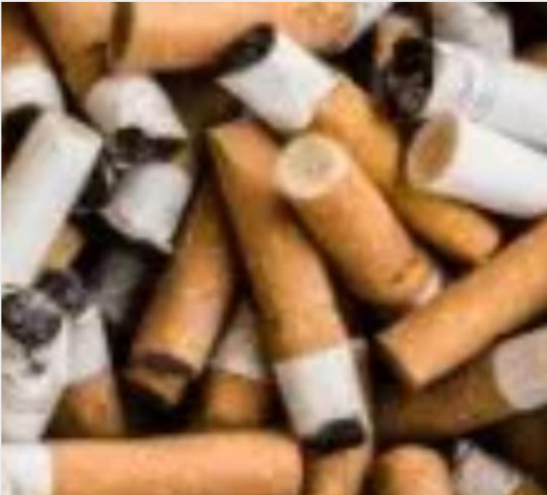
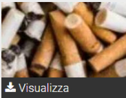

<!-- Page 0 | source: demo_924e4249_page_0.md | kind: md -->

il TRENTINO
QUOTIDIANO ONLINE DELLA PROVINCIA AUTONOMA DI TRENTO Ufficio stampa

Segui
PROVINCIA AUTONOMA DI TRENTO

Comunicati

Riviste

Tematiche

Focus

Web TV

Newsletter

Cerca

ATTUALITÀ

AMBIENTE

CULTURA

ISTRUZIONE E FORMAZIONE

ECONOMIA, IMPRESE E ATTIVITÀ PRODUTTIVE

LAVORO E OCCUPAZIONE

FAMIGLIA, SOCIALE E COMUNITÀ

SICUREZZA E PROTEZIONE CIVILE

SALUTE E BENESSERE

ALTRO

Ufficio Stampa

Comunicati

A Civezzano un impianto innovativo per il recupero dei mozziconi di sigarette

Sabato, 07 Agosto 2021 - 13:20

Comunicato 2148

Decisione della Giunta su proposta del vicepresidente e assessore all'urbanistica e ambiente

# A Civezzano un impianto innovativo per il recupero dei mozziconi di sigarette

Novità sul fronte della raccolta differenziata, che riguardano una particolare tipologia di rifiuto: il mozzicone di sigaretta. A Civezzano la ditta RE-CIG Srl realizzerà infatti un impianto di "recupero dei rifiuti urbani non pericolosi da mozziconi di prodotti da fumo". Il rifiuto, una volta raccolto, verrà utilizzato per la produzione di un conglomerato plastico granulato da utilizzare, dopo apposita certificazione, come materia prima. Il progetto risulta coerente con gli obiettivi definiti dal Piano provinciale per lo smaltimento dei rifiuti, inerenti l'aumento della raccolta differenziata. Risulta in accordo inoltre con i principi dell'economia circolare e con quelli della direttiva 904/2019 sulla riduzione del consumo di plastiche monouso. Si tratta di un progetto inedito sul territorio: a tutt'oggi infatti non sono presenti in Trentino impianti di questo tipo.

L'approccio proposto dalla ditta, tramite l'utilizzo di appositi cestini per la raccolta dei mozziconi, andrà ad intercettare e recuperare una frazione di rifiuto che, per quanto esigua, non è al momento né riciclato, né raccolto in maniera differenziata, ma smaltito in discarica e spesso abbandonato sulle strade. Con la realizzazione di questo impianto, quindi, verrà attivato il recupero di una nuova frazione di rifiuto sottraendolo allo smaltimento finale in discarica.

Il progetto prevede diverse fasi di lavorazione del rifiuto, quali setacciatura e separazione della carta, successivo lavaggio, essiccazione e miscelazione termica e granulazione dei filtri. Le lavorazioni sono coperte da brevetto internazionale.

(mp)

Fonte: Ufficio Stampa

Ambiente

Versione Stampabile

Immagini

Visualizza

Ufficio Stampa della Giunta provinciale

Piazza Dante, 15 - 38122 Trento (IT)

uff.stampa@provincia.tn.it

Pubblicazione iscritta nel registro della stampa
del Tribunale di Trento in data 13.08.1963 al n. 100
Direttore responsabile Giampaolo Pedrotti

Provincia autonoma di Trento - C.F. e P.IVA: 00337460224
Numero verde 800 903606

Chi siamo

- Redazione

- Staff

- Trentino Film Commission

Contatti

- Dove Siamo

- Struttura di riferimento

- Scrivici

Informazioni legali

- Note legali

- Privacy

- Social media policy

- Info cookies

- Dichiarazione di accessibilità
