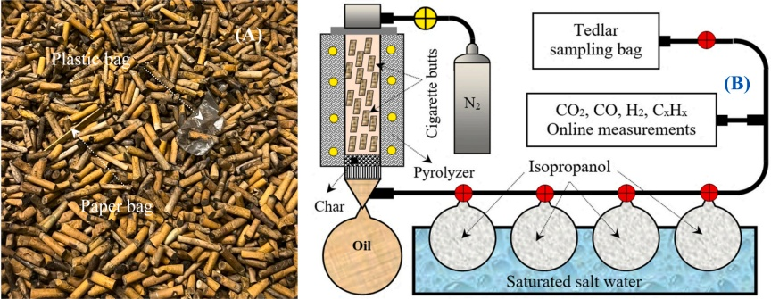
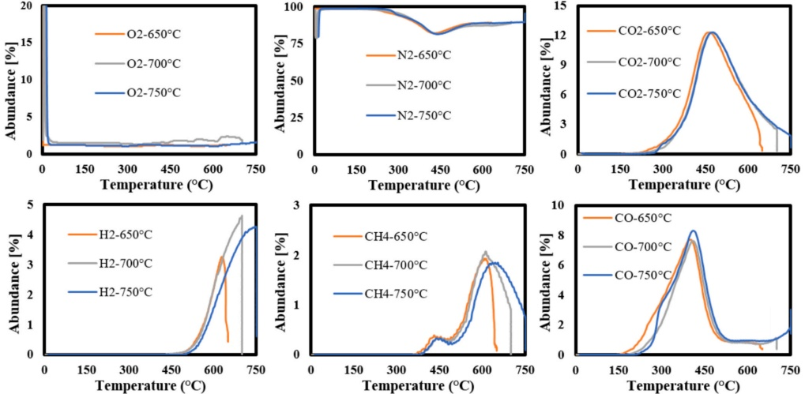
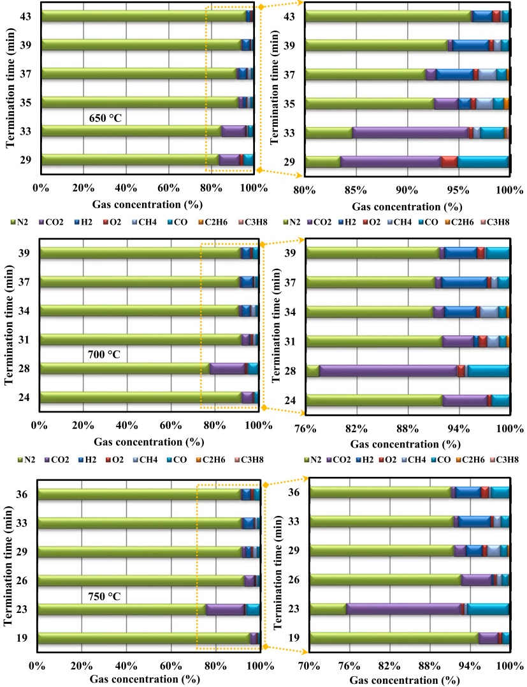
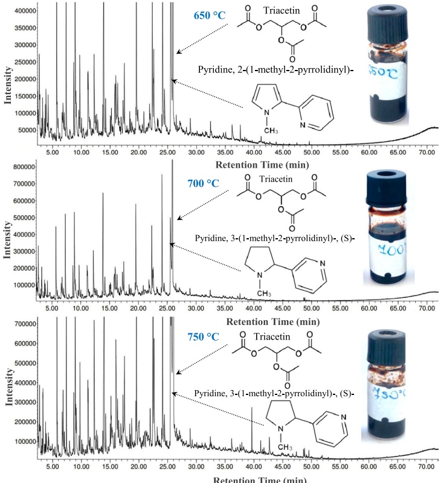
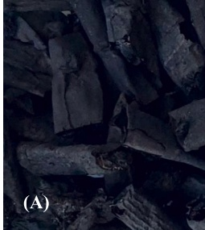
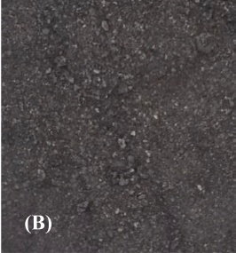
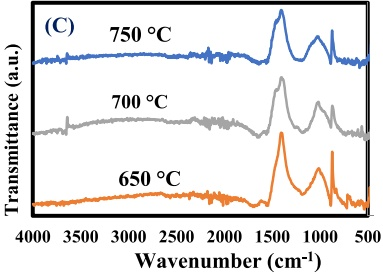
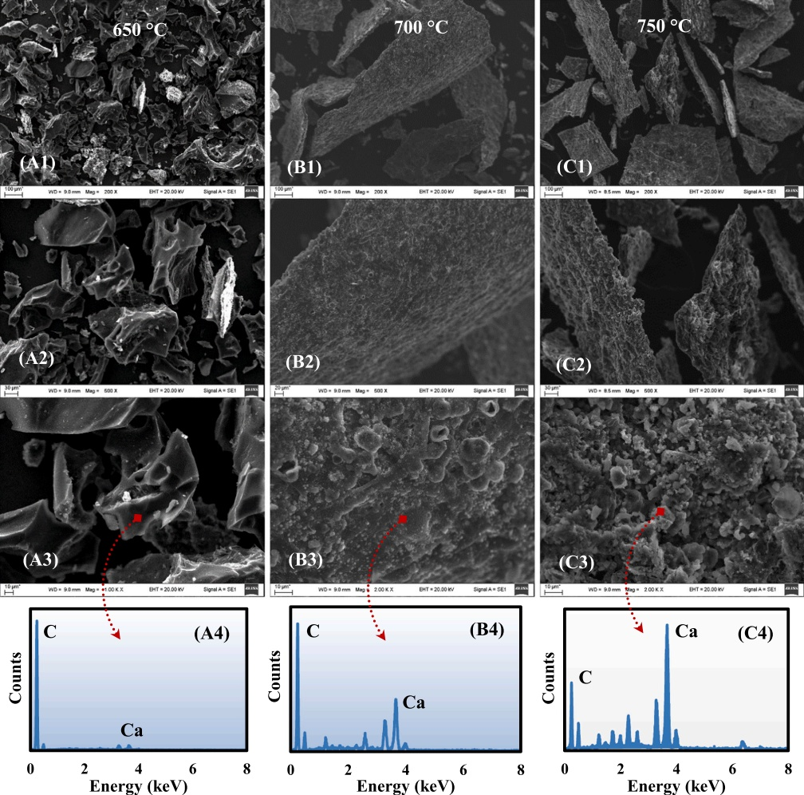
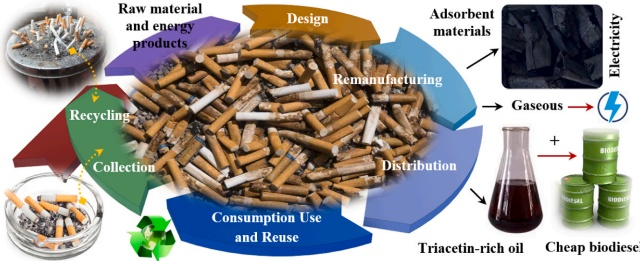

# Pyrolysis of cigarette butts as a sustainable strategy to recover triacetin for low-cost and efficient biodiesel production

Samy Yousef $ ^{a,*} $, Justas Eimontas $ ^{b} $, Kęstutis Zakarauskas $ ^{b} $, Nerijus Striūgas $ ^{b} $

 $ ^{a} $ Department of Production Engineering, Faculty of Mechanical Engineering and Design, Kaunas University of Technology, LT-51424 Kaunas, Lithuania

 $ ^{b} $ Lithuanian Energy Institute, Laboratory of Combustion Processes, Breslaujos 3, LT-44403 Kaunas, Lithuania

##### ARTICLE INFO

Keywords:

Cigarette butts

Pyrolysis

Triacetin-rich oil

Biodiesel

Gaseous

Porous char

## ABSTRACT

The high cost of biodiesel production is the main barrier to its commercialization. Addition of triacetin as an oxygenated additive to biodiesel is one of the most profitable solutions to augment its combustion propensity if it is extracted from a sustainable and cheap source and processed properly. Cigarette butts (CBs) are very rich in triacetin and are characterized by high sustainability, hence, they are probable to help to realize the concept of this strategy. Within this framework, this research aims to recover triacetin from CBs using pyrolysis treatment as an eco-friendly solution. The experiments were carried out in a 200 g reactor at different reaction temperatures (650, 700, and 750 °C) to obtain optimal conditions that yield the largest abundance of triacetin in the pyrolysis oil. The gases generated during the entire decomposition process were observed using an instantaneous gas analyzer. The effect of reaction temperature on the yield and composition of oil and char products was also investigated using GC/MS, SEM-EDX, and FTIR. It was found that the reaction temperature had no significant impact on the yield of pyrolysis products which was estimated in the ranges of 38–39.5 wt% (oil), 25.7–27.7 wt% (char), and 33–36.4 wt% (gas). However, the biggest quantity of triacetin (43%) was synthesized at 750 °C accompanied by a gaseous product consisting mainly of CO₂ (11.6%), CO (8%), H₂ (4.6%), and CH₄ (2%). The composite char product with a porous structure was very rich in calcium (up to 32 wt%) in the form of debris (at 650 °C) and flakes (at 750 °C) with a pore size smaller than 1 μm. This study experimentally proved that the pyrolysis process has a high potential to dispose of CBs and can be used as a sustainable source of triacetin recovery.

## 1. Introduction

Recently, biodiesel has been getting a lot of attention as a renewable fuel with low harmful emissions and biodegradability when facing fossil fuels depletion and its environmental pollution [1]. However, the high production cost of biodiesel remains a major barrier to its worldwide marketing, which is estimated to be twice the price of fossil fuels [2]. One of the most effective modern solutions is to mix it with triacetin (as an oxygenated additive) in a slightly higher amount up to wt. 10% without affecting its performance recognized by ASTM D6451 and EN 14214 standards due to its mutual solubility [3,4]. Recent studies have also shown that this approach has an appropriate environmental performance and can contribute to reducing air pollution [5,6]. Despite the promising results and its contribution to increased combustion propensity of biodiesel [4], triacetin is usually produced chemically by the esterification of glycerol with acetic acid in presence of a catalyst, such as sulfuric acid, which consumes a lot of chemicals resulting in many waste and toxic residues [7,8]. Therefore, new sources and production concepts to provide sustainable triacetin at a lower cost are urgently needed. Cigarette butts (CBs) are among such sources that contain a significant amount of triacetin, which is used as an additive in tobacco during the production process [3]. Also, CBs are characterized by their sustainability and huge amount, where more than 6 trillion cigarettes are produced annually to meet the growing demand for bad smoking practices and habits that are greedily spreading among different age groups and genders all over the world [9]. It is worth noting that the average weight of one cigarette butts is estimated at 0.2 g, which means that more than 1.1 million tons can be produced annually [10], which is about 2% of the global waste-printed circuit board produced annually (55 million tons) [11]. Besides, many modern companies and systems have recently been established with different designs to collect this waste completely separately from other solid waste, which facilitates its

Fig. 1. A) image of the supplied CBs and B) sketch of the test set up for pyrolysis of CBs in the integrated conversion system.
 

Table 1  Yields distribution of the pyrolyzed CBs at various pyrolysis temperatures.
 

<table border=1 style='margin: auto; word-wrap: break-word;'><tr><td style='text-align: center; word-wrap: break-word;'>Pyrolysis product</td><td style='text-align: center; word-wrap: break-word;'>650 °C</td><td style='text-align: center; word-wrap: break-word;'>700 °C</td><td style='text-align: center; word-wrap: break-word;'>750 °C</td></tr><tr><td style='text-align: center; word-wrap: break-word;'>Oil (wt%)</td><td style='text-align: center; word-wrap: break-word;'>39.52</td><td style='text-align: center; word-wrap: break-word;'>38.33</td><td style='text-align: center; word-wrap: break-word;'>37.92</td></tr><tr><td style='text-align: center; word-wrap: break-word;'>Char (wt%)</td><td style='text-align: center; word-wrap: break-word;'>27.45</td><td style='text-align: center; word-wrap: break-word;'>26.61</td><td style='text-align: center; word-wrap: break-word;'>25.68</td></tr><tr><td style='text-align: center; word-wrap: break-word;'>Gaseous (wt%)</td><td style='text-align: center; word-wrap: break-word;'>33.03</td><td style='text-align: center; word-wrap: break-word;'>35.05</td><td style='text-align: center; word-wrap: break-word;'>36.40</td></tr></table>

treatment and encourages investors to pay more attention to CBs and their potential valorization in the future. Despite the continuous efforts and warnings from the World Health Organization regarding harmful effects of smoking on human health, the number of smokers is constantly growing until it has become a habit that is difficult to overcome for many, to the extent that about 20% of smokers of the world smoke on average 16 cigarettes a day [12]. In addition, this industry has a huge global economic capacity and investments exceeding 814 billion US dollars [13], which makes it difficult to disrupt due to its negative impact on the global economy. Therefore, it is necessary to deal with this industry and its wastes as a fair accompli, and to develop the necessary strategies and policies for their safe disposal [14].

Cigarettes consist of finely shredded tobacco leaves, paper and a filter made of cellulose acetate fibres and all of them are joined by chemical and friction bonds [15]. After having burnt, a waste called cigarettes butts (CBs) is generated. They consist of the basic elements of cigarettes along with tobacco residue and burnt and filtered ash [16], which is classified as one of the most widespread and common sources of garbage and pollution on the planet that always causes many serious environmental and health issues [17]. Also, these CBs contain a huge amount of toxic chemicals, carcinogens, microplastic fibres, and radioactive elements that need special attention. Therefore, they must be handled appropriately, otherwise many dangerous problems can occur in the environment and organisms in general [18,19]. Unfortunately, currently, the large portion of CBs (two-thirds of CBs) is disposed of inappropriately, in particular, in landfills, by burning and incineration which helps for accumulation of toxic chemicals found in CBs in soil, water and air and generation of sediment and toxic pollutants [20]. In order to reduce the harmful environmental effects of these practices and to maximize the economic return of CBs, researchers have sought to develop a reliable platform for disposal of CBs and have developed

Fig. 2. Gases distribution resulting from pyrolysis of CBs at different temperatures.
 

N2  $ CO_{2} $  $ H_{2} $  $ O_{2} $  $ CH_{4} $  $ CO $  $ C_{2}H_{6} $  $ C_{3}H_{8} $  $ N_{2} $  $ CO_{2} $  $ H_{2} $  $ O_{2} $  $ CH_{4} $  $ CO $  $ C_{2}H_{6} $  $ C_{3}H_{8} $
 

Fig. 3. GC/MS analysis of the collected gases at  $ 650\,^{\circ}\mathrm{C} $,  $ 700\,^{\circ}\mathrm{C} $, and  $ 750\,^{\circ}\mathrm{C} $.
 

several environmental and sustainable strategies for extraction of secondary raw materials OR high value-added energy/chemical compounds from CBs. In the material extraction approach, the researchers have successfully extracted several materials from CBs, such as porous absorbers, cellulose-based thin films, cellulose nanocrystals, additives, porous nickel/carbon fibers, etc. [21–24]. However, this solution is surrounded by many dangers due to a toxic nature of CBs and thus, several pre-treatments steps are needed to reduce them, which costs additionally. Besides, a lot of chemicals are used during the treatments. Meanwhile, with regard to energy recovery solution, little pre-treatment is required as the conversion process takes place at a slightly higher temperature, which ensures that all toxic chemicals either decompose or remain in the reaction chamber [25]. Also, CBs are rich in volatiles that can be extracted and exploited if managed optimally [26,27]. The pyrolysis process is the most common thermochemical method and is a technically feasible option used for this purpose that offers an effective alternative to handle various waste through thermal cracking of a carbonaceous material in an oxygen-free environment [28], unlike the gasification process which produces syngas with a lower heating value [29,30]. Also, pyrolysis treatment is characterized by it is higher

Fig. 4. GC/MS of the pyrolysis oil synthesized at 650, 700, and 750 °C.
 

techno-economic and environmental preferences [31,32]. Accordingly, the pyrolysis process has received much attention for processing CBs into sustainable oil and gasoline compounds that can be used in the manufacture of chemicals and fuel products [33–35]. Meanwhile, char can be used for such applications as fillers, absorbed materials, fertilizers manufacturing, etc., leaving almost no residues [36]. However, most of these studies were focused on investigation of thermal degradation of CBs components individually using thermogravimetry, then analyzing the generated vapors using TG-FTIR and GC/MS analysis, followed by studying of their pyrolysis kinetic behaviour. Therefore, this treatment is in conflict with real industrial scale, where the treatment of a mixture is a logical solution to avoid usage of an additional separation and pre-treatment process [37].

Within this framework, Yousef et al. (2022) studied the pyrolysis kinetic behaviour and degradation pathway of CBs as a mixture and the study concluded that CBs can be treated as a mixture without separating each component and without a need for additional pre-separation systems and more sophisticated infrastructure [38]. However, such kinetic studies can be conducted to study the decomposition mechanism of CBs and the basic characteristics of the formulated vapour pyrolysis without real yield products and accurate products composition. Even studies in the literature related to investigation of pyrolysis of cigarette using different types of fixed bed reactors were conducted on different feedstocks such as tobacco waste and cigarette filters not on all components of the CBs as a mixture in a large reactor [33,39,40]. Also, the study by Wang et al. focused on investigating the thermal decomposition of cigarette filters (UCF) using microwave-assisted pyrolysis (MAP) in methanol and nitrogen ( $ N_{2} $) carrier gas [33]. Although the study succeeded in converting UCF into bio-oil with a yield of 29.17% ( $ N_{2} $) and 46.71% (methanol and  $ N_{2} $), the experiments were performed on UCF only, which needs pre-treatment and additional costs to separate UCF from paper and tobacco components in CBs. Besides, MAP is classified as an advanced version of pyrolysis processing and it is still under construction and needs more infrastructure and investments for upscaling. While the pyrolysis of the conventional version of CBs as a mixture is still missing. Such these studies are very important to determine the yield and composition of the oil, needs for future marketing and implementation. Based on that, this research aims to fill this gap and study the pyrolysis of CBs as a mixture using a 200 g integrated pyrolysis system, and then determine their product yield and composition under different operating temperature conditions.

## 2. Experimental

### 2.1. Materials preparation

The CBs used in the present research were supplied by Keenat Company, France. The supplied CBs had some cigarette packaging

GC/MS compounds generated from the pyrolysis of CBs at different temperatures.
 

<table border=1 style='margin: auto; word-wrap: break-word;'><tr><td colspan="3">650°C</td><td colspan="3">700°C</td><td colspan="3">750°C</td></tr><tr><td style='text-align: center; word-wrap: break-word;'>Time (min.)</td><td style='text-align: center; word-wrap: break-word;'>GC Compounds</td><td style='text-align: center; word-wrap: break-word;'>Area (%)</td><td style='text-align: center; word-wrap: break-word;'>Time (min.)</td><td style='text-align: center; word-wrap: break-word;'>GC Compounds</td><td style='text-align: center; word-wrap: break-word;'>Area (%)</td><td style='text-align: center; word-wrap: break-word;'>Time (min.)</td><td style='text-align: center; word-wrap: break-word;'>GC Compounds</td><td style='text-align: center; word-wrap: break-word;'>Area (%)</td></tr><tr><td style='text-align: center; word-wrap: break-word;'>3.924</td><td style='text-align: center; word-wrap: break-word;'>1-Propanol, 2-methyl-</td><td style='text-align: center; word-wrap: break-word;'>1.78</td><td style='text-align: center; word-wrap: break-word;'>5.741</td><td style='text-align: center; word-wrap: break-word;'>2-Cyclopenten-1-one</td><td style='text-align: center; word-wrap: break-word;'>4.48</td><td style='text-align: center; word-wrap: break-word;'>5.754</td><td style='text-align: center; word-wrap: break-word;'>2-Cyclopenten-1-one</td><td style='text-align: center; word-wrap: break-word;'>2.20</td></tr><tr><td style='text-align: center; word-wrap: break-word;'>5.735</td><td style='text-align: center; word-wrap: break-word;'>2-Cyclopenten-1-one</td><td style='text-align: center; word-wrap: break-word;'>3.38</td><td style='text-align: center; word-wrap: break-word;'>7.358</td><td style='text-align: center; word-wrap: break-word;'>1,2-Ethanediol, diacetate</td><td style='text-align: center; word-wrap: break-word;'>4.23</td><td style='text-align: center; word-wrap: break-word;'>7.391</td><td style='text-align: center; word-wrap: break-word;'>1,2-Ethanediol, diacetate</td><td style='text-align: center; word-wrap: break-word;'>3.20</td></tr><tr><td style='text-align: center; word-wrap: break-word;'>7.384</td><td style='text-align: center; word-wrap: break-word;'>1,2-Ethanediol, diacetate</td><td style='text-align: center; word-wrap: break-word;'>4.22</td><td style='text-align: center; word-wrap: break-word;'>8.659</td><td style='text-align: center; word-wrap: break-word;'>2-Cyclopenten-1-one, 2-methyl-</td><td style='text-align: center; word-wrap: break-word;'>1.82</td><td style='text-align: center; word-wrap: break-word;'>8.930</td><td style='text-align: center; word-wrap: break-word;'>Ethanone, 1-(2-furanyl)-</td><td style='text-align: center; word-wrap: break-word;'>3.49</td></tr><tr><td style='text-align: center; word-wrap: break-word;'>8.684</td><td style='text-align: center; word-wrap: break-word;'>2-Cyclopenten-1-one, 2-methyl-</td><td style='text-align: center; word-wrap: break-word;'>1.74</td><td style='text-align: center; word-wrap: break-word;'>8.930</td><td style='text-align: center; word-wrap: break-word;'>Ethanone, 1-(2-furanyl)-</td><td style='text-align: center; word-wrap: break-word;'>5.72</td><td style='text-align: center; word-wrap: break-word;'>12.242</td><td style='text-align: center; word-wrap: break-word;'>Phenol</td><td style='text-align: center; word-wrap: break-word;'>3.44</td></tr><tr><td style='text-align: center; word-wrap: break-word;'>8.950</td><td style='text-align: center; word-wrap: break-word;'>Ethanone, 1-(2-furanyl)-</td><td style='text-align: center; word-wrap: break-word;'>5.71</td><td style='text-align: center; word-wrap: break-word;'>9.752</td><td style='text-align: center; word-wrap: break-word;'>2,5-Octanedione</td><td style='text-align: center; word-wrap: break-word;'>2.49</td><td style='text-align: center; word-wrap: break-word;'>13.917</td><td style='text-align: center; word-wrap: break-word;'>2-Cyclopenten-1-one, 2-hydroxy-3-methyl-</td><td style='text-align: center; word-wrap: break-word;'>7.20</td></tr><tr><td style='text-align: center; word-wrap: break-word;'>9.758</td><td style='text-align: center; word-wrap: break-word;'>2,5-Hexanedione</td><td style='text-align: center; word-wrap: break-word;'>2.22</td><td style='text-align: center; word-wrap: break-word;'>12.223</td><td style='text-align: center; word-wrap: break-word;'>Phenol</td><td style='text-align: center; word-wrap: break-word;'>3.31</td><td style='text-align: center; word-wrap: break-word;'>16.046</td><td style='text-align: center; word-wrap: break-word;'>Phenol, 3-methyl-</td><td style='text-align: center; word-wrap: break-word;'>5.47</td></tr><tr><td style='text-align: center; word-wrap: break-word;'>11.214</td><td style='text-align: center; word-wrap: break-word;'>2-Furancarboxaldehyde, 5-methyl-</td><td style='text-align: center; word-wrap: break-word;'>1.81</td><td style='text-align: center; word-wrap: break-word;'>13.859</td><td style='text-align: center; word-wrap: break-word;'>2-Cyclopenten-1-one, 2-hydroxy-3-methyl-</td><td style='text-align: center; word-wrap: break-word;'>8.63</td><td style='text-align: center; word-wrap: break-word;'>17.527</td><td style='text-align: center; word-wrap: break-word;'>2-Acetylcyclopentanone</td><td style='text-align: center; word-wrap: break-word;'>2.98</td></tr><tr><td style='text-align: center; word-wrap: break-word;'>12.255</td><td style='text-align: center; word-wrap: break-word;'>Phenol</td><td style='text-align: center; word-wrap: break-word;'>2.51</td><td style='text-align: center; word-wrap: break-word;'>15.806</td><td style='text-align: center; word-wrap: break-word;'>2-Furanol, tetrahydro-2-methyl-</td><td style='text-align: center; word-wrap: break-word;'>2.99</td><td style='text-align: center; word-wrap: break-word;'>19.578</td><td style='text-align: center; word-wrap: break-word;'>Thiophene</td><td style='text-align: center; word-wrap: break-word;'>4.46</td></tr><tr><td style='text-align: center; word-wrap: break-word;'>13.885</td><td style='text-align: center; word-wrap: break-word;'>1,2-Cyclopentanedione, 3-methyl-</td><td style='text-align: center; word-wrap: break-word;'>7.72</td><td style='text-align: center; word-wrap: break-word;'>15.994</td><td style='text-align: center; word-wrap: break-word;'>Phenol, 4-methyl-</td><td style='text-align: center; word-wrap: break-word;'>2.35</td><td style='text-align: center; word-wrap: break-word;'>22.443</td><td style='text-align: center; word-wrap: break-word;'>1,2,3-Propanetriol, monoacetate</td><td style='text-align: center; word-wrap: break-word;'>5.75</td></tr><tr><td style='text-align: center; word-wrap: break-word;'>15.826</td><td style='text-align: center; word-wrap: break-word;'>Butanoic acid, 2-butoxy-1-methyl-2-oxoethylester</td><td style='text-align: center; word-wrap: break-word;'>2.44</td><td style='text-align: center; word-wrap: break-word;'>17.249</td><td style='text-align: center; word-wrap: break-word;'>Maltol</td><td style='text-align: center; word-wrap: break-word;'>1.67</td><td style='text-align: center; word-wrap: break-word;'>22.631</td><td style='text-align: center; word-wrap: break-word;'>1,2,3-Propanetriol, diacetate</td><td style='text-align: center; word-wrap: break-word;'>4.12</td></tr><tr><td style='text-align: center; word-wrap: break-word;'>16.020</td><td style='text-align: center; word-wrap: break-word;'>Phenol, 4-methyl-</td><td style='text-align: center; word-wrap: break-word;'>1.96</td><td style='text-align: center; word-wrap: break-word;'>17.475</td><td style='text-align: center; word-wrap: break-word;'>2-Cyclopenten-1-one, 3-ethyl-2-hydroxy-</td><td style='text-align: center; word-wrap: break-word;'>2.05</td><td style='text-align: center; word-wrap: break-word;'>24.125</td><td style='text-align: center; word-wrap: break-word;'>2-Furancarboxylic acid, 2-methoxyethylester</td><td style='text-align: center; word-wrap: break-word;'>6.74</td></tr><tr><td style='text-align: center; word-wrap: break-word;'>17.281</td><td style='text-align: center; word-wrap: break-word;'>Maltol</td><td style='text-align: center; word-wrap: break-word;'>1.85</td><td style='text-align: center; word-wrap: break-word;'>19.565</td><td style='text-align: center; word-wrap: break-word;'>2,2&#x27;-Dipiperidine</td><td style='text-align: center; word-wrap: break-word;'>4.67</td><td style='text-align: center; word-wrap: break-word;'>25.509</td><td style='text-align: center; word-wrap: break-word;'>Pyridine, 3-(1-methyl-2-pyrrolidinyl)-, (S)-</td><td style='text-align: center; word-wrap: break-word;'>7.95</td></tr><tr><td style='text-align: center; word-wrap: break-word;'>17.495</td><td style='text-align: center; word-wrap: break-word;'>2-Cyclopenten-1-one, 3-ethyl-2-hydroxy-</td><td style='text-align: center; word-wrap: break-word;'>1.83</td><td style='text-align: center; word-wrap: break-word;'>22.333</td><td style='text-align: center; word-wrap: break-word;'>1,2,3-Propanetriol, monoacetate</td><td style='text-align: center; word-wrap: break-word;'>4.66</td><td style='text-align: center; word-wrap: break-word;'>25.969</td><td style='text-align: center; word-wrap: break-word;'>Triacetin</td><td style='text-align: center; word-wrap: break-word;'>42.99</td></tr><tr><td style='text-align: center; word-wrap: break-word;'>19.565</td><td style='text-align: center; word-wrap: break-word;'>2-Methyl[1,3,4]oxadiazole</td><td style='text-align: center; word-wrap: break-word;'>5.60</td><td style='text-align: center; word-wrap: break-word;'>24.119</td><td style='text-align: center; word-wrap: break-word;'>N-Methyl-2-furohydroxamic acid</td><td style='text-align: center; word-wrap: break-word;'>7.21</td><td style='text-align: center; word-wrap: break-word;'></td><td style='text-align: center; word-wrap: break-word;'></td><td style='text-align: center; word-wrap: break-word;'></td></tr><tr><td style='text-align: center; word-wrap: break-word;'>22.346</td><td style='text-align: center; word-wrap: break-word;'>1,2,3-Propanetriol, monoacetate</td><td style='text-align: center; word-wrap: break-word;'>4.08</td><td style='text-align: center; word-wrap: break-word;'>25.606</td><td style='text-align: center; word-wrap: break-word;'>Pyridine, 3-(1-methyl-2-pyrrolidinyl)-, (S)-</td><td style='text-align: center; word-wrap: break-word;'>10.47</td><td style='text-align: center; word-wrap: break-word;'></td><td style='text-align: center; word-wrap: break-word;'></td><td style='text-align: center; word-wrap: break-word;'></td></tr><tr><td style='text-align: center; word-wrap: break-word;'>22.586</td><td style='text-align: center; word-wrap: break-word;'>1 H-1,2,4-Triazol-5-amine, 1-methyl</td><td style='text-align: center; word-wrap: break-word;'>1.86</td><td style='text-align: center; word-wrap: break-word;'>25.897</td><td style='text-align: center; word-wrap: break-word;'>Triacetin</td><td style='text-align: center; word-wrap: break-word;'>33.26</td><td style='text-align: center; word-wrap: break-word;'></td><td style='text-align: center; word-wrap: break-word;'></td><td style='text-align: center; word-wrap: break-word;'></td></tr><tr><td style='text-align: center; word-wrap: break-word;'>24.125</td><td style='text-align: center; word-wrap: break-word;'>Furan, 2-ethyl-5-methyl-</td><td style='text-align: center; word-wrap: break-word;'>6.90</td><td style='text-align: center; word-wrap: break-word;'></td><td style='text-align: center; word-wrap: break-word;'></td><td style='text-align: center; word-wrap: break-word;'></td><td style='text-align: center; word-wrap: break-word;'></td><td style='text-align: center; word-wrap: break-word;'></td><td style='text-align: center; word-wrap: break-word;'></td></tr><tr><td style='text-align: center; word-wrap: break-word;'>25.574</td><td style='text-align: center; word-wrap: break-word;'>Pyridine, 2-(1-methyl-2-pyrrolidinyl)-</td><td style='text-align: center; word-wrap: break-word;'>11.17</td><td style='text-align: center; word-wrap: break-word;'></td><td style='text-align: center; word-wrap: break-word;'></td><td style='text-align: center; word-wrap: break-word;'></td><td style='text-align: center; word-wrap: break-word;'></td><td style='text-align: center; word-wrap: break-word;'></td><td style='text-align: center; word-wrap: break-word;'></td></tr><tr><td style='text-align: center; word-wrap: break-word;'>25.904</td><td style='text-align: center; word-wrap: break-word;'>Triacetin</td><td style='text-align: center; word-wrap: break-word;'>31.23</td><td style='text-align: center; word-wrap: break-word;'></td><td style='text-align: center; word-wrap: break-word;'></td><td style='text-align: center; word-wrap: break-word;'></td><td style='text-align: center; word-wrap: break-word;'></td><td style='text-align: center; word-wrap: break-word;'></td><td style='text-align: center; word-wrap: break-word;'></td></tr></table>

Fig. 5. A, B) Images of solid residue and crushed powder, respectively, and C) FTIR spectrum of the crushed powder.
 

components (plastic film and cardboard), as shown in Fig. 1A, which were removed before the experiments. Afterwards, the CBs were dried naturally for a couple of days and then stored in a well-ventilated area. The dried CBs were used as they were in the thermochemical process directly to avoid any additional processing and costs of future upscaling, as well as to avoid dust resulting from crushing and milling mechanical pre-treatment [41,42]. The ultimate and proximate properties of CBs were measured first of all [38]. All gases used in this study were supplied by the Lithuanian Energy Institute, Lithuania. Finally, the CBs batch used in the present research consisted of 20 wt% paper, 62 wt% filter and 18 wt% tobacco. Based on the elemental analysis of CBs components [38], paper and filter components in CBs are almost free of the element nitrogen, while tobacco component with the lowest presence (18 wt%) in CBs batch has a small content of nitrogen (2.6 wt%), which contributes to a significant reduction in NOx emissions during combustion.

### 2.2. Pyrolysis experiments

#### 2.2.1. Description of the thermal conversion system

The pyrolysis experiment of CBs in this study was carried out in an integrated conversion system containing a fixed bed pyrolysis reactor with a 200 g electric furnace, as shown in Fig. 1B. The furnace contained a capsule with a grid at the end, which was used to collect coal and allow oil and gas to pass through. There was also an additional unit for collection of liquid and gaseous products at the end. Liquid products could be collected directly in the tank fixed at the bottom of the reactor, while gaseous products were passing the purification (four scrubbers) and cooling units to capture any heavy fraction (tar) and aerosol, while their temperature was reduced using isopropanol and saturated salt water, respectively. The composition of the purified gaseous phase was analysed in all stages of reaction development using an instantaneous gas analyser digital (IGD) system. Also, some samples of the purified gas

Fig. 6. A) SEM- EDX image of the prepared char product at A) 650 °C, B) 700 °C, and C) 750 °C.
 

Table 3 EDX elemental analysis of the CBs char.
 

<table border=1 style='margin: auto; word-wrap: break-word;'><tr><td rowspan="2">Element (wt%)</td><td colspan="3">Cigarette butts batch</td></tr><tr><td style='text-align: center; word-wrap: break-word;'>650 °C</td><td style='text-align: center; word-wrap: break-word;'>700 °C</td><td style='text-align: center; word-wrap: break-word;'>750 °C</td></tr><tr><td style='text-align: center; word-wrap: break-word;'>Carbon</td><td style='text-align: center; word-wrap: break-word;'>$ 82.50 \pm 0.38 $</td><td style='text-align: center; word-wrap: break-word;'>$ 56.25 \pm 0.33 $</td><td style='text-align: center; word-wrap: break-word;'>$ 26.87 \pm 0.27 $</td></tr><tr><td style='text-align: center; word-wrap: break-word;'>Calcium</td><td style='text-align: center; word-wrap: break-word;'>$ 2.15 \pm 0.03 $</td><td style='text-align: center; word-wrap: break-word;'>$ 13.87 \pm 0.08 $</td><td style='text-align: center; word-wrap: break-word;'>$ 31.85 \pm 0.09 $</td></tr><tr><td style='text-align: center; word-wrap: break-word;'>Oxygen</td><td style='text-align: center; word-wrap: break-word;'>$ 13.62 \pm 0.11 $</td><td style='text-align: center; word-wrap: break-word;'>$ 20.70 \pm 0.18 $</td><td style='text-align: center; word-wrap: break-word;'>$ 22.21 \pm 0.16 $</td></tr><tr><td style='text-align: center; word-wrap: break-word;'>Potassium</td><td style='text-align: center; word-wrap: break-word;'>$ 1.72 \pm 0.04 $</td><td style='text-align: center; word-wrap: break-word;'>$ 6.02 \pm 0.04 $</td><td style='text-align: center; word-wrap: break-word;'>$ 7.15 \pm 0.07 $</td></tr><tr><td style='text-align: center; word-wrap: break-word;'>Iron</td><td style='text-align: center; word-wrap: break-word;'>——</td><td style='text-align: center; word-wrap: break-word;'>——</td><td style='text-align: center; word-wrap: break-word;'>$ 4.48 \pm 0.12 $</td></tr><tr><td style='text-align: center; word-wrap: break-word;'>Sulfur</td><td style='text-align: center; word-wrap: break-word;'>——</td><td style='text-align: center; word-wrap: break-word;'>——</td><td style='text-align: center; word-wrap: break-word;'>$ 3.04 \pm 0.09 $</td></tr><tr><td style='text-align: center; word-wrap: break-word;'>Chlorine</td><td style='text-align: center; word-wrap: break-word;'>——</td><td style='text-align: center; word-wrap: break-word;'>$ 1.88 \pm 0.02 $</td><td style='text-align: center; word-wrap: break-word;'>$ 1.35 \pm 0.01 $</td></tr><tr><td style='text-align: center; word-wrap: break-word;'>Silicon</td><td style='text-align: center; word-wrap: break-word;'>——</td><td style='text-align: center; word-wrap: break-word;'>——</td><td style='text-align: center; word-wrap: break-word;'>$ 1.09 \pm 0.01 $</td></tr><tr><td style='text-align: center; word-wrap: break-word;'>Magnesium</td><td style='text-align: center; word-wrap: break-word;'>——</td><td style='text-align: center; word-wrap: break-word;'>$ 1.28 \pm 0.03 $</td><td style='text-align: center; word-wrap: break-word;'>$ 1.21 \pm 0.03 $</td></tr><tr><td style='text-align: center; word-wrap: break-word;'>Phosphorus</td><td style='text-align: center; word-wrap: break-word;'>——</td><td style='text-align: center; word-wrap: break-word;'>——</td><td style='text-align: center; word-wrap: break-word;'>$ 0.76 \pm 0.01 $</td></tr></table>

were collected at different reaction times using a Tedlar gas bag, devoid of any condensable components or contaminated materials, and examined using a Gas Chromatograph-Mass spectrograph (GC/MS) to get the precise composition. Solid residues were extracted from the reactor after it had been shut down and cooled to room temperature. All conversion system units were connected to an airtight piping system to prevent any leakage or nitrous oxide emissions.

#### 2.2.2. Selection of the conversion process conditions

The pyrolysis experiment of CBs was performed at different temperatures of 650, 700 and 750 °C using an integrated conversion setup. These conditions were chosen based on the degradation profile of CBs received from the thermogravimetric analysis (TGA) of our previous study [38], which showed that paper, filter and tobacco components of CBs could degrade completely in the ranges of 650–700 °C. However,

Fig. 7. Sustainability of the suggested conversion strategy of cigarette butts.
 

composition of CBs components is not fixed as the amount of tobacco and paper can change based on each country's lifestyle or age. This means that 700 °C is probably not sufficient to achieve complete decomposition of CBs. Therefore, the experiments were conducted in the present research up to 750 °C to get full decomposition and to study the effect of various temperatures on the pyrolysis products and triacetin concentration. Also, the heating rate (25 °C/min) and nitrogen (N2) flow rate (60 ml/min) were chosen from the same study and based on GC/MS results providing the highest abundance of volatiles.

#### 2.2.3. Procedures of the conversion process

The experiments were started with filling of the capsule with 200 g of CBs and it was carefully sealed. Afterwards,  $ N_2 $ was pumped from the top of the chamber at a steady flow rate of 60 ml/min to produce anaerobic ambient. Meanwhile, the furnace was warmed up at heating rate of 25 °C/min up to 650, 700 and 750 °C. The temperature inside the reactor was constantly monitored during all the conversion process using a thermocouple. After the target pyrolysis temperature had been reached, the process was maintained until the data recorded using IGD system became stable. This process took approximately 5–10 min after the target temperature had been reached. The pyrolysis experiments were repeated three times to observe the stability of the received results. Finally, all components from the pyrolysis treatment of CBs in the reactor were collected for future chemical and morphological analysis.

## 3. Characterizations

The composition of the formulated gaseous phase was observed during the whole process using the IGD system (Zambelli - Model ZB1), while the gaseous products devoid of any condensable substances and contaminants were characterized by an Agilent 7890 A gas chromatograph (GC) connected to dual-channel thermal conductivity detectors (TCD). The composition of liquid products was analyzed using GC/MS (Agilent 7890 A/5957 C) with a non-polar capillary column setting. Finally, Scanning electron microscope and energy-dispersive X-ray (SEM-EDX: Model BPI-T) and Fourier-transform infrared spectroscopy (FTIR) were used to identify the morphology, composition, and functional groups of the solid residue collected from the reaction chamber at different conditions. The FTIR measurements were performed under the following conditions: 32 (number of scans), baseline correction (background subtraction), and 8–10 cm-1 (resolution factor). While the SEM-EDX measurements were performed using carbon tape and an electron beam produced by an electron gun at a high voltage (20 kV).

## 4. Results and discussion

### 4.1. Effects of pyrolysis temperature on product yield distribution

Table 1 shows the distribution and yield percentage of the solid residue (char), oil (condensable), and gaseous (unconveyable) products obtained from pyrolysis of CBs at different temperature conditions. As shown, the temperature did not have an effect on the yield of liquid products and the maximum amount of yield was obtained at 650 °C (39.52 wt%) with 4% increase compared to that obtained at 750 °C. This result is very promising compared to oil obtained from microwave-assisted pyrolysis of cigarette filters (29.17 wt% in N₂ atmosphere) with a 35% improvement in oil yield [33]. Similar features were observed in case of char, where the maximum yield was received at 650 °C (39.52 wt% with 7% increase compared to 750 °C). In case of gaseous products, it was noticed that the yield of gaseous products was increasing gradually as pyrolysis temperature was rising (contrary to the previous cases). The increase percentage amounted to 10%. In general, the pyrolysis temperature had a slight effect on the processed products in the ranges of 4–10%.

### 4.2. Effects of pyrolysis temperature on gases distribution

Based on the online gas measurements using IGD system, the pyrolysis experiments were carried out in an oxygen-free environment with full nitrogen in the reaction. These features confirm that the experiments were conducted under ideal pyrolysis operating conditions [43]. Also, it was observed that the concentration of N2 started to decrease gradually at 300 °C until the end of the reaction due to release of several other gases (CO2, H2, CH4, and CO) and their participation in the reaction [44]. The distribution of these gases and the effect of temperature on their concentrations are shown in Fig. 2. Among these gases, CO2 (11.6 wt%) and CO (8 wt%) were the most abundant. These abundances were almost unaffected by the reaction temperature since these gases are typically formed at lower temperature (<550 °C). The same feature was noticed in case of CH4 which is usually generated at the temperature below 650 °C [26]. On the contrary, the abundance of H2 gas (4.6 wt%) increased with rising temperature due to enhancement of the thermal decomposition process, growing chemical reaction rates, and enhanced volatility (tendency of CBs to vaporize or convert into vapours and gas compounds) [45]. All these factors provided more kinetic energy to the molecules participating in the reaction and helped to minimize competing reactions that accelerate the rate and promote abundance of H2 gas. Also, H2 quantity decreased a little at 750°C due to occurrence of undesirable side reactions [46]. However, online gas measurements have some limitations because of acknowledgement of light hydrocarbon compounds (C2H6 and C3H8), dealing with them as with a CH4 compound due to the measurement concept that uses a methane cell detector with a wave length to establish C–H oscillations only [47,48]. Thus, several gas samples were collected from each CBs batch at different termination times, and then checked again with the GC to determine the correct composition of these compounds and verify the results of the online measurements. Fig. 3 shows GC/MS analysis of the collected gases produced from 650, 700, and 750 °C samples. As shown in the figures, six gas samples were collected from CBs batches at different termination times in the ranges of 19–43 min (to cover all

degradation regions) with the help of portable constant flow sampler. Regardless of N2 gas (reaction agent), the analysis indicated that CO2 and CO were prevailing gases in all CBs batches at the beginning of reaction, while CH4, C2H6 and C3H6 gases occupied a place at the moderate pyrolysis temperature. These results prove that the CH4 gas detected by online measurement was loaded with other light hydrocarbons that could not be recognized by IGD system. At the end of the reaction and at high temperature, H2 gas was present strongly, especially at 750 °C and these results correspond to IGD results. All of these gases could be used directly as a mixture gas or after their separation using such advanced gas separation techniques as the membrane technology [49-51].

### 4.3. GC-MS analysis of the pyrolysis oil

Fig. 4 shows images and GC/MS analysis of oil products obtained at the end of CBs pyrolysis process at 650, 700, and 750 °C. As shown, the oil product generated from all batches of CB had a similar dark brown colour. Meanwhile, the GC-MS results showed that these oil products were rich in triacetin compound up to 43% at 750 °C vs 31% at 750 °C, in addition to other less abundant (up to 10.47%) compounds such as Pyridine, 2-(1-methyl-2-pyrrolidinyl)-, Pyridine, 3-(1-methyl-2-pyrrolidinyl)-, (S)-, N-Methyl-2-furohydroxamic acid, 2-Cyclopenten-1-one, 2-hydroxy-3-methyl-, etc., as illustrated in Table 2. Also, it was noticed that the abundance of the major GC/MS compound (triacetin) increased as the pyrolysis temperature increased by 39% due to faster reaction rate [38]. Triacetin is classified as a triglyceride ester compound with a high boiling point. Similar results were obtained by Wang et al. (2020) [33], but the quantity of triacetin was smaller (only 12% from cigarette filters). These results prove that pyrolysis treatment can be used to convert CBs into triacetin rich in oil. Also, it is highly recommended to treat all components of CBs as a mixture to increase the abundance of triacetin in the pyrolysis oil.

### 4.4. Analysis of the pyrolysis char

By the end of the pyrolysis process of CBs, a solid residue was obtained from each batch due to devolatilization reaction [52]. These residues had nearly similar features, shape, and geometry even with varying reaction temperatures, where the obtained coal had a deformed cylindrical shape with a very brittle structure that could be manually crushed with minimal energy, as shown in Fig. 5A. In order to investigate the effect of pyrolysis temperature on their structure, chemical composition, and morphology, the solid residue products were crushed and ground using a porcelain mortar and pestle for a few minutes to obtain fine powder, as shown in Fig. 5B. This powder was used in the examination process with FTIR and SEM-EDX, as described below.

#### 4.4.1. Chemical analysis of the pyrolysis char

Fig. 5C shows FTIR spectrum of the cursed powder derived from all CBs batches and their functional groups. It is clear that all samples showed four similar functional groups at 876 cm⁻¹ and another weak vibration band at 711 cm⁻¹ (C-O and CO2 → in Calcium carbonate (CaCO₃)), 980 cm⁻¹ (glycoside bonds), 1396 cm⁻¹ (C=C aromatic bonds), and 1968–2152 cm⁻¹ (CO bonds) [53,54], while in case of 700 °C and 750 °C samples, another weak peak was observed at 3641 cm⁻¹ assigned to hydroxyl groups (-OH) due to the surface modification of the obtained char under the applied high temperature, which can enhance their porous structure, as shown by the SEM analysis [55,56].

#### 4.4.2. Morphology and composition of cigarette butts chars

Fig. 6 shows SEM images of the crushed powder derived from CBs pyrolysis at 650 °C (Fig. 6A), 700 °C (Fig. 6B), and 750 °C (Fig. 6C) with different scanning scales in the ranges of 10–100 μm. The scanning process showed that derived powder in the form of debris particles (650 °C) and flakes (700 and 750 °C) were within a micro-scale. These debris and flakes had a porous structure, especially at 750 °C, with pores smaller than 1 μm due to complete decomposition of organic matter in CBs components. Meanwhile, EDX measurements (area scan configuration) showed that calcium (Ca) was the main element in all samples and its concentration increased with increasing temperature, as shown in Table 3. This high amount of Ca element resulted from tobacco smoke constituents and tobacco-substitute sheet [57–59], which could not decompose at such decomposition temperatures and remained in the char component. Also, some other elements were observed with low concentration such as iron, sulfur, chlorine, silicon, magnesium, and phosphorus resulting from decomposition of tobacco and pigments [60]. Also, some of these elements can be consumed during the reaction as self-catalysts [48]. Based on that configuration, the derived residue can be defined as Ca-rich char that can be used in adsorption applications with high capacity [61,62].

#### 4.4.3. Integration of cigarette butts into circular economy and their contribution to mainstreaming of biodiesel

For any emerging waste treatment technology, including CBs, to be integrated into a circular economy system, there must be two essential elements (after consumption stage) and the infrastructure that would help to implement them. These items are collection and recycling stages [63]. In the case of CBs, various systems (e.g., metal wastebasket and ashtrays) are currently in place to collect and separate this waste from solid waste. These systems have been developed to avoid mixing the lit cigarettes with other garbage and causing burning of trash bin. Also, these systems ensure that only CBs are collected without the need for future sorting. Subsequently, these CBs are collected by specialized companies engaged in collection and transportation of CBs, e.g., Keenat Company [64]. This means that the collection phase includes transfer and sorting process and it is already in place and is carried out with high performance. With regard to the recycling stages, in the suggested treatment strategy, use of pyrolysis as pre-treatment (separation of CBs components or grinding them) has been avoided to reduce the economic and infrastructure burdens. Thus, the conversion plant can be fed directly with the collected CBs and under the applied treatment conditions (750°C), it can be thermally converted into three types of raw materials and energy products: char, gas, and oil. Gaseous products can be used to generate electricity and to power the conversion plant [65, 66], while char and oil can be considered as the main products as shown in Fig. 7. Chars can be used as adsorbents, while oil can be added to biofuels at a rate of up to 25%, since the allowable triacetin rate is 10% [3,4]. Accordingly, large-scale adaptation of this strategy ensures a cheap and sustainable source of triacetin production (up to 43%) and helps to move cigarettes forward to the circular economy, to generalize biodiesel and to reduce its production costs. Finally, although the proposed solution is classified as an eco-friendly approach as mentioned in the literature, a future life cycle assessment (LCA) is highly required to provide an accurate view of its environmental performance and suitability for eco-design solutions. Also, since this approach is an emerging technology, it is better to evaluate it based on the modern scientific methodology that allows evaluating ideas, prototypes, and immature products of eco-design solutions in the future instead of evaluating the traditional LCA [67].

## 5. Conclusions

In this work, cigarette butts (CBs) were successfully processed using the pyrolysis process. The CBs treatment was conducted in an integrated thermochemical system with capacity of 200 g at three different pyrolysis temperatures: 650, 700, and 750 °C. Under the applicable pyrolysis conditions, the CBs were converted into tracetin-rich oil that can be used as an oxygenating additive for biodiesel, which can help reduce its production costs and increase its combustibility. The maximum amount of triacetin compound (43%) was extracted at 750 °C with yields

estimated at 38 wt% (oil), 25.7 wt% (char), and 36.4 wt% (gas). At the same temperature, the char product had a calcium-rich porous structure with engineered flakes and smaller than 1 µm pores that can be used as adsorbents. Accordingly, pyrolysis of CBs at 750 °C can be considered as a promising source for recovery of triacetin which can be subsequently used to decrease biodiesel production costs and to reduce the environmental burdens of CBs and the health problems they are causing. Finally, it is highly recommended to study the techno-economic and environmental performance of the proposed strategy and this part is under research conducted by our research group.

#### CRediT authorship contribution statement

Samy Yousef: Conceptualization, Data curation, Formal analysis, Funding acquisition, Investigation, Methodology, Project administration, Resources, Software, Supervision, Writing – original draft, Writing – review & editing. Justas Eimontas: Conceptualization, Data curation, Formal analysis. Kęstutis Zakarauskas: Conceptualization, Data curation, Formal analysis. Nerijus Striugas: Conceptualization, Data curation, Formal analysis.

#### Declaration of Competing Interest

The authors declare that they have no known competing financial interests or personal relationships that could have appeared to influence the work reported in this paper.

#### Data availability

The data that has been used is confidential.

## Acknowledgments

This project has received funding from the Research Council of Lithuania (LMTLT), agreement No. S-MIP-23-118. Thanks to Keenat Company, https://keenat.com/megots-de-cigarettes/ for providing us with the cigarette butts used in the current research.

## References

[1] S.F. Basumatary, K. Patir, B. Das, P. Saikia, S. Brahma, B. Basumatary, B. Nath, B. Basumatary, S. Basumatary, Production of renewable biodiesel using metal organic frameworks based materials as efficient heterogeneous catalysts, J. Clean. Prod. (2022), https://doi.org/10.1016/j.jclepro.2022.131955.

[2] M.A. Bashir, S. Wu, J. Zhu, A. Krosuri, M.U. Khan, R.J. Ndeddy Aka, Recent development of advanced processing technologies for biodiesel production: a critical review, Fuel Process. Technol. (2022), https://doi.org/10.1016/j.fuproc.2021.107120.

[3] G.L. Maddikeri, A.B. Pandit, P.R. Gogate, Ultrasound assisted interesterification of waste cooking oil and methyl acetate for biodiesel and triacetin production, Fuel Process. Technol. (2013), https://doi.org/10.1016/j.fuproc.2013.07.004.

[4] T. Kalyani, L.S.V. Prasad, A. Kolakoti, Effect of triacetin as an oxygenated additive in algae biodiesel fuelled CI engine combustion, performance, and exhaust emission analysis, Fuel (2023), https://doi.org/10.1016/j.fuel.2022.127366.

[5] M. Tabatabaei, M. Aghbashlo, B. Najafi, H. Hosseinzadeh-Bandbafha, S. Faizollahzadeh Ardabili, E. Akbarian, E. Khalife, P. Mohammadi, H. Rastegari, H.S. Ghaziaskar, Environmental impact assessment of the mechanical shaft work produced in a diesel engine running on diesel/biodiesel blends containing glycerol-derived triacetin, J. Clean. Prod. (2019), https://doi.org/10.1016/j.iclepro.2019.03.106.

[6] P. Mukhopadhyay, R. Chakraborty, S. Singh, Triacetin additive in biodiesel to reduce air pollution: a review, Environ. Chem. Lett. (2022), https://doi.org/10.1007/s10311-021-01362-0.

[7] M.S. Dhawan, S.C. Barton, G.D. Yadav, Interesterification of triglycerides with methyl acetate for the co-production biodiesel and triacetin using hydrotalcite as a heterogenous base catalyst, Catal. Today (2021), https://doi.org/10.1016/j.cattod.2020.07.056.

[8] J. Sun, X. Tong, L. Yu, J. Wan, An efficient and sustainable production of triacetin from the acetylation of glycerol using magnetic solid acid catalysts under mild conditions, Catal. Today (2016), https://doi.org/10.1016/j.cattod.2015.07.011.

[9] M. Ng, M.K. Freeman, T.D. Fleming, M. Robinson, L. Dwyer-Lindgren, B. Thomson, Smoking prevalence and cigarette consumption in 187 countries, 1980–2012, J. Am. Med. Assoc. 311 (2) (2014) 183–192, https://doi.org/10.1001/jama.2013.284692.

[10] Kumar Raja Vanapalli, Hari Bhakta Sharma, Shaivya Anand, Ved Prakash Ranjan, Hemant Singh, Brajesh K. Dubey, Bijayananda Mohanty, Cigarettes butt littering: The story of the world's most littered item from the perspective of pollution, remedial actions, and policy measures, J. Hazard. Mater. (2023), https://doi.org/10.1016/j.jhazmat.2023.131387.

[11] Maksym Tatariants, Regita Bendikiene, Rita Kriukienė, Gintaras Denafas, A new industrial technology for closing the loop of full-size waste motherboards using chemical-ultrasonic-mechanical treatment, Process Saf. Environ. Prot. (2020), https://doi.org/10.1016/j.psep.2020.04.002.

[12] (https://www.who.int/news-room/fact-sheets/detail/tobacco).

[13] (https://www.grandviewresearch.com/industry-analysis/tobacco-market)

[14] Kumar Raja Vanapalli, Hari Bhakta Sharma, Shaivya Anand, Ved Prakash Ranjan, Hemant Singh, Brajesh K. Dubey, Bijayananda Mohanty, Cigarettes butt littering: The story of the world's most littered item from the perspective of pollution, remedial actions, and policy measures, J. Hazard. Mater. (2023), https://doi.org/10.1016/j.jhazmat.2023.131387.

[15] Li Lixin, Chao Jia, Xiangdong Zhu, Shicheng Zhang, Utilization of cigarette butt waste as functional carbon precursor for supercapacitors and adsorbents, J. Clean. Prod. (2020), https://doi.org/10.1016/j.jclepro.2020.120326.

[16] Y. Kim, S.H. Cho, S. Lee, S. Jung, W.H. Chen, E.E. Kwon, Environmental benefits from the use of  $ CO_{2} $ in the thermal disposal of cigarette butts, Environ. Res. (2023), https://doi.org/10.1016/j.envres.2023.115217.

[17] Wajhul Qamar, et al., Cigarette waste: assessment of hazard to the environment and health in Riyadh City, Saudi J. Biol. Sci. (2020), https://doi.org/10.1016/j.sjbs.2019.12.002.

[18] H. Kurmus, A. Mohajerani, The toxicity and valorization options of cigarette butts, J. Waste Manag. (2020), https://doi.org/10.1016/j.wasman.2020.01.011.

[19] M. Shen, et al., Smoked cigarette butts: unignorable source for environmental microplastic fibers, Sci. Total Environ. (2021), https://doi.org/10.1016/j.scitotenv.2021.148384.

[20] S. Marinello, F. Lolli, R. Gamberini, B. Rimini, A second life for cigarette butts? A review of recycling solutions, J. Hazard. Mater. (2020), https://doi.org/10.1016/j.jhazmat.2019.121245.

[21] S.A. Ogundare, V. Moodley, W.E. van Zyl, Nanocrystalline cellulose isolated from discarded cigarette filters, Carbohydr. Polym. (2017), https://doi.org/10.1016/j.carbpol.2017.08.008.

[22] E. Abu-Danso, A. Bagheri, A. Bhatnagar, Facile functionalization of cellulose from discarded cigarette butts for the removal of diclofenac from water, Carbohydr. Polym. (2019), https://doi.org/10.1016/j.carbpol.2019.04.090.

[23] Y. Ahlawat, A. Bhardawaj, R. Bhardwaj, An experimental study on the stability and flow characteristics of mastic asphalt mix using cigarette butt additive, Mater. Today.: Proc. (2022), https://doi.org/10.1016/j.matpr.2022.03.205.

[24] Z. Ranjkesh, K. Nasouri, Facile synthesis of novel porous nickel/carbon fibers obtained from cigarette butts for high-frequency microwave absorption, J. Environ. Chem. Eng. (2022), https://doi.org/10.1016/j.jece.2021.106969.

[25] W. Zhu, X. Shen, R. Ou, M. Murugesan, A. Yuan, J. Liu, X. Hu, Z. Yang, M. Shen, F. Yang, Superhigh selective capture of volatile organic compounds exploiting cigarette butts-derived engineering carbonaceous adsorbent, Chin. J. Chem. Eng. (2022), https://doi.org/10.1016/j.cjche.2021.01.012.

[26] J. Eimontas, K. Zakarauskas, N. Striugas, A new sustainable strategy for oil, CH4 and aluminum recovery from metallised food packaging plastics waste using catalytic pyrolysis over ZSM-5 zeolite catalyst, Thermochim. Acta (2022), https://doi.org/10.1016/j.tca.2022.179223.

[27] F. Battista, C. Padovan, E. Salvetti, V. Gatto, F. Rizzioli, D. Bertasini, D. Bolzonella, A groundbreaking biorefinery loop for the valorization of cigarette butts into fermentable sugars and bioethanol, Sustain. Chem. Pharm. (2023), https://doi.org/10.1016/j.scp.2022.100948.

[28] M.A. Abdelnaby, J. Eimontas, N. Striugas, Effect of aluminum leaching pretreatment on catalytic pyrolysis of metallised food packaging plastics and its linear and nonlinear kinetic behaviour, Sci. Total Environ. (2022), https://doi.org/10.1016/j.scitotenv.2022.157150.

[29] Yi Yang, Shipping Jin, Yixin Lin, Suyi Huang, Haiping Yang, Catalytic gasification of tobacco rob in steam-nitrogen mixture: Kinetic study and fuel gas analysis, Energy (2012), https://doi.org/10.1016/j.energy.2012.05.051.

[30] Justas Eimontas, K.ęstitis Zakarauskas, Adolfas Jančauskas, Nerijus Striugas, An eco-friendly strategy for recovery of H2-CH4-rich syngas, benzene-rich tar and carbon nanoparticles from surgical mask waste using an updraft gasifier system, Energy Sources, Part A: Recovery, Util., Environ. Eff. 45 (2) (2023) 5063–5080, https://doi.org/10.1080/15567036.2023.2207507.

[31] S. Yousef, V. Lekavicius, N. Striugas, Techno-Economic Analysis of Thermochemical Conversion of Waste Masks Generated in the EU during COVID-19 Pandemic into Energy Products, Energies 16 (9) (2023) 3948, https://doi.org/10.3390/en16093948.

[32] J. Eimontas, I. Stasiulaitiene, K. Zakarauskas, N. Striugas, Pyrolysis of all layers of surgical mask waste as a mixture and its life-cycle assessment, Sustain. Prod. Consum. (2022), https://doi.org/10.1016/j.spc.2022.05.011.

[33] W. Wang, M. Wang, J. Huang, X. Li, L. Cai, S.Q. Shi, Y. Cui, L. Chen, Y. Ni, High efficiency pyrolysis of used cigarette filters for ester-rich bio-oil through microwave-assisted heating, J. Clean. Prod. (2020), https://doi.org/10.1016/j.jclepro.2020.120596.

[34] José Luiz Francisco Alves, et al., Thermo-kinetic investigation of the multi-step pyrolysis of smoked cigarette butts towards its energy recovery potential, Biomass.. Conv. Bioref. (2020).

[35] R. Chen, et al., Comparative study on synergistic effects in co-pyrolysis of tobacco stalk with polymer wastes: thermal behavior, gas formation, and kinetics, Bioresour. Technol. (2019), https://doi.org/10.1016/j.biortech.2019.121970.

[36] F. Güleç, O. Williams, E.T. Kostas, A. Samson, E. Lester, A comprehensive comparative study on the energy application of chars produced from different biomass feedstocks via hydrothermal conversion, pyrolysis, and torrefaction, Energy Convers. Manag. (2022), https://doi.org/10.1016/j.enconman.2022.116260.

[37] N. Striugas, J. Eimontas, M.A. Abdelnaby, Pyrolysis kinetic behaviour and TG-FTIR-GC-MS analysis of Coronavirus Face Masks, J. Anal. Appl. Pyrolysis (2021), https://doi.org/10.1016/j.jaap.2021.105118.

[38] S. Yousef, J. Eimontas, N. Striugas, et al., Pyrolysis kinetic behaviour, TG-FTIR, and GC/MS analysis of cigarette butts and their components, Biomass--. Conv. Bioref. (2022), https://doi.org/10.1007/s13399-022-02698-5.

[39] Qian Xia, et al., Production of bio-oils enriched with aroma compounds from tobacco waste fast pyrolysis in a fluidized bed reactor, Biomass-.-. Convers. Biorefin (2021), https://doi.org/10.1007/s13399-019-00578-z.

[40] Bruna Onorevoli, et al., Characterization of feedstock and biochar from energetic tobacco seed waste pyrolysis and potential application of biochar as an adsorbent, Environ. Chem. Eng. (2018), https://doi.org/10.1016/j.jece.2018.01.039.

[41] I. Kiminaité, J. Eimontas, N. Striugas, M.A. Abdelnaby, Catalytic pyrolysis kinetic behaviour of glass fibre-reinforced epoxy resin composites over ZSM-5 zeolite catalyst, Fuel (2022), https://doi.org/10.1016/j.fuel.2022.123235.

[42] Samy Yousef, Justas Eimontas, K.estutis Zakarauskas, Nerijus Striugas, Recovery of styrene-rich oil and glass fibres from fibres-reinforced unsaturated polyester resin end-of-life wind turbine blades using pyrolysis technology, J. Anal. Appl. Pyrolysis (2023), https://doi.org/10.1016/j.jaap.2023.106100.

[43] J. Eimontas, N. Striugas, E. Trofimov, M. Hamdy, M.A. Abdelnaby, Conversion of end-of-life cotton banknotes into liquid fuel using mini-pyrolysis plant, J. Clean. Prod. (2020), https://doi.org/10.1016/j.jclepro.2020.121612.

[44] A. Mohamed, J. Eimontas, K. Zakarauskas, N. Striugas, A new strategy for using lint-microfibers generated from clothes dryer as a sustainable source of renewable energy, Sci. Total Environ. (2021), https://doi.org/10.1016/j.scitotenv.2020.143107.

[45] Y. Wen, S. Wang, Z. Shi, I. Nuran Zaini, L. Niedzwiecki, C. Aragon-Briceno, C. Tang, H. Pawlak-Kruczek, P.G. Jönsson, W. Yang, H2-rich syngas production from pyrolysis of agricultural waste digestate coupled with the hydrothermal carbonization process, Energy Convers. Manag. (2022), https://doi.org/10.1016/j.enconman.2022.116101.

[46] F. Lin, F. Zheng, J. Li, B. Sun, L. Che, B. Yan, G. Chen, Catalytic pyrolysis of oily sludge with iron-containing waste for production of high-quality oil and  $ H_{2} $-rich gas, Fuel (2022), https://doi.org/10.1016/j.fuel.2022.124995.

[47] K. Zakarauskas, J. Eimontas, N. Striugas, Microcrystalline paraffin wax, biogas, carbon particles and aluminum recovery from metallised food packaging plastics using pyrolysis, mechanical and chemical treatments, J. Clean. Prod. (2021), https://doi.org/10.1016/j.jclepro.2021.125878.

[48] Tatariants, J. Eimontas, N., M. Striugas, M.A. Abdelnaby, S. Tuckute, L. Kliucininkas, A sustainable bioenergy conversion strategy for textile waste with self-catalysts using mini-pyrolysis plant, Energy Convers. Manag. (2019), https://doi.org/10.1016/j.enconman.2019.06.050.

[49] A. Mohamed, S. Tuckute, A. Tonkonogovas, A. Stankevicius, Gas permeation and selectivity of polysulfone/carbon non-woven fabric membranes with sponge and finger-like structures, Process Saf. Environ. Prot. (2023), https://doi.org/10.1016/j.psep.2023.01.055.

[50] A. Mohamed, A. Tonkonogovas, A. Stankevicius, A. Baltušnikas, Fabrication of high-strength graphene oxide/carbon fiber nanocomposite membranes for hydrogen separation applications, Process Saf. Environ. Prot. (2023), https://doi.org/10.1016/j.psep.2023.03.002.

[51] A. Mohamed, S. Yousef, V. Makarevicius, A. Tonkonogovas, GNs/MOF-based mixed matrix membranes for gas separations, Int. J. Hydrog. Energy (2023), https://doi.org/10.1016/j.ijhydene.2023.02.074.

[52] J. Eimontas, N. Striugas, M.A. Abdelnaby, Gasification kinetics of char derived from metallised food packaging plastics waste pyrolysis, Energy (2022), https://doi.org/10.1016/j.energy.2021.122070.

[54] Hossein Beidaghy Dizaji, Ash-Related Aspects During Thermochemical Conversion of Silica-rich Biomass Assortments, Faculty of Chemistry and Mineralogy, Leipzig University, 2022.

[53] H.H.C. Lima, R.S. Maniezzo, V.L. Kupfer, M.R. Guilherme, M.P. Moises, P.A. Arroyo, A.W. Rinaldi, Hydrochars based on cigarette butts as a recycled material for the adsorption of pollutants, J. Environ. Chem. Eng. (2018), https://doi.org/10.1016/j.jece.2018.11.012.

[55] R. Kalpokaité-Diékuviené, A. Baltušnikas, I. Pitak, S.I. Lukosiūtē, A new strategy for functionalization of char derived from pyrolysis of textile waste and its application as hybrid fillers (CNTs/char and graphene/char) in cement industry, J. Clean. Prod. (2021), https://doi.org/10.1016/j.jclepro.2021.128058.

[56] S. Yousef, J. Eimontas, S.P. Subadra, N. Striugas, Functionalization of char derived from pyrolysis of metallised food packaging plastics waste and its application as a filler in fiberglass/epoxy composites, Process Saf. Environ. Prot. (2021), https://doi.org/10.1016/j.psep.2021.01.009.

[57] M.F. Sassano, A. Ghosh, R. Tarran, Tobacco smoke constituents trigger cytoplasmic calcium release, Appl. Vitr. Toxicol. (2017), https://doi.org/10.1089/aivt.2016.0039.

[58] K.G. McAdam, E.O. Gregg, C. Liu, D.J. Dittrich, M.G. Duke, C.J. Proctor, The use of a novel tobacco-substitute sheet and smoke dilution to reduce toxicant yields in cigarette smoke, Food Chem. Toxicol. (2011), https://doi.org/10.1016/j.fct.2011.04.002.

[59] Liu Haoyue, Z. Liu, Hongbin Liu, L. Hui, F. Zhang, P. Liu, X. An, Y. Wen, S. Wu, Using cationic nanofibrillated cellulose to increase the precipitated calcium carbonate retention and physical properties during reconstituted tobacco sheet preparation, Ind. Crops Prod. (2019), https://doi.org/10.1016/j.indcrop.2019.01.021.

[60] S. Dahlawi, A. Abdulrahman Al Mulla, Saifullah, K. Salama, O. Ahmed Labib, M. Tawfiq Aljassim, A. Akhtar, W. Asghar, T. Kh. Faraj, N. Khalid, Assessment of different heavy metals in cigarette filler and ash from multiple brands retailed in Saudi Arabia, J. King Saud. Univ. - Sci. (2021), https://doi.org/10.1016/j.jksus.2021.101521.

[61] S. Faisal, R. Ebaid, M. Xiong, J. Huang, Q. Wang, M. El-Hefnawy, A. Abomohra, Maximizing the energy recovery from rice straw through two-step conversion using eggshell-catalytic pyrolysis followed by enhanced anaerobic digestion using calcium-rich biochar, Sci. Total Environ. (2023), https://doi.org/10.1016/j.scitotenv.2022.159984.

[62] J. Liu, X. Yang, H. Liu, W. Cheng, Y. Bao, Modification of calcium-rich biochar by loading Si/Mn binary oxide after NaOH activation and its adsorption mechanisms for removal of Cu(II) from aqueous solution, Colloids Surf. A: Physicochem. Eng. Asp. (2020), https://doi.org/10.1016/j.colsurfa.2020.124960.

[63] N. Kuliesienė, S. Sakalauskaitė, T. Nenartavičius, R. Daugelavičius, Sustainable green strategy for recovery of glucose from end-of-life euro banknotes, Waste Manag. (2021), https://doi.org/10.1016/j.wasman.2021.01.007.

[64] <https://keenat.com/en/>.

[65] C.K.R. Pocha, W.Y. Chia, Silvanir, T.A. Kurniawan, K.S. Khoo, K.W. Chew, Thermochemical conversion of different biomass feedstocks into hydrogen for power plant electricity generation, Fuel (2023), https://doi.org/10.1016/j.fuel.2023.127472.

[66] Justas Eimontas, Nerijus Striugas, Mohammed Ali Abdelnaby, Pyrolysis kinetic behaviour and thermodynamic analysis of waste wind turbine blades (carbon fibres/unsaturated polyester resin, Energy Sources, Part A: Recovery, Util., Environ. Eff. 45 (4) (2023) 10505–10522, https://doi.org/10.1080/15567036.2023.2246422.

[67] Christian Spreafico, Daniele Landi, Davide Russo, A new method of patent analysis to support prospective life cycle assessment of eco-design solutions, Sustain. Prod. Consum. (2023), https://doi.org/10.1016/j.spc.2023.04.006.

